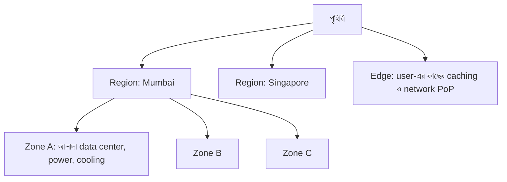
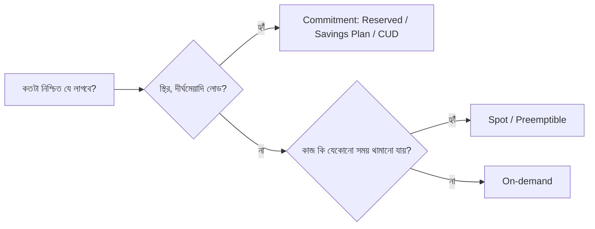

# 01 · Cloud-এর ভিত্তি

> **এই অধ্যায়ে কী শিখবেন**
>
> - Cloud computing আসলে কী, কেন এত জনপ্রিয় — এবং On-premise-এর সাথে পার্থক্য
> - IaaS / PaaS / SaaS / FaaS — চার মডেল, চার cloud-এ উদাহরণসহ
> - Region, Zone (AZ), Edge — প্রতিটি cloud-এর নিজস্ব শব্দ ও বাংলাদেশ থেকে কোনটা কাছে
> - Shared responsibility model — কোনটা provider-এর দায়, কোনটা আপনার
> - Pricing model (on-demand, reserved/commitment, spot) ও free tier — খরচ কীভাবে তৈরি হয়
> - চার provider-এর শক্তির জায়গা এবং নিজের প্রজেক্টের জন্য কীভাবে বেছে নেবেন

!!! abstract "এক নজরে — কোন cloud-এ কী নাম"

    | Concept | AWS | GCP | Azure | OCI |
    |---|---|---|---|---|
    | কোম্পানি / চালু | Amazon Web Services (২০০৬) | Google Cloud Platform | Microsoft Azure | Oracle Cloud Infrastructure |
    | Virtual machine (IaaS) | Amazon EC2 | Compute Engine | Azure Virtual Machines | OCI Compute |
    | Managed platform (PaaS) | Elastic Beanstalk, App Runner | App Engine, Cloud Run | Azure App Service | Container Instances, OCI APEX ইত্যাদি (App Service-এর হুবহু সমতুল্য নেই) |
    | Functions (FaaS) | AWS Lambda | Cloud Run functions (পুরোনো নাম Cloud Functions) | Azure Functions | OCI Functions |
    | ভৌগোলিক এলাকা | Region | Region | Region (Geography-র ভেতরে) | Region |
    | Region-এর ভেতরে isolated অংশ | Availability Zone (AZ) | Zone | Availability Zone (১/২/৩) | Availability Domain (AD) ও Fault Domain (FD) |
    | Edge | Edge location / PoP, Local Zone | Edge PoP (Cloud CDN, Cloud Interconnect) | Edge site (Front Door, ExpressRoute) | Edge / FastConnect PoP |
    | Region কোড (Mumbai) | `ap-south-1` | `asia-south1` | `centralindia` (Pune), `westindia` (Mumbai) | `ap-mumbai-1` |
    | Shared responsibility-র নাম | Shared Responsibility Model | Shared responsibility ও "shared fate" | Shared responsibility | Shared responsibility |
    | Spot / সস্তা interruptible VM | Spot Instances | Spot VMs (আগে Preemptible VM) | Spot VMs | Preemptible Instances |
    | Commitment ছাড় | Savings Plans, Reserved Instances | Committed Use Discounts (CUD) | Reservations, Savings Plan for compute | Universal Credits (commitment) |
    | Free tier | Free plan (credit) + Always Free কিছু service | Free Trial credit + Always Free | Free account (credit + ১২ মাস + always free) | Free Trial credit + Always Free |

---

## ১. Cloud computing কী?

কল্পনা করুন `shopbd` নামে একটি ছোট অনলাইন শপ আপনি শুরু করতে চান। পুরোনো দিনে আপনাকে করতে হতো:

1. একটা server কিনতে হতো (লক্ষ লক্ষ টাকা আগাম)।
2. সেটা রাখার জন্য ঠান্ডা ঘর, নিরবচ্ছিন্ন বিদ্যুৎ (UPS, generator), dedicated internet লাগত।
3. Hardware নষ্ট হলে নিজেই ঠিক করতে হতো।
4. ঈদের আগে বিক্রি দশগুণ হলে? আরো server কিনে বসানোর সময় থাকত না।

**Cloud computing** মানে এই সব computing resource — server, storage, database, network — আপনি internet-এর মাধ্যমে অন্য কোম্পানি
(AWS, Google, Microsoft, Oracle) থেকে **ভাড়া** নেন এবং **যতটুকু ব্যবহার করেন ততটুকুর** বিল দেন।

!!! example "দৈনন্দিন উপমা"
    বিদ্যুৎ। আপনি নিজের বাড়িতে power plant বসান না; বিদ্যুৎ কোম্পানির লাইন থেকে নেন, মিটার দেখে বিল দেন।
    Cloud-ও তাই — "computing power"-এর মিটার। সুইচ অন করলেই পাবেন, বন্ধ করলে বিল থামবে।

### NIST-এর পাঁচটি বৈশিষ্ট্য

কোনো সেবাকে "cloud" বলতে গেলে সাধারণত এই পাঁচটি থাকতে হয়:

| বৈশিষ্ট্য | মানে | `shopbd` উদাহরণ |
|---|---|---|
| On-demand self-service | কারো সাথে কথা না বলে নিজেই resource নেওয়া | Console/CLI থেকে ২ মিনিটে VM চালু |
| Broad network access | Internet দিয়ে যেকোনো জায়গা থেকে | ঢাকা থেকে Mumbai region-এর server ম্যানেজ |
| Resource pooling | বিশাল pool থেকে অনেক গ্রাহক ভাগ করে নেয় | আপনার VM আর অন্য কোম্পানির VM একই data center-এ |
| Rapid elasticity | চাহিদা অনুযায়ী দ্রুত বাড়ানো-কমানো | ঈদ সেলে server ৩টি থেকে ১২টি, সেল শেষে আবার ৩টি |
| Measured service | ব্যবহার মাপা হয়, সেই অনুযায়ী বিল | ঘণ্টা/সেকেন্ড/GB/request অনুযায়ী খরচ |

### CapEx বনাম OpEx

- **CapEx (Capital Expenditure):** আগাম বড় বিনিয়োগ — server কেনা। না লাগলেও টাকা আটকে থাকে।
- **OpEx (Operational Expenditure):** চলমান খরচ — মাসিক বিল। ব্যবহার কমলে খরচও কমে।

Cloud মূলত CapEx-কে OpEx-এ বদলে দেয়। তবে সতর্ক থাকুন: OpEx মানে "খরচ নিয়ন্ত্রণে" নয় — ভুলে চালু থাকা resource
প্রতি মাসেই টাকা খাবে। খরচের পুরো গল্প [18 · Cost Management](18-cost-management.md) অধ্যায়ে।

### Scalability, Elasticity, High availability — তিনটি আলাদা জিনিস

| শব্দ | মানে | উদাহরণ |
|---|---|---|
| **Scalability** | বেশি লোড সামলানোর ক্ষমতা (বড় machine = vertical, বেশি machine = horizontal) | VM ছোট থেকে বড় করা, বা ২টির জায়গায় ১০টি VM |
| **Elasticity** | লোড অনুযায়ী *স্বয়ংক্রিয়ভাবে* বাড়া ও কমা | Autoscaling: রাতে ২টি, সন্ধ্যায় ৮টি |
| **High availability (HA)** | একটি অংশ ভাঙলেও সেবা চালু থাকা | ২টি আলাদা AZ-তে app চালানো |
| **Fault tolerance** | ব্যর্থতা হলেও ব্যবহারকারী টেরই পান না | Database standby + স্বয়ংক্রিয় failover |

### Deployment model

| মডেল | মানে | কখন |
|---|---|---|
| **Public cloud** | AWS/GCP/Azure/OCI-র মতো shared infrastructure | বেশিরভাগ নতুন কাজ |
| **Private cloud** | শুধু একটি প্রতিষ্ঠানের জন্য (নিজের data center-এ বা hosted) | কড়া regulation, legacy |
| **Hybrid cloud** | on-premise + public cloud একসাথে, সংযুক্ত | ব্যাংক/টেলকো যাদের কিছু data বাইরে যাবে না |
| **Multi-cloud** | একাধিক public cloud | vendor lock-in কমানো, প্রতিটির সেরা service নেওয়া |

Hybrid ও multi-cloud-এর আর্কিটেকচার আছে [19 · Architecture, HA/DR ও Multi-cloud](19-architecture-ha-dr.md) অধ্যায়ে।

---

## ২. On-premise বনাম Cloud

| বিষয় | On-premise | Cloud |
|---|---|---|
| শুরুর খরচ | অনেক বেশি (hardware) | প্রায় শূন্য |
| Setup সময় | সপ্তাহ–মাস | মিনিট |
| Scaling | নতুন hardware কিনে | কয়েক ক্লিক / স্বয়ংক্রিয় |
| Maintenance | আপনার দল | provider (hardware-এর অংশ) |
| Disaster recovery | নিজে আরেকটি site বানাতে হয় | multi-AZ / multi-region সহজ |
| Control | পূর্ণ | সীমিত (hypervisor-এর নিচে যাওয়া যায় না) |
| খরচ ভবিষ্যদ্বাণী | সহজ (fixed) | কঠিন, শৃঙ্খলা না থাকলে বিল চমকে দেয় |
| কখন ভালো | স্থির, বড়, পূর্বানুমেয় workload; কড়া data নিয়ম | ওঠানামা করা চাহিদা, দ্রুত শুরু, ছোট দল |

!!! note "Cloud সবসময় সস্তা নয়"
    ২৪/৭ একই লোডে চলা বিশাল, স্থির workload হিসাব করলে নিজের hardware কখনো সস্তা হতে পারে। Cloud-এর জোর হলো
    **গতি ও নমনীয়তা** — এবং হিসাবটা *total cost of ownership (TCO)* ধরে করতে হয়: বিদ্যুৎ, জায়গা, লোকবল, hardware পরিবর্তন সহ।

---

## ৩. IaaS, PaaS, SaaS ও FaaS

মূল প্রশ্ন একটাই: **কোন স্তর পর্যন্ত আপনি manage করবেন, আর কোনটা provider?**

```mermaid
flowchart TB
    subgraph onprem["On-premise: সবকিছু আপনার"]
        A1[Application] --- A2[Data] --- A3[Runtime] --- A4[OS] --- A5[Virtualization] --- A6[Server ও Network] --- A7[Data center]
    end
    subgraph iaas["IaaS: OS থেকে উপরে আপনার"]
        B1[Application] --- B2[Data] --- B3[Runtime] --- B4[OS]
    end
    subgraph paas["PaaS: শুধু app ও data"]
        C1[Application] --- C2[Data]
    end
    subgraph saas["SaaS: কিছুই না, শুধু ব্যবহার"]
        D1[শুধু configuration]
    end
```



!!! example "পিৎজার উপমা"
    - **On-premise** = বাড়িতে ময়দা মেখে, চুলা বসিয়ে পিৎজা বানানো।
    - **IaaS** = কাঁচামাল ও চুলা ভাড়া — রান্না আপনার।
    - **PaaS** = তৈরি base কিনে নিজের পছন্দের topping দেওয়া।
    - **SaaS** = রেস্টুরেন্টে গিয়ে খাওয়া।
    - **FaaS** = অর্ডার এলে তবেই একটা পিৎজা বানানো হয়, বানানোর সময়টুকুর দাম — না এলে শূন্য।

### IaaS — Infrastructure as a Service

Virtual machine, disk, network আপনি ভাড়া নেন; OS patch, runtime, app সব আপনার দায়িত্ব। সর্বোচ্চ নমনীয়তা, সর্বোচ্চ কাজ।

### PaaS — Platform as a Service

Code (বা container) দিন; OS, runtime, scaling, patch provider সামলায়। Managed database (RDS, Cloud SQL, Azure SQL, OCI MySQL)-ও
সাধারণত PaaS হিসেবে ধরা হয়।

### FaaS / Serverless

ছোট function লিখুন; event এলে চলে, না এলে চলে না। **Serverless** শব্দটি একটু বড় — function ছাড়াও serverless container
(Cloud Run, Azure Container Apps) ও managed database (DynamoDB, Firestore) এর আওতায় পড়ে। বিস্তারিত [09 · Serverless](09-serverless.md)-এ।

### SaaS — Software as a Service

সম্পূর্ণ software, আপনি শুধু ব্যবহার করেন: Gmail, Microsoft 365, Google Workspace, Salesforce, Oracle NetSuite। Cloud provider-রাও
কিছু SaaS দেয় (যেমন Amazon Connect contact center)।

### চার cloud-এ তুলনা

=== "AWS"

    | মডেল | Service |
    |---|---|
    | IaaS | **Amazon EC2**, EBS (disk), VPC |
    | PaaS | **Elastic Beanstalk**, **AWS App Runner**, RDS (managed DB) |
    | FaaS | **AWS Lambda** |
    | Serverless container | **AWS Fargate** (ECS/EKS-এর জন্য) |
    | SaaS | Amazon Connect, Amazon QuickSight (BI) |

=== "GCP"

    | মডেল | Service |
    |---|---|
    | IaaS | **Compute Engine**, Persistent Disk / Hyperdisk, VPC |
    | PaaS | **App Engine**, **Cloud Run** (container), Cloud SQL |
    | FaaS | **Cloud Run functions** (আগের নাম Cloud Functions) |
    | Serverless container | **Cloud Run** |
    | SaaS | Google Workspace (Gmail, Docs), Looker |

=== "Azure"

    | মডেল | Service |
    |---|---|
    | IaaS | **Azure Virtual Machines**, Managed Disks, Virtual Network |
    | PaaS | **Azure App Service**, Azure SQL Database |
    | FaaS | **Azure Functions** |
    | Serverless container | **Azure Container Apps**, Container Instances |
    | SaaS | Microsoft 365, Dynamics 365, Power BI |

=== "OCI"

    | মডেল | Service |
    |---|---|
    | IaaS | **OCI Compute**, Block Volume, VCN |
    | PaaS | OCI APEX, Autonomous Database, MySQL HeatWave (managed) |
    | FaaS | **OCI Functions** (open-source Fn Project-ভিত্তিক) |
    | Serverless container | **OCI Container Instances** |
    | SaaS | Oracle Fusion Cloud Applications, NetSuite |

!!! tip "মনে রাখার সূত্র"
    IaaS থেকে SaaS-এর দিকে গেলে **control কমে, দায়িত্বও কমে**। `shopbd`-এর মতো ছোট দলের জন্য সাধারণ নিয়ম:
    যে কাজ provider আপনার চেয়ে ভালো করে, সেটা provider-কে দিন (managed database, managed Kubernetes, serverless)।

---

## ৪. Region, Zone ও Edge — Global infrastructure

Cloud provider-দের data center পৃথিবীজুড়ে ছড়ানো। একটি সঠিক জায়গা বাছাই latency, নির্ভরযোগ্যতা, আইন ও খরচ — সবকিছুকে প্রভাবিত করে।



- **Region** — ভৌগোলিক এলাকা, যেখানে একাধিক data center আছে। Region একটি অন্যটি থেকে সম্পূর্ণ স্বাধীন।
- **Zone** — Region-এর ভেতরে আলাদা power, cooling, network-যুক্ত অংশ। একটি zone-এ বিপর্যয় হলে অন্যটি চলতে থাকে।
- **Edge** — ছোট সাইট যা user-এর কাছে content cache করে বা network-এর প্রবেশপথ হয়। Region-এর চেয়ে অনেক বেশি।

!!! example "উপমা"
    Region = একটি জেলা শহর। Zone = সেই শহরের আলাদা আলাদা থানা-এলাকা, প্রতিটির নিজস্ব বিদ্যুৎ-লাইন।
    একটি এলাকায় লোডশেডিং হলে অন্য এলাকায় দোকান খোলা থাকে। Edge = প্রতিটি পাড়ার কোণের ছোট দোকান যেখানে জনপ্রিয় জিনিস আগে থেকেই রাখা।

### প্রতিটি cloud-এর শব্দ ও কাঠামো

=== "AWS"

    - **Region** (`ap-south-1` Mumbai, `ap-south-2` Hyderabad, `ap-southeast-1` Singapore) — প্রতিটি region-এ সাধারণত ৩ বা তার বেশি **Availability Zone (AZ)**।
    - AZ-র নাম `ap-south-1a`, `ap-south-1b`… — কিন্তু এই নাম **আপনার account-এর জন্য** physical AZ-তে map হয়। একই `1a` আরেক account-এ আলাদা physical AZ হতে পারে। Account জুড়ে মিলাতে **AZ ID** (`aps1-az1`) ব্যবহার করুন।
    - **Edge:** CloudFront-এর edge location ও Regional edge cache; **Local Zones** (ছোট শহরের কাছে সীমিত service) এবং **Wavelength** (টেলকোর 5G network-এ)।
    - নতুন কিছু region **opt-in** — ডিফল্টে বন্ধ থাকে, account-এ চালু করতে হয়।

    ```bash
    aws ec2 describe-regions --query "Regions[].RegionName" --output text
    aws ec2 describe-availability-zones --region ap-south-1 \
      --query "AvailabilityZones[].[ZoneName,ZoneId]" --output table
    ```

=== "GCP"

    - **Region** (`asia-south1` Mumbai, `asia-south2` Delhi, `asia-southeast1` Singapore) — প্রতিটি region-এ সাধারণত ৩টি **Zone** (`asia-south1-a`, `-b`, `-c`)।
    - **Multi-region** বলে কিছু service আছে (যেমন Cloud Storage `ASIA`, BigQuery `US`) — সেখানে data একাধিক region জুড়ে থাকে।
    - GCP-র একটি বিশেষত্ব: **VPC network global** — একটি VPC সব region জুড়ে (বিস্তারিত [05 · Networking](05-networking.md))।
    - **Edge:** Google-এর নিজস্ব global backbone ও edge PoP; Cloud CDN ও Cloud Interconnect এগুলো ব্যবহার করে।

    ```bash
    gcloud compute regions list
    gcloud compute zones list --filter="region:asia-south1"
    ```

=== "Azure"

    - **Region** (`centralindia` Pune, `southindia` Chennai, `westindia` Mumbai, `southeastasia` Singapore)। কাছাকাছি region-গুলো মিলিয়ে একটি **Geography** (যেমন India) — data residency-র সীমানা।
    - **Availability Zone** (১, ২, ৩) — সব region-এ নেই; যেসব region-এ আছে সেখানে তিনটি। Zone-নম্বর আপনার subscription-এর জন্য logical, physical zone-এ map হয় (AWS-এর মতোই)।
    - **Region pair** — অনেক region-এর একটি নির্দিষ্ট জোড়া থাকে (DR ও platform update-এর জন্য)।
    - **Edge:** Azure Front Door ও CDN-এর edge site, ExpressRoute-এর peering location।

    ```bash
    az account list-locations --query "[].{name:name, display:displayName}" --output table
    ```

=== "OCI"

    - **Region** (`ap-mumbai-1` Mumbai, `ap-hyderabad-1` Hyderabad, `ap-singapore-1` Singapore)।
    - Region-এর ভেতরে **Availability Domain (AD)** — কিছু region-এ ৩টি AD, কিন্তু **অনেক region-এ মাত্র একটি AD**। এক-AD region-এ resilience পেতে **Fault Domain (FD)** ব্যবহার করুন: প্রতিটি AD-তে ৩টি FD, যেখানে আলাদা hardware/power গ্রুপ।
    - OCI-র নিজস্ব শব্দ মনে রাখুন: **AD ≠ AZ**। Multi-AZ-এর OCI সমতুল্য হলো "একাধিক AD, না থাকলে একাধিক FD"।
    - **Tenancy-র home region** আলাদা বিষয় — IAM resource সেখানে তৈরি হয় ([03 · IAM](03-identity-and-access.md)-এ দেখবেন)।

    ```bash
    oci iam region list
    oci iam availability-domain list --compartment-id ocid1.tenancy.oc1..example
    ```

### বাংলাদেশ থেকে কোন region?

২০২৬ সালের শেষ পর্যন্ত বাংলাদেশে এই চার provider-এর কারোরই নিজস্ব region নেই বলে ধরে নেওয়া হয় (বর্তমান তালিকা যাচাই করুন)। নিকটতম বিকল্প:

| Region | সুবিধা | অসুবিধা |
|---|---|---|
| Mumbai / Hyderabad / Delhi (ভারত) | সাধারণত কাছে, প্রায় সব service থাকে | সীমান্ত ও সাবমেরিন ক্যাবল রুটের উপর latency নির্ভর করে |
| Singapore | সবচেয়ে বেশি service, প্রায় সব নতুন feature আগে আসে | সাধারণত ভারতীয় region-এর চেয়ে একটু দূরে |

**Region বাছাইয়ের চার প্রশ্ন:**

1. **Latency** — আমার user কোথায়? (Dhaka থেকে ping করে দেখুন)
2. **Compliance / data residency** — আইন বা ক্লায়েন্ট কি দেশের বাইরে data রাখতে দেয়? (ব্যাংকিং ও সরকারি কাজে প্রায়ই সীমাবদ্ধ — নিয়ন্ত্রকের নির্দেশনা দেখে নিন)
3. **Service availability** — দরকারি service ও machine type এই region-এ আছে তো?
4. **Price** — region ভেদে দাম আলাদা হয়; official calculator-এ মিলিয়ে নিন।

!!! tip "Dhaka-র user থাকলে কী করবেন"
    Static content (ছবি, CSS, JS) CDN দিয়ে দিন — edge cache user-এর কাছে থাকে। Dynamic API Mumbai/Singapore-এ রাখুন।
    CDN-এর বিস্তারিত [10 · Load Balancing, DNS ও CDN](10-load-balancing-scaling-dns-cdn.md)-এ।

### Terraform-এ region কোথায় বসে

কোন cloud-এ resource তৈরি হবে সেটি provider block-এই ঠিক হয়। (Terraform পরিচিতি [14 · Infrastructure as Code](14-infrastructure-as-code.md) অধ্যায়ে; এখানে শুধু কাঠামোটুকু দেখুন।)

=== "AWS"

    ```hcl
    terraform {
      required_providers {
        aws = { source = "hashicorp/aws" }
      }
    }

    provider "aws" {
      region = "ap-south-1"
    }
    ```

=== "GCP"

    ```hcl
    terraform {
      required_providers {
        google = { source = "hashicorp/google" }
      }
    }

    provider "google" {
      project = "my-project-id"
      region  = "asia-south1"
    }
    ```

=== "Azure"

    ```hcl
    terraform {
      required_providers {
        azurerm = { source = "hashicorp/azurerm" }
      }
    }

    provider "azurerm" {
      features {}
      subscription_id = "00000000-0000-0000-0000-000000000000"
    }

    # Azure-এ region আলাদা resource-এর location attribute-এ দেওয়া হয়
    # যেমন: location = "centralindia"
    ```

=== "OCI"

    ```hcl
    terraform {
      required_providers {
        oci = { source = "oracle/oci" }
      }
    }

    provider "oci" {
      region = "ap-mumbai-1"
      # authentication আসে ~/.oci/config থেকে অথবা environment variable থেকে
    }
    ```

---

## ৫. Shared responsibility model

Cloud-এ নিরাপত্তা **দুই পক্ষের যৌথ দায়িত্ব**। সবচেয়ে বড় ভুল হলো ভাবা "AWS/GCP আছে, তাই সব নিরাপদ"।

- **Provider-এর দায় — "cloud-এর নিরাপত্তা" (security *of* the cloud):** data center-এর গেট, hardware, hypervisor, global network।
- **আপনার দায় — "cloud-এর ভেতরের নিরাপত্তা" (security *in* the cloud):** আপনার data, কে কী access পাবে (IAM), firewall rule, OS patch (IaaS হলে), encryption চালু করা, কনফিগারেশন।

!!! example "উপমা"
    আপনি বহুতল ভবনে ফ্ল্যাট ভাড়া নিয়েছেন। ভবনের মূল ফটক, সিঁড়ি, lift, দারোয়ান — মালিকের দায়। কিন্তু আপনার ফ্ল্যাটের দরজায় তালা
    দেওয়া, চাবি কাউকে না দেওয়া, ভেতরের জিনিসপত্র সামলানো — আপনার। দরজা খোলা রেখে চুরি হলে ভবন-মালিককে দোষ দিতে পারবেন না।

### মডেল ভেদে দায়িত্ব কার

| স্তর | On-premise | IaaS | PaaS | FaaS / Serverless | SaaS |
|---|---|---|---|---|---|
| Data ও তার শ্রেণিবিন্যাস | আপনি | আপনি | আপনি | আপনি | আপনি |
| Identity ও access (IAM) | আপনি | আপনি | আপনি | আপনি | আপনি |
| Application code | আপনি | আপনি | আপনি | আপনি | provider |
| Network control (firewall rule) | আপনি | আপনি | ভাগাভাগি | সীমিত | provider |
| OS ও patching | আপনি | **আপনি** | provider | provider | provider |
| Runtime | আপনি | আপনি | provider | provider | provider |
| Hypervisor ও hardware | আপনি | provider | provider | provider | provider |
| Data center physical | আপনি | provider | provider | provider | provider |

লক্ষ্য করুন: **Data** আর **Identity** সব মডেলেই সবসময় আপনার। এই কারণেই এই বইয়ে IAM-কে তৃতীয় অধ্যায়েই রাখা হয়েছে।

### প্রতিটি provider-এর ভাষা

=== "AWS"

    AWS বলে: **Security *of* the Cloud** (AWS-এর) বনাম **Security *in* the Cloud** (গ্রাহকের)।
    উদাহরণ: S3 bucket public করে ফেললে সেটা গ্রাহকের কনফিগারেশন-ভুল, AWS-এর নয়।
    প্রমাণপত্র ও audit রিপোর্ট পাবেন **AWS Artifact** থেকে।

=== "GCP"

    Google নিজেদের মডেলকে "shared responsibility"-র পাশাপাশি **shared fate** বলে — মানে শুধু দায় ভাগ নয়, গ্রাহকের সাফল্যে
    সহায়তাও (secure-by-default blueprint, Security Command Center ইত্যাদি)। মূল দায়ভাগ কিন্তু একই।
    রিপোর্ট পাবেন **Compliance Reports Manager** থেকে।

=== "Azure"

    Microsoft-এর documentation-এ shared responsibility-র একটি সুপরিচিত চার্ট আছে (on-prem, IaaS, PaaS, SaaS)।
    রিপোর্ট পাবেন **Service Trust Portal** থেকে।

=== "OCI"

    Oracle-ও একই ভাগ করে — "security *of* the cloud" ও "security *in* the cloud"। OCI-তে নিজস্ব isolated network virtualization
    ও security zones-এর মতো ধারণা আছে। compliance তথ্য পাবেন **OCI Compliance documents** থেকে।

!!! warning "সবচেয়ে সাধারণ ভুল"
    Public storage bucket, সবার জন্য খোলা SSH port (`0.0.0.0/0`), source code-এ secret key, কাউকে Admin permission দিয়ে রাখা —
    এগুলো **সবই গ্রাহকের দায়**। বড় বড় data leak-এর অধিকাংশই provider-এর hack নয়, গ্রাহকের misconfiguration।

---

## ৬. Pricing model — খরচ কীভাবে তৈরি হয়

!!! note "দাম নিয়ে নোট"
    এই বইয়ে কোনো সুনির্দিষ্ট দাম লেখা হয়নি, কারণ দাম region ও সময় অনুযায়ী বদলায়। প্রতিবার official calculator-এ
    হিসাব করুন:

    - AWS: <https://calculator.aws/>
    - Google Cloud: <https://cloud.google.com/products/calculator>
    - Azure: <https://azure.microsoft.com/pricing/calculator/>
    - OCI: <https://www.oracle.com/cloud/costestimator.html>

### খরচের চারটি মূল উৎস

| উৎস | উদাহরণ | মনে রাখুন |
|---|---|---|
| **Compute** | VM চলার সময়, function invocation | VM বন্ধ করলে compute-বিল থামে, কিন্তু disk-বিল থামে না |
| **Storage** | GB-মাস, request সংখ্যা | কম-ব্যবহৃত data-র জন্য সস্তা class আছে |
| **Network** | বাইরে যাওয়া data (**egress**) | ভেতরে আসা (ingress) সাধারণত বিনামূল্যে; বাইরে যাওয়া ও region/AZ-এর মাঝের data পয়সা লাগে |
| **Managed service** | database, load balancer, NAT gateway | ঘণ্টা ধরে চলার ফি + ব্যবহার, ঘণ্টাভিত্তিক "রাখার" খরচ আছে |

!!! warning "লুকানো খরচের তিন বিপদ"
    ১) **Egress** — অন্য region বা internet-এ data পাঠানো। ২) **NAT gateway / load balancer** — ঘণ্টা ধরে চলে, কেউ ব্যবহার না করলেও।
    ৩) **ভুলে-যাওয়া resource** — চালু VM, অব্যবহৃত disk, পুরোনো snapshot, public IP।

### তিনটি কেনার ধরন



#### ক) On-demand (pay-as-you-go)

যখন দরকার তখন নিন, যতটুকু ব্যবহার ততটুকু বিল। কোনো প্রতিশ্রুতি নেই, দাম সবচেয়ে বেশি। নতুন প্রজেক্ট, অনিশ্চিত লোড, পরীক্ষার জন্য ভালো।

#### খ) Reserved / Commitment (আগাম প্রতিশ্রুতি)

"আমি ১ বা ৩ বছর এই পরিমাণ ব্যবহার করব" — বিনিময়ে বড় ছাড়। বেশিরভাগ production workload-এর জন্য এটিই খরচ কমানোর প্রধান উপায়, **যদি** আপনার baseline লোড স্থির থাকে।

=== "AWS"

    - **Savings Plans** (Compute Savings Plans — instance family/region বদলালেও প্রযোজ্য; EC2 Instance Savings Plans — নির্দিষ্ট family-র জন্য আরো বেশি ছাড়)
    - **Reserved Instances (RI)** — পুরোনো, নির্দিষ্ট instance-ভিত্তিক; নতুন কিনলে সাধারণত Savings Plans সুবিধাজনক।
    - ঘণ্টাপ্রতি "$/hr" প্রতিশ্রুতি — ব্যবহার না করলেও দিতে হবে।

=== "GCP"

    - **Committed Use Discounts (CUD)** — *resource-based* (নির্দিষ্ট vCPU/RAM) ও *spend-based / flexible* (খরচের পরিমাণ)।
    - কিছু পুরোনো machine family-তে **Sustained Use Discount** (SUD) স্বয়ংক্রিয়ভাবে পাওয়া যায় — মাসের বড় অংশ চালালে আপনাআপনি ছাড়। নতুন family-গুলোয় এটি নেই, তাই CUD দেখুন।

=== "Azure"

    - **Azure Reservations** (VM, database ইত্যাদির জন্য ১ বা ৩ বছর)
    - **Azure Savings Plan for compute** — flexible, ঘণ্টাপ্রতি খরচের প্রতিশ্রুতি।
    - **Azure Hybrid Benefit** — আপনার আগের Windows Server / SQL Server লাইসেন্স থাকলে cloud-এ ছাড় (লাইসেন্সের শর্ত যাচাই করুন)।

=== "OCI"

    - **Universal Credits** — Pay As You Go ও Monthly/Annual Flex; আগাম অর্থ commit করে বিভিন্ন service-এ খরচ করা যায়।
    - OCI-র দামের কাঠামো সাধারণত সরল ও সব region-এ একই ধাঁচের — তবু calculator দেখুন।

#### গ) Spot / Preemptible (উদ্বৃত্ত ক্ষমতা)

Provider-এর অব্যবহৃত ক্ষমতা অনেক কম দামে — কিন্তু **provider যেকোনো সময় কেড়ে নিতে পারে**। Batch job, image প্রসেসিং, CI runner, stateless worker-এর জন্য চমৎকার; database বা একমাত্র API server-এর জন্য নয়।

=== "AWS"

    **Spot Instances** — কেড়ে নেওয়ার আগে সাধারণত প্রায় ২ মিনিটের সতর্কসংকেত (interruption notice)।

=== "GCP"

    **Spot VMs** (পুরোনো **Preemptible VM**-এর উত্তরসূরি; Preemptible-এ ২৪ ঘণ্টার সীমা ছিল, Spot-এ সেই সীমা নেই)। সতর্কসংকেত সাধারণত প্রায় ৩০ সেকেন্ড।

=== "Azure"

    **Azure Spot VMs** — eviction policy ঠিক করতে পারেন (deallocate বা delete)। সতর্কসংকেত সাধারণত প্রায় ৩০ সেকেন্ড।

=== "OCI"

    **Preemptible Instances** — provider ক্ষমতা ফেরত চাইলে instance terminate হয়। কোন shape সমর্থিত এবং সতর্কসংকেত কতক্ষণের, তা docs-এ দেখে নিন।

!!! tip "ঠিক ধরন বাছাই"
    **Baseline** লোড → commitment। **ওঠানামা** → on-demand + autoscaling। **থামানো যায় এমন কাজ** → spot। একই প্রজেক্টে তিনটিই মিশিয়ে ব্যবহার স্বাভাবিক।

### Billing-এর ধরন

- **Per-second / per-minute / per-hour:** আধুনিক VM সাধারণত সেকেন্ড বা মিনিট ধরে বিল হয় (ন্যূনতম সময় আছে); ঘণ্টার আগের হিসাব এখন কমই দেখা যায়।
- **Per-request / per-GB-month:** serverless ও storage।
- **Free allocation:** অনেক service-এ মাসিক বিনামূল্যে অংশ (যেমন function-এর কিছু invocation) — free tier-এর অংশ।

---

## ৭. Free tier — নিরাপদে শেখা

প্রতিটি cloud নতুনদের জন্য বিনামূল্যে শেখার সুযোগ দেয়, তবে নিয়ম আলাদা এবং **প্রায়ই বদলায়** — সাইন-আপের আগে official পাতা দেখে নিন।

=== "AWS"

    - নতুন account-এ সাধারণত একটি **Free plan** — শুরুতে কিছু **credit** ও নির্দিষ্ট মেয়াদ; credit শেষ বা মেয়াদ ফুরালে account বন্ধ হয় অথবা Paid plan-এ যেতে হয় (বর্তমান শর্ত দেখুন)।
    - কিছু service-এ **Always Free** সীমা (যেমন Lambda-র মাসিক কিছু request)।
    - Official: <https://aws.amazon.com/free/>

=== "GCP"

    - **Free Trial**: নতুন গ্রাহকের জন্য সীমিত মেয়াদের credit।
    - **Always Free**: কিছু service-এ মাসিক সীমা পর্যন্ত বিনামূল্যে (যেমন ছোট একটি VM, কিছু Cloud Storage, Cloud Run-এর কিছু request) — region ও সীমা শর্তাধীন।
    - Official: <https://cloud.google.com/free>

=== "Azure"

    - **Free account**: প্রথম ৩০ দিনের জন্য credit, তারপর কিছু জনপ্রিয় service **১২ মাস বিনামূল্যে**, আর কিছু service **সবসময় বিনামূল্যে** (সীমাসহ)।
    - ছাত্রদের জন্য আলাদা **Azure for Students** (কার্ড ছাড়াই, যোগ্যতা যাচাইসহ)।
    - Official: <https://azure.microsoft.com/free/>

=== "OCI"

    - **Free Trial**: ৩০ দিন মেয়াদি credit।
    - **Always Free**: সবচেয়ে উদার — Arm-ভিত্তিক Ampere A1 instance, ছোট AMD VM, Autonomous Database, object storage, বাইরে যাওয়া data-র মাসিক সীমা ইত্যাদি। ট্রায়াল শেষেও বিনামূল্যে চলে (সীমার মধ্যে)।
    - Official: <https://www.oracle.com/cloud/free/>

!!! danger "Free tier-এ বিল এড়ানোর নিয়ম"
    1. **প্রথম দিনেই budget alert বসান** (বিস্তারিত [02 · Account ও Hierarchy](02-accounts-and-hierarchy.md) ও [18 · Cost Management](18-cost-management.md))।
    2. যে resource ব্যবহার শেষ, **তখনই মুছুন**। বন্ধ করা (stop) আর মুছে ফেলা (delete) আলাদা — disk ও IP বিল চালিয়ে যায়।
    3. Free tier-এর সীমা ছাড়ালে নীরবে বিল শুরু হয় — "free" শব্দ দেখে নিশ্চিন্ত হবেন না।
    4. সাইন-আপে **আন্তর্জাতিক লেনদেনসমর্থিত card** লাগে; বাংলাদেশের অনেক card-এ আগে থেকে international usage চালু করাতে হয়।
    5. বন্ধ করার আগে region-ভিত্তিক সব resource দেখে নিন — ভুলে অন্য region-এ resource রয়ে যেতে পারে।

---

## ৮. চার provider-এর শক্তির জায়গা

প্রত্যেকের নিজস্ব ইতিহাস ও মনোভাব আছে — সেটাই তাদের শক্তি-দুর্বলতা ঠিক করে।

=== "AWS"

    - **সবচেয়ে পুরোনো ও বিস্তৃত:** সবচেয়ে বেশি service, সবচেয়ে বড় community, সবচেয়ে বেশি tutorial ও চাকরির বাজার।
    - ছোট ছোট building block দেওয়ার দর্শন — flexible, কিন্তু শেখার চড়াই আছে (একই কাজের জন্য অনেক service)।
    - **শক্তি:** service-এর গভীরতা, ecosystem, ইন্টারভিউ-সার্টিফিকেশনের চাহিদা, startup-দের জনপ্রিয়তা।
    - **সতর্কতা:** console ও naming জটিল মনে হতে পারে; data egress খরচ বেশি হতে পারে।

=== "GCP"

    - **Data, analytics, AI ও Kubernetes** — Google-এর নিজস্ব অভ্যন্তরীণ প্রযুক্তি থেকে (BigQuery, GKE, Spanner)।
    - **Global VPC**, ভালো developer-অভিজ্ঞতা, পরিষ্কার project-ভিত্তিক কাঠামো।
    - **শক্তি:** BigQuery, Vertex AI/Gemini, Kubernetes, Cloud Run-এর সরলতা।
    - **সতর্কতা:** enterprise/hybrid অংশে AWS/Azure-র চেয়ে কম; কিছু service-এর নাম/সংস্করণ বদলায় (যেমন Cloud Functions → Cloud Run functions)।

=== "Azure"

    - **Microsoft ecosystem-এর সাথে গভীর যোগ:** Entra ID, Microsoft 365, Windows Server, .NET, SQL Server, Active Directory।
    - Enterprise ও সরকারি বাজারে শক্তিশালী, শক্ত hybrid গল্প (Azure Arc, Azure Stack)।
    - **শক্তি:** যে কোম্পানি আগে থেকেই Microsoft ব্যবহার করে, তাদের জন্য সবচেয়ে সহজ পথ; Azure OpenAI Service।
    - **সতর্কতা:** portal-এ অনেক ধারণা (tenant, subscription, resource group, Entra) প্রথমে গুলিয়ে যায়।

=== "OCI"

    - **Oracle Database-এর জন্য সেরা ঘর:** Autonomous Database, Exadata Cloud Service।
    - সরল ও পূর্বানুমেয় দাম (বিশেষত network egress-এ উদার), উচ্চ-পারফরম্যান্স bare metal, GPU cluster।
    - **শক্তি:** Oracle workload, দাম-সচেতন প্রজেক্ট, উদার Always Free tier।
    - **সতর্কতা:** service-এর ব্যাপ্তি ও community ছোট; অনেক জায়গায় compartment-ভিত্তিক নতুন ধারণা শিখতে হয়।

### পাশাপাশি সারসংক্ষেপ

| মানদণ্ড | AWS | GCP | Azure | OCI |
|---|---|---|---|---|
| Service ব্যাপ্তি | সবচেয়ে বেশি | বড়, data/AI-তে গভীর | বড়, enterprise-এ গভীর | অপেক্ষাকৃত ছোট, কেন্দ্রীভূত |
| শেখার সহজতা | মাঝারি (বিশাল) | তুলনামূলক সহজ | মাঝারি (ধারণা বেশি) | মাঝারি |
| Kubernetes | EKS | **GKE (শক্তিশালী)** | AKS | OKE |
| Data warehouse / AI | Redshift, Bedrock/SageMaker | **BigQuery, Vertex AI** | Synapse/Fabric, Azure OpenAI | Autonomous DW, OCI Generative AI |
| Microsoft ecosystem | চলবে | চলবে | **সবচেয়ে ভালো** | চলবে |
| Oracle DB | RDS for Oracle | সীমিত (Oracle Database@Google Cloud) | Oracle Database@Azure | **সবচেয়ে ভালো** |
| বাজার ও চাকরি | **সবচেয়ে বেশি** | বাড়ছে | বেশি (enterprise) | কম |

---

## ৯. কীভাবে বেছে নেবেন

সবার জন্য একটি "সেরা cloud" নেই। প্রশ্ন করুন:

| আপনার অবস্থা | সাধারণত ভালো পছন্দ | কারণ |
|---|---|---|
| ক্যারিয়ার শুরু, চাকরি খুঁজছেন | **AWS** (সাথে একটি দ্বিতীয় cloud-এর ধারণা) | সবচেয়ে বেশি চাকরি ও learning material |
| কোম্পানি Microsoft 365 / Active Directory-নির্ভর | **Azure** | Entra ID ও আগের লাইসেন্সের সাথে যোগ |
| data analytics, ML, Kubernetes-কেন্দ্রিক | **GCP** | BigQuery, GKE, Vertex AI |
| Oracle Database / Oracle ERP-ভিত্তিক | **OCI** | licensing ও পারফরম্যান্স |
| বাজেট কম, শেখার জন্য সময়-সীমাহীন free | **OCI Always Free**, GCP Always Free | উদার বা দীর্ঘস্থায়ী free |
| ক্লায়েন্ট নির্দিষ্ট করে দিয়েছে | ক্লায়েন্টের cloud | নিজের পছন্দ গৌণ |
| সরকারি/ব্যাংক — data residency কড়া | যে provider-এর compliance ও region মেলে | আইনি যাচাই আগে |

### সিদ্ধান্তের চেকলিস্ট

1. দলের কী দক্ষতা আছে? (শিখতে সময় কম হলে পরিচিতটাই)
2. কোন service **না থাকলে** কাজ হবে না? (যেমন নির্দিষ্ট database, GPU)
3. Region ও latency আমার user-এর জন্য ঠিক আছে?
4. Compliance ও data residency?
5. মোট খরচ — commitment, egress, support plan সহ।
6. Lock-in কতটা মেনে নেব? (Terraform ও container দিয়ে কমানো যায়, শূন্য করা যায় না)

!!! tip "Multi-cloud নিয়ে সতর্কতা"
    ছোট দলের জন্য শুরুতেই multi-cloud সাধারণত বাড়তি জটিলতা — দুই গুণ শেখা, দুই গুণ security কনফিগারেশন, egress খরচ। আগে একটি cloud ভালো করে শিখুন;
    এই বইয়ের তুলনা আপনাকে ধারণাটি অন্য cloud-এ সহজে তুলে নিতে সাহায্য করবে।

---

## ১০. শুরুর কাজ — CLI ইনস্টল ও লগইন

হাতে-কলমে শেখার প্রথম ধাপ: প্রতিটি cloud-এর command-line tool বসানো ও পরিচয় দেওয়া। বিস্তারিত নির্দেশ [platforms](platforms/aws.md)-এর পাতাগুলোতে।

=== "AWS"

    **Tool:** AWS CLI v2। Console path: *IAM Identity Center* বা *IAM → Security credentials*।

    ```bash
    aws --version
    aws configure sso            # workforce SSO হলে (প্রস্তাবিত)
    aws sts get-caller-identity  # "আমি কে?" — প্রথম দিনের সবচেয়ে দরকারি command
    ```

=== "GCP"

    **Tool:** Google Cloud CLI (`gcloud`)।

    ```bash
    gcloud --version
    gcloud init                  # login + default project
    gcloud auth list             # active account কে?
    gcloud config list           # বর্তমান project, region, zone
    ```

=== "Azure"

    **Tool:** Azure CLI (`az`)।

    ```bash
    az --version
    az login
    az account show              # বর্তমান subscription ও tenant
    ```

=== "OCI"

    **Tool:** OCI CLI (`oci`)।

    ```bash
    oci --version
    oci setup config             # ~/.oci/config ও API key তৈরি
    oci iam region list          # কাজ করছে কিনা পরীক্ষা
    ```

---

## মিল ও অমিল

| বিষয় | AWS | GCP | Azure | OCI |
|---|---|---|---|---|
| Region-এর ভেতরের isolation | AZ (অধিকাংশ region-এ ≥ ৩) | Zone (সাধারণত ৩) | AZ ১/২/৩ (সব region-এ নেই) | AD (১ বা ৩) + Fault Domain (AD প্রতি ৩) |
| Zone নামের ধারা | account-ভেদে physical map আলাদা (AZ ID ব্যবহার করুন) | সবার জন্য একই (`-a`, `-b`) | subscription-ভেদে logical | AD নাম tenancy-নির্দিষ্ট prefix-সহ |
| Spot-এর নাম | Spot Instances | Spot VMs | Spot VMs | Preemptible Instances |
| স্বয়ংক্রিয় ছাড় | না | কিছু পুরোনো family-তে SUD | না | না |
| নতুন region | কিছু opt-in | সাধারণত সরাসরি | কিছু region সীমিত অ্যাক্সেসে | সাধারণত সাবস্ক্রাইব করে চালু |
| Free tier-এর ধরন | credit-ভিত্তিক Free plan + Always Free | Trial credit + Always Free | credit + ১২ মাস + Always Free | Trial credit + উদার Always Free |

**যে ভুলগুলো মানুষ সবচেয়ে বেশি করে:**

- **"Zone `a` সব account-এ একই জায়গা"** ধরে নেওয়া — AWS ও Azure-এ তা নয়; account-জুড়ে মেলানোর দরকার হলে AZ ID / physical zone দেখুন।
- **Azure-এর সব region-এ AZ আছে** ভাবা — নেই; তাই `centralindia` ও `westindia`-র zone-সমর্থন আলাদা করে যাচাই করুন।
- **OCI-তে "multi-AZ" খোঁজা** — OCI-তে AD/FD। Mumbai-র মতো এক-AD region-এ resilience-এর জন্য Fault Domain দিন।
- **ভাবা যে region বেছে নিলেই সব service পাওয়া যায়** — কিছু নতুন service শুধু বড় region-এ থাকে।
- **Free tier = চিরকালীন নিরাপদ** — সীমা পেরোলেই বিল।

---

## Real-world: shopbd

`shopbd` একটি ছোট বাংলাদেশি অনলাইন শপ: web frontend (`shopbd.example.com`), REST API (`shopbd-api`), PostgreSQL (`shopbd-db`), product-image storage (`shopbd-images`), অর্ডার ই-মেইল (`ops@example.com` থেকে) এবং রাতের sales report।

**ধাপ ১ — কোন মডেল?**

| উপাদান | মডেল | কেন |
|---|---|---|
| Frontend (static) | Object storage + CDN (PaaS-ধাঁচের) | সার্ভার চালানোর দরকার নেই |
| REST API | PaaS বা serverless container (Cloud Run / App Runner / Container Apps / Container Instances) | ছোট দল, OS patch নিজে করতে চায় না |
| PostgreSQL | Managed database (PaaS) | backup, patch, failover provider-এর |
| Product image | Object storage | ছবি জমা ও পরিবেশন |
| Order email | Managed email service বা SaaS (SES / Workspace / ...) | নিজের mail server বানানো ঝুঁকিপূর্ণ |
| Nightly report | FaaS বা scheduled job | রাতে ১০ মিনিট চলে, বাকি সময় খরচ শূন্য |

**ধাপ ২ — কোন region?** Customer বাংলাদেশে, কাছের option Mumbai। তাই চার cloud-এই Mumbai: `ap-south-1`, `asia-south1`, `westindia` (বা `centralindia`), `ap-mumbai-1`। ছবি ও static file CDN দিয়ে Dhaka-র কাছের edge থেকে।

**ধাপ ৩ — কেনার ধরন:**

- Database ও ন্যূনতম API instance (সবসময় চলে) → ৬ মাস মাপার পর commitment।
- ঈদ সেলের বাড়তি লোড → on-demand autoscaling।
- ছবি থাম্বনেইল তৈরি / রাতের report → spot বা serverless।

**ধাপ ৪ — চারটি cloud-এ শুরুর রূপ:**

| প্রয়োজন | AWS | GCP | Azure | OCI |
|---|---|---|---|---|
| API | App Runner / ECS Fargate | Cloud Run | Container Apps | Container Instances |
| Database | RDS PostgreSQL | Cloud SQL for PostgreSQL | Azure Database for PostgreSQL Flexible Server | OCI Database with PostgreSQL |
| Images | S3 `shopbd-images` | Cloud Storage `shopbd-images` | Blob Storage container `shopbd-images` | Object Storage bucket `shopbd-images` |
| Nightly report | Lambda + EventBridge Scheduler | Cloud Run job + Cloud Scheduler | Functions timer trigger | OCI Functions + schedule |

!!! note "পরের অধ্যায়গুলোতে"
    এই তালিকার প্রতিটি সারি একটি পুরো অধ্যায়: compute (04), network (05), storage (06), database (07), serverless (09)।

---

## Best practices

1. **শুরুতেই region ঠিক করুন** এবং নথিভুক্ত করুন — পরে region বদলানো মানে data সরানো।
2. **Production-এ কমপক্ষে দুটি zone/AD/FD ব্যবহার করুন**; একটি zone-এ সবকিছু রাখবেন না।
3. **Managed service-কে অগ্রাধিকার দিন** — patch, backup, failover-এর কাজ provider-এর হাতে।
4. **সাইন-আপের প্রথম দিনেই budget alert** বসান।
5. **Tag/label লাগান** প্রতিটি resource-এ (`env`, `app`, `owner`) — খরচ কার তা বুঝতে ([02 · Account ও Hierarchy](02-accounts-and-hierarchy.md))।
6. **Shared responsibility ছকটি নিজের প্রজেক্টে মেলান** — প্রতিটি উপাদানে নিজেকে জিজ্ঞেস করুন "এখানে আমার দায় কী?"
7. **Official calculator** দিয়ে অনুমান করুন; বিল আসার পর অনুমানের সাথে মিলিয়ে দেখুন।
8. **Learning account আলাদা রাখুন**, production-এর সাথে না মিশিয়ে।
9. **Infrastructure কোডে লিখুন** (Terraform) — কনসোলের ক্লিক ভুলে যাওয়া সহজ, কোড নয়।
10. দাম ও free tier-এর শর্ত **প্রতি কয়েক মাসে** official পাতায় দেখে নিন।

---

## Common mistakes

| ভুল | সমস্যা | সমাধান |
|---|---|---|
| "Cloud-এ গেলে নিরাপত্তা provider-এর" | misconfiguration থেকে data leak | Shared responsibility ছক পড়ে নিজের অংশ নিশ্চিত করুন |
| VM বন্ধ করে ভাবা বিল থামল | disk, static IP, snapshot-এর বিল চলতে থাকে | প্রয়োজন শেষে **delete** করুন, শুধু stop নয় |
| সব কিছু একটি zone-এ | zone-এর সমস্যায় পুরো app বন্ধ | কমপক্ষে দুটি zone/AD/FD |
| দূরের region বেছে নেওয়া | বেশি latency, বেশি egress | user-এর কাছের region; static হলে CDN |
| বিশাল commitment আগেই কিনে ফেলা | ব্যবহার কমলেও টাকা যায় | ৩–৬ মাস on-demand-এ মেপে তারপর commit |
| Spot VM-এ database চালানো | হঠাৎ বন্ধ, data ক্ষতি | Spot শুধু stateless/batch কাজে |
| Free tier-এর সীমা না জানা | নীরবে বিল | সীমা পড়ুন, budget alert বসান |
| Root/Admin দিয়ে সব কাজ | একটি ভুলেই সর্বনাশ | [03 · IAM](03-identity-and-access.md) অনুযায়ী least privilege |
| শুধু একটি cloud-এর terminology ধরে বসে থাকা | অন্য cloud-এ গিয়ে বিভ্রান্তি | মূল ধারণা শিখুন, নাম পরে মিলিয়ে নিন (এই বইয়ের পদ্ধতি) |

---

## ইন্টারভিউ / সার্টিফিকেশন টিপস

??? question "Cloud computing-এর পাঁচটি বৈশিষ্ট্য কী কী?"
    On-demand self-service, broad network access, resource pooling, rapid elasticity, measured service (NIST সংজ্ঞা)। ইন্টারভিউয়ে প্রতিটির একটি করে উদাহরণ দিন।

??? question "IaaS, PaaS, SaaS-এর পার্থক্য বোঝান।"
    পার্থক্য হলো কতটুকু আপনি manage করেন। IaaS-এ OS থেকে উপরে আপনার (EC2/Compute Engine/Azure VM/OCI Compute); PaaS-এ শুধু code ও data (App Service/Cloud Run/Beanstalk); SaaS-এ শুধু ব্যবহার (Gmail, Microsoft 365)। Serverless/FaaS-এ code-ও function আকারে, ব্যবহারের সময়টুকুর বিল।

??? question "Region, Availability Zone ও Edge location-এর পার্থক্য কী?"
    Region = ভৌগোলিক এলাকা; Zone/AZ = region-এর ভেতরের বিচ্ছিন্ন data center গ্রুপ (HA-র জন্য); Edge = user-এর কাছে content cache/network প্রবেশপথ। OCI-তে AZ-এর জায়গায় Availability Domain ও Fault Domain।

??? question "Shared responsibility model কী? একটি উদাহরণ দিন।"
    Provider "cloud-এর নিরাপত্তা" (physical, hypervisor, network), গ্রাহক "cloud-এর ভেতরের নিরাপত্তা" (data, IAM, কনফিগারেশন, IaaS হলে OS)। উদাহরণ: S3/Cloud Storage bucket public করা গ্রাহকের দায়।

??? question "Spot/Preemptible instance কখন ব্যবহার করবেন, কখন নয়?"
    Fault-tolerant, stateless, থামানো-যায় এমন কাজে (batch, CI, render)। Database, একক production server বা কড়া SLA-র কাজে নয়, কারণ provider যেকোনো সময় ফিরিয়ে নিতে পারে।

??? question "Scalability ও Elasticity-র পার্থক্য কী?"
    Scalability = বেশি লোড সামলানোর ক্ষমতা (vertical/horizontal)। Elasticity = লোড অনুযায়ী স্বয়ংক্রিয়ভাবে বাড়া-কমা, যাতে শুধু দরকারের সময় খরচ হয়।

??? question "কোনো workload cloud-এ আনা কি সবসময় সস্তা?"
    না। স্থির ও বড় workload-এ on-premise সস্তা হতে পারে। Cloud-এর জোর গতি, নমনীয়তা ও বিশ্বব্যাপী পৌঁছানো। TCO হিসাব করুন এবং commitment/spot ব্যবহারে খরচ কমান।

??? question "Egress cost কী এবং কীভাবে কমাবেন?"
    Cloud থেকে বাইরে (internet বা অন্য region) যাওয়া data-র খরচ। কমানোর উপায়: CDN ব্যবহার, একই region-এ সংশ্লিষ্ট service রাখা, data compress করা, প্রয়োজন না হলে cross-region replication না করা।

??? question "সার্টিফিকেশন কোথা থেকে শুরু করবেন?"
    শুরুর স্তর: AWS Certified Cloud Practitioner, Google Cloud Digital Leader / Associate Cloud Engineer, Microsoft AZ-900 (Azure Fundamentals), Oracle Cloud Infrastructure Foundations Associate। সবগুলোতেই এই অধ্যায়ের ধারণা (shared responsibility, pricing, global infrastructure) আসে।

---

## সারসংক্ষেপ

- Cloud = ভাড়ায় computing, ব্যবহার অনুযায়ী বিল; CapEx → OpEx।
- **IaaS → PaaS → FaaS → SaaS**: যত উপরে, তত কম control ও কম দায়িত্ব। চার cloud-এই প্রতিটি স্তরের service আছে।
- **Region → Zone → Edge**: AWS ও Azure-এ AZ, GCP-তে Zone, OCI-তে AD + Fault Domain। বাংলাদেশ থেকে সাধারণত Mumbai বা Singapore।
- **Shared responsibility:** Data ও Identity সবসময় আপনার; নিচের স্তর যত provider-এর হাতে যায়, তত কম কাজ।
- **খরচ:** on-demand (নমনীয়, দামি), commitment (স্থির লোডে ছাড়), spot (থামানো যায় এমন কাজে সস্তা); egress ও ভুলে-যাওয়া resource লুকানো ঝুঁকি।
- **Free tier** শেখার জন্য দারুণ, কিন্তু শর্ত বদলায়; budget alert প্রথম দিনেই।
- সবার জন্য একটি সেরা cloud নেই: দলের দক্ষতা, workload ও compliance দেখে বেছে নিন।

**পরের অধ্যায়:** [02 · Account, Organization ও Resource hierarchy](02-accounts-and-hierarchy.md) — cloud-এ আপনার "ঘর" কীভাবে সাজাবেন।
