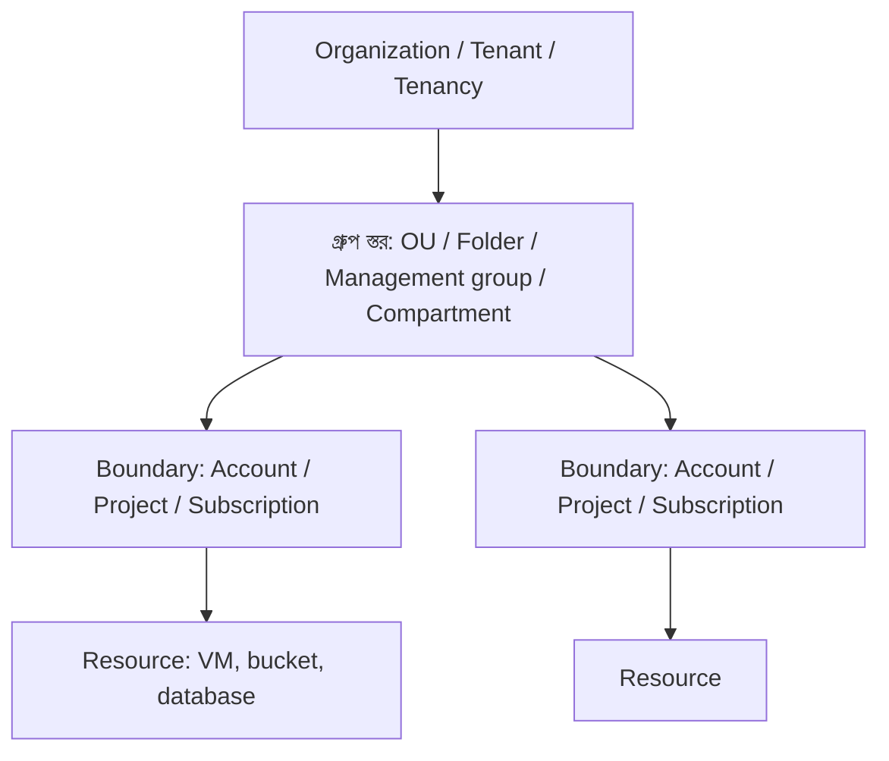
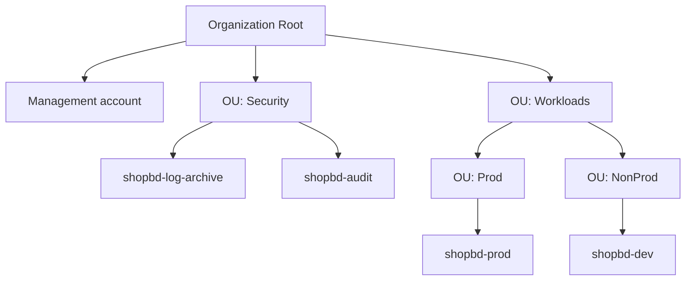
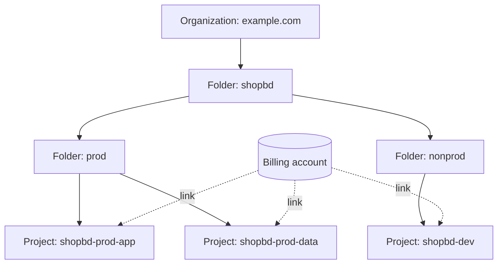
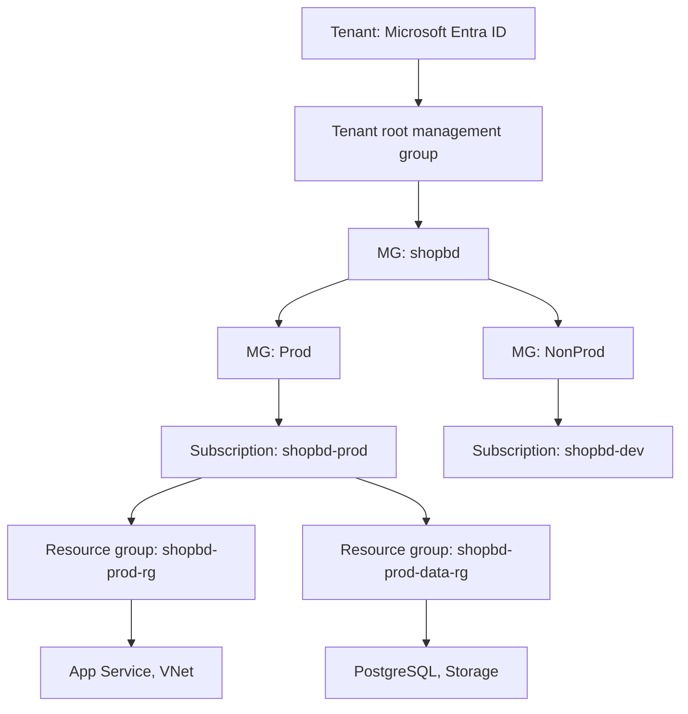
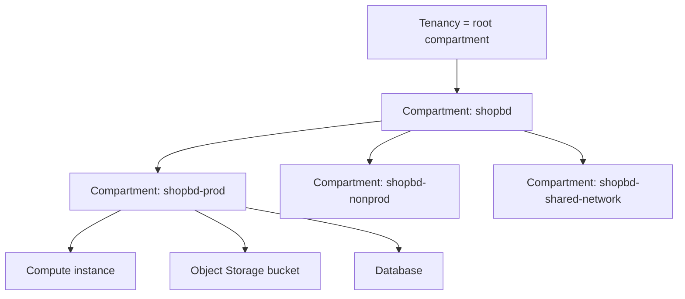
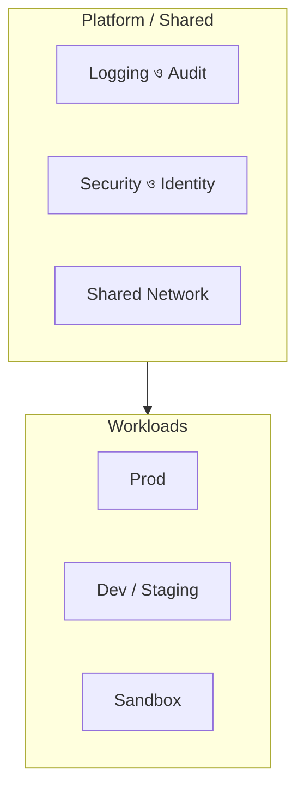
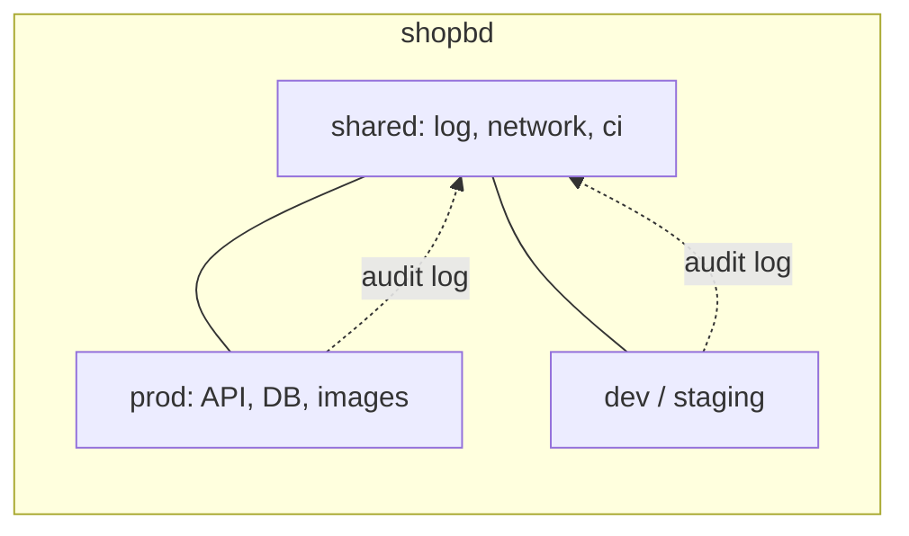

# 02 · Account, Organization ও Resource hierarchy

> **এই অধ্যায়ে কী শিখবেন**
>
> - Cloud-এ resource কোথায় "বাস করে" — চার cloud-এর hierarchy (Account/Project/Subscription/Compartment)
> - Organization, OU, Folder, Management group — কেন দরকার ও কীভাবে সাজাবেন
> - Billing account কীভাবে resource-এর সাথে যুক্ত হয়
> - Tag / Label দিয়ে খরচ ও মালিকানা ট্র্যাক করা
> - Landing zone কী এবং `shopbd`-র জন্য একটি ন্যূনতম কাঠামো
> - প্রথম দিনের নিরাপত্তা: root user/admin সুরক্ষা ও budget alert

!!! abstract "এক নজরে — কোন cloud-এ কী নাম"

    | Concept | AWS | GCP | Azure | OCI |
    |---|---|---|---|---|
    | সর্বোচ্চ কাঠামো | **Organization** (AWS Organizations) | **Organization** (domain-এর সাথে যুক্ত) | **Tenant** (Microsoft Entra ID directory) + Tenant root management group | **Tenancy** (= root compartment) |
    | Grouping layer | **OU** (Organizational Unit) | **Folder** | **Management group** | **Compartment** (নেস্টেড) |
    | বিচ্ছিন্নতার একক (বিল, quota, access) | **Account** | **Project** | **Subscription** | **Compartment** (billing ও quota-র জন্য tenancy-ই মূল একক) |
    | Resource গ্রুপ (lifecycle) | (সরাসরি নেই; CloudFormation stack/tag) | (সরাসরি নেই; label) | **Resource group** (বাধ্যতামূলক) | Compartment / tag |
    | Policy দিয়ে সীমা টানা | **SCP** (Service Control Policy), RCP | **Organization Policy** (constraints) | **Azure Policy** + RBAC | Policy statements + **Quotas** |
    | Billing সংযোগ | Consolidated billing (management account পরিশোধ করে) | **Cloud Billing account** → Project-এ link | Billing account → Billing profile → Subscription | Tenancy = এক billing; Budget দিয়ে compartment-ভিত্তিক নজর |
    | Metadata | **Tag** (key-value) | **Label** (+ আলাদা **Tag** = IAM/policy-র জন্য) | **Tag** | **Free-form tag** ও **Defined tag** |
    | Landing zone | AWS Control Tower, Landing Zone Accelerator | Cloud Foundation / Enterprise foundations blueprint | Azure Landing Zones (CAF) | OCI Landing Zones (CIS-ভিত্তিক) |
    | অনন্য ID | 12-digit account ID | Project ID / Project number | Subscription ID (GUID) | OCID |

---

## ১. কেন hierarchy দরকার?

আপনি যখন প্রথম cloud ব্যবহার করেন, সাধারণত একটি account/project নিয়েই শুরু করেন, আর সবকিছু সেখানেই রাখেন — প্রোডাকশন, টেস্ট, ডেভেলপারের পরীক্ষা। কিছুদিন পর সমস্যা:

- একজন ডেভেলপারের ভুলে **production database** মুছে গেল।
- মাসের শেষে বিল এল — কোন দল কত খরচ করেছে বোঝার উপায় নেই।
- Security দল চায় প্রোডাকশনে কড়া নিয়ম, কিন্তু ডেভেলপাররা পরীক্ষা করতে চায় স্বাধীনভাবে।
- নতুন ক্লায়েন্টের জন্য আলাদা পরিবেশ চাই।

সমাধান: resource-গুলোকে **স্তরে সাজানো** — যাতে প্রতিটি স্তরে আলাদা access, আলাদা policy, আলাদা বিল ও আলাদা blast radius (ভুল হলে ক্ষতির পরিধি) থাকে।

!!! example "উপমা"
    একটি বড় কোম্পানির কাঠামো ভাবুন: **Group of Companies → Business unit → Office → Department**। প্রতিটি অফিসের নিজস্ব চাবি, নিজস্ব বাজেট, নিজস্ব নিয়ম।
    হেড-অফিস উপর থেকে কিছু নিয়ম বেঁধে দেয় ("কোনো অফিস বিদেশে বিনিয়োগ করতে পারবে না"), যা সবাইকে মানতে হয়।
    Cloud hierarchy ঠিক তাই — উপরের স্তরের নিয়ম নিচে বর্তায়।

### তিনটি মূল ধারণা

1. **Isolation boundary (বিচ্ছিন্নতার সীমানা):** Account/Project/Subscription — এটিই সবচেয়ে শক্ত দেয়াল। এক account-এর resource অন্য account থেকে ডিফল্টে অদৃশ্য।
2. **Inheritance (উত্তরাধিকার):** উপরের স্তরে দেওয়া IAM/policy নিচের সব স্তরে প্রযোজ্য।
3. **Billing ও quota:** প্রতিটি boundary আলাদা limit/quota ও খরচের হিসাব পায়।



---

## ২. AWS — Organizations, OU ও Account

### কাঠামো

- **Account** — AWS-এর মূল boundary। প্রতিটির আছে 12-digit ID (`123456789012`), নিজস্ব **root user**, নিজস্ব IAM, নিজস্ব bill ও quota।
- **AWS Organizations** — একাধিক account একত্রে manage করার সেবা। এর **management account** (আগে বলা হতো master account) বাকি **member account**-গুলো তৈরি/আমন্ত্রণ করে।
- **Root (organization root) → OU → Account:** OU-এর ভেতরে OU নেস্ট করা যায় (সর্বোচ্চ ৫ স্তর)।
- **Consolidated billing:** সব member account-এর বিল management account-এ একত্রে আসে; commitment ও volume-ছাড় সবার মধ্যে ভাগ হয়।
- **SCP (Service Control Policy):** OU বা account-এ বসানো নিয়ম যা বলে "এই account-এ সর্বোচ্চ কোন action সম্ভব"। SCP নিজে কিছু **allow করে না** — শুধু সীমা টানে; allow আসে IAM policy থেকে। (নতুন: **RCP** — Resource Control Policy, resource-এর উপর সীমা।)
- **Management account-এ শুধু organization ও billing** রাখুন — workload নয়।



### Console path

*AWS Organizations → AWS accounts* (সেখানে OU তৈরি, account সরানো, policy attach)।

### CLI

=== "AWS"

    ```bash
    # Organization তৈরি (যে account থেকে চালাচ্ছেন সেটি management account হবে)
    aws organizations create-organization --feature-set ALL

    aws organizations describe-organization
    aws organizations list-roots

    # OU তৈরি (parent-id = root ID, যেমন r-ab12)
    aws organizations create-organizational-unit \
      --parent-id r-ab12 \
      --name Workloads

    # নতুন member account তৈরি
    aws organizations create-account \
      --email ops+shopbd-prod@example.com \
      --account-name shopbd-prod

    aws organizations list-accounts --output table

    # Account একটি OU-তে সরানো
    aws organizations move-account \
      --account-id 123456789012 \
      --source-parent-id r-ab12 \
      --destination-parent-id ou-ab12-11111111
    ```

    প্রতিটি account-এর জন্য **আলাদা, unique email** লাগে। `ops+shopbd-prod@example.com`-এর মতো plus-addressing অনেক mail provider-এ কাজ করে; সব মেইল একই inbox-এ আসে।

### SCP-র উদাহরণ — অনুমোদিত region-এর বাইরে কাজ বন্ধ

```json
{
  "Version": "2012-10-17",
  "Statement": [
    {
      "Sid": "DenyOutsideApprovedRegions",
      "Effect": "Deny",
      "NotAction": [
        "iam:*",
        "organizations:*",
        "route53:*",
        "cloudfront:*",
        "support:*"
      ],
      "Resource": "*",
      "Condition": {
        "StringNotEquals": {
          "aws:RequestedRegion": ["ap-south-1", "ap-southeast-1"]
        }
      }
    }
  ]
}
```

!!! note "কেন `NotAction`"
    IAM, Route 53, CloudFront-এর মতো **global service** একটি নির্দিষ্ট region-এ নয়, তাই তাদের বাদ রাখা হয়েছে; নইলে এই SCP সেগুলোও আটকে দিত।
    প্রকৃত বাদ-দেওয়া তালিকা আপনার ব্যবহারের উপর নির্ভর করে — AWS-এর নমুনা policy-র সাথে মিলিয়ে নিন।

### Terraform

=== "AWS"

    ```hcl
    resource "aws_organizations_organization" "this" {
      feature_set = "ALL"

      aws_service_access_principals = [
        "cloudtrail.amazonaws.com",
        "sso.amazonaws.com",
      ]

      enabled_policy_types = ["SERVICE_CONTROL_POLICY"]
    }

    resource "aws_organizations_organizational_unit" "workloads" {
      name      = "Workloads"
      parent_id = aws_organizations_organization.this.roots[0].id
    }

    resource "aws_organizations_account" "prod" {
      name      = "shopbd-prod"
      email     = "ops+shopbd-prod@example.com"
      parent_id = aws_organizations_organizational_unit.workloads.id
    }

    resource "aws_organizations_policy" "region_guard" {
      name    = "region-guard"
      type    = "SERVICE_CONTROL_POLICY"
      content = file("${path.module}/scp-region-guard.json")
    }

    resource "aws_organizations_policy_attachment" "workloads" {
      policy_id = aws_organizations_policy.region_guard.id
      target_id = aws_organizations_organizational_unit.workloads.id
    }
    ```

### Landing zone: AWS Control Tower

**AWS Control Tower** একটি "multi-account setup in a box": আপনার জন্য OU, একটি **log archive** account, একটি **audit** account, ভিত্তি guardrail ও **Account Factory** (নতুন account চাইলে স্ট্যান্ডার্ড আকারে তৈরি) বসিয়ে দেয়। কাস্টমাইজেশনের জন্য আছে **Landing Zone Accelerator on AWS**।

!!! tip "অ্যাকাউন্ট বন্ধ করা"
    AWS account বন্ধ (close) করলে একটি পোস্ট-ক্লোজার সময়সীমা থাকে (প্রায় ৯০ দিন), যে সময় আবার চালু করা সম্ভব। তারপর স্থায়ীভাবে মুছে যায়। বন্ধ করার আগে বিল ও resource পরীক্ষা করুন।

---

## ৩. GCP — Organization, Folder ও Project

### কাঠামো

- **Organization** — সর্বোচ্চ node, একটি **Google Workspace** বা **Cloud Identity** domain-এর সাথে যুক্ত। ডোমেইন যাচাই করলে তবেই organization তৈরি হয়। (ব্যক্তিগত Gmail দিয়ে project বানালে সেটি "No organization"-এর অধীন — কোনো folder, org policy নেই।)
- **Folder** — গ্রুপ করার স্তর (দল, পরিবেশ, প্রোডাক্ট); নেস্ট করা যায়।
- **Project** — মূল boundary। প্রতিটি project-এর তিনটি পরিচয়:
    - **Project name** — মানুষের জন্য, বদলানো যায়।
    - **Project ID** — globally unique, **একবার সেট করলে আর বদলানো যায় না** (যেমন `my-project-id`)।
    - **Project number** — সিস্টেম-নির্ধারিত সংখ্যা।
- **IAM ও Organization Policy** উপর থেকে নিচে inherit হয়।
- **Cloud Billing account** আলাদা resource; project একটি billing account-এ **link** করতে হয় — link না থাকলে বেশিরভাগ paid service কাজ করবে না।



### Console path

*IAM & Admin → Manage resources* (hierarchy দেখা ও তৈরি); *Billing → Account management* (billing account link)।

### CLI

=== "GCP"

    ```bash
    gcloud organizations list

    # Folder তৈরি
    gcloud resource-manager folders create \
      --display-name="shopbd" \
      --organization=123456789012

    # Folder-এর ভেতরে project তৈরি
    gcloud projects create my-project-id \
      --name="shopbd prod" \
      --folder=111111111111

    # Billing account-এ link
    gcloud billing accounts list
    gcloud billing projects link my-project-id \
      --billing-account=000000-000000-000000

    gcloud projects list
    gcloud config set project my-project-id

    # Label বসানো
    gcloud projects update my-project-id \
      --update-labels=env=prod,app=shopbd
    ```

    `gcloud projects create`-এ API অনেক সময় নিজে থেকেই চালু হয় না; কোনো service ব্যবহারের আগে সেই API enable করতে হয়, যেমন `gcloud services enable compute.googleapis.com`।

### Organization Policy

IAM বলে "কে কী করতে পারে"; **Organization Policy** বলে "এই organization-এ কোন কনফিগারেশন *অনুমোদিত*"। উদাহরণ constraint:

- `constraints/gcp.resourceLocations` — কোন region-এ resource রাখা যাবে।
- `constraints/iam.disableServiceAccountKeyCreation` — service account key তৈরি নিষিদ্ধ ([03 · IAM](03-identity-and-access.md))।
- `constraints/compute.vmExternalIpAccess` — কোন VM-এর public IP থাকতে পারবে।

### Terraform

=== "GCP"

    ```hcl
    resource "google_folder" "shopbd" {
      display_name = "shopbd"
      parent       = "organizations/123456789012"
    }

    resource "google_folder" "prod" {
      display_name = "prod"
      parent       = google_folder.shopbd.name
    }

    resource "google_project" "prod_app" {
      name            = "shopbd prod"
      project_id      = "my-project-id"
      folder_id       = google_folder.prod.name
      billing_account = "000000-000000-000000"

      labels = {
        env = "prod"
        app = "shopbd"
      }
    }
    ```

### Landing zone: GCP

Google-এর **enterprise foundations blueprint** (Terraform-ভিত্তিক) এবং **Cloud Foundation Fabric** (FAST) থেকে শুরু করা যায়। সাধারণত folder-ভিত্তিক কাঠামো: `common` (shared, logging, security), `network`, `prod`, `nonprod`, `sandbox`।

!!! warning "Project মুছলে"
    Project delete করলে সেটি ~৩০ দিনের জন্য "pending deletion"-এ থাকে এবং এই সময়ে পুনরুদ্ধার সম্ভব; পরে সব resource স্থায়ীভাবে যায়। **Project ID আবার ব্যবহার করা যায় না।**

---

## ৪. Azure — Tenant, Management group, Subscription ও Resource group

Azure-এর কাঠামো সবচেয়ে বেশি স্তরের — এবং নতুনদের সবচেয়ে বেশি গুলিয়ে দেয়। ধীরে বুঝুন:

| স্তর | কী | কীসের জন্য |
|---|---|---|
| **Tenant** | **Microsoft Entra ID** directory (পুরোনো নাম **Azure Active Directory / Azure AD** — ২০২৩-এ নাম বদলে Entra ID)। | **পরিচয়** — user, group, app। Azure-এর ভাগে এটি "কে" |
| **Tenant root management group** | tenant-এর শীর্ষ management group | সব subscription-এর উপরে |
| **Management group** | subscription-এর group (ছয় স্তর পর্যন্ত নেস্ট) | RBAC ও Azure Policy একসাথে প্রয়োগ |
| **Subscription** | billing ও boundary-র একক | বিল, quota, access-এর মূল একক |
| **Resource group** | resource-এর লজিক্যাল container | একই জীবনচক্রের resource একসাথে manage ও মোছা |
| **Resource** | VM, storage account, DB | কাজের জিনিস |

!!! warning "Tenant ≠ Subscription"
    একটি **tenant**-এ একাধিক subscription থাকতে পারে; প্রতিটি subscription ঠিক একটি tenant-এর সাথে *trust*-এ থাকে। Tenant = পরিচয়ের জগৎ, subscription = খরচ ও resource-এর জগৎ।
    এ-কারণেই Entra role (পরিচয়ের জন্য) আর Azure RBAC role (resource-এর জন্য) আলাদা — [03 · IAM](03-identity-and-access.md) অধ্যায়ে।

### Resource group-এর নিয়ম

- প্রতিটি resource **ঠিক একটি** resource group-এ থাকতে হবে (বাধ্যতামূলক)।
- Resource group-এর নিজস্ব একটি **location** আছে (শুধু তার metadata কোথায় থাকবে), কিন্তু ভেতরের resource অন্য region-এ থাকতে পারে।
- Group মুছলে ভেতরের **সবকিছু** মুছে যায় — তাই একই জীবনচক্রের জিনিস একসাথে রাখুন (যেমন `shopbd-prod-rg`-এ API, DB, network)।
- RBAC ও tag resource group-এ বসালে (RBAC) ভেতরে inherit হয়; tag ডিফল্টে inherit হয় না।



### Billing-এর কাঠামো (Azure)

গ্রাহকের চুক্তির ধরন অনুযায়ী আলাদা:

- **Microsoft Customer Agreement (MCA)** — আধুনিক: **Billing account → Billing profile → Invoice section → Subscription**।
- **Enterprise Agreement (EA)** — বড় প্রতিষ্ঠান: Enrollment → Department → Account → Subscription।
- **Pay-as-you-go / Free account** — সরাসরি ব্যক্তি/ছোট দলের জন্য, একটি subscription।

### Console path

*Management groups* ও *Subscriptions* (Portal-এ সার্চ করুন); *Resource groups*; *Cost Management + Billing*।

### CLI

=== "Azure"

    ```bash
    az login
    az account list --output table
    az account set --subscription "00000000-0000-0000-0000-000000000000"
    az account show

    # Management group তৈরি ও subscription যুক্ত
    az account management-group create \
      --name shopbd-mg \
      --display-name "shopbd"

    az account management-group subscription add \
      --name shopbd-mg \
      --subscription "00000000-0000-0000-0000-000000000000"

    # Resource group তৈরি (tag সহ)
    az group create \
      --name shopbd-prod-rg \
      --location centralindia \
      --tags env=prod app=shopbd owner=ops@example.com

    az group list --output table
    az group delete --name shopbd-prod-rg --yes --no-wait   # সাবধান: ভেতরের সব মুছে যাবে
    ```

### Terraform

=== "Azure"

    ```hcl
    resource "azurerm_management_group" "shopbd" {
      display_name = "shopbd"
    }

    resource "azurerm_management_group_subscription_association" "prod" {
      management_group_id = azurerm_management_group.shopbd.id
      subscription_id     = "/subscriptions/00000000-0000-0000-0000-000000000000"
    }

    resource "azurerm_resource_group" "prod" {
      name     = "shopbd-prod-rg"
      location = "centralindia"

      tags = {
        env   = "prod"
        app   = "shopbd"
        owner = "ops@example.com"
      }
    }
    ```

### Landing zone: Azure Landing Zones (ALZ)

Microsoft-এর **Cloud Adoption Framework (CAF)** একটি রেফারেন্স কাঠামো দেয় — management group-এর এক সুপরিচিত বিন্যাস:
`Platform` (identity, connectivity, management) ও `Landing zones` (`Corp`, `Online`), সাথে `Sandbox` ও `Decommissioned`। Bicep ও Terraform দুই রূপেই accelerator পাওয়া যায়।

---

## ৫. OCI — Tenancy ও Compartment

OCI-র কাঠামো অন্যদের চেয়ে সরল, কিন্তু ভিন্ন ধারণার উপর দাঁড়িয়ে — **Compartment**।

- **Tenancy** — আপনার Oracle Cloud account-এর শীর্ষ স্তর। এর নিজস্ব **tenancy OCID** আছে, এবং tenancy নিজেই **root compartment**।
- **Compartment** — resource-কে লজিক্যাল গ্রুপে ভাগ করা, **নেস্টেড** (সর্বোচ্চ ৬ স্তর)। প্রতিটি resource **ঠিক একটি compartment**-এ থাকে।
- **Compartment region-নিরপেক্ষ:** একটি compartment আপনার tenancy-র সব region-এ দেখা যায়। (resource নিজে কিন্তু নির্দিষ্ট region-এ।)
- **IAM policy compartment-এ বসে** — কে কোন compartment-এ কী করতে পারবে ([03 · IAM](03-identity-and-access.md))। উপরের compartment-এ দেওয়া policy নিচেরগুলোতেও খাটে।
- **OCID** — OCI-র প্রতিটি resource-এর unique ID (`ocid1.compartment.oc1..example`)। প্রায় সব CLI ও Terraform call-এ compartment OCID লাগে।
- **Quota ও service limit** compartment-ভিত্তিক সীমায় নিয়ন্ত্রণ করা যায় (Compartment quotas)।
- **Home region:** tenancy তৈরির সময় বেছে নেওয়া region, যেখানে IAM resource-এর "মূল কপি" থাকে।



### Console path

*Identity & Security → Compartments*।

### CLI

=== "OCI"

    ```bash
    # tenancy OCID প্রায়ই ~/.oci/config-এ থাকে; এখানে placeholder
    TENANCY=ocid1.tenancy.oc1..example

    # Compartment তৈরি
    oci iam compartment create \
      --compartment-id "$TENANCY" \
      --name shopbd \
      --description "All shopbd resources"

    # নেস্টেড compartment (parent = উপরেরটির OCID)
    oci iam compartment create \
      --compartment-id ocid1.compartment.oc1..example \
      --name shopbd-prod \
      --description "shopbd production"

    # তালিকা
    oci iam compartment list \
      --compartment-id "$TENANCY" \
      --compartment-id-in-subtree true \
      --access-level ACCESSIBLE
    ```

### Terraform

=== "OCI"

    ```hcl
    variable "tenancy_ocid" {
      type    = string
      default = "ocid1.tenancy.oc1..example"
    }

    resource "oci_identity_compartment" "shopbd" {
      compartment_id = var.tenancy_ocid
      name           = "shopbd"
      description    = "All shopbd resources"
      enable_delete  = true
    }

    resource "oci_identity_compartment" "prod" {
      compartment_id = oci_identity_compartment.shopbd.id
      name           = "shopbd-prod"
      description    = "shopbd production"
      enable_delete  = true
    }
    ```

    `enable_delete = true` না দিলে `terraform destroy`-এ compartment মুছবে না — Terraform শুধু state থেকে সরাবে। Compartment মোছার আগে ভেতর **সম্পূর্ণ খালি** থাকতে হবে।

### Landing zone: OCI

Oracle-এর **OCI Landing Zones** (GitHub-এ Terraform) — **CIS OCI Foundations Benchmark**-এর সাথে সাজানো: আলাদা compartment `network`, `security`, `app`, `database`, সাথে প্রাথমিক logging, notification ও security services চালু।

---

## ৬. চার hierarchy পাশাপাশি

| প্রশ্ন | AWS | GCP | Azure | OCI |
|---|---|---|---|---|
| সবচেয়ে ছোট isolation একক? | Account | Project | Subscription | Compartment (লজিক্যাল; tenancy হলো আসল billing boundary) |
| Hard isolation (আলাদা IAM, quota)? | ✅ Account | ✅ Project (IAM আলাদা, কিন্তু ভাগ করা যায়) | ✅ Subscription | ❌ Compartment শুধু লজিক্যাল গ্রুপ — IAM policy দিয়ে আলাদা হয় |
| গ্রুপ স্তর | OU | Folder | Management group | Compartment-এর ভেতর compartment |
| Resource-কে গ্রুপ করার বাধ্যতামূলক স্তর? | না | না (project-ই) | **হ্যাঁ — Resource group** | **হ্যাঁ — compartment** |
| উপরের নিয়ম নিচে বর্তায়? | SCP, tag policy | IAM + Org Policy | RBAC + Azure Policy | Policy (compartment hierarchy) |
| নিয়ম কি "সীমা" না "অনুমতি"? | SCP = শুধু সীমা | Org Policy = সীমা; IAM = অনুমতি | Policy = সীমা/অডিট; RBAC = অনুমতি | Policy statement = অনুমতি; Quota = সীমা |
| Hierarchy-র সর্বোচ্চ গভীরতা | OU: ৫ | Folder: ১০ (সাধারণত) | Management group: ৬ | Compartment: ৬ |
| Resource মুছলে পুনরুদ্ধারের সময় | Account close ≈ ৯০ দিন | Project ≈ ৩০ দিন | Subscription cancel/delete-এর সময়সীমা আছে | Compartment মুছতে হলে খালি হতে হবে |
| ID | 12 digit | Project ID (নিজে ঠিক করা) | GUID | OCID |

!!! tip "কোনটা কীসের সমতুল্য"
    - AWS **Account** ≈ GCP **Project** ≈ Azure **Subscription** (বিল ও access-এর মূল boundary)।
    - AWS **OU** ≈ GCP **Folder** ≈ Azure **Management group**।
    - OCI **Compartment** একটু আলাদা — এটি একই সাথে "OU-ও" আর "resource group-ও" বলা যায়। তাই OCI-তে "কত account লাগবে" প্রশ্নটার উত্তর প্রায়ই "একটি tenancy, অনেক compartment।"
    - Azure **Resource group** ≈ কিছুটা GCP-র "project-এর ভেতরের label গ্রুপ" বা AWS-এর "CloudFormation stack" — যদিও ঠিক সমান নয়।

---

## ৭. Billing account ও খরচের সংযোগ

প্রতিটি cloud-এ "কে টাকা দেয়" আর "কে resource ব্যবহার করে" — দুটি আলাদা প্রশ্ন।

=== "AWS"

    - **Consolidated billing**: Organization-এর সব account-এর বিল **management account**-এ একত্রে আসে।
    - **Cost Explorer**, **Budgets**, **Cost and Usage Report (CUR)** — account ও tag অনুযায়ী খরচ ভাগ করা যায়।
    - Member account-এ বিল **দেখা** নিয়ন্ত্রণযোগ্য (IAM-এর billing access চালু করতে হয়)।
    - Billing console: *Billing and Cost Management*।

    ```bash
    # মোট ব্যয় (Cost Explorer API — Console-এ আগে চালু করা থাকতে হয়)
    aws ce get-cost-and-usage \
      --time-period Start=2026-11-01,End=2026-11-30 \
      --granularity MONTHLY \
      --metrics UnblendedCost \
      --group-by Type=DIMENSION,Key=LINKED_ACCOUNT
    ```

=== "GCP"

    - **Cloud Billing account** আলাদা resource; এক billing account-এ বহু project link করা যায়।
    - Billing account-এর নিজস্ব IAM role: `Billing Account Administrator`, `Billing Account User` (project link করার অধিকার), `Billing Account Viewer`।
    - **Cloud Billing export to BigQuery** চালু করলে বিস্তারিত খরচ query করা যায়।
    - Console: *Billing*।

    ```bash
    gcloud billing accounts list
    gcloud billing projects describe my-project-id
    ```

=== "Azure"

    - **Billing account → Billing profile → Invoice section → Subscription** (MCA) — প্রতিটি স্তরে আলাদা ইনভয়েস/মালিক সম্ভব।
    - **Cost Management + Billing**-এ scope (management group, subscription, resource group) ধরে খরচ ও budget।
    - Subscription **transfer** (এক billing-এ থেকে অন্যে) সম্ভব।

    ```bash
    az billing account list
    az consumption usage list --top 5
    ```

=== "OCI"

    - পুরো tenancy-র একটাই চুক্তি/ব্যবহার-হিসাব; **Cost Analysis** এ compartment ও tag ধরে ভাগ করা যায়।
    - **Budgets** একটি compartment বা tag-কে লক্ষ্য করে তৈরি করা যায়; সীমা ছুঁলে alert।
    - Console: *Billing & Cost Management*।

    ```bash
    oci budgets budget list --compartment-id ocid1.tenancy.oc1..example --target-type COMPARTMENT
    ```

    (Budget তৈরি ও alert rule বিস্তারিত [18 · Cost Management](18-cost-management.md)-এ।)

!!! tip "প্রথম কাজ: budget alert"
    যেকোনো cloud-এ resource বানানোর আগেই একটি মাসিক budget ও ইমেইল alert বসান (যেমন ৮০% ও ১০০%-এ `ops@example.com`-এ)।
    নতুন account-এ ভুলে চালু থাকা একটি VM বা চুরি-যাওয়া key থেকেই বেশিরভাগ "বিল-ধাক্কা" হয়।

---

## ৮. Tag / Label — সবকিছুতে নামের চিরকুট

**Tag/Label** হলো resource-এ লাগানো key=value চিরকুট। এর কাজ: খরচ ভাগ করা, মালিক চেনা, automation (যেমন "dev resource রাতে বন্ধ"), policy-র শর্ত।

### `shopbd`-র ন্যূনতম tag standard

| Key | উদাহরণ | কেন |
|---|---|---|
| `app` | `shopbd` | কোন প্রজেক্ট |
| `env` | `prod` / `staging` / `dev` | পরিবেশ |
| `owner` | `ops@example.com` | কাকে জিজ্ঞেস করবেন |
| `cost-center` | `engineering` | খরচ কোন খাতে |
| `managed-by` | `terraform` | হাতে বানানো, না কোড থেকে |

=== "AWS"

    - **Tag** key-value (সংখ্যা ও আকারে সীমা আছে, case-sensitive)।
    - **Cost allocation tag** হিসেবে Billing console-এ **activate** না করলে খরচ রিপোর্টে tag দেখা যায় না — সবচেয়ে বেশি ভোলা ধাপ।
    - **Tag policy** (Organizations): কোন key ও কোন মান বৈধ তা বাধ্য করা।
    - Resource Groups Tagging API দিয়ে সব service জুড়ে tag খোঁজা যায়।

    ```bash
    aws ec2 create-tags \
      --resources i-0123456789abcdef0 \
      --tags Key=env,Value=prod Key=app,Value=shopbd

    aws resourcegroupstaggingapi get-resources \
      --tag-filters Key=app,Values=shopbd
    ```

    ```hcl
    provider "aws" {
      region = "ap-south-1"

      default_tags {
        tags = {
          app        = "shopbd"
          env        = "prod"
          managed-by = "terraform"
        }
      }
    }
    ```

=== "GCP"

    GCP-তে দুই ধরনের জিনিস — **বিভ্রান্তিকর, তাই মনোযোগ দিন**:

    - **Label** — key-value, খরচ ও filtering-এর জন্য (AWS tag-এর কাছাকাছি)। Billing export-এ দেখা যায়।
    - **Tag** (Resource Manager tag) — organization/folder/project স্তরে নির্ধারিত **structured** key-value, যা **IAM ও Organization Policy-র শর্তে** ব্যবহার করা যায়। (এগুলো AWS tag নয়!)
    - **Network tag** — একেবারে আলাদা: VM-এ বসানো চিহ্ন যা firewall rule-এর target হয় ([05 · Networking](05-networking.md))।

    ```bash
    gcloud projects update my-project-id --update-labels=env=prod,app=shopbd
    gcloud compute instances update shopbd-api-1 \
      --zone=asia-south1-a \
      --update-labels=env=prod
    ```

    ```hcl
    resource "google_compute_instance" "api" {
      # ... অন্যান্য আর্গুমেন্ট বাদ
      labels = {
        env = "prod"
        app = "shopbd"
      }
    }
    ```

=== "Azure"

    - **Tag** key-value, resource, resource group ও subscription-এ বসে।
    - **ডিফল্টে inherit হয় না** — resource group-এ tag দিলে ভেতরের resource-এ আপনাআপনি যায় না। Azure Policy-র "inherit tag from resource group" ধরনের built-in policy দিয়ে বাধ্য করা যায়।
    - Cost Management-এ tag ধরে খরচ filter ও group করা যায়।

    ```bash
    az tag update --resource-id /subscriptions/00000000-0000-0000-0000-000000000000/resourceGroups/shopbd-prod-rg \
      --operation merge --tags env=prod app=shopbd
    ```

    ```hcl
    resource "azurerm_storage_account" "images" {
      # ... অন্যান্য আর্গুমেন্ট বাদ
      tags = {
        env = "prod"
        app = "shopbd"
      }
    }
    ```

=== "OCI"

    OCI-তে দুই ধরনের tag:

    - **Free-form tag** — সাধারণ key-value, যেকোনো resource-এ, কোনো আগাম সংজ্ঞা ছাড়া।
    - **Defined tag** — **tag namespace**-এর ভেতর আগে সংজ্ঞায়িত key (এবং সম্ভাব্য মানের তালিকা)। IAM policy-র শর্তে ও cost tracking-এ ব্যবহার করা যায়; **tag default** দিয়ে compartment-এ নতুন resource-এ স্বয়ংক্রিয়ভাবে বসানো যায়।

    ```bash
    oci iam tag-namespace create \
      --compartment-id ocid1.tenancy.oc1..example \
      --name shopbd \
      --description "shopbd tags"
    ```

    ```hcl
    resource "oci_identity_tag_namespace" "shopbd" {
      compartment_id = var.tenancy_ocid
      name           = "shopbd"
      description    = "shopbd tags"
    }

    resource "oci_identity_tag" "env" {
      tag_namespace_id = oci_identity_tag_namespace.shopbd.id
      name             = "env"
      description      = "Environment"
    }
    ```

!!! warning "Tag-এর সাধারণ ফাঁদ"
    - **নামের গোলমাল:** `Env`, `env`, `environment` — আলাদা key গণ্য হয় (case-sensitive)। একটি naming standard লিখে রাখুন।
    - **সবকিছু ট্যাগ করা যায় না**, আর কিছু resource-এর খরচ tag-এ ধরা পড়ে না (যেমন কিছু shared network খরচ)।
    - **Billing-এ active করা** ভুলবেন না (AWS) / **inherit হয় না** (Azure) — ধরে নেবেন না যে tag নিজে থেকে কাজ করছে।
    - Tag-এ **secret বা ব্যক্তিগত তথ্য** রাখবেন না — এগুলো billing ও log-এ দেখা যায়।

---

## ৯. Landing zone কী?

**Landing zone** হলো "নতুন ক্লাউড বসতির আগে থেকে বানানো সুরক্ষিত ভিত" — যে কাঠামোতে নতুন workload নিরাপদে "নামতে" পারে। এতে সাধারণত থাকে:

1. **Multi-account/project কাঠামো** (hierarchy), পরিবেশ ও দায়িত্ব অনুযায়ী আলাদা।
2. **Identity ভিত্তি:** SSO, কেন্দ্রীয় group, ন্যূনতম admin ([03 · IAM](03-identity-and-access.md))।
3. **Network ভিত্তি:** shared network, hub-and-spoke ([05 · Networking](05-networking.md))।
4. **Logging ও audit:** আলাদা, সুরক্ষিত log account/project, যেখানে audit log জমা হয় ([12 · Observability](12-observability.md))।
5. **Guardrail:** SCP / Org Policy / Azure Policy / OCI Policy ও quota দিয়ে বিপজ্জনক কাজ আটকানো।
6. **Billing ও tag standard**, budget alert।
7. **Automation:** পুরো ভিত Terraform/Bicep দিয়ে কোডে ([14 · Infrastructure as Code](14-infrastructure-as-code.md))।



| প্রয়োজন | AWS | GCP | Azure | OCI |
|---|---|---|---|---|
| Ready-made বিন্যাস | **AWS Control Tower** | Enterprise foundations blueprint, Cloud Foundation Fabric | **Azure Landing Zones** (CAF) | **OCI Landing Zones** |
| নতুন "ঘর" বানানোর factory | Account Factory | Project factory (Terraform module) | Subscription vending | Compartment module |
| Guardrail | SCP, Config rules, Control Tower controls | Org Policy, Security Command Center | Azure Policy, Defender for Cloud | Cloud Guard, Security Zones |
| আলাদা log সংরক্ষণ | Log Archive account | আলাদা logging project | আলাদা management subscription / Log Analytics | আলাদা compartment + Logging/Audit |

!!! tip "ছোট দলের জন্য কতটুকু?"
    সবসময় Control Tower/ALZ বসানো জরুরি নয়। কিন্তু **আজকে** যে সিদ্ধান্তগুলো নেবেন (কয়টি account/project, কীভাবে নাম, কীভাবে tag) সেগুলো পরে বদলানো কঠিন। তাই ন্যূনতম কাঠামো — prod আর non-prod আলাদা — প্রথম দিন থেকেই রাখুন।

---

## ১০. প্রথম দিনের নিরাপত্তা — root/admin সুরক্ষা

নতুন account খুললে আপনার হাতে থাকে সর্বশক্তিমান একটি পরিচয়। প্রথম ঘণ্টায় এগুলো করুন:

=== "AWS"

    1. **Root user** (account খোলার email) দিয়ে প্রথম login; root-এ **MFA** চালু করুন (virtual authenticator বা hardware/FIDO2 key)।
    2. Root-এর কোনো **access key** থাকলে মুছে ফেলুন; নতুন তৈরিও করবেন না।
    3. Root-এর email হিসেবে ব্যক্তিগত নয়, কোম্পানির ভাগ-করা mailbox (`ops@example.com`-ধাঁচের) ব্যবহার করুন; ফোন নম্বর হালনাগাদ রাখুন।
    4. **IAM Identity Center** চালু করে নিজের জন্য admin user বানান; এরপর root-এ আর লগইন করবেন না ([03 · IAM](03-identity-and-access.md))।
    5. **Budget** ও billing alert।
    6. Organizations-এর management account আলাদা রাখুন, সেখানে workload নয়।

=== "GCP"

    1. প্রথম super admin (Workspace/Cloud Identity) অ্যাকাউন্টে **2-Step Verification** চালু; ভাগ-করা নয়, ব্যক্তিগত অ্যাডমিন।
    2. Organization-এর `Organization Administrator` যতজন সম্ভব কম।
    3. **Billing account**-এর মালিকানা কোম্পানির group-এ, ব্যক্তির নামে নয়।
    4. **Organization Policy** দিয়ে ডিফল্ট ঝুঁকি বন্ধ: service account key তৈরি, গ্রহণযোগ্য region।
    5. Project-এ default service account-কে অতিরিক্ত অনুমতি থাকলে কমান ([03 · IAM](03-identity-and-access.md))।
    6. **Budget** alert।

=== "Azure"

    1. প্রথম **Global Administrator**-এ MFA; **security defaults** চালু (Entra ID-র বিনামূল্যের বেসলাইন) অথবা Conditional Access।
    2. কমপক্ষে **দুটি emergency (break-glass) account**, যেগুলো সাধারণ কাজে ব্যবহার হয় না, MFA/Conditional Access-এর বাইরে থাকে এবং ব্যবহার হলে alert বাজে।
    3. Global Administrator সংখ্যা সীমিত; দৈনন্দিন কাজে নয়।
    4. Subscription-এর **Owner** ও billing role পুনর্বিবেচনা করুন।
    5. **Budget** alert (Cost Management)।

=== "OCI"

    1. Tenancy তৈরির সময় পাওয়া প্রথম **admin user**-এ MFA চালু করুন।
    2. দৈনিক কাজে আলাদা সীমিত-ক্ষমতার user/group; `Administrators` group-এ সদস্য কম।
    3. **Home region** ঠিক করা হয় একবারই — ভেবেচিন্তে (Mumbai হলে `ap-mumbai-1`)।
    4. API key ও auth token নিয়মিত পাল্টান; ব্যবহার না হলে মুছুন।
    5. **Budget** ও Cloud Guard চালু।

!!! danger "Root/Global Admin-এর পাসওয়ার্ড কোথাও লিখে রাখবেন না"
    Password manager-এ রাখুন; MFA device-এর backup (ফোন হারালে) নিশ্চিত করুন। Recovery path না থাকলে নিজের account-এ ঢুকতেই পারবেন না — আবার কেউ আপনার MFA ছিনিয়ে নিলে সব শেষ।

---

## মিল ও অমিল

| বিষয় | AWS | GCP | Azure | OCI |
|---|---|---|---|---|
| IAM কোথায় থাকে | প্রতি account-এ আলাদা (+ Identity Center কেন্দ্রীয়) | Organization/folder/project-এ inherit | Tenant (Entra) ও subscription-এ (RBAC) | Tenancy-তে, compartment-এ policy |
| Region-ভিত্তিক কাঠামো? | না, account global | না, project global | না | Compartment global; resource regional |
| Resource-কে সরানো | কিছু resource account-জুড়ে সরানো কঠিন | project-জুড়ে কিছু resource সরানো যায় (সীমাবদ্ধ) | subscription/resource group-জুড়ে অনেক resource move করা যায় | compartment-জুড়ে resource move করা যায় |
| নতুন "ঘর" তৈরি | `create-account` + email | `projects create` | subscription তৈরিতে billing-এর শর্ত | `compartment create` — সবচেয়ে সহজ ও ফ্রি |
| ID বদলানো যায়? | না | **Project ID না** | না (GUID) | না |

**মানুষ যে ভুলগুলো করে:**

- **Azure:** Subscription আর tenant গুলিয়ে ফেলা; resource group-কে "ফোল্ডার" ভেবে ভুল ধারণা (resource group-এর ভেতর সব এক জীবনচক্রে মুছতে পারে); tag inherit না হওয়া।
- **GCP:** Project ID পরে বদলাতে চাওয়া (যায় না); billing link ভুলে যাওয়া (API call fail); ব্যক্তিগত Gmail-এ project বানিয়ে organization-এ আনার ঝামেলা; label আর tag গুলিয়ে ফেলা।
- **AWS:** Management account-এ workload চালানো; প্রতিটি account-এর জন্য আলাদা email ভুলে যাওয়া; cost allocation tag active না করা; SCP-কে "অনুমতি" ভাবা।
- **OCI:** প্রতিটি command-এ compartment OCID দরকার — ভুল compartment-এ resource তৈরি; compartment মোছার আগে ভেতর খালি না করা; policy ভুল compartment-এ লেখা।

---

## Real-world: shopbd

`shopbd` একটি ছোট দল (৫–৮ জন)। ভুল করা সহজ ও ব্যয়বহুল — তাই প্রথম দিনেই ন্যূনতম কাঠামো:

**মূল সিদ্ধান্ত:** production ও বাকি সবকিছু **আলাদা boundary**-তে। একটি shared/security boundary-ও রাখুন।

| প্রয়োজন | AWS | GCP | Azure | OCI |
|---|---|---|---|---|
| শীর্ষ কাঠামো | Organization (management account `shopbd-mgmt`) | Organization `example.com` | Tenant + MG `shopbd` | Tenancy |
| Prod boundary | Account `shopbd-prod` | Project `shopbd-prod` (folder `prod`) | Subscription `shopbd-prod` | Compartment `shopbd-prod` |
| Dev/Staging boundary | Account `shopbd-dev` | Project `shopbd-dev` (folder `nonprod`) | Subscription `shopbd-dev` | Compartment `shopbd-nonprod` |
| Shared (log, network) | Account `shopbd-shared` | Project `shopbd-shared` | Subscription `shopbd-shared` | Compartment `shopbd-shared` |
| Resource grouping | tag | label | Resource groups: `shopbd-prod-rg`, `shopbd-prod-data-rg` | compartment + defined tag |
| Billing alert | Budget → `ops@example.com` | Budget → `ops@example.com` | Cost Management budget | Budget on compartment |
| Region | `ap-south-1` | `asia-south1` | `centralindia` | `ap-mumbai-1` |



**শুরুতে কেন তিনটি, একটি নয়?**

- **Blast radius:** ডেভেলপারের পরীক্ষা production-এ হাত দিতে পারে না।
- **Access:** ডেভেলপাররা `dev`-এ প্রায় স্বাধীন; `prod`-এ শুধু নির্বাচিত, পরিবর্তন pipeline-এর মাধ্যমে।
- **Billing:** `shopbd-prod` আর `shopbd-dev` আলাদা — কোনটা কত খরচ করল সরাসরি দেখা যায়।
- **Quota:** dev-এ ভুলে GPU/বিশাল VM চালালেও prod-এর quota খেয়ে ফেলে না।

**সংকেত: কখন আরো ভাগ করবেন?** দল বাড়লে, compliance (পেমেন্ট ডেটা) লাগলে, বা আলাদা পণ্য এলে নতুন OU/folder/management group যোগ করুন — কিন্তু প্রথম থেকেই ৪০টি account বানাবেন না।

---

## Best practices

1. **Production আলাদা boundary-তে** (account/project/subscription/compartment)।
2. **Management/root স্তরে workload নয়** — শুধু organization, billing, identity।
3. **Naming convention লিখে রাখুন** (`<app>-<env>-<role>` যেমন `shopbd-prod-vpc`) এবং Terraform-এ ব্যবহার করুন।
4. **Tag/Label standard** চালু করুন এবং policy দিয়ে বাধ্য করুন (AWS tag policy, Azure Policy, GCP Org Policy, OCI tag default)।
5. **প্রথম দিনেই budget alert**, আর billing role-এ ব্যক্তি নয়, group।
6. **Guardrail আগে, ছাড় পরে:** SCP/Org Policy/Azure Policy দিয়ে বিপজ্জনক কাজ আটকে তারপর স্বাধীনতা দিন।
7. **আলাদা log archive:** audit log-কে workload account-এর বাইরে রাখুন যাতে হামলাকারী তা মুছতে না পারে।
8. **Root/Global Admin ব্যবহার সীমিত** — MFA, break-glass, কোম্পানির mailbox।
9. **সবকিছু কোডে (Terraform):** account/project তৈরিও কোডের মাধ্যমে, যাতে পুনরাবৃত্তি করা যায়।
10. **Sandbox আলাদা রাখুন** — শেখার জন্য, কঠিন budget ও স্বয়ংক্রিয় পরিষ্কারসহ।

---

## Common mistakes

| ভুল | সমস্যা | সমাধান |
|---|---|---|
| সবকিছু এক account/project-এ | এক ভুলে prod ধ্বংস, বিল ভাগ অসম্ভব | prod/non-prod আলাদা করুন |
| Management account-এ workload চালানো | সেই account compromise হলে পুরো organization বিপদে | শুধু governance রাখুন |
| ব্যক্তিগত Gmail/email দিয়ে account খোলা | কর্মী চলে গেলে account হারানো | কোম্পানির shared mailbox/domain |
| SCP/Org Policy-কে "অনুমতি" ভাবা | policy দিলেও কাজ হয় না | অনুমতি IAM/RBAC-এ, policy শুধু সীমা |
| Tag নেই / অসংগত | খরচ কার বোঝা যায় না | tag standard + বাধ্যতামূলক policy |
| Billing account একজন ব্যক্তির নামে | তিনি চলে গেলে বিল আটকে যায় | group/role-ভিত্তিক মালিকানা |
| OCI-তে ভুল compartment OCID | resource ভুল জায়গায় | `--compartment-id` ভালো করে মেলান, env variable রাখুন |
| Azure Resource group মুছতে গিয়ে ভুল group | ভেতরের সব হারিয়ে যায় | `az group delete` এর আগে `az resource list -g ...` চালান; resource lock বসান |
| একসাথে বেশি account আগেই বানানো | ব্যবস্থাপনা বোঝা | দরকার হলে ধাপে ধাপে বাড়ান |

---

## ইন্টারভিউ / সার্টিফিকেশন টিপস

??? question "AWS Organizations-এ SCP কী করে? SCP কি কাউকে permission দেয়?"
    না। SCP একটি **permission guardrail** — account/OU-র জন্য সর্বোচ্চ সীমা। কোনো action করতে হলে SCP **ও** IAM policy দুটোতেই অনুমতি থাকতে হবে (সীমার ছেদ)। Management account-এ SCP কার্যকর হয় না।

??? question "AWS account, GCP project ও Azure subscription — মিল ও অমিল?"
    তিনটিই মূল isolation ও billing boundary। মিল: আলাদা IAM scope, quota, খরচ। অমিল: AWS account-এ আলাদা root user ও IAM; GCP project global ও organization-এর IAM inherit করে; Azure subscription একটি tenant-এর (Entra) সাথে যুক্ত এবং ভেতরে বাধ্যতামূলক resource group।

??? question "Azure-এ tenant ও subscription-এর পার্থক্য কী?"
    Tenant = Microsoft Entra ID directory (পরিচয়)। Subscription = billing ও resource boundary। এক tenant-এ বহু subscription থাকতে পারে; প্রতিটি subscription একটি tenant-এর বিশ্বাসে চলে।

??? question "OCI Compartment কীসের মতো? AWS account-এর সাথে পার্থক্য?"
    Compartment হলো নেস্টেড লজিক্যাল গ্রুপ যাতে IAM policy প্রয়োগ হয়; এটি tenancy-র ভেতরে। AWS account একটি পূর্ণ boundary (আলাদা IAM user/root)। OCI-তে একটি tenancy-র ভেতরেই অনেক compartment — তাই "multi-account" এর OCI সমতুল্য প্রায়ই "multi-compartment"।

??? question "GCP-তে Label ও Tag-এর পার্থক্য?"
    Label = খরচ ও filtering-এর জন্য সাধারণ key-value। Tag (Resource Manager tag) = governance — IAM ও Organization Policy-র শর্তে ব্যবহারযোগ্য structured key-value। Network tag আরেকটি আলাদা বিষয় (firewall target)।

??? question "Landing zone কী ও কেন?"
    নতুন workload-এর জন্য আগেই-বানানো নিরাপদ ভিত: multi-account কাঠামো, identity, network, logging, guardrail, billing ও tag standard। এটি নিরাপত্তা ও সঙ্গতি দ্রুত নিশ্চিত করে। উদাহরণ: AWS Control Tower, Azure Landing Zones, OCI Landing Zones।

??? question "Consolidated billing কী?"
    Organization-এর সব account-এর বিল একত্রে একটি management/payer account-এ আসে; commitment ও volume ছাড় ভাগ হয়, তবু account-ভিত্তিক খরচ আলাদা দেখা যায়।

??? question "Organization Policy (GCP) বনাম IAM?"
    IAM = কে (principal) কী (role) করতে পারে। Organization Policy = কোন কনফিগারেশন *অনুমোদিত* (যেমন কোন region, key তৈরি করা যাবে কিনা), principal যে-ই হোক।

---

## সারসংক্ষেপ

- Hierarchy-র কাজ **বিচ্ছিন্নতা (blast radius), inherit করা নিয়ম, আলাদা বিল ও quota**।
- **AWS:** Organization → OU → Account (SCP দিয়ে সীমা, Control Tower landing zone)।
- **GCP:** Organization → Folder → Project (Org Policy, billing account link, label বনাম tag)।
- **Azure:** Tenant (Entra) → Management group → Subscription → Resource group (tag inherit হয় না)।
- **OCI:** Tenancy (root compartment) → নেস্টেড Compartment (policy-র স্তর, OCID সর্বত্র)।
- **Billing** আলাদা স্তর; **budget alert প্রথম দিনেই**; **tag standard** খরচ ও মালিকানার চাবি।
- **Landing zone** = hierarchy + identity + network + logging + guardrail, কোডে লেখা।
- `shopbd`: অন্তত prod, non-prod ও shared — তিনটি আলাদা boundary।

**পরের অধ্যায়:** [03 · Identity ও Access (IAM)](03-identity-and-access.md) — এই boundary-গুলোতে কে কী করতে পারবে।
