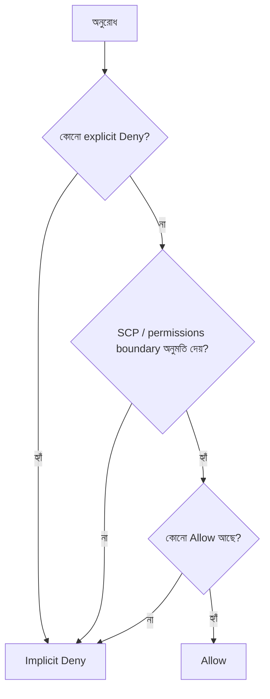
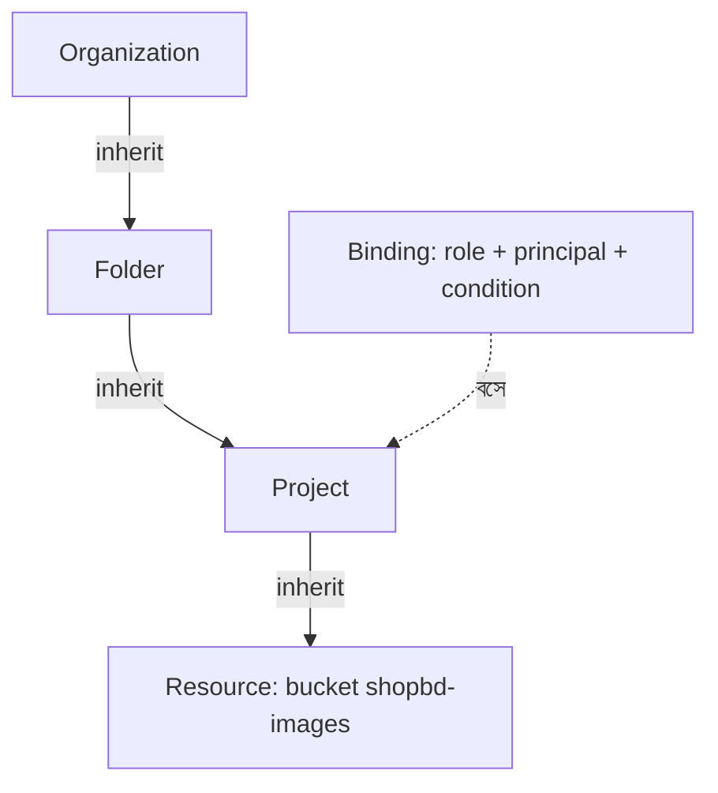
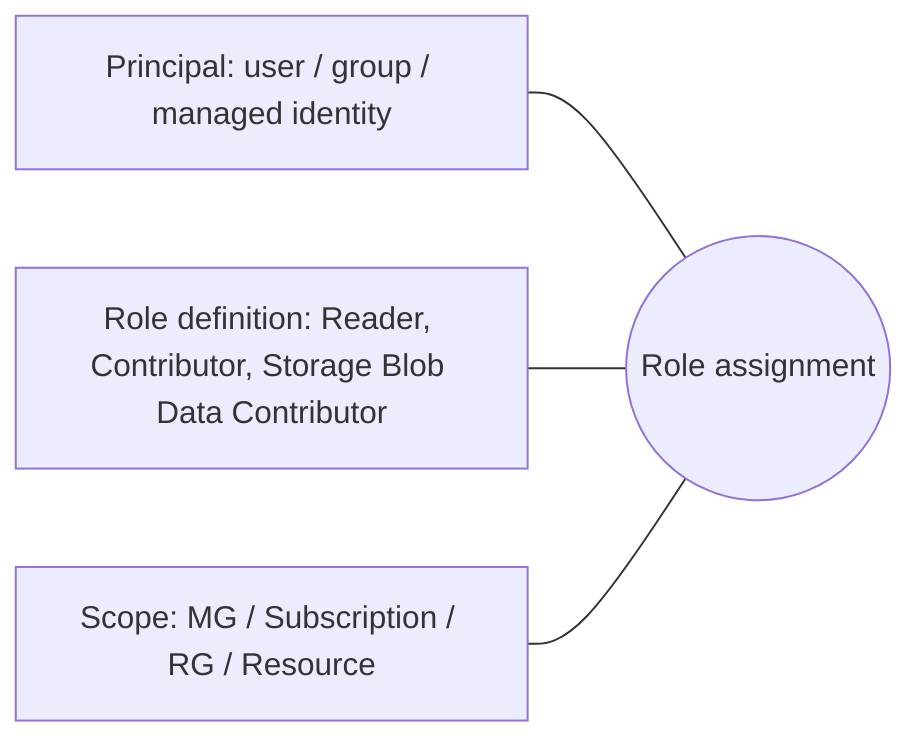
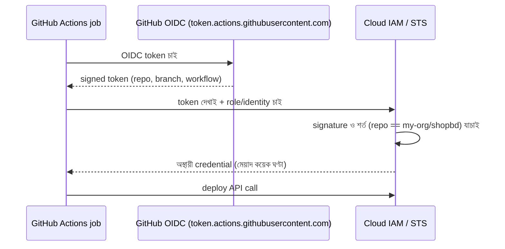

# 03 · Identity ও Access (IAM)

> **এই অধ্যায়ে কী শিখবেন**
>
> - Authentication বনাম Authorization — এবং IAM-এর মূল ধারণা (principal, permission, role, policy)
> - চার cloud-এর IAM মডেল: AWS JSON policy, GCP role binding, Azure RBAC, OCI policy statement
> - মানুষের জন্য user/group/SSO এবং application-এর জন্য role/service account/managed identity/instance principal
> - Least privilege, MFA, condition, explicit deny — বাস্তবে কীভাবে কাজ করে
> - Workload identity federation — GitHub Actions-এর মতো CI থেকে **কোনো long-lived key ছাড়া** cloud-এ ঢোকা
> - `shopbd` API-কে ছবির bucket পড়তে/লিখতে দেওয়ার নিরাপদ উপায়, চার cloud-এ

!!! abstract "এক নজরে — কোন cloud-এ কী নাম"

    | Concept | AWS | GCP | Azure | OCI |
    |---|---|---|---|---|
    | IAM service | AWS IAM + **IAM Identity Center** (মানুষের SSO) | Cloud IAM + **Cloud Identity / Workspace** | **Microsoft Entra ID** (পরিচয়) + **Azure RBAC** (অনুমতি) | OCI IAM with **identity domains** |
    | ব্যবহারকারী (মানুষ) | IAM user / Identity Center user | Google account / Cloud Identity user | Entra user | IAM user (identity domain-এর) |
    | Group | IAM group | Google group | Entra group | IAM group |
    | Application-এর পরিচয় | IAM **role** | **Service account** | **Service principal / Managed identity** | **Instance principal / Resource principal** (+ dynamic group) |
    | VM-এ attach করা পরিচয় | EC2 instance profile (role) | VM-এ attached service account | System/User-assigned managed identity | Instance principal (dynamic group + policy) |
    | অনুমতির বিবরণ | **JSON policy** (Action/Resource/Condition) | **Role** (permission-এর সেট) + **binding** | **Role definition** + **role assignment** (scope-সহ) | **Policy statement** (`Allow group … to … in compartment …`) |
    | অনুমতি কোথায় বসে | identity-তে (বা resource-এ) | **resource-এ**, নিচে inherit হয় | **scope**-এ (MG/subscription/RG/resource) | **compartment**-এ |
    | Explicit deny | ✅ হ্যাঁ (সবার উপরে) | ✅ IAM deny policy | সীমিত (deny assignment) | ঐতিহ্যগতভাবে শুধু Allow; docs দেখুন |
    | সীমা টানার স্তর | SCP, permission boundary | Org Policy, deny policy, principal access boundary | Azure Policy, ABAC condition | Compartment policy, quota |
    | Short-lived credential | STS (`AssumeRole`) | Token impersonation | Managed identity token | Instance principal token (সেশন) |
    | CI-র জন্য keyless | **OIDC provider + role** | **Workload Identity Federation** | **Federated credential** | token exchange / session token (docs দেখুন) |
    | MFA | root + user MFA, passkey/FIDO2 | 2-Step Verification (Google) | Entra MFA, Conditional Access | identity domain MFA/sign-on policy |

---

## ১. IAM কী এবং কেন?

প্রশ্নটা সহজ: **"কে" (Who), "কী" (What), "কোথায়" (Where) করতে পারবে?** IAM (Identity and Access Management) এই তিনটির উত্তর ঠিক করে।

### Authentication বনাম Authorization

| ধারণা | প্রশ্ন | উদাহরণ |
|---|---|---|
| **Authentication (AuthN)** | তুমি আসলে কে? | password + MFA, token, certificate |
| **Authorization (AuthZ)** | তুমি কী করতে পারো? | "এই bucket পড়তে পারো, মুছতে পারো না" |
| **Accounting / Audit** | কে কী করেছিল? | audit log (CloudTrail, Cloud Audit Logs ইত্যাদি) |

!!! example "উপমা"
    অফিস ভবনে ঢুকতে **ID কার্ড দেখানো** = authentication। কার্ড ঘষে **কোন ফ্লোরের দরজা খুলবে** = authorization। দরজায় কে কখন ঢুকল তার **লগ** = audit।

### মূল শব্দগুলো

| শব্দ | মানে |
|---|---|
| **Principal / Identity** | যে অনুরোধ করছে — মানুষ, application, service |
| **Permission** | একটি নির্দিষ্ট কাজের অনুমতি (`read object`, `start VM`) |
| **Role** | permission-এর একটি নামকরা সেট ("Storage Viewer") |
| **Policy** | নিয়মের নথি: কোন principal-কে কোন resource-এ কী অনুমতি |
| **Resource** | অনুমতির লক্ষ্য — bucket, VM, database |
| **Scope** | অনুমতি কতদূর প্রযোজ্য — পুরো organization, একটি project, একটি resource |

### দুই ধরনের পরিচয়

- **মানুষ (workforce identity):** SSO, group, MFA — সাধারণত কোম্পানির identity provider (IdP) থেকে।
- **Application (workload identity):** password/long-lived key **নয়**; বরং অস্থায়ী credential যা cloud নিজে দেয়।

!!! warning "সোনালি নিয়ম"
    মানুষের জন্য **SSO + MFA**; application-এর জন্য **attached role/identity** (কোনো secret ফাইলে নয়); CI-র জন্য **federation**। এই তিনটি মানলে credential-leak-এর বেশিরভাগ ঝুঁকি দূর হয়।

---

## ২. AWS IAM

### উপাদান

- **Root user** — account খোলার email; সর্বশক্তিমান, শুধু কয়েকটি বিশেষ কাজে ([02 · Account ও Hierarchy](02-accounts-and-hierarchy.md))।
- **IAM user** — স্থায়ী পরিচয় (password ও/বা access key)। **নতুন কাজে মানুষের জন্য IAM user এড়িয়ে IAM Identity Center ব্যবহার করুন।**
- **IAM group** — user-দের গ্রুপ; policy group-এ attach করুন।
- **IAM role** — অস্থায়ী পরিচয়, যা কেউ **assume** করে; স্থায়ী credential নেই। Application ও cross-account access-এর প্রধান উপায়।
- **Policy** — JSON; প্রকার:
    - **Identity-based policy** — user/group/role-এ attach (managed বা inline)।
    - **Resource-based policy** — resource-এ attach (যেমন S3 bucket policy, role-এর **trust policy**)।
    - **Permissions boundary** — একটি identity-র সর্বোচ্চ সীমা।
    - **SCP / RCP** — organization স্তরের সীমা।
    - **Session policy** — assume করার সময় আরো সঙ্কুচিত করা।
- **IAM Identity Center** — (আগের নাম AWS SSO) কর্মীদের কেন্দ্রীয় sign-in; এক জায়গা থেকে একাধিক account-এ permission set।

### Policy-র গঠন

```json
{
  "Version": "2012-10-17",
  "Statement": [
    {
      "Sid": "ShopbdImagesReadWrite",
      "Effect": "Allow",
      "Action": [
        "s3:GetObject",
        "s3:PutObject"
      ],
      "Resource": "arn:aws:s3:::shopbd-images/*"
    },
    {
      "Sid": "ShopbdImagesList",
      "Effect": "Allow",
      "Action": "s3:ListBucket",
      "Resource": "arn:aws:s3:::shopbd-images"
    }
  ]
}
```

| Field | মানে |
|---|---|
| `Version` | policy ভাষার সংস্করণ (সবসময় `2012-10-17`) |
| `Effect` | `Allow` / `Deny` |
| `Action` | কাজ, `service:Action` রূপে |
| `Resource` | কোন resource (ARN) |
| `Principal` | (resource-based policy-তে) কে |
| `Condition` | (ঐচ্ছিক) শর্ত |

!!! warning "`/*` এর ফাঁদ"
    Bucket-এ list করতে ARN হবে `arn:aws:s3:::shopbd-images` (bucket), আর object পড়তে `arn:aws:s3:::shopbd-images/*` (ভেতরের object)। দুটোই আলাদা — একটা ভুলে ঠিক permission দিয়েও `AccessDenied` আসে।

### Policy evaluation



1. ডিফল্ট = **সব Deny** (implicit deny)।
2. কোথাও **explicit Deny** থাকলে সর্বোপরি **Deny**।
3. সীমা (SCP, boundary) পার হলে এবং কোনো **Allow** থাকলে → **Allow**।

### Role ও trust policy

Role-এর দুটি অংশ: **trust policy** (কে assume করতে পারবে) এবং **permission policy** (assume করলে কী করতে পারবে)।

```json
{
  "Version": "2012-10-17",
  "Statement": [
    {
      "Effect": "Allow",
      "Principal": { "Service": "ec2.amazonaws.com" },
      "Action": "sts:AssumeRole"
    }
  ]
}
```

এটি বলছে "EC2 service এই role assume করতে পারে" — তাই EC2 instance-এ এই role attach করলে সেখানে চলা app অস্থায়ী credential পায়।

### CLI

=== "AWS"

    ```bash
    # আমি এখন কোন পরিচয়ে?
    aws sts get-caller-identity

    # Group ও user
    aws iam create-group --group-name shopbd-developers
    aws iam create-user --user-name dev1
    aws iam add-user-to-group --group-name shopbd-developers --user-name dev1

    # Managed policy তৈরি ও group-এ attach
    aws iam create-policy \
      --policy-name shopbd-images-rw \
      --policy-document file://shopbd-images-rw.json
    aws iam attach-group-policy \
      --group-name shopbd-developers \
      --policy-arn arn:aws:iam::123456789012:policy/shopbd-images-rw

    # EC2 role (trust policy ফাইল থেকে) ও instance profile
    aws iam create-role \
      --role-name shopbd-api-role \
      --assume-role-policy-document file://trust-ec2.json
    aws iam attach-role-policy \
      --role-name shopbd-api-role \
      --policy-arn arn:aws:iam::123456789012:policy/shopbd-images-rw
    aws iam create-instance-profile --instance-profile-name shopbd-api-profile
    aws iam add-role-to-instance-profile \
      --instance-profile-name shopbd-api-profile \
      --role-name shopbd-api-role

    # অস্থায়ীভাবে অন্য role assume
    aws sts assume-role \
      --role-arn arn:aws:iam::123456789012:role/shopbd-api-role \
      --role-session-name test-session

    # Workforce SSO লগইন
    aws configure sso
    aws sso login --profile my-sso-profile
    ```

### Terraform

=== "AWS"

    ```hcl
    data "aws_iam_policy_document" "images_rw" {
      statement {
        actions   = ["s3:GetObject", "s3:PutObject"]
        resources = ["arn:aws:s3:::shopbd-images/*"]
      }
      statement {
        actions   = ["s3:ListBucket"]
        resources = ["arn:aws:s3:::shopbd-images"]
      }
    }

    data "aws_iam_policy_document" "ec2_trust" {
      statement {
        actions = ["sts:AssumeRole"]
        principals {
          type        = "Service"
          identifiers = ["ec2.amazonaws.com"]
        }
      }
    }

    resource "aws_iam_policy" "images_rw" {
      name   = "shopbd-images-rw"
      policy = data.aws_iam_policy_document.images_rw.json
    }

    resource "aws_iam_role" "api" {
      name               = "shopbd-api-role"
      assume_role_policy = data.aws_iam_policy_document.ec2_trust.json
    }

    resource "aws_iam_role_policy_attachment" "api_images" {
      role       = aws_iam_role.api.name
      policy_arn = aws_iam_policy.images_rw.arn
    }

    resource "aws_iam_instance_profile" "api" {
      name = "shopbd-api-profile"
      role = aws_iam_role.api.name
    }

    ```

---

## ৩. GCP IAM

### মূল ভিন্নতা: policy "কার" নয়, "কোথায়"

AWS-এ আপনি identity-তে policy লাগান। GCP-তে **resource (organization/folder/project/বা নির্দিষ্ট resource)-এর উপর** একটি **allow policy** বসে, যার ভেতর থাকে **binding**: `role` + `members` (principal) + (ঐচ্ছিক) `condition`। উপরের স্তরে বসানো binding নিচে **inherit** হয়।



### Principal-এর প্রকার

| Principal | বোঝায় |
|---|---|
| `user:alice@example.com` | Google account / Cloud Identity user |
| `group:devs@example.com` | Google group (প্রস্তাবিত) |
| `serviceAccount:shopbd-api@my-project-id.iam.gserviceaccount.com` | application-এর পরিচয় |
| `domain:example.com` | পুরো domain |
| `allUsers` / `allAuthenticatedUsers` | **সবাই / যেকোনো Google account — সাবধান, public করে দেয়!** |
| `principal://…` / `principalSet://…` | workload identity federation-এর পরিচয় |

### Role-এর প্রকার

| প্রকার | কী | কখন |
|---|---|---|
| **Basic** (`Owner`, `Editor`, `Viewer`) | অতি ব্যাপক | production-এ এড়ান |
| **Predefined** (`roles/storage.objectViewer`) | service-নির্দিষ্ট, Google ম্যানেজ করে | **ডিফল্ট পছন্দ** |
| **Custom** | আপনার বানানো permission সেট | predefined-এ না মিললে |

### Service account

Application-এর জন্য GCP-র পরিচয়। একই সাথে এটি **principal** (কেউ তাকে role দিতে পারে) এবং **resource** (কেউ তাকে impersonate করতে পারে)।

- **User-managed** service account আপনি বানান; **default service account** কিছু service (যেমন Compute Engine) নিজে তৈরি করে — এগুলোর **ঐতিহাসিকভাবে `Editor` role** থাকত, যা বিপজ্জনক।
- **Key (JSON ফাইল)** তৈরি করা সম্ভব, কিন্তু **এড়ান** — ফাঁস হলে যে কেউ সেই পরিচয়ে ঢুকতে পারে। বদলে VM/Cloud Run/GKE-তে **attach** করুন বা **impersonate** করুন।
- **Impersonation:** মানুষ/অন্য পরিচয় service account-এর হয়ে অস্থায়ীভাবে কাজ করে (প্রয়োজন `roles/iam.serviceAccountTokenCreator`)।

### Condition — CEL ভাষায়

```text
request.time < timestamp("2027-01-01T00:00:00Z")
resource.name.startsWith("projects/_/buckets/shopbd-images/objects/public/")
```

### Deny policy ও Principal Access Boundary

- **IAM deny policy** — "এই principal-দের কখনোই এই permission নয়", allow-এর উপরে প্রাধান্য পায়।
- **Principal access boundary (PAB)** — কোন resource-এ principal কাজ করতে পারবে তার সীমা।

### CLI

=== "GCP"

    ```bash
    # কে আমি?
    gcloud auth list
    gcloud config list account

    # Service account তৈরি
    gcloud iam service-accounts create shopbd-api \
      --display-name="shopbd API"

    # Project-এ role দেওয়া (binding)
    gcloud projects add-iam-policy-binding my-project-id \
      --member="serviceAccount:shopbd-api@my-project-id.iam.gserviceaccount.com" \
      --role="roles/storage.objectUser"

    # শুধু একটি bucket-এ দেওয়া (আরো সংকীর্ণ — প্রস্তাবিত)
    gcloud storage buckets add-iam-policy-binding gs://shopbd-images \
      --member="serviceAccount:shopbd-api@my-project-id.iam.gserviceaccount.com" \
      --role="roles/storage.objectUser"

    # শর্তসহ (সময়সীমা)
    gcloud projects add-iam-policy-binding my-project-id \
      --member="user:alice@example.com" \
      --role="roles/viewer" \
      --condition='expression=request.time < timestamp("2027-01-01T00:00:00Z"),title=temp-access'

    # বর্তমান policy দেখা
    gcloud projects get-iam-policy my-project-id

    # Service account impersonate করে কাজ
    gcloud storage ls gs://shopbd-images \
      --impersonate-service-account=shopbd-api@my-project-id.iam.gserviceaccount.com

    # Application Default Credentials (লোকাল ডেভেলপমেন্টে SDK-র জন্য)
    gcloud auth application-default login
    ```

    `roles/storage.objectUser` হলো object পড়া/লেখা/মোছার predefined role; শুধু পড়ার জন্য `roles/storage.objectViewer`।

### Terraform

=== "GCP"

    ```hcl
    resource "google_service_account" "api" {
      account_id   = "shopbd-api"
      display_name = "shopbd API"
    }

    resource "google_storage_bucket_iam_member" "api_images" {
      bucket = "shopbd-images"
      role   = "roles/storage.objectUser"
      member = "serviceAccount:${google_service_account.api.email}"
    }
    ```

!!! warning "`_binding`, `_member`, `_policy` — Terraform-এর তিন রূপ"
    `google_project_iam_member` একটি member যোগ করে (অন্যদের ছুঁয়ে না); `google_project_iam_binding` একটি role-এর **সব** member নিজের হাতে নেয়; `google_project_iam_policy` পুরো policy **ওভাররাইট** করে — নিজেকে তালাবন্ধ করতে পারেন। সাধারণত `_member` ব্যবহার করুন।

---

## ৪. Azure — Entra ID ও RBAC

Azure-এ "IAM" দুটি আলাদা জগতে ভাগ — এটি নতুনদের সবচেয়ে বড় বিভ্রান্তি।

| | **Microsoft Entra ID** | **Azure RBAC** |
|---|---|---|
| কী | পরিচয় ও directory (পুরোনো নাম **Azure AD**) | Azure resource-এর উপর অনুমতি |
| Role-এর নাম | **Entra roles** (Global Administrator, User Administrator…) | **Azure roles** (Owner, Contributor, Reader…) |
| কী নিয়ন্ত্রণ করে | user, group, app registration, Conditional Access | VM, storage, database ইত্যাদি |
| Scope | tenant | management group → subscription → resource group → resource |

!!! danger "বিখ্যাত গোলমাল"
    **Global Administrator** (Entra role) ডিফল্টে Azure subscription-এর resource-এর RBAC role নয় — যদিও একটি বিশেষ "elevate access" সুইচ দিয়ে সে নিজেকে সব subscription-এ `User Access Administrator` বানাতে পারে। আর **Owner** (Azure RBAC role) Entra directory-র user বানাতে পারে না। দুটি আলাদা সিস্টেম।

### Principal-এর প্রকার

- **User**, **Group** — মানুষ (Entra directory-তে)।
- **Service principal** — একটি application-এর পরিচয় (app registration থেকে)।
- **Managed identity** — Azure resource-এর জন্য, **secret ছাড়া**। দুই প্রকার:
    - **System-assigned** — resource-এর সাথে জন্ম-মৃত্যু (VM মুছলে identity-ও যায়)।
    - **User-assigned** — স্বাধীন resource; একাধিক resource-এ ভাগ করা যায়।

### RBAC-র গঠন: Role assignment = কে + কোন role + কোন scope



- **Role definition** — `Actions` (control plane) ও `DataActions` (data plane) তালিকা।
- Scope-এ দেওয়া assignment নিচে inherit হয়।
- সাধারণ built-in: `Owner` (সব + অন্যকে অনুমতি দেওয়া), `Contributor` (সব, কিন্তু অনুমতি দেওয়া নয়), `Reader`, `User Access Administrator`।

!!! warning "Control plane বনাম data plane"
    **Contributor** দিয়ে storage account বানানো যায়, কিন্তু ভেতরের blob পড়তে `Storage Blob Data Reader/Contributor`-এর মতো **data role** লাগে। ফলে "Contributor আছে, তবু blob পড়তে পারছি না" — Azure-এর একটি চিরন্তন বিস্ময়।

### Entra-র নিরাপত্তা সরঞ্জাম

- **MFA** — **Security defaults** (বিনামূল্যে বেসলাইন) বা **Conditional Access** (শর্তসাপেক্ষ: location, device, risk — সাধারণত P1 license)।
- **PIM** (admin role just-in-time, সময়সীমাসহ), **Access reviews** (নিয়মিত যাচাই), **B2B guest** (বাইরের মানুষকে নিমন্ত্রণ) — কিছু সুবিধায় P1/P2 license লাগে।

### CLI

=== "Azure"

    ```bash
    az login
    az account show                 # বর্তমান subscription ও tenant
    az ad signed-in-user show       # আমি কে (Entra-তে)

    # Group তৈরি (Entra)
    az ad group create \
      --display-name shopbd-developers \
      --mail-nickname shopbd-developers

    # User-assigned managed identity
    az identity create \
      --name shopbd-api-id \
      --resource-group shopbd-prod-rg

    # Role assignment: managed identity-কে storage-এর blob data পড়া/লেখার অনুমতি
    az role assignment create \
      --assignee <principal-id-of-managed-identity> \
      --role "Storage Blob Data Contributor" \
      --scope /subscriptions/00000000-0000-0000-0000-000000000000/resourceGroups/shopbd-prod-rg/providers/Microsoft.Storage/storageAccounts/shopbdimages

    # কার কী role আছে?
    az role assignment list --assignee <principal-id> --all --output table

    # VM-এ identity attach
    az vm identity assign \
      --name shopbd-api-vm \
      --resource-group shopbd-prod-rg \
      --identities shopbd-api-id
    ```

    `<principal-id-of-managed-identity>` হলো `az identity create`-এর output-এর `principalId` (GUID)। Storage account-এর নাম শুধু ছোট হাতের অক্ষর-সংখ্যা, তাই `shopbdimages`।

### Terraform

=== "Azure"

    ```hcl
    resource "azurerm_user_assigned_identity" "api" {
      name                = "shopbd-api-id"
      resource_group_name = azurerm_resource_group.prod.name
      location            = azurerm_resource_group.prod.location
    }

    resource "azurerm_role_assignment" "api_blob" {
      scope                = azurerm_storage_account.images.id
      role_definition_name = "Storage Blob Data Contributor"
      principal_id         = azurerm_user_assigned_identity.api.principal_id
    }
    ```

---

## ৫. OCI IAM

### কাঠামো

- **Identity domain** — user, group ও অ্যাপ-সম্পর্কিত পরিচয়ের পাত্র (আগের **IDCS**-ভিত্তিক)। প্রতিটি tenancy-তে একটি **Default** domain থাকে; আরো বানানো যায়।
- **User, Group** — মানুষ। Group-কে policy দিন।
- **Policy** — **আপনি যে ভাষা পড়তে পারেন** এমন সরল বাক্য।
- **Dynamic group** — নিয়ম (matching rule) দিয়ে নির্ধারিত resource-এর দল (যেমন "এই compartment-এর সব instance")। Application-এর পরিচয়ের ভিত্তি।
- **Instance principal** — একটি OCI instance নিজেই "principal", dynamic group-এর সদস্য হয়ে policy পায়; কোনো key লাগে না।
- **Resource principal** — একই ধারণা Functions-এর মতো সেবার জন্য।
- **Compartment** — policy এখানে বসে ([02 · Account ও Hierarchy](02-accounts-and-hierarchy.md))।

### Policy statement-এর ব্যাকরণ

```text
Allow <subject> to <verb> <resource-type> in <location> [where <condition>]
```

| অংশ | উদাহরণ |
|---|---|
| subject | `group shopbd-developers`, `dynamic-group shopbd-api-dg` |
| verb | `inspect` < `read` < `use` < `manage` (ক্রমে বেশি ক্ষমতা) |
| resource-type | `object-family`, `instance-family`, `virtual-network-family`, `all-resources`, বা নির্দিষ্ট (`buckets`, `objects`) |
| location | `tenancy` অথবা `compartment shopbd-prod` |
| condition | `where target.bucket.name = 'shopbd-images'` |

উদাহরণ:

```text
Allow group shopbd-developers to read all-resources in compartment shopbd-prod
Allow group shopbd-developers to manage instance-family in compartment shopbd-nonprod
Allow dynamic-group shopbd-api-dg to manage objects in compartment shopbd-prod where target.bucket.name = 'shopbd-images'
```

- Verb-এর ক্ষমতা: `inspect` (list), `read` (+ metadata ও content), `use` (+ কাজে লাগানো/বদলানো), `manage` (সব, মোছা সহ)।
- **Default = সব অস্বীকার।** শুধু যা Allow, তা-ই চলে। OCI policy ঐতিহ্যগতভাবে **শুধু Allow** — আলাদা Deny বাক্য নেই; "না দেওয়া"-ই সুরক্ষা। (এটি বিবর্তিত হতে পারে — বর্তমান docs দেখুন।)
- Policy ঠিক যে compartment-এ আছে এবং তার **নিচের সব** compartment-এ প্রযোজ্য। Tenancy-তে লিখলে সব জায়গায়।
- Tenancy-তে ডিফল্টে `Administrators` group ও তার জন্য একটি সর্বক্ষমতার policy থাকে।

### CLI

=== "OCI"

    ```bash
    # প্রথমবার CLI কনফিগার (API signing key তৈরি করে)
    oci setup config

    # Group (compartment-id = tenancy OCID)
    oci iam group create \
      --compartment-id ocid1.tenancy.oc1..example \
      --name shopbd-developers \
      --description "shopbd developers"

    # User
    oci iam user create \
      --compartment-id ocid1.tenancy.oc1..example \
      --name dev1 \
      --description "Developer 1" \
      --email dev1@example.com

    # User-কে group-এ
    oci iam group add-user \
      --user-id ocid1.user.oc1..example \
      --group-id ocid1.group.oc1..example

    # Dynamic group
    oci iam dynamic-group create \
      --compartment-id ocid1.tenancy.oc1..example \
      --name shopbd-api-dg \
      --description "shopbd API instances" \
      --matching-rule "ALL {instance.compartment.id = 'ocid1.compartment.oc1..example'}"

    # Policy
    oci iam policy create \
      --compartment-id ocid1.compartment.oc1..example \
      --name shopbd-api-policy \
      --description "API access to images bucket" \
      --statements '["Allow dynamic-group shopbd-api-dg to manage objects in compartment shopbd-prod where target.bucket.name = '\''shopbd-images'\''"]'

    # Instance-এর ভেতর থেকে, key ছাড়া
    oci --auth instance_principal os ns get
    ```

    এখানে `oci iam …` কমান্ডগুলো tenancy-র Default identity domain-এর জন্য কাজ করে; নতুন identity domain-ভিত্তিক বিশেষ কমান্ড `oci identity-domains …`-এ আছে — বিস্তারিত docs দেখুন।

### Terraform

=== "OCI"

    ```hcl
    resource "oci_identity_group" "developers" {
      compartment_id = var.tenancy_ocid
      name           = "shopbd-developers"
      description    = "shopbd developers"
    }

    resource "oci_identity_user" "dev1" {
      compartment_id = var.tenancy_ocid
      name           = "dev1"
      description    = "Developer 1"
      email          = "dev1@example.com"
    }

    resource "oci_identity_user_group_membership" "dev1" {
      user_id  = oci_identity_user.dev1.id
      group_id = oci_identity_group.developers.id
    }

    resource "oci_identity_dynamic_group" "api" {
      compartment_id = var.tenancy_ocid
      name           = "shopbd-api-dg"
      description    = "shopbd API instances"
      matching_rule  = "ALL {instance.compartment.id = '${oci_identity_compartment.prod.id}'}"
    }

    resource "oci_identity_policy" "api" {
      compartment_id = oci_identity_compartment.prod.id
      name           = "shopbd-api-policy"
      description    = "API access to images bucket"
      statements = [
        "Allow dynamic-group shopbd-api-dg to manage objects in compartment shopbd-prod where target.bucket.name = 'shopbd-images'",
      ]
    }
    ```

!!! note "Dynamic group সম্পর্কে"
    Dynamic group-এর নিজস্ব নাম-নির্ভর policy statement-এর রূপ identity domain ব্যবহার করলে `dynamic-group '<DomainName>'/'shopbd-api-dg'` রূপে লিখতে হতে পারে (Default domain-এর বাইরে)। আপনার tenancy-র domain-এর নিয়ম docs-এ মিলিয়ে নিন।

---

## ৬. Workload-এর পরিচয় — Key ছাড়া অনুমতি

Access key/password **কোডে বা ফাইলে রাখাই** সবচেয়ে সাধারণ নিরাপত্তা-ব্যর্থতা: GitHub-এ ভুলে push হয়, backup-এ যায়, ল্যাপটপ চুরি হয়। সমাধান: cloud-কে বলুন "এই VM/container/function-কে চিনে নাও" — তখন সে অস্থায়ী credential পায়, যা কয়েক ঘণ্টায় মেয়াদ হারায়।

| Workload কোথায় চলছে | AWS | GCP | Azure | OCI |
|---|---|---|---|---|
| VM | Instance profile (role) | Attached service account | Managed identity | Instance principal |
| Serverless function | Lambda execution role | Function-এর service account | Function-এর managed identity | Resource principal |
| Container (managed) | ECS task role | Cloud Run service account | Container Apps managed identity | Resource principal |
| Kubernetes pod | IRSA / EKS Pod Identity | Workload Identity (GKE) | Entra Workload ID | OKE Workload Identity |

Kubernetes ও IAM-এর পূর্ণ সংযোগ [08 · Container ও Kubernetes](08-containers-kubernetes.md)-এ।

!!! tip "SDK আপনাকে বাঁচায়"
    AWS SDK-র default credential chain, Google-এর Application Default Credentials, Azure-এর `DefaultAzureCredential` — সবাই স্বয়ংক্রিয়ভাবে "attached identity" খুঁজে নেয়। কোডে কোনো key বসানোর দরকারই নেই; লোকাল মেশিনে লগইন করা পরিচয়, cloud-এ attached পরিচয়।

---

## ৭. Workload identity federation — CI থেকে keyless

ধরুন GitHub Actions থেকে `shopbd`-এর deploy হবে। পুরোনো পদ্ধতি: cloud-এ একটি user/service account বানিয়ে তার **long-lived key** GitHub secret-এ রাখা। ঝুঁকি: key ফাঁস, কখনো ঘোরানো (rotate) হয় না।

**Federation:** GitHub প্রতি job-এ একটি **OIDC token** (পরিচয়-প্রমাণ: "আমি `my-org/shopbd` repo-র `main` branch") বানায়। Cloud সেই token যাচাই করে একটি **অস্থায়ী credential** দেয়। কোনো secret ভাগ হয় না।



### প্রতিটি cloud-এ সেটআপ

=== "AWS"

    **IAM OIDC provider** + **role** যার trust policy GitHub token-এর শর্ত মেলায়।

    ```hcl
    resource "aws_iam_openid_connect_provider" "github" {
      url            = "https://token.actions.githubusercontent.com"
      client_id_list = ["sts.amazonaws.com"]
    }

    data "aws_iam_policy_document" "github_trust" {
      statement {
        actions = ["sts:AssumeRoleWithWebIdentity"]
        principals {
          type        = "Federated"
          identifiers = [aws_iam_openid_connect_provider.github.arn]
        }
        condition {
          test     = "StringEquals"
          variable = "token.actions.githubusercontent.com:aud"
          values   = ["sts.amazonaws.com"]
        }
        condition {
          test     = "StringLike"
          variable = "token.actions.githubusercontent.com:sub"
          values   = ["repo:my-org/shopbd:ref:refs/heads/main"]
        }
      }
    }

    resource "aws_iam_role" "github_deploy" {
      name               = "shopbd-github-deploy"
      assume_role_policy = data.aws_iam_policy_document.github_trust.json
    }
    ```

    Workflow-তে `aws-actions/configure-aws-credentials` action (`role-to-assume`, `aws-region`) ব্যবহার করুন।

=== "GCP"

    **Workload Identity Pool + Provider**, তারপর service account-কে `roles/iam.workloadIdentityUser` দিন।

    ```bash
    gcloud iam workload-identity-pools create github-pool \
      --project=my-project-id \
      --location=global \
      --display-name="GitHub"

    gcloud iam workload-identity-pools providers create-oidc github-provider \
      --project=my-project-id \
      --location=global \
      --workload-identity-pool=github-pool \
      --issuer-uri="https://token.actions.githubusercontent.com" \
      --attribute-mapping="google.subject=assertion.sub,attribute.repository=assertion.repository" \
      --attribute-condition="assertion.repository=='my-org/shopbd'"

    gcloud iam service-accounts add-iam-policy-binding \
      shopbd-deploy@my-project-id.iam.gserviceaccount.com \
      --role="roles/iam.workloadIdentityUser" \
      --member="principalSet://iam.googleapis.com/projects/123456789012/locations/global/workloadIdentityPools/github-pool/attribute.repository/my-org/shopbd"
    ```

    Workflow-তে `google-github-actions/auth` action (`workload_identity_provider`, `service_account`)।

    ```hcl
    resource "google_iam_workload_identity_pool" "github" {
      workload_identity_pool_id = "github-pool"
    }

    resource "google_iam_workload_identity_pool_provider" "github" {
      workload_identity_pool_id          = google_iam_workload_identity_pool.github.workload_identity_pool_id
      workload_identity_pool_provider_id = "github-provider"

      attribute_mapping = {
        "google.subject"       = "assertion.sub"
        "attribute.repository" = "assertion.repository"
      }
      attribute_condition = "assertion.repository == 'my-org/shopbd'"

      oidc {
        issuer_uri = "https://token.actions.githubusercontent.com"
      }
    }
    ```

=== "Azure"

    Entra **app registration** (বা user-assigned managed identity)-এ **federated credential** যোগ করুন, তারপর সেই principal-কে RBAC role দিন।

    ```json
    {
      "name": "github-main",
      "issuer": "https://token.actions.githubusercontent.com",
      "subject": "repo:my-org/shopbd:ref:refs/heads/main",
      "audiences": ["api://AzureADTokenExchange"]
    }
    ```

    ```bash
    az ad app federated-credential create \
      --id <app-object-id> \
      --parameters credential.json
    ```

    Workflow-তে `azure/login` action (`client-id`, `tenant-id`, `subscription-id`) — কোনো client secret নেই।

=== "OCI"

    OCI-তে GitHub Actions থেকে keyless-এর পথ পরিবর্তনশীল: Identity domain-এর **token exchange / identity propagation trust** ধরনের ব্যবস্থায় বাইরের OIDC token-কে OCI-র অস্থায়ী token (UPST)-এ বদলানো যায়।
    নির্দিষ্ট সেটআপ ও CLI/Terraform রূপ docs-এর সংস্করণ-নির্ভর, তাই এখানে অনুমান করে কমান্ড দেওয়া হলো না — [15 · CI/CD ও DevOps](15-cicd-devops.md)-এ বর্তমান সমর্থিত উপায় দেখুন।
    মূলনীতি একই: **long-lived API key-এর বদলে অস্থায়ী token**।
    Kubernetes-এ OKE **Workload Identity** পাওয়া যায়।

!!! tip "Subject/শর্ত সংকীর্ণ রাখুন"
    শুধু `repo` নয়, branch বা environment-ও (`ref:refs/heads/main`) বাঁধুন। না হলে ওই organization-এর যেকোনো repo-র workflow আপনার role পেয়ে যেতে পারে।

---

## ৮. মানুষের জন্য SSO ও Federation

প্রতিটি cloud-এ আলাদা আলাদা user বানানো — কেউ চলে গেলে ৪টি জায়গা থেকে মুছতে ভুলে যাওয়া — বিপদ। সমাধান: **একটি Identity Provider (IdP)** — যেমন **Microsoft Entra ID, Google Workspace, Okta** — যা সবার পরিচয়ের উৎস। Cloud তাকে **বিশ্বাস** করে (federation)।

- **SAML 2.0** — পুরোনো, enterprise SSO-র মানক। **OIDC** — আধুনিক, JSON/JWT-ভিত্তিক।
- **SCIM** — IdP থেকে user/group স্বয়ংক্রিয়ভাবে cloud-এ তৈরি ও মুছে ফেলার প্রোটোকল।

| Cloud | কীভাবে |
|---|---|
| AWS | **IAM Identity Center** — IdP (Entra/Okta/Google) যুক্ত করুন, **permission set** বানিয়ে group → account → permission set ম্যাপ করুন; CLI-তে `aws sso login` |
| GCP | **Cloud Identity / Google Workspace** — user কোম্পানি domain-এর Google account; বাইরের IdP চাইলে **SAML SSO** profile; IAM-এ **group** ব্যবহার করুন |
| Azure | **Entra ID নিজেই IdP**; অন্য IdP থাকলে federation; Microsoft 365 ব্যবহারকারী কোম্পানি একই directory পায় |
| OCI | **Identity domain**-এ SAML/OIDC **identity provider** যুক্ত করে IdP-র group-কে OCI group-এ ম্যাপ করুন |

---

## ৯. MFA ও Sign-in নিরাপত্তা

**MFA (Multi-Factor Authentication):** password ছাড়াও আরেকটি প্রমাণ — ফোনের authenticator app বা hardware key। SMS কোড দুর্বল (SIM-swap); **FIDO2/passkey/hardware key** phishing-প্রতিরোধী, তাই admin-দের জন্য সেরা।

=== "AWS"

    - **Root user-এ MFA বাধ্যতামূলক**; সব user-এ চালু করুন (virtual MFA, hardware, passkey)।
    - Policy-তে `aws:MultiFactorAuthPresent` condition দিয়ে MFA ছাড়া বিপজ্জনক কাজ আটকানো যায়:

    ```json
    {
      "Version": "2012-10-17",
      "Statement": [
        {
          "Sid": "DenyDeleteWithoutMFA",
          "Effect": "Deny",
          "Action": ["s3:DeleteBucket", "s3:DeleteObject"],
          "Resource": "*",
          "Condition": {
            "BoolIfExists": { "aws:MultiFactorAuthPresent": "false" }
          }
        }
      ]
    }
    ```

=== "GCP"

    Google account-এ **2-Step Verification** (Workspace/Cloud Identity admin console থেকে সবার জন্য বাধ্যতামূলক করা যায়, security key সহ)। বিপজ্জনক কাজে **Context-Aware Access** ও **BeyondCorp** ধারণা।

=== "Azure"

    **Security defaults** — ছোট দলের জন্য বিনামূল্যের বেসলাইন (সবার MFA, legacy auth বন্ধ)। বড় প্রয়োজনে **Conditional Access** (যেমন "admin portal-এ ঢুকতে MFA + compliant device")।

=== "OCI"

    Identity domain-এর **sign-on policy** ও **MFA factor** (app, FIDO2, SMS/email) চালু করুন; admin ও privileged group-এ বাধ্যতামূলক।

!!! danger "Admin-এ MFA না থাকা মানে খোলা দরজা"
    বেশিরভাগ cloud account দখলের গল্প শুরু হয় MFA-বিহীন একটি admin পাসওয়ার্ড ফাঁস দিয়ে। MFA সবচেয়ে সস্তা ও কার্যকর প্রতিরক্ষা।

---

## ১০. Least privilege ও Condition

**Least privilege:** যার যতটুকু দরকার, ঠিক ততটুকুই — এক চুল বেশি নয়।

### বাস্তবে কীভাবে

1. **শুরু করুন ছোট থেকে:** ব্যাপক permission (`*`, `Owner`, `Admin`) দিয়ে শুরু না করে প্রয়োজনের ন্যূনতম দিন।
2. **Scope সংকীর্ণ করুন:** পুরো project নয়, শুধু ওই bucket/resource group/compartment।
3. **Group/role ব্যবহার করুন**, ব্যক্তিকে সরাসরি permission নয়।
4. **অব্যবহৃত permission খুঁজে কাটুন:**

| Cloud | টুল |
|---|---|
| AWS | IAM Access Analyzer (unused access), last-accessed information |
| GCP | IAM Recommender, Policy Troubleshooter |
| Azure | Access reviews, PIM-এর audit, Entra permissions management |
| OCI | Audit log বিশ্লেষণ ও নিয়মিত policy-পর্যালোচনা |

5. **অস্থায়ী উচ্চ-ক্ষমতা:** PIM (Azure), IAM condition-এ সময়সীমা (GCP), Identity Center-এ সময়সীমাযুক্ত session (AWS) — স্থায়ী admin নয়।
6. **Break-glass account:** জরুরি অবস্থার জন্য আলাদা, সুরক্ষিত, ব্যবহারে alert বাজে এমন।

### Condition — শর্তসাপেক্ষ অনুমতি

একই অনুমতি, কিন্তু শর্তসহ: কোন IP থেকে, কোন সময়ে, কোন tag-যুক্ত resource-এ, MFA সহ কিনা।

=== "AWS"

    ```json
    {
      "Effect": "Allow",
      "Action": "ec2:*",
      "Resource": "*",
      "Condition": {
        "StringEquals": { "aws:RequestedRegion": "ap-south-1" },
        "IpAddress": { "aws:SourceIp": "203.0.113.0/24" }
      }
    }
    ```

    জনপ্রিয় condition key: `aws:RequestedRegion`, `aws:SourceIp`, `aws:MultiFactorAuthPresent`, `aws:PrincipalTag/…`, `aws:ResourceTag/…`।

=== "GCP"

    IAM Condition (CEL)।

    ```text
    request.time < timestamp("2027-01-01T00:00:00Z")
    resource.name.startsWith("projects/_/buckets/shopbd-images")
    ```

    Binding-এর `condition` ক্ষেত্রে বসে (দেখুন §৩ CLI)। সব service-এ condition সমর্থিত নয় — docs দেখুন।

=== "Azure"

    **Azure ABAC** — role assignment-এ শর্ত (যেমন storage blob-এর container-নাম বা tag দেখে), আর Entra-তে **Conditional Access** (sign-in-এর শর্ত: location, device, risk)। শর্তের ভাষা docs-এর "role assignment conditions" অংশে।

=== "OCI"

    Policy statement-এর শেষে `where` শর্ত।

    ```text
    Allow group shopbd-developers to manage objects in compartment shopbd-prod where target.bucket.name = 'shopbd-images'
    Allow group shopbd-developers to manage instance-family in compartment shopbd-prod where request.region = 'ap-mumbai-1'
    ```

---

## মিল ও অমিল

| বিষয় | AWS | GCP | Azure | OCI |
|---|---|---|---|---|
| অনুমতি কোথায় লেখা | identity-তে JSON policy | resource-এ binding | scope-এ role assignment | compartment-এ policy বাক্য |
| Default অবস্থা | implicit deny | কোনো binding না থাকলে deny | কোনো assignment না থাকলে deny | কোনো policy না থাকলে deny |
| Deny কীভাবে | explicit Deny সর্বোচ্চ | IAM deny policy | deny assignment (সীমিত) | সাধারণত নেই — না দিয়েই আটকানো |
| Inheritance | OU→account (SCP-র মাধ্যমে সীমা) | org→folder→project→resource | MG→sub→RG→resource | compartment-এর উপর থেকে নিচে |
| Application-এর পরিচয় | role (attach) | service account (attach/impersonate) | managed identity | instance principal |
| "Role" শব্দের মানে | **অস্থায়ী পরিচয়** (assume করা) | **permission-এর সেট** | **permission-এর সেট** (definition) | (role নেই; policy বাক্য) |
| Permission ভাষা | `service:Action` | `service.resource.verb` (permission) | `Provider/resource/action` | verb + resource-type (aggregate) |
| Custom role | policy নিজেই | custom role | custom role definition | policy-তে নির্দিষ্ট resource-type |
| মানুষের SSO | IAM Identity Center | Cloud Identity/Workspace | Entra ID | Identity domain |

**সবচেয়ে বড় বিভ্রান্তি — "Role" শব্দটা:**

- **AWS role** = পরিচয়, যা কেউ assume করে।
- **GCP/Azure role** = permission-এর সেট, যা কোনো principal-কে দেওয়া হয়।
- **OCI**-তে আলাদা role নেই, policy বাক্যই সব।

নতুনরা একটির মানে অন্যটিতে ধরে নিয়ে ভুল করেন।

**অন্যান্য ফাঁদ:**

- **AWS:** `Resource`-এ bucket বনাম `bucket/*` ভুল; SCP-কে "allow" ভাবা; root user-কে দৈনিক ব্যবহার।
- **GCP:** default Compute service account-এ `Editor` থাকা; `allUsers` binding দিয়ে অজান্তে public করা; service account key তৈরি করে ফেলা; basic role (`Owner/Editor`) ব্যাপক ব্যবহার।
- **Azure:** Entra role ও Azure RBAC গুলিয়ে ফেলা; control plane বনাম data plane (`Contributor` ≠ blob পড়া); অনেক বড় scope-এ (subscription) role দেওয়া।
- **OCI:** policy ভুল compartment-এ লেখা; dynamic group-এর matching rule ভুল → instance principal কাজ না করা; verb-resource-type গুলিয়ে ফেলা (`read` বনাম `use`)।

---

## Real-world: shopbd

**পরিস্থিতি:** `shopbd` দলে ৫ জন — ২ জন backend, ১ জন frontend, ১ জন ops (`ops@example.com`), ১ জন মালিক। API (`shopbd-api`) ছবির bucket (`shopbd-images`) পড়ে ও লেখে; রাতের report job শুধু database পড়ে; GitHub Actions থেকে deploy হয়।

**পরিচয়ের নকশা:**

| কে | কীভাবে সনাক্ত | অনুমতি |
|---|---|---|
| মালিক/ops | SSO + MFA (FIDO2 key) | `prod`-এ সীমিত admin, সময়সীমাসহ |
| Backend dev | SSO + MFA, group `shopbd-developers` | `dev`-এ বিস্তৃত, `prod`-এ শুধু পড়া |
| Frontend dev | SSO + MFA | `dev`-এর static hosting, `prod`-এ কিছু নয় |
| `shopbd-api` | attached identity | শুধু `shopbd-images` object read/write ও নিজের DB |
| Nightly report job | আলাদা identity | শুধু DB পড়া ও report bucket-এ লেখা |
| GitHub Actions | OIDC federation | শুধু `main` branch থেকে deploy |

| | AWS | GCP | Azure | OCI |
|---|---|---|---|---|
| মানুষ | Identity Center → group `shopbd-developers` → `ReadOnly` (prod), `PowerUser` (dev) | Workspace group `devs@example.com` → `roles/viewer` (prod), নির্দিষ্ট predefined role (dev) | Entra group → `Reader` (prod), `Contributor` (dev RG); admin-এ PIM | Group → `read all-resources in compartment shopbd-prod`; `manage instance-family in compartment shopbd-nonprod` |
| API | Role `shopbd-api-role` + policy `shopbd-images-rw` | Cloud Run service account + `roles/storage.objectUser` শুধু `gs://shopbd-images`-এ | User-assigned managed identity + `Storage Blob Data Contributor` শুধু image storage account-এ | Dynamic group `shopbd-api-dg` + `manage objects … where target.bucket.name = 'shopbd-images'` |
| Report job | আলাদা role (RDS read + report bucket write) | আলাদা service account + `roles/cloudsql.client` | আলাদা managed identity | আলাদা dynamic group ও policy |
| CI (GitHub) | OIDC provider + role, trust-এ `main` branch | Workload Identity Federation + `shopbd-deploy` SA | Federated credential + `azure/login` | বর্তমান সমর্থিত token-exchange উপায় ([15 · CI/CD](15-cicd-devops.md)) |
| Guardrail | SCP (শুধু `ap-south-1`) | Org Policy `iam.disableServiceAccountKeyCreation` | Azure Policy + security defaults | Compartment quota, Cloud Guard |

**ফলাফল:** কোডে বা কোনো `.env`-এ একটিও cloud key নেই; কেউ চলে গেলে IdP থেকে মুছলেই সব জায়গা থেকে অ্যাক্সেস শেষ; `prod`-এ পরিবর্তন শুধু pipeline-এর মাধ্যমে।

---

## Best practices

1. **Root/Global Admin ব্যবহার নয়** — MFA, কোম্পানি mailbox, break-glass; দৈনিক কাজ অন্য পরিচয়ে।
2. **মানুষ → SSO + MFA** (IdP-ভিত্তিক), স্থানীয় user এড়িয়ে।
3. **Application → attached identity** (role / service account / managed identity / instance principal), key নয়।
4. **CI → workload identity federation**, secret নয়।
5. **Least privilege:** predefined/ন্যূনতম role, scope সংকীর্ণ, নিয়মিত অব্যবহৃত permission ছাঁটা।
6. **Group-এ permission দিন**, ব্যক্তিকে নয়; কেউ চলে গেলে group থেকে সরালেই কাজ শেষ।
7. **Admin ক্ষমতা অস্থায়ী** (PIM / সময়সীমাযুক্ত session / condition)।
8. **Guardrail আলাদা স্তরে** (SCP, Org Policy, Azure Policy) যাতে ভুল করলেও সীমা থাকে।
9. **IAM-কে কোডে লিখুন (Terraform)** এবং পর্যালোচনা (pull request) দিয়ে পরিবর্তন করুন।
10. **Audit log চালু ও সংরক্ষিত** রাখুন; কে কী করেছে খোঁজার জন্য ([12 · Observability](12-observability.md))।

---

## Common mistakes

| ভুল | সমস্যা | সমাধান |
|---|---|---|
| সবাইকে `Admin`/`Owner`/`*:*` | এক ভুলে/হ্যাকে সর্বনাশ | কাজ-ভিত্তিক ন্যূনতম role |
| Access key কোডে/Git-এ | মিনিটে ফাঁস, বিল-হামলা | attached identity + secret manager; ফাঁস হলে তখনই বাতিল |
| Root account দিয়ে দৈনিক কাজ | সর্বোচ্চ ঝুঁকি | root ব্লক, SSO user |
| MFA নেই | password ফাঁস = দখল | সবার জন্য MFA, admin-এ FIDO2 |
| GCP default service account-এ `Editor` | যেকোনো VM compromise হলেই প্রজেক্ট দখল | নিজস্ব সীমিত service account বানান |
| GCP-তে `allUsers` binding | অজান্তে public | Org Policy দিয়ে নিষেধ, নিয়মিত পর্যালোচনা |
| Azure: Entra role ও RBAC গুলিয়ে ফেলা | "অনুমতি আছে, তবু হচ্ছে না" | দুই জগৎ আলাদা চিনুন; data role লাগে কিনা দেখুন |
| Azure: subscription-স্তরে `Contributor` | অতি-ব্যাপক scope | resource group/resource স্তরে |

---

## ইন্টারভিউ / সার্টিফিকেশন টিপস

??? question "AWS IAM user আর role-এর পার্থক্য কী? কখন কোনটি?"
    User = স্থায়ী credential-যুক্ত পরিচয়; Role = অস্থায়ী credential-যুক্ত, assume করা যায়। Application/সার্ভিস/cross-account/federation-এ role; মানুষের জন্য আধুনিক পথ IAM Identity Center (SSO)।

??? question "AWS-এ explicit deny ও implicit deny-র পার্থক্য? Evaluation কীভাবে?"
    Implicit deny = কোনো Allow না থাকলে ডিফল্টে বাদ। Explicit deny = policy-তে স্পষ্ট `Deny` — সবকিছুর উপরে, কোনো Allow একে হারায় না। SCP/boundary-র সীমার মধ্যে এবং Allow থাকলে তবেই অনুমতি।

??? question "GCP-তে role binding কীভাবে কাজ করে? Inheritance?"
    Binding = role + members (+ condition), resource-এ বসে (org/folder/project/resource)। উপরের স্তরের binding নিচে inherit হয়। তাই সংকীর্ণ করতে নিচের স্তরে (যেমন নির্দিষ্ট bucket-এ) দিন।

??? question "Azure-এ Entra role ও Azure RBAC role-এর পার্থক্য?"
    Entra role = directory (user, group, app) নিয়ন্ত্রণ; Azure RBAC role = subscription-এর resource নিয়ন্ত্রণ। Scope আলাদা; Global Administrator ডিফল্টে Azure resource-এর মালিক নয়।

??? question "OCI-তে instance principal কীভাবে কাজ করে?"
    Instance একটি dynamic group-এর সদস্য হয় (matching rule দিয়ে); সেই dynamic group-কে policy দেওয়া হয়। Instance-এর ভেতরের code অস্থায়ী token পেয়ে কোনো API key ছাড়াই OCI API ডাকে।

??? question "Workload identity federation কী এবং কেন ভালো?"
    বাইরের IdP (GitHub, GitLab, অন্য cloud)-এর OIDC token দিয়ে cloud-এ অস্থায়ী credential নেওয়া — long-lived secret রাখতে বা rotate করতে হয় না। ফাঁসের ঝুঁকি ও রক্ষণাবেক্ষণ কমে। শর্ত (repo/branch) সংকীর্ণ রাখা জরুরি।

---

## সারসংক্ষেপ

- IAM = **কে + কী + কোথায়**। Authentication (কে) আলাদা, Authorization (কী করতে পারে) আলাদা, Audit (কী করেছে) আলাদা।
- **AWS:** identity-তে JSON policy; role = assume করা অস্থায়ী পরিচয়; explicit deny সর্বোচ্চ; মানুষের জন্য IAM Identity Center।
- **GCP:** resource-এ role binding, উপর থেকে inherit; service account application-এর পরিচয়; key এড়ান; deny policy ও condition (CEL)।
- **Azure:** Entra ID (পরিচয়) + Azure RBAC (অনুমতি) — দুটি আলাদা জগৎ; managed identity; control plane ও data plane আলাদা; PIM ও Conditional Access।
- **OCI:** compartment-এ পড়া-যায় এমন policy বাক্য; dynamic group + instance principal; default deny, মূলত শুধু Allow।
- **"Role" শব্দটি** AWS-এ পরিচয়, GCP/Azure-এ permission-সেট, OCI-তে নেই — গুলিয়ে ফেলবেন না।
- **সোনালি নিয়ম:** মানুষ = SSO + MFA; application = attached identity; CI = federation; কোথাও long-lived key নয়।
- `shopbd`: API-র হাতে শুধু `shopbd-images`-এর চাবি, কোডে কোনো secret নেই, deploy হয় OIDC দিয়ে।

**পরের অধ্যায়:** [04 · Virtual Machine (Compute)](04-compute-vms.md) — এই পরিচয় VM-এ কীভাবে attach হয়, সেখান থেকে শুরু।
