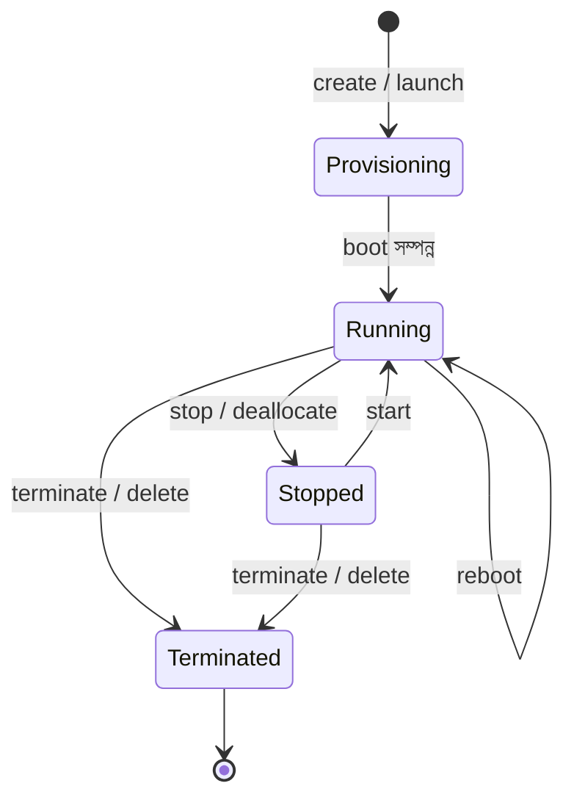
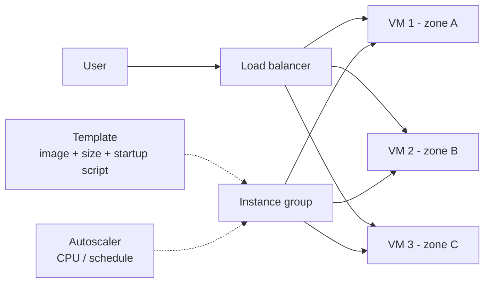
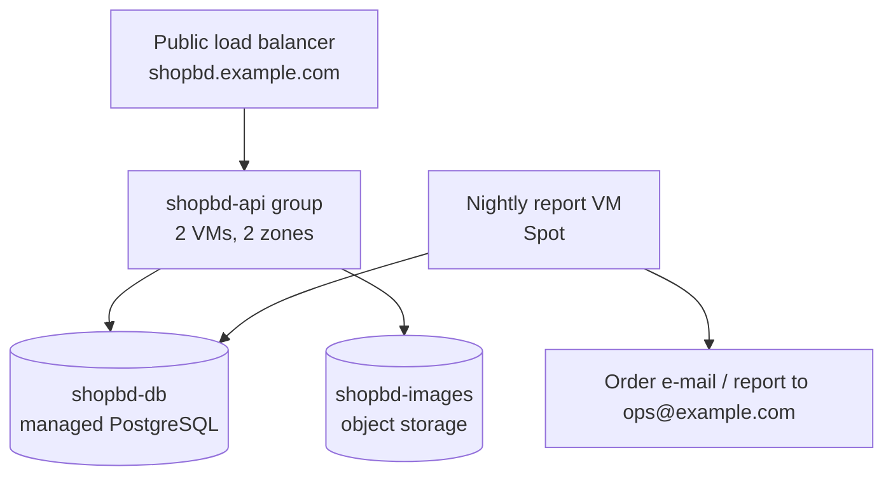

# 04 · Virtual Machine (Compute)

> **এই অধ্যায়ে কী শিখবেন**
>
> - Virtual machine (VM) কী, কেন সব cloud-এর সবচেয়ে মৌলিক service, আর এর lifecycle কেমন
> - Machine family / shape / size কীভাবে বাছবেন — AWS EC2, GCP Compute Engine, Azure VMs, OCI Compute-এ
> - Image, SSH key, metadata ও startup script, disk — চার cloud-এ কোনটা কী নামে
> - Spot / preemptible VM, instance group (ASG / MIG / VMSS / instance pool), dedicated host ও bare metal
> - `shopbd`-র API server চার cloud-এ CLI ও Terraform দিয়ে তৈরি করা, আর কোথায় মানুষ ভুল করে

!!! abstract "এক নজরে — কোন cloud-এ কী নাম"

    | Concept | AWS | GCP | Azure | OCI |
    |---|---|---|---|---|
    | Virtual machine service | Amazon EC2 | Compute Engine | Azure Virtual Machines | OCI Compute |
    | VM-এর আকার | Instance type (`t3.small`) | Machine type (`e2-small`) | VM size (`Standard_B2s`) | Shape (`VM.Standard.E4.Flex`) |
    | Template image | AMI | Image / image family | Marketplace image / Azure Compute Gallery image | Platform / custom image |
    | SSH key রাখার জায়গা | Key pair | Project/instance metadata, OS Login | VM-এর `admin_ssh_key` | `ssh_authorized_keys` metadata |
    | Boot-time script | User data (cloud-init) | `startup-script` metadata | Custom data (cloud-init), Custom Script Extension | cloud-init `user_data` |
    | Metadata endpoint | `169.254.169.254` (IMDSv2) | `metadata.google.internal` | `169.254.169.254` (IMDS) | `169.254.169.254/opc/v2` |
    | Block disk | EBS | Persistent Disk / Hyperdisk | Managed Disks | Block Volume / Boot Volume |
    | VM-এ attach হওয়া identity | Instance profile (IAM role) | Service account | Managed identity | Instance principal |
    | Spot / সস্তা interruptible | Spot Instances | Spot VMs (পুরনো নাম Preemptible) | Spot VMs | Preemptible instances |
    | VM-এর group + autoscale | Auto Scaling Group (ASG) | Managed Instance Group (MIG) | VM Scale Set (VMSS) | Instance pool + autoscaling configuration |
    | একা ভাড়া নেওয়া physical server | Dedicated Hosts | Sole-tenant nodes | Azure Dedicated Host | Dedicated Virtual Machine Host |
    | Bare metal | `.metal` instance | `-metal` machine type, Bare Metal Solution | (সীমিত) BareMetal Infrastructure | `BM.*` shape |

---

## ১. Virtual Machine কী এবং কেন দরকার

**Virtual machine (VM)** হলো cloud-এর ভেতরে ভাড়া নেওয়া একটা "কম্পিউটার" — নিজের CPU, RAM, disk, network আর operating system সহ। আসলে একটা বড় physical server-এর ওপর **hypervisor** নামের সফটওয়্যার সেই server-কে অনেকগুলো আলাদা, বিচ্ছিন্ন VM-এ ভাগ করে দেয়। আপনি মনে করেন পুরো কম্পিউটারটাই আপনার, অথচ পাশের VM অন্য কারও।

!!! note "Analogy: বহুতল ভবনে ফ্ল্যাট ভাড়া"
    একটা বিল্ডিং (physical server) কিনে পুরোটায় থাকার দরকার নেই। আপনি একটা ফ্ল্যাট (VM) ভাড়া নেন — নিজের দরজা, নিজের তালা, নিজের ঘর। বিদ্যুৎ-পানির লাইন (hardware, data center) বাড়িওয়ালার (cloud provider) দায়িত্ব; ঘরের ভেতরের সাজসজ্জা (OS, software, patch) আপনার।

### VM কেন সবচেয়ে মৌলিক

- Container, Kubernetes node, database, load balancer — অনেক managed service-ও ভেতরে VM-এর ওপরই দাঁড়িয়ে আছে।
- **IaaS**-এর (দেখুন [01 · Cloud-এর ভিত্তি](01-cloud-fundamentals.md)) সবচেয়ে সরাসরি রূপ: OS থেকে ওপরের সব কিছুর control আপনার, আবার সব দায়িত্বও আপনার (shared responsibility)।
- যেকোনো সফটওয়্যার চলে — legacy app, বিশেষ license-ওয়ালা software, নিজের মতো করে tuning করা server।

### কখন VM, কখন managed service?

| পরিস্থিতি | কী বেছে নেবেন |
|---|---|
| OS-level control, বিশেষ software, lift-and-shift | **VM** |
| শুধু code চালাতে চান, server দেখতে চান না | Serverless / container platform ([09](09-serverless.md)) |
| PostgreSQL/MySQL চালাতে চান, backup-patch নিজে করতে চান না | Managed database ([07](07-databases.md)) |
| অনেক container orchestrate | Kubernetes ([08](08-containers-kubernetes.md)) |

### VM-এর lifecycle (চার cloud-এ প্রায় একই)



| অবস্থা | AWS | GCP | Azure | OCI |
|---|---|---|---|---|
| তৈরি হচ্ছে | `pending` | `PROVISIONING` / `STAGING` | `Creating` | `PROVISIONING` |
| চলছে | `running` | `RUNNING` | `Running` | `RUNNING` |
| থামানো | `stopped` | `TERMINATED` (হ্যাঁ, GCP-তে stopped VM-কে এই নামে দেখায়!) | `Stopped` বনাম **`Deallocated`** | `STOPPED` |
| মুছে ফেলা | `terminated` | instance delete | VM delete | `TERMINATED` |

!!! warning "চার cloud-এ stop মানে এক জিনিস নয়"
    - **AWS:** stop করলে compute charge বন্ধ, কিন্তু EBS volume আর Elastic IP-র খরচ চলে। Terminate করলে instance চিরতরে শেষ।
    - **GCP:** stop করলে compute বন্ধ, disk-এর খরচ চলে। Status-এ `TERMINATED` দেখালে ঘাবড়াবেন না — এটা শুধু "বন্ধ", delete নয়।
    - **Azure:** OS-এর ভেতর থেকে shutdown করলে VM **Stopped** থাকে কিন্তু compute resource ধরে রাখে — **বিল চলতেই থাকে**। Portal/CLI থেকে **Deallocate** করলে তবেই compute বিল বন্ধ।
    - **OCI:** বেশির ভাগ standard shape stop করলে compute বিল থামে, কিন্তু কিছু shape (যেমন Dense I/O, GPU, bare metal) থামানো অবস্থাতেও বিল হতে পারে — আপনার shape-এর docs দেখে নিন।

---

## ২. Machine family, shape ও size — সঠিক আকার বাছা

প্রতিটি cloud অনেক ধরনের VM দেয়। আপনার কাজ হলো **workload-এর ধরন** (CPU-heavy, memory-heavy, GPU…) বুঝে সঠিক "পরিবার" ও তারপর "আকার" বাছা।

### নামের গঠন বোঝা

=== "AWS"

    `m7g.2xlarge` — **family** `m` (general purpose), **generation** `7`, **extra** `g` (Graviton / Arm processor), **size** `2xlarge`।

    - প্রধান family: `t` (burstable), `m` (general), `c` (compute), `r`/`x` (memory), `i`/`d` (storage), `p`/`g`/`inf`/`trn` (GPU ও accelerator)।
    - শেষে `a` = AMD, `g` = Graviton (Arm), `i` = Intel; `d` = local NVMe disk, `n` = বেশি network।
    - `.metal` size মানে bare metal (নিচে দেখুন)।
    - Nitro system-এর ওপর চলে — hypervisor-এর overhead কম।

=== "GCP"

    `n2-standard-4` — **series** `n2`, **type** `standard`, **vCPU** `4`। `standard` = প্রতি vCPU-তে ৪ GB RAM, `highmem` = ৮ GB, `highcpu` = কম RAM।

    - **General purpose:** E2 (সস্তা, shared-core আছে), N2/N2D, N4, C3/C4, T2D, Tau।
    - **Compute-optimized:** C2, H3। **Memory-optimized:** M-series। **Storage-optimized:** Z3।
    - **Accelerator-optimized:** A-series (A2, A3…), G2 — GPU workload।
    - **Custom machine type:** vCPU ও RAM নিজের মতো ঠিক করা যায় (যেমন `n2-custom-6-20480`) — GCP-র বিশেষ সুবিধা।
    - Arm: Tau T2A ও Axion-based series।

=== "Azure"

    `Standard_D4s_v5` — **series** `D` (general purpose), **vCPU** `4`, **feature** `s` (Premium SSD সমর্থন), **version** `v5`।

    - প্রধান series: `B` (burstable), `D` (general), `F` (compute), `E`/`M` (memory), `L` (storage), `N` (GPU), `H` (HPC)।
    - ছোট হরফ: `a` = AMD, `p` = Arm (Azure Cobalt-ভিত্তিক), `d` = local temp disk, `s` = Premium storage।
    - একই size বিভিন্ন version-এ (`v4`, `v5`, `v6`) থাকে — নতুন version সাধারণত ভালো price/performance।

=== "OCI"

    `VM.Standard.E4.Flex` — **VM** (virtual machine; `BM` হলে bare metal), **family** `Standard`, **processor** `E4` (AMD EPYC), **Flex** = আপনি OCPU ও memory নিজে ঠিক করেন।

    - `E` = AMD, `A` = Ampere Arm (`VM.Standard.A1.Flex`), অন্য Intel shape-ও আছে।
    - **OCPU** = একটা physical core। x86 shape-এ ১ OCPU ≈ ২ vCPU (hyper-thread); Ampere A-series-এ ১ OCPU = ১ vCPU।
    - Flex shape-এ OCPU ও GB RAM আলাদা slider — GCP custom machine type-এর মতো সুবিধা।
    - Fixed shape ও GPU shape (`VM.GPU…`, `BM.GPU…`) আছে।

### তুলনামূলক family map

| ধরন | কীসের জন্য | AWS | GCP | Azure | OCI |
|---|---|---|---|---|---|
| Burstable / shared-core | ছোট, কম-ব্যবহৃত workload | `t3`, `t4g` | `e2-micro/small/medium` | `B`-series | (Flex shape-এ কম OCPU) |
| General purpose | web, API, ছোট DB | `m6i`, `m7g` | `n2`, `n4`, `c3` | `D`-series | `VM.Standard.E4/E5.Flex` |
| Compute optimized | CPU-heavy, encoding | `c6i`, `c7g` | `c2`, `h3` | `F`-series | `VM.Optimized3.Flex` |
| Memory optimized | in-memory DB, analytics | `r6i`, `x2idn` | `m3`, `m4` | `E`, `M`-series | `VM.Standard.E4.Flex` (বেশি RAM দিয়ে) |
| Storage optimized | দ্রুত local NVMe | `i4i`, `d3` | `z3` | `L`-series | `VM.DenseIO.E4.Flex` |
| GPU / accelerator | ML, rendering | `p5`, `g5`, `inf2` | `a3`, `g2` | `N`-series | `VM.GPU…`, `BM.GPU…` |
| Arm | কম খরচ, কম power | Graviton (`*g`) | Tau T2A, Axion | Cobalt (`p` series) | Ampere (`A1`/`A2`) |

!!! note "Burstable কীভাবে কাজ করে"
    `t3` / `e2` / Azure `B`-series সাধারণত কম CPU ব্যবহার করে "credit" জমায়, হঠাৎ লোড এলে সেই credit খরচ করে দ্রুত চলে। credit ফুরিয়ে গেলে performance নেমে আসে (AWS `t3` default-এ unlimited mode-এ গিয়ে বাড়তি খরচ হতে পারে)। ছোট ও spiky workload-এ সস্তা, কিন্তু সারাক্ষণ ৮০% CPU চললে এই family ভুল পছন্দ।

!!! tip "Right-sizing-এর নিয়ম"
    ছোট দিয়ে শুরু করুন, monitoring (CPU, memory, network) দেখে বাড়ান। Cloud-এ resize সহজ; বেশি কিনে ফেলে রাখলে টাকা নষ্ট। বিস্তারিত: [18 · Cost Management](18-cost-management.md) ও [12 · Monitoring](12-observability.md)।

### `shopbd` কোন size নেবে?

| Component | কী লাগে | শুরুর পছন্দ (উদাহরণ) |
|---|---|---|
| `shopbd-api` (REST API) | ২ vCPU, ২–৪ GB RAM | AWS `t3.small` · GCP `e2-small` · Azure `Standard_B2s` · OCI `VM.Standard.E4.Flex` (১ OCPU, ৮ GB) |
| Nightly report job | সামান্য সময় ধরে বেশি CPU | Spot / preemptible VM (নিচে দেখুন) |

কোন region-এ কত দাম — **exact দাম এখানে দেওয়া হয়নি**, কারণ বদলায়। দেখুন: [AWS EC2 pricing](https://aws.amazon.com/ec2/pricing/), [GCP pricing calculator](https://cloud.google.com/products/calculator), [Azure pricing calculator](https://azure.microsoft.com/pricing/calculator/), [OCI cost estimator](https://www.oracle.com/cloud/costestimator.html)।

---

## ৩. Image — VM-এর template

**Image** হলো একটা তৈরি করা disk template: OS (আর চাইলে software ও configuration) ভেতরে থাকে। VM তৈরির সময় image থেকে boot disk কপি হয়।

| প্রকার | AWS | GCP | Azure | OCI |
|---|---|---|---|---|
| Provider-র দেওয়া | AWS-provided AMI (Amazon Linux 2023, Ubuntu…) | Public images (`debian-cloud`, `ubuntu-os-cloud`…) | Marketplace image (Canonical, Red Hat…) | Platform images (Oracle Linux, Ubuntu…) |
| Marketplace | AWS Marketplace | Cloud Marketplace | Azure Marketplace | OCI Marketplace |
| নিজের বানানো | Custom AMI | Custom image / machine image | Managed image / Azure Compute Gallery image version | Custom image |
| Share করা | AMI permission | Image IAM | Compute Gallery sharing | Custom image export / share |

### Image family — "সবসময় সর্বশেষ"

GCP-তে `--image-family=debian-12` দিলে সর্বশেষ patched image আসে। Azure-তে `:latest` version, AWS-তে SSM parameter বা `most_recent` data source একই কাজ করে। তবে **production-এ নিজের golden image** বানিয়ে version-pin করাই ভালো, নইলে একদিন নতুন image এসে আপনার deploy ভেঙে দিতে পারে।

!!! note "Golden image"
    আপনার OS + Nginx + runtime + security agent সব install করা একটা image। নতুন VM এক মিনিটেই তৈরি আর সবগুলো হুবহু একই। Packer দিয়ে এই কাজ automate করা যায় (চার cloud-ই সমর্থিত)। Autoscaling-এ এটা প্রায় বাধ্যতামূলক।

### Custom image তৈরি

চলমান (বা বন্ধ) VM থেকে image বানানোর কমান্ড: `aws ec2 create-image --instance-id … --name shopbd-api-v1`, `gcloud compute images create shopbd-api-v1 --source-disk=shopbd-api --source-disk-zone=asia-south1-a`, Azure-এ আগে `az vm deallocate` ও `az vm generalize` তারপর `az image create` (বা বড় setup-এ **Azure Compute Gallery**), আর OCI-তে `oci compute image create --instance-id …`। Production-এর জন্য হাতে না বানিয়ে Packer pipeline ব্যবহার করুন।

---

## ৪. VM তৈরি করা — Console ও CLI

**Console-এ:** AWS — *EC2 → Launch instances*; GCP — *Compute Engine → VM instances → Create instance*; Azure — *Virtual machines → Create*; OCI — *Compute → Instances → Create instance* (সঠিক compartment বাছুন)। প্রতিবার region/zone আর network ঠিক আছে কিনা দেখে নিন।

### CLI দিয়ে `shopbd-api` VM

=== "AWS"

    ```bash
    aws ec2 run-instances \
      --region ap-south-1 \
      --image-id ami-0abcdef1234567890 \
      --instance-type t3.small \
      --key-name shopbd-key \
      --subnet-id subnet-0123456789abcdef0 \
      --security-group-ids sg-0123456789abcdef0 \
      --iam-instance-profile Name=shopbd-api-profile \
      --metadata-options HttpTokens=required \
      --user-data file://user-data.sh \
      --tag-specifications 'ResourceType=instance,Tags=[{Key=Name,Value=shopbd-api},{Key=project,Value=shopbd}]'
    ```

    অবস্থা দেখা ও থামানো:

    ```bash
    aws ec2 describe-instances \
      --filters "Name=tag:Name,Values=shopbd-api" \
      --query "Reservations[].Instances[].{ID:InstanceId,State:State.Name,PrivateIP:PrivateIpAddress}" \
      --output table

    aws ec2 stop-instances      --instance-ids i-0abcd1234efgh5678
    aws ec2 start-instances     --instance-ids i-0abcd1234efgh5678
    aws ec2 terminate-instances --instance-ids i-0abcd1234efgh5678
    ```

=== "GCP"

    ```bash
    gcloud compute instances create shopbd-api \
      --zone=asia-south1-a \
      --machine-type=e2-small \
      --image-family=debian-12 \
      --image-project=debian-cloud \
      --subnet=shopbd-private-mumbai \
      --no-address \
      --tags=shopbd-api \
      --labels=project=shopbd \
      --service-account=shopbd-api@my-project-id.iam.gserviceaccount.com \
      --scopes=cloud-platform \
      --metadata-from-file=startup-script=startup.sh
    ```

    `--no-address` মানে public IP নেই। অবস্থা দেখা ও থামানো:

    ```bash
    gcloud compute instances list --filter="labels.project=shopbd"
    gcloud compute instances stop   shopbd-api --zone=asia-south1-a
    gcloud compute instances start  shopbd-api --zone=asia-south1-a
    gcloud compute instances delete shopbd-api --zone=asia-south1-a
    ```

=== "Azure"

    ```bash
    az group create --name shopbd-prod-rg --location centralindia

    az vm create \
      --resource-group shopbd-prod-rg \
      --name shopbd-api \
      --image Canonical:ubuntu-24_04-lts:server:latest \
      --size Standard_B2s \
      --admin-username azureuser \
      --generate-ssh-keys \
      --vnet-name shopbd-prod-vnet \
      --subnet private-app-a \
      --public-ip-address "" \
      --assign-identity \
      --custom-data cloud-init.yaml \
      --tags project=shopbd
    ```

    `--public-ip-address ""` মানে public IP নেই। অবস্থা দেখা, থামানো ও deallocate:

    ```bash
    az vm list -g shopbd-prod-rg -d -o table
    az vm deallocate -g shopbd-prod-rg -n shopbd-api   # বিল বন্ধ করতে
    az vm start      -g shopbd-prod-rg -n shopbd-api
    az vm delete     -g shopbd-prod-rg -n shopbd-api --yes
    ```

=== "OCI"

    ```bash
    oci compute instance launch \
      --compartment-id ocid1.compartment.oc1..example \
      --availability-domain "xxxx:AP-MUMBAI-1-AD-1" \
      --shape VM.Standard.E4.Flex \
      --shape-config '{"ocpus": 1, "memoryInGBs": 8}' \
      --image-id ocid1.image.oc1.ap-mumbai-1.example \
      --subnet-id ocid1.subnet.oc1.ap-mumbai-1.example \
      --assign-public-ip false \
      --display-name shopbd-api \
      --ssh-authorized-keys-file ~/.ssh/id_ed25519.pub \
      --user-data-file cloud-init.yaml
    ```

    অবস্থা দেখা ও থামানো:

    ```bash
    oci compute instance list --compartment-id ocid1.compartment.oc1..example --output table
    oci compute instance action --instance-id ocid1.instance.oc1.ap-mumbai-1.example --action STOP
    oci compute instance terminate --instance-id ocid1.instance.oc1.ap-mumbai-1.example
    ```

    OCI-তে availability domain (AD)-এর নাম tenancy-ভেদে আলাদা প্রিফিক্স সহ আসে; `oci iam availability-domain list` দিয়ে আপনারটা দেখে নিন। Mumbai-র মতো অনেক region-এ মাত্র একটি AD থাকে।

!!! tip "Zone / AD / fault domain"
    AWS ও GCP-তে VM একটা **zone**-এ (যেমন `ap-south-1a`, `asia-south1-a`) থাকে। Azure-তে optional **availability zone** (১/২/৩)। OCI-তে আছে **availability domain** এবং তার ভেতরে তিনটি **fault domain** (আলাদা hardware group) — একটা AD-ওয়ালা region-এও fault domain দিয়ে ছড়ানো যায়। HA-র বিস্তারিত: [19 · Architecture, HA ও DR](19-architecture-ha-dr.md)।

---

## ৫. SSH ও VM-এ login

Linux VM-এ ঢোকার প্রধান পথ **SSH**। public key VM-এ থাকে, private key আপনার কাছে — private key কখনো share/commit করবেন না। Windows VM-এ সাধারণত RDP।

=== "AWS"

    - Key pair তৈরি: `aws ec2 create-key-pair --key-name shopbd-key --key-type ed25519 --query KeyMaterial --output text > shopbd-key.pem` তারপর `chmod 400 shopbd-key.pem`।
    - Default user: Amazon Linux-এ `ec2-user`, Ubuntu-তে `ubuntu`।
    - Key ছাড়া ও port 22 না খুলে ঢুকতে চাইলে **AWS Systems Manager Session Manager** (IAM দিয়ে control, audit log সহ) বা **EC2 Instance Connect**।

    ```bash
    ssh -i shopbd-key.pem ec2-user@<private-or-public-ip>
    aws ssm start-session --target i-0abcd1234efgh5678
    ```

=== "GCP"

    - `gcloud compute ssh` নিজেই key বানিয়ে VM-এ বসায়।
    - **OS Login** চালু থাকলে SSH access IAM role দিয়ে (`roles/compute.osLogin`) নিয়ন্ত্রণ হয় — key ম্যানুয়ালি ঘোরাতে হয় না।
    - Public IP ছাড়া VM-এ **IAP TCP forwarding** দিয়ে ঢোকা যায়।

    ```bash
    gcloud compute ssh shopbd-api --zone=asia-south1-a --tunnel-through-iap
    ```

=== "Azure"

    - `--generate-ssh-keys` বা `--ssh-key-values` দিয়ে VM তৈরির সময় public key বসে; user `azureuser` (আপনার দেওয়া নাম)।
    - Public IP ছাড়া ও port 22 না খুলে ঢুকতে **Azure Bastion** (portal-ভিত্তিক) ব্যবহার করা যায়।
    - চাইলে Microsoft Entra ID দিয়ে SSH login-এর extension আছে।

    ```bash
    ssh azureuser@<ip-address>
    ```

=== "OCI"

    - Instance তৈরির সময় public key দিতে হয়; default user `opc` (Oracle Linux) বা `ubuntu` (Ubuntu image)।
    - Private subnet-এর VM-এ ঢুকতে **OCI Bastion service** (সময়সীমাওয়ালা session)।
    - SSH না চললে **Console connection** দিয়ে serial console-এ ঢোকা যায়।

    ```bash
    ssh -i ~/.ssh/id_ed25519 opc@<ip-address>
    ```

!!! danger "Port 22 গোটা ইন্টারনেটে খোলা রাখবেন না"
    `0.0.0.0/0` থেকে SSH খোলা থাকলে কয়েক মিনিটেই brute-force শুরু হয়। বিকল্প: bastion / Session Manager / IAP / Azure Bastion / OCI Bastion, অথবা শুধু আপনার অফিসের IP। নেটওয়ার্ক-নিয়ম: [05 · Networking](05-networking.md)।

---

## ৬. Metadata ও startup script

### Metadata কী

প্রতিটি VM একটা **লিংক-লোকাল metadata endpoint**-এ নিজের সম্পর্কে তথ্য পায় — instance id, zone, network, tag, আর (role থাকলে) অস্থায়ী credential। এই endpoint VM-এর বাইরে থেকে পৌঁছানো যায় না।

=== "AWS"

    IMDSv2 — আগে token নিতে হয় (SSRF-এর বিরুদ্ধে নিরাপদ):

    ```bash
    TOKEN=$(curl -s -X PUT "http://169.254.169.254/latest/api/token" \
      -H "X-aws-ec2-metadata-token-ttl-seconds: 21600")
    curl -s -H "X-aws-ec2-metadata-token: $TOKEN" \
      http://169.254.169.254/latest/meta-data/instance-id
    ```

=== "GCP"

    ```bash
    curl -s -H "Metadata-Flavor: Google" \
      "http://metadata.google.internal/computeMetadata/v1/instance/zone"
    ```

=== "Azure"

    ```bash
    curl -s -H "Metadata:true" \
      "http://169.254.169.254/metadata/instance?api-version=2021-02-01"
    ```

=== "OCI"

    ```bash
    curl -s -H "Authorization: Bearer Oracle" \
      http://169.254.169.254/opc/v2/instance/
    ```

!!! warning "Metadata endpoint = credential-এর দরজা"
    VM-এ role/identity থাকলে এই endpoint থেকে অস্থায়ী token মেলে। App-এ SSRF bug থাকলে আক্রমণকারী সেটা চুরি করতে পারে। তাই AWS-এ **IMDSv2 বাধ্যতামূলক** (`HttpTokens=required`) করুন; অন্য cloud-এও VM-এ যতটুকু দরকার ততটুকুই permission দিন।

### Startup script (boot-time automation)

VM চালু হওয়ার সময় script চালিয়ে software install করা যায়। বেশির ভাগ Linux image-এ **cloud-init** থাকে — তাই `#cloud-config` YAML বা সাধারণ shell script — দুটোই দেওয়া যায়।

=== "AWS"

    **User data** — default-এ শুধু **প্রথম boot-এ** চলে, root হিসেবে; আকারে ছোট (১৬ KB সীমা)।

    ```bash
    #!/bin/bash
    dnf install -y nginx
    systemctl enable --now nginx
    ```

=== "GCP"

    Metadata key **`startup-script`** — **প্রতিবার boot-এ** চলে (এবং `shutdown-script` বন্ধের সময়)। বড় script Cloud Storage থেকে `startup-script-url` দিয়ে আনা যায়।

    ```bash
    #!/bin/bash
    apt-get update && apt-get install -y nginx
    systemctl enable --now nginx
    ```

=== "Azure"

    **Custom data** (cloud-init, base64 হয়ে যায়; CLI-তে `--custom-data`)। পরে চালাতে চাইলে **Custom Script Extension** বা `az vm run-command`।

    ```yaml
    #cloud-config
    package_update: true
    packages:
      - nginx
    runcmd:
      - systemctl enable --now nginx
    ```

=== "OCI"

    `user_data` (cloud-init, base64) metadata-তে; CLI-তে `--user-data-file`। Oracle Linux-এ firewalld default-এ চালু — script-এ port খুলতে ভুলবেন না।

    ```yaml
    #cloud-config
    packages:
      - nginx
    runcmd:
      - systemctl enable --now nginx
      - firewall-cmd --permanent --add-service=http
      - firewall-cmd --reload
    ```

!!! danger "Script-এ secret রাখবেন না"
    User data / metadata সাধারণত VM-এর ভেতর থেকে যে কেউ পড়তে পারে, কখনো console-এও দেখা যায়। Password, API key এখানে লিখবেন না — secret manager ব্যবহার করুন ([13 · Security](13-security.md))।

---

## ৭. Disk — VM-এর storage

VM-এর disk দুই রকম: **network-attached block disk** (VM মুছলেও disk বাঁচিয়ে রাখা যায়) আর **local / ephemeral disk** (VM-এর সাথে বাঁধা, VM বন্ধ হলে data যায়)। বিস্তারিত পরের অধ্যায়ে — [06 · Storage](06-storage.md)। এখানে VM-এর দৃষ্টিকোণ থেকে মূল কথা:

| বিষয় | AWS | GCP | Azure | OCI |
|---|---|---|---|---|
| Boot (root) disk | EBS root volume | Boot disk (Persistent Disk) | OS disk (Managed Disk) | Boot volume |
| বাড়তি data disk | EBS volume | Persistent Disk / Hyperdisk | Data disk (Managed Disk) | Block volume |
| সাধারণ SSD প্রকার | `gp3` (সাধারণ), `io2` (উচ্চ IOPS) | `pd-balanced`, `pd-ssd`, Hyperdisk | Standard SSD, Premium SSD, Premium SSD v2, Ultra Disk | Balanced / Higher Performance / Ultra High Performance (VPU দিয়ে) |
| Local (ephemeral) disk | Instance store (`d`/`i` family) | Local SSD | Temporary disk (`D:` বা `/dev/sdb`) | Local NVMe (DenseIO shape) |
| Snapshot | EBS snapshot | Disk snapshot | Disk snapshot | Boot/block volume backup |
| VM delete করলে root disk | default-এ মুছে যায় (`DeleteOnTermination`) | default-এ মুছে যায় (অপশন আছে) | CLI/ARM-এ সাধারণত থেকে যায় (`deleteOption` দিয়ে ঠিক করা যায়; portal-এর default আলাদা হতে পারে) | terminate করার সময় boot volume রাখা বা মোছা বেছে নিতে হয় ("preserve boot volume") |

!!! warning "Local disk-এ গুরুত্বপূর্ণ data রাখবেন না"
    Azure-এর temporary disk, AWS instance store, GCP Local SSD, OCI local NVMe — এগুলো cache বা scratch space-এর জন্য। VM deallocate/stop/migrate হলে data মুছে যেতে পারে। Database বা user-upload এখানে রাখলে একদিন সব হারাবেন।

Disk attach করার CLI: `aws ec2 attach-volume`, `gcloud compute instances attach-disk`, `az vm disk attach`, `oci compute volume-attachment attach`। Attach-এর পরে OS-এর ভেতরে `lsblk` → `mkfs.ext4` → `mount` করে `/etc/fstab`-এ UUID দিয়ে লিখতে হয় — চার cloud-এই একই।

---

## ৮. IP address ও network-এর সাথে VM-এর সম্পর্ক

প্রতিটি VM একটা **virtual network interface (NIC)** দিয়ে network-এ যুক্ত হয়, আর সেই NIC একটা subnet থেকে **private IP** পায়। Internet থেকে সরাসরি পৌঁছাতে চাইলে **public IP** লাগে। বেশির ভাগ ভালো design-এ app server-এর public IP থাকে না — সামনে load balancer থাকে।

| বিষয় | AWS | GCP | Azure | OCI |
|---|---|---|---|---|
| NIC | ENI (Elastic Network Interface) | NIC (network interface) | NIC (network interface) | VNIC |
| Public IP নাম | Public IPv4 / **Elastic IP** (স্থির) | Ephemeral / **Static external IP** | **Public IP** (Standard SKU, static) | Ephemeral / **Reserved public IP** |
| VM বন্ধ করলে সাধারণ public IP | বদলে যায় (Elastic IP বদলায় না) | ephemeral হলে বদলে যায় | Basic dynamic হলে বদলে যায়; static হলে থাকে | ephemeral হলে বদলে যায় |
| Network-এর স্তর | VPC → subnet (zone-ভিত্তিক) | VPC → subnet (region-ভিত্তিক) | VNet → subnet | VCN → subnet |

!!! note "Public IP-ও টাকা লাগে"
    AWS এখন in-use ও idle সব public IPv4 address-এর জন্য আলাদা charge করে। তাই "সব VM-কে একটা করে public IP" অভ্যাসটা খরচও বাড়ায়, ঝুঁকিও। Private IP + load balancer + NAT-ই নিয়ম হোক। পুরো network ডিজাইন: [05 · Networking](05-networking.md)।

---

## ৯. VM-এ identity — key ছাড়া cloud API ডাকা

VM-এর ভেতরের app যদি S3/Cloud Storage/Blob/Object Storage থেকে ছবি পড়তে চায়, সবচেয়ে খারাপ উপায় হলো access key কোডে বা `.env`-এ রাখা। সঠিক উপায়: **VM-এর সাথে identity জুড়ে দেওয়া** — cloud সেই VM-কে অস্থায়ী credential দেয় যা নিজে নিজে ঘোরে (rotate হয়)।

| Cloud | VM-এর identity | কীভাবে permission দেন |
|---|---|---|
| AWS | **Instance profile** (ভেতরে IAM role) | role-এ IAM policy attach |
| GCP | **Service account** | service account-কে IAM role binding |
| Azure | **Managed identity** (system-assigned বা user-assigned) | Azure RBAC role assignment |
| OCI | **Instance principal** (dynamic group-এর সদস্য) | dynamic group-এর জন্য policy statement |

বিস্তারিত তত্ত্ব ও least-privilege: [03 · Identity ও Access](03-identity-and-access.md)।

=== "AWS"

    ```bash
    aws iam create-instance-profile --instance-profile-name shopbd-api-profile
    aws iam add-role-to-instance-profile \
      --instance-profile-name shopbd-api-profile --role-name shopbd-api-role
    ```

    Launch-এ `--iam-instance-profile Name=shopbd-api-profile` দিন (উপরে দেখুন)।

=== "GCP"

    ```bash
    gcloud iam service-accounts create shopbd-api --display-name="shopbd API VM"
    gcloud projects add-iam-policy-binding my-project-id \
      --member="serviceAccount:shopbd-api@my-project-id.iam.gserviceaccount.com" \
      --role="roles/storage.objectViewer"
    ```

    VM-এ `--service-account=` দিয়ে বসান। Default Compute Engine service account-এ বেশি অধিকার থাকে — নিজের আলাদা SA বানান।

=== "Azure"

    ```bash
    az vm identity assign -g shopbd-prod-rg -n shopbd-api
    az role assignment create \
      --assignee "$(az vm show -g shopbd-prod-rg -n shopbd-api --query identity.principalId -o tsv)" \
      --role "Storage Blob Data Reader" \
      --scope /subscriptions/00000000-0000-0000-0000-000000000000/resourceGroups/shopbd-prod-rg
    ```

=== "OCI"

    VM-কে আগে একটা **dynamic group**-এ ফেলতে হয়, তারপর policy লিখতে হয়:

    ```text
    # Dynamic group matching rule
    ALL {instance.compartment.id = 'ocid1.compartment.oc1..example'}

    # Policy statement
    Allow dynamic-group shopbd-api-dg to read objects in compartment shopbd-prod where target.bucket.name='shopbd-images'
    ```

---

## ১০. Lifecycle ও billing — কখন কত টাকা?

VM-এর বিল কয়েকটা আলাদা অংশে ভাগ হয়: **compute** (VM চলার সময়), **disk** (যতদিন disk আছে), **public IP**, আর **network egress**। VM "বন্ধ" করলেও disk আর IP-র বিল থেকে যায়।

| কাজ | AWS | GCP | Azure | OCI |
|---|---|---|---|---|
| Compute বিল থামানো | `stop` | `stop` | **`deallocate`** | `STOP` (shape ভেদে দেখুন) |
| সবকিছু শেষ | `terminate` | `delete` | VM + attached disk/NIC/IP আলাদা delete | `terminate` (boot volume আলাদা ঠিক করুন) |
| ঘুমন্ত অবস্থা সংরক্ষণ | Hibernate (সমর্থিত instance-এ) | Suspend | (সীমিত) | — |
| Accidental delete ঠেকানো | Termination protection | Deletion protection | Resource lock | (policy/tag ও IAM দিয়ে) |

Dev/test VM রাতে ও ছুটিতে schedule করে বন্ধ রাখলে compute খরচ অনেক কমে।

---

## ১১. Pricing মডেল — On-demand, Commitment ও Spot

মূল তিনটি পথ (দেখুন [01](01-cloud-fundamentals.md)): **On-demand** (সেকেন্ড/মিনিট ধরে, কোনো প্রতিশ্রুতি নেই), **Commitment** (১ বা ৩ বছরের প্রতিশ্রুতি → ছাড়), **Spot** (উদ্বৃত্ত ক্ষমতা, অনেক সস্তা, কিন্তু যেকোনো সময় কেড়ে নিতে পারে)।

| মডেল | AWS | GCP | Azure | OCI |
|---|---|---|---|---|
| On-demand | On-Demand | On-demand (+ কিছু family-তে **sustained use discount** স্বয়ংক্রিয়) | Pay-as-you-go | Pay-as-you-go |
| Commitment | **Savings Plans**, Reserved Instances | **Committed use discounts (CUD)** | **Reservations**, Savings plan for compute | Universal Credits-এ commit; Capacity reservation (ক্ষমতা নিশ্চিত করতে) |
| Spot | **Spot Instances** | **Spot VMs** (পুরনো Preemptible, সর্বোচ্চ ২৪ ঘণ্টা সীমা ছিল) | **Spot VMs** | **Preemptible instances** |
| কেড়ে নেওয়ার আগে সতর্কতা | ২ মিনিট | ~৩০ সেকেন্ড | ~৩০ সেকেন্ড (Scheduled Events) | সংক্ষিপ্ত (shutdown signal) |

### Spot কোথায় চলে, কোথায় চলে না

**চলে:** batch job, image resize, nightly report, CI runner, stateless worker, test environment — যা মাঝপথে থামলে আবার শুরু করা যায়।
**চলে না:** একক database, session জমানো server, ছোট্ট একটা API server যার সামনে কোনো load balancer নেই।

=== "AWS"

    ```bash
    aws ec2 run-instances \
      --image-id ami-0abcdef1234567890 --instance-type c6i.large \
      --instance-market-options 'MarketType=spot' \
      --subnet-id subnet-0123456789abcdef0
    ```

=== "GCP"

    ```bash
    gcloud compute instances create shopbd-report \
      --zone=asia-south1-a --machine-type=e2-standard-2 \
      --provisioning-model=SPOT --instance-termination-action=STOP
    ```

=== "Azure"

    ```bash
    az vm create -g shopbd-prod-rg -n shopbd-report \
      --image Canonical:ubuntu-24_04-lts:server:latest --size Standard_D2s_v5 \
      --priority Spot --eviction-policy Deallocate --max-price -1 \
      --admin-username azureuser --generate-ssh-keys
    ```

    `--max-price -1` মানে "on-demand দামের বেশি না হলে চালিয়ে যাও"।

=== "OCI"

    ```bash
    oci compute instance launch \
      --compartment-id ocid1.compartment.oc1..example \
      --availability-domain "xxxx:AP-MUMBAI-1-AD-1" \
      --shape VM.Standard.E4.Flex --shape-config '{"ocpus": 2, "memoryInGBs": 16}' \
      --image-id ocid1.image.oc1.ap-mumbai-1.example \
      --subnet-id ocid1.subnet.oc1.ap-mumbai-1.example \
      --preemptible-instance-config '{"preemptionAction": {"type": "TERMINATE", "preserveBootVolume": false}}'
    ```

!!! example "Spot-এ code লেখার নিয়ম"
    ১) কাজের অবস্থা (checkpoint) বাইরে — queue বা object storage-এ — রাখুন। ২) Interrupt সংকেত ধরে নিরাপদে থামুন। ৩) একই কাজ দুবার চললেও যেন ক্ষতি না হয় (idempotent)। Queue-র নিয়ম: [11 · Messaging](11-messaging-and-events.md)।

আরও বিস্তারিত খরচ-নিয়ন্ত্রণ: [18 · Cost Management](18-cost-management.md)। Pricing পাতা: [EC2](https://aws.amazon.com/ec2/pricing/), [Compute Engine](https://cloud.google.com/compute/all-pricing), [Azure VMs](https://azure.microsoft.com/pricing/details/virtual-machines/linux/), [OCI Compute](https://www.oracle.com/cloud/compute/pricing/)।

---

## ১২. Instance group — অনেক VM একসাথে

একটা VM মরলে app বন্ধ — এটা production-এর জন্য অগ্রহণযোগ্য। সমাধান: **একই রকম অনেক VM** একটা group-এ, সামনে load balancer, আর group নিজেই মরা VM বদলায় ও লোড বুঝে VM বাড়ায়-কমায় (autoscaling)।



| ধারণা | AWS | GCP | Azure | OCI |
|---|---|---|---|---|
| VM-এর নকশা (template) | **Launch template** | **Instance template** | VMSS model (profile) | **Instance configuration** |
| Group | **Auto Scaling Group (ASG)** | **Managed Instance Group (MIG)** (zonal বা regional) | **Virtual Machine Scale Set (VMSS)** | **Instance pool** |
| Autoscaling | ASG scaling policy | MIG autoscaler | VMSS autoscale rules | Autoscaling configuration |
| Self-healing | ASG health check | Autohealing health check | Automatic instance repair | Instance pool health (load balancer health check) |
| Rolling update | Instance refresh | Rolling update | Rolling upgrade policy | Instance pool-এ configuration বদলে rolling replace |

Azure-এর পুরনো **availability set** এখন কম ব্যবহৃত — নতুন কাজে availability zone + VMSS নিন।

### CLI — instance group তৈরি

=== "AWS"

    ```bash
    aws ec2 create-launch-template --launch-template-name shopbd-api-lt \
      --launch-template-data '{"ImageId":"ami-0abcdef1234567890","InstanceType":"t3.small"}'

    aws autoscaling create-auto-scaling-group \
      --auto-scaling-group-name shopbd-api-asg \
      --launch-template LaunchTemplateName=shopbd-api-lt,Version='$Latest' \
      --min-size 2 --max-size 4 --desired-capacity 2 \
      --vpc-zone-identifier "subnet-0aaa,subnet-0bbb"
    ```

=== "GCP"

    ```bash
    gcloud compute instance-templates create shopbd-api-tpl \
      --machine-type=e2-small --image-family=debian-12 --image-project=debian-cloud \
      --subnet=shopbd-private-mumbai --region=asia-south1 --no-address

    gcloud compute instance-groups managed create shopbd-api-mig \
      --template=shopbd-api-tpl --size=2 --region=asia-south1

    gcloud compute instance-groups managed set-autoscaling shopbd-api-mig \
      --region=asia-south1 --min-num-replicas=2 --max-num-replicas=4 --target-cpu-utilization=0.6
    ```

=== "Azure"

    ```bash
    az vmss create \
      --resource-group shopbd-prod-rg --name shopbd-api-vmss \
      --image Canonical:ubuntu-24_04-lts:server:latest \
      --vm-sku Standard_B2s --instance-count 2 \
      --admin-username azureuser --generate-ssh-keys \
      --zones 1 2 3

    az monitor autoscale create -g shopbd-prod-rg \
      --resource shopbd-api-vmss --resource-type Microsoft.Compute/virtualMachineScaleSets \
      --name shopbd-api-autoscale --min-count 2 --max-count 4 --count 2
    ```

=== "OCI"

    ```bash
    oci compute-management instance-configuration create \
      --compartment-id ocid1.compartment.oc1..example \
      --display-name shopbd-api-config \
      --instance-details file://instance-details.json

    oci compute-management instance-pool create \
      --compartment-id ocid1.compartment.oc1..example \
      --instance-configuration-id ocid1.instanceconfiguration.oc1.ap-mumbai-1.example \
      --size 2 \
      --placement-configurations file://placement.json
    ```

    `instance-details.json`-এ shape, image, subnet ইত্যাদি থাকে; `placement.json`-এ AD ও subnet। Autoscaling-এর policy আলাদা `oci autoscaling configuration create` দিয়ে।

Load balancer ও autoscaling-এর policy নিয়ে বিস্তারিত: [10 · Load Balancing, Autoscaling, DNS ও CDN](10-load-balancing-scaling-dns-cdn.md)।

---

## ১৩. Dedicated host ও bare metal

সাধারণ VM-এ একটা physical server-এ আপনার VM-এর পাশে অন্য customer-এর VM-ও থাকতে পারে (multi-tenant)। তাতে hypervisor বিচ্ছিন্নতা নিশ্চিত করে, তবু কিছু ক্ষেত্রে আরও দরকার:

- **Compliance / regulation:** "আমার workload অন্যের সাথে server share করবে না"
- **License:** per-socket / per-core software license (যেমন Windows Server, Oracle, SQL Server) — physical core গুনে license
- **Performance:** hypervisor-এর স্তর ছাড়া সরাসরি hardware (low latency, বিশেষ driver)

| বিকল্প | AWS | GCP | Azure | OCI |
|---|---|---|---|---|
| পুরো physical server ভাড়া, ওপরে নিজের VM | **Dedicated Hosts** (এবং কম নিয়ন্ত্রণের **Dedicated Instances**) | **Sole-tenant nodes** (node group) | **Azure Dedicated Host** | **Dedicated Virtual Machine Host** |
| Hypervisor ছাড়া bare metal | `.metal` instance (যেমন `m5.metal`) | `-metal` machine type (কিছু series-এ); **Bare Metal Solution** (বিশেষ workload, যেমন Oracle) | **BareMetal Infrastructure** (সীমিত বিশেষ workload) | **`BM.*` shape** — প্রথম শ্রেণির, নিয়মিত bare metal |
| BYOL (নিজের license) সুবিধা | হ্যাঁ, host affinity সহ | হ্যাঁ | হ্যাঁ (Azure Hybrid Benefit-ও আলাদা) | হ্যাঁ |

!!! tip "OCI-এর বৈশিষ্ট্য"
    OCI-তে bare metal একটা সাধারণ shape-এর মতোই — console থেকে `BM.Standard…` বেছে নিলেই হয়। কিছু ক্ষেত্রে (যেমন নিজের hypervisor চালানো বা Oracle RAC) এটা মূল আকর্ষণ।

!!! warning "Dedicated মানে অনেক বেশি খরচ"
    এটা শুরুতেই দরকার হয় না। `shopbd` ধরনের ছোট দোকানের এটা লাগবে না — compliance বা license-এর কারণ না থাকলে সাধারণ VM যথেষ্ট।

---

## ১৪. Placement ও High Availability

একটা VM একটা zone-এ থাকে। সেই zone-এর power বা network গেলে আপনার VM-ও যাবে। তাই:

- **কমপক্ষে ২টি zone-এ** VM ছড়ান (ASG/MIG/VMSS/pool দিয়ে)।
- **Placement control** চাইলে: AWS **placement group** (`cluster` কাছাকাছি/কম latency, `spread` আলাদা hardware, `partition`); GCP **compact / spread placement policy**; Azure **proximity placement group** / zones; OCI **fault domain** ও cluster network।
- Maintenance: GCP-র **live migration** (VM না থামিয়ে host বদল) বেশির ভাগ VM-এ স্বয়ংক্রিয়; AWS/Azure/OCI-তে scheduled event/ maintenance notification আসে — group + load balancer থাকলে সমস্যা নেই।

পুরো HA/DR কৌশল: [19 · Architecture, HA ও DR](19-architecture-ha-dr.md)।

---

## ১৫. Terraform — `shopbd-api` VM

Terraform দিয়ে VM লিখে রাখলে যেকোনো সময় একই infrastructure আবার তৈরি করা যায়, আর পরিবর্তন code review হয়। Terraform-এর পূর্ণ আলোচনা: [14 · Infrastructure as Code](14-infrastructure-as-code.md)। নিচের উদাহরণ ধরে নিচ্ছে আপনার network (subnet, security group/firewall) আগে থেকে আছে — সেটা [05 · Networking](05-networking.md)-এ আছে।

=== "AWS"

    ```hcl
    provider "aws" {
      region = "ap-south-1"
    }

    # সর্বশেষ Amazon Linux 2023 AMI (SSM public parameter থেকে)
    data "aws_ssm_parameter" "al2023" {
      name = "/aws/service/ami-amazon-linux-latest/al2023-ami-kernel-default-x86_64"
    }

    resource "aws_instance" "api" {
      ami                    = data.aws_ssm_parameter.al2023.value
      instance_type          = "t3.small"
      subnet_id              = aws_subnet.private_a.id
      vpc_security_group_ids = [aws_security_group.api.id]
      iam_instance_profile   = aws_iam_instance_profile.api.name
      user_data              = file("${path.module}/user-data.sh")

      metadata_options {
        http_tokens = "required" # IMDSv2 only
      }

      root_block_device {
        volume_type = "gp3"
        volume_size = 20
        encrypted   = true
      }

      tags = {
        Name    = "shopbd-api"
        project = "shopbd"
      }
    }
    ```

=== "GCP"

    ```hcl
    provider "google" {
      project = "my-project-id"
      region  = "asia-south1"
    }

    resource "google_service_account" "api" {
      account_id   = "shopbd-api"
      display_name = "shopbd API VM"
    }

    resource "google_compute_instance" "api" {
      name         = "shopbd-api"
      machine_type = "e2-small"
      zone         = "asia-south1-a"
      tags         = ["shopbd-api"]
      labels       = { project = "shopbd" }

      boot_disk {
        initialize_params {
          image = "debian-cloud/debian-12"
          size  = 20
          type  = "pd-balanced"
        }
      }

      network_interface {
        subnetwork = google_compute_subnetwork.private_mumbai.id
        # access_config নেই = public IP নেই
      }

      service_account {
        email  = google_service_account.api.email
        scopes = ["cloud-platform"]
      }

      metadata_startup_script = file("${path.module}/startup.sh")
    }
    ```

=== "Azure"

    ```hcl
    provider "azurerm" {
      features {}
      subscription_id = "00000000-0000-0000-0000-000000000000"
    }

    resource "azurerm_network_interface" "api" {
      name                = "shopbd-api-nic"
      location            = azurerm_resource_group.main.location
      resource_group_name = azurerm_resource_group.main.name

      ip_configuration {
        name                          = "internal"
        subnet_id                     = azurerm_subnet.private_app_a.id
        private_ip_address_allocation = "Dynamic"
      }
    }

    resource "azurerm_linux_virtual_machine" "api" {
      name                  = "shopbd-api"
      resource_group_name   = azurerm_resource_group.main.name
      location              = azurerm_resource_group.main.location
      size                  = "Standard_B2s"
      admin_username        = "azureuser"
      network_interface_ids = [azurerm_network_interface.api.id]
      custom_data           = base64encode(file("${path.module}/cloud-init.yaml"))

      admin_ssh_key {
        username   = "azureuser"
        public_key = file("~/.ssh/id_ed25519.pub")
      }

      os_disk {
        caching              = "ReadWrite"
        storage_account_type = "Premium_LRS"
      }

      source_image_reference {
        publisher = "Canonical"
        offer     = "ubuntu-24_04-lts"
        sku       = "server"
        version   = "latest"
      }

      identity {
        type = "SystemAssigned"
      }

      tags = { project = "shopbd" }
    }
    ```

=== "OCI"

    ```hcl
    provider "oci" {
      region = "ap-mumbai-1"
    }

    resource "oci_core_instance" "api" {
      compartment_id      = var.compartment_ocid
      availability_domain = var.availability_domain
      display_name        = "shopbd-api"
      shape               = "VM.Standard.E4.Flex"

      shape_config {
        ocpus         = 1
        memory_in_gbs = 8
      }

      source_details {
        source_type = "image"
        source_id   = var.image_ocid
      }

      create_vnic_details {
        subnet_id        = oci_core_subnet.private_app.id
        assign_public_ip = false
        nsg_ids          = [oci_core_network_security_group.api.id]
      }

      metadata = {
        ssh_authorized_keys = file("~/.ssh/id_ed25519.pub")
        user_data           = base64encode(file("${path.module}/cloud-init.yaml"))
      }

      freeform_tags = { project = "shopbd" }
    }
    ```

---

## মিল ও অমিল

| বিষয় | AWS | GCP | Azure | OCI |
|---|---|---|---|---|
| Size বাছা | Fixed instance type | Fixed বা **custom** (vCPU + RAM) | Fixed size | **Flex shape** (OCPU + RAM) |
| VM কোথায় থাকে | AZ-তে | Zone-এ | Region-এ (optional zone) | AD-তে (+ fault domain) |
| Group-এর পরিধি | ASG একাধিক AZ | **Regional MIG** একাধিক zone | VMSS zone-spread | Pool একাধিক AD/subnet |
| Default SSH | Key pair | Project metadata / OS Login | তৈরির সময় key | তৈরির সময় key |
| Boot script | প্রথম boot-এ | **প্রতি boot-এ** | cloud-init (প্রথম boot) | cloud-init (প্রথম boot) |
| Network-এর সম্পর্ক | Security group NIC-তে | Firewall VPC-তে (tag/SA দিয়ে target) | NSG subnet বা NIC-তে | NSG VNIC-তে / Security list subnet-এ |
| Stop = বিল বন্ধ? | হ্যাঁ (disk ছাড়া) | হ্যাঁ (disk ছাড়া) | শুধু **Deallocate** হলে | shape ভেদে |
| Cost-এর বিশেষত্ব | Savings Plans, public IPv4 charge | Sustained use discount, CUD | Hybrid Benefit, Reservations | কম egress, শক্তিশালী Always Free |

### যেসব gotcha সবচেয়ে বেশি ঘটে

!!! warning "Azure: Stopped ≠ Deallocated"
    OS থেকে shutdown করলে VM "Stopped" থাকে কিন্তু compute resource ধরে রাখে — বিল চলে। সবসময় `az vm deallocate` ব্যবহার করুন।

!!! warning "GCP: stopped VM দেখায় `TERMINATED`"
    এটা শুধু বন্ধ অবস্থা; VM মুছে যায়নি। আর GCP VM-এর `startup-script` প্রতিবার boot-এ চলে — script idempotent রাখুন; AWS user data শুধু প্রথম boot-এ চলে।

!!! warning "OCI: OCPU ≠ vCPU, আর compartment OCID সর্বত্র"
    x86 shape-এ ১ OCPU = ২ vCPU, তাই তুলনার সময় হিসাব মেলান। প্রতিটি command-এ `--compartment-id` লাগে; ভুল compartment-এ resource বানিয়ে ফেলা খুব সাধারণ ভুল। Always Free `VM.Standard.A1.Flex` Arm capacity মাঝে মাঝে "Out of host capacity" দেখায় — অন্য সময়ে বা অন্য AD/region-এ চেষ্টা করুন।

!!! warning "AWS: instance-এ public IP ও IMDS"
    Default VPC-র subnet-এ launch করলে সাধারণত public IP বসে যায়, এবং নতুন launch-এও IMDSv1 চালু থাকতে পারে — template-এ `HttpTokens=required` দিন।

---

## Real-world: `shopbd`

`shopbd`-র ট্রাফিক সামান্য — সন্ধ্যায় বাড়ে, বিক্রির দিনে (যেমন ঈদের আগে) অনেক বাড়ে। VM-সংক্রান্ত সিদ্ধান্তগুলো এমন:



| কাজ | VM-সিদ্ধান্ত | কারণ |
|---|---|---|
| `shopbd-api` | ২টি ছোট VM (burstable বা Flex), দুই zone, private subnet, public IP নেই | HA + কম খরচ |
| Image | নিজের golden image (Packer) | অটোস্কেলে দ্রুত boot, একই রকম server |
| Login | Session Manager / IAP / Azure Bastion / OCI Bastion | port 22 বন্ধ |
| Storage access | Instance profile / service account / managed identity / instance principal | কোডে কোনো key নেই |
| Nightly report | Spot / preemptible VM, রাত ২টায় চালু, শেষে বন্ধ | সস্তা; ব্যর্থ হলে আবার চালানো যায় |
| Database | VM-এ নয় — managed service ([07](07-databases.md)) | backup, patch, failover নিজে সামলানোর ঝামেলা নেই |
| Dev/test | রাতে ও ছুটিতে বন্ধ | খরচ কমে |

---

## Best practices

- **Private by default:** app VM-এর public IP নেই; load balancer/bastion/Session Manager দিয়ে ঢুকুন।
- **Image দিয়ে immutable infrastructure:** চলমান VM-এ হাতে-কলমে বদল না করে নতুন image বানিয়ে VM বদলান।
- **Identity দিয়ে permission:** VM-এর role/service account/managed identity/instance principal — কোডে long-lived key নয়।
- **Tag / label:** `project`, `env`, `owner` — খরচের হিসাব ও automation-এর ভিত্তি ([02](02-accounts-and-hierarchy.md), [18](18-cost-management.md))।
- **Right-size ও schedule:** monitoring দেখে ছোট করুন; dev VM বন্ধ রাখুন।
- **Multi-zone group:** একক VM-কে কখনো production ভরসা বানাবেন না।
- **Patch:** OS-এর security update স্বয়ংক্রিয় করুন (AWS Systems Manager Patch Manager, GCP VM Manager, Azure Update Manager, OCI OS Management Hub)।
- **Backup:** disk snapshot-এর schedule রাখুন; data disk আলাদা রাখুন।
- **Metadata hardening:** AWS-এ IMDSv2 বাধ্যতামূলক; script-এ secret নয়।
- **Spot শুধু stateless কাজে**, আর interrupt সামলে code লিখুন।
- **Terraform-এ সব:** Console-এ হাতে বানানো VM দুই মাস পরে কেউ মনে রাখে না।

---

## Common mistakes

| ভুল | ফল | সমাধান |
|---|---|---|
| SSH `0.0.0.0/0`-তে খোলা | brute-force, compromise | Bastion / Session Manager / IAP / শুধু নিজের IP |
| Private key (`.pem`) Git-এ commit | সবাই VM-এ ঢুকতে পারে | key সরান, নতুন key, secret scan চালু |
| Azure VM শুধু shutdown, deallocate নয় | বিল চলতেই থাকে | `az vm deallocate` |
| Elastic IP / static IP / disk ফেলে রাখা | অকারণ বিল | VM delete-এর পর orphan resource মুছুন |
| Instance store / temp disk-এ data | VM বদলালে data শেষ | persistent disk বা managed service |
| বড় size দিয়ে শুরু | খরচ নষ্ট | ছোট দিয়ে শুরু, metric দেখে বাড়ান |
| `t3`/B-series-এ সারাক্ষণ ভারী CPU | credit শেষ, ধীর | General purpose / compute family |
| Single VM, single zone, auto-recovery নেই | zone গেলেই app বন্ধ | ASG/MIG/VMSS/pool, ২+ zone |
| Script-এ DB password | metadata থেকে ফাঁস | secret manager |
| OCI: ভুল compartment | resource পাওয়া যায় না, policy খাটে না | `--compartment-id` সচেতনভাবে দিন |
| Spot-এ একমাত্র API/DB | যেকোনো সময় বন্ধ | on-demand + group; spot শুধু batch |
| Default service account/instance profile-এ বেশি অধিকার | VM compromise = পুরো project | আলাদা, কম অধিকারের identity |

---

## ইন্টারভিউ / সার্টিফিকেশন টিপস

??? question "EC2 stop আর terminate-এর পার্থক্য কী? Azure-তে এর সমতুল্য কী?"
    Stop-এ instance আবার চালু করা যায়, compute বিল বন্ধ, কিন্তু EBS ও Elastic IP-র খরচ থাকে। Terminate-এ instance শেষ (root volume default-এ মুছে যায়)। Azure-তে stop ≈ **Deallocate** (বিল বন্ধ); OS shutdown শুধু "Stopped", বিল চলে। GCP-তে stop-এর অবস্থা `TERMINATED`, delete আলাদা।

??? question "Spot / preemptible VM কখন ব্যবহার করবেন, কখন না?"
    Stateless, fault-tolerant, পুনরায়-চালানো-যায় এমন কাজে (batch, CI, worker) — অনেক সস্তা। Single API/DB-তে নয়। Interrupt notice (AWS ২ মিনিট, GCP/Azure ~৩০ সেকেন্ড) ধরে checkpoint করুন।

??? question "Burstable (t3 / e2 / B-series) instance কীভাবে কাজ করে?"
    কম লোডে CPU credit জমে, লোড এলে খরচ হয়। credit শেষ হলে throttle (বা AWS unlimited mode-এ বাড়তি চার্জ)। সারাক্ষণ বেশি CPU লাগলে general purpose নিন।

??? question "VM থেকে cloud API ডাকতে access key কেন নয়? বিকল্প কী?"
    Key কোডে/ফাইলে থাকলে leak হয় ও ঘোরানো কঠিন। বিকল্প: AWS instance profile, GCP service account, Azure managed identity, OCI instance principal — অস্থায়ী credential, স্বয়ংক্রিয় rotation।

??? question "AWS IMDSv2 কী, কেন গুরুত্বপূর্ণ?"
    Metadata পড়ার আগে session token (PUT request) লাগে — SSRF দিয়ে metadata-র credential চুরি অনেক কঠিন হয়। Launch template-এ `HttpTokens=required` দিন।

??? question "GCP custom machine type আর OCI Flex shape-এর মিল কী?"
    দুটোতেই fixed size না নিয়ে CPU ও memory আলাদাভাবে বেছে নেওয়া যায়, ফলে অপচয় কমে। AWS ও Azure-এ fixed size-এর মধ্য থেকে বাছতে হয়।

??? question "ASG / MIG / VMSS / instance pool — একটি ছবিতে তফাত বলুন।"
    চারটিই "template + একাধিক VM + (autoscale) + self-heal"। নাম আলাদা: Launch template→ASG, Instance template→MIG (regional MIG একাধিক zone), VMSS (Flexible orchestration), Instance configuration→Instance pool। সামনে load balancer থাকে।

??? question "OCPU আর vCPU-র পার্থক্য?"
    OCI-তে ১ OCPU = ১ physical core = x86-এ ২ vCPU (hyper-thread)। AWS/GCP/Azure vCPU গোনে। তাই মূল্য তুলনার সময় OCPU × ২ করে মেলাতে হয় (Arm Ampere-এ ১ OCPU = ১ vCPU)।

---

## সারসংক্ষেপ

- **VM = ভাড়া করা virtual কম্পিউটার।** চারটি service: EC2, Compute Engine, Azure VMs, OCI Compute।
- Size বাছার ভাষা আলাদা — instance type / machine type / VM size / shape; GCP custom ও OCI Flex-এ CPU ও RAM আলাদা বাছা যায়।
- Image থেকে VM; golden image + version-pin। SSH-এর বদলে bastion/Session Manager/IAP; secret নয় script-এ।
- Disk: persistent বনাম ephemeral। VM-এ identity জুড়ুন (instance profile / service account / managed identity / instance principal)।
- Billing: stop ≠ বিল বন্ধ সব জায়গায় — Azure-তে **deallocate**। Spot দিয়ে batch সস্তা করুন, commitment দিয়ে স্থির লোড।
- Production মানে group + ২+ zone + load balancer + autoscaling। Dedicated host/bare metal শুধু license, compliance বা বিশেষ performance-এর জন্য।
- Terraform-এ লিখে রাখুন — `shopbd-api` চার cloud-এই ১০–৩০ লাইনে বর্ণিত।

**পরের অধ্যায়:** VM তো তৈরি হলো, কিন্তু সে কোন network-এ থাকবে, কে তার সাথে কথা বলতে পারবে? → [05 · Networking](05-networking.md)
