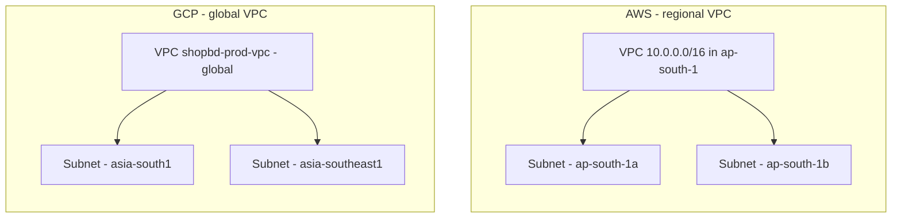
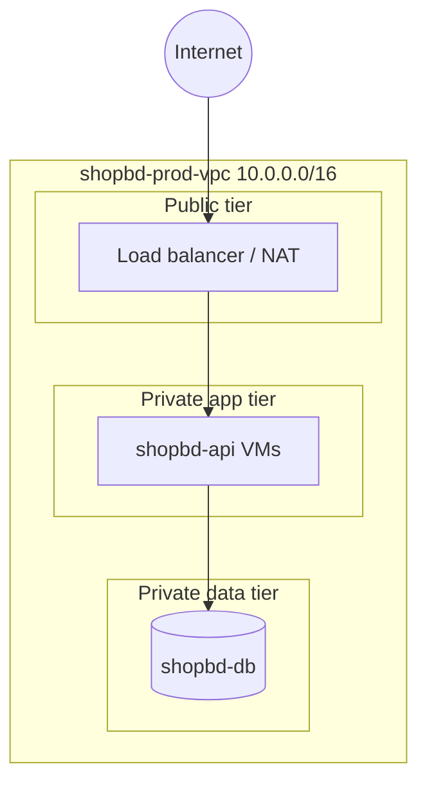
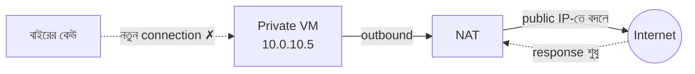
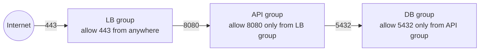
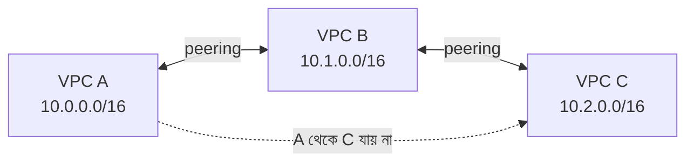
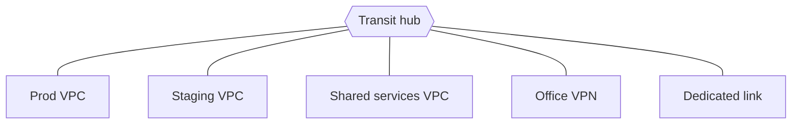
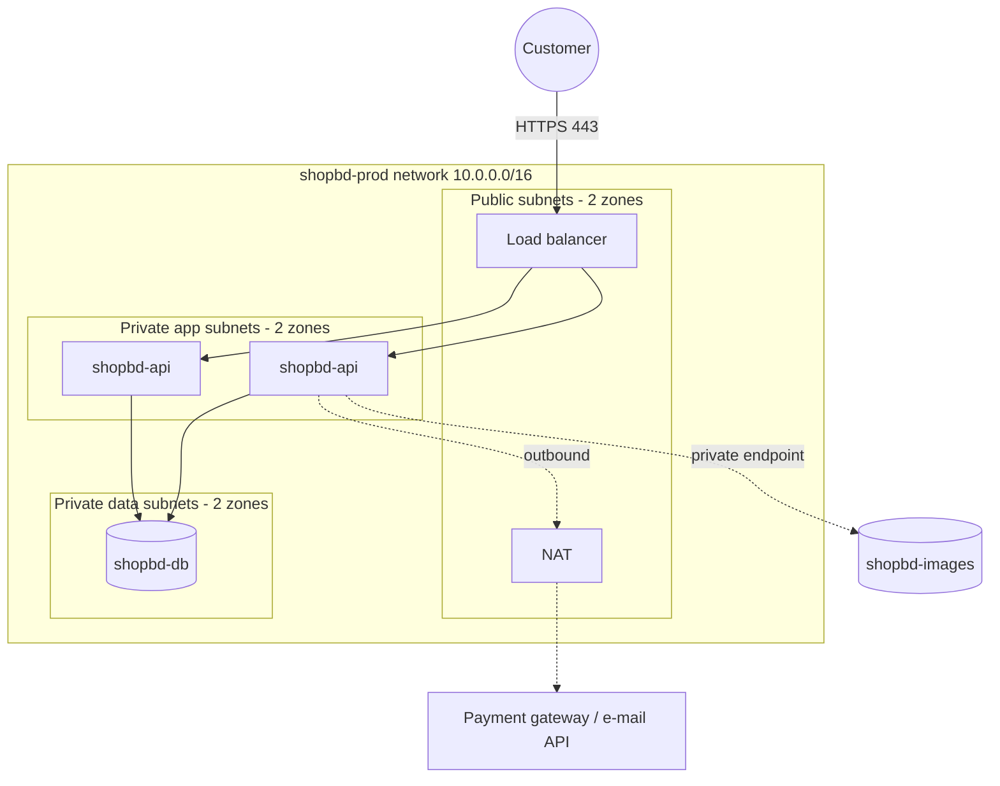

# 05 · Networking

> **এই অধ্যায়ে কী শিখবেন**
>
> - Private network (VPC / VNet / VCN) কী, আর কেন GCP-র VPC **global** কিন্তু বাকি তিনটি regional
> - CIDR, subnet, route table — কোন subnet কীভাবে "public" বা "private" হয়
> - Internet gateway, NAT, public IP; firewall — Security Group/NACL, GCP firewall rule, Azure NSG, OCI Security List/NSG
> - Private endpoint, peering, transit hub (TGW / NCC / Virtual WAN / DRG), VPN ও dedicated link (Direct Connect / Interconnect / ExpressRoute / FastConnect)
> - `shopbd`-র network চার cloud-এ CLI ও Terraform দিয়ে, আর সবচেয়ে সাধারণ ভুলগুলো

!!! abstract "এক নজরে — কোন cloud-এ কী নাম"

    | Concept | AWS | GCP | Azure | OCI |
    |---|---|---|---|---|
    | Private network | VPC | VPC network (**global**) | Virtual Network (VNet) | Virtual Cloud Network (VCN) |
    | Network-এর পরিধি | Region | **Global** (subnet regional) | Region | Region |
    | Subnet-এর পরিধি | **Zone (AZ)** | **Region** | Region (zone জুড়ে) | Region (বা AD) |
    | Route table | Route table (subnet-এ) | Routes (VPC-তে, tag দিয়ে target) | Route table / UDR (subnet-এ) | Route table (subnet-এ) |
    | Internet-এ বেরোনো/ঢোকা | Internet Gateway (IGW) | Default internet gateway + external IP | Public IP + default outbound | Internet Gateway |
    | Private subnet-এর outbound | NAT Gateway | Cloud NAT | NAT Gateway | NAT Gateway |
    | Instance-level firewall | Security Group (stateful) | VPC firewall rule (network tag / service account) | NSG (subnet বা NIC-তে) | NSG (VNIC-তে) |
    | Subnet-level firewall | Network ACL (stateless) | Firewall policy (hierarchical) | NSG (subnet-এ) | Security List |
    | Private access to PaaS | VPC Endpoint (Gateway / Interface = PrivateLink) | Private Google Access / Private Service Connect | Private Endpoint (Private Link) / Service Endpoint | Service Gateway / Private Endpoint |
    | VPC peering | VPC Peering | VPC Network Peering | VNet Peering | Local / Remote Peering (via DRG) |
    | Transit / hub | Transit Gateway (TGW) | Network Connectivity Center (NCC) | Virtual WAN / hub-spoke | Dynamic Routing Gateway (DRG) |
    | Site-to-site VPN | Site-to-Site VPN | Cloud VPN (HA VPN) | VPN Gateway | Site-to-Site VPN (IPSec) |
    | Dedicated link | Direct Connect | Cloud Interconnect | ExpressRoute | FastConnect |
    | Bastion | SSM Session Manager / EC2 Instance Connect Endpoint | IAP TCP forwarding | Azure Bastion | OCI Bastion |
    | Flow logs | VPC Flow Logs | VPC Flow Logs | NSG / VNet flow logs | VCN Flow Logs |

---

## ১. Network কেন দরকার — মূল ধারণা

যেকোনো দুটি মেশিন কথা বলতে হলে তাদের **IP address** লাগে। Cloud-এ আপনি নিজের জন্য একটা **বিচ্ছিন্ন, ব্যক্তিগত network** তৈরি করেন, যার ভেতরে আপনি ঠিক করেন:

- কোন IP range ব্যবহার হবে (**CIDR**)
- network-কে কীভাবে ভাগ করবেন (**subnet**)
- traffic কোন পথে যাবে (**route**)
- কে কার সাথে কথা বলতে পারবে (**firewall**)
- internet আর অন্য network-এর সাথে কীভাবে যুক্ত হবেন (**gateway, peering, VPN**)

!!! note "Analogy: একটা গেটওয়ালা আবাসিক এলাকা"
    VPC হলো পুরো এলাকা (প্রাচীর-ঘেরা)। Subnet হলো এক-একটা পাড়া (public পাড়া = দোকানের সামনের রাস্তা, private পাড়া = ভেতরের বাসা)। Route table হলো সাইনবোর্ড ("বাইরে যেতে হলে এই গেট দিয়ে")। Gateway হলো গেট। Firewall হলো প্রতিটি দরজার দারোয়ান। NAT হলো এমন এক ডাকঘর — ভেতরের বাসিন্দা চিঠি পাঠাতে পারে, কিন্তু বাইরের কেউ সরাসরি ভেতরে ঢুকতে পারে না।

### CIDR এক মিনিটে

`10.0.0.0/16` মানে প্রথম ১৬ bit নির্দিষ্ট, বাকি ১৬ bit-এ ২^১৬ = ৬৫,৫৩৬টি address। `/n` যত বড়, range তত ছোট।

| CIDR | মোট address | সাধারণ ব্যবহার |
|---|---|---|
| `/16` | ৬৫,৫৩৬ | পুরো VPC/VNet/VCN |
| `/20` | ৪,০৯৬ | বড় subnet (যেমন Kubernetes) |
| `/24` | ২৫৬ | সাধারণ subnet |
| `/28` | ১৬ | খুব ছোট subnet |

Private ব্যবহারের জন্য সংরক্ষিত range (RFC 1918): `10.0.0.0/8`, `172.16.0.0/12`, `192.168.0.0/16`।

!!! warning "প্রথমেই CIDR ঠিক করুন — পরে বদলানো কঠিন"
    দুটি network কখনো peering/VPN/transit দিয়ে জুড়তে চাইলে তাদের CIDR **overlap** করা চলবে না। অফিসের network, অন্য cloud, অন্য team-এর VPC — সব মিলিয়ে একটা IP plan আগে থেকে তৈরি করুন। চার cloud-ই সাধারণত VPC-র primary range পরে বদলাতে দেয় না (কিছু secondary range যোগ করা যায়)।

---

## ২. VPC / VNet / VCN — আপনার private network



| বিষয় | AWS VPC | GCP VPC | Azure VNet | OCI VCN |
|---|---|---|---|---|
| পরিধি | একটি region | **সারা বিশ্ব (global)** | একটি region | একটি region |
| Default network | প্রতি region-এ একটি **default VPC** | `default` auto-mode network (প্রতি নতুন project-এ) | নেই | নেই |
| Address range | VPC-তে এক বা একাধিক IPv4 CIDR | **VPC-তে CIDR নেই** — range শুধু subnet-এ | VNet-এ এক বা একাধিক address space | VCN-এ এক বা একাধিক CIDR |
| Subnet mode | সবসময় custom | **Auto mode** বনাম **Custom mode** | সবসময় custom | সবসময় custom |
| Multi-cloud তুলনার সতর্কতা | zone-ভিত্তিক subnet | region-ভিত্তিক subnet, global VPC | region-ভিত্তিক | compartment-এ থাকে |

!!! danger "GCP-র VPC global — এটাই সবচেয়ে বড় অমিল"
    GCP-তে একটাই VPC `asia-south1` (Mumbai) আর `asia-southeast1` (Singapore) দুটো region-এর VM-কে সরাসরি private IP-তে যুক্ত করে — peering/VPN লাগে না। Route ও firewall rule-ও VPC-জুড়ে। AWS/Azure/OCI-তে প্রতি region-এ আলাদা network, পরে জুড়তে হয়। বিপরীতে GCP-র subnet **regional** (একটা subnet সব zone ঢাকে), AWS-এর subnet **zonal**।

!!! warning "Default network-এর ফাঁদ"
    AWS default VPC-তে subnet-গুলো public (VM-এ auto public IP)। GCP `default` network-এ `default-allow-ssh`, `default-allow-rdp`, `default-allow-icmp` ও `default-allow-internal` নামে firewall rule থাকে, আর auto-mode range সব region-এ বসে — production-এ কখনো এটা ব্যবহার করবেন না; নিজের custom-mode VPC বানান। Azure ও OCI-তে default নেই, আপনি নিজে তৈরি করেন (OCI console-এর "VCN wizard" সাহায্য করে)।

### OCI-তে compartment

OCI-তে প্রতিটি VCN, subnet, route table একটা **compartment**-এর ভেতরে থাকে ([02 · Account ও Hierarchy](02-accounts-and-hierarchy.md))। CLI/Terraform-এ প্রায় প্রতি কমান্ডে `compartment-id` (OCID) দিতে হয়।

---

## ৩. Subnet — network-কে ভাগ করা

**Subnet** হলো VPC-র CIDR-এর একটা অংশ। আপনার resource সব সময় একটা subnet-এ বসে।

| বিষয় | AWS | GCP | Azure | OCI |
|---|---|---|---|---|
| Subnet কোথায় থাকে | **একটি AZ-তে** | **একটি region-এ** (সব zone-এ কাজ করে) | একটি VNet-এ (region; zone-এ সীমাবদ্ধ নয়) | একটি VCN-এ; **regional** (প্রস্তাবিত) বা AD-নির্দিষ্ট |
| প্রতি subnet-এ reserved IP | ৫টি | ৪টি | ৫টি | ৩টি |
| Public/private কীভাবে হয় | Route table-এ IGW-র route আছে কিনা | VM-এ external IP আছে কিনা (route সব সময় আছে) | Public IP ও outbound ব্যবস্থা (NAT/IP) আছে কিনা | Subnet-এর flag: public বা private + route |
| Subnet-এ বিশেষ flag | `map_public_ip_on_launch` | Private Google Access | `defaultOutboundAccess` (private subnet) | `prohibit-public-ip-on-vnic` |
| বিশেষ নামের subnet | — | — | `GatewaySubnet`, `AzureBastionSubnet`, `AzureFirewallSubnet` | — |

!!! note "Subnet নিজে public বা private নয়"
    সত্যিকারের "public/private" নির্ভর করে **route** ও **public IP**-র ওপর। AWS-এ public subnet = যার route table-এ `0.0.0.0/0 → igw-…`। GCP-তে public/private বলে কিছু নেই — VM-এর external IP থাকলে সে internet থেকে পৌঁছানো যায়। Azure-এ নতুন VNet-এ ধাপে ধাপে "private subnet" default হচ্ছে (default outbound access বন্ধ), তাই outbound-এর জন্য NAT Gateway বা public IP **স্পষ্টভাবে** দিন। OCI-তে subnet বানানোর সময়ই public/private বেছে নিতে হয়।

### Subnet-এর আকার কত?

- ছোট রাখলে IP ফুরিয়ে যায়, বড় রাখলে অপচয় — সাধারণ app tier-এ `/24` (প্রায় ২৫১ IP) ভালো শুরু।
- Kubernetes (pod প্রতি IP) বা অনেক VM হলে `/20`-এর কাছাকাছি।
- Database subnet আলাদা — সংখ্যায় কম, নিরাপত্তায় কঠোর।

### 3-tier layout



### `shopbd`-র IP plan

| Tier | AWS / Azure / OCI (zone/AD ভিত্তিক বা সমতুল্য) | GCP (regional subnet) |
|---|---|---|
| VPC | `10.0.0.0/16` | VPC-তে range নেই |
| Public a / b | `10.0.0.0/24`, `10.0.1.0/24` | `10.0.0.0/24` (একটাই) |
| App a / b | `10.0.10.0/24`, `10.0.11.0/24` | `10.0.10.0/24` |
| Data a / b | `10.0.20.0/24`, `10.0.21.0/24` | `10.0.20.0/24` |
| ভবিষ্যৎ | `10.1.0.0/16` — staging | `10.1.0.0/16` — staging |

!!! tip "ভবিষ্যতের জন্য আলাদা `/16`"
    Production `10.0.0.0/16`, staging `10.1.0.0/16`, অফিস/অন্য cloud `10.2.0.0/16` — এভাবে ভাগ করলে পরে peering/transit-এ overlap-এর ঝামেলা থাকে না।

---

## ৪. Route table — traffic কোন পথে যায়

Route table বলে: "এই destination-এর traffic এই **target**-এ পাঠাও।" যে route-এর prefix সবচেয়ে নির্দিষ্ট (longest prefix match), সেটি জেতে।

| বিষয় | AWS | GCP | Azure | OCI |
|---|---|---|---|---|
| Route কোথায় থাকে | Route table, subnet-এ associate | **VPC-তে** route (instance tag দিয়ে নির্দিষ্ট করা যায়) | Route table (UDR), subnet-এ associate | Route table, subnet-এ associate |
| ভেতরের route | `local` (মুছা যায় না) | Subnet route (স্বয়ংক্রিয়) | System route (VNet traffic, internet) | VCN-এর ভেতরে implicit (route লাগে না) |
| Internet-এর target | `igw-…` | `default-internet-gateway` | `Internet` (system) | Internet Gateway (OCID) |
| NAT-এর target | `nat-…` | Cloud NAT (route-এ নয়, router-এ) | NAT Gateway (subnet-এ attach) | NAT Gateway (route target) |
| Appliance-এ পাঠানো | ENI / instance target | Next hop instance/ILB | **Next hop: Virtual appliance** | Private IP target |
| Peer/Gateway | peering/TGW/VGW | VPN tunnel, peering | Virtual network gateway | DRG, LPG, Service Gateway |

=== "AWS"

    প্রতিটি subnet একটা route table-এর সাথে যুক্ত; আলাদা না দিলে VPC-র **main route table** প্রযোজ্য। Public/private আলাদা route table বানানোই নিয়ম।

    | Destination | Target | মানে |
    |---|---|---|
    | `10.0.0.0/16` | `local` | VPC-র ভেতর |
    | `0.0.0.0/0` | `igw-0abc…` | বাকি সব internet-এ (public subnet) |
    | `0.0.0.0/0` | `nat-0abc…` | বাকি সব NAT-এ (private subnet) |

=== "GCP"

    Route সরাসরি VPC-র সম্পদ। Subnet তৈরি হলে তার route স্বয়ংক্রিয়, আর custom VPC-তেও `0.0.0.0/0 → default internet gateway` route থাকে। কোন VM-এ route খাটবে তা **network tag** দিয়ে সীমাবদ্ধ করা যায়। Private VM-এর NAT-এর জন্য আলাদা route নয়, **Cloud NAT** লাগে।

    ```bash
    gcloud compute routes list --filter="network:shopbd-prod-vpc"
    ```

=== "Azure"

    Azure-এ **system route** আপনা-আপনি থাকে (VNet-এর ভেতর, internet)। নিজের নিয়ম দিতে **route table (user-defined route, UDR)** বানিয়ে subnet-এ যুক্ত করুন — যেমন সব traffic firewall appliance-এর মধ্য দিয়ে পাঠাতে next hop `VirtualAppliance`।

    ```bash
    az network route-table create -g shopbd-prod-rg -n shopbd-private-rt
    az network route-table route create -g shopbd-prod-rg --route-table-name shopbd-private-rt \
      -n to-firewall --address-prefix 0.0.0.0/0 \
      --next-hop-type VirtualAppliance --next-hop-ip-address 10.0.1.4
    ```

=== "OCI"

    VCN-এর ভেতরের traffic-এর জন্য route লাগে না (স্বয়ংক্রিয়)। বাকিগুলোর জন্য subnet-ভিত্তিক route table-এ `destination → target (OCID)` — target হতে পারে Internet Gateway, NAT Gateway, Service Gateway, DRG, Local Peering Gateway বা private IP।

    ```bash
    oci network route-table create \
      --compartment-id ocid1.compartment.oc1..example --vcn-id ocid1.vcn.oc1.ap-mumbai-1.example \
      --display-name shopbd-public-rt \
      --route-rules '[{"destination":"0.0.0.0/0","destinationType":"CIDR_BLOCK","networkEntityId":"ocid1.internetgateway.oc1.ap-mumbai-1.example"}]'
    ```

---

## ৫. Internet-এ যাওয়া — Gateway, Public IP ও NAT

### ইনবাউন্ড (বাইরে থেকে ভেতরে)

Internet থেকে আপনার resource-এ পৌঁছাতে চাই: **gateway + public IP + firewall-এ অনুমতি** — তিনটিই লাগে।

| উপাদান | AWS | GCP | Azure | OCI |
|---|---|---|---|---|
| Internet গেট | **Internet Gateway** (VPC-তে attach) | অন্তর্নির্মিত default internet gateway | অন্তর্নির্মিত (public IP থাকলেই) | **Internet Gateway** (VCN-এ তৈরি) |
| স্থির public IP | **Elastic IP** | Static external IP | Public IP (Standard, static) | Reserved public IP |
| Public IP-র জন্য বিল | প্রতিটি public IPv4-র আলাদা charge | external IP-র charge (static/ephemeral ধরন ভেদে) | Public IP-র charge | Reserved IP-র শর্ত pricing পাতায় দেখুন |

!!! tip "App server-এর public IP নয়, load balancer-এর"
    Production-এ internet-মুখী একমাত্র দরজা হয় **load balancer** ([10 · Load Balancing](10-load-balancing-scaling-dns-cdn.md))। App ও DB private subnet-এ থাকে।

### আউটবাউন্ড (ভেতর থেকে বাইরে) — NAT

Private subnet-এর VM-এর OS update, package download বা external API (যেমন payment gateway) ডাকা দরকার, অথচ বাইরে থেকে কেউ ঢুকতে পারবে না। এ কাজ **NAT (Network Address Translation)** করে।



| বিষয় | AWS NAT Gateway | GCP Cloud NAT | Azure NAT Gateway | OCI NAT Gateway |
|---|---|---|---|---|
| ধরন | Managed, **zonal** | Managed, **software-defined, regional** (VM-এর path-এ আলাদা ডিভাইস নেই) | Managed, subnet-এ attach | Managed, VCN-এ, route target |
| কোথায় বসে | **Public subnet**-এ + Elastic IP | Cloud Router-এর সাথে | Public IP / prefix সহ | VCN-এ; route table-এ target |
| HA-র জন্য | প্রতি AZ-তে একটি | Regional (নিজেই HA) | SKU ভেদে zonal বা zone-redundant | Regional |
| খরচ-চালক | ঘণ্টা-ভিত্তিক + **প্রতি GB প্রক্রিয়াজাত data** | gateway/ব্যবহার + data | ঘণ্টা + data | pricing পাতা দেখুন |

!!! warning "NAT Gateway এ ছোট ভুলে বড় বিল"
    AWS NAT Gateway প্রতি GB data প্রক্রিয়াকরণের জন্য আলাদা চার্জ করে। Private VM থেকে S3-তে বড় ফাইল NAT দিয়ে গেলে বিল ফুলে ওঠে — সমাধান: **Gateway endpoint (S3)** বা private endpoint (নিচের ৭ নম্বর)। GCP-তেও Private Google Access একই কাজ করে।

### Egress-only ও IPv6

Public IPv6 address সব cloud-এ সরাসরি reachable; তাই আউটবাউন্ড-শুধু চাইলে AWS-এ **Egress-only Internet Gateway** লাগে, বাকিগুলোতে firewall দিয়ে সামলাতে হয়। `shopbd` এখনো IPv4-ই ব্যবহার করে; IPv6 নিয়ে আরও জানতে প্রতিটি cloud-এর docs দেখুন।

### CLI — internet ও NAT সেটআপ

=== "AWS"

    ```bash
    aws ec2 create-internet-gateway \
      --tag-specifications 'ResourceType=internet-gateway,Tags=[{Key=Name,Value=shopbd-igw}]'
    aws ec2 attach-internet-gateway --internet-gateway-id igw-0abc123 --vpc-id vpc-0abc123

    aws ec2 allocate-address --domain vpc
    aws ec2 create-nat-gateway --subnet-id subnet-0public-a --allocation-id eipalloc-0abc123

    aws ec2 create-route --route-table-id rtb-0public --destination-cidr-block 0.0.0.0/0 --gateway-id igw-0abc123
    aws ec2 create-route --route-table-id rtb-0private --destination-cidr-block 0.0.0.0/0 --nat-gateway-id nat-0abc123
    ```

=== "GCP"

    Internet-এর route আপনা-আপনি আছে। Private VM-এর outbound-এর জন্য Cloud Router + Cloud NAT:

    ```bash
    gcloud compute routers create shopbd-router \
      --network=shopbd-prod-vpc --region=asia-south1

    gcloud compute routers nats create shopbd-nat \
      --router=shopbd-router --region=asia-south1 \
      --auto-allocate-nat-external-ips --nat-all-subnet-ip-ranges
    ```

=== "Azure"

    ```bash
    az network public-ip create -g shopbd-prod-rg -n shopbd-nat-ip --sku Standard --allocation-method Static
    az network nat gateway create -g shopbd-prod-rg -n shopbd-natgw --public-ip-addresses shopbd-nat-ip
    az network vnet subnet update -g shopbd-prod-rg --vnet-name shopbd-prod-vnet \
      -n private-app --nat-gateway shopbd-natgw
    ```

=== "OCI"

    ```bash
    oci network internet-gateway create --compartment-id ocid1.compartment.oc1..example \
      --vcn-id ocid1.vcn.oc1.ap-mumbai-1.example --is-enabled true --display-name shopbd-igw

    oci network nat-gateway create --compartment-id ocid1.compartment.oc1..example \
      --vcn-id ocid1.vcn.oc1.ap-mumbai-1.example --display-name shopbd-natgw
    ```

    তারপর private subnet-এর route table-এ `0.0.0.0/0 → NAT gateway OCID` যোগ করুন।

---

## ৬. Firewall — কে কার সাথে কথা বলতে পারবে

Firewall rule বলে: "এই source থেকে, এই port-এ, এই protocol-এর traffic **অনুমতি দাও** (বা আটকাও)।" চার cloud-এ ধারণা এক, কিন্তু **কোথায় লাগে** আর **কীভাবে লেখে** — এখানেই সবচেয়ে বেশি গোলমাল।

!!! note "Stateful বনাম stateless"
    **Stateful** firewall একটি request অনুমতি পেলে তার response স্বয়ংক্রিয়ভাবে ফিরতে দেয় — আলাদা rule লাগে না। **Stateless** firewall-এ আসা ও যাওয়া দুই দিকের rule আলাদা লিখতে হয়, ফেরত পথের জন্য ephemeral port (সাধারণত `1024–65535`) খুলতে হয়।

| বিষয় | AWS | GCP | Azure | OCI |
|---|---|---|---|---|
| Instance-level | **Security Group (SG)** — ENI-তে | **VPC firewall rule** — VPC-তে, target = tag/service account | **NSG** — NIC-তে | **NSG** — VNIC-তে |
| Subnet-level | **Network ACL (NACL)** | (hierarchical firewall policy: org/folder/VPC) | **NSG** — subnet-এ | **Security List** — subnet-এ |
| Stateful? | SG হ্যাঁ; NACL **না** | হ্যাঁ | হ্যাঁ | Rule-ভিত্তিক: stateful (default) বা stateless |
| Allow / Deny | SG শুধু allow; NACL allow + deny | allow + deny, priority সহ | allow + deny, priority সহ | শুধু allow |
| Default (ঢোকা) | সব বন্ধ | সব বন্ধ (implied deny) | সব বন্ধ (VNet-এর ভেতর ও LB বাদে) | Security List-এর rule অনুযায়ী |
| Default (বেরোনো) | সব খোলা | সব খোলা (implied allow) | সব খোলা (Internet outbound) | Security List/NSG-র rule অনুযায়ী |
| অন্য group-কে source বানানো | **হ্যাঁ** (SG → SG) | tag / service account | **ASG** (Application Security Group) বা service tag | **হ্যাঁ** (NSG → NSG) |
| Rule priority | নেই (সব allow মেলে) | `0–65535` (ছোট = আগে) | `100–4096` (ছোট = আগে) | নেই (allow-only) |

### তিন স্তরের নিরাপত্তা (`shopbd`)



লক্ষ করুন, IP-র পরিবর্তে **group-কে source** বানানো হয়েছে। নতুন API VM যোগ হলেও rule বদলাতে হয় না।

=== "AWS"

    **Security Group** — আপনার সবচেয়ে বেশি ব্যবহৃত firewall। Stateful, allow-only, ENI-তে। এক SG আরেক SG-কে source ধরতে পারে।

    ```bash
    aws ec2 create-security-group --group-name shopbd-api-sg \
      --description "shopbd API" --vpc-id vpc-0abc123

    # শুধু ALB-র SG থেকে 8080
    aws ec2 authorize-security-group-ingress --group-id sg-0api123 \
      --protocol tcp --port 8080 --source-group sg-0alb123
    ```

    **Network ACL (NACL)** — subnet-স্তরে অতিরিক্ত দেয়াল। **Stateless**; rule নম্বর ধরে (ছোট নম্বর আগে) চলে, allow ও deny দুটোই আছে, আর ফেরত পথের ephemeral port নিজে খুলতে হয়। Default NACL সব অনুমতি দেয়; বেশির ভাগ সময় SG-ই যথেষ্ট, NACL লাগে নির্দিষ্ট IP **block** করতে।

=== "GCP"

    **VPC firewall rule** — VPC-র সম্পদ, instance-এ attach করতে হয় না; **target** ঠিক করে কোন VM-এ খাটবে: `--target-tags` (network tag) বা `--target-service-accounts` (আরও নিরাপদ — tag যে কেউ বদলাতে পারে)। Priority `0–65535`; সবচেয়ে নিচের implied rule: সব ingress deny, সব egress allow।

    ```bash
    # Internet থেকে শুধু web tag-ওয়ালা VM-এ 443
    gcloud compute firewall-rules create shopbd-allow-https \
      --network=shopbd-prod-vpc --direction=INGRESS --action=ALLOW \
      --rules=tcp:443 --source-ranges=0.0.0.0/0 --target-tags=shopbd-web

    # web থেকে api-তে 8080
    gcloud compute firewall-rules create shopbd-web-to-api \
      --network=shopbd-prod-vpc --direction=INGRESS --action=ALLOW \
      --rules=tcp:8080 --source-tags=shopbd-web --target-tags=shopbd-api
    ```

    বড় organization-এ **hierarchical firewall policy** দিয়ে org/folder স্তরে নিয়ম চাপানো যায়, আর Cloud NGFW উন্নত filtering দেয়।

=== "Azure"

    **NSG (Network Security Group)** — rule list priority সহ (`100–4096`); একটি NSG **subnet-এ বা NIC-তে বা দুটোতেই** লাগানো যায়। দুটোতে থাকলে traffic দুটো NSG-ই পার হতে হয়। Default rule: `AllowVnetInBound`, `AllowAzureLoadBalancerInBound`, `DenyAllInBound` (ঢোকা) এবং `AllowVnetOutBound`, `AllowInternetOutBound`, `DenyAllOutBound`। Source/destination-এ IP, **Application Security Group (ASG)** বা **service tag** (যেমন `Internet`, `Storage`) দেওয়া যায়।

    ```bash
    az network nsg create -g shopbd-prod-rg -n shopbd-public-nsg

    az network nsg rule create -g shopbd-prod-rg --nsg-name shopbd-public-nsg \
      -n AllowHttps --priority 100 --direction Inbound --access Allow \
      --protocol Tcp --source-address-prefixes Internet \
      --destination-port-ranges 443

    az network vnet subnet update -g shopbd-prod-rg --vnet-name shopbd-prod-vnet \
      -n public --network-security-group shopbd-public-nsg
    ```

=== "OCI"

    দুই উপায়, এবং **দুটোই একসাথে খাটে** (union — একটি অনুমতি দিলেই traffic পার):

    - **Security List** — subnet-স্তরে; প্রতিটি rule stateful (default) বা stateless। VCN-এর **default security list**-এ internet থেকে SSH (`22`) ও ICMP-র rule থাকে!
    - **Network Security Group (NSG)** — VNIC-স্তরে, আধুনিক ও নমনীয়; অন্য NSG-কে source/destination বানানো যায়। নতুন ডিজাইনে NSG প্রস্তাবিত।

    ```bash
    oci network nsg create --compartment-id ocid1.compartment.oc1..example \
      --vcn-id ocid1.vcn.oc1.ap-mumbai-1.example --display-name shopbd-api-nsg

    oci network nsg rules add --nsg-id ocid1.networksecuritygroup.oc1.ap-mumbai-1.example \
      --security-rules '[{"direction":"INGRESS","protocol":"6","source":"ocid1.networksecuritygroup.oc1.ap-mumbai-1.lb","sourceType":"NETWORK_SECURITY_GROUP","tcpOptions":{"destinationPortRange":{"min":8080,"max":8080}}}]'
    ```

    (`protocol: "6"` মানে TCP।)

!!! danger "`0.0.0.0/0` থেকে SSH/RDP/DB port খুলবেন না"
    `22`, `3389`, `5432`, `3306`, `6379` ইত্যাদি কখনো গোটা internet-এ নয়। Bastion, VPN বা নির্দিষ্ট IP দিন। GCP `default` network ও OCI default security list-এর SSH rule মনে রাখুন।

---

## ৭. Private endpoint — internet না ঘুরে managed service-এ

Object storage, database, secret manager — এই PaaS service-গুলোর একটা public address থাকে। আপনার VM সেখানে সাধারণত NAT/internet হয়ে যায়: খরচ বাড়ে, আর data public পথে ঘোরে। **Private connectivity**-তে traffic cloud-এর নিজস্ব backbone-এর ভেতরেই থাকে, আর PaaS-কে আপনার VPC থেকেই private IP-তে পাওয়া যায়।

| উপায় | AWS | GCP | Azure | OCI |
|---|---|---|---|---|
| Object storage-কে route দিয়ে (gateway-ধরন) | **Gateway endpoint** (S3, DynamoDB) | **Private Google Access** (subnet flag) | **Service Endpoint** (subnet-এ; পুরনো ধরন) | **Service Gateway** (route target) |
| Private IP-সহ endpoint (interface-ধরন) | **Interface endpoint (PrivateLink)** | **Private Service Connect (PSC)** endpoint | **Private Endpoint (Private Link)** | **Private Endpoint** (সমর্থিত service-এ) |
| নিজের service অন্যকে private-এ দেওয়া | PrivateLink endpoint service | PSC published service | Private Link service | Private Endpoint / Service-নির্ভর |
| Managed DB-র private IP | RDS/Aurora subnet group | Cloud SQL private IP (**private services access**) | Private Endpoint / VNet integration | DB system নিজের subnet-এ |
| DNS-এ কী বদলায় | `*.s3.ap-south-1.amazonaws.com` private IP-তে | `*.googleapis.com` → private/restricted VIP | `*.privatelink.blob.core.windows.net` private DNS zone | Service Gateway-তে Oracle Services Network |

!!! note "Interface endpoint আর gateway endpoint আলাদা"
    Gateway endpoint (AWS-এ S3/DynamoDB) আসলে **route table-এর একটি entry** — প্রায় কোনো খরচ নেই। Interface endpoint (PrivateLink, PSC, Azure Private Endpoint) হলো subnet-এ বসা একটা **private IP-ওয়ালা network interface** — ঘণ্টা ও data অনুযায়ী খরচ, আর DNS ঠিক করতে হয়।

=== "AWS"

    ```bash
    # S3 gateway endpoint — private route table-এ route যোগ হয়
    aws ec2 create-vpc-endpoint --vpc-id vpc-0abc123 \
      --service-name com.amazonaws.ap-south-1.s3 \
      --route-table-ids rtb-0private

    # Interface endpoint (যেমন Secrets Manager)
    aws ec2 create-vpc-endpoint --vpc-id vpc-0abc123 --vpc-endpoint-type Interface \
      --service-name com.amazonaws.ap-south-1.secretsmanager \
      --subnet-ids subnet-0private-a --security-group-ids sg-0endpoint
    ```

=== "GCP"

    ```bash
    # সবচেয়ে সরল: subnet-এ Private Google Access
    gcloud compute networks subnets update shopbd-private-mumbai \
      --region=asia-south1 --enable-private-ip-google-access
    ```

    VM-এ external IP না থাকলেও এতে Google API (Cloud Storage ইত্যাদি) পৌঁছানো যায়। নিজস্ব internal IP-ওয়ালা endpoint চাইলে **Private Service Connect**।

=== "Azure"

    ```bash
    az network private-endpoint create -g shopbd-prod-rg -n shopbd-images-pe \
      --vnet-name shopbd-prod-vnet --subnet private-data \
      --private-connection-resource-id /subscriptions/00000000-0000-0000-0000-000000000000/resourceGroups/shopbd-prod-rg/providers/Microsoft.Storage/storageAccounts/shopbdimages \
      --group-id blob --connection-name shopbd-images-conn
    ```

    সঙ্গে `privatelink.blob.core.windows.net` **private DNS zone** ও VNet link লাগে, নইলে name পুরনো public IP-তেই resolve হবে।

=== "OCI"

    **Service Gateway** তৈরি করে private subnet-এর route table-এ "All <region> Services in Oracle Services Network" target দিন — তাহলে Object Storage ইত্যাদিতে NAT/IGW ছাড়াই যাওয়া যায়।

    ```bash
    oci network service-gateway create --compartment-id ocid1.compartment.oc1..example \
      --vcn-id ocid1.vcn.oc1.ap-mumbai-1.example \
      --services '[{"serviceId":"ocid1.service.oc1.ap-mumbai-1.example"}]' \
      --display-name shopbd-sgw
    ```

---

## ৮. VPC Peering — দুটি network সরাসরি জোড়া

**Peering** দুটি আলাদা network-কে private IP-তে সরাসরি যুক্ত করে, internet বা VPN ছাড়া।



!!! warning "Peering transitive নয়"
    A↔B এবং B↔C peering থাকলেও A থেকে C-তে যাওয়া **যায় না** (চার cloud-এই)। তিনটি network-কে সংযুক্ত রাখতে সব জোড়ায় peering, বা **transit hub** (পরের অংশ) লাগে। আর দুই network-এর CIDR overlap করলে peering-ই হয় না।

| বিষয় | AWS VPC Peering | GCP VPC Network Peering | Azure VNet Peering | OCI (LPG / RPC / DRG) |
|---|---|---|---|---|
| Cross-region | হ্যাঁ (inter-region peering) | হ্যাঁ — VPC global হওয়ায় একই VPC-ই বেশি কাজ করে | হ্যাঁ (Global VNet peering) | RPC (DRG-র মাধ্যমে) |
| Cross-account | হ্যাঁ (accept করতে হয়) | হ্যাঁ (দুই দিকে তৈরি করতে হয়) | হ্যাঁ (দুই দিকে) | হ্যাঁ, policy সহ |
| উভয় পক্ষে তৈরি | requester + accepter | দুই দিকে peering | দুই দিকে peering | LPG জোড়া / RPC; এখন DRG attachment-ই সহজ |
| Route যোগ করা | **হাতে** (দুই VPC-র route table-এ) | স্বয়ংক্রিয় subnet route বিনিময় | স্বয়ংক্রিয় | route table-এ target DRG/LPG |
| Firewall | SG/NACL-এ অনুমতি লাগে | firewall rule-এ অনুমতি লাগে | NSG-তে অনুমতি লাগে | SL/NSG-তে অনুমতি লাগে |

=== "AWS"

    ```bash
    aws ec2 create-vpc-peering-connection --vpc-id vpc-0prod --peer-vpc-id vpc-0staging
    aws ec2 accept-vpc-peering-connection --vpc-peering-connection-id pcx-0abc123

    # দুই VPC-র route table-এই:
    aws ec2 create-route --route-table-id rtb-0prod \
      --destination-cidr-block 10.1.0.0/16 --vpc-peering-connection-id pcx-0abc123
    ```

=== "GCP"

    ```bash
    gcloud compute networks peerings create prod-to-staging \
      --network=shopbd-prod-vpc --peer-network=shopbd-staging-vpc

    gcloud compute networks peerings create staging-to-prod \
      --network=shopbd-staging-vpc --peer-network=shopbd-prod-vpc
    ```

=== "Azure"

    ```bash
    az network vnet peering create -g shopbd-prod-rg -n prod-to-staging \
      --vnet-name shopbd-prod-vnet --remote-vnet shopbd-staging-vnet \
      --allow-vnet-access

    az network vnet peering create -g shopbd-staging-rg -n staging-to-prod \
      --vnet-name shopbd-staging-vnet --remote-vnet shopbd-prod-vnet \
      --allow-vnet-access
    ```

=== "OCI"

    OCI-তে এখন সাধারণ উপায় হলো দুটি VCN-কে একই **DRG**-তে attach করা (DRG-ই hub হিসেবে route দেয়)। পুরনো উপায় **Local Peering Gateway (LPG)** একই region-এ, আর অন্য region-এ **Remote Peering Connection (RPC)**।

    ```bash
    oci network drg create --compartment-id ocid1.compartment.oc1..example --display-name shopbd-drg
    oci network drg-attachment create --drg-id ocid1.drg.oc1.ap-mumbai-1.example \
      --network-details '{"type":"VCN","id":"ocid1.vcn.oc1.ap-mumbai-1.example"}'
    ```

---

## ৯. Transit hub — অনেক network এক কেন্দ্রে

পাঁচটি VPC পরস্পর peering করলে ১০টি সংযোগ; দশটি হলে ৪৫টি — জটিল! সমাধান **hub-and-spoke**: সবাই hub-এর সাথে যুক্ত, hub route করে।



| ভূমিকা | AWS | GCP | Azure | OCI |
|---|---|---|---|---|
| Hub service | **Transit Gateway (TGW)** | **Network Connectivity Center (NCC)** | **Virtual WAN (virtual hub)** বা নিজে বানানো hub VNet | **Dynamic Routing Gateway (DRG)** |
| Spoke (attachment) | VPC, VPN, Direct Connect gateway, TGW peering | VPC spoke, VPN/Interconnect/router-appliance spoke | VNet connection, VPN/ExpressRoute, branch | VCN, IPSec VPN, FastConnect, RPC attachment |
| Route নিয়ন্ত্রণ | TGW route table (association/propagation) | Hub-এর preset topology (mesh বা star) ও route বিনিময় | Hub route table | DRG route table ও import distribution |
| Cross-region | TGW peering | Global VPC + NCC, বা hub region ভেদে | Virtual WAN hub-to-hub | DRG + RPC |

!!! example "অন্য বিষয়: network ভাগাভাগি"
    GCP-তে **Shared VPC** দিয়ে একটি host project-এর network অনেক service project ব্যবহার করে। AWS-এ **Resource Access Manager (RAM)** দিয়ে subnet অন্য account-এর সাথে share হয়। Azure-এ সাধারণত hub-spoke peering ব্যবহৃত হয়। OCI-তে একটি VCN একটি compartment-এ থাকে, আর IAM policy দিয়ে অন্য team-এর resource সেটা ব্যবহার করতে পারে। দুটো ভিন্ন জিনিস মনে রাখুন: **share** (এক network সবাই ব্যবহার করে) বনাম **connect** (আলাদা network জোড়া)।

আপাতত `shopbd` ছোট — hub লাগবে না। ভবিষ্যতে prod/staging/shared-tools আলাদা network হলে তখন hub ভাবুন।

=== "AWS"

    ```bash
    aws ec2 create-transit-gateway --description "shopbd-tgw"
    aws ec2 create-transit-gateway-vpc-attachment \
      --transit-gateway-id tgw-0abc123 --vpc-id vpc-0prod --subnet-ids subnet-0private-a subnet-0private-b
    ```

=== "GCP"

    ```bash
    gcloud network-connectivity hubs create shopbd-hub
    gcloud network-connectivity spokes linked-vpc-network create prod-spoke \
      --hub=shopbd-hub --vpc-network=shopbd-prod-vpc --global
    ```

=== "Azure"

    ```bash
    az network vwan create -g shopbd-prod-rg -n shopbd-vwan -l centralindia
    az network vhub create -g shopbd-prod-rg -n shopbd-hub --vwan shopbd-vwan \
      --address-prefix 10.100.0.0/24 -l centralindia
    ```

=== "OCI"

    DRG ইতিমধ্যে hub: প্রতিটি VCN `drg-attachment create` দিয়ে যুক্ত করুন (উপরের peering অংশ), আর DRG route table দিয়ে কোন attachment কার সাথে কথা বলবে ঠিক করুন।

---

## ১০. VPN — internet-এর ওপর encrypted টানেল

**Site-to-site VPN** আপনার অফিস/অন্য cloud-এর network-এর সাথে cloud network-কে **IPsec** দিয়ে সংযুক্ত করে — public internet-এর ওপর দিয়ে, কিন্তু encrypted। দ্রুত শুরু করা যায়, কম খরচ, কিন্তু latency ও bandwidth internet-নির্ভর।

| বিষয় | AWS | GCP | Azure | OCI |
|---|---|---|---|---|
| Service | Site-to-Site VPN | **Cloud VPN (HA VPN)** | **VPN Gateway** | **Site-to-Site VPN** |
| Cloud-এর প্রান্ত | Virtual Private Gateway বা **TGW** | HA VPN gateway + **Cloud Router** | VPN Gateway (**`GatewaySubnet`** লাগে) | **DRG** |
| Tunnel | প্রতি connection-এ ২টি (redundancy) | HA VPN: দুই interface, ২+ tunnel | Active-active সম্ভব | ২টি tunnel (redundancy) |
| Routing | BGP বা static | BGP (Cloud Router) | BGP বা static | BGP বা static |
| Remote-access (laptop→cloud) | **Client VPN** | (3rd-party বা IAP) | **P2S VPN** (VPN Gateway) | Bastion / 3rd-party |

!!! note "পুরনো নাম"
    GCP-র **Classic VPN** পুরনো; নতুন কাজে **HA VPN** (দুই interface, উচ্চ SLA)।

!!! warning "Azure: `GatewaySubnet` নামটা বাঁধা"
    VPN/ExpressRoute gateway যে subnet-এ বসে তার নাম হুবহু `GatewaySubnet` হতে হবে (সাধারণত `/27` বা বড়); এতে অন্য resource রাখা যায় না।

Remote developer-দের VM-এ ঢোকাতে সাধারণত VPN-এর বদলে bastion/IAP/Session Manager সহজ ও নিরাপদ (নিচে)।

---

## ১১. Dedicated link — Direct Connect, Interconnect, ExpressRoute, FastConnect

VPN internet-এর ওপর চলে; **dedicated link** আপনার data center/ISP থেকে cloud-এর edge পর্যন্ত **ব্যক্তিগত physical সংযোগ** — স্থিতিশীল latency, বড় bandwidth, কখনো কম egress খরচ।

| বিষয় | AWS Direct Connect | GCP Cloud Interconnect | Azure ExpressRoute | OCI FastConnect |
|---|---|---|---|---|
| ধরন | Dedicated port, বা partner-এর **hosted connection** | **Dedicated** বা **Partner Interconnect** (+ Cross-Cloud Interconnect) | Provider-এর মাধ্যমে **circuit**, বা **ExpressRoute Direct** | Partner (provider) বা colocation (Oracle-এর সাথে) |
| Virtual / peering | Private, Public, **Transit** VIF | VLAN attachment | **Private peering**, Microsoft peering | **Private peering**, public peering |
| Cloud-এর প্রান্ত | Virtual Private Gateway / **Direct Connect gateway** / TGW | Cloud Router | VNet gateway (ExpressRoute gateway) | **DRG** |
| Redundancy | দুই location-এ দুটি connection | ২টি attachment ২ zone-এ | দুই circuit / দুই provider | দুই virtual circuit |
| Multi-cloud সংযোগ | partner-এর মাধ্যমে | **Cross-Cloud Interconnect** | partner / ExpressRoute | **Oracle Interconnect for Azure / Google Cloud** |

!!! note "Bangladesh থেকে বাস্তবতা"
    Bangladesh-এ নিজস্ব cloud region নেই; সবচেয়ে কাছের সাধারণ পছন্দ Mumbai (`ap-south-1`, `asia-south1`, `centralindia`, `ap-mumbai-1`) বা Singapore। Dedicated link সাধারণত ব্যাংক/বড় প্রতিষ্ঠানের দরকার, আর partner/carrier-এর মাধ্যমে করা হয় — স্থানীয় সরবরাহকারীর সাথে কথা বলে নিন। ছোট `shopbd`-র জন্য VPN-ই যথেষ্ট; অনেক সময় তারও দরকার হয় না।

---

## ১২. Network-সংলগ্ন কয়েকটি জরুরি জিনিস

### ক) Private DNS

VPC-র ভেতরে আপনার service-গুলোকে নাম দিয়ে ডাকতে private DNS লাগে। AWS-এ **VPC resolver** + Route 53 **private hosted zone**; GCP-তে internal DNS + **Cloud DNS private zone**; Azure-তে **Azure Private DNS zone** (ও **DNS Private Resolver**); OCI-তে **VCN resolver** ও private DNS zone/view। বিস্তারিত: [10 · Load Balancing, Autoscaling, DNS ও CDN](10-load-balancing-scaling-dns-cdn.md)।

### খ) Bastion — private VM-এ ঢোকা

| উপায় | AWS | GCP | Azure | OCI |
|---|---|---|---|---|
| Port 22 না খুলে ঢোকা | **SSM Session Manager**, EC2 Instance Connect Endpoint | **IAP TCP forwarding** | **Azure Bastion** | **OCI Bastion service** |

### গ) Flow log ও troubleshooting

| কাজ | AWS | GCP | Azure | OCI |
|---|---|---|---|---|
| Traffic-এর record | VPC Flow Logs | VPC Flow Logs (subnet-এ) | NSG flow logs → **VNet flow logs** (Network Watcher) | VCN Flow Logs (Logging-এর মাধ্যমে) |
| "এই দুই জায়গায় কি পৌঁছায়?" | **Reachability Analyzer** | **Connectivity Tests** (Network Intelligence Center) | **Network Watcher** (IP flow verify, next hop, connection troubleshoot) | **Network Path Analyzer** |

!!! tip "Network debug-এর ক্রম"
    ১) DNS ঠিক আছে? ২) Subnet-এর route ঠিক? ৩) Firewall/SG/NSG-তে port খোলা? ৪) NACL/Security List আটকাচ্ছে? ৫) VM-এর OS firewall (`iptables`, `firewalld`) বন্ধ? ৬) Flow log/Reachability tool কী বলে? — "ঠিক লাগছে কিন্তু যায় না" হলে সাধারণত ৩, ৪ বা ৫।

### ঘ) খরচের দিকগুলো

- **Egress** (cloud থেকে internet-এ বেরোনো data) সাধারণত বিলের বড় অংশ; ঢোকা data সাধারণত বিনামূল্যে।
- AWS ও GCP-তে এক zone থেকে অন্য zone-এর traffic-ও খরচ হতে পারে।
- **NAT Gateway** প্রতি GB data প্রক্রিয়াকরণে চার্জ করে।
- Public IPv4 address, load balancer, VPN gateway, interface endpoint — ঘণ্টা ধরে বিল হয়।
- OCI-র egress মূল্যনীতি তুলনামূলক সুবিধাজনক — তবে pricing পাতা দেখে যাচাই করুন।
- বিস্তারিত: [18 · Cost Management](18-cost-management.md)।

---

## ১৩. হাতে-কলমে — `shopbd` network তৈরি

### CLI: VPC/VNet/VCN ও subnet

=== "AWS"

    ```bash
    aws ec2 create-vpc --cidr-block 10.0.0.0/16 --region ap-south-1 \
      --tag-specifications 'ResourceType=vpc,Tags=[{Key=Name,Value=shopbd-prod-vpc}]'

    aws ec2 create-subnet --vpc-id vpc-0abc123 --cidr-block 10.0.0.0/24 \
      --availability-zone ap-south-1a \
      --tag-specifications 'ResourceType=subnet,Tags=[{Key=Name,Value=shopbd-public-a}]'

    aws ec2 create-subnet --vpc-id vpc-0abc123 --cidr-block 10.0.10.0/24 \
      --availability-zone ap-south-1a \
      --tag-specifications 'ResourceType=subnet,Tags=[{Key=Name,Value=shopbd-private-a}]'

    aws ec2 create-route-table --vpc-id vpc-0abc123
    aws ec2 associate-route-table --route-table-id rtb-0public --subnet-id subnet-0public-a
    ```

=== "GCP"

    ```bash
    gcloud compute networks create shopbd-prod-vpc --subnet-mode=custom

    gcloud compute networks subnets create shopbd-public-mumbai \
      --network=shopbd-prod-vpc --region=asia-south1 --range=10.0.0.0/24

    gcloud compute networks subnets create shopbd-private-mumbai \
      --network=shopbd-prod-vpc --region=asia-south1 --range=10.0.10.0/24 \
      --enable-private-ip-google-access
    ```

=== "Azure"

    ```bash
    az group create --name shopbd-prod-rg --location centralindia

    az network vnet create -g shopbd-prod-rg -n shopbd-prod-vnet -l centralindia \
      --address-prefixes 10.0.0.0/16 --subnet-name public --subnet-prefixes 10.0.0.0/24

    az network vnet subnet create -g shopbd-prod-rg --vnet-name shopbd-prod-vnet \
      -n private-app --address-prefixes 10.0.10.0/24
    ```

=== "OCI"

    ```bash
    oci network vcn create --compartment-id ocid1.compartment.oc1..example \
      --cidr-block 10.0.0.0/16 --display-name shopbd-prod-vcn --dns-label shopbd

    oci network subnet create --compartment-id ocid1.compartment.oc1..example \
      --vcn-id ocid1.vcn.oc1.ap-mumbai-1.example --cidr-block 10.0.10.0/24 \
      --display-name shopbd-private-app --prohibit-public-ip-on-vnic true \
      --route-table-id ocid1.routetable.oc1.ap-mumbai-1.example
    ```

### Terraform: পূর্ণ network

Terraform-এর বিস্তারিত: [14 · Infrastructure as Code](14-infrastructure-as-code.md)। প্রতিটি উদাহরণে আছে: network, public ও private subnet, internet-এর পথ, private subnet-এর NAT, আর load balancer → API → DB firewall।

=== "AWS"

    ```hcl
    provider "aws" {
      region = "ap-south-1"
    }

    data "aws_availability_zones" "az" {
      state = "available"
    }

    resource "aws_vpc" "main" {
      cidr_block           = "10.0.0.0/16"
      enable_dns_support   = true
      enable_dns_hostnames = true
      tags                 = { Name = "shopbd-prod-vpc" }
    }

    resource "aws_internet_gateway" "igw" {
      vpc_id = aws_vpc.main.id
    }

    resource "aws_subnet" "public" {
      count                   = 2
      vpc_id                  = aws_vpc.main.id
      cidr_block              = cidrsubnet(aws_vpc.main.cidr_block, 8, count.index)      # 10.0.0.0/24, 10.0.1.0/24
      availability_zone       = data.aws_availability_zones.az.names[count.index]
      map_public_ip_on_launch = true
      tags                    = { Name = "shopbd-public-${count.index}" }
    }

    resource "aws_subnet" "private" {
      count             = 2
      vpc_id            = aws_vpc.main.id
      cidr_block        = cidrsubnet(aws_vpc.main.cidr_block, 8, count.index + 10) # 10.0.10.0/24, 10.0.11.0/24
      availability_zone = data.aws_availability_zones.az.names[count.index]
      tags              = { Name = "shopbd-private-${count.index}" }
    }

    resource "aws_eip" "nat" {
      domain = "vpc"
    }

    resource "aws_nat_gateway" "nat" {
      allocation_id = aws_eip.nat.id
      subnet_id     = aws_subnet.public[0].id # প্রোডাকশনে প্রতি AZ-তে একটি
      depends_on    = [aws_internet_gateway.igw]
    }

    resource "aws_route_table" "public" {
      vpc_id = aws_vpc.main.id
      route {
        cidr_block = "0.0.0.0/0"
        gateway_id = aws_internet_gateway.igw.id
      }
    }

    resource "aws_route_table" "private" {
      vpc_id = aws_vpc.main.id
      route {
        cidr_block     = "0.0.0.0/0"
        nat_gateway_id = aws_nat_gateway.nat.id
      }
    }

    resource "aws_route_table_association" "public" {
      count          = 2
      subnet_id      = aws_subnet.public[count.index].id
      route_table_id = aws_route_table.public.id
    }

    resource "aws_route_table_association" "private" {
      count          = 2
      subnet_id      = aws_subnet.private[count.index].id
      route_table_id = aws_route_table.private.id
    }

    resource "aws_security_group" "alb" {
      name   = "shopbd-alb-sg"
      vpc_id = aws_vpc.main.id
      ingress {
        from_port   = 443
        to_port     = 443
        protocol    = "tcp"
        cidr_blocks = ["0.0.0.0/0"]
      }
      egress {
        from_port   = 0
        to_port     = 0
        protocol    = "-1"
        cidr_blocks = ["0.0.0.0/0"]
      }
    }

    resource "aws_security_group" "api" {
      name   = "shopbd-api-sg"
      vpc_id = aws_vpc.main.id
      ingress {
        from_port       = 8080
        to_port         = 8080
        protocol        = "tcp"
        security_groups = [aws_security_group.alb.id]
      }
      egress {
        from_port   = 0
        to_port     = 0
        protocol    = "-1"
        cidr_blocks = ["0.0.0.0/0"]
      }
    }

    resource "aws_security_group" "db" {
      name   = "shopbd-db-sg"
      vpc_id = aws_vpc.main.id
      ingress {
        from_port       = 5432
        to_port         = 5432
        protocol        = "tcp"
        security_groups = [aws_security_group.api.id]
      }
    }
    ```

=== "GCP"

    ```hcl
    provider "google" {
      project = "my-project-id"
      region  = "asia-south1"
    }

    resource "google_compute_network" "vpc" {
      name                    = "shopbd-prod-vpc"
      auto_create_subnetworks = false # custom mode
    }

    resource "google_compute_subnetwork" "public" {
      name          = "shopbd-public-mumbai"
      region        = "asia-south1"
      network       = google_compute_network.vpc.id
      ip_cidr_range = "10.0.0.0/24"
    }

    resource "google_compute_subnetwork" "private" {
      name                     = "shopbd-private-mumbai"
      region                   = "asia-south1"
      network                  = google_compute_network.vpc.id
      ip_cidr_range            = "10.0.10.0/24"
      private_ip_google_access = true
    }

    # internet route (0.0.0.0/0 -> default internet gateway) VPC-র সাথে আপনা-আপনি আসে

    resource "google_compute_router" "router" {
      name    = "shopbd-router"
      region  = "asia-south1"
      network = google_compute_network.vpc.id
    }

    resource "google_compute_router_nat" "nat" {
      name                               = "shopbd-nat"
      router                             = google_compute_router.router.name
      region                             = "asia-south1"
      nat_ip_allocate_option             = "AUTO_ONLY"
      source_subnetwork_ip_ranges_to_nat = "ALL_SUBNETWORKS_ALL_IP_RANGES"
    }

    resource "google_compute_firewall" "https" {
      name        = "shopbd-allow-https"
      network     = google_compute_network.vpc.name
      direction   = "INGRESS"
      source_ranges = ["0.0.0.0/0"]
      target_tags   = ["shopbd-web"]
      allow {
        protocol = "tcp"
        ports    = ["443"]
      }
    }

    resource "google_compute_firewall" "web_to_api" {
      name        = "shopbd-web-to-api"
      network     = google_compute_network.vpc.name
      direction   = "INGRESS"
      source_tags = ["shopbd-web"]
      target_tags = ["shopbd-api"]
      allow {
        protocol = "tcp"
        ports    = ["8080"]
      }
    }

    resource "google_compute_firewall" "api_to_db" {
      name        = "shopbd-api-to-db"
      network     = google_compute_network.vpc.name
      direction   = "INGRESS"
      source_tags = ["shopbd-api"]
      target_tags = ["shopbd-db"]
      allow {
        protocol = "tcp"
        ports    = ["5432"]
      }
    }
    ```

=== "Azure"

    ```hcl
    provider "azurerm" {
      features {}
      subscription_id = "00000000-0000-0000-0000-000000000000"
    }

    resource "azurerm_resource_group" "main" {
      name     = "shopbd-prod-rg"
      location = "centralindia"
    }

    resource "azurerm_virtual_network" "vnet" {
      name                = "shopbd-prod-vnet"
      location            = azurerm_resource_group.main.location
      resource_group_name = azurerm_resource_group.main.name
      address_space       = ["10.0.0.0/16"]
    }

    resource "azurerm_subnet" "public" {
      name                 = "public"
      resource_group_name  = azurerm_resource_group.main.name
      virtual_network_name = azurerm_virtual_network.vnet.name
      address_prefixes     = ["10.0.0.0/24"]
    }

    resource "azurerm_subnet" "private_app" {
      name                 = "private-app"
      resource_group_name  = azurerm_resource_group.main.name
      virtual_network_name = azurerm_virtual_network.vnet.name
      address_prefixes     = ["10.0.10.0/24"]
    }

    resource "azurerm_public_ip" "nat" {
      name                = "shopbd-nat-ip"
      location            = azurerm_resource_group.main.location
      resource_group_name = azurerm_resource_group.main.name
      allocation_method   = "Static"
      sku                 = "Standard"
    }

    resource "azurerm_nat_gateway" "nat" {
      name                = "shopbd-natgw"
      location            = azurerm_resource_group.main.location
      resource_group_name = azurerm_resource_group.main.name
      sku_name            = "Standard"
    }

    resource "azurerm_nat_gateway_public_ip_association" "nat" {
      nat_gateway_id       = azurerm_nat_gateway.nat.id
      public_ip_address_id = azurerm_public_ip.nat.id
    }

    resource "azurerm_subnet_nat_gateway_association" "private_app" {
      subnet_id      = azurerm_subnet.private_app.id
      nat_gateway_id = azurerm_nat_gateway.nat.id
    }

    resource "azurerm_network_security_group" "app" {
      name                = "shopbd-app-nsg"
      location            = azurerm_resource_group.main.location
      resource_group_name = azurerm_resource_group.main.name

      security_rule {
        name                       = "AllowApiFromPublicSubnet"
        priority                   = 100
        direction                  = "Inbound"
        access                     = "Allow"
        protocol                   = "Tcp"
        source_port_range          = "*"
        destination_port_range     = "8080"
        source_address_prefix      = "10.0.0.0/24"
        destination_address_prefix = "*"
      }
    }

    resource "azurerm_subnet_network_security_group_association" "app" {
      subnet_id                 = azurerm_subnet.private_app.id
      network_security_group_id = azurerm_network_security_group.app.id
    }
    ```

=== "OCI"

    ```hcl
    provider "oci" {
      region = "ap-mumbai-1"
    }

    resource "oci_core_vcn" "vcn" {
      compartment_id = var.compartment_ocid
      cidr_blocks    = ["10.0.0.0/16"]
      display_name   = "shopbd-prod-vcn"
      dns_label      = "shopbd"
    }

    resource "oci_core_internet_gateway" "igw" {
      compartment_id = var.compartment_ocid
      vcn_id         = oci_core_vcn.vcn.id
      enabled        = true
      display_name   = "shopbd-igw"
    }

    resource "oci_core_nat_gateway" "nat" {
      compartment_id = var.compartment_ocid
      vcn_id         = oci_core_vcn.vcn.id
      display_name   = "shopbd-natgw"
    }

    resource "oci_core_route_table" "public" {
      compartment_id = var.compartment_ocid
      vcn_id         = oci_core_vcn.vcn.id
      display_name   = "shopbd-public-rt"
      route_rules {
        destination       = "0.0.0.0/0"
        destination_type  = "CIDR_BLOCK"
        network_entity_id = oci_core_internet_gateway.igw.id
      }
    }

    resource "oci_core_route_table" "private" {
      compartment_id = var.compartment_ocid
      vcn_id         = oci_core_vcn.vcn.id
      display_name   = "shopbd-private-rt"
      route_rules {
        destination       = "0.0.0.0/0"
        destination_type  = "CIDR_BLOCK"
        network_entity_id = oci_core_nat_gateway.nat.id
      }
    }

    resource "oci_core_subnet" "public" {
      compartment_id             = var.compartment_ocid
      vcn_id                     = oci_core_vcn.vcn.id
      cidr_block                 = "10.0.0.0/24"
      display_name               = "shopbd-public"
      route_table_id             = oci_core_route_table.public.id
      prohibit_public_ip_on_vnic = false
    }

    resource "oci_core_subnet" "private_app" {
      compartment_id             = var.compartment_ocid
      vcn_id                     = oci_core_vcn.vcn.id
      cidr_block                 = "10.0.10.0/24"
      display_name               = "shopbd-private-app"
      route_table_id             = oci_core_route_table.private.id
      prohibit_public_ip_on_vnic = true
    }

    resource "oci_core_network_security_group" "api" {
      compartment_id = var.compartment_ocid
      vcn_id         = oci_core_vcn.vcn.id
      display_name   = "shopbd-api-nsg"
    }

    resource "oci_core_network_security_group_security_rule" "api_from_public" {
      network_security_group_id = oci_core_network_security_group.api.id
      direction                 = "INGRESS"
      protocol                  = "6" # TCP
      source                    = "10.0.0.0/24"
      source_type               = "CIDR_BLOCK"
      tcp_options {
        destination_port_range {
          min = 8080
          max = 8080
        }
      }
    }
    ```

---

## মিল ও অমিল

| বিষয় | AWS | GCP | Azure | OCI |
|---|---|---|---|---|
| Network-এর পরিধি | Regional | **Global** | Regional | Regional |
| Subnet-এর পরিধি | **Zonal** | **Regional** | Regional | Regional (বা AD) |
| CIDR কোথায় | VPC + subnet | **শুধু subnet** | VNet + subnet | VCN + subnet |
| Public subnet-এর সংজ্ঞা | route-এ IGW | VM-এ external IP | public IP / outbound | subnet type + route |
| Firewall কোথায় | SG: instance; NACL: subnet | VPC-তে rule, tag/SA দিয়ে target | NSG: **subnet বা NIC** | NSG: VNIC; Security List: subnet |
| Stateless firewall | NACL | নেই | নেই | Security List-এর stateless rule |
| Deny rule | NACL-এ | firewall rule-এ (priority) | NSG rule-এ (priority) | **নেই** (allow-only) |
| NAT | NAT Gateway (zonal) | Cloud NAT (regional, router-এ) | NAT Gateway (subnet-এ) | NAT Gateway (route target) |
| Hub | Transit Gateway | NCC | Virtual WAN | DRG |
| Network share | RAM subnet sharing | Shared VPC | hub-spoke peering | VCN এক compartment-এ থাকে, IAM policy দিয়ে অন্য team ব্যবহার করে |
| Resource-grouping | tag | label / project | resource group | compartment |

### যেসব gotcha সবচেয়ে বেশি ঘটে

!!! warning "GCP: global VPC, regional subnet"
    একই VPC-তে Mumbai ও Singapore-এর VM কোনো peering ছাড়াই কথা বলে — ভালো, কিন্তু firewall rule-ও VPC-জুড়ে খাটে, তাই "শুধু Mumbai-র জন্য" rule ভাবলে নির্দিষ্ট target (tag/SA/subnet range) দিন।

!!! warning "Azure: NSG subnet আর NIC দুই জায়গায়"
    একই VM-এ subnet-NSG আর NIC-NSG দুটো থাকলে দুটোই পার হতে হয় — একটাতে allow, অন্যটায় deny থাকলে traffic আটকায়। Debug-এ **Network Watcher → IP flow verify** কাজে লাগে। আর Azure-এর default outbound access ধীরে ধীরে বন্ধ হচ্ছে — NAT Gateway ছাড়া private subnet-এর VM-এর internet নাও থাকতে পারে।

!!! warning "OCI: Security List আর NSG একসাথে + compartment + default list"
    দুটোর যেকোনো একটি অনুমতি দিলেই traffic চলে। Default Security List-এ SSH খোলা থাকে, আর সব resource-এ `compartment-id` লাগে। OCI-তে **deny rule নেই** — বন্ধ রাখতে শুধু allow না দিন।

!!! warning "AWS: SG ও NACL-এর পার্থক্য ও NAT প্রতি AZ-তে"
    SG stateful, NACL stateless — NACL-এ return traffic না খুললে "SG ঠিক, তবু যায় না" ঘটে। NAT Gateway zonal; একটা AZ-তে রাখলে সেই AZ পড়লে সব private subnet-এর outbound বন্ধ।

---

## Real-world: `shopbd`



| উপাদান | AWS | GCP | Azure | OCI |
|---|---|---|---|---|
| Network | `shopbd-prod-vpc` `10.0.0.0/16` | `shopbd-prod-vpc` (custom mode) | `shopbd-prod-vnet` `10.0.0.0/16` | `shopbd-prod-vcn` `10.0.0.0/16` |
| Public tier | ২ public subnet (২ AZ) + ALB | `shopbd-public-mumbai` + HTTPS LB | `public` subnet + Application Gateway/LB | `shopbd-public` + Load Balancer |
| App tier | ২ private subnet, SG `shopbd-api-sg` | `shopbd-private-mumbai`, tag `shopbd-api` | `private-app` subnet + NSG | `shopbd-private-app` + NSG |
| DB tier | ২ private data subnet, SG `shopbd-db-sg` | private services access | `private-data` subnet / Private Endpoint | `private-data` subnet |
| Outbound | NAT Gateway (প্রতি AZ) | Cloud NAT | NAT Gateway | NAT Gateway |
| Image storage-এ private পথ | S3 gateway endpoint | Private Google Access | Private Endpoint (blob) | Service Gateway |
| Admin access | Session Manager | IAP | Azure Bastion | OCI Bastion |
| Staging সংযোগ (ভবিষ্যৎ) | peering → TGW | peering → NCC | peering → Virtual WAN | DRG |

ধাপে ধাপে: ১) IP plan ঠিক → ২) network ও subnet → ৩) IGW/NAT ও route → ৪) firewall chain (LB → API → DB) → ৫) private endpoint → ৬) flow log চালু → ৭) bastion → ৮) সব Terraform-এ।

---

## Best practices

- **IP plan আগে:** প্রতিটি environment/cloud/অফিসের জন্য আলাদা, non-overlapping `/16`।
- **Custom network:** default VPC/network ব্যবহার নয় (AWS default VPC, GCP `default` network)।
- **Tier আলাদা subnet:** public (LB/NAT) / private app / private data।
- **Multi-zone:** প্রতি tier কমপক্ষে ২ zone; NAT-ও প্রতি zone-এ (AWS)।
- **Least-privilege firewall:** IP-র বদলে SG/NSG/ASG/tag/service account reference; কোনো `0.0.0.0/0` admin port নয়।
- **Private connectivity:** storage/secrets/DB-তে gateway/private endpoint — NAT bill ও exposure কমে।
- **Bastion/Session Manager/IAP** — SSH key ও open port 22 ছাড়া।
- **Flow log চালু** (অন্তত reject traffic-এর জন্য), আর alert।
- **সবকিছু Terraform-এ** এবং network পরিবর্তন code review-এর মধ্য দিয়ে।
- **Naming ও tag:** `shopbd-prod-…`, `env`, `owner` — [02 · Account ও Hierarchy](02-accounts-and-hierarchy.md)।
- **সরল রাখুন:** hub দরকার না হলে peering-ই যথেষ্ট; অকারণে জটিল topology নয়।

---

## Common mistakes

| ভুল | ফল | সমাধান |
|---|---|---|
| Overlapping CIDR | peering/VPN/transit কাজ করে না | শুরুতেই IP plan; পরে বদলানো কঠিন |
| DB-কে public subnet/public IP-তে রাখা | সরাসরি internet থেকে আক্রমণ | private data subnet, SG শুধু app থেকে |
| SG/NSG-এ `0.0.0.0/0` থেকে 22/3389/DB port | brute-force, ransomware | bastion/VPN/নির্দিষ্ট IP |
| Peering করে route/firewall যোগ না করা | "peering up", তবু ping যায় না | দুই পাশে route (AWS) ও firewall অনুমতি |
| ধরে নেওয়া peering transitive | A→C কাজ করে না | hub (TGW/NCC/vWAN/DRG) বা সরাসরি peering |
| একটিমাত্র NAT, একটি AZ-তে | সেই AZ-এর ক্ষতিতে সব outbound বন্ধ | প্রতি AZ-তে NAT |
| S3/Storage-এ বড় traffic NAT দিয়ে | অপ্রত্যাশিত NAT data বিল | gateway/private endpoint |
| NACL-এ return traffic না খোলা (AWS) | "SG ঠিক, তবু যায় না" | ephemeral port `1024–65535` অনুমতি |
| Azure: subnet ও NIC-তে ভিন্ন NSG, ভুলে যাওয়া | traffic আটকায়, কারণ ধরা কঠিন | দুটো দেখুন, IP flow verify |
| OCI: default security list-এ SSH রেখে দেওয়া | internet থেকে SSH | list পরিবর্তন করুন; NSG ব্যবহার |
| GCP: `default` network প্রোডাকশনে | চওড়া default rule, সব region-এ range | নিজের custom VPC |
| Private DNS না মেলানো (Azure Private Endpoint) | name public IP-তে resolve | `privatelink` private DNS zone + link |
| Flow log বন্ধ | ঘটনার পরে কিছুই দেখা যায় না | আগে থেকে চালু রাখুন |

---

## ইন্টারভিউ / সার্টিফিকেশন টিপস

??? question "Security Group আর NACL-এর পার্থক্য কী?"
    SG: instance/ENI-স্তরে, **stateful**, শুধু allow, সব rule মিলিয়ে মূল্যায়ন। NACL: subnet-স্তরে, **stateless**, allow ও deny, rule নম্বরের ক্রমে মূল্যায়ন, ফেরত traffic-এর জন্য আলাদা rule। বেশির ভাগ ক্ষেত্রে SG যথেষ্ট; NACL দিয়ে নির্দিষ্ট IP block করা যায়।

??? question "GCP VPC আর AWS VPC-র মূল পার্থক্য?"
    GCP VPC **global** — একই VPC-তে একাধিক region-এর subnet; subnet **regional**। AWS VPC **regional**, subnet **zonal**। GCP-তে VPC-র নিজস্ব CIDR নেই — range শুধু subnet-এ। GCP firewall rule VPC-র সম্পদ ও tag/service account দিয়ে target করে।

??? question "Public আর private subnet কীভাবে আলাদা হয়?"
    AWS-এ route table-এ IGW-র route আছে কিনা। GCP-তে VM-এ external IP আছে কিনা। Azure-এ public IP ও outbound ব্যবস্থা। OCI-তে subnet-এর public/private flag + route। "Public subnet" নামটাই আসলে route/IP-র ফল, subnet-এর নিজস্ব গুণ নয়।

??? question "Private subnet-এর VM কীভাবে internet-এ package নামায়?"
    NAT: AWS NAT Gateway (public subnet-এ), GCP Cloud NAT (Cloud Router-এ), Azure NAT Gateway (subnet-এ), OCI NAT Gateway (route target)। বাইরে থেকে নতুন connection ঢুকতে পারে না। S3/Storage-এর জন্য endpoint নিলে NAT-এর খরচ বাঁচে।

??? question "VPC Peering কেন transitive নয়? ৫০টি VPC জুড়তে কী করবেন?"
    Peering শুধু দুটি network-এর মধ্যে সরাসরি route দেয়, তৃতীয়টির route দেয় না। পুরো mesh-এর বদলে hub-and-spoke: AWS Transit Gateway, GCP NCC, Azure Virtual WAN, OCI DRG।

??? question "Gateway endpoint আর Interface endpoint-এর তফাত?"
    Gateway endpoint (AWS S3/DynamoDB) route table-এর entry — নেটওয়ার্ক interface নেই। Interface endpoint (PrivateLink, PSC, Azure Private Endpoint) subnet-এ একটি private IP-ওয়ালা interface তৈরি করে; DNS ঠিক করতে হয়, ঘণ্টা ও data বিল আছে।

??? question "Azure NSG কোথায় লাগানো যায়?"
    Subnet-এ বা NIC-তে বা দুটোতেই; দুটোতে থাকলে traffic দুটোই পার হতে হয়। Priority `100–4096`, default rule-এর শেষ `DenyAllInBound`। ASG ও service tag দিয়ে rule সহজ হয়।

??? question "OCI-তে Security List আর NSG-র পার্থক্য?"
    Security List subnet-স্তরে, NSG VNIC-স্তরে (নমনীয়, অন্য NSG-কে reference করা যায়)। দুটোই খাটে এবং union — একটিতে অনুমতি থাকলেই চলে। দুটোতেই শুধু allow rule আছে।

??? question "VPN আর Direct Connect/ExpressRoute/FastConnect/Interconnect-এ কখন কোনটি?"
    VPN: দ্রুত, কম খরচ, internet-নির্ভর। Dedicated link: স্থিতিশীল latency, বড় bandwidth, compliance — বেশি সময় ও খরচ। অনেক সময় dedicated link-এর backup হিসেবে VPN রাখা হয়।

??? question "Network সমস্যা debug করবেন কীভাবে?"
    DNS → route → firewall (SG/NSG/rule) → NACL/Security List → OS firewall → flow log। টুল: Reachability Analyzer, Connectivity Tests, Network Watcher, Network Path Analyzer।

---

## সারসংক্ষেপ

- Network = IP plan (CIDR) + subnet + route + gateway + firewall। শুরুতেই non-overlapping CIDR ঠিক করুন।
- **GCP VPC global, বাকি তিনটি regional;** subnet AWS-এ zonal, GCP/Azure/OCI-তে regional।
- Public/private হলো route ও public IP-র ফল। App ও DB private, সামনে load balancer, বেরোতে NAT।
- Firewall: SG (stateful) + NACL (stateless); GCP firewall rule (tag/SA); Azure NSG (subnet/NIC); OCI NSG + Security List। Group-কে source বানান, `0.0.0.0/0` admin port নয়।
- Private endpoint/gateway দিয়ে PaaS-এ internet না ঘুরে যান — নিরাপত্তা ও খরচ দুটোই ভালো।
- Peering transitive নয়; অনেক network হলে hub (TGW / NCC / Virtual WAN / DRG)। অফিস/অন্য cloud: VPN, বড় প্রয়োজনে Direct Connect / Interconnect / ExpressRoute / FastConnect।
- Terraform-এ network লিখে রাখুন; flow log ও bastion আগে থেকেই ভাবুন।

**পরের অধ্যায়:** network তৈরি, এবার data-র জায়গা — [06 · Storage](06-storage.md)।
