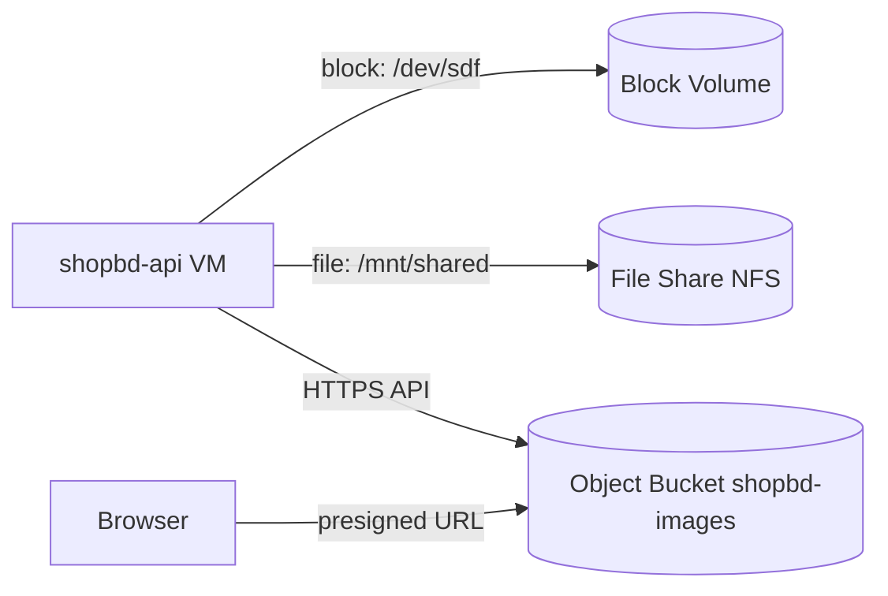
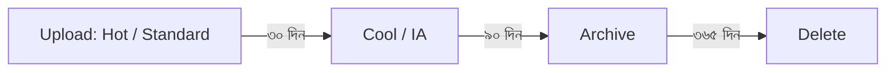
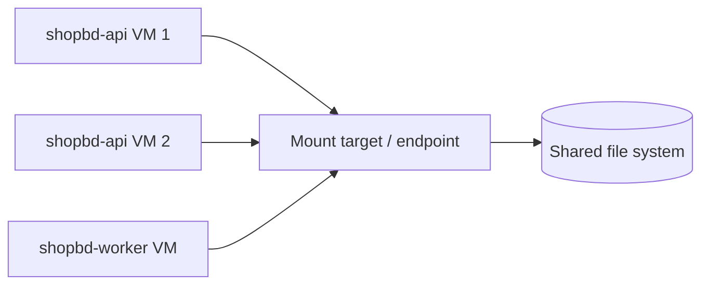
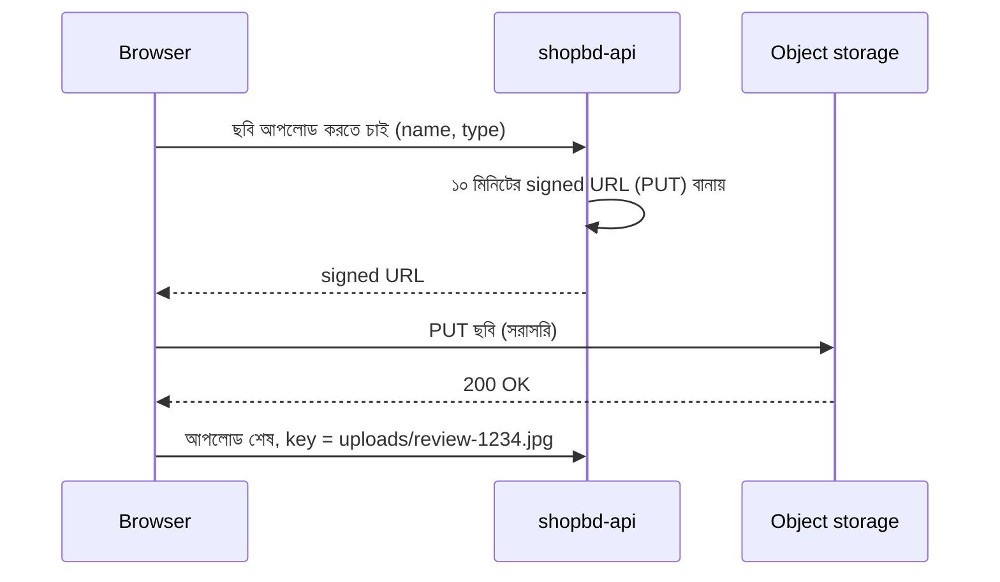

# 06 · Storage

> **এই অধ্যায়ে কী শিখবেন**
>
> - Object, Block ও File storage — তিনটার পার্থক্য এবং কোন কাজে কোনটা
> - Object storage (S3 / Cloud Storage / Blob / Object Storage): bucket, storage class, lifecycle, versioning
> - Presigned URL, SAS token ও Pre-Authenticated Request (PAR) দিয়ে নিরাপদে file দেওয়া-নেওয়া
> - Block storage (EBS / Persistent Disk ও Hyperdisk / Managed Disks / Block Volume) ও snapshot
> - File storage (EFS / Filestore / Azure Files / File Storage) এবং archive tier
> - বড় data cloud-এ আনার উপায় — `sync`, AzCopy, Transfer Service, physical appliance

!!! abstract "এক নজরে — কোন cloud-এ কী নাম"

    | Concept | AWS | GCP | Azure | OCI |
    |---|---|---|---|---|
    | Object storage | Amazon S3 | Cloud Storage | Azure Blob Storage | OCI Object Storage |
    | Container-এর নাম | Bucket | Bucket | Storage account → Container | Bucket (namespace-এর ভেতরে) |
    | Hot tier | S3 Standard | Standard | Hot | Standard |
    | Infrequent tier | Standard-IA / One Zone-IA | Nearline / Coldline | Cool / Cold | Infrequent Access |
    | Archive tier | Glacier Instant / Flexible / Deep Archive | Archive | Archive | Archive |
    | Auto tiering | Intelligent-Tiering | Autoclass | Lifecycle rule (last-access based) | Auto-Tiering |
    | Temporary link | Presigned URL | Signed URL | SAS token | Pre-Authenticated Request (PAR) |
    | Block storage | Amazon EBS | Persistent Disk / Hyperdisk | Azure Managed Disks | OCI Block Volume |
    | Snapshot | EBS Snapshot | Disk Snapshot | Disk Snapshot | Block Volume Backup |
    | File storage (NFS/SMB) | Amazon EFS (+ FSx) | Filestore | Azure Files (+ NetApp Files) | OCI File Storage |
    | Bulk transfer tool | DataSync, Snow Family | Storage Transfer Service, Transfer Appliance | AzCopy, Storage Mover, Data Box | `oci os` bulk commands, Data Transfer |

## ১. Storage-এর তিন ধরন

Cloud-এ data রাখার তিনটা মৌলিক উপায় আছে। কোনটা কখন লাগবে তা বুঝতে পারাই এই অধ্যায়ের মূল কথা।

| ধরন | কেমন লাগে | কীভাবে access | কোন কাজে |
|---|---|---|---|
| **Object** | অসীম আকারের গুদামঘর, প্রতিটি জিনিসের একটা ট্যাগ (key) | HTTP API / SDK | ছবি, video, backup, log, data lake |
| **Block** | কম্পিউটারের hard disk / SSD | VM-এ attach করে format ও mount | OS disk, database data directory |
| **File** | অফিসের shared network drive | NFS / SMB mount | একাধিক server-এ একই folder, CMS upload |



!!! note "Analogy"
    - **Block** = আপনার নিজের ল্যাপটপের SSD। একজন মালিক, দ্রুত, কিন্তু সবার সাথে ভাগ করা যায় না (সাধারণত)।
    - **File** = অফিসের shared drive। অনেকে একসাথে খুলে একই folder-এ কাজ করতে পারে।
    - **Object** = Google Drive-এর মতো অসীম আলমারি, যেখানে file-এর শুধু পুরোটা রাখা বা পুরোটা আনা যায়; মাঝখানের এক লাইন বদলানো যায় না।

## ২. Object storage

Object storage-এ data থাকে **object** হিসেবে: আসল content + metadata + একটা **key** (নাম)। Object রাখার পাত্রের নাম **bucket** (Azure-তে **container**)। এখানে সত্যিকারের folder নেই — `products/2026/shirt.jpg` পুরোটাই একটা key; `products/2026/` শুধু prefix, Console সুবিধার জন্য folder-এর মতো দেখায়।

চার cloud-এই object storage-এর সাধারণ বৈশিষ্ট্য:

- প্রায় অসীম জায়গা, আগে থেকে size ঠিক করতে হয় না
- অত্যন্ত বেশি durability (সব cloud-ই "eleven nines"-এর কাছাকাছি লক্ষ্য রাখে, একাধিক জায়গায় copy রেখে)
- HTTP API দিয়ে access — তাই যেকোনো ভাষা থেকে SDK/CLI দিয়ে কাজ করে
- **Strong consistency** — নতুন object লিখলে বা মুছলে পরের read সঙ্গে সঙ্গে সেটাই দেখে (আগে S3 eventually consistent ছিল, এখন চার cloud-এই এটা ঠিক আছে)
- Object **immutable-এর মতো**: আংশিক edit নেই, পুরো object replace করতে হয়

### Naming-এর পার্থক্য

| | AWS | GCP | Azure | OCI |
|---|---|---|---|---|
| নামের scope | সব AWS-এ unique (global) | সব GCP-তে unique (global) | **Storage account**-এর নাম global unique; container শুধু account-এর ভেতরে unique | **Namespace** (tenancy-র) ভেতরে unique; bucket একটা region-এ থাকে |
| নামের নিয়ম | ৩–৬৩ অক্ষর, lowercase | ৩–৬৩ অক্ষর, lowercase | account: ৩–২৪ অক্ষর, শুধু lowercase + সংখ্যা (hyphen চলে না) | ১–২৫৬ অক্ষর, বিভিন্ন চিহ্ন চলে |
| URL | `https://shopbd-images.s3.ap-south-1.amazonaws.com/key` | `https://storage.googleapis.com/shopbd-images/key` | `https://shopbdimages.blob.core.windows.net/images/key` | `https://objectstorage.ap-mumbai-1.oraclecloud.com/n/NAMESPACE/b/shopbd-images/o/key` |

!!! warning "Azure-এ আগে Storage account"
    Azure-তে সরাসরি bucket বানানো যায় না। আগে **Storage account** (redundancy, tier, network rule এখানে ঠিক হয়), তারপর তার ভেতরে **container**। Storage account-এর নামে hyphen চলে না — তাই এই বইয়ে `shopbdimages` লেখা হয়েছে।

### Bucket তৈরি

=== "AWS"

    Service: **Amazon S3**। Console: S3 → Create bucket।

    ```bash
    # ap-south-1 (Mumbai) ছাড়া অন্য region হলে LocationConstraint লাগে
    aws s3api create-bucket \
      --bucket shopbd-images \
      --region ap-south-1 \
      --create-bucket-configuration LocationConstraint=ap-south-1

    aws s3 ls
    ```

=== "GCP"

    Service: **Cloud Storage**। Console: Cloud Storage → Buckets → Create।

    ```bash
    gcloud storage buckets create gs://shopbd-images \
      --location=asia-south1 \
      --default-storage-class=STANDARD \
      --uniform-bucket-level-access

    gcloud storage buckets list
    ```

=== "Azure"

    Service: **Azure Blob Storage**। Console: Storage accounts → Create → তারপর Containers।

    ```bash
    az group create --name shopbd-prod-rg --location centralindia

    az storage account create \
      --name shopbdimages \
      --resource-group shopbd-prod-rg \
      --location centralindia \
      --sku Standard_LRS \
      --kind StorageV2 \
      --min-tls-version TLS1_2

    az storage container create \
      --name images \
      --account-name shopbdimages \
      --auth-mode login
    ```

=== "OCI"

    Service: **OCI Object Storage**। Console: Storage → Buckets। আগে tenancy-র **namespace** জানতে হয়।

    ```bash
    oci os ns get

    oci os bucket create \
      --compartment-id ocid1.compartment.oc1..example \
      --namespace-name my-namespace \
      --name shopbd-images \
      --region ap-mumbai-1
    ```

### File upload / download (প্রতিদিনের কমান্ড)

```bash
# AWS
aws s3 cp ./shirt.jpg s3://shopbd-images/products/original/shirt.jpg
aws s3 ls s3://shopbd-images/products/ --recursive

# GCP
gcloud storage cp ./shirt.jpg gs://shopbd-images/products/original/shirt.jpg
gcloud storage ls --recursive gs://shopbd-images/products/

# Azure
az storage blob upload --account-name shopbdimages --container-name images \
  --name products/original/shirt.jpg --file ./shirt.jpg --auth-mode login

# OCI
oci os object put --namespace-name my-namespace --bucket-name shopbd-images \
  --name products/original/shirt.jpg --file ./shirt.jpg
```

!!! tip "বড় file হলে multipart"
    কয়েকশ MB-র বেশি file একসাথে না পাঠিয়ে টুকরো (part) করে পাঠানো হয় — মাঝপথে network গেলে শুধু ব্যর্থ টুকরোটা আবার যায়। AWS CLI, `gcloud storage`, AzCopy ও OCI CLI সবই এটা নিজে থেকে করে। তবে অসম্পূর্ণ multipart upload পড়ে থাকলে সেগুলোর জন্যও টাকা লাগে — lifecycle rule দিয়ে মুছে ফেলুন (নিচে দেখুন)।

### Redundancy ও durability — কোথায় data থাকে

| | AWS | GCP | Azure | OCI |
|---|---|---|---|---|
| Default | Region-এর ≥৩ AZ-তে (Standard); One Zone-IA শুধু ১ AZ | Region / dual-region / multi-region — location type আপনি বাছেন | Account-এ redundancy বাছতে হয়: LRS, ZRS, GRS, GZRS (+ RA- read access) | Region-এর ভেতরে একাধিক AD / fault domain-এ replicate |
| Cross-region copy | Cross-Region Replication (CRR) | Dual/multi-region location বা Turbo replication | GRS / GZRS | Cross-region replication policy |

!!! note "Azure redundancy শব্দগুলো"
    **LRS** = একই datacenter-এ ৩ copy। **ZRS** = ৩টা availability zone-এ। **GRS** = LRS + দূরের paired region-এ আরেকটা। **GZRS** = ZRS + দূরের region। `Standard_LRS` সবচেয়ে সস্তা কিন্তু datacenter নষ্ট হলে data যাবে — production image-এর জন্য অন্তত ZRS ভাবুন।

## ৩. Storage class ও tier

সব data সমান ঘন ঘন লাগে না। গত সপ্তাহের product image রোজ দেখা হয়, কিন্তু ৩ বছর আগের invoice হয়তো বছরে একবার। **Storage class**-এর নিয়ম: যত "ঠান্ডা" tier, **জমানোর খরচ তত কম, কিন্তু access/retrieval খরচ ও অপেক্ষা তত বেশি**, আর একটা **ন্যূনতম রাখার মেয়াদ** (minimum storage duration) থাকে — আগে মুছলেও পুরো মেয়াদের টাকা কাটে।

| ঠান্ডার মাত্রা | AWS | GCP | Azure | OCI |
|---|---|---|---|---|
| গরম (ঘন ঘন) | Standard (+ Express One Zone, খুব low latency) | Standard | Hot (+ Premium block blob) | Standard |
| মাঝারি | Standard-IA, One Zone-IA (৩০ দিন min) | Nearline (৩০ দিন min) | Cool (৩০ দিন min) | Infrequent Access (৩১ দিন min) |
| ঠান্ডা | Glacier Instant Retrieval (৯০ দিন min) | Coldline (৯০ দিন min) | Cold (৯০ দিন min) | — |
| Archive | Glacier Flexible Retrieval (৯০), Deep Archive (১৮০ দিন min) | Archive (৩৬৫ দিন min) | Archive (১৮০ দিন min) | Archive (৯০ দিন min) |
| Auto | Intelligent-Tiering | Autoclass | — (lifecycle দিয়ে) | Auto-Tiering |

!!! warning "Archive-এর সবচেয়ে বড় পার্থক্য: তাৎক্ষণিক পড়া যায় কি না"
    - **GCP Archive** এবং **AWS Glacier Instant Retrieval**: millisecond-এ পড়া যায় (retrieval fee আছে)।
    - **AWS Glacier Flexible / Deep Archive**, **Azure Archive**, **OCI Archive**: object আগে **restore / rehydrate** করতে হয় — মিনিট থেকে ঘণ্টা (কখনো ১২ ঘণ্টার বেশি) লাগতে পারে। এর মধ্যে সরাসরি `GET` করলে error আসে।

    তাই "সস্তা" দেখে সবকিছু archive-এ ফেলবেন না — আগে ভাবুন কত দ্রুত ফেরত লাগতে পারে।

### Class ঠিক করা: upload-এর সময়

```bash
# AWS
aws s3 cp backup.sql.gz s3://shopbd-backups/db/2026-11-23.sql.gz --storage-class STANDARD_IA

# GCP (Autoclass চালু করলে object নিজে নিজে tier বদলায়)
gcloud storage cp backup.sql.gz gs://shopbd-backups/db/2026-11-23.sql.gz --storage-class=NEARLINE
gcloud storage buckets update gs://shopbd-backups --enable-autoclass

# Azure
az storage blob upload --account-name shopbdbackups --container-name db \
  --name 2026-11-23.sql.gz --file backup.sql.gz --tier Cool --auth-mode login

# OCI
oci os object put --namespace-name my-namespace --bucket-name shopbd-backups \
  --name db/2026-11-23.sql.gz --file backup.sql.gz --storage-tier InfrequentAccess
```

## ৪. Lifecycle policy

Lifecycle মানে একটা **স্বয়ংক্রিয় নিয়ম**: "৩০ দিন পর সস্তা tier-এ যাও, ৩৬৫ দিন পর মুছে যাও, অসম্পূর্ণ upload ৭ দিন পর ফেলে দাও"। কেউ হাতে সরাতে হয় না — এটাই object storage-এ খরচ কমানোর সবচেয়ে সহজ উপায়।



shopbd-র নিয়ম: `reports/` prefix-এর nightly sales report ৩০ দিন পর infrequent tier-এ, ৩৬৫ দিন পর delete।

=== "AWS"

    ```json
    {"Rules": [{
      "ID": "reports-tiering", "Status": "Enabled",
      "Filter": {"Prefix": "reports/"},
      "Transitions": [{"Days": 30, "StorageClass": "STANDARD_IA"}],
      "Expiration": {"Days": 365},
      "AbortIncompleteMultipartUpload": {"DaysAfterInitiation": 7}
    }]}
    ```

    ```bash
    aws s3api put-bucket-lifecycle-configuration \
      --bucket shopbd-images \
      --lifecycle-configuration file://lifecycle.json
    ```

=== "GCP"

    ```json
    {"rule": [
      {"action": {"type": "SetStorageClass", "storageClass": "NEARLINE"},
       "condition": {"age": 30, "matchesPrefix": ["reports/"]}},
      {"action": {"type": "Delete"},
       "condition": {"age": 365, "matchesPrefix": ["reports/"]}}
    ]}
    ```

    ```bash
    gcloud storage buckets update gs://shopbd-images --lifecycle-file=lifecycle.json
    ```

=== "Azure"

    Azure-তে lifecycle নিয়ম **Storage account level**-এ (management policy) থাকে, container-এ নয়।

    ```json
    {
      "rules": [
        {
          "enabled": true,
          "name": "reports-tiering",
          "type": "Lifecycle",
          "definition": {
            "filters": { "blobTypes": ["blockBlob"], "prefixMatch": ["images/reports/"] },
            "actions": {
              "baseBlob": {
                "tierToCool": { "daysAfterModificationGreaterThan": 30 },
                "delete": { "daysAfterModificationGreaterThan": 365 }
              }
            }
          }
        }
      ]
    }
    ```

    ```bash
    az storage account management-policy create \
      --account-name shopbdimages \
      --resource-group shopbd-prod-rg \
      --policy @policy.json
    ```

=== "OCI"

    ```json
    [
      {"name": "reports-to-ia", "action": "INFREQUENT_ACCESS", "timeAmount": 30, "timeUnit": "DAYS",
       "isEnabled": true, "objectNameFilter": {"inclusionPrefixes": ["reports/"]}},
      {"name": "reports-delete", "action": "DELETE", "timeAmount": 365, "timeUnit": "DAYS",
       "isEnabled": true, "objectNameFilter": {"inclusionPrefixes": ["reports/"]}}
    ]
    ```

    ```bash
    oci os object-lifecycle-policy put \
      --namespace-name my-namespace \
      --bucket-name shopbd-images \
      --items file://lifecycle.json
    ```

    !!! note
        OCI Object Storage service-কে আপনার compartment-এ object manage করার অনুমতি দিতে একটা IAM policy লাগে (`Allow service objectstorage-ap-mumbai-1 to manage object-family in compartment ...`)। policy না থাকলে lifecycle কাজ করে না।

## ৫. Versioning, soft delete ও immutability

ভুল করে `rm` করে ফেললে বা ভুল file overwrite করলে ফেরত আনার উপায় লাগে। এর তিনটা স্তর:

1. **Versioning** — একই key-তে নতুন upload করলে পুরোনোটা noncurrent version হিসেবে থাকে; delete করলে শুধু একটা delete marker বসে।
2. **Soft delete** — মুছে ফেললেও নির্দিষ্ট দিন (retention) ধরে রিসাইকেল বিনে থাকে।
3. **Immutability / Object Lock / Retention** — নির্দিষ্ট সময় পর্যন্ত কেউ (এমনকি admin-ও) মুছতে বা বদলাতে পারে না — ransomware ও compliance-এর জন্য।

| | AWS | GCP | Azure | OCI |
|---|---|---|---|---|
| Versioning | Bucket versioning (একবার চালালে শুধু suspend করা যায়) | Object Versioning | Blob versioning | Bucket versioning |
| Soft delete | — (versioning-ই এর কাজ করে) | Soft delete (নতুন bucket-এ default retention আছে; পরিবর্তনযোগ্য) | Blob ও container soft delete | — (versioning) |
| Immutability | **S3 Object Lock** (governance / compliance mode, legal hold) | **Retention policy + Bucket Lock**, object hold | **Immutable storage** (time-based, legal hold) | **Retention rules** (time-bound / indefinite) |

=== "AWS"

    ```bash
    aws s3api put-bucket-versioning \
      --bucket shopbd-images \
      --versioning-configuration Status=Enabled

    aws s3api list-object-versions --bucket shopbd-images --prefix products/
    ```

=== "GCP"

    ```bash
    gcloud storage buckets update gs://shopbd-images --versioning

    # সব version-সহ list
    gcloud storage ls --all-versions gs://shopbd-images/products/
    ```

=== "Azure"

    ```bash
    az storage account blob-service-properties update \
      --account-name shopbdimages \
      --resource-group shopbd-prod-rg \
      --enable-versioning true \
      --enable-delete-retention true \
      --delete-retention-days 14
    ```

=== "OCI"

    ```bash
    oci os bucket update \
      --namespace-name my-namespace \
      --name shopbd-images \
      --versioning Enabled
    ```

!!! danger "Versioning চালু = পুরোনো version-ও জমানোর টাকা"
    প্রতিদিন overwrite হওয়া file-এর সব version storage হিসেবে গোনা হয়। তাই versioning-এর সাথে **noncurrent version expire** lifecycle rule বাধ্যতামূলক (যেমন ৩০ দিন পর পুরোনো version delete)।

## ৬. Access control, public access ও encryption

Object storage-এ সবচেয়ে বেশি ঘটনা ঘটে "ভুল করে bucket public হয়ে গেছে" — ক্লাসিক data leak। চার cloud-ই এখন এর জন্য আলাদা guard রেখেছে।

| নিয়ন্ত্রণ | AWS | GCP | Azure | OCI |
|---|---|---|---|---|
| Public ঠেকানোর master switch | **Block Public Access** | **Public access prevention** | Storage account-এ `allowBlobPublicAccess = false` | Bucket visibility = `NoPublicAccess` |
| কে access পাবে | IAM policy + bucket policy | IAM role + (uniform bucket-level access) | Azure RBAC + SAS/শেয়ার্ড key | IAM policy |
| পুরোনো ACL ব্যবস্থা | ACL (নতুন bucket-এ default বন্ধ — "bucket owner enforced") | Fine-grained ACL (uniform access চালু করলে বন্ধ) | Container access level | — |
| Encryption at rest (default) | SSE-S3 (সব নতুন object-এ) | Google-managed key | Microsoft-managed key | Oracle-managed key |
| নিজের key | SSE-KMS (AWS KMS) | CMEK (Cloud KMS) | Customer-managed key (Key Vault) | OCI Vault key |

সব cloud-এই transit-এ HTTPS ব্যবহার করুন এবং plain HTTP বন্ধ করুন। Key management নিয়ে বিস্তারিত: [Security](13-security.md); কে কী access পাবে নিয়ে: [Identity ও Access](03-identity-and-access.md)।

=== "AWS"

    ```bash
    aws s3api put-public-access-block \
      --bucket shopbd-images \
      --public-access-block-configuration \
      BlockPublicAcls=true,IgnorePublicAcls=true,BlockPublicPolicy=true,RestrictPublicBuckets=true
    ```

    Account level-এও এটা চালু রাখা যায় (`aws s3control put-public-access-block`) — এতে ভবিষ্যতের সব bucket সুরক্ষিত।

=== "GCP"

    ```bash
    gcloud storage buckets update gs://shopbd-images --public-access-prevention
    gcloud storage buckets update gs://shopbd-images --uniform-bucket-level-access

    # একটা service account-কে শুধু object পড়ার অনুমতি
    gcloud storage buckets add-iam-policy-binding gs://shopbd-images \
      --member="serviceAccount:shopbd-api@my-project-id.iam.gserviceaccount.com" \
      --role="roles/storage.objectViewer"
    ```

=== "Azure"

    ```bash
    az storage account update \
      --name shopbdimages \
      --resource-group shopbd-prod-rg \
      --allow-blob-public-access false \
      --allow-shared-key-access false

    az role assignment create \
      --assignee 00000000-0000-0000-0000-000000000000 \
      --role "Storage Blob Data Reader" \
      --scope /subscriptions/00000000-0000-0000-0000-000000000000/resourceGroups/shopbd-prod-rg/providers/Microsoft.Storage/storageAccounts/shopbdimages
    ```

    `allow-shared-key-access false` দিলে account key দিয়ে access বন্ধ হয়ে শুধু Entra ID (ও user delegation SAS) চলে — নিরাপদ, কিন্তু পুরোনো tool ভেঙে যেতে পারে।

=== "OCI"

    ```bash
    oci os bucket update \
      --namespace-name my-namespace \
      --name shopbd-images \
      --public-access-type NoPublicAccess
    ```

    ```text
    Allow group shopbd-api-readers to read objects in compartment shopbd-prod where target.bucket.name = 'shopbd-images'
    ```

## ৭. Temporary access: Presigned URL, SAS ও PAR

Browser থেকে সরাসরি bucket-এ ছবি তুলতে দিতে চান, কিন্তু user-কে আপনার credential দেবেন না। সমাধান: server একটা **সময়সীমাওয়ালা, একটা কাজের জন্য, signed লিংক** বানায়; user সেই লিংক দিয়ে সরাসরি storage-এ upload/download করে। API server-এর ভেতর দিয়ে বড় file যেতে হয় না।

!!! note "Analogy"
    হোটেলের **কী-কার্ড**: শুধু ৩০২ নম্বর ঘর খোলে, শুধু ৩ দিনের জন্য — মাস্টার চাবি (আপনার credential) কাউকে দিতে হয় না।

| | AWS | GCP | Azure | OCI |
|---|---|---|---|---|
| নাম | Presigned URL | Signed URL (V4) | SAS (User delegation SAS সবচেয়ে নিরাপদ) | Pre-Authenticated Request (PAR) |
| কে sign করে | যে IAM identity বানায় তার permission-এর সীমায় | Service account key বা impersonation | Account key (Service SAS) অথবা Entra ID key (User delegation) | OCI নিজেই একটা অনন্য URL বানায় |
| Revoke | URL-এর expiry; signer-এর permission বাতিল করলে অকেজো | Signer-এর key/permission বাতিল | Stored access policy বা key rotation | PAR মুছে দিলে তাৎক্ষণিক বন্ধ |

=== "AWS"

    ```bash
    # ১ ঘণ্টার download link
    aws s3 presign s3://shopbd-images/products/original/shirt.jpg --expires-in 3600
    ```

=== "GCP"

    ```bash
    gcloud storage sign-url gs://shopbd-images/products/original/shirt.jpg \
      --duration=1h \
      --impersonate-service-account=shopbd-signer@my-project-id.iam.gserviceaccount.com
    ```

=== "Azure"

    ```bash
    az storage blob generate-sas \
      --account-name shopbdimages \
      --container-name images \
      --name products/original/shirt.jpg \
      --permissions r \
      --expiry 2026-12-31T00:00Z \
      --https-only \
      --full-uri \
      --as-user --auth-mode login
    ```

=== "OCI"

    ```bash
    oci os preauth-request create \
      --namespace-name my-namespace \
      --bucket-name shopbd-images \
      --name shirt-download \
      --access-type ObjectRead \
      --object-name products/original/shirt.jpg \
      --time-expires "2026-12-31T00:00:00Z"
    ```

    Response-এ `access-uri` আসে; পুরো URL = `https://objectstorage.ap-mumbai-1.oraclecloud.com` + সেই `access-uri`। **এই URL একবারই দেখানো হয়**, হারালে আবার বানাতে হবে।

!!! danger "Presigned URL = password"
    যার কাছে লিংক আছে সে-ই access পাবে। তাই: expiry ছোট রাখুন (মিনিট), শুধু প্রয়োজনীয় method (`GET` বা `PUT`) দিন, লিংক log-এ লিখবেন না।

## ৮. Terraform: shopbd-images bucket

চারটা cloud-এ একই কাজ — private, versioned bucket। Lifecycle-ও Terraform-এ লেখা যায় (`aws_s3_bucket_lifecycle_configuration`, `google_storage_bucket`-এর `lifecycle_rule`, `azurerm_storage_management_policy`, `oci_objectstorage_object_lifecycle_policy`)। Terraform-এর বিস্তারিত: [Infrastructure as Code](14-infrastructure-as-code.md)।

=== "AWS"

    ```hcl
    resource "aws_s3_bucket" "images" {
      bucket = "shopbd-images"
    }

    resource "aws_s3_bucket_public_access_block" "images" {
      bucket                  = aws_s3_bucket.images.id
      block_public_acls       = true
      block_public_policy     = true
      ignore_public_acls      = true
      restrict_public_buckets = true
    }

    resource "aws_s3_bucket_versioning" "images" {
      bucket = aws_s3_bucket.images.id
      versioning_configuration {
        status = "Enabled"
      }
    }
    ```

=== "GCP"

    ```hcl
    resource "google_storage_bucket" "images" {
      name                        = "shopbd-images"
      location                    = "ASIA-SOUTH1"
      storage_class               = "STANDARD"
      uniform_bucket_level_access = true
      public_access_prevention    = "enforced"

      versioning {
        enabled = true
      }

      lifecycle_rule {
        action {
          type = "Delete"
        }
        condition {
          age            = 365
          matches_prefix = ["reports/"]
        }
      }
    }
    ```

=== "Azure"

    ```hcl
    resource "azurerm_storage_account" "images" {
      name                            = "shopbdimages"
      resource_group_name             = "shopbd-prod-rg"
      location                        = "centralindia"
      account_tier                    = "Standard"
      account_replication_type        = "ZRS"
      min_tls_version                 = "TLS1_2"
      allow_nested_items_to_be_public = false

      blob_properties {
        versioning_enabled = true
        delete_retention_policy {
          days = 14
        }
      }
    }

    resource "azurerm_storage_container" "images" {
      name                  = "images"
      storage_account_id    = azurerm_storage_account.images.id
      container_access_type = "private"
    }
    ```

=== "OCI"

    ```hcl
    data "oci_objectstorage_namespace" "ns" {
      compartment_id = var.compartment_id
    }

    resource "oci_objectstorage_bucket" "images" {
      compartment_id = var.compartment_id
      namespace      = data.oci_objectstorage_namespace.ns.namespace
      name           = "shopbd-images"
      access_type    = "NoPublicAccess"
      storage_tier   = "Standard"
      versioning     = "Enabled"
    }
    ```

## ৯. Block storage

Block storage হলো VM-এর "hard disk"। OS-এর কাছে এটা একটা raw device (`/dev/sdf`, `/dev/nvme1n1`); আপনি filesystem (ext4, xfs) বানিয়ে mount করেন। Database-এর data directory, OS disk, কম latency-র কাজে এটাই ব্যবহার হয়।

গুরুত্বপূর্ণ বৈশিষ্ট্য:

- **Zonal**: disk একটা নির্দিষ্ট zone/AD-তে থাকে এবং **সেই zone-এর VM-এই** attach হয়। (GCP-তে regional PD-ও আছে, দুই zone-এ replicate হয়।)
- VM বন্ধ বা delete হলেও disk আলাদা resource হিসেবে বেঁচে থাকতে পারে — আলাদা করে মুছতে হয়।
- Performance (IOPS ও throughput) নির্ভর করে disk type ও size-এর ওপর।
- Single-attach সাধারণ; multi-attach সীমিত ও বিশেষ ব্যবহারের।

| Tier | AWS EBS | GCP | Azure Managed Disks | OCI Block Volume |
|---|---|---|---|---|
| সাধারণ SSD | `gp3` (IOPS/throughput আলাদা ঠিক করা যায়) | `pd-balanced` | Standard SSD / Premium SSD | Balanced |
| Performance SSD | `io2` / `io2 Block Express` | `pd-ssd`, Hyperdisk Balanced | Premium SSD v2, Ultra Disk | Higher Performance / Ultra High Performance |
| HDD (throughput, সস্তা) | `st1`, `sc1` | `pd-standard` | Standard HDD | Lower Cost |
| Provisioning-এর ধরন | size + (gp3/io2-তে IOPS) | size (PD) / IOPS সরাসরি (Hyperdisk) | size বা tier | size + **VPU/GB** performance বাছা |

=== "AWS"

    ```bash
    aws ec2 create-volume \
      --availability-zone ap-south-1a \
      --size 100 \
      --volume-type gp3 \
      --encrypted \
      --tag-specifications 'ResourceType=volume,Tags=[{Key=Name,Value=shopbd-data}]'

    aws ec2 attach-volume \
      --volume-id vol-0123456789abcdef0 \
      --instance-id i-0123456789abcdef0 \
      --device /dev/sdf
    ```

=== "GCP"

    ```bash
    gcloud compute disks create shopbd-data \
      --size=100GB --type=pd-balanced --zone=asia-south1-a

    gcloud compute instances attach-disk shopbd-api \
      --disk=shopbd-data --zone=asia-south1-a
    ```

=== "Azure"

    ```bash
    az disk create \
      --resource-group shopbd-prod-rg \
      --name shopbd-data \
      --size-gb 100 \
      --sku Premium_LRS

    az vm disk attach \
      --resource-group shopbd-prod-rg \
      --vm-name shopbd-api \
      --name shopbd-data
    ```

=== "OCI"

    ```bash
    oci bv volume create \
      --compartment-id ocid1.compartment.oc1..example \
      --availability-domain "AAAA:AP-MUMBAI-1-AD-1" \
      --display-name shopbd-data \
      --size-in-gbs 100

    oci compute volume-attachment attach \
      --instance-id ocid1.instance.oc1.ap-mumbai-1.example \
      --volume-id ocid1.volume.oc1.ap-mumbai-1.example \
      --type paravirtualized
    ```

Attach করার পর VM-এর ভেতরে (চার cloud-এই একই, Linux):

```bash
lsblk                                   # নতুন disk খুঁজুন, যেমন nvme1n1 বা sdb
sudo mkfs.ext4 /dev/nvme1n1             # শুধু প্রথমবার! ভুল disk হলে data যাবে
sudo mkdir -p /data
sudo mount /dev/nvme1n1 /data
sudo blkid /dev/nvme1n1                 # UUID নিন
echo 'UUID=<uuid-from-blkid> /data ext4 defaults,nofail 0 2' | sudo tee -a /etc/fstab
```

!!! warning "`mkfs` শুধু নতুন disk-এ"
    snapshot থেকে বানানো disk-এ আগেই filesystem আছে — `mkfs` চালালে সব data মুছে যাবে। আর `/etc/fstab`-এ device নাম নয়, **UUID** ব্যবহার করুন, নইলে reboot-এ নাম বদলে boot আটকাতে পারে।

### Resize ও performance

চার cloud-ই চালু অবস্থায় disk বড় করা (grow) সমর্থন করে, কিন্তু **ছোট করা যায় না**। বড় করার পর OS-এর ভেতরে `growpart` ও `resize2fs` (বা `xfs_growfs`) চালাতে হয়। AWS-এ একই volume-এ একটা modification-এর পর কিছুক্ষণ আবার বদলানো যায় না (cooldown), আর GCP-তে disk-এর size বাড়ালে IOPS/throughput-ও বাড়ে (PD-র ক্ষেত্রে)।

## ১০. Snapshot

**Snapshot** হলো একটা disk-এর নির্দিষ্ট মুহূর্তের backup। প্রথম snapshot পুরো data কপি করে, পরেরগুলো শুধু **পরিবর্তিত block** (incremental) — তাই দ্রুত ও কম খরচের। Snapshot অন্য zone/region-এ নিয়ে disk বানানো যায় — এটাই disk-কে এক zone থেকে আরেক zone-এ সরানোর উপায়।

=== "AWS"

    ```bash
    aws ec2 create-snapshot \
      --volume-id vol-0123456789abcdef0 \
      --description "shopbd-data nightly"

    # অন্য region-এ copy (DR-এর জন্য)
    aws ec2 copy-snapshot \
      --source-region ap-south-1 --source-snapshot-id snap-0123456789abcdef0 \
      --region ap-southeast-1
    ```

    স্বয়ংক্রিয় schedule: **Amazon Data Lifecycle Manager** বা **AWS Backup**।

=== "GCP"

    ```bash
    gcloud compute disks snapshot shopbd-data \
      --snapshot-names=shopbd-data-2026-11-23 \
      --zone=asia-south1-a
    ```

    স্বয়ংক্রিয় schedule: **snapshot schedule** (resource policy) disk-এ attach করে।

=== "Azure"

    ```bash
    az snapshot create \
      --resource-group shopbd-prod-rg \
      --name shopbd-data-2026-11-23 \
      --source shopbd-data \
      --incremental true
    ```

    স্বয়ংক্রিয় schedule: **Azure Backup** (backup vault + policy)।

=== "OCI"

    ```bash
    oci bv backup create \
      --volume-id ocid1.volume.oc1.ap-mumbai-1.example \
      --type INCREMENTAL \
      --display-name shopbd-data-2026-11-23
    ```

    স্বয়ংক্রিয় schedule: **backup policy** (Bronze / Silver / Gold অথবা custom) volume-এ assign করে।

!!! tip "Database-এর জন্য"
    চলমান database-এর disk snapshot "crash-consistent" হয় — ঠিকঠাক restore হয় কিন্তু কিছু in-flight transaction হারাতে পারে। Managed database ([Database](07-databases.md)) নিজের backup/PITR দেয়, তাই সেটাই প্রথম পছন্দ।

## ১১. File storage

যখন **একাধিক VM একই folder** একসাথে পড়া-লেখা করতে চায় (যেমন CMS-এর upload folder, shared config, legacy app) তখন file storage। এখানে ready-made filesystem — আপনি `mount` করেন, format করেন না।

| | AWS | GCP | Azure | OCI |
|---|---|---|---|---|
| মূল service | **Amazon EFS** (NFS) | **Filestore** (NFS) | **Azure Files** (SMB ও NFS) | **OCI File Storage** (NFS) |
| Windows (SMB) | **FSx for Windows File Server** | Filestore-এ SMB নেই; third-party/NetApp Volumes | Azure Files SMB | সরাসরি নেই |
| High-performance | FSx for Lustre / NetApp ONTAP / OpenZFS | Filestore Enterprise / Google Cloud NetApp Volumes | Azure NetApp Files / Premium Files | — |
| Scaling | Elastic — আপনা-আপনি বাড়ে-কমে | Tier অনুযায়ী capacity ঠিক করতে হয় | Share quota ঠিক করতে হয় | Elastic (৮ exabyte পর্যন্ত বাড়ে) |
| Network-এ কীভাবে | VPC-র subnet-এ **mount target** | VPC-তে instance IP | Storage account-এর private endpoint/service endpoint | Subnet-এ **mount target** + export |



=== "AWS"

    ```bash
    aws efs create-file-system \
      --performance-mode generalPurpose \
      --throughput-mode elastic \
      --encrypted \
      --tags Key=Name,Value=shopbd-shared

    aws efs create-mount-target \
      --file-system-id fs-0123456789abcdef0 \
      --subnet-id subnet-0123456789abcdef0 \
      --security-groups sg-0123456789abcdef0

    # VM-এ (amazon-efs-utils ইনস্টল থাকলে)
    sudo mkdir -p /mnt/shared
    sudo mount -t efs -o tls fs-0123456789abcdef0:/ /mnt/shared
    ```

    Security group-এ **TCP 2049 (NFS)** খোলা থাকতে হবে।

=== "GCP"

    ```bash
    gcloud filestore instances create shopbd-files \
      --zone=asia-south1-a \
      --tier=ZONAL \
      --file-share=name=share,capacity=1TB \
      --network=name=shopbd-prod-vpc

    # VM-এ
    sudo apt-get install -y nfs-common
    sudo mkdir -p /mnt/shared
    sudo mount -o discard,defaults 10.0.0.2:/share /mnt/shared
    ```

    Tier নির্বাচন: Basic HDD/SSD, Zonal, Regional, Enterprise — capacity-র সর্বনিম্ন সীমা tier ভেদে আলাদা, তাই [official docs](https://cloud.google.com/filestore/docs) দেখে নিন।

=== "Azure"

    ```bash
    az storage share-rm create \
      --resource-group shopbd-prod-rg \
      --storage-account shopbdfiles \
      --name shopbd-share \
      --quota 100

    # Linux VM-এ SMB mount
    sudo mkdir -p /mnt/shared
    sudo mount -t cifs //shopbdfiles.file.core.windows.net/shopbd-share /mnt/shared \
      -o vers=3.1.1,username=shopbdfiles,password=<storage-account-key>,serverino
    ```

    Port 445 কিছু ISP/office network-এ বন্ধ থাকে — Azure VM-এর ভেতর থেকে সাধারণত সমস্যা নেই। NFS share চাইলে **Premium** (FileStorage) account লাগে।

=== "OCI"

    ```bash
    oci fs file-system create \
      --compartment-id ocid1.compartment.oc1..example \
      --availability-domain "AAAA:AP-MUMBAI-1-AD-1" \
      --display-name shopbd-shared

    oci fs mount-target create \
      --compartment-id ocid1.compartment.oc1..example \
      --availability-domain "AAAA:AP-MUMBAI-1-AD-1" \
      --subnet-id ocid1.subnet.oc1.ap-mumbai-1.example
    ```

    এরপর file system-কে একটা **export path** দিয়ে mount target-এ export করতে হয়, তারপর VM থেকে `sudo mount <mount-target-ip>:/shopbd-shared /mnt/shared`। Security list/NSG-তে NFS port (2048–2050, 111) খুলতে হয়।

!!! note "File storage কখন নয়"
    শুধু product image দেখানোর জন্য file storage লাগে না — object storage + CDN সস্তা ও scalable। File storage তখনই যখন app সত্যিই POSIX filesystem আশা করে।

## ১২. Archive ও restore

Archive মানে সবচেয়ে সস্তা জমানো, কিন্তু ফেরত আনা ধীর/খরচসাপেক্ষ। shopbd-র জন্য: ৩ বছরের পুরোনো invoice, পুরোনো database dump। Tier-এর তুলনা ওপরের "Storage class ও tier" section-এ আছে।

```bash
# AWS — Glacier Flexible/Deep Archive থেকে ৭ দিনের জন্য অস্থায়ী কপি
aws s3api restore-object --bucket shopbd-backups --key db/2024-01-01.sql.gz \
  --restore-request '{"Days":7,"GlacierJobParameters":{"Tier":"Standard"}}'

# GCP — Archive class-এ আলাদা restore নেই, সরাসরি পড়া যায় (retrieval fee লাগে)
gcloud storage cp gs://shopbd-backups/db/2024-01-01.sql.gz .

# Azure — Archive থেকে Hot-এ rehydrate (ঘণ্টা লাগে)
az storage blob set-tier --account-name shopbdbackups --container-name db \
  --name 2024-01-01.sql.gz --tier Hot --rehydrate-priority Standard --auth-mode login

# OCI — ২৪ ঘণ্টার জন্য restore
oci os object restore --namespace-name my-namespace --bucket-name shopbd-backups \
  --name db/2024-01-01.sql.gz --hours 24
```

!!! warning "Restore-এ শুধু অপেক্ষা নয়, টাকাও"
    Restore request, retrieval data ও restore-হওয়া কপির অস্থায়ী storage — সবকিছুর আলাদা চার্জ আছে। হাজার হাজার ছোট file archive করার আগে একটা বড় `.tar.gz` বানিয়ে নিন; per-object overhead কমবে।

## ১৩. Data transfer: cloud-এ data আনা ও সরানো

প্রথম নিয়ম: **data ঢোকানো (ingress) প্রায় সব cloud-এ বিনা পয়সায়; বের করা (egress) টাকার।** Egress-এর দাম cloud ভেদে আলাদা — তুলনা [Cost Management](18-cost-management.md)-এ।

| পরিমাণ / পরিস্থিতি | AWS | GCP | Azure | OCI |
|---|---|---|---|---|
| ছোট-মাঝারি, নিজে নিজে | `aws s3 sync`, S3 Transfer Acceleration | `gcloud storage rsync` | **AzCopy** | `oci os object bulk-upload` |
| Cloud থেকে cloud / on-prem থেকে schedule | **AWS DataSync** | **Storage Transfer Service** | **Azure Storage Mover** | rclone, OCI CLI script |
| TB–PB, internet ধীর | **Snow Family** (Snowball Edge) | **Transfer Appliance** | **Azure Data Box** | **OCI Data Transfer** (disk/appliance) |
| SFTP সরাসরি bucket-এ | **AWS Transfer Family** | VM + rclone | Blob SFTP support | VM + rclone |
| Hybrid file gateway | Storage Gateway | — | Azure File Sync | Storage Gateway |

```bash
# AWS — শুধু পরিবর্তিত file যায়; আগে --dryrun দিয়ে দেখুন
aws s3 sync ./images s3://shopbd-images/products/original/ --dryrun

# GCP
gcloud storage rsync ./images gs://shopbd-images/products/original/ --recursive

# Azure — AzCopy আলাদা binary, az CLI নয় (SAS token বা azcopy login লাগে)
azcopy copy "./images" "https://shopbdimages.blob.core.windows.net/images/products/original?<SAS-token>" --recursive

# OCI
oci os object bulk-upload --namespace-name my-namespace --bucket-name shopbd-images \
  --src-dir ./images --object-prefix products/original/
```

!!! tip "rclone — চার cloud-এর সাধারণ ছুরি"
    `rclone` একই কমান্ডে S3, GCS, Azure Blob ও OCI (এবং S3-compatible endpoint) সমর্থন করে। এক cloud থেকে আরেক cloud-এ bucket সরানো বা migration-এর সময় এটা খুবই কাজে লাগে।

**Internet না Direct link?** বড় নিয়মিত transfer-এ private link (Direct Connect / Interconnect / ExpressRoute / FastConnect) বসালে latency ও egress খরচ কমতে পারে — [Networking](05-networking.md) দেখুন।

## মিল ও অমিল

| বিষয় | AWS | GCP | Azure | OCI |
|---|---|---|---|---|
| Bucket scope | Global নাম, region-এ থাকে | Global নাম, region/dual/multi-region | Storage account (global নাম) → container | Tenancy namespace → regional bucket |
| Redundancy কে ঠিক করে | AWS (class অনুযায়ী) | Location type | **আপনি** (LRS/ZRS/GRS…) | OCI (region-এর ভেতর) |
| Public block | Block Public Access | Public access prevention | Account-এ public access off | Bucket-এ NoPublicAccess |
| Temporary link | Presigned | Signed URL | SAS | PAR (সার্ভারে তৈরি হয় ও মোছা যায়) |
| Auto tiering | Intelligent-Tiering | Autoclass | Lifecycle last-access rule | Auto-Tiering |
| Archive তাৎক্ষণিক? | Glacier Instant: হ্যাঁ; Deep: না | **Archive: হ্যাঁ** | না (rehydrate) | না (restore) |
| Block disk scope | Zonal (AZ) | Zonal বা Regional PD | Zonal বা zone-redundant (ZRS) option | AD-level |
| File storage protocol | NFS (EFS), SMB (FSx) | NFS | SMB + NFS | NFS |
| Strong consistency | হ্যাঁ | হ্যাঁ | হ্যাঁ | হ্যাঁ |

**যে ভুলগুলো মানুষ সবচেয়ে বেশি করে**

- **Azure-তে Storage account-এর নামে hyphen** দিতে গিয়ে error। নাম ৩–২৪, lowercase ও সংখ্যা।
- **GCP bucket-এর নাম ছেড়ে দেওয়া:** bucket delete করলে সেই নাম অন্য কেউ নিয়ে নিতে পারে (সব cloud-এই কম বা বেশি) — production domain-এর নামে bucket রাখলে সাবধান।
- **OCI-তে region ভুলে যাওয়া:** bucket regional; এক region-এর bucket অন্য region-এর Console-এ দেখা যায় না।
- **OCI PAR-এর URL হারানো:** একবারই দেখায়।
- **AWS-এ presigned URL-এর expiry ≠ credential expiry:** সাময়িক role/SSO credential দিয়ে sign করলে credential শেষ হলে URL-ও আগেই অকেজো হয়।
- **GCP signed URL-এর জন্য service account key ডাউনলোড:** key-এর বদলে impersonation (`--impersonate-service-account`) ভালো।
- **Disk zone-এ আটকা:** `asia-south1-a`-র disk `-b`-র VM-এ attach হয় না; snapshot নিয়ে নতুন zone-এ disk বানাতে হয়।

## Real-world: shopbd

shopbd-র storage ব্যবহার:

| কী | কোথায় | কেন |
|---|---|---|
| Product image (original + thumbnail) | Object storage `shopbd-images` (private) + CDN | সস্তা, অসীম, CDN-এ cache হয় |
| Customer-এর upload (রিভিউ-র ছবি) | Presigned **PUT** URL দিয়ে সরাসরি bucket-এ | API server-এর bandwidth বাঁচে |
| Nightly sales report (CSV) | `reports/` prefix, ৩০ দিন পর infrequent tier | কেউ বেশি দেখে না, কিন্তু অডিটে লাগতে পারে |
| Database dump | আলাদা bucket `shopbd-backups`, versioning + lifecycle→archive | নিরাপদ, বহুদিন রাখা যায় |
| PostgreSQL data (self-managed হলে) | Block volume + রাতের snapshot | Managed DB নিলে এটা লাগে না |
| Admin-দের shared CSV import folder | File storage (ঐচ্ছিক) | একাধিক worker VM একই ফোল্ডার দেখে |

Browser থেকে সরাসরি ছবি আপলোডের flow (চার cloud-এই একই):



Server-side কোডে এটা একটা SDK কল: boto3-এ `generate_presigned_url("put_object", ...)`, Python GCS-এ `blob.generate_signed_url(version="v4", method="PUT", ...)`, Azure-এ `generate_blob_sas(..., user_delegation_key=...)`, OCI SDK-তে `create_preauthenticated_request(...)` (`access_type="ObjectWrite"`)।

ফ্রন্টএন্ড এরপর `fetch(url, {method: "PUT", body: file})` করে। (Azure-তে PUT-এর সময় header `x-ms-blob-type: BlockBlob` লাগে; আর browser থেকে সরাসরি আপলোডে bucket-এ **CORS** নিয়ম দিতে হয় — যাতে `https://shopbd.example.com` origin অনুমোদিত থাকে।)

## Best practices

- **Default private**: public access block/prevention সব bucket/account-এ চালু; public লাগলে CDN-এর মাধ্যমে দিন ([Load Balancing, DNS ও CDN](10-load-balancing-scaling-dns-cdn.md))।
- **Lifecycle প্রথম দিন থেকে**: অসম্পূর্ণ multipart upload, পুরোনো version, ও পুরোনো report-এর জন্য rule।
- **আলাদা bucket আলাদা কাজে**: images, backups, logs — policy, lifecycle ও access আলাদা রাখা সহজ হয়।
- **Versioning + immutability (অথবা অন্তত soft delete)** গুরুত্বপূর্ণ backup bucket-এ।
- **Encryption**: default চালু থাকে; compliance চাইলে নিজের key (KMS/Key Vault/Vault)।
- **Tag/label** দিন (`app=shopbd`, `env=prod`) — খরচ ভাগ করা সহজ হয়।
- **Short-lived credential**: Presigned/SAS/PAR-এ ছোট expiry, ন্যূনতম permission।
- **Disk-এ automated snapshot schedule** এবং বছরে অন্তত একবার restore-test।
- **Egress মাথায় রাখুন**: বড় download সরাসরি bucket থেকে না দিয়ে CDN থেকে।
- **নামের convention**: `shopbd-<purpose>-<env>`; Azure-তে hyphen ছাড়া `shopbd<purpose><env>`।

## Common mistakes

| ভুল | ফল | সমাধান |
|---|---|---|
| Bucket public করে ফেলা | Customer data leak | Block Public Access / Public access prevention সব স্তরে |
| Lifecycle ছাড়া versioning | Storage bill বাড়তেই থাকে | Noncurrent version expire rule |
| সব data Standard/Hot-এ | অকারণে বেশি খরচ | ৩০/৯০ দিনের tiering rule বা auto tiering |
| Archive-এ ঢুকিয়ে আবার ঘন ঘন পড়া | Retrieval fee ও early-deletion fee | Access pattern আগে মাপুন; মাঝামাঝি tier ব্যবহার |
| Account key / long-lived key হার্ডকোড করা | Key leak হলে সবকিছু খোলা | Managed identity / IAM role / workload identity |
| Disk attach করে `mkfs` আবার চালানো | Data মুছে যায় | `lsblk -f` দিয়ে আগে filesystem আছে কি না দেখুন |
| `/etc/fstab`-এ `/dev/sdf` লেখা | Reboot-এ boot আটকে যেতে পারে | UUID + `nofail` |
| Snapshot নেওয়া কিন্তু restore কখনো না করা | বিপদে দেখা যায় backup কাজ করে না | নিয়মিত restore drill |
| Single-zone / LRS-এ গুরুত্বপূর্ণ data | Zone নষ্টে data হারানো | ZRS / multi-AZ / dual-region |
| Instance মুছেও disk/snapshot না মোছা | নীরবে টাকা কাটতে থাকে | নিয়মিত অব্যবহৃত disk/snapshot audit |

## ইন্টারভিউ / সার্টিফিকেশন টিপস

??? question "Object, block ও file storage-এর পার্থক্য কী?"
    Object: flat namespace, HTTP API, বিশাল ও সস্তা, শুধু পুরো object replace হয় (media, backup, data lake)। Block: VM-এ attach করা raw disk, কম latency, একটি VM-এর জন্য (OS/database)। File: shared filesystem, NFS/SMB, একাধিক VM একসাথে mount করে।

??? question "Bucket-এ ভুল করে delete হলে কীভাবে ফেরত আনবেন?"
    Versioning চালু থাকলে delete marker সরিয়ে বা আগের version restore করে। GCP/Azure-এ soft delete থাকলে retention-এর মধ্যে undelete। Critical data-তে object lock/retention policy দিয়ে আগেই delete ঠেকানো ভালো।

??? question "Presigned URL / SAS / PAR কী এবং কেন নিরাপদ?"
    সময়সীমা ও নির্দিষ্ট কাজ (read/write) সহ signed লিংক। Client সরাসরি storage-এ যায়, আপনার credential পায় না। ঝুঁকি: লিংক যার কাছে আছে সে-ই ব্যবহার করতে পারে — তাই expiry ছোট ও scope সীমিত রাখতে হয়। Azure-তে user delegation SAS (Entra ID-ভিত্তিক) সবচেয়ে ভালো।

??? question "Archive tier কখন বাছবেন এবং কী সাবধানতা?"
    বছরে এক-দুইবার লাগে এমন data (compliance, পুরোনো backup)। সাবধানতা: minimum storage duration, retrieval fee, restore-এর অপেক্ষা (GCP Archive ও AWS Glacier Instant ছাড়া)।

??? question "Azure Storage account-এর ZRS ও GRS-এর পার্থক্য?"
    ZRS = একই region-এর ৩টা zone-এ (zone ব্যর্থতা সহ্য করে)। GRS = LRS-এর কপি + দূরের paired region-এ (পুরো region ব্যর্থতা সহ্য করে)। GZRS = দুটোই।

??? question "সবচেয়ে বেশি খরচ কমানোর সহজ উপায় object storage-এ?"
    Lifecycle/auto tiering, অসম্পূর্ণ multipart ও পুরোনো version মোছা, CDN দিয়ে egress কমানো, ছোট ছোট object জড় করে বড় file বানানো।

## সারসংক্ষেপ

- **Object** (S3 / Cloud Storage / Blob / Object Storage) — বিশাল, সস্তা, HTTP; image, backup, log, data lake-এর জন্য। **Block** — VM-এর disk। **File** — shared NFS/SMB।
- Object storage-এ **storage class + lifecycle** দিয়ে খরচ কমান; **versioning/soft delete/immutability** দিয়ে data বাঁচান।
- **Default private** রাখুন; বাইরে দিতে হলে **presigned URL / SAS / PAR** এবং CDN।
- **Block disk zonal**; backup = **snapshot** (incremental), schedule ও restore-test করুন।
- **Archive** সস্তা কিন্তু ধীর বা খরচসাপেক্ষ restore — access pattern না জেনে ব্যবহার নয়।
- Ingress ফ্রি, **egress টাকার**; বড় data-র জন্য sync tool বা physical appliance।
- Azure-এর বিশেষত্ব: Storage account ও redundancy আপনার বাছাই; OCI-র বিশেষত্ব: namespace ও PAR; GCP-র বিশেষত্ব: Archive-ও তাৎক্ষণিক; AWS-এর বিশেষত্ব: সবচেয়ে বিস্তৃত class ও Object Lock।

পরের অধ্যায়: [07 · Database](07-databases.md) — যেখানে structured data ও transaction-এর জায়গা।
