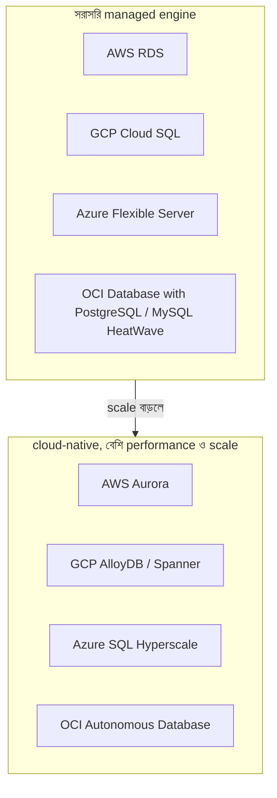
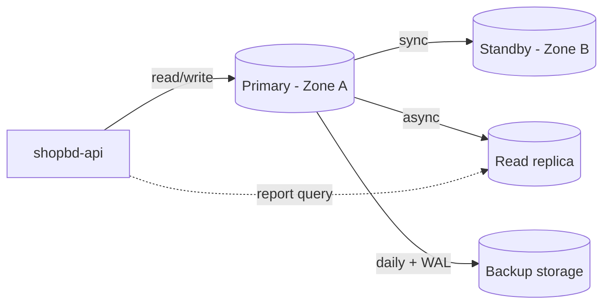
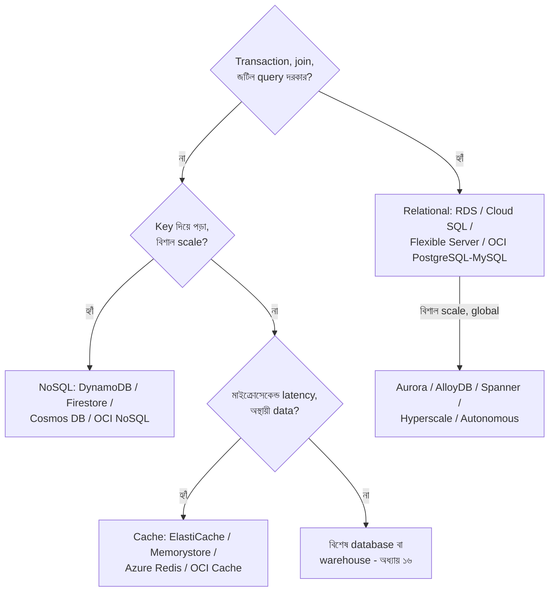

# 07 · Database

> **এই অধ্যায়ে কী শিখবেন**
>
> - Relational, NoSQL ও Cache — কোন ধরনের data কোথায় রাখবেন
> - Managed relational: RDS / Aurora, Cloud SQL / AlloyDB / Spanner, Azure SQL / Flexible Server, OCI MySQL HeatWave / Autonomous / Base DB
> - NoSQL: DynamoDB, Firestore / Bigtable, Cosmos DB, OCI NoSQL
> - Cache: ElastiCache, Memorystore, Azure Cache for Redis, OCI Cache
> - Backup, point-in-time recovery, read replica ও High Availability-র পার্থক্য
> - কোন কাজে কোন database বাছবেন — একটা সিদ্ধান্ত-ছক

!!! abstract "এক নজরে — কোন cloud-এ কী নাম"

    | Concept | AWS | GCP | Azure | OCI |
    |---|---|---|---|---|
    | Managed PostgreSQL / MySQL | RDS | Cloud SQL | Azure Database for PostgreSQL / MySQL — Flexible Server | OCI Database with PostgreSQL / MySQL HeatWave |
    | Cloud-native relational | Aurora (PostgreSQL/MySQL compatible) | AlloyDB for PostgreSQL | Azure SQL Hyperscale | Autonomous Database |
    | Globally distributed SQL | Aurora DSQL / Aurora Global Database | Spanner | Azure SQL (geo-replication), Cosmos DB | Autonomous Database (Data Guard), Globally Distributed Database |
    | Microsoft SQL Server | RDS for SQL Server | Cloud SQL for SQL Server | Azure SQL Database / Managed Instance | VM-এ self-managed |
    | Oracle Database | RDS for Oracle | Oracle Database@Google Cloud | Oracle Database@Azure | Base DB, Exadata, Autonomous |
    | Key-value / document NoSQL | DynamoDB | Firestore | Cosmos DB (NoSQL API) | OCI NoSQL Database |
    | Wide-column / huge scale | DynamoDB, Keyspaces | Bigtable | Cosmos DB (Cassandra API) | OCI NoSQL (বা Autonomous JSON) |
    | In-memory cache | ElastiCache (Valkey / Redis OSS / Memcached), MemoryDB | Memorystore | Azure Cache for Redis / Azure Managed Redis | OCI Cache |
    | Backup | Automated backup + snapshot, AWS Backup | Automated backup, on-demand backup | Automated backup, Azure Backup | Automatic backup, manual backup |
    | Migration tool | AWS DMS | Database Migration Service | Azure Database Migration Service | OCI Database Migration, GoldenGate |

## ১. Database-এর ধরন ও কেন managed

Application-এর স্মৃতি হলো database। shopbd-তে customer, product, order সবই এখানে। কিন্তু সব data এক ধরনের নয়, তাই একাধিক ধরনের database আছে:

| ধরন | data কেমন | শক্তি | উদাহরণ (shopbd) |
|---|---|---|---|
| **Relational (SQL)** | সারি-কলামের table, সম্পর্কযুক্ত (foreign key) | Transaction (ACID), join, জটিল query | customers, products, orders |
| **Key-value / Document** | key ধরে পুরো document/JSON | বিশাল scale, কম latency, flexible schema | shopping cart, session |
| **Wide-column** | বিশাল row key-ভিত্তিক table | লক্ষ লক্ষ write/sec | click-stream, IoT event |
| **In-memory cache** | RAM-এ key-value | মাইক্রোসেকেন্ড latency | popular product list, rate limit |
| Graph / Time-series / Search | বিশেষ কাজের | সম্পর্ক, সময়ভিত্তিক, full-text | (এই বইয়ের বাইরে, সংক্ষেপে নিচে) |

### Self-managed বনাম Managed

VM-এ নিজে PostgreSQL ইনস্টল করলে patching, backup, failover, disk resize, monitoring — সব আপনার কাজ। **Managed database** মানে এসব cloud সামলায়, আপনি schema ও query নিয়ে ভাবেন।

| কাজ | VM-এ নিজে | Managed service |
|---|---|---|
| Hardware, OS patch | আপনি | Cloud |
| Backup ও point-in-time recovery | script লিখতে হয় | checkbox / retention দিন |
| Failover | Patroni বা হাতে-কলমে | automatic (HA চালু করলে) |
| Engine-এর সব সেটিং | পূর্ণ নিয়ন্ত্রণ | সীমিত (superuser সীমাবদ্ধ, কিছু extension নেই) |
| খরচ | VM + আপনার সময় | সাধারণত বেশি, কিন্তু অপারেশন কম |

!!! tip "নিয়ম"
    ছোট দল হলে **প্রথমে managed**। Self-managed শুধু তখন, যখন specific engine/extension/OS-tuning দরকার যা managed দেয় না।

## ২. Managed relational database

shopbd-র মূল database PostgreSQL। চার cloud-এ এর "ঘর":



### প্ল্যাটফর্ম ধরে পরিচিতি

=== "AWS"

    - **Amazon RDS**: PostgreSQL, MySQL, MariaDB, Oracle, SQL Server, Db2 — এক service-এ।
    - **Amazon Aurora**: PostgreSQL/MySQL-compatible, কিন্তু নিজস্ব storage layer — data ৩টা AZ-তে ৬ কপি; read replica দ্রুত; **Aurora Serverless v2** load অনুযায়ী capacity ওঠানামা করে। নতুন: **Aurora DSQL** (distributed SQL)।
    - Console: RDS → Create database। Subnet group দিয়ে VPC-র private subnet বাছতে হয়।

=== "GCP"

    - **Cloud SQL**: MySQL, PostgreSQL, SQL Server। Edition: Enterprise ও Enterprise Plus।
    - **AlloyDB for PostgreSQL**: PostgreSQL-compatible, analytics-সহ বেশি performance-এর লক্ষ্য (compute ও storage আলাদা)।
    - **Spanner**: horizontal scale ও multi-region strong consistency-সহ SQL — সত্যিকারের global app-এর জন্য।
    - Console: SQL → Create instance।

=== "Azure"

    - **Azure Database for PostgreSQL — Flexible Server** ও **MySQL — Flexible Server**: প্রধান managed open-source database। (পুরোনো *Single Server* বন্ধ/retired — নতুন কাজে Flexible Server।)
    - **Azure SQL Database** (Microsoft SQL Server-এর PaaS), **Azure SQL Managed Instance** (প্রায় full SQL Server compatibility), Hyperscale tier (বিশাল DB)।
    - Console: Azure Database for PostgreSQL flexible servers → Create।

=== "OCI"

    - **OCI Database with PostgreSQL** (managed PostgreSQL), **MySQL HeatWave** (MySQL + in-memory analytics accelerator)।
    - **Autonomous Database**: Oracle Database, নিজে tuning/patching/backup করে (workload: Transaction Processing, Data Warehouse, JSON, APEX)। Oracle ২০২৫ থেকে "Autonomous AI Database" branding-ও ব্যবহার করছে।
    - **Base Database Service** (VM-এ Oracle DB), **Exadata Database Service** (বড় enterprise)।
    - Console: Oracle Database বা Databases menu।

### Managed PostgreSQL তৈরি — `shopbd-db`

Private network-এ, HA সহ। (Subnet/VPC আগে তৈরি থাকতে হবে — [Networking](05-networking.md)।)

=== "AWS"

    ```bash
    aws rds create-db-instance \
      --db-instance-identifier shopbd-db \
      --engine postgres \
      --db-instance-class db.t4g.medium \
      --allocated-storage 50 \
      --storage-type gp3 \
      --master-username shopbdadmin \
      --manage-master-user-password \
      --multi-az \
      --db-subnet-group-name shopbd-db-subnets \
      --vpc-security-group-ids sg-0123456789abcdef0 \
      --no-publicly-accessible \
      --backup-retention-period 7 \
      --storage-encrypted \
      --region ap-south-1
    ```

    `--manage-master-user-password` দিলে RDS password নিজে বানিয়ে **Secrets Manager**-এ রাখে ও rotate করে।

=== "GCP"

    ```bash
    gcloud sql instances create shopbd-db \
      --database-version=POSTGRES_16 \
      --edition=ENTERPRISE \
      --tier=db-custom-2-8192 \
      --region=asia-south1 \
      --availability-type=REGIONAL \
      --network=projects/my-project-id/global/networks/shopbd-prod-vpc \
      --no-assign-ip \
      --enable-point-in-time-recovery
    ```

    Private IP-র জন্য VPC-তে **Private Services Access** আগে সেটআপ করা থাকতে হয়। Root password আলাদা করে `gcloud sql users set-password postgres --instance=shopbd-db --prompt-for-password` দিয়ে দিন।

=== "Azure"

    ```bash
    az postgres flexible-server create \
      --resource-group shopbd-prod-rg \
      --name shopbd-db \
      --location centralindia \
      --version 16 \
      --tier GeneralPurpose \
      --sku-name Standard_D2ds_v5 \
      --storage-size 128 \
      --high-availability ZoneRedundant \
      --vnet shopbd-prod-vnet \
      --subnet db-subnet \
      --admin-user shopbdadmin \
      --admin-password '<strong-password>'
    ```

    Zone-redundant HA শুধু General Purpose ও Memory Optimized tier-এ পাওয়া যায়, Burstable-এ নয়। Subnet-এ Microsoft.DBforPostgreSQL/flexibleServers delegation দরকার (`--vnet`/`--subnet` দিলে CLI নিজে করে দেয়)।

=== "OCI"

    ```bash
    # MySQL HeatWave DB system
    oci mysql db-system create \
      --compartment-id ocid1.compartment.oc1..example \
      --availability-domain "AAAA:AP-MUMBAI-1-AD-1" \
      --display-name shopbd-db \
      --shape-name MySQL.2 \
      --subnet-id ocid1.subnet.oc1.ap-mumbai-1.example \
      --admin-username shopbdadmin \
      --admin-password '<strong-password>'
    ```

    **OCI Database with PostgreSQL** Console বা Terraform দিয়ে বানানোই সহজ (নিচে Terraform দেখুন)। OCI-তে সবকিছু compartment-এ থাকে, তাই প্রতিটি কমান্ডে OCID লাগে।

!!! warning "Password কমান্ডে লিখবেন না"
    উদাহরণের `<strong-password>` শুধু বোঝানোর জন্য। বাস্তবে secret manager বা Console-এর "managed credentials" ব্যবহার করুন; shell history-তে password থাকা বিপজ্জনক। বিস্তারিত: [Security](13-security.md)।

### Terraform

=== "AWS"

    ```hcl
    resource "aws_db_instance" "shopbd" {
      identifier                  = "shopbd-db"
      engine                      = "postgres"
      instance_class              = "db.t4g.medium"
      allocated_storage           = 50
      storage_type                = "gp3"
      db_name                     = "shopbd"
      username                    = "shopbdadmin"
      manage_master_user_password = true
      multi_az                    = true
      db_subnet_group_name        = aws_db_subnet_group.shopbd.name
      vpc_security_group_ids      = [aws_security_group.db.id]
      publicly_accessible         = false
      storage_encrypted           = true
      backup_retention_period     = 7
      deletion_protection         = true
      skip_final_snapshot         = false
      final_snapshot_identifier   = "shopbd-db-final"
    }
    ```

=== "GCP"

    ```hcl
    resource "google_sql_database_instance" "shopbd" {
      name                = "shopbd-db"
      region              = "asia-south1"
      database_version    = "POSTGRES_16"
      deletion_protection = true

      settings {
        tier              = "db-custom-2-8192"
        edition           = "ENTERPRISE"
        availability_type = "REGIONAL"

        backup_configuration {
          enabled                        = true
          point_in_time_recovery_enabled = true
        }

        ip_configuration {
          ipv4_enabled    = false
          private_network = google_compute_network.shopbd.id
        }
      }
    }
    ```

=== "Azure"

    ```hcl
    resource "azurerm_postgresql_flexible_server" "shopbd" {
      name                          = "shopbd-db"
      resource_group_name           = "shopbd-prod-rg"
      location                      = "centralindia"
      version                       = "16"
      sku_name                      = "GP_Standard_D2ds_v5"
      storage_mb                    = 131072
      delegated_subnet_id           = azurerm_subnet.db.id
      private_dns_zone_id           = azurerm_private_dns_zone.pg.id
      public_network_access_enabled = false
      administrator_login           = "shopbdadmin"
      administrator_password        = var.db_password
      backup_retention_days         = 7

      high_availability {
        mode = "ZoneRedundant"
      }
    }
    ```

=== "OCI"

    ```hcl
    resource "oci_psql_db_system" "shopbd" {
      compartment_id              = var.compartment_id
      display_name                = "shopbd-db"
      db_version                  = "16"
      shape                       = "PostgreSQL.VM.Standard.E4.Flex.2.32GB"
      instance_count              = 1
      instance_ocpu_count         = 2
      instance_memory_size_in_gbs = 32

      network_details {
        subnet_id = oci_core_subnet.db.id
      }

      storage_details {
        is_regionally_durable = true
        system_type           = "OCI_OPTIMIZED_STORAGE"
      }

      credentials {
        username = "shopbdadmin"
        password_details {
          password_type = "PLAIN_TEXT"
          password      = var.db_password
        }
      }
    }
    ```

    Shape ও version-এর অনুমোদিত মান region-ভেদে বদলায়; `oci psql shape list` ও Console-এ দেখে নিন।

### Cloud-native engine কেন আলাদা?

Aurora, AlloyDB, Azure SQL Hyperscale ও Autonomous Database-এ **compute আর storage আলাদা**। Storage নিজে নিজে বড় হয়, replica তৈরি দ্রুত (কপি করতে হয় না, একই storage ভাগ করে), failover ছোট। বিনিময়ে vendor lock-in কিছুটা বাড়ে ও খরচ সাধারণ managed engine-এর চেয়ে বেশি হতে পারে। প্রথমে সাধারণ managed PostgreSQL দিয়ে শুরু করা প্রায় সবসময় ভালো সিদ্ধান্ত।

## ৩. High Availability, Read Replica ও Backup — তিনটা আলাদা জিনিস

নতুনরা এই তিনটা গুলিয়ে ফেলে। প্রতিটার কাজ আলাদা:

| | High Availability (HA) | Read Replica | Backup |
|---|---|---|---|
| উদ্দেশ্য | server/zone নষ্ট হলে **দ্রুত চালু থাকা** | **read লোড ভাগ** করা | **ডেটা হারানো/মুছে ফেলা** থেকে ফেরা |
| Sync | Synchronous (standby সবসময় হুবহু) | সাধারণত Asynchronous (সামান্য পিছিয়ে) | নির্দিষ্ট সময় পরপর |
| Standby/replica পড়া যায়? | সাধারণত না | হ্যাঁ | — |
| ভুল `DELETE` ঠিক করে? | **না** (ভুলটাও standby-তে চলে যায়) | **না** | **হ্যাঁ** (PITR) |
| Promote করা যায়? | Automatic failover | Manual (DR-এও কাজে লাগে) | নতুন instance-এ restore |



!!! note "Analogy"
    HA = একই কাজের জন্য দুজন ড্রাইভার, একজন অসুস্থ হলে অন্যজন গাড়ি চালায়। Read replica = একই দোকানের আরেকটা কাউন্টার যেখানে শুধু তথ্য দেখা যায়। Backup = ফটোকপি করে বাসায় রাখা কাগজ — কেউ আসল ফাইল পুড়িয়ে ফেললেও ফেরত পাবেন।

| | AWS | GCP | Azure | OCI |
|---|---|---|---|---|
| HA | RDS **Multi-AZ** (sync standby); Multi-AZ DB cluster (২ readable standby) | Cloud SQL **REGIONAL** availability | Flexible Server **Zone-redundant / Same-zone HA** | PostgreSQL ও MySQL HA (একাধিক node, regional durable storage); Autonomous Data Guard |
| Read replica | RDS read replica (cross-region-ও) | Cloud SQL read replica | Flexible Server read replica | MySQL HeatWave ও PostgreSQL read replica |
| Failover | Automatic (সাধারণত এক-দুই মিনিট) | Automatic | Automatic | Automatic |

=== "AWS"

    ```bash
    aws rds create-db-instance-read-replica \
      --db-instance-identifier shopbd-db-replica \
      --source-db-instance-identifier shopbd-db

    # HA-এর failover পরীক্ষা (Multi-AZ instance)
    aws rds reboot-db-instance --db-instance-identifier shopbd-db --force-failover
    ```

=== "GCP"

    ```bash
    gcloud sql instances create shopbd-db-replica \
      --master-instance-name=shopbd-db \
      --region=asia-south1

    # HA failover পরীক্ষা
    gcloud sql instances failover shopbd-db
    ```

=== "Azure"

    ```bash
    az postgres flexible-server replica create \
      --resource-group shopbd-prod-rg \
      --replica-name shopbd-db-replica \
      --source-server shopbd-db
    ```

=== "OCI"

    ```bash
    # MySQL HeatWave-এ read replica আলাদা resource;
    # Console-এ: MySQL DB system → Read replicas → Create
    oci mysql replica list --compartment-id ocid1.compartment.oc1..example
    ```

!!! warning "HA ≠ backup"
    কেউ ভুলে `DROP TABLE orders;` চালালে HA standby-ও সাথে সাথে সেটা মুছে ফেলে। শুধু **backup + PITR** আপনাকে ফেরাতে পারবে।

## ৪. Backup, point-in-time recovery ও maintenance

### ধারণা

- **Automated backup**: প্রতিদিন snapshot + ক্রমাগত transaction log (WAL/binlog) জমা → retention-এর মধ্যে **যেকোনো সেকেন্ডে ফেরা (PITR)** যায়।
- **Manual snapshot/backup**: আপনার ইচ্ছামতো, retention শেষ হলেও থাকে (যেমন বড় migration-এর আগে)।
- **Restore মানে নতুন instance**: পুরোনো instance-কে "undo" করে না — নতুন একটা বানায়, তারপর app-কে সেদিকে ঘোরাতে হয় (বা প্রয়োজনীয় table কপি করতে হয়)।
- **RPO** (কতটুকু data হারানো সহ্য) ও **RTO** (কত দ্রুত ফেরা) — [Architecture ও HA/DR](19-architecture-ha-dr.md)-এ বিস্তারিত।

| | AWS | GCP | Azure | OCI |
|---|---|---|---|---|
| Automatic retention | ০–৩৫ দিন | ১–৩৬৫টি backup রাখা যায়; PITR log কয়েক দিন | ৭–৩৫ দিন | service ভেদে আলাদা (docs দেখুন) |
| PITR | হ্যাঁ | হ্যাঁ (চালু করতে হয়) | হ্যাঁ (default) | হ্যাঁ |
| Cross-region backup | Snapshot copy / Automated backup replication | Backup retention / cross-region replica | Geo-redundant backup | Cross-region backup copy |
| Engine settings-এর নাম | **Parameter group** | **Database flags** | **Server parameters** | **Configuration** |

=== "AWS"

    ```bash
    aws rds create-db-snapshot \
      --db-instance-identifier shopbd-db \
      --db-snapshot-identifier shopbd-db-before-migration

    aws rds restore-db-instance-to-point-in-time \
      --source-db-instance-identifier shopbd-db \
      --target-db-instance-identifier shopbd-db-restore \
      --restore-time 2026-11-20T10:00:00Z
    ```

=== "GCP"

    ```bash
    gcloud sql backups create --instance=shopbd-db

    gcloud sql instances clone shopbd-db shopbd-db-restore \
      --point-in-time=2026-11-20T10:00:00Z
    ```

=== "Azure"

    ```bash
    az postgres flexible-server restore \
      --resource-group shopbd-prod-rg \
      --name shopbd-db-restore \
      --source-server shopbd-db \
      --restore-time "2026-11-20T10:00:00Z"
    ```

=== "OCI"

    ```bash
    oci mysql backup create \
      --db-system-id ocid1.mysqldbsystem.oc1.ap-mumbai-1.example \
      --display-name shopbd-db-before-migration \
      --backup-type FULL
    ```

    Autonomous Database-এ automatic backup default চালু; restore Console বা `oci db autonomous-database restore` দিয়ে timestamp দিয়ে।

!!! tip "Restore drill"
    প্রতি মাসে একবার backup থেকে নতুন instance বানিয়ে `SELECT count(*) FROM orders;` চালান। যে backup কখনো restore করা হয়নি, সেটা backup কিনা আপনি জানেন না।

### Maintenance, patching ও deletion protection

- সব managed service একটা **maintenance window** দেয় — minor patch ও restart তখন হয়। shopbd-র জন্য রাত ২–৪টা (BDT) বেছে নিন।
- Major version upgrade (যেমন PostgreSQL 15 → 16) সাধারণত আপনার নিয়ন্ত্রণে; আগে clone-এ পরীক্ষা করুন।
- Production-এ **deletion protection** চালু রাখুন এবং delete-এর সময় final snapshot নিন (AWS `deletion_protection`, GCP `deletion_protection`)।

## ৫. Connectivity ও নিরাপত্তা

Database কখনো internet-এ খোলা রাখবেন না।

| বিষয় | করণীয় |
|---|---|
| Network | Private subnet/private IP; **public access বন্ধ** — [Networking](05-networking.md) |
| Firewall | শুধু `shopbd-api`-র security group / NSG / firewall rule থেকে DB port (PostgreSQL 5432) |
| Credentials | Secret manager (Secrets Manager / Secret Manager / Key Vault / OCI Vault) — কোডে নয় |
| IAM authentication | RDS IAM auth, Cloud SQL IAM database auth, Azure Entra ID auth, OCI IAM DB auth — password ছাড়াই short-lived token |
| Encryption | Rest-এ default চালু (নিজের key চাইলে KMS/CMEK/Key Vault/OCI Vault); transit-এ TLS বাধ্যতামূলক |
| Audit | pgAudit / cloud-এর audit log → [Monitoring](12-observability.md) |

## ৬. NoSQL

NoSQL-এর মূল মন্ত্র: **আগে access pattern ভাবুন, তারপর schema**। SQL-এ আগে table বানিয়ে পরে যেকোনো query চালানো যায়; NoSQL-এ আপনি যে প্রশ্নগুলো করবেন সেগুলোর ওপর ভিত্তি করে data সাজান, নইলে scan করতে গিয়ে ধীর ও দামি হয়।

| | AWS | GCP | Azure | OCI |
|---|---|---|---|---|
| Key-value/document | **DynamoDB** | **Firestore** (Native / Datastore mode) | **Cosmos DB** for NoSQL | **OCI NoSQL Database** |
| Wide-column | DynamoDB, Keyspaces (Cassandra) | **Bigtable** | Cosmos DB for Apache Cassandra | OCI NoSQL |
| MongoDB-compatible | DocumentDB | Firestore with MongoDB compatibility | Cosmos DB for MongoDB | Oracle Database API for MongoDB (Autonomous) |
| Primary key ধারণা | Partition key + (optional) Sort key | Document path / collection | Partition key (container-এ) | Primary key (shard key অংশ) |
| Capacity মডেল | On-demand বা Provisioned (RCU/WCU) | Pay-per-operation (serverless) | RU/s (Request Units): provisioned / autoscale / serverless | Provisioned (read/write units) বা On-demand |
| Global replication | Global Tables | Multi-region location | Multi-region writes | Multi-region replication |
| Consistency | Eventually / Strongly consistent read বাছা যায় | Strong | ৫টা level: Strong → Eventual (default Session) | Absolute / Eventual |

### মূল ধারণাগুলো

**Partition key** — data কোন "বালতিতে" যাবে। ভালো key সমানভাবে ছড়ায় (যেমন `customer_id`); খারাপ key (যেমন `status = "pending"`) সব ট্রাফিক এক partition-এ ঢালে — **hot partition**, throttling।

**Secondary index** — ভিন্ন key দিয়ে query করতে (DynamoDB GSI, Firestore composite index, Cosmos indexing policy)। বাড়তি লেখার খরচ আছে।

**TTL** — নির্দিষ্ট সময় পর item নিজে মুছে যায় (session, cart-এর জন্য উপযোগী)। চার cloud-এই আছে।

**Change stream** — data বদলালে event বের হয় (DynamoDB Streams, Firestore listeners, Cosmos DB change feed) — [Messaging ও Event](11-messaging-and-events.md)-এর সাথে জোড়ে।

**Cosmos DB-র RU**: প্রতিটি অপারেশনের একটা "খরচ" (Request Unit)। একটা point read সবচেয়ে সস্তা; cross-partition query দামি।

### shopbd-র cart table: `shopbd-carts`

=== "AWS"

    ```bash
    aws dynamodb create-table \
      --table-name shopbd-carts \
      --attribute-definitions AttributeName=customer_id,AttributeType=S \
      --key-schema AttributeName=customer_id,KeyType=HASH \
      --billing-mode PAY_PER_REQUEST \
      --region ap-south-1

    aws dynamodb put-item --table-name shopbd-carts \
      --item '{"customer_id": {"S": "c-1001"}, "items": {"L": []}}'
    ```

=== "GCP"

    ```bash
    gcloud firestore databases create \
      --database=shopbd-carts \
      --location=asia-south1 \
      --type=firestore-native
    ```

    Firestore-এ table আগে বানাতে হয় না — প্রথম document লিখলেই collection তৈরি (`carts/c-1001`)। **Bigtable** লাগবে যখন কয়েক TB+ time-series/analytics data, key-ভিত্তিক দ্রুত read; row key ডিজাইনই মূল কাজ।

=== "Azure"

    ```bash
    az cosmosdb create \
      --name shopbd-cosmos \
      --resource-group shopbd-prod-rg \
      --locations regionName=centralindia failoverPriority=0 isZoneRedundant=False \
      --default-consistency-level Session

    az cosmosdb sql database create \
      --account-name shopbd-cosmos --resource-group shopbd-prod-rg --name shopbd

    az cosmosdb sql container create \
      --account-name shopbd-cosmos --resource-group shopbd-prod-rg \
      --database-name shopbd --name carts \
      --partition-key-path "/customer_id" --throughput 400
    ```

=== "OCI"

    ```bash
    oci nosql table create \
      --compartment-id ocid1.compartment.oc1..example \
      --name shopbd_carts \
      --ddl-statement "CREATE TABLE IF NOT EXISTS shopbd_carts (customer_id STRING, cart JSON, PRIMARY KEY (customer_id))" \
      --table-limits '{"maxReadUnits": 50, "maxWriteUnits": 50, "maxStorageInGBs": 10}'
    ```

### Terraform

=== "AWS"

    ```hcl
    resource "aws_dynamodb_table" "carts" {
      name         = "shopbd-carts"
      billing_mode = "PAY_PER_REQUEST"
      hash_key     = "customer_id"

      attribute {
        name = "customer_id"
        type = "S"
      }

      point_in_time_recovery {
        enabled = true
      }

      ttl {
        attribute_name = "expires_at"
        enabled        = true
      }
    }
    ```

=== "GCP"

    ```hcl
    resource "google_firestore_database" "carts" {
      name        = "shopbd-carts"
      location_id = "asia-south1"
      type        = "FIRESTORE_NATIVE"
    }
    ```

=== "Azure"

    ```hcl
    resource "azurerm_cosmosdb_account" "shopbd" {
      name                = "shopbd-cosmos"
      location            = "centralindia"
      resource_group_name = "shopbd-prod-rg"
      offer_type          = "Standard"
      kind                = "GlobalDocumentDB"

      consistency_policy {
        consistency_level = "Session"
      }

      geo_location {
        location          = "centralindia"
        failover_priority = 0
      }
    }

    resource "azurerm_cosmosdb_sql_database" "shopbd" {
      name                = "shopbd"
      resource_group_name = "shopbd-prod-rg"
      account_name        = azurerm_cosmosdb_account.shopbd.name
    }

    resource "azurerm_cosmosdb_sql_container" "carts" {
      name                  = "carts"
      resource_group_name   = "shopbd-prod-rg"
      account_name          = azurerm_cosmosdb_account.shopbd.name
      database_name         = azurerm_cosmosdb_sql_database.shopbd.name
      partition_key_paths   = ["/customer_id"]
    }
    ```

    `partition_key_paths` (বহুবচন) নতুন azurerm 4.x provider-এর নাম; পুরোনো 3.x-এ `partition_key_path`। আপনার provider version অনুযায়ী মিলিয়ে নিন।

=== "OCI"

    ```hcl
    resource "oci_nosql_table" "carts" {
      compartment_id = var.compartment_id
      name           = "shopbd_carts"
      ddl_statement  = "CREATE TABLE IF NOT EXISTS shopbd_carts (customer_id STRING, cart JSON, PRIMARY KEY (customer_id))"

      table_limits {
        max_read_units     = 50
        max_write_units    = 50
        max_storage_in_gbs = 10
      }
    }
    ```

!!! warning "SQL-এর অভ্যাস NoSQL-এ নিয়ে যাবেন না"
    DynamoDB/Cosmos-এ join নেই; "সব order-এর মোট বিক্রি" ধরনের analytics query এখানে ভুল জায়গা — সেটা [Data ও Analytics](16-data-and-analytics.md)-এ warehouse-এর কাজ।

## ৭. Cache

Cache হলো RAM-ভিত্তিক দ্রুত data store (বেশিরভাগ Redis/Valkey-compatible, কিছু Memcached)। উদ্দেশ্য: **ঘন ঘন পড়া, কম বদলানো** data database থেকে না এনে মেমরি থেকে দেওয়া — database-এর লোড কমে, response দ্রুত হয়।

!!! note "Analogy"
    রান্নাঘরের দূরের ফ্রিজ (database) থেকে প্রতিবার লবণ আনার বদলে চুলার পাশে ছোট কৌটায় রাখা (cache)।

| | AWS | GCP | Azure | OCI |
|---|---|---|---|---|
| Service | **ElastiCache** (Valkey, Redis OSS, Memcached); ElastiCache Serverless | **Memorystore** (Valkey/Redis, Redis Cluster, Memcached) | **Azure Cache for Redis**; নতুন **Azure Managed Redis** | **OCI Cache** (Redis/Valkey-compatible) |
| Durable in-memory DB | Amazon MemoryDB | — | Azure Managed Redis (persistence option) | — |
| HA | Replication group + automatic failover | STANDARD_HA tier | Standard/Premium tier (replica) | Multi-node cluster |
| Network | VPC subnet group + security group | VPC peering/PSA | Private endpoint | Subnet |

!!! warning "Azure Cache for Redis নিয়ে সতর্কতা"
    Microsoft ধীরে ধীরে নতুন কাজে **Azure Managed Redis**-এর দিকে যেতে বলছে এবং পুরোনো tier-গুলোর retirement timeline ঘোষিত আছে। নতুন প্রজেক্ট শুরুর আগে [learn.microsoft.com](https://learn.microsoft.com/azure/redis/) দেখে নিন কোন offering বর্তমান।

=== "AWS"

    ```bash
    aws elasticache create-replication-group \
      --replication-group-id shopbd-cache \
      --replication-group-description "shopbd cache" \
      --engine valkey \
      --cache-node-type cache.t4g.small \
      --num-cache-clusters 2 \
      --automatic-failover-enabled \
      --cache-subnet-group-name shopbd-cache-subnets \
      --security-group-ids sg-0123456789abcdef0 \
      --transit-encryption-enabled
    ```

=== "GCP"

    ```bash
    gcloud redis instances create shopbd-cache \
      --size=1 \
      --region=asia-south1 \
      --tier=STANDARD_HA \
      --network=shopbd-prod-vpc \
      --redis-version=redis_7_2
    ```

=== "Azure"

    ```bash
    az redis create \
      --name shopbd-cache \
      --resource-group shopbd-prod-rg \
      --location centralindia \
      --sku Standard \
      --vm-size c1
    ```

=== "OCI"

    ```bash
    oci redis redis-cluster create \
      --compartment-id ocid1.compartment.oc1..example \
      --display-name shopbd-cache \
      --node-count 2 \
      --node-memory-in-gbs 2 \
      --software-version V7_0_5 \
      --subnet-id ocid1.subnet.oc1.ap-mumbai-1.example
    ```

    `--software-version`-এর অনুমোদিত মান `oci redis redis-cluster create --help` বা Console-এ দেখুন; সময়ের সাথে বদলায়।

### Cache-aside pattern (সবচেয়ে সাধারণ)

```python
import json
import redis

r = redis.Redis(host="shopbd-cache.example.internal", port=6379, ssl=True)

def get_product(product_id: int) -> dict:
    key = f"product:{product_id}"
    cached = r.get(key)
    if cached:                       # cache hit
        return json.loads(cached)

    product = db_query_product(product_id)   # cache miss: database থেকে আনুন
    r.setex(key, 300, json.dumps(product))   # ৫ মিনিট TTL
    return product
```

নিয়ম: (১) প্রথমে cache দেখুন, (২) না থাকলে DB, (৩) cache-এ **TTL সহ** রাখুন, (৪) data বদলালে key মুছে দিন বা TTL-এর ওপর ভরসা করুন। Cache হারালেও app চলতে হবে — cache কখনো একমাত্র সত্যের উৎস নয়।

**Cache-এর অন্যান্য ব্যবহার:** user session, rate limiting (`INCR` + TTL), leaderboard (sorted set), distributed lock, job queue (সীমিত)।

## ৮. অন্যান্য special-purpose database (সংক্ষেপে)

| ধরন | কাজ | AWS | GCP | Azure | OCI |
|---|---|---|---|---|---|
| Document (MongoDB-style) | JSON document | DocumentDB | Firestore (MongoDB compat.) | Cosmos DB for MongoDB | Autonomous JSON / MongoDB API |
| Graph | সম্পর্ক (fraud, recommendation) | Neptune | (Spanner Graph) | Cosmos DB for Gremlin / Fabric graph | Autonomous (Property Graph) |
| Time-series | সময়ভিত্তিক metric/IoT | Timestream | Bigtable / BigQuery | Azure Data Explorer | Autonomous / OCI Monitoring |
| Search | Full-text search | OpenSearch Service | Elastic on GCP / Vertex AI Search | Azure AI Search | OpenSearch (OCI Search) |
| Vector | AI similarity search | RDS/Aurora pgvector, OpenSearch | AlloyDB / Cloud SQL pgvector | PostgreSQL pgvector, AI Search | Autonomous AI Vector Search, PostgreSQL pgvector |

PostgreSQL-এর **pgvector** extension দিয়ে ছোট-মাঝারি vector search আলাদা database ছাড়াই করা যায় — [AI ও Machine Learning](17-ai-ml.md)-এ দেখুন।

## ৯. কোন কাজে কোন database — বাছাইয়ের ছক



| প্রয়োজন | সাধারণ পছন্দ |
|---|---|
| ছোট-মাঝারি e-commerce, transaction | Managed PostgreSQL / MySQL |
| Oracle/SQL Server-নির্ভর পুরোনো app | RDS for Oracle/SQL Server, Azure SQL, OCI Autonomous / Base DB |
| বিশাল traffic, কম latency read/write, সহজ access pattern | DynamoDB / Firestore / Cosmos DB / OCI NoSQL |
| একাধিক region-এ write, strong consistency | Spanner / Aurora DSQL / Cosmos DB multi-region |
| Session, cart snapshot, hot data | Redis-compatible cache |
| Analytics, রিপোর্ট | Warehouse — [Data ও Analytics](16-data-and-analytics.md) |
| Oracle-এর কাজে ও কম অপারেশন চান | OCI Autonomous Database |

**ভুল সিদ্ধান্ত এড়ানোর প্রশ্ন:** data-র আকার কত? কতটা write/read? Transaction লাগে? ছয় মাস পর কেমন বদলাবে? দলে কে এটা চালাতে জানে? — শেষ প্রশ্নটাই সবচেয়ে গুরুত্বপূর্ণ।

## ১০. Migration (সংক্ষেপে)

পুরোনো database cloud-এ আনার (বা এক cloud থেকে অন্যটায়) tool:

| | AWS | GCP | Azure | OCI |
|---|---|---|---|---|
| Managed migration | **AWS DMS** (+ Schema Conversion) | **Database Migration Service** | **Azure Database Migration Service** | **OCI Database Migration** |
| Continuous replication/CDC | DMS CDC | DMS / Datastream | DMS / Data Factory | **OCI GoldenGate** |

সহজ ছোট workload-এ `pg_dump` ও `pg_restore` যথেষ্ট; কিন্তু downtime কমাতে চাইলে logical replication বা এসব tool। বিস্তারিত migration কৌশল (6R) আছে [Architecture ও HA/DR](19-architecture-ha-dr.md)-এ।

## মিল ও অমিল

| বিষয় | AWS | GCP | Azure | OCI |
|---|---|---|---|---|
| "RDS"-এর সমতুল্য | RDS | Cloud SQL | Flexible Server | OCI Database with PostgreSQL / MySQL HeatWave |
| Network-এ কীভাবে ঢোকে | VPC subnet group | Private Services Access (peering) / Private IP | VNet-delegated subnet বা Private endpoint | VCN subnet |
| Engine setting | Parameter group | Database flags | Server parameters | Configuration |
| Secret management | Secrets Manager (RDS integration) | Secret Manager, IAM DB auth | Key Vault, Entra auth | OCI Vault |
| NoSQL-এর capacity unit | RCU / WCU | Operation count | RU/s | Read/Write Units |
| HA standby পড়া যায়? | Multi-AZ instance: না; Multi-AZ cluster: হ্যাঁ | না | না (ZR HA-তে) | service অনুযায়ী |
| Oracle workload | RDS for Oracle (license) | Oracle Database@Google Cloud | Oracle Database@Azure | Native (Autonomous, Exadata) |

**যে gotcha-গুলো প্রায়ই ঘটে**

- **GCP Cloud SQL private IP** চাইলে আগে VPC-তে private services access (IP range + peering) বসাতে হয়; না থাকলে "network not found/peering" error।
- **Azure Flexible Server-এ VNet integration** চাইলে আলাদা delegated subnet ও Private DNS zone দরকার; পরে public ও private (VNet) মোডের মধ্যে বদলানো সীমিত বা কঠিন — শুরুতেই ঠিক করুন।
- **AWS RDS-এ subnet group-এ অন্তত ২টা AZ-র subnet** লাগে — Multi-AZ না চাইলেও।
- **Cosmos DB-তে partition key পরে বদলানো যায় না** (নতুন container + data migration লাগে)। DynamoDB-তেও তাই।
- **OCI-তে প্রতিটি DB system একটা compartment-এ** — policy ছাড়া অন্য team দেখতে পাবে না।
- **Free tier / trial instance** production-এ নয় — SLA/HA নেই বা সীমিত।

## Real-world: shopbd

shopbd-র data layer:

| Data | পছন্দ | কেন |
|---|---|---|
| customers, products, orders, payments | **Managed PostgreSQL** (`shopbd-db`), HA চালু | Transaction ও join দরকার |
| Cart ও wishlist | NoSQL (`shopbd-carts`) **অথবা** Redis | key দিয়ে পড়া, TTL আছে; প্রথমে PostgreSQL-এই রাখাও ঠিক |
| Home page-এর "জনপ্রিয় পণ্য" ও session | Cache (Redis-compatible) | ঘন ঘন পড়া, DB-র লোড কমে |
| রাতের sales report | Read replica থেকে query (production DB-র ওপর চাপ নয়) | → [Data ও Analytics](16-data-and-analytics.md) |
| Backup | Automated + PITR ৭ দিন + মাসিক manual snapshot | ভুলের ধাক্কা সামলাতে |

প্রতিটি cloud-এ shopbd:

| | AWS | GCP | Azure | OCI |
|---|---|---|---|---|
| Primary DB | RDS PostgreSQL Multi-AZ | Cloud SQL PostgreSQL REGIONAL | Flexible Server (Zone-redundant) | OCI Database with PostgreSQL |
| Cache | ElastiCache (Valkey) | Memorystore | Azure Cache for Redis / Managed Redis | OCI Cache |
| Cart NoSQL | DynamoDB on-demand | Firestore | Cosmos DB (serverless/autoscale) | OCI NoSQL |
| Report replica | RDS read replica | Cloud SQL read replica | Flexible Server replica | PostgreSQL/MySQL read replica |

শুরুর advice: **একটা PostgreSQL ও একটা Redis** দিয়েই shopbd অনেক দূর যায়। NoSQL যোগ করুন যখন সত্যিই একটা access pattern PostgreSQL-এ ধরছে না।

## Best practices

- **Managed service** ব্যবহার করুন; HA চালু রাখুন production-এ।
- **Private network only**, public access বন্ধ; security group/firewall-এ শুধু app tier।
- **Credentials** secret manager-এ; সম্ভব হলে IAM/Entra authentication।
- **Backup + PITR**, retention অন্তত ৭ দিন, ও **মাসিক restore drill**।
- **Read replica** reporting ও read-heavy query-র জন্য, কিন্তু replica lag মাপুন।
- **Connection pooling** (PgBouncer / RDS Proxy / Cloud SQL Auth Proxy-র সাথে pooler / Azure built-in PgBouncer) — serverless বা অনেক app instance থাকলে অপরিহার্য।
- **Deletion protection + final snapshot**।
- **Tag/label** দিন (`app=shopbd`, `env=prod`)।
- **Right-size**: প্রথমে ছোট instance, metric দেখে বাড়ান। Storage autoscaling চালু রাখুন।
- **NoSQL-এ access pattern আগে**, partition key সাবধানে।
- **Cache-এ সবসময় TTL**।
- Monitoring ও alarm (CPU, connections, free storage, replica lag, deadlock) — [Monitoring](12-observability.md)।

## Common mistakes

| ভুল | ফল | সমাধান |
|---|---|---|
| Database-কে public IP দেওয়া | Brute-force ও data leak | Private IP + firewall |
| HA-কে backup ভাবা | `DROP TABLE` হলে সব শেষ | Backup + PITR আলাদা করে |
| Backup কখনো restore না করা | বিপদে দেখা যায় ভাঙা | মাসিক restore drill |
| Password কোডে/`.env`-এ commit করা | Credential leak | Secret manager / IAM auth |
| Connection pooling ছাড়া শত শত connection | `too many connections` | Pooler ব্যবহার |
| Production-এ ছোট burstable/free instance | CPU credit শেষ হলে ধীর, HA নেই | General purpose + HA |
| NoSQL-এ hot partition key | Throttling | সমান ছড়ানো key |
| Cache-কে একমাত্র source of truth বানানো | Cache গেলে data গেল | Cache শুধু copy; TTL |
| Read replica থেকে তাৎক্ষণিক সর্বশেষ data আশা | পুরোনো data দেখা | Replica lag মাথায় রাখুন; critical read primary থেকে |
| Delete করার আগে final snapshot না নেওয়া | Data অপূরণীয় | Deletion protection + final snapshot |
| Major version upgrade সরাসরি production-এ | Query ভাঙে | আগে clone-এ পরীক্ষা |

## ইন্টারভিউ / সার্টিফিকেশন টিপস

??? question "Multi-AZ (HA) আর Read Replica-র পার্থক্য কী?"
    Multi-AZ = synchronous standby, failover-এর জন্য, সাধারণত read করা যায় না (AWS Multi-AZ DB cluster ব্যতিক্রম)। Read replica = asynchronous, read লোড ভাগ করে, আলাদা endpoint, promote করা যায় (DR-এ কাজে লাগে)। একই জিনিস নয় — একসাথেও ব্যবহার করা যায়।

??? question "RDS আর Aurora-র পার্থক্য?"
    RDS-এ সাধারণ engine EBS storage-এ চলে। Aurora-র নিজস্ব distributed storage (৩ AZ-তে ৬ কপি), দ্রুত replica ও failover, Serverless v2; খরচ বেশি ও AWS-specific। এখানে নতুন হলে RDS দিয়ে শুরু।

??? question "PITR কীভাবে কাজ করে?"
    নির্দিষ্ট সময় পরপর full backup + ক্রমাগত transaction log জমানো হয়। ফেরার সময় সবচেয়ে কাছের backup restore করে log replay করা হয় যতক্ষণ না কাঙ্ক্ষিত timestamp আসে। ফলাফল একটা **নতুন instance**।

??? question "DynamoDB-তে partition key কেমন হওয়া উচিত?"
    High cardinality, সমান ট্রাফিক বণ্টন (যেমন `customer_id`)। কম মানের key (status, date শুধু) hot partition তৈরি করে। Access pattern ধরে key + GSI ডিজাইন করুন।

??? question "Cosmos DB-র consistency level গুলো কী কী?"
    Strong, Bounded Staleness, Session (default), Consistent Prefix, Eventual। Strong সবচেয়ে নিরাপদ কিন্তু latency বেশি; Eventual সবচেয়ে দ্রুত কিন্তু পুরোনো data পড়তে পারে।

??? question "Cache-aside ও write-through-এর পার্থক্য?"
    Cache-aside: app নিজে cache দেখে, miss হলে DB থেকে এনে cache-এ রাখে। Write-through: লেখার সময় একসাথে cache ও DB আপডেট। Cache-aside সহজ ও সবচেয়ে প্রচলিত।

??? question "Spanner / Aurora DSQL কখন লাগে?"
    যখন একাধিক region-এ strongly consistent SQL write দরকার ও single-node PostgreSQL scale করে না। বেশিরভাগ ছোট-মাঝারি app-এ এটা overkill।

??? question "Azure-তে PostgreSQL Single Server-এর কী হলো?"
    Single Server retired হয়েছে; Flexible Server হলো বর্তমান, zone-redundant HA, বেশি নিয়ন্ত্রণ ও VNet integration সহ।

## সারসংক্ষেপ

- Data-র ধরন ঠিক করে database বাছুন: **Relational** (transaction/join), **NoSQL** (key-ভিত্তিক scale), **Cache** (RAM-এর গতি)।
- **Managed service** প্রায় সবসময় ভালো শুরু: RDS / Cloud SQL / Flexible Server / OCI PostgreSQL-MySQL HeatWave। বড় scale-এ Aurora / AlloyDB / Spanner / Hyperscale / Autonomous।
- **HA, Read Replica ও Backup তিনটা আলাদা** — HA ভুল delete ঠেকায় না, backup-ই ঠেকায়; backup-এর restore-test অপরিহার্য।
- **Private network, secret manager, deletion protection** — নিরাপত্তার ন্যূনতম।
- NoSQL-এ **access pattern আগে**, partition key সাবধানে; Cache-এ **TTL ও cache-aside**।
- shopbd: PostgreSQL (HA, PITR) + Redis cache + (দরকারে) NoSQL cart + report-এর জন্য replica।

পরের অধ্যায়: [08 · Container ও Kubernetes](08-containers-kubernetes.md)।
