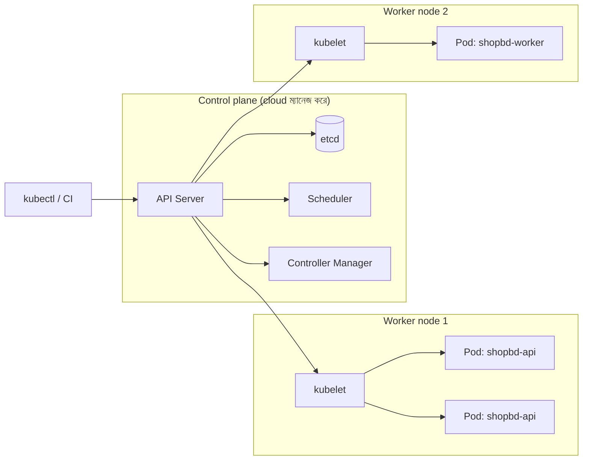
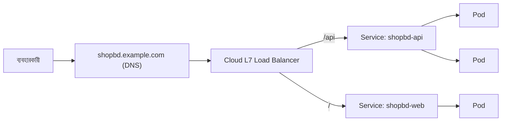

# 08 · Container ও Kubernetes

> **এই অধ্যায়ে কী শিখবেন**
>
> - Container আসলে কী, VM থেকে কীভাবে আলাদা, আর image কীভাবে বানাতে ও রাখতে হয়
> - চার cloud-এর container registry: **ECR / Artifact Registry / ACR / OCIR**
> - Kubernetes-এর মূল ধারণা এবং managed service: **EKS / GKE / AKS / OKE**
> - "Standard" বনাম "Autopilot-style" mode, node pool, AWS **ECS**-এর ভূমিকা
> - Ingress / Gateway দিয়ে বাইরের traffic ঢোকানো, আর Pod-কে cloud IAM-এর সাথে যুক্ত করা
> - `shopbd`-এর API container কীভাবে চার cloud-এ চলে — CLI ও Terraform সহ

!!! abstract "এক নজরে — কোন cloud-এ কী নাম"

    | Concept | AWS | GCP | Azure | OCI |
    |---|---|---|---|---|
    | Container registry | Amazon ECR | Artifact Registry | Azure Container Registry (ACR) | OCI Registry (OCIR / Container Registry) |
    | Managed Kubernetes | Amazon EKS | Google Kubernetes Engine (GKE) | Azure Kubernetes Service (AKS) | Oracle Container Engine for Kubernetes (OKE) |
    | "Autopilot-style" (node ম্যানেজ করতে হয় না) | EKS Auto Mode, Fargate profile | GKE Autopilot | AKS Automatic | OKE virtual nodes |
    | Node-এর group | Managed node group | Node pool | Node pool (system / user) | Node pool |
    | Cloud-এর নিজস্ব orchestrator | Amazon ECS | নেই (Cloud Run, দেখুন [Serverless](09-serverless.md)) | Azure Container Apps (Kubernetes-based, abstracted) | OCI Container Instances (orchestrator নয়) |
    | Pod → cloud IAM | EKS Pod Identity / IRSA | Workload Identity Federation for GKE | Microsoft Entra Workload ID | Workload Identity (OKE) |
    | Ingress / L7 controller | AWS Load Balancer Controller (ALB) | GKE Ingress / Gateway API (Application LB) | Application Gateway for Containers, app routing add-on | OCI native ingress controller (OCI LB) |
    | Image vulnerability scan | ECR scanning (Inspector) | Artifact Analysis | Microsoft Defender for Containers | OCI Vulnerability Scanning |

আগের অধ্যায়গুলোতে আমরা [VM](04-compute-vms.md), [Network](05-networking.md) ও [Storage](06-storage.md) দেখেছি। এবার দেখব কীভাবে
app-কে **container** আকারে প্যাকেজ করে একই ভাবে যেকোনো cloud-এ চালানো যায়। পরের অধ্যায় [Serverless](09-serverless.md)-এ দেখব
container চালানোর আরও সহজ পথ, আর [Load Balancing](10-load-balancing-scaling-dns-cdn.md)-এ দেখব traffic ভাগ করার বিস্তারিত।

---

## ১. Container কী ও কেন

### সমস্যাটা

আপনার `shopbd-api` আপনার laptop-এ Python 3.12 আর কিছু library দিয়ে চলে। Server-এ গিয়ে দেখলেন Python 3.9, library-র
version আলাদা — app চলছে না। "আমার মেশিনে তো চলে!" — এই বিখ্যাত সমস্যার সমাধান container।

**Container** হলো app + তার runtime + library + config — সব একটা বাক্সে (image) বন্দি করা, যা যেকোনো জায়গায় একইভাবে চলে।

!!! example "দৈনন্দিন analogy"
    Container হলো **শিপিং কন্টেইনার**। ভেতরে কী আছে (কাপড়, মোবাইল, চাল) জাহাজ-ট্রাক-ট্রেনের জানার দরকার নেই —
    সবাই শুধু বাক্সের মাপ আর হুক চেনে। তেমনি container-এর ভেতরে Python আছে না Go আছে, host মেশিন তা নিয়ে মাথা ঘামায় না।

### Container বনাম VM

| বিষয় | Virtual Machine | Container |
|---|---|---|
| OS | প্রতিটির নিজের পুরো OS (guest kernel) | Host-এর kernel শেয়ার করে |
| আকার | GB | সাধারণত MB (দশ থেকে কয়েকশো) |
| চালু হতে সময় | কয়েক সেকেন্ড থেকে মিনিট | সাধারণত এক সেকেন্ডের কাছাকাছি |
| Isolation | শক্তিশালী (hypervisor) | Process-level (namespace + cgroup) |
| এক মেশিনে কতগুলো | কয়েকটি | অনেক (dense) |

### Image, container ও registry

- **Dockerfile** — image বানানোর recipe।
- **Image** — immutable (বদলানো যায় না) template; অনেকগুলো read-only **layer** দিয়ে তৈরি। একই base layer অনেক image শেয়ার করে, তাই pull দ্রুত হয়।
- **Container** — image-এর চলমান instance।
- **Registry** — image রাখার server (Docker Hub, ECR, Artifact Registry…)। Image-এর পূর্ণ নাম হলো `registry/repository:tag`।
- **Tag** — version লেবেল (`1.0`, `git-3f2a9c1`)। **Digest** (`sha256:...`) — image-এর অপরিবর্তনীয় fingerprint।

`shopbd-api`-এর জন্য একটা multi-stage Dockerfile:

```dockerfile
# Build stage: dependency আলাদা করে বানাই
FROM python:3.12-slim AS build
WORKDIR /app
COPY requirements.txt .
RUN pip install --no-cache-dir --prefix=/install -r requirements.txt

# Runtime stage: ছোট ও পরিষ্কার
FROM python:3.12-slim
WORKDIR /app
COPY --from=build /install /usr/local
COPY . .
# Non-root user: security best practice
RUN useradd --create-home appuser
USER appuser
EXPOSE 8000
CMD ["gunicorn", "-b", "0.0.0.0:8000", "shopbd.api:app"]
```

```bash
docker build -t shopbd-api:1.0 .
docker run --rm -p 8000:8000 shopbd-api:1.0
curl http://localhost:8000/healthz
```

!!! tip "Container-এর ১২-factor নিয়ম"
    Config ঢুকবে **environment variable** দিয়ে (image-এ hard-code নয়), log যাবে **stdout/stderr**-এ (file-এ নয়), আর container
    হবে **stateless** — data থাকবে [database](07-databases.md) বা [object storage](06-storage.md)-এ। এই তিনটা মানলে যেকোনো
    orchestrator-এ app সুন্দরভাবে চলে।

---

## ২. Container Registry

Registry হলো আপনার private image-এর গুদাম। Cluster বা serverless service এখান থেকেই image **pull** করে।
চার cloud-এর registry-র মূল কাজ এক; পার্থক্য নাম, login ও repository-র গঠনে।

| বিষয় | AWS ECR | GCP Artifact Registry | Azure ACR | OCI OCIR |
|---|---|---|---|---|
| Image-এর পূর্ণ নাম | `123456789012.dkr.ecr.ap-south-1.amazonaws.com/shopbd-api:1.0` | `asia-south1-docker.pkg.dev/my-project-id/shopbd/shopbd-api:1.0` | `shopbdacr.azurecr.io/shopbd-api:1.0` | `bom.ocir.io/<tenancy-namespace>/shopbd-api:1.0` |
| "Repository"-র অর্থ | প্রতিটি image-এর জন্য আলাদা repository | একটা repository-তে অনেক image | একটা registry-তে অনেক repository | একটা tenancy namespace-এ অনেক repository |
| Login | `aws ecr get-login-password` | `gcloud auth configure-docker` | `az acr login` | Auth token (password) + username |
| পুরোনো image মোছা | Lifecycle policy | Cleanup policy | Retention / purge task | Retention policy |

!!! note "পুরোনো নাম"
    GCP-র **Container Registry** (`gcr.io`) এখন legacy — নতুন কাজে সবসময় **Artifact Registry** ব্যবহার করুন; পুরোনো `gcr.io` path
    Artifact Registry-র দিকে redirect হয়। Artifact Registry শুধু Docker image নয়, Python/npm/Maven package-ও রাখে।

=== "AWS"

    Service: **Amazon ECR**। Console: ECR → Repositories → Create repository।

    ```bash
    REGION=ap-south-1
    ACCOUNT=123456789012

    # ১) Repository বানানো (scan-on-push চালু)
    aws ecr create-repository --repository-name shopbd-api \
      --image-scanning-configuration scanOnPush=true --region $REGION

    # ২) Docker-কে ECR-এ login
    aws ecr get-login-password --region $REGION \
      | docker login --username AWS --password-stdin $ACCOUNT.dkr.ecr.$REGION.amazonaws.com

    # ৩) Tag ও push
    docker tag shopbd-api:1.0 $ACCOUNT.dkr.ecr.$REGION.amazonaws.com/shopbd-api:1.0
    docker push $ACCOUNT.dkr.ecr.$REGION.amazonaws.com/shopbd-api:1.0
    ```

    Login token প্রায় ১২ ঘণ্টা বৈধ থাকে — CI-তে প্রতিবার login করান। Lifecycle policy দিয়ে "১০টির বেশি untagged image রাখো না" জাতীয় নিয়ম বসানো যায়।

=== "GCP"

    Service: **Artifact Registry**। Console: Artifact Registry → Create repository (format = Docker)।

    ```bash
    gcloud artifacts repositories create shopbd \
      --repository-format=docker --location=asia-south1 \
      --description="shopbd container images"

    # Docker-কে gcloud credential ব্যবহার করতে বলা (একবারই)
    gcloud auth configure-docker asia-south1-docker.pkg.dev

    docker tag shopbd-api:1.0 asia-south1-docker.pkg.dev/my-project-id/shopbd/shopbd-api:1.0
    docker push asia-south1-docker.pkg.dev/my-project-id/shopbd/shopbd-api:1.0
    ```

    Repository region-ভিত্তিক। Cluster/Cloud Run যে region-এ চলে, repository-ও সেই region-এ রাখলে pull দ্রুত ও সস্তা।

=== "Azure"

    Service: **Azure Container Registry (ACR)**। Registry-র নাম global-ভাবে unique, শুধু ছোট হাতের অক্ষর ও সংখ্যা।

    ```bash
    az group create --name shopbd-rg --location centralindia

    az acr create --resource-group shopbd-rg --name shopbdacr --sku Standard

    az acr login --name shopbdacr

    docker tag shopbd-api:1.0 shopbdacr.azurecr.io/shopbd-api:1.0
    docker push shopbdacr.azurecr.io/shopbd-api:1.0

    # Docker ছাড়াই cloud-এ build করা (ACR Tasks)
    az acr build --registry shopbdacr --image shopbd-api:1.0 .
    ```

    `az acr build` laptop-এ Docker না থাকলেও চলে — source ACR-এ গিয়ে সেখানেই build হয়।

=== "OCI"

    Service: **Container Registry (OCIR)**। Registry-র host হলো region key দিয়ে — Mumbai (`ap-mumbai-1`)-র key `bom`।
    Username গঠন: `<tenancy-namespace>/<username>`, আর password হলো **Auth Token** (Console → Profile → Auth tokens)।

    ```bash
    docker login bom.ocir.io -u '<tenancy-namespace>/<username>'
    # Password প্রশ্নে Auth Token paste করুন

    docker tag shopbd-api:1.0 bom.ocir.io/<tenancy-namespace>/shopbd-api:1.0
    docker push bom.ocir.io/<tenancy-namespace>/shopbd-api:1.0
    ```

    প্রথম push-এ repository নিজে থেকে তৈরি হয় (root compartment-এ)। নির্দিষ্ট compartment-এ রাখতে আগে Console থেকে repository বানান।
    Region key-র তালিকা OCI docs-এ আছে — Mumbai `bom`, Hyderabad `hyd`, Singapore `sin`।

!!! warning "Image tag নিয়ে সাবধান"
    `latest` tag production-এ ব্যবহার করবেন না — আজ `latest` যা, কাল তা অন্য কিছু; rollback অসম্ভব হয়ে যায়। Git commit SHA বা semantic
    version ব্যবহার করুন, আর deploy করার সময় সম্ভব হলে **digest** pin করুন। ECR/ACR-এ **tag immutability** চালু রাখুন।

---

## ৩. Orchestration কেন লাগে — Kubernetes-এর পরিচয়

একটা container চালানো সহজ। কিন্তু `shopbd` যখন বড় হয় — ১০টা API container, ৩টা worker, কোনোটা মরে গেলে নতুন চালু, নতুন
version-এ একটা একটা করে বদল, ভিড়ে বাড়ানো — তখন কাজগুলো হাতে করা অসম্ভব। এই কাজ করে **container orchestrator**:

- **Scheduling** — কোন container কোন মেশিনে বসবে
- **Self-healing** — মরে গেলে আবার চালু, health check ব্যর্থ হলে সরিয়ে দেওয়া
- **Scaling** — লোড বাড়লে সংখ্যা বাড়ানো
- **Rolling update / rollback** — বিনা downtime-এ version বদল
- **Service discovery ও load balancing** — container-এ container-এ কথা বলা

!!! example "Analogy"
    Orchestrator হলো রেস্টুরেন্টের **ম্যানেজার**। রাঁধুনি (container) কম পড়লে সে নতুন ডাকে, কেউ অসুস্থ হলে বদলি আনে,
    কোন টেবিলে কে সার্ভ করবে ঠিক করে। আপনি শুধু বলেন "দিনে ৫ জন রাঁধুনি চাই" — বাকি সে সামলায়।

**Kubernetes (K8s)** হলো এই কাজের de-facto standard, open-source। চার cloud-ই managed Kubernetes দেয়, তাই K8s জানলে skill সব জায়গায় কাজে লাগে।

### Kubernetes-এর স্থাপত্য



- **Control plane** — cluster-এর "মস্তিষ্ক" (API server, etcd, scheduler, controller)। Managed service-এ এটা cloud চালায়, আপনি দেখেনও না।
- **Worker node** — যে মেশিনে আপনার container আসলে চলে (VM)। Node-এ `kubelet` আর container runtime থাকে।

### মূল K8s object

| Object | কাজ | shopbd-এ উদাহরণ |
|---|---|---|
| **Pod** | এক বা একাধিক container-এর ক্ষুদ্রতম একক | একটা `shopbd-api` container |
| **Deployment** | "এই Pod ৩টা সবসময় চলুক" + rolling update | `shopbd-api` Deployment |
| **Service** | Pod-গুলোর সামনে স্থির নাম ও IP (cluster-ভেতরের load balancer) | `shopbd-api` Service |
| **Ingress / Gateway** | বাইরের HTTP(S) traffic ভেতরে ঢোকানো | `shopbd.example.com` → API |
| **ConfigMap / Secret** | Config ও গোপন তথ্য | DB host, API key |
| **Namespace** | Cluster-এর ভেতরে logical ভাগ | `shopbd-prod`, `shopbd-staging` |
| **HPA** | Pod-সংখ্যা auto-scale | CPU 60% ছুঁলে বাড়াও |
| **PersistentVolumeClaim** | স্থায়ী disk চাওয়া | (shopbd-এর stateless API-তে দরকার নেই) |

### shopbd-api-র manifest

```yaml
apiVersion: apps/v1
kind: Deployment
metadata:
  name: shopbd-api
  namespace: shopbd-prod
spec:
  replicas: 3
  selector:
    matchLabels:
      app: shopbd-api
  template:
    metadata:
      labels:
        app: shopbd-api
    spec:
      serviceAccountName: shopbd-api-sa
      containers:
        - name: api
          image: REGISTRY/shopbd-api:1.0   # পরের অংশে প্রতিটি cloud-এর registry বসবে
          ports:
            - containerPort: 8000
          env:
            - name: APP_ENV
              value: prod
          resources:
            requests:
              cpu: 250m
              memory: 256Mi
            limits:
              memory: 512Mi
          readinessProbe:
            httpGet:
              path: /healthz
              port: 8000
            initialDelaySeconds: 5
          livenessProbe:
            httpGet:
              path: /healthz
              port: 8000
            initialDelaySeconds: 15
---
apiVersion: v1
kind: Service
metadata:
  name: shopbd-api
  namespace: shopbd-prod
spec:
  selector:
    app: shopbd-api
  ports:
    - port: 80
      targetPort: 8000
```

```bash
kubectl create namespace shopbd-prod
kubectl apply -f shopbd-api.yaml
kubectl -n shopbd-prod get pods
kubectl -n shopbd-prod rollout status deployment/shopbd-api
kubectl -n shopbd-prod logs deployment/shopbd-api
kubectl -n shopbd-prod rollout undo deployment/shopbd-api   # ভুল version গেলে rollback
```

!!! warning "resources.requests ছাড়া Pod দেবেন না"
    Scheduler `requests` দেখেই Pod কোথায় বসবে ঠিক করে, আর HPA-ও `requests`-এর শতাংশ ধরে হিসাব করে। `requests` না দিলে
    scheduling এলোমেলো হয়, autoscaling কাজ করে না, আর একটা Pod পুরো node-এর memory খেয়ে ফেলতে পারে।

---

## ৪. Managed Kubernetes — EKS, GKE, AKS, OKE

নিজে Kubernetes বানানো (control plane, etcd backup, upgrade, certificate) কঠিন। Managed service-এ **control plane-এর দায়িত্ব cloud-এর**,
আপনি দেখেন শুধু worker node আর workload। চার cloud-এর পার্থক্য:

| বিষয় | EKS | GKE | AKS | OKE |
|---|---|---|---|---|
| Control plane খরচ | Cluster-ঘণ্টা হিসেবে charge | Cluster management fee (billing account প্রতি একটা free-tier credit আছে) | Free tier (SLA ছাড়া) / Standard / Premium tier | Basic cluster বিনা-খরচে; Enhanced cluster-এ ঘণ্টা-হিসেব |
| Node ম্যানেজমেন্ট | Managed node group / self-managed / Fargate / Auto Mode | Standard (node pool) / Autopilot | Node pool / AKS Automatic | Managed node / Virtual node |
| Default networking | Amazon VPC CNI (Pod পায় VPC IP) | VPC-native (alias IP) | Azure CNI (Overlay সহ) / kubenet legacy | VCN-native Pod networking / Flannel overlay |
| Upgrade | Control plane ও node আলাদা করে | Release channel দিয়ে auto-upgrade | Auto-upgrade channel | Manual / managed |
| K8s-এ কে ঢুকতে পারে | EKS access entries (IAM) | IAM role + K8s RBAC | Entra ID + Azure RBAC for K8s | IAM policy + K8s RBAC |

!!! note "দাম নিয়ে"
    Control plane fee, node VM, load balancer, disk, data transfer — সব মিলে খরচ। সঠিক সংখ্যার জন্য দেখুন:
    [AWS EKS pricing](https://aws.amazon.com/eks/pricing/), [GKE pricing](https://cloud.google.com/kubernetes-engine/pricing),
    [AKS pricing](https://azure.microsoft.com/pricing/details/kubernetes-service/), [OKE pricing](https://www.oracle.com/cloud/cloud-native/kubernetes-engine/pricing/)।

### Cluster বানানো ও `kubectl` connect

=== "AWS"

    Service: **Amazon EKS**। সবচেয়ে সহজ পথ `eksctl` — ভেতরে CloudFormation দিয়ে VPC, IAM role, node group সব বানায়।

    ```bash
    eksctl create cluster \
      --name shopbd-eks \
      --region ap-south-1 \
      --nodegroup-name shopbd-nodes \
      --node-type t3.medium \
      --nodes 2

    # kubeconfig-এ cluster যোগ
    aws eks update-kubeconfig --name shopbd-eks --region ap-south-1

    kubectl get nodes
    ```

    Cluster তৈরিতে সাধারণত ১৫-২০ মিনিট লাগে। Add-on (VPC CNI, CoreDNS, kube-proxy) EKS add-on হিসেবে manage হয়।

=== "GCP"

    Service: **Google Kubernetes Engine (GKE)**। দুটো mode: **Standard** ও **Autopilot** (পরের অংশ দেখুন)।

    ```bash
    # Autopilot cluster (node নিয়ে ভাবতে হয় না)
    gcloud container clusters create-auto shopbd-gke --region asia-south1

    # অথবা Standard cluster (--num-nodes প্রতি zone-এ)
    gcloud container clusters create shopbd-gke-std \
      --region asia-south1 --num-nodes 1 --machine-type e2-standard-2

    gcloud container clusters get-credentials shopbd-gke --region asia-south1

    kubectl get nodes
    ```

    `get-credentials` কমান্ড kubeconfig-এ context যোগ করে। Regional cluster-এ control plane একাধিক zone-এ ছড়ানো থাকে, তাই বেশি available।

=== "Azure"

    Service: **Azure Kubernetes Service (AKS)**। Cluster একটা resource group-এ থাকে; Azure নিজে আরেকটা "node resource group" (`MC_...`) বানিয়ে ভেতরে VM, disk, LB রাখে।

    ```bash
    az group create --name shopbd-rg --location centralindia

    az aks create \
      --resource-group shopbd-rg \
      --name shopbd-aks \
      --node-count 2 \
      --generate-ssh-keys \
      --attach-acr shopbdacr

    az aks get-credentials --resource-group shopbd-rg --name shopbd-aks

    kubectl get nodes
    ```

    `--attach-acr` flag দিলে cluster-এর kubelet identity-কে ACR থেকে image pull করার অনুমতি (AcrPull) নিজে থেকে দেওয়া হয়।

=== "OCI"

    Service: **Oracle Container Engine for Kubernetes (OKE)**। OCI-তে সবকিছু compartment-এর ভেতরে এবং CLI-তে OCID লাগে বলে প্রথমবার **Console → Developer Services → Kubernetes Clusters → Create cluster → Quick create** ব্যবহার করাই সহজ — এটা VCN, subnet ও node pool একসাথে বানিয়ে দেয়।

    ```bash
    # Cluster তৈরির পর kubeconfig নেওয়া
    oci ce cluster create-kubeconfig \
      --cluster-id ocid1.cluster.oc1..example \
      --file $HOME/.kube/config \
      --region ap-mumbai-1 \
      --token-version 2.0.0 \
      --kube-endpoint PUBLIC_ENDPOINT

    kubectl get nodes
    ```

    Kubeconfig-এর token `oci` CLI চালিয়ে আনা হয় — তাই `kubectl` চালানো মেশিনে OCI CLI configure করা থাকতে হবে।

Deploy-এর আগে manifest-এর `REGISTRY` অংশে নিজের registry path বসান, তারপর `kubectl apply -f shopbd-api.yaml`।

---

## ৫. "Autopilot-style" — node ছাড়া Kubernetes

Standard mode-এ আপনাকে node-এর আকার, সংখ্যা, OS patch, upgrade ভাবতে হয়। **Autopilot-style** mode-এ cloud এই কাজ নিজে করে —
আপনি শুধু Pod বলেন, cloud সঠিক capacity জোগায়।

| | AWS | GCP | Azure | OCI |
|---|---|---|---|---|
| Standard (আপনি node ম্যানেজ করেন) | Managed node group | GKE Standard | AKS (node pool) | OKE managed nodes |
| Node-ছাড়া / কম-ম্যানেজমেন্ট | **EKS Auto Mode** (node, load balancer, storage, autoscaling cloud ম্যানেজ করে) এবং **Fargate profile** (Pod প্রতি আলাদা micro-VM) | **GKE Autopilot** | **AKS Automatic** (preconfigured, opinionated cluster) | **Virtual nodes** (serverless node, Pod প্রতি) |
| Billing-এর একক | Auto Mode: node EC2 + management fee; Fargate: Pod-এর vCPU/memory | Autopilot: Pod-এর requests করা resource | AKS Automatic: node VM-ভিত্তিক | Virtual node: Pod-এর resource |

!!! tip "কখন Autopilot-style?"
    ছোট টিম, ops-এর লোক কম, workload সাধারণ (web API, worker) — তাহলে Autopilot-style বেছে নিন। DaemonSet, privileged container,
    GPU/বিশেষ hardware, কাস্টম kernel setting, অথবা খুব বড় scale-এ খরচ কমানো দরকার হলে Standard। প্রতিটি mode-এর সীমাবদ্ধতা
    (যেমন GKE Autopilot-এ কিছু privileged workload নিষিদ্ধ) docs-এ দেখে নিন।

!!! warning "Autopilot-এ `requests` = আপনার বিল"
    GKE Autopilot ও Fargate-এ আপনি Pod-এর `requests` অনুযায়ী টাকা দেন। `cpu: 2` চেয়ে ০.২ ব্যবহার করলেও ২-এর দাম। তাই `requests` ঠিকঠাক মাপুন।

---

## ৬. Node pool

**Node pool** হলো একই ধরনের node-এর group। একটা cluster-এ একাধিক pool থাকতে পারে — যেমন সাধারণ API-র জন্য ছোট VM, ভারী report job-এর জন্য বেশি memory-র VM, আর সস্তা spot/preemptible VM batch কাজের জন্য।

| Cloud | Node pool-এর নাম | Autoscaler | Spot/সস্তা node |
|---|---|---|---|
| AWS | Managed node group (Auto Scaling Group-ভিত্তিক) | Cluster Autoscaler বা **Karpenter** (Auto Mode-এ built-in) | Spot Instance capacity type |
| GCP | Node pool | Cluster autoscaler, node auto-provisioning | Spot VM node pool |
| Azure | System pool + User pool | Cluster autoscaler | Spot node pool |
| OCI | Node pool | Cluster Autoscaler (add-on) | Preemptible instance node pool |

AKS-এ **system pool** (CoreDNS, metrics-server-এর মতো system Pod) আর **user pool** (আপনার app) আলাদা রাখা হয়। বাকি cloud-এ এই আলাদা করা ঐচ্ছিক।

### Pod-কে নির্দিষ্ট pool-এ পাঠানো

Node-এ **label** ও **taint** বসিয়ে Pod-কে নির্দিষ্ট pool-এ বসানো যায়:

```yaml
# spec.template.spec-এর ভেতরে
      nodeSelector:
        workload: reports          # এই label-ওয়ালা node-এই বসো
      tolerations:
        - key: dedicated
          operator: Equal
          value: reports
          effect: NoSchedule       # taint থাকা node-এ বসার অনুমতি
```

Pool যোগ করার কমান্ড: `eksctl create nodegroup` (AWS), `gcloud container node-pools create` (GCP), `az aks nodepool add` (Azure); OCI-তে Console → OKE → Node pools → Add node pool (shape, OCPU, memory, image, subnet লাগে)। সব ক্ষেত্রেই min/max দিয়ে autoscaling চালু করা যায়।


## ৭. AWS ECS — Kubernetes ছাড়া আরেক পথ

শুধু AWS-এই **Amazon ECS (Elastic Container Service)** আছে — AWS-এর নিজস্ব, সহজতর orchestrator। Kubernetes-এর চেয়ে শেখা সহজ, AWS-এর সাথে গভীরভাবে যুক্ত, আর ECS-এর control plane-এর জন্য আলাদা ফি নেই।

| ECS উপাদান | মানে | K8s-এ কাছাকাছি |
|---|---|---|
| **Task definition** | Container-এর blueprint (image, CPU, memory, port, env, log) | Pod spec |
| **Task** | Task definition থেকে চলমান instance | Pod |
| **Service** | N টা task সবসময় চালু রাখে, ALB-র সাথে যুক্ত | Deployment + Service |
| **Cluster** | Capacity-র logical group | Cluster |
| **Launch type** | **Fargate** (serverless) বা **EC2** (নিজের instance) | Autopilot-style বনাম node pool |

```json
{
  "family": "shopbd-api",
  "networkMode": "awsvpc",
  "requiresCompatibilities": ["FARGATE"],
  "cpu": "256",
  "memory": "512",
  "executionRoleArn": "arn:aws:iam::123456789012:role/shopbd-ecs-execution-role",
  "taskRoleArn": "arn:aws:iam::123456789012:role/shopbd-api-task-role",
  "containerDefinitions": [
    {
      "name": "api",
      "image": "123456789012.dkr.ecr.ap-south-1.amazonaws.com/shopbd-api:1.0",
      "essential": true,
      "portMappings": [{ "containerPort": 8000, "protocol": "tcp" }],
      "logConfiguration": {
        "logDriver": "awslogs",
        "options": {
          "awslogs-group": "/ecs/shopbd-api",
          "awslogs-region": "ap-south-1",
          "awslogs-stream-prefix": "ecs"
        }
      }
    }
  ]
}
```

```bash
aws ecs create-cluster --cluster-name shopbd-prod
aws logs create-log-group --log-group-name /ecs/shopbd-api
aws ecs register-task-definition --cli-input-json file://task-def.json

aws ecs create-service \
  --cluster shopbd-prod --service-name shopbd-api \
  --task-definition shopbd-api --desired-count 2 --launch-type FARGATE \
  --network-configuration "awsvpcConfiguration={subnets=[subnet-aaa,subnet-bbb],securityGroups=[sg-123],assignPublicIp=DISABLED}"
```

!!! note "দুটো role — ভুল করা সহজ"
    ECS-এ **execution role** (ECS agent-এর জন্য: ECR থেকে image টানা, log লেখা) আর **task role** (আপনার app-এর জন্য: S3, DynamoDB ইত্যাদি) আলাদা।
    App S3 ধরতে না পারলে প্রায় সবসময় task role-এ permission নেই।

বাকি তিন cloud-এ "orchestrator" নামে সরাসরি সমতুল্য নেই; সেখানে container চালাতে হয় হয় Kubernetes-এ, নয়তো serverless container-এ:
**Cloud Run** (GCP), **Azure Container Apps**, **OCI Container Instances** — এগুলো [Serverless অধ্যায়ে](09-serverless.md) বিস্তারিত।

## ৮. Ingress ও Gateway — বাইরের traffic ভেতরে ঢোকানো

Cluster-এর ভেতরে Service-এর IP বাইরে থেকে পৌঁছায় না। বাইরে থেকে `https://shopbd.example.com`-এ আসা request-কে Pod-এ পৌঁছাতে লাগে:

1. **Service type `LoadBalancer`** — প্রতি Service-এ একটা cloud load balancer (L4) তৈরি হয়। সহজ, কিন্তু অনেক Service হলে অনেক LB = খরচ।
2. **Ingress** — একটা L7 load balancer, hostname/path দেখে Service-এ পাঠায়। Ingress নিজে শুধু নিয়মের "ঘোষণা"; কাজটা করে **Ingress controller**।
3. **Gateway API** — Ingress-এর আধুনিক উত্তরসূরি (`Gateway`, `HTTPRoute`); আরও expressive ও role-ভিত্তিক। নতুন প্রজেক্টে এটাই এগোনোর পথ।



| | AWS | GCP | Azure | OCI |
|---|---|---|---|---|
| L7 controller | **AWS Load Balancer Controller** → ALB | **GKE Ingress / Gateway controller** (built-in) → Google Cloud Application LB | **Application Gateway for Containers**, AGIC, বা **app routing add-on** (managed NGINX) | **OCI native ingress controller** → OCI Load Balancer |
| `type: LoadBalancer` Service | NLB (controller থাকলে) | Network LB (passthrough) | Azure Load Balancer | OCI Load Balancer / NLB (annotation দিয়ে) |
| Controller কীভাবে আসে | Helm দিয়ে install (EKS Auto Mode-এ built-in) | Cluster-এ আগে থেকেই | Add-on enable | Add-on / manifest install |

!!! note "ingress-nginx সম্পর্কে"
    জনপ্রিয় community **ingress-nginx** project-এর retirement (রক্ষণাবেক্ষণ বন্ধ) ঘোষণা হয়েছে (২০২৬-এর শুরুতে)। নতুন cluster-এ তাই cloud-native
    controller বা **Gateway API** implementation দেখুন; পুরোনো cluster-এ migration-এর পরিকল্পনা করুন। AKS-এর app routing add-on-এর ভবিষ্যৎ সংস্করণও
    Microsoft docs-এ দেখে নিন।

একটা সাধারণ Ingress (controller ভেদে `ingressClassName` ও annotation আলাদা):

```yaml
apiVersion: networking.k8s.io/v1
kind: Ingress
metadata:
  name: shopbd
  namespace: shopbd-prod
  annotations:
    # AWS Load Balancer Controller-এর উদাহরণ; অন্য cloud-এ অন্য annotation
    alb.ingress.kubernetes.io/scheme: internet-facing
    alb.ingress.kubernetes.io/target-type: ip
    alb.ingress.kubernetes.io/healthcheck-path: /healthz
spec:
  ingressClassName: alb
  rules:
    - host: shopbd.example.com
      http:
        paths:
          - path: /api
            pathType: Prefix
            backend:
              service:
                name: shopbd-api
                port:
                  number: 80
```

=== "AWS"

    ```bash
    # AWS Load Balancer Controller install (Helm) — IAM role (IRSA/Pod Identity) আগে বানানো থাকতে হবে
    helm repo add eks https://aws.github.io/eks-charts
    helm install aws-load-balancer-controller eks/aws-load-balancer-controller \
      -n kube-system --set clusterName=shopbd-eks \
      --set serviceAccount.name=aws-load-balancer-controller
    ```

    `Ingress` apply করলে controller নিজে একটা **ALB** বানায়। `ingressClassName: alb`। EKS Auto Mode-এ এই controller built-in।

=== "GCP"

    GKE-তে Ingress/Gateway controller আগে থেকেই আছে — আলাদা install লাগে না।

    ```yaml
    apiVersion: gateway.networking.k8s.io/v1
    kind: Gateway
    metadata:
      name: shopbd-gw
      namespace: shopbd-prod
    spec:
      gatewayClassName: gke-l7-global-external-managed
      listeners:
        - name: http
          protocol: HTTP
          port: 80
    ```

    `gatewayClassName` ঠিক করে কোন ধরনের load balancer (global external, regional, internal) তৈরি হবে। সাধারণ Ingress-এ `kubernetes.io/ingress.class` বা `ingressClassName: gce` ব্যবহৃত হয়।

=== "Azure"

    ```bash
    # সবচেয়ে সহজ: app routing add-on (managed ingress controller)
    az aks approuting enable --resource-group shopbd-rg --name shopbd-aks
    ```

    এরপর Ingress-এ `ingressClassName: webapprouting.kubernetes.azure.com`। বেশি feature (WAF, Gateway API) লাগলে **Application Gateway for Containers**।

=== "OCI"

    **OCI native ingress controller** Ingress object দেখে OCI Load Balancer (flexible shape) বানায় ও আপডেট করে। Install: OKE cluster-এ add-on বা official manifest।
    Controller-কে OCI Load Balancer ম্যানেজ করার জন্য IAM policy (dynamic group বা workload identity দিয়ে) দিতে হয়।
    সাধারণ `Service` `type: LoadBalancer`-এ annotation (`service.beta.kubernetes.io/oci-load-balancer-shape: "flexible"` ইত্যাদি) দিয়ে shape ও bandwidth ঠিক করা যায়।

TLS certificate কীভাবে Ingress-এ যুক্ত হয় তা [Load Balancing, DNS ও CDN](10-load-balancing-scaling-dns-cdn.md) অধ্যায়ে।

---

## ৯. Kubernetes ↔ Cloud IAM

Pod-এর ভেতরের `shopbd-api` কোড `shopbd-images` bucket-এ ছবি রাখবে। এর জন্য access key Pod-এ ঢোকানো (Secret/env) — **ভুল পথ**: key leak হয়, rotate করা কষ্ট। সঠিক পথ: **Pod-এর Kubernetes ServiceAccount-কে cloud-এর IAM identity-র সাথে যুক্ত করা**, যাতে Pod short-lived token পায়। বিস্তারিত IAM ধারণা [Identity ও Access](03-identity-and-access.md) অধ্যায়ে।

| | AWS | GCP | Azure | OCI |
|---|---|---|---|---|
| Feature | **EKS Pod Identity** (নতুন, সহজ) বা **IRSA** (OIDC-ভিত্তিক) | **Workload Identity Federation for GKE** | **Microsoft Entra Workload ID** | **Workload Identity** (OKE) |
| কী যুক্ত হয় | K8s ServiceAccount ↔ IAM role | K8s ServiceAccount ↔ IAM principal (বা Google service account) | K8s ServiceAccount ↔ Managed identity (federated credential) | K8s ServiceAccount ↔ IAM policy (principal type workload) |
| Pod কী পায় | STS temporary credential | Short-lived token | Entra token | Short-lived token |

=== "AWS"

    **EKS Pod Identity** — IAM role বানিয়ে ServiceAccount-এর সাথে association করা:

    ```bash
    aws eks create-pod-identity-association \
      --cluster-name shopbd-eks \
      --namespace shopbd-prod \
      --service-account shopbd-api-sa \
      --role-arn arn:aws:iam::123456789012:role/shopbd-api-pod-role
    ```

    (Pod Identity-র জন্য cluster-এ `eks-pod-identity-agent` add-on থাকতে হয়।) পুরোনো **IRSA** পদ্ধতিতে ServiceAccount-এ annotation দেওয়া হয়:

    ```yaml
    apiVersion: v1
    kind: ServiceAccount
    metadata:
      name: shopbd-api-sa
      namespace: shopbd-prod
      annotations:
        eks.amazonaws.com/role-arn: arn:aws:iam::123456789012:role/shopbd-api-pod-role
    ```

=== "GCP"

    Autopilot-এ Workload Identity Federation ডিফল্টে চালু; Standard-এ cluster তৈরির সময় চালু করতে হয়। ServiceAccount সরাসরি IAM principal হিসেবে role পায়:

    ```bash
    gcloud projects add-iam-policy-binding my-project-id \
      --role="roles/storage.objectAdmin" \
      --member="principal://iam.googleapis.com/projects/123456789012/locations/global/workloadIdentityPools/my-project-id.svc.id.goog/subject/ns/shopbd-prod/sa/shopbd-api-sa"
    ```

    এখানে `123456789012` হলো project **number**। Production-এ role আরও সংকীর্ণ করুন (পুরো project-এ না দিয়ে শুধু `shopbd-images` bucket-এ)।

=== "Azure"

    **Microsoft Entra Workload ID** — cluster-এ OIDC issuer ও workload identity চালু করে, একটা user-assigned managed identity-তে federated credential যোগ করা হয়:

    ```bash
    az aks update --resource-group shopbd-rg --name shopbd-aks \
      --enable-oidc-issuer --enable-workload-identity
    ```

    ```yaml
    apiVersion: v1
    kind: ServiceAccount
    metadata:
      name: shopbd-api-sa
      namespace: shopbd-prod
      annotations:
        azure.workload.identity/client-id: 00000000-0000-0000-0000-000000000000
    ---
    # Pod template-এ label লাগবে:
    #   metadata.labels: azure.workload.identity/use: "true"
    ```

    Managed identity-কে Storage Blob Data Contributor role দিতে হয় ([Azure RBAC](03-identity-and-access.md))।

=== "OCI"

    OKE **Enhanced cluster**-এ Workload Identity সমর্থিত। Access দেওয়া হয় IAM policy-তে, workload-এর namespace ও service account শর্ত দিয়ে:

    ```text
    Allow any-user to manage objects in compartment shopbd where all {
      request.principal.type = 'workload',
      request.principal.namespace = 'shopbd-prod',
      request.principal.service_account = 'shopbd-api-sa',
      request.principal.cluster_id = 'ocid1.cluster.oc1..example'
    }
    ```

    Basic cluster-এ এই সুবিধা নেই — সেখানে instance principal (node-এর dynamic group) ব্যবহার হয়, যা node-এর সব Pod-কে একই অধিকার দেয় — তাই কম নিরাপদ।

!!! tip "দুই ধরনের access আলাদা"
    এখানে আমরা **Pod → cloud service** access দেখলাম। আর **মানুষ → cluster (`kubectl`)** access আলাদা বিষয়: EKS-এ access entries,
    GKE-তে IAM role + RBAC, AKS-এ Entra ID + Azure RBAC for Kubernetes, OKE-তে IAM policy + RBAC। দুটোই least privilege মেনে বসান।

---

## ১০. Terraform দিয়ে registry ও cluster

নিচের snippet-গুলো **ছোট উদাহরণ** — production-এ network, IAM role, version variable আলাদা module-এ রাখুন ([Terraform অধ্যায়](14-infrastructure-as-code.md))।

=== "AWS"

    ```hcl
    provider "aws" {
      region = "ap-south-1"
    }

    resource "aws_ecr_repository" "api" {
      name                 = "shopbd-api"
      image_tag_mutability = "IMMUTABLE"

      image_scanning_configuration {
        scan_on_push = true
      }
    }

    resource "aws_eks_cluster" "shopbd" {
      name     = "shopbd-eks"
      role_arn = aws_iam_role.eks_cluster.arn # role আলাদা resource-এ বানানো

      vpc_config {
        subnet_ids = var.private_subnet_ids
      }
    }

    resource "aws_eks_node_group" "default" {
      cluster_name    = aws_eks_cluster.shopbd.name
      node_group_name = "shopbd-nodes"
      node_role_arn   = aws_iam_role.eks_node.arn
      subnet_ids      = var.private_subnet_ids
      instance_types  = ["t3.medium"]

      scaling_config {
        desired_size = 2
        min_size     = 2
        max_size     = 4
      }
    }
    ```

=== "GCP"

    ```hcl
    provider "google" {
      project = "my-project-id"
      region  = "asia-south1"
    }

    resource "google_artifact_registry_repository" "shopbd" {
      location      = "asia-south1"
      repository_id = "shopbd"
      format        = "DOCKER"
    }

    resource "google_container_cluster" "shopbd" {
      name     = "shopbd-gke"
      location = "asia-south1"

      enable_autopilot    = true
      deletion_protection = false # শুধু শেখার জন্য; production-এ true
    }
    ```

=== "Azure"

    ```hcl
    provider "azurerm" {
      features {}
    }

    resource "azurerm_resource_group" "shopbd" {
      name     = "shopbd-rg"
      location = "centralindia"
    }

    resource "azurerm_container_registry" "acr" {
      name                = "shopbdacr"
      resource_group_name = azurerm_resource_group.shopbd.name
      location            = azurerm_resource_group.shopbd.location
      sku                 = "Standard"
    }

    resource "azurerm_kubernetes_cluster" "shopbd" {
      name                = "shopbd-aks"
      location            = azurerm_resource_group.shopbd.location
      resource_group_name = azurerm_resource_group.shopbd.name
      dns_prefix          = "shopbd"

      default_node_pool {
        name       = "system"
        node_count = 2
        vm_size    = "Standard_D2s_v5"
      }

      identity {
        type = "SystemAssigned"
      }
    }

    # AKS-কে ACR থেকে image টানার অনুমতি
    resource "azurerm_role_assignment" "aks_acr_pull" {
      scope                = azurerm_container_registry.acr.id
      role_definition_name = "AcrPull"
      principal_id         = azurerm_kubernetes_cluster.shopbd.kubelet_identity[0].object_id
    }
    ```

=== "OCI"

    ```hcl
    provider "oci" {
      region = "ap-mumbai-1"
    }

    variable "compartment_id" {
      default = "ocid1.compartment.oc1..example"
    }

    resource "oci_artifacts_container_repository" "api" {
      compartment_id = var.compartment_id
      display_name   = "shopbd-api"
      is_public      = false
    }

    resource "oci_containerengine_cluster" "shopbd" {
      compartment_id     = var.compartment_id
      kubernetes_version = var.k8s_version
      name               = "shopbd-oke"
      vcn_id             = var.vcn_id
      type               = "ENHANCED_CLUSTER"

      endpoint_config {
        subnet_id            = var.api_subnet_id
        is_public_ip_enabled = true
      }
    }
    ```

    Node pool (`oci_containerengine_node_pool`) আলাদা resource — shape, image ও subnet লাগে।

---

## মিল ও অমিল

| বিষয় | AWS | GCP | Azure | OCI |
|---|---|---|---|---|
| Registry-র গঠন | প্রতি image-এর আলাদা repository | এক repository-তে বহু image | এক registry-তে বহু repository | Tenancy namespace + repository |
| Registry login | IAM → ১২ ঘণ্টার token | gcloud credential helper | `az acr login` / managed identity | **Auth token** (আলাদা password) |
| Cluster-এর নেটওয়ার্ক | VPC-র IP সরাসরি Pod পায় | VPC-native alias IP | Azure CNI (Overlay) | VCN-native বা Flannel |
| Autopilot-style | Auto Mode / Fargate | Autopilot (পরিণত, জনপ্রিয়) | AKS Automatic | Virtual nodes |
| Pod → IAM | Pod Identity / IRSA | WIF for GKE | Workload ID | Workload identity (Enhanced) |
| Native simple orchestrator | **ECS** | নেই | নেই (Container Apps আলাদা) | নেই |

### যেসব জায়গায় মানুষ হোঁচট খায়

- **AWS:** EKS cluster বানালেই node-এ কাজ হয় না — node group, VPC CNI, IAM role, আর `aws-auth`/access entry ঠিক থাকতে হয়। Cluster-এর creator-ই শুরুতে একমাত্র admin।
- **GCP:** Standard cluster-এ `--num-nodes` **প্রতি zone**-এ। `--region` দিয়ে ৩ zone-এ `--num-nodes 2` মানে ৬টা node!
- **GCP Autopilot:** কিছু workload (privileged, hostPath) অনুমোদিত নয়; `requests` ছোট হলে Autopilot নিজে বাড়িয়ে দেয়।
- **Azure:** ACR-এর নাম global unique ও hyphen-হীন। AKS-এর `MC_...` node resource group হাতে বদলাবেন না।
- **Azure:** `--attach-acr` না দিলে Pod `ImagePullBackOff` ধরবে।
- **OCI:** `docker login` এ password আসলে **Auth Token**, console password নয়। প্রতিটি resource compartment OCID চায়।
- **OCI:** Workload Identity শুধু **Enhanced** cluster-এ।
- **সব cloud:** Private registry থেকে pull-এ `ImagePullBackOff` মানে প্রায় সবসময় credential/permission সমস্যা, image নামের টাইপো নয়।

---

## Real-world: shopbd

`shopbd` ছোট দোকান — প্রথম দিন থেকে Kubernetes লাগে না। সৎ পরামর্শ: **শুরুতে serverless container বা ECS Fargate**, দল ও লোড বাড়লে Kubernetes। তবু ধরুন shopbd-র টিম Kubernetes বেছে নিল। তাহলে একই workload চার cloud-এ এভাবে বসে:

| কাজ | AWS | GCP | Azure | OCI |
|---|---|---|---|---|
| Image | ECR `shopbd-api` | Artifact Registry `shopbd` | ACR `shopbdacr` | OCIR `shopbd-api` |
| Cluster | `shopbd-eks` (Auto Mode বা managed node group, `ap-south-1`) | `shopbd-gke` (Autopilot, `asia-south1`) | `shopbd-aks` (`centralindia`) | `shopbd-oke` (Enhanced, `ap-mumbai-1`) |
| API Pod | Deployment, ৩ replica + HPA | একই | একই | একই |
| Ingress | AWS LB Controller → ALB | Gateway/Ingress → Application LB | App Gateway for Containers | OCI native ingress → OCI LB |
| ছবি রাখা | Pod Identity → S3 `shopbd-images` | WIF → GCS `shopbd-images` | Workload ID → Blob container | Workload identity → Object Storage |
| DB | RDS PostgreSQL (cluster-এর বাইরে, managed) | Cloud SQL | Azure Database for PostgreSQL | OCI Database with PostgreSQL |
| Nightly sales report | K8s `CronJob` (বা Lambda/ECS scheduled task) | `CronJob` | `CronJob` | `CronJob` |

!!! tip "Database cluster-এর ভেতরে নয়"
    shopbd-র PostgreSQL Kubernetes-এ নিজে না চালিয়ে **managed database** ব্যবহার করুন ([Database অধ্যায়](07-databases.md))। Stateful workload
    K8s-এ চালানো সম্ভব কিন্তু backup, failover, upgrade-এর দায়িত্ব আপনার ঘাড়ে। Pod stateless, data managed service-এ — এটাই সহজ ও নিরাপদ।

Nightly report চালাতে K8s `CronJob` (`schedule: "0 20 * * *"`, UTC — বাংলাদেশে রাত ২টা) ব্যবহার করা যায়।

---

## Best practices

- **ছোট ও পরিষ্কার image** — slim base, multi-stage build, non-root user। কম আকার = দ্রুত pull, কম attack surface।
- **Tag immutable, `latest` নয়** — commit SHA বা version; production-এ digest pin।
- **Registry-তে scan ও cleanup চালু** রাখুন; পুরোনো image মোছার policy বসান।
- **প্রতিটি Pod-এ `requests`, `limits`, `readinessProbe`, `livenessProbe`** দিন।
- **Namespace দিয়ে ভাগ** করুন (prod/staging/team)। NetworkPolicy দিয়ে Pod↔Pod traffic সীমিত করুন।
- **Secret আলাদা** — K8s Secret-এর বদলে cloud-এর secret manager ([Security অধ্যায়](13-security.md)) + workload identity।
- **Node-এ key নয়, workload identity** ব্যবহার করুন; node role-এ বিস্তৃত permission দেবেন না।
- **Control plane-কে private** রাখার কথা ভাবুন; ভেতর-বাইরের নেটওয়ার্ক [Networking অধ্যায়](05-networking.md) অনুযায়ী।
- **Version নিয়মিত upgrade** — K8s প্রতি কয়েক মাসে নতুন minor version আনে; পুরোনো version support হারায়। Upgrade staging-এ আগে চালান।
- **Multi-AZ** — node pool একাধিক availability zone-এ ছড়ান; Pod-এ `topologySpreadConstraints` বা `podAntiAffinity`।
- **খরচ নজরে** — idle node, অব্যবহৃত load balancer, বড় `requests` সবচেয়ে বেশি অপচয়। [Cost অধ্যায়](18-cost-management.md) দেখুন।

---

## Common mistakes

| ভুল | ফল | সমাধান |
|---|---|---|
| `latest` tag ব্যবহার | Rollback অসম্ভব, অজানা version চলে | SHA/version tag + immutability |
| Access key Pod-এ env/Secret আকারে | Leak, rotate কঠিন | Workload identity (Pod Identity / WIF / Workload ID) |
| `requests` না দেওয়া | HPA কাজ করে না, node overload | সব Pod-এ `requests` |
| `livenessProbe` খুব আক্রমণাত্মক | App ধীর চালু হলে ক্রমাগত restart | `initialDelaySeconds` / startupProbe |
| সব Service `type: LoadBalancer` | অনেক LB, অনেক খরচ | একটা Ingress/Gateway |
| DB Pod-এর ভেতরে, backup ছাড়া | Data হারানো | Managed database |
| Control plane public ও খোলা | আক্রমণের ঝুঁকি | Authorized network / private endpoint |
| Node একটা zone-এ | Zone বিভ্রাটে সব বন্ধ | Multi-AZ node pool |
| ছোট app-এর জন্যই K8s | Ops-ভার বেশি, শেখার চাপ | আগে ECS Fargate / Cloud Run / Container Apps |

---

## ইন্টারভিউ / সার্টিফিকেশন টিপস

??? question "Container ও VM-এর পার্থক্য কী?"
    VM প্রতিটি নিজের guest OS নিয়ে hypervisor-এর ওপর চলে; container host OS-এর kernel শেয়ার করে, তাই হালকা ও দ্রুত চালু হয়। Isolation VM-এ বেশি শক্তিশালী,
    container-এ process-level (namespace ও cgroup)।

??? question "Pod, Deployment ও Service-এর সম্পর্ক বোঝান।"
    Pod ক্ষুদ্রতম চলমান একক। Deployment বলে "এই Pod-এর N টা কপি চাই" ও rolling update সামলায় (ভেতরে ReplicaSet)। Service Pod-গুলোর সামনে স্থির নাম/IP
    দেয় ও তাদের মধ্যে traffic ভাগ করে — কারণ Pod-এর IP বদলায়।

??? question "Managed Kubernetes-এ cloud কী দেখে, আপনি কী দেখেন?"
    Control plane (API server, etcd, scheduler) cloud চালায়, upgrade ও availability তার দায়িত্ব। Worker node, workload, networking, IAM আপনার — Autopilot-style mode-এ node-ও cloud দেখে।

??? question "EKS Pod Identity বা IRSA কেন দরকার?"
    Pod-কে long-lived access key না দিয়ে ServiceAccount-এর মাধ্যমে IAM role-এ যুক্ত করতে; ফলে short-lived credential আসে, key leak-এর ঝুঁকি কমে। GCP-তে Workload Identity Federation, Azure-এ Workload ID — একই ধারণা।

??? question "ECS বনাম EKS কখন কোনটা?"
    শুধু AWS, ছোট টিম, দ্রুত চালু — ECS (Fargate)। Portability, K8s ecosystem (Helm, operator), অভিজ্ঞ টিম — EKS। অনেক সময় প্রশ্নের উত্তর "টিম কী জানে" ও "ভবিষ্যতে multi-cloud লাগবে কি না"-র ওপর।

??? question "Ingress ও Service type LoadBalancer-এর পার্থক্য?"
    `LoadBalancer` Service প্রতিটির জন্য একটা L4 cloud LB বানায়। Ingress একটা L7 LB দিয়ে hostname/path দেখে অনেক Service-এ পাঠায় — খরচ ও ম্যানেজমেন্ট কম। Ingress controller ছাড়া Ingress কিছুই করে না।

??? question "GKE Autopilot ও Standard-এর পার্থক্য?"
    Standard-এ আপনি node pool ও machine type ঠিক করেন; Autopilot-এ Google node ম্যানেজ করে, আর billing Pod-এর requested resource অনুযায়ী। Autopilot-এ কিছু privileged workload চলে না।

??? question "`ImagePullBackOff` হলে কী দেখবেন?"
    `kubectl describe pod` → event দেখুন। সাধারণ কারণ: image নাম/tag ভুল, registry credential/permission নেই (ACR attach, ECR pull policy, OCIR secret), অথবা node থেকে registry-তে network path নেই।

**সার্টিফিকেশন-সংযোগ:** AWS Solutions Architect / Developer (ECS, EKS, ECR), Google Associate/Professional Cloud (GKE), Azure AZ-104/AZ-204 (AKS, ACR), OCI Architect Associate (OKE) এবং CNCF-এর **CKA / CKAD**-এ Kubernetes ধারণা সরাসরি আসে।

---

## সারসংক্ষেপ

- Container = app + dependency একসাথে, image থেকে চলে; registry-তে image থাকে — **ECR / Artifact Registry / ACR / OCIR**।
- Orchestrator scheduling, self-healing, scaling, rolling update সামলায়; Kubernetes হলো standard — **EKS / GKE / AKS / OKE**।
- Control plane cloud চালায়; **Autopilot-style** mode (EKS Auto Mode/Fargate, GKE Autopilot, AKS Automatic, OKE virtual nodes) node-ম্যানেজমেন্টও সরিয়ে দেয়।
- **Node pool** দিয়ে ভিন্ন workload-এর জন্য ভিন্ন আকারের/সস্তা node।
- AWS-এ **ECS** সহজতর বিকল্প; বাকি cloud-এ serverless container ([পরের অধ্যায়](09-serverless.md))।
- বাইরের traffic **Ingress/Gateway + cloud L7 LB**-এ; Pod→cloud access **workload identity**-তে — কখনো key ঢুকিয়ে নয়।
- ছোট দোকান `shopbd`-র জন্য আগে সহজ পথ; K8s তখনই যখন টিম ও প্রয়োজন তৈরি।

পরের অধ্যায়: [09 · Serverless](09-serverless.md) — server/node ছাড়াই code ও container চালানো।
