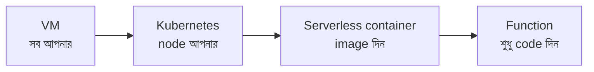
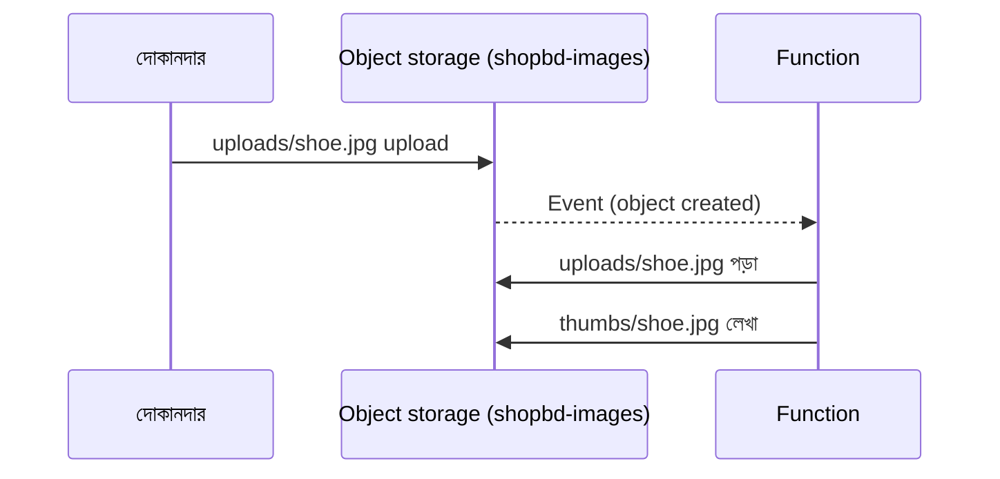
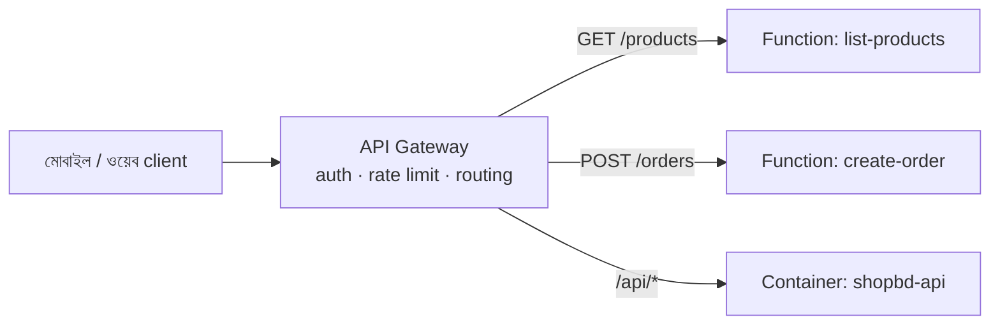
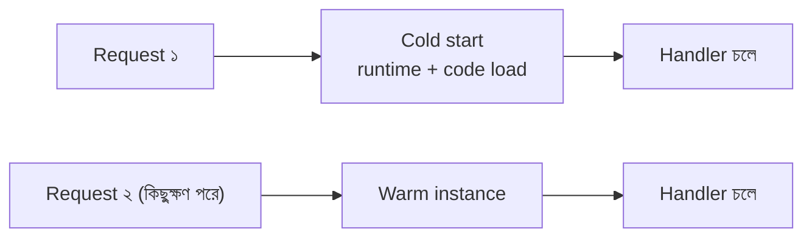

# 09 · Serverless

> **এই অধ্যায়ে কী শিখবেন**
>
> - Serverless মানে আসলে কী (server নেই নয়, server **আপনার ভাবনায় নেই**)
> - Function-as-a-Service: **Lambda / Cloud Run functions / Azure Functions / OCI Functions**
> - Serverless container: **App Runner ও ECS Fargate / Cloud Run / Container Apps / OCI Container Instances**
> - API gateway, trigger (HTTP, object upload, queue, schedule), cold start ও তার সমাধান
> - প্রতিটি platform-এর limit, খরচের হিসাব এবং কখন serverless **ব্যবহার করবেন না**

!!! abstract "এক নজরে — কোন cloud-এ কী নাম"

    | Concept | AWS | GCP | Azure | OCI |
    |---|---|---|---|---|
    | Function (FaaS) | AWS Lambda | Cloud Run functions (আগের নাম Cloud Functions 2nd gen) | Azure Functions | OCI Functions (open-source Fn Project-ভিত্তিক) |
    | Serverless container | App Runner, ECS on Fargate | Cloud Run (services ও jobs) | Azure Container Apps | OCI Container Instances |
    | API gateway | API Gateway (HTTP/REST/WebSocket), Lambda Function URL | API Gateway, Cloud Endpoints, Apigee | API Management (APIM) | API Gateway |
    | HTTP-তে সরাসরি function | Lambda Function URL | Function-এর HTTPS URL | HTTP trigger | API Gateway / function invoke endpoint |
    | Schedule trigger | EventBridge Scheduler / Rules | Cloud Scheduler | Timer trigger | সরাসরি cron trigger সীমিত (নিচে দেখুন) |
    | Object-upload trigger | S3 Event → Lambda | Eventarc (Cloud Storage) | Blob trigger / Event Grid | OCI Events (Object Storage) → Functions |
    | Cold-start কমানো | Provisioned Concurrency, SnapStart | `min-instances` | Always-ready instances (Flex / Premium) | Provisioned Concurrency |
    | Container-ভিত্তিক job | ECS Task / AWS Batch | Cloud Run jobs | Container Apps jobs | Container Instances |

আগের অধ্যায় [Container ও Kubernetes](08-containers-kubernetes.md)-এ আমরা cluster ও node ম্যানেজ করেছি। Serverless সেই ভার আরও কমায়: আপনি
শুধু code (বা container) দেন, scaling, patching, capacity — সব cloud দেখে। Event ও queue নিয়ে বিস্তারিত পাবেন [Messaging ও Event](11-messaging-and-events.md) অধ্যায়ে।

---

## ১. Serverless আসলে কী

"Serverless"-এ server আছে, কিন্তু **আপনি তা কিনেন না, বানান না, patch করেন না**। চারটা বৈশিষ্ট্য:

1. **Server ম্যানেজমেন্ট নেই** — OS, patch, capacity cloud দেখে।
2. **Auto-scaling** — request না থাকলে শূন্য, ভিড় এলে শত শত instance।
3. **Pay-per-use** — চলার সময় (invocation, মিলিসেকেন্ড, memory) অনুযায়ী টাকা; idle-এ প্রায় শূন্য।
4. **Event-driven** — কিছু ঘটলে (request, upload, বার্তা, ঘড়ির সময়) code চলে।

!!! example "Analogy"
    VM হলো নিজের গাড়ি কেনা — তেল, মেরামত, গ্যারেজ সব আপনার। Serverless হলো **Pathao/Uber**: যতটুকু যাবেন ততটুকুর ভাড়া, গাড়ি রাখার ঝামেলা নেই।
    কিন্তু প্রতিদিন ১০ ঘণ্টা চালালে নিজের গাড়িই সস্তা — তেমনি সবসময় ব্যস্ত workload-এ serverless সবচেয়ে সস্তা নয়।

### Serverless-এর স্তর



ডানে গেলে ম্যানেজমেন্ট কমে, কিন্তু **নিয়ন্ত্রণ ও portability-ও কমে** (function সাধারণত platform-নির্ভর handler চায়)।

| | Function (FaaS) | Serverless container |
|---|---|---|
| আপনি দেন | Code + handler | Container image |
| Runtime | Platform-এর নির্ধারিত (Python, Node, Java, Go…) | যেকোনো (image-এ যা আছে) |
| এক instance-এ request | সাধারণত ১টা (Lambda) | অনেকগুলো (Cloud Run, Container Apps) |
| সর্বোচ্চ সময় | মিনিটের হিসাব | ঘণ্টা পর্যন্ত (service/job ভেদে) |
| Portability | কম | বেশি (Docker image) |
| কাজের ধরন | ছোট event handler | পুরো web API, background worker |

---

## ২. Function-as-a-Service

একটা function হলো একটা ছোট code টুকরো, যা কোনো **event**-এ চলে, কাজ শেষ করে থেমে যায়। `shopbd`-র উদাহরণ: **অর্ডার-করা পণ্যের ছবি `shopbd-images` bucket-এ upload হলেই একটা thumbnail বানানো।**



!!! warning "Event-এ নিজের output বসালে loop!"
    যে bucket-এর upload-এ function চলে, সেই bucket-এই একই prefix-এ output লিখলে function নিজেকে বারবার trigger করবে — অসীম loop ও বিশাল বিল।
    তাই trigger-কে `uploads/` prefix-এ সীমিত রাখুন আর output যাবে `thumbs/`-এ (অথবা আলাদা bucket-এ)।

### একই কাজ চার platform-এ — code

=== "AWS"

    Service: **AWS Lambda**। Handler-এর signature `handler(event, context)`। Console: Lambda → Create function।

    ```python
    import boto3

    s3 = boto3.client("s3")


    def handler(event, context):
        record = event["Records"][0]["s3"]
        bucket = record["bucket"]["name"]
        key = record["object"]["key"]          # uploads/shoe.jpg
        body = s3.get_object(Bucket=bucket, Key=key)["Body"].read()

        thumb = make_thumbnail(body)           # নিজের helper (Pillow)
        s3.put_object(Bucket=bucket, Key=key.replace("uploads/", "thumbs/"), Body=thumb)
        return {"status": "ok", "key": key}
    ```

=== "GCP"

    Service: **Cloud Run functions** (আগে Cloud Functions 2nd gen; ভেতরে Cloud Run-এ চলে)। Event আসে **CloudEvent** আকারে।

    ```python
    import functions_framework
    from google.cloud import storage

    client = storage.Client()


    @functions_framework.cloud_event
    def make_thumbnail(cloud_event):
        data = cloud_event.data                # Cloud Storage event payload
        bucket = client.bucket(data["bucket"])
        name = data["name"]                    # uploads/shoe.jpg
        body = bucket.blob(name).download_as_bytes()

        thumb = make_thumbnail_bytes(body)     # নিজের helper (Pillow)
        bucket.blob(name.replace("uploads/", "thumbs/")).upload_from_string(thumb)
    ```

=== "Azure"

    Service: **Azure Functions** (Python v2 programming model — decorator দিয়ে trigger বাঁধা)।

    ```python
    import azure.functions as func

    app = func.FunctionApp()


    @app.blob_trigger(arg_name="blob", path="shopbd-images/uploads/{name}",
                      connection="AzureWebJobsStorage")
    @app.blob_output(arg_name="out", path="shopbd-images/thumbs/{name}",
                     connection="AzureWebJobsStorage")
    def make_thumbnail(blob: func.InputStream, out: func.Out[bytes]):
        thumb = make_thumbnail_bytes(blob.read())   # নিজের helper (Pillow)
        out.set(thumb)
    ```

    Binding (input/output) থাকায় storage SDK-র code কম লাগে — এটা Azure Functions-এর বৈশিষ্ট্য।

=== "OCI"

    Service: **OCI Functions** — ভেতরে open-source **Fn Project**; প্রতিটি function আসলে একটা **container image** (`fn deploy` নিজে image বানিয়ে OCIR-এ পাঠায়)।

    ```python
    import io
    import json
    from fdk import response


    def handler(ctx, data: io.BytesIO = None):
        event = json.loads(data.getvalue())            # OCI Events (CloudEvents) payload
        name = event["data"]["resourceName"]           # uploads/shoe.jpg
        # Object Storage থেকে পড়া/লেখা: resource principal দিয়ে OCI SDK
        result = {"processed": name}
        return response.Response(
            ctx, response_data=json.dumps(result),
            headers={"Content-Type": "application/json"},
        )
    ```

    OCI Functions-এ Object Storage access দেওয়া হয় **resource principal** দিয়ে (dynamic group + policy) — key code-এ রাখতে হয় না।

### Deploy ও trigger বাঁধা — CLI

=== "AWS"

    ```bash
    zip function.zip app.py

    aws lambda create-function \
      --function-name shopbd-thumbnailer \
      --runtime python3.13 \
      --handler app.handler \
      --zip-file fileb://function.zip \
      --role arn:aws:iam::123456789012:role/shopbd-lambda-role \
      --region ap-south-1

    # S3 যেন function ডাকতে পারে
    aws lambda add-permission \
      --function-name shopbd-thumbnailer --statement-id s3-invoke \
      --action lambda:InvokeFunction --principal s3.amazonaws.com \
      --source-arn arn:aws:s3:::shopbd-images

    # Bucket-এ notification (uploads/ prefix)
    aws s3api put-bucket-notification-configuration \
      --bucket shopbd-images --notification-configuration file://notification.json
    ```

    `notification.json`-এ `LambdaFunctionConfigurations` ও `Filter` (prefix `uploads/`) দিন।

=== "GCP"

    ```bash
    gcloud functions deploy shopbd-thumbnailer \
      --gen2 \
      --runtime=python312 \
      --region=asia-south1 \
      --source=. \
      --entry-point=make_thumbnail \
      --trigger-event-filters="type=google.cloud.storage.object.v1.finalized" \
      --trigger-event-filters="bucket=shopbd-images"
    ```

    Bucket ও function একই region-এ রাখা সুবিধাজনক (Cloud Storage trigger-এ bucket location-এর সীমা আছে)। Function-এর service account-এ bucket access ও Eventarc receiver role লাগে।

=== "Azure"

    ```bash
    az storage account create --name shopbdfuncsa --resource-group shopbd-rg \
      --location centralindia --sku Standard_LRS

    # Flex Consumption plan-এ function app (region-সমর্থন docs-এ যাচাই করুন)
    az functionapp create --resource-group shopbd-rg --name shopbd-func \
      --storage-account shopbdfuncsa --flexconsumption-location centralindia \
      --runtime python --runtime-version 3.12

    # Local project থেকে publish (Azure Functions Core Tools)
    func azure functionapp publish shopbd-func
    ```

=== "OCI"

    ```bash
    # Application = function-এর group; subnet লাগে
    fn create app shopbd-app \
      --annotation oracle.com/oci/subnetIds='["ocid1.subnet.oc1..example"]'

    fn init --runtime python shopbd-thumb
    cd shopbd-thumb
    fn deploy --app shopbd-app          # image build → OCIR push → function তৈরি
    fn invoke shopbd-app shopbd-thumb   # হাতে চালিয়ে পরীক্ষা
    ```

    Trigger বাঁধা হয় **Events service**-এ rule বানিয়ে (Object Storage "create object" → action: Functions)।
    `fn` CLI-র context আগে `fn use context` দিয়ে OCI region/compartment-এ ঠিক করতে হয়।

### Function-এর identity (permission)

Function যা access করবে (storage, DB, queue), তার অধিকার **function-এর নিজের identity**-তে দিন — code-এ key নয়। বিস্তারিত [IAM অধ্যায়](03-identity-and-access.md)।

| | AWS | GCP | Azure | OCI |
|---|---|---|---|---|
| Function-এর identity | Execution role (IAM role) | Runtime service account | Managed identity | Resource principal (dynamic group + policy) |

---

## ৩. Serverless Container

Function-এর সীমা (runtime, আকার, সময়) পেরোলে বা আপনার আগে থেকেই Docker image থাকলে **serverless container** — image দিন, বাকি cloud-এর। `shopbd-api` পুরোটাই এভাবে চলতে পারে।

| | AWS | GCP | Azure | OCI |
|---|---|---|---|---|
| Service | **App Runner**, **ECS on Fargate** | **Cloud Run** | **Azure Container Apps** | **Container Instances** |
| Scale to zero | App Runner: না (minimum provisioned instance); Fargate: নিজে scale করতে হয় | হ্যাঁ | হ্যাঁ | না (instance চলতে থাকে, শুরু/বন্ধ আপনি) |
| Request-ভিত্তিক autoscale | App Runner: হ্যাঁ | হ্যাঁ (concurrency-ভিত্তিক) | হ্যাঁ (KEDA, HTTP/queue/cron) | নেই (একটা fixed instance) |
| Job / batch | ECS task, AWS Batch | **Cloud Run jobs** | **Container Apps jobs** | Container Instances (শেষ হলে বন্ধ) |
| Network | VPC connector / awsvpc | VPC connector / Direct VPC egress | VNet-integrated environment | VCN subnet-এ সরাসরি |

!!! note "App Runner সম্পর্কে"
    AWS App Runner-এর নতুন গ্রাহক নেওয়ার ব্যাপারে availability পরিবর্তনের ঘোষণা এসেছে বলে জানা যায়; নতুন প্রজেক্টে শুরু করার আগে
    [App Runner docs](https://docs.aws.amazon.com/apprunner/) দেখে নিন, এবং বিকল্প হিসেবে **ECS on Fargate** (ও তার সরলীকৃত "Express" mode) বিবেচনা করুন। ECS-এর ধারণা [আগের অধ্যায়ে](08-containers-kubernetes.md)।

### Cloud Run ও Container Apps কীভাবে scale করে

- **Cloud Run:** প্রতিটি instance **একসাথে অনেক request** (concurrency, ডিফল্ট ৮০, সর্বোচ্চ ১০০০) সামলায়। Request না থাকলে instance শূন্য।
  Service (HTTP) ও **Job** (একবার চলে শেষ হয়) — দুই ধরন।
- **Container Apps:** **KEDA**-ভিত্তিক scale rule — HTTP concurrency, queue length, cron, CPU/memory। শূন্য থেকে N পর্যন্ত। Dapr ও revision-ভিত্তিক traffic split built-in।
- **Fargate:** কোনো node নেই, কিন্তু scaling ECS Service Auto Scaling policy দিয়ে আপনাকেই ঠিক করতে হয়; শূন্যে নামে না (service-এ ন্যূনতম task চলে)।
- **OCI Container Instances:** একটা instance = একটা বা একাধিক container; auto-scaling নেই — সরল, "চালাও-বন্ধ করো" ধরনের কাজ।

### Deploy — CLI

=== "AWS"

    ECS Fargate-এ service বানানোর কমান্ড [Container অধ্যায়ে](08-containers-kubernetes.md) দেওয়া আছে। এক-off task চালাতে:

    ```bash
    aws ecs run-task \
      --cluster shopbd-prod --task-definition shopbd-report \
      --launch-type FARGATE \
      --network-configuration "awsvpcConfiguration={subnets=[subnet-aaa],securityGroups=[sg-123],assignPublicIp=DISABLED}"
    ```

    App Runner-এ (যেখানে available) ECR image থেকে service:

    ```bash
    aws apprunner create-service --service-name shopbd-api \
      --source-configuration file://source.json --region ap-south-1
    ```

=== "GCP"

    ```bash
    gcloud run deploy shopbd-api \
      --image asia-south1-docker.pkg.dev/my-project-id/shopbd/shopbd-api:1.0 \
      --region asia-south1 \
      --allow-unauthenticated \
      --min-instances 0 --max-instances 10 \
      --concurrency 80

    gcloud run services describe shopbd-api --region asia-south1 --format='value(status.url)'
    ```

    `--allow-unauthenticated` মানে public। ভেতরের (internal) API-তে এটা দেবেন না; IAM `roles/run.invoker` দিয়ে সীমিত করুন।

=== "Azure"

    ```bash
    az containerapp env create --name shopbd-env \
      --resource-group shopbd-rg --location centralindia

    az containerapp create --name shopbd-api \
      --resource-group shopbd-rg --environment shopbd-env \
      --image shopbdacr.azurecr.io/shopbd-api:1.0 \
      --target-port 8000 --ingress external \
      --min-replicas 0 --max-replicas 10
    ```

    ACR থেকে image টানতে registry credential বা managed identity যোগ করতে হয় (`--registry-server`, `--registry-identity`)।

=== "OCI"

    ```bash
    oci container-instances container-instance create \
      --compartment-id ocid1.compartment.oc1..example \
      --availability-domain "<AD-name>" \
      --display-name shopbd-report \
      --shape CI.Standard.E4.Flex \
      --shape-config '{"ocpus": 1, "memoryInGBs": 4}' \
      --containers '[{"imageUrl": "bom.ocir.io/<tenancy-namespace>/shopbd-api:1.0"}]' \
      --vnics '[{"subnetId": "ocid1.subnet.oc1..example"}]'
    ```

    Container Instances-এ কোনো autoscale/ingress নেই — web API-র জন্য সামনে Load Balancer বসাতে হয়, আর সাধারণত **batch/job** কাজে এটা সেরা।

---

## ৪. API Gateway

Function বা container-কে বাইরের দুনিয়ার কাছে HTTP API আকারে খুলতে সামনে একটা **API gateway** বসে। কাজ: routing, authentication (JWT/API key), rate limiting/throttling, request validation, CORS, caching, monitoring।



| | AWS | GCP | Azure | OCI |
|---|---|---|---|---|
| Service | **API Gateway**: HTTP API (সস্তা, সরল), REST API (বেশি feature), WebSocket API | **API Gateway** (Cloud Run/Functions-এর সামনে), Cloud Endpoints, **Apigee** (enterprise) | **API Management (APIM)** — tier: Consumption, Developer, Standard, Premium | **API Gateway** (deployment + route) |
| Authentication | IAM, Cognito, JWT authorizer, Lambda authorizer | API key, Firebase/JWT, service account | Subscription key, JWT validate policy, Entra ID | JWT, custom authorizer function, OAuth |
| সরাসরি বিকল্প | **Lambda Function URL** (গেটওয়ে ছাড়াই HTTPS) | Cloud Run/Functions-এর নিজস্ব URL | Function-এর HTTP trigger URL | — |
| Throttling / usage plan | ✓ | ✓ | ✓ (policy) | ✓ (rate limiting policy) |

!!! tip "কখন gateway লাগে, কখন লাগে না?"
    একটাই service, শুধু public HTTPS — Function URL/Cloud Run URL/Container Apps ingress যথেষ্ট। অনেক service একটা API-র নিচে আনা, API key/usage plan,
    request transform, বা third-party developer-দের দেওয়া — তখন gateway। সবসময় gateway বসালে খরচ ও latency বাড়ে।

=== "AWS"

    ```bash
    # Quick-create HTTP API সরাসরি Lambda-র সামনে
    aws apigatewayv2 create-api --name shopbd-http-api \
      --protocol-type HTTP \
      --target arn:aws:lambda:ap-south-1:123456789012:function:shopbd-api

    # গেটওয়ে ছাড়া: Function URL
    aws lambda create-function-url-config \
      --function-name shopbd-api --auth-type AWS_IAM
    ```

    `--auth-type NONE` দিলে URL সবার জন্য খোলা — সাবধান। Gateway-র integration timeout সাধারণত ~৩০ সেকেন্ডের কাছাকাছি; লম্বা কাজ async করুন।

=== "GCP"

    ```bash
    gcloud api-gateway apis create shopbd-api
    gcloud api-gateway api-configs create shopbd-cfg-v1 \
      --api=shopbd-api --openapi-spec=openapi.yaml
    gcloud api-gateway gateways create shopbd-gw \
      --api=shopbd-api --api-config=shopbd-cfg-v1 --location=<supported-region>
    ```

    API Gateway সব region-এ নেই — supported region-এর তালিকা docs-এ দেখে নিন। API-র বিবরণ **OpenAPI** spec-এ লেখা হয়।

=== "Azure"

    ```bash
    az apim create --name shopbd-apim --resource-group shopbd-rg \
      --publisher-email ops@example.com --publisher-name shopbd \
      --sku-name Consumption
    ```

    APIM-এ API import করে **policy** (XML) দিয়ে rate limit, JWT validation, header বদল ইত্যাদি বসানো হয়।

=== "OCI"

    ```bash
    oci api-gateway gateway create \
      --compartment-id ocid1.compartment.oc1..example \
      --endpoint-type PUBLIC \
      --subnet-id ocid1.subnet.oc1..example \
      --display-name shopbd-gw
    ```

    Gateway-র ভেতরে **deployment** বানিয়ে route (`/products` → Function/HTTP backend) ও policy বসাতে হয় — Console-এ সহজ।

---

## ৫. Trigger — কীসে code চলে

| Trigger ধরন | AWS | GCP | Azure | OCI |
|---|---|---|---|---|
| **HTTP request** | API Gateway / Function URL | HTTPS URL / API Gateway | HTTP trigger | API Gateway |
| **Object upload** | S3 Event | Eventarc (Cloud Storage) | Blob trigger / Event Grid | Events → Functions |
| **Queue message** | SQS (event source mapping) | Pub/Sub (push/Eventarc) | Queue / Service Bus trigger | Streaming / Notifications → Functions (Service Connector Hub) |
| **Schedule (cron)** | EventBridge Scheduler | Cloud Scheduler → HTTP/Pub/Sub | Timer trigger | সীমিত (নিচে দেখুন) |
| **Database change** | DynamoDB Streams | Firestore trigger / Eventarc | Cosmos DB change feed | (সরাসরি নেই; Streaming/Connector) |
| **Cloud event bus** | EventBridge | Eventarc | Event Grid | OCI Events |

`shopbd`-তে তিনটা ধরনই আছে: ছবি upload (object), অর্ডার confirmation email (queue), রাত ২টায় sales report (schedule)।

### Schedule trigger — CLI

=== "AWS"

    ```bash
    aws scheduler create-schedule \
      --name shopbd-nightly-report \
      --schedule-expression "cron(0 20 * * ? *)" \
      --flexible-time-window Mode=OFF \
      --target '{"Arn":"arn:aws:lambda:ap-south-1:123456789012:function:shopbd-report","RoleArn":"arn:aws:iam::123456789012:role/shopbd-scheduler-role"}'
    ```

    সময় UTC-তে (২০:০০ UTC = বাংলাদেশে রাত ২টা)। EventBridge Scheduler time zone-ও দিতে পারে।

=== "GCP"

    ```bash
    gcloud scheduler jobs create http shopbd-nightly-report \
      --location asia-south1 \
      --schedule "0 2 * * *" --time-zone "Asia/Dhaka" \
      --uri "https://shopbd-report-abc123-el.a.run.app/run" \
      --http-method POST \
      --oidc-service-account-email shopbd-scheduler@my-project-id.iam.gserviceaccount.com
    ```

    Cloud Run **job** চালাতে Scheduler-কে Cloud Run Admin API-র URL-এ OAuth দিয়ে call করানো যায়।

=== "Azure"

    Azure Functions-এ schedule হলো function-এর **Timer trigger** (NCRONTAB — ছয় field, সেকেন্ডসহ):

    ```python
    @app.timer_trigger(schedule="0 0 20 * * *", arg_name="timer", run_on_startup=False)
    def nightly_report(timer: func.TimerRequest) -> None:
        run_report()
    ```

    Container Apps **job**-এও `--trigger-type Schedule --cron-expression "0 20 * * *"` দেওয়া যায়।

=== "OCI"

    অন্য তিন cloud-এর মতো function-এর জন্য সরল built-in cron trigger OCI-তে সীমিত। সাধারণ পথ: একটা ছোট Compute instance বা অন্য scheduler থেকে
    `fn invoke` / function-এর invoke endpoint ডাকা, অথবা nightly job-কে Container Instances/OKE `CronJob`-এ চালানো।
    বর্তমানে কোনো নতুন scheduling সুবিধা এসেছে কি না OCI docs-এ যাচাই করুন।

---

## ৬. Cold Start

Function-এর নতুন instance শূন্য থেকে চালু হতে হলে যে বাড়তি সময় লাগে (container/runtime চালু, code load, initialization), সেটাই **cold start**। পরের request যদি চালু instance পায়, তা **warm** ও দ্রুত।



**কারণ:** শূন্য-থেকে scale, নতুন deploy, ভিড়ে নতুন instance, দীর্ঘ idle।
**প্রভাব কীসে বাড়ে:** ভারী runtime (Java, .NET বড় framework), বড় package/image, VPC-তে attach (পুরোনো দিনের তুলনায় এখন কম), initialization-এ DB connection/ভারী import।

### কমানোর উপায়

| কৌশল | AWS | GCP | Azure | OCI |
|---|---|---|---|---|
| আগে থেকে গরম রাখা | **Provisioned Concurrency** | `--min-instances` | **Always-ready instances** (Flex Consumption) / **Premium plan** pre-warmed | **Provisioned Concurrency** |
| Runtime snapshot | **Lambda SnapStart** (Java, এবং কিছু অন্য runtime) | — | — | — |
| হালকা runtime | Python/Node/Go দ্রুত | একই | একই | একই |

সাধারণ কৌশল (সব cloud-এ):

- Package ছোট রাখুন, অপ্রয়োজনীয় dependency বাদ দিন।
- Initialization **handler-এর বাইরে একবার** করুন (SDK client, connection) — warm request-এ পুনরায় ব্যবহার হয়।
- Memory/CPU বাড়ালে অনেক সময় cold start কমে (Lambda-য় CPU memory-র সাথে আসে)।
- Latency-sensitive path-এ min-instance/provisioned রাখুন; background কাজে cold start মেনে নিন।
- Ping করে "গরম রাখা" hack-এর চেয়ে প্ল্যাটফর্মের নিজস্ব সুবিধা ভালো।

!!! tip "গরম রাখার মূল্য আছে"
    Provisioned concurrency / min-instances মানে idle-এও টাকা দেওয়া — serverless-এর "শূন্যে শূন্য খরচ"-এর সুবিধা কমে যায়।
    তাই শুধু user-facing, latency-sensitive endpoint-এ ব্যবহার করুন।

---

## ৭. Limits ও কোটা

প্রতিটি serverless service-এর **hard limit** আছে। নিচের সংখ্যাগুলো **আনুমানিক ও সময়ের সাথে বদলায়** — design করার আগে অবশ্যই official docs দেখুন:
[Lambda quotas](https://docs.aws.amazon.com/lambda/latest/dg/gettingstarted-limits.html), [Cloud Run quotas](https://cloud.google.com/run/quotas),
[Azure Functions scale & hosting](https://learn.microsoft.com/azure/azure-functions/functions-scale), [OCI Functions](https://docs.oracle.com/iaas/Content/Functions/home.htm)।

| বিষয় | Lambda | Cloud Run functions / Cloud Run | Azure Functions | OCI Functions |
|---|---|---|---|---|
| সর্বোচ্চ সময় (timeout) | ১৫ মিনিট | HTTP: দীর্ঘ (Cloud Run service ঘণ্টা পর্যন্ত); event-driven: কয়েক মিনিট; Cloud Run job: ঘণ্টা | Plan ভেদে: Consumption সীমিত (মিনিট); Flex/Premium দীর্ঘ; HTTP trigger-এ response ~২৩০ সেকেন্ড (≈ ৪ মিনিট) লোড-ব্যালান্সার সীমায় কাটে | ~৫ মিনিট |
| Memory | ১২৮ MB – ১০ GB | Cloud Run: কয়েক GB থেকে ৩২ GB পর্যন্ত | Plan ভেদে | ১২৮ MB – কয়েক GB |
| Request/response payload (sync) | ~৬ MB | Cloud Run: ৩২ MB (HTTP/1) | HTTP ~১০০ MB request | ~৬ MB |
| Package / image | Zip ২৫০ MB (unzipped), container image ১০ GB | Container image (বড় সীমা) | Plan ভেদে | Container image |
| Concurrency | প্রতি instance-এ ১ request; account/region-ভিত্তিক সীমা | প্রতি instance-এ বহু request | Plan ও scale controller অনুযায়ী | প্রতি instance-এ ১ |
| Temp disk | `/tmp` ১২৮ MB – ১০ GB | In-memory filesystem (memory থেকে কাটে) | Plan ভেদে | সীমিত |

!!! warning "সংখ্যা মুখস্থ নয়, সীমার ধরন মনে রাখুন"
    ইন্টারভিউ বা design-এ জানতে হবে: **timeout আছে** (লম্বা কাজ serverless function-এ নয়), **sync payload ছোট** (বড় ফাইল object storage-এ রেখে URL পাঠান),
    **concurrency/account quota আছে** (ভিড়ে throttle হয়), **temp disk ছোট** ও **stateless** (instance-এর ফাইল হারাতে পারে)। সঠিক সংখ্যা নিয়ম বদলায়।

### খরচের হিসাব কী কী নিয়ে

- **Invocation সংখ্যা** (request প্রতি)
- **Duration × memory** (GB-সেকেন্ড বা vCPU-সেকেন্ড)
- Provisioned/always-ready instance (গরম রাখলে idle-এও)
- API gateway request, data transfer (egress), log সংরক্ষণ
- প্রতিটি cloud-এ মাসিক **free tier** আছে — [Cloud-এর ভিত্তি](01-cloud-fundamentals.md) অধ্যায়ে দেখুন

দাম: [Lambda](https://aws.amazon.com/lambda/pricing/), [Cloud Run](https://cloud.google.com/run/pricing), [Azure Functions](https://azure.microsoft.com/pricing/details/functions/), [OCI Functions](https://www.oracle.com/cloud/cloud-native/functions/pricing/)।

---

## ৮. Terraform দিয়ে serverless

=== "AWS"

    ```hcl
    provider "aws" {
      region = "ap-south-1"
    }

    resource "aws_lambda_function" "thumbnailer" {
      function_name = "shopbd-thumbnailer"
      role          = aws_iam_role.lambda.arn # role আলাদা resource-এ
      handler       = "app.handler"
      runtime       = "python3.13"
      filename      = "function.zip"
      memory_size   = 256
      timeout       = 30

      environment {
        variables = {
          BUCKET = "shopbd-images"
        }
      }
    }

    resource "aws_apigatewayv2_api" "http" {
      name          = "shopbd-http-api"
      protocol_type = "HTTP"
      target        = aws_lambda_function.thumbnailer.arn
    }
    ```

    Lambda-কে API Gateway/S3 থেকে ডাকার অনুমতি দিতে `aws_lambda_permission` resource-ও লাগে।

=== "GCP"

    ```hcl
    provider "google" {
      project = "my-project-id"
      region  = "asia-south1"
    }

    resource "google_cloud_run_v2_service" "api" {
      name     = "shopbd-api"
      location = "asia-south1"
      ingress  = "INGRESS_TRAFFIC_ALL"

      template {
        scaling {
          min_instance_count = 0
          max_instance_count = 10
        }
        containers {
          image = "asia-south1-docker.pkg.dev/my-project-id/shopbd/shopbd-api:1.0"
        }
      }
    }

    # Public করতে (internal API-তে দেবেন না)
    resource "google_cloud_run_v2_service_iam_member" "public" {
      name     = google_cloud_run_v2_service.api.name
      location = google_cloud_run_v2_service.api.location
      role     = "roles/run.invoker"
      member   = "allUsers"
    }
    ```

=== "Azure"

    ```hcl
    provider "azurerm" {
      features {}
    }

    resource "azurerm_container_app_environment" "env" {
      name                = "shopbd-env"
      location            = "centralindia"
      resource_group_name = "shopbd-rg"
    }

    resource "azurerm_container_app" "api" {
      name                         = "shopbd-api"
      container_app_environment_id = azurerm_container_app_environment.env.id
      resource_group_name          = "shopbd-rg"
      revision_mode                = "Single"

      template {
        min_replicas = 0
        max_replicas = 10

        container {
          name   = "api"
          image  = "shopbdacr.azurecr.io/shopbd-api:1.0"
          cpu    = 0.5
          memory = "1Gi"
        }
      }

      ingress {
        external_enabled = true
        target_port      = 8000

        traffic_weight {
          latest_revision = true
          percentage      = 100
        }
      }
    }
    ```

=== "OCI"

    ```hcl
    provider "oci" {
      region = "ap-mumbai-1"
    }

    variable "compartment_id" {
      default = "ocid1.compartment.oc1..example"
    }

    resource "oci_functions_application" "shopbd" {
      compartment_id = var.compartment_id
      display_name   = "shopbd-app"
      subnet_ids     = [var.subnet_id]
    }

    resource "oci_functions_function" "thumb" {
      application_id = oci_functions_application.shopbd.id
      display_name   = "shopbd-thumb"
      image          = "bom.ocir.io/<tenancy-namespace>/shopbd-thumb:0.0.1"
      memory_in_mbs  = 256
    }
    ```

---

## মিল ও অমিল

| বিষয় | AWS | GCP | Azure | OCI |
|---|---|---|---|---|
| Function-এর ভিত্তি | নিজস্ব runtime/Firecracker | Cloud Run (container) | Functions host (plan ভেদে) | **Container image** (Fn) |
| Function-এ container image | ✓ (Lambda container image) | স্বাভাবিক (Cloud Run) | ✓ (Functions on container) | বাধ্যতামূলক (image-ই unit) |
| সবচেয়ে "সরল" serverless container | App Runner / Fargate | **Cloud Run** (সবচেয়ে জনপ্রিয়) | **Container Apps** | Container Instances (সীমিত) |
| Scale to zero | Lambda ✓; Fargate ✗ | ✓ | ✓ | Functions ✓; Container Instances ✗ |
| Binding / সহজ integration | Event source mapping | Eventarc | **Bindings** (সবচেয়ে সমৃদ্ধ) | Events + Service Connector |
| Workflow orchestration | Step Functions | Workflows | Durable Functions / Logic Apps | সীমিত ([Messaging অধ্যায়](11-messaging-and-events.md)) |

### কোথায় হোঁচট খায়

- **AWS Lambda:** একটা instance একবারে একটা request — ভিড়ে concurrency quota ছুঁয়ে **throttle**। Database-এ হাজার connection খুলে যায় — **RDS Proxy** বা connection pool লাগে।
- **GCP:** Cloud Functions-এর নাম এখন **Cloud Run functions**; পুরোনো 1st-gen docs-এ ভিন্ন আচরণ — `--gen2` দেখুন। Cloud Run-এ **CPU শুধু request চলার সময়** বরাদ্দ থাকে (default); background thread request-এর বাইরে ধীর হতে পারে।
- **Azure:** Plan-এর নাম বদলাচ্ছে — **Flex Consumption** এখন প্রস্তাবিত; পুরোনো Linux Consumption ধীরে retire হচ্ছে। HTTP function-এ লোড-ব্যালান্সার timeout (≈ ৪ মিনিট) পেরোলে request কেটে যায়।
- **OCI:** Function-এর জন্য VCN subnet, OCIR image, dynamic group/policy — প্রথমবার setup-এ ধাপ বেশি। Container Instances **autoscale করে না**।
- **সব cloud:** Event delivery **at-least-once** — একই event দু-বার আসতে পারে, তাই function **idempotent** হতে হবে।

---

## Real-world: shopbd

`shopbd`-র serverless অংশ:

| কাজ | কোন ধরনের serverless | কারণ |
|---|---|---|
| ছবি upload → thumbnail | **Function** (object trigger) | ছোট, event-driven, দিনে হাতেগোনা বার |
| অর্ডার confirmation email | **Function** (queue trigger) | Queue-র বার্তা → email পাঠানো |
| রাতের sales report | **Scheduled job** (Cloud Run job / Container Apps job / ECS scheduled task / Timer function) | কয়েক মিনিট চলে, তারপর শেষ — idle-এ খরচ নেই |
| REST API `shopbd-api` | **Serverless container** (Cloud Run / Container Apps / Fargate) | আগে থেকেই Docker image; web framework |
| সামনে HTTPS ও রেট লিমিট | API Gateway / Cloud Run URL + LB | [পরের অধ্যায়](10-load-balancing-scaling-dns-cdn.md) |

| কাজ | AWS | GCP | Azure | OCI |
|---|---|---|---|---|
| Thumbnail | Lambda | Cloud Run function | Azure Function (blob trigger) | OCI Function (Events) |
| Email worker | Lambda ← SQS | Cloud Run function ← Pub/Sub | Function ← Queue | Function ← Queue/Streaming |
| Nightly report | EventBridge Scheduler → ECS task/Lambda | Cloud Scheduler → Cloud Run job | Container Apps job / Timer function | Container Instances বা scheduled function |
| API | Fargate/App Runner বা Lambda + HTTP API | Cloud Run | Container Apps | OKE বা Container Instances + LB |

!!! tip "ছোট দোকানের জন্য কেন serverless ভালো"
    `shopbd`-র ট্র্যাফিক রাতে প্রায় নেই, বিকেলে বাড়ে। Serverless-এ রাতে শূন্য খরচ, ভিড়ে অটো-scale — আর ছোট টিমকে server patch করতে হয় না। ট্র্যাফিক স্থির ও বিপুল হলে VM/K8s সস্তা হতে পারে — তখন [Cost অধ্যায়](18-cost-management.md) ধরে হিসাব করুন।

### কখন serverless ব্যবহার করবেন না

- সারাক্ষণ ব্যস্ত, স্থির, বড় workload (VM/commitment সস্তা)।
- দীর্ঘ কাজ (ঘণ্টার পর ঘণ্টা ML training, বড় video encode) — batch/VM/Kubernetes।
- খুব কম latency লাগে এবং cold start অসহনীয়।
- Persistent connection/stateful (WebSocket বড় scale-এ, in-memory cache)।
- বিশেষ OS/kernel/GPU/লাইসেন্স নিয়ন্ত্রণ।

---

## Best practices

- **ছোট, এক-কাজের function** — প্রতিটি function একটা কাজ করুক; জটিল flow-তে workflow service ব্যবহার করুন ([Messaging অধ্যায়](11-messaging-and-events.md))।
- **Idempotent** বানান — একই event ২ বার এলেও ফল একই; DB-তে unique key/conditional write।
- **Initialization handler-এর বাইরে** — SDK client ও connection একবার তৈরি করুন।
- **Least privilege identity** — প্রতিটি function-এর আলাদা role/service account/managed identity; [IAM অধ্যায়](03-identity-and-access.md)।
- **Secret code-এ নয়** — cloud-এর secret manager ([Security অধ্যায়](13-security.md)); env var-এ শুধু non-secret config।
- **Dead-letter queue / retry** সেট করুন — বার্তা বারবার ব্যর্থ হলে হারিয়ে না গিয়ে DLQ-তে যাক।
- **Timeout যুক্তিসঙ্গত** রাখুন — ডিফল্ট ও সর্বোচ্চ সময় ছাড়িয়ে অকারণে বাড়াবেন না (ভুল হলে বিল বাড়ে)।
- **Concurrency সীমা** বসান (max instances/reserved concurrency) — ভুলবশত অসীম scale হয়ে DB বা বিল উড়ে না যাক।
- **Database connection** — pool/proxy (RDS Proxy, Cloud SQL connector, pgbouncer) ব্যবহার করুন।
- **Log ও tracing** — structured log, correlation id; [Observability অধ্যায়](12-observability.md)।
- **IaC দিয়ে deploy** — Terraform/SAM/Serverless Framework; [IaC অধ্যায়](14-infrastructure-as-code.md)।
- **Version ও alias/revision** — নতুন version-এ ধীরে traffic সরান (canary), সমস্যায় আগের revision-এ ফিরুন।

---

## Common mistakes

| ভুল | ফল | সমাধান |
|---|---|---|
| Trigger bucket-এই output লেখা | অসীম loop, বিশাল বিল | আলাদা prefix/bucket, trigger-এ prefix filter |
| Function public (`allUsers` / `--auth-type NONE`) | যে কেউ call করে খরচ বাড়ায় | IAM/authorizer/JWT; internal হলে private ingress |
| Long-running কাজ function-এ | Timeout-এ মাঝপথে কাটা | Job/Batch/container, বা কাজ ভেঙে queue-এ |
| Idempotency নেই | Email দু-বার, অর্ডার ডবল | Idempotency key, conditional write |
| প্রতি invocation-এ নতুন DB connection | DB connection ফুরিয়ে যায় | Pool/proxy, handler-এর বাইরে client |
| Max concurrency সীমা না দেওয়া | Backend overload বা বিল spike | Reserved concurrency / max-instances |
| Cold start-এ latency-sensitive API ফেলে রাখা | প্রথম user ধীর | Provisioned concurrency / min-instances |
| Secret env var-এ plain text | Leak | Secret manager + identity |
| Log retention অসীম | Log খরচ জমা | Retention নির্ধারণ |
| বড় ফাইল function-এর payload দিয়ে | Payload limit-এ ব্যর্থ | Object storage-এ রেখে pre-signed URL/SAS/PAR |
| সব কিছুতেই serverless | স্থির ভারী workload-এ বেশি দাম | Workload-ভিত্তিক হিসাব, VM/K8s মিশিয়ে |

---

## ইন্টারভিউ / সার্টিফিকেশন টিপস

??? question "Serverless মানে কি server নেই?"
    না। Server আছে, কিন্তু provisioning, patching, scaling cloud-এর দায়িত্ব। বৈশিষ্ট্য: ম্যানেজমেন্ট-মুক্ত, auto-scale (শূন্য সহ), pay-per-use, event-driven।

??? question "Cold start কী ও কীভাবে কমাবেন?"
    শূন্য থেকে নতুন instance চালুর বাড়তি সময়। কমানো: ছোট package, initialization handler-এর বাইরে, হালকা runtime, বেশি memory/CPU, আর provisioned concurrency / min-instances / always-ready instances। SnapStart Java-র জন্য (Lambda)।

??? question "Lambda ও Cloud Run-এর concurrency model-এ পার্থক্য কী?"
    Lambda-য় প্রতি instance একবারে একটা request, তাই ১০০ concurrent request = ১০০ instance। Cloud Run-এ একটা instance অনেক request সামলায় (concurrency সেটিং), তাই কম instance লাগে এবং cold start কম বার হয়।

??? question "কখন Function, কখন Serverless Container?"
    ছোট event handler, ১৫-মিনিটের নিচে, সমর্থিত runtime — Function। পুরো web framework, কাস্টম runtime/library, বেশি সময়, বা portability দরকার — Container (Cloud Run, Container Apps, Fargate)।

??? question "API Gateway কেন লাগে?"
    Authentication, rate limiting/throttling, routing একাধিক backend-এ, request validation, CORS, usage plan, monitoring এক জায়গায় — backend code-এ বারবার লিখতে হয় না।

??? question "Event delivery at-least-once হলে কী করবেন?"
    Function idempotent বানাবেন — unique key দিয়ে ডুপ্লিকেট শনাক্ত বা conditional write। সাথে retry ও DLQ।

??? question "Serverless-এ database connection সমস্যা কেন হয়?"
    অনেক concurrent instance প্রতিটি নিজের connection খোলে, DB-র max connection ছাড়িয়ে যায়। সমাধান: connection pooler/proxy (RDS Proxy, pgbouncer, Cloud SQL connector) ও concurrency সীমা।

**সার্টিফিকেশন-সংযোগ:** AWS Developer Associate (Lambda, API Gateway, event source), Solutions Architect; Google Professional Cloud Developer (Cloud Run); Azure AZ-204 (Functions, Container Apps, APIM); OCI Developer Professional (Functions, API Gateway)।

---

## সারসংক্ষেপ

- Serverless = ম্যানেজমেন্ট-মুক্ত, auto-scale, pay-per-use, event-driven।
- **Function:** Lambda / Cloud Run functions / Azure Functions / OCI Functions — ছোট event handler।
- **Serverless container:** Cloud Run, Container Apps, Fargate/App Runner, Container Instances — পুরো image; Cloud Run ও Container Apps scale-to-zero।
- **API Gateway** দিয়ে auth, throttling, routing; ছোট ক্ষেত্রে Function URL/ingress যথেষ্ট।
- **Trigger:** HTTP, object upload, queue, schedule — সবই event; delivery at-least-once, তাই **idempotent** হতে হবে।
- **Cold start** কমান ছোট package, বাইরে-init ও provisioned/min instance দিয়ে।
- **Limit** আছে (timeout, payload, concurrency) — সংখ্যা বদলায়, docs দেখুন।
- স্থির, ভারী, দীর্ঘ কাজে serverless সেরা নয়।

পরের অধ্যায়: [10 · Load Balancing, Autoscaling, DNS ও CDN](10-load-balancing-scaling-dns-cdn.md)।
