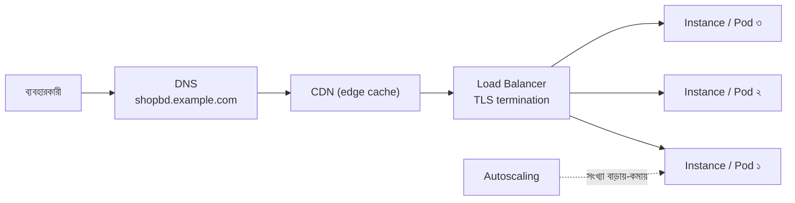
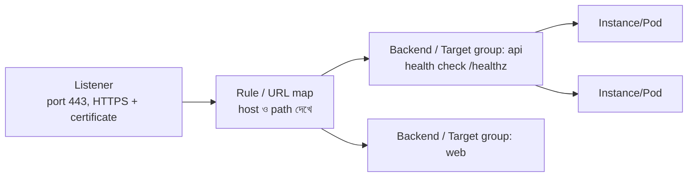
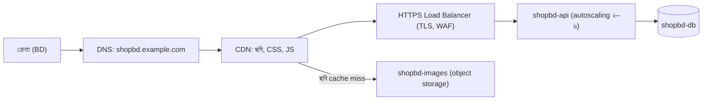

# 10 · Load Balancing, Autoscaling, DNS ও CDN

> **এই অধ্যায়ে কী শিখবেন**
>
> - **Load balancer** কী, L4 ও L7-এর পার্থক্য, আর চার cloud-এর কোন service কোনটা
> - **Health check** কীভাবে কাজ করে এবং কেন ভুল হলে পুরো সাইট নামে
> - **Autoscaling** — scale out/in, target tracking, schedule, cooldown
> - **DNS** — record, routing policy (weighted, latency, failover, geo), private zone
> - **CDN** — edge cache, invalidation, origin protection
> - **TLS certificate** — কোথায় তৈরি হয়, কীভাবে auto-renew হয়, HTTPS-এ redirect

!!! abstract "এক নজরে — কোন cloud-এ কী নাম"

    | Concept | AWS | GCP | Azure | OCI |
    |---|---|---|---|---|
    | L7 (HTTP/HTTPS) load balancer | Application Load Balancer (ALB) | Application Load Balancer (global বা regional) | Application Gateway (regional), Front Door (global) | Load Balancer (L7) |
    | L4 (TCP/UDP) load balancer | Network Load Balancer (NLB) | Network Load Balancer (passthrough ও proxy) | Azure Load Balancer | Network Load Balancer |
    | Appliance (firewall) LB | Gateway Load Balancer | Internal passthrough NLB (next-hop) | Gateway Load Balancer | — |
    | Autoscaling (VM) | EC2 Auto Scaling Group | Managed Instance Group (MIG) autoscaler | VM Scale Set autoscale | Instance Pool + Autoscaling configuration |
    | DNS | Route 53 | Cloud DNS | Azure DNS (+ Private DNS) | OCI DNS |
    | DNS-ভিত্তিক traffic routing | Route 53 routing policies | Cloud DNS routing policies | Traffic Manager | Traffic Management Steering Policies |
    | CDN | CloudFront | Cloud CDN (Media CDN) | Azure Front Door | কোনো সরাসরি built-in CDN নেই — partner/third-party |
    | TLS certificate | AWS Certificate Manager (ACM) | Certificate Manager, Google-managed cert | App Service / Front Door managed cert, Key Vault | OCI Certificates |

আগের অধ্যায়ে instance ([VM](04-compute-vms.md)) ও container ([Kubernetes](08-containers-kubernetes.md), [Serverless](09-serverless.md)) চালানো দেখেছি। এখন প্রশ্ন:
ব্যবহারকারী কীভাবে সেগুলোর কাছে পৌঁছাবে, ভিড় বাড়লে কীভাবে সামলাবে, আর পৃথিবীর ওপারের ব্যবহারকারী কীভাবে দ্রুত সাড়া পাবে — সেটাই এই অধ্যায়।



---

## ১. Load Balancer — ভিড় ভাগ করা

একটা server সব request সামলাতে পারে না, আর সেটা মরলে সাইট শেষ। **Load balancer (LB)** সামনে বসে request-গুলো একাধিক backend-এ ভাগ করে, আর মরা backend-কে বাদ দেয়। ফলে: **availability** (একটা পড়লেও সাইট চলে), **scalability** (backend বাড়ানো যায়), **নিরাপত্তা** (backend সরাসরি ইন্টারনেটে খোলা থাকে না)।

!!! example "Analogy"
    ব্যাংকের **টোকেন কাউন্টার**: গ্রাহক এলে ম্যানেজার (LB) দেখে কোন কাউন্টার খালি, সেখানে পাঠায়। কোনো কাউন্টারের কর্মী অনুপস্থিত থাকলে সেখানে কাউকে পাঠায় না (health check)।

### L4 বনাম L7

| | L4 (Transport) | L7 (Application) |
|---|---|---|
| কী দেখে | IP, port, TCP/UDP | HTTP: host, path, header, cookie |
| গতি | খুব দ্রুত, কম latency | সামান্য বেশি processing |
| TLS | সাধারণত passthrough (বা কিছু ক্ষেত্রে terminate) | Terminate করে, certificate এখানে |
| ক্ষমতা | যেকোনো TCP/UDP protocol, static IP, millions of connections | path/host routing, redirect, rewrite, WAF, sticky session, gRPC/WebSocket |
| কখন | Database proxy, game, MQTT, non-HTTP, static IP চাই | Web app, REST API, microservice routing |

### চার cloud-এর LB service

| ধরন | AWS | GCP | Azure | OCI |
|---|---|---|---|---|
| **L7 regional** | ALB | Regional external/internal Application LB | **Application Gateway** (WAF সহ) | **Load Balancer** (flexible shape) |
| **L7 global** | ALB + CloudFront / Global Accelerator-এর সামনে | **Global external Application LB** (একটা anycast IP) | **Front Door** | — (DNS steering + regional LB) |
| **L4** | NLB | Network LB (passthrough) / Proxy Network LB | Azure Load Balancer (Standard) | Network Load Balancer |
| **Appliance** | Gateway LB | — | Gateway LB | — |
| Internal/private | Internal ALB/NLB | Internal Application/Network LB | Internal Load Balancer / Internal App Gateway | Private LB |

!!! note "পুরোনো নাম"
    AWS-এর **Classic Load Balancer (CLB)** legacy — নতুন কাজে ALB/NLB। GCP-তে "HTTP(S) Load Balancing" এখন **Application Load Balancer** নামে।
    Azure-এ **Traffic Manager** আসলে LB নয়, DNS-ভিত্তিক routing (পরে দেখব)।

### LB-র ভেতরের অংশ — সব cloud-এ একই কাঠামো



| ধারণা | AWS | GCP | Azure (App Gateway) | OCI |
|---|---|---|---|---|
| Listener | Listener | Forwarding rule + target proxy | Listener | Listener |
| Routing নিয়ম | Listener rule | URL map | Routing rule / path map | Routing policy |
| Backend-এর group | Target group | Backend service | Backend pool | Backend set |
| Health check | Target group-এ | Health check resource | Health probe | Backend set-এ |

---

## ২. Health Check

LB প্রতি কয়েক সেকেন্ডে backend-কে ডাকে (`GET /healthz`); ধারাবাহিকভাবে ব্যর্থ হলে সেই backend-কে **unhealthy** ধরে traffic বন্ধ করে, আবার সুস্থ হলে ফেরত আনে।

প্রধান সেটিং (নাম ভিন্ন, ধারণা এক):

| সেটিং | মানে | সাধারণ উদাহরণ |
|---|---|---|
| Protocol / port / path | কী ডাকবে | HTTP, `8000`, `/healthz` |
| Interval | কত সেকেন্ড পর পর | ১০–৩০ |
| Timeout | কত সময়ে উত্তর না দিলে ব্যর্থ | ৫ |
| Healthy threshold | কতবার সফল হলে "সুস্থ" | ২–৩ |
| Unhealthy threshold | কতবার ব্যর্থ হলে "অসুস্থ" | ২–৩ |
| Success code | কোন HTTP status ঠিক | `200` |

**ভালো `/healthz` কেমন?** হালকা, দ্রুত, শুধু "আমি request নিতে পারি কি না" বলে। সাধারণ best practice: ডেটাবেস ডাউন হলেই **সব** instance-কে unhealthy করবেন না (তাহলে সব সরে গিয়ে পুরো সাইট নামে) — LB health আর deep dependency check আলাদা রাখুন।

!!! warning "Health check-এর firewall — সবচেয়ে সাধারণ ভুল"
    LB-র probe আপনার backend-এ ঢুকতে না পারলে সব backend "unhealthy" দেখাবে, যদিও app ঠিক আছে। অনুমতি দিন:
    **AWS:** backend security group-এ LB-র security group থেকে port; **GCP:** health-check IP range `130.211.0.0/22` ও `35.191.0.0/16` firewall-এ allow;
    **Azure:** Azure Load Balancer probe আসে `168.63.129.16` থেকে (NSG-তে `AzureLoadBalancer` service tag), Application Gateway-র subnet থেকে allow;
    **OCI:** LB subnet থেকে backend subnet-এ security list/NSG rule। বিস্তারিত নেটওয়ার্ক [Networking অধ্যায়ে](05-networking.md)।

---

## ৩. Load Balancer বানানো

নিচে `shopbd-api` (port 8000, `/healthz`) চার cloud-এ HTTPS LB-র পিছনে বসানোর কমান্ড। Certificate আগে তৈরি থাকতে হবে (অংশ ৮)।

=== "AWS"

    Service: **Application Load Balancer**। Console: EC2 → Load Balancers → Create → Application Load Balancer।

    ```bash
    # ১) Target group (health check path সহ)
    aws elbv2 create-target-group --name shopbd-api-tg \
      --protocol HTTP --port 8000 --vpc-id vpc-0123456789abcdef0 \
      --health-check-path /healthz --target-type instance

    # ২) Load balancer (দুটো public subnet, দুই AZ)
    aws elbv2 create-load-balancer --name shopbd-alb \
      --subnets subnet-aaa subnet-bbb --security-groups sg-0123456789abcdef0 \
      --scheme internet-facing --type application

    # ৩) HTTPS listener (ACM certificate) → target group
    aws elbv2 create-listener --load-balancer-arn <alb-arn> \
      --protocol HTTPS --port 443 \
      --certificates CertificateArn=arn:aws:acm:ap-south-1:123456789012:certificate/example \
      --default-actions Type=forward,TargetGroupArn=<tg-arn>

    # ৪) HTTP → HTTPS redirect
    aws elbv2 create-listener --load-balancer-arn <alb-arn> --protocol HTTP --port 80 \
      --default-actions 'Type=redirect,RedirectConfig={Protocol=HTTPS,Port=443,StatusCode=HTTP_301}'
    ```

    Instance-কে target group-এ `register-targets` দিয়ে বা Auto Scaling Group-এর `--target-group-arns` দিয়ে যুক্ত করুন।

=== "GCP"

    Service: **Global external Application Load Balancer** — একটা anycast IP, পৃথিবীর যেকোনো জায়গা থেকে নিকটতম Google edge-এ ঢোকে। GCP-তে LB কয়েকটা আলাদা resource জুড়ে তৈরি হয়:

    ```bash
    # ১) Health check
    gcloud compute health-checks create http shopbd-hc \
      --port 8000 --request-path /healthz

    # ২) Backend service + instance group যোগ
    gcloud compute backend-services create shopbd-backend \
      --protocol HTTP --health-checks shopbd-hc \
      --load-balancing-scheme EXTERNAL_MANAGED --global
    gcloud compute backend-services add-backend shopbd-backend \
      --instance-group shopbd-mig --instance-group-region asia-south1 --global

    # ৩) URL map → HTTPS proxy (Google-managed certificate)
    gcloud compute url-maps create shopbd-urlmap --default-service shopbd-backend
    gcloud compute target-https-proxies create shopbd-https-proxy \
      --url-map shopbd-urlmap --certificate-map shopbd-certmap

    # ৪) Forwarding rule (এটাই public IP/port)
    gcloud compute forwarding-rules create shopbd-fr \
      --global --target-https-proxy shopbd-https-proxy \
      --ports 443 --load-balancing-scheme EXTERNAL_MANAGED
    ```

    Console-এ "Create load balancer" wizard এই সব একসাথে বানিয়ে দেয়। Certificate map তৈরির কথা অংশ ৮-এ।

=== "Azure"

    L7-এর জন্য **Application Gateway**, L4-এর জন্য **Azure Load Balancer**।

    ```bash
    # L7: Application Gateway (v2; subnet ও public IP আগে থেকে লাগে)
    az network application-gateway create \
      --name shopbd-appgw --resource-group shopbd-rg \
      --sku Standard_v2 --capacity 2 \
      --vnet-name shopbd-prod-vnet --subnet appgw-subnet \
      --public-ip-address shopbd-appgw-ip \
      --http-settings-port 8000 --http-settings-protocol Http

    # L4: Azure Load Balancer (Standard SKU)
    az network lb create --resource-group shopbd-rg --name shopbd-lb \
      --sku Standard --frontend-ip-name fe --backend-pool-name be \
      --public-ip-address shopbd-lb-ip
    az network lb probe create --resource-group shopbd-rg --lb-name shopbd-lb \
      --name hc --protocol http --port 8000 --path /healthz
    az network lb rule create --resource-group shopbd-rg --lb-name shopbd-lb \
      --name http --protocol Tcp --frontend-port 80 --backend-port 8000 \
      --frontend-ip-name fe --backend-pool-name be --probe-name hc
    ```

    Application Gateway-র জন্য আলাদা **dedicated subnet** লাগে। Global L7 দরকার হলে **Azure Front Door** (CDN অংশে দেখুন)।

=== "OCI"

    Service: **Load Balancer** (L7, flexible shape — bandwidth min/max ঠিক করা যায়) ও **Network Load Balancer** (L4)।

    ```bash
    oci lb load-balancer create \
      --compartment-id ocid1.compartment.oc1..example \
      --display-name shopbd-lb \
      --shape-name flexible \
      --shape-details '{"minimumBandwidthInMbps": 10, "maximumBandwidthInMbps": 100}' \
      --subnet-ids '["ocid1.subnet.oc1..example"]'
    ```

    এরপর **backend set** (health check সহ), **backend** (instance IP:port), **listener** ও certificate যোগ করতে হয় — Console: Networking → Load balancers → Create।

!!! tip "Internal vs external"
    ইন্টারনেট-মুখী LB আর ভেতরের (microservice-এ microservice) LB আলাদা। Backend-কে private subnet-এ রাখুন; শুধু LB-কে public রাখুন।

### L7 LB-র দরকারি feature

- **Host ও path routing:** `api.shopbd.example.com` ও `/api/*` → API; বাকি → web।
- **TLS termination** — certificate LB-তে, backend-এ plain HTTP (বা end-to-end TLS)।
- **Redirect** HTTP→HTTPS, URL rewrite।
- **WAF integration** — AWS WAF / Cloud Armor / Azure WAF / OCI WAF ([Security অধ্যায়](13-security.md))।
- **Connection draining** — instance সরানোর সময় চলমান request শেষ হতে দেওয়া।

---

## ৪. Autoscaling

ভিড় বাড়লে instance বাড়ানো, কমলে কমানো — স্বয়ংক্রিয়ভাবে। দুই ধরনের scaling:

- **Scale out/in (horizontal)** — instance-এর **সংখ্যা** বাড়ানো/কমানো। Cloud-এর সাধারণ পথ।
- **Scale up/down (vertical)** — একটা instance-এর **আকার** বাড়ানো (restart লাগে, সীমা আছে)।

### Policy-র ধরন

| ধরন | কীভাবে কাজ করে | উদাহরণ |
|---|---|---|
| **Target tracking** | একটা metric লক্ষ্যে রাখো | "গড় CPU ৫০% রাখো" — সবচেয়ে সহজ ও প্রস্তাবিত |
| **Step / simple** | Threshold পেরোলে নির্দিষ্ট সংখ্যা যোগ | "CPU > ৭০% হলে +২" |
| **Scheduled** | নির্দিষ্ট সময়ে | "রোজ বিকেল ৫টায় min ৪" |
| **Predictive** | ইতিহাস দেখে আগেই বাড়ায় | নিয়মিত দৈনিক pattern-এ |

মূল প্যারামিটার: **min, max, desired** (সংখ্যা), **cooldown/warm-up** (নতুন instance প্রস্তুত হওয়ার সময়), **health check grace period**।

!!! example "Analogy"
    রেস্টুরেন্ট: দুপুরে ভিড় বাড়লে অতিরিক্ত ওয়েটার ডাকা (scale out), ভিড় কমলে ছুটি (scale in)। কিন্তু ওয়েটার ডাকার পর কাজ শিখতে সময় লাগে (warm-up), তাই প্রতি মিনিটে ডাকা-ছাড়া করলে দোকান বিশৃঙ্খল (flapping) — তাই cooldown।

| | AWS | GCP | Azure | OCI |
|---|---|---|---|---|
| Group-এর নাম | **Auto Scaling Group** (Launch template) | **Managed Instance Group** (Instance template) | **VM Scale Set (VMSS)** | **Instance Pool** (Instance configuration) |
| Autoscale সুবিধা | Auto Scaling policies | MIG autoscaler | Azure Monitor autoscale | Autoscaling configuration |
| Metric | CPU, ALB request count/target, custom | CPU, LB utilization, custom metric, schedule | CPU, memory, queue length, custom, schedule | CPU, memory, schedule |
| Predictive | ✓ | ✓ | ✓ (VMSS predictive autoscale) | — |
| Multi-AZ | Subnet-এর মাধ্যমে | Regional MIG (একাধিক zone) | Zones | একাধিক AD/FD |

(Container ও serverless-এ scaling আলাদা: Kubernetes-এ **HPA + Cluster Autoscaler**, Cloud Run/Functions-এ built-in request-ভিত্তিক — [Container](08-containers-kubernetes.md) ও [Serverless](09-serverless.md) অধ্যায়।)

=== "AWS"

    ```bash
    # Launch template আগে বানানো (AMI, instance type, security group, user data)
    aws autoscaling create-auto-scaling-group \
      --auto-scaling-group-name shopbd-api-asg \
      --launch-template LaunchTemplateName=shopbd-api-lt,Version='$Latest' \
      --min-size 2 --max-size 6 --desired-capacity 2 \
      --vpc-zone-identifier "subnet-aaa,subnet-bbb" \
      --target-group-arns <tg-arn> \
      --health-check-type ELB --health-check-grace-period 120

    # Target tracking: গড় CPU ৫০%
    aws autoscaling put-scaling-policy \
      --auto-scaling-group-name shopbd-api-asg \
      --policy-name cpu50 --policy-type TargetTrackingScaling \
      --target-tracking-configuration file://tt.json
    ```

    ```json
    {
      "PredefinedMetricSpecification": { "PredefinedMetricType": "ASGAverageCPUUtilization" },
      "TargetValue": 50.0
    }
    ```

    `--health-check-type ELB` দিলে LB-র health check অনুযায়ী অসুস্থ instance বদলানো হয়। Request-ভিত্তিক scaling-এর জন্য `ALBRequestCountPerTarget` metric।

=== "GCP"

    ```bash
    gcloud compute instance-templates create shopbd-api-tpl \
      --machine-type e2-small --image-family debian-12 --image-project debian-cloud

    gcloud compute instance-groups managed create shopbd-mig \
      --template shopbd-api-tpl --size 2 --region asia-south1

    gcloud compute instance-groups managed set-autoscaling shopbd-mig \
      --region asia-south1 \
      --min-num-replicas 2 --max-num-replicas 6 \
      --target-cpu-utilization 0.6 --cool-down-period 90
    ```

    Regional MIG instance-গুলো একাধিক zone-এ ছড়ায়। `--cool-down-period` = নতুন instance-কে metric-এ ধরার আগে অপেক্ষা।

=== "Azure"

    ```bash
    az vmss create --resource-group shopbd-rg --name shopbd-vmss \
      --image Ubuntu2204 --instance-count 2 --vm-sku Standard_B2s \
      --lb shopbd-lb --admin-username azureuser --generate-ssh-keys

    az monitor autoscale create --resource-group shopbd-rg \
      --resource shopbd-vmss --resource-type Microsoft.Compute/virtualMachineScaleSets \
      --name shopbd-autoscale --min-count 2 --max-count 6 --count 2

    az monitor autoscale rule create --resource-group shopbd-rg \
      --autoscale-name shopbd-autoscale \
      --condition "Percentage CPU > 60 avg 5m" --scale out 1

    az monitor autoscale rule create --resource-group shopbd-rg \
      --autoscale-name shopbd-autoscale \
      --condition "Percentage CPU < 30 avg 10m" --scale in 1
    ```

    Azure-এ scale out ও scale in-এর **আলাদা rule** লাগে — একটা দিলে অন্যটা নিজে আসে না।

=== "OCI"

    OCI-তে **Instance Pool**-এর ওপর **Autoscaling configuration** বসে (metric-ভিত্তিক বা schedule-ভিত্তিক)। Resource ও policy JSON-এ দিতে হয়:

    ```bash
    oci autoscaling auto-scaling-configuration create \
      --compartment-id ocid1.compartment.oc1..example \
      --display-name shopbd-autoscale \
      --resource file://resource.json \
      --policies file://policies.json
    ```

    `resource.json`-এ instance pool OCID, `policies.json`-এ min/max/initial capacity ও CPU threshold rule। Console-এ (Compute → Autoscaling configurations) সহজে বানানো যায়।

### Scaling-এর খুঁটিনাটি

- **Stateless হতে হবে:** Session/ফাইল instance-এ রাখলে scale in-এ হারায়। Session [cache](07-databases.md)-এ, ফাইল [object storage](06-storage.md)-এ।
- **Scale out দ্রুত, scale in ধীরে** — scale in-এ বেশি সময় নিন যেন ভিড়ের টেউয়ে আবার না বাড়তে হয়।
- **Max সীমা** — ভুল/আক্রমণে অসীম বেড়ে বিল ও database-এ চাপ এড়াতে।
- **Database scaling** আলাদা সমস্যা — instance ১০০ করলেও DB bottleneck হতে পারে ([Database অধ্যায়](07-databases.md): read replica, cache)।

---

## ৫. DNS

**DNS (Domain Name System)** মানুষের নাম (`shopbd.example.com`) কে IP address-এ (`203.0.113.10`) বদলায়। ইন্টারনেটের "ফোনবুক"।

### মূল record type

| Record | কাজ | উদাহরণ |
|---|---|---|
| **A** | নাম → IPv4 | `www → 203.0.113.10` |
| **AAAA** | নাম → IPv6 | `www → 2001:db8::10` |
| **CNAME** | নাম → আরেক নাম (alias) | `www → shopbd-alb-123.ap-south-1.elb.amazonaws.com` |
| **ALIAS / ANAME** | Zone apex (root domain)-এ CNAME-এর মতো — cloud-এর বিশেষ ধরন | `shopbd.example.com → ALB` |
| **MX** | Mail server | email-এর জন্য |
| **TXT** | লেখা (SPF, domain verification) | `"v=spf1 ..."` |
| **NS** | কোন name server এই zone-এর দায়িত্বে | delegation |
| **SOA** | Zone-এর মূল তথ্য | automatic |

**TTL (Time To Live):** কত সেকেন্ড অন্যরা উত্তর cache করে রাখবে। বেশি TTL = কম DNS query, কিন্তু বদল ছড়াতে দেরি। Migration/failover-এর আগে TTL কমিয়ে রাখুন (যেমন ৬০ সেকেন্ড)।

!!! warning "Root domain-এ CNAME চলে না"
    DNS নিয়মে `shopbd.example.com` (zone apex)-এ CNAME বসানো যায় না। তাই cloud আলাদা alias সুবিধা দেয়: Route 53 **Alias record**, Azure DNS **alias record set**,
    OCI DNS-এ ALIAS record, GCP Cloud DNS-এ সাধারণত load balancer-এর **IP** দিয়ে A record (LB-র static/anycast IP থাকে)।

### Delegation — কেন registrar-এ NS বসাতে হয়

Domain কেনা (registrar) আর DNS hosting আলাদা বিষয়। Cloud-এ zone বানালে cloud চারটি name server দেয়; সেগুলো আপনার **registrar-এর NS record-এ** বসাতে হয় — তখনই ইন্টারনেট জানে "এই domain-এর উত্তর Route 53/Cloud DNS-এ"।

### চার cloud-এর DNS service

| | AWS Route 53 | GCP Cloud DNS | Azure DNS | OCI DNS |
|---|---|---|---|---|
| Public zone | Public hosted zone | Public managed zone | DNS zone | Public zone (PRIMARY) |
| Private zone | Private hosted zone | Private managed zone | **Azure Private DNS** (আলাদা service) | Private zone (private view) |
| Apex alias | Alias record | A record → LB IP | Alias record set | ALIAS record |
| Health-check-ভিত্তিক failover | ✓ (Route 53 health check) | ✓ (routing policy-তে) | Traffic Manager দিয়ে | Traffic Management Steering Policy |
| DNSSEC | ✓ | ✓ | ✓ | ✓ |
| Domain registrar | ✓ (Route 53 Domains) | ✓ (Cloud Domains) | App Service Domains (সীমিত) | নেই (বাইরের registrar) |

=== "AWS"

    ```bash
    aws route53 create-hosted-zone --name shopbd.example.com \
      --caller-reference "shopbd-$(date +%s)"

    # change.json: UPSERT একটা A alias record (ALB-তে)
    aws route53 change-resource-record-sets \
      --hosted-zone-id Z0123456789EXAMPLE --change-batch file://change.json
    ```

    ```json
    {
      "Changes": [{
        "Action": "UPSERT",
        "ResourceRecordSet": {
          "Name": "shopbd.example.com",
          "Type": "A",
          "AliasTarget": {
            "HostedZoneId": "<alb-hosted-zone-id>",
            "DNSName": "shopbd-alb-123.ap-south-1.elb.amazonaws.com",
            "EvaluateTargetHealth": true
          }
        }
      }]
    }
    ```

    Hosted zone তৈরির পর সেই NS record-গুলো registrar-এ বসান।

=== "GCP"

    ```bash
    gcloud dns managed-zones create shopbd-zone \
      --dns-name shopbd.example.com. --description "shopbd public zone"

    gcloud dns record-sets create www.shopbd.example.com. \
      --zone shopbd-zone --type A --ttl 300 --rrdatas 203.0.113.10

    # Registrar-এ বসানোর NS দেখা
    gcloud dns managed-zones describe shopbd-zone --format='value(nameServers)'
    ```

    GCP-তে domain-এর শেষে **ডট (`.`)** দিতে হয় (fully qualified name)।

=== "Azure"

    ```bash
    az network dns zone create --resource-group shopbd-rg --name shopbd.example.com

    az network dns record-set a add-record --resource-group shopbd-rg \
      --zone-name shopbd.example.com --record-set-name www --ipv4-address 203.0.113.10

    az network dns zone show --resource-group shopbd-rg --name shopbd.example.com \
      --query nameServers
    ```

=== "OCI"

    ```bash
    oci dns zone create --compartment-id ocid1.compartment.oc1..example \
      --name shopbd.example.com --zone-type PRIMARY

    oci dns record rrset update --zone-name-or-id shopbd.example.com \
      --domain www.shopbd.example.com --rtype A --items file://items.json
    ```

    `rrset update` সেই নামের সব A record **প্রতিস্থাপন** করে — `items.json`-এ পুরো তালিকা দিন (`domain`, `rtype`, `rdata`, `ttl`)।

### Private DNS

ভেতরের নাম (`db.shopbd.internal`) শুধু VPC/VNet-এর ভেতরে resolve হবে, ইন্টারনেটে নয় — **split-horizon**। যেমন `shopbd-db.internal → 10.0.2.15`:
AWS **private hosted zone** (VPC-র সাথে যুক্ত), GCP **private managed zone** (VPC network-এ visible), Azure **Private DNS zone** (VNet link), OCI **private zone** (VCN-এর DNS resolver view)।
Private endpoint-এর ([Networking অধ্যায়](05-networking.md)) জন্য private DNS প্রায় অপরিহার্য।

### DNS routing policy

Plain A record সবসময় এক উত্তর দেয়। Routing policy দিয়ে **ব্যবহারকারী ও backend-এর অবস্থা** দেখে উত্তর বদলানো যায়:

| Policy | কাজ | AWS Route 53 | GCP Cloud DNS | Azure | OCI Steering |
|---|---|---|---|---|---|
| Simple | এক বা একাধিক fixed মান | ✓ | ✓ | DNS zone | ✓ |
| **Weighted** | শতাংশ ভাগে (canary, A/B) | ✓ | ✓ (weighted round robin) | Traffic Manager Weighted | Load Balancer steering |
| **Latency** | সবচেয়ে কম latency-র region | ✓ | — (Geo দিয়ে) | Traffic Manager Performance | — |
| **Failover** | Primary মরলে secondary | ✓ (health check সহ) | ✓ | Traffic Manager Priority | Failover steering |
| **Geolocation** | ব্যবহারকারীর দেশ/অঞ্চল | ✓ | ✓ | Traffic Manager Geographic | Geolocation steering |
| Multi-value | কয়েকটা healthy IP | ✓ | — | Traffic Manager MultiValue | — |

!!! note "Azure-এ DNS ও routing আলাদা"
    **Azure DNS** শুধু record রাখে। রাউটিং-বুদ্ধি (weighted, performance, failover) **Traffic Manager** (DNS-স্তরে) বা **Front Door** (HTTP-স্তরে, global L7) দেয়।
    OCI-তে এই কাজ **Traffic Management Steering Policies**-এ।

!!! warning "DNS failover-এর সীমা"
    DNS-স্তরের failover **TTL ও resolver cache**-এর ওপর নির্ভর করে — কিছু client পুরোনো উত্তর ধরে রাখে। তাই সত্যিকারের দ্রুত failover-এ anycast global LB
    (GCP global LB, Front Door, CloudFront) বা Global Accelerator-ধরনের সমাধান ভালো। বিস্তারিত DR [Architecture অধ্যায়ে](19-architecture-ha-dr.md)।

---

## ৬. CDN

**CDN (Content Delivery Network)** পৃথিবীজুড়ে ছড়ানো **edge location**-এ আপনার content-এর কপি রাখে, যাতে ব্যবহারকারী নিকটতম edge থেকে পায়। ফল: কম latency, origin-এ কম চাপ, কম egress খরচ, আক্রমণ-প্রতিরোধ।

!!! example "Analogy"
    ঢাকার একটা প্রকাশনীর বই সবাই কিনতে চট্টগ্রাম থেকে ঢাকায় আসে না — **চট্টগ্রামের বইয়ের দোকানে** কপি রাখা থাকে। দোকানে না থাকলে (cache miss) ঢাকা থেকে আনে (origin fetch), তারপর পরেরজন দোকান থেকেই পায়।

### মূল ধারণা

- **Origin:** আসল source (bucket, load balancer, যেকোনো HTTP server)।
- **Cache key:** কোন request একই ধরা হবে (URL, query string, header)।
- **TTL / `Cache-Control`:** কত সময় cache থাকবে। Origin থেকে header দিয়ে নিয়ন্ত্রণ।
- **Invalidation/purge:** মেয়াদের আগে cache মোছা (খরচ বা সীমা থাকতে পারে)।
- **Origin access control:** Origin-কে শুধু CDN থেকে ঢোকার অনুমতি — bucket সরাসরি public না করে।
- **Signed URL/cookie:** private content শুধু অনুমোদিত ব্যবহারকারীকে।

| | AWS | GCP | Azure | OCI |
|---|---|---|---|---|
| Service | **CloudFront** | **Cloud CDN** (external Application LB-এর সাথে যুক্ত); স্ট্রিমিং-এ **Media CDN** | **Azure Front Door** (Standard/Premium) | সরাসরি built-in general CDN নেই |
| Origin | S3, ALB, যেকোনো HTTP | Backend service / bucket (Load Balancer-এর পিছনে) | Blob, App Service, যেকোনো HTTP | — |
| Origin সুরক্ষা | Origin Access Control (OAC) | LB-র IAM/signed URL | Private Link origin, `X-Azure-FDID` header | — |
| Purge | `create-invalidation` | `invalidate-cdn-cache` | `az afd endpoint purge` | — |
| ফ্রি TLS cert | ✓ (ACM) | ✓ | ✓ (managed cert) | — |

!!! note "Azure CDN-এর পুরোনো নাম"
    "Azure CDN"-এর পুরোনো ধরনগুলো (যেমন Edgio/Verizon-ভিত্তিক) অবসরে গেছে বা যাচ্ছে; নতুন কাজে **Azure Front Door** — যা CDN ও global L7 LB একসাথে।

!!! note "OCI-তে CDN"
    OCI-র সুপরিচিত নিজস্ব general-purpose CDN নেই। সাধারণ উপায়: OCI Object Storage/LB-কে origin করে **third-party CDN** (Cloudflare, Akamai, Fastly)
    সামনে বসানো; OCI WAF-ও edge-এ কিছু সুরক্ষা দেয়। বর্তমানে কী সুবিধা আছে [OCI docs](https://docs.oracle.com/iaas/)-এ যাচাই করুন।

=== "AWS"

    ```bash
    # ছোট কমান্ড-লাইন সংস্করণ: S3 origin-সহ distribution
    aws cloudfront create-distribution \
      --origin-domain-name shopbd-images.s3.ap-south-1.amazonaws.com \
      --default-root-object index.html

    # Cache মোছা
    aws cloudfront create-invalidation \
      --distribution-id E123EXAMPLE --paths "/images/*"
    ```

    Production-এ distribution-config JSON (OAC, cache policy, ACM certificate) দিয়ে বানান। **CloudFront-এর জন্য ACM certificate অবশ্যই `us-east-1` region-এ** তৈরি করতে হয়।

=== "GCP"

    Cloud CDN আলাদা product-এর মতো নয় — **load balancer-এর backend-এ চালু করা** feature:

    ```bash
    # Bucket backend + CDN চালু
    gcloud compute backend-buckets create shopbd-images-bb \
      --gcs-bucket-name shopbd-images --enable-cdn

    # Instance/service backend-এ CDN চালু
    gcloud compute backend-services update shopbd-backend --global --enable-cdn

    # Cache মোছা
    gcloud compute url-maps invalidate-cdn-cache shopbd-urlmap --path "/images/*"
    ```

=== "Azure"

    ```bash
    az afd profile create --resource-group shopbd-rg \
      --profile-name shopbd-fd --sku Standard_AzureFrontDoor

    az afd endpoint create --resource-group shopbd-rg \
      --profile-name shopbd-fd --endpoint-name shopbd --enabled-state Enabled

    az afd endpoint purge --resource-group shopbd-rg \
      --profile-name shopbd-fd --endpoint-name shopbd --content-paths '/images/*'
    ```

    এরপর origin group, origin ও route যোগ করতে হয় (`az afd origin-group create`, `az afd origin create`, `az afd route create`)।

=== "OCI"

    OCI-তে native CDN না থাকায় সাধারণ ধারা: Object Storage bucket/LB-র public hostname বা **pre-authenticated request (PAR)** URL origin হিসেবে third-party CDN-এ বসানো। অথবা
    ছোট প্রজেক্টে OCI-র Object Storage সরাসরি, আর egress কম থাকার সুবিধা কাজে লাগানো ([Storage অধ্যায়](06-storage.md))।

### Caching-এর best practice

- **Static asset-এ লম্বা TTL + versioned ফাইলের নাম** (`app.3f2a9c.js`) — বদলালে নাম বদলায়, invalidation লাগে না।
- HTML/API-তে ছোট TTL বা `no-store`; ব্যবহারকারী-ভিত্তিক response cache করবেন না।
- `Cache-Control: public, max-age=31536000, immutable` — ছবি/CSS/JS-এর জন্য।
- Origin-কে সরাসরি public না রেখে শুধু CDN-এর জন্য খুলুন।

---

## ৭. TLS Certificate ও HTTPS

HTTPS মানে HTTP + **TLS**; ব্রাউজার ও server-এর মধ্যে কথা এনক্রিপ্ট করে ও server-এর পরিচয় যাচাই করে। এর জন্য লাগে **certificate** (domain-এর নামে, trusted CA-র সই করা)।

- **TLS termination:** LB/CDN-এ TLS খোলা — certificate সেখানে থাকে। Backend-এ plain HTTP বা (বেশি নিরাপদ) আবার TLS (end-to-end)।
- **Domain validation:** আপনি domain-এর মালিক তা প্রমাণ — সাধারণত **DNS validation** (একটা CNAME/TXT record বসানো); এতে auto-renew নির্বিঘ্ন।
- **Auto-renewal:** managed certificate cloud নিজে নবায়ন করে — মেয়াদোত্তীর্ণ certificate-এ সাইট নামার ঘটনা এতে এড়ানো যায়।
- **Wildcard** (`*.shopbd.example.com`) একটা certificate-এ সব subdomain।
- **TLS policy:** ন্যূনতম **TLS 1.2** (সম্ভব হলে 1.3); পুরোনো cipher বন্ধ। **HSTS** header দিয়ে ব্রাউজারকে সবসময় HTTPS-এ বাধ্য করা।

| | AWS | GCP | Azure | OCI |
|---|---|---|---|---|
| Managed public cert | **ACM** (বিনা মূল্যে, auto-renew) | **Certificate Manager** / Google-managed cert | App Service managed cert, Front Door managed cert; অন্যত্র **Key Vault** certificate | **OCI Certificates** (নিজের/imported ও private CA); public cert import করে বা Let's Encrypt |
| কোথায় ব্যবহার | ALB, NLB (TLS), CloudFront, API Gateway | LB target proxy, Cloud CDN | Front Door, App Gateway (Key Vault থেকে), App Service | Load Balancer, API Gateway |
| Private key export | Public cert export **যায় না** | Google-managed export যায় না | Key Vault-এ নিজের cert export-যোগ্য | নিজের/imported cert-এ নিয়ন্ত্রণ আপনার |
| Validation | DNS / email | DNS authorization / LB authorization | CNAME/TXT domain validation | নিজে/Let's Encrypt-এ ACME |

=== "AWS"

    ```bash
    aws acm request-certificate \
      --domain-name shopbd.example.com \
      --subject-alternative-names "*.shopbd.example.com" \
      --validation-method DNS --region ap-south-1

    # Validation CNAME দেখা, তারপর Route 53-এ বসানো
    aws acm describe-certificate --certificate-arn <cert-arn> --region ap-south-1
    ```

    Route 53 ব্যবহার করলে Console-এ "Create records in Route 53" এক ক্লিকে validation record বসায়। CloudFront-এর জন্য `--region us-east-1`।

=== "GCP"

    ```bash
    # DNS authorization + Google-managed certificate
    gcloud certificate-manager dns-authorizations create shopbd-auth \
      --domain shopbd.example.com

    gcloud certificate-manager certificates create shopbd-cert \
      --domains shopbd.example.com --dns-authorizations shopbd-auth

    gcloud certificate-manager maps create shopbd-certmap
    gcloud certificate-manager maps entries create shopbd-entry \
      --map shopbd-certmap --hostname shopbd.example.com --certificates shopbd-cert
    ```

    `dns-authorizations describe` যে CNAME দেয় তা DNS zone-এ বসাতে হয়। পুরোনো সরল পথ: `gcloud compute ssl-certificates create ... --domains`।

=== "Azure"

    ```bash
    # Key Vault-এ certificate (Application Gateway এ ব্যবহারের জন্য)
    az keyvault create --name shopbd-kv --resource-group shopbd-rg --location centralindia
    az keyvault certificate create --vault-name shopbd-kv --name shopbd-cert \
      --policy "$(az keyvault certificate get-default-policy)"
    ```

    **Front Door**-এ custom domain যোগ করলে managed certificate নিজে তৈরি ও নবায়ন হয়। App Gateway-তে Key Vault certificate ও managed identity দিয়ে TLS listener।

=== "OCI"

    Console: **Identity & Security → Certificates → Create certificate** (imported, বা Certificate Authority থেকে issued)।
    Load Balancer-এর listener-এ সেই certificate বাছাই করা যায়। Public CA-র certificate হাতে এনে import করা বা ACME (Let's Encrypt) automation-ই সাধারণ।

!!! danger "Certificate মেয়াদ ফুরানো — নীরব ঘাতক"
    Manual certificate-এর মেয়াদ কেউ মনে রাখে না, একদিন সাইট "Not secure" দেখায়। সম্ভব হলে **managed, auto-renew** certificate ব্যবহার করুন;
    না পারলে certificate-এ expiry alarm বসান ([Observability অধ্যায়](12-observability.md))।

---

## ৮. Terraform

=== "AWS"

    ```hcl
    provider "aws" {
      region = "ap-south-1"
    }

    resource "aws_lb" "shopbd" {
      name               = "shopbd-alb"
      load_balancer_type = "application"
      subnets            = var.public_subnet_ids
      security_groups    = [aws_security_group.alb.id]
    }

    resource "aws_lb_target_group" "api" {
      name     = "shopbd-api-tg"
      port     = 8000
      protocol = "HTTP"
      vpc_id   = var.vpc_id

      health_check {
        path    = "/healthz"
        matcher = "200"
      }
    }

    resource "aws_lb_listener" "https" {
      load_balancer_arn = aws_lb.shopbd.arn
      port              = 443
      protocol          = "HTTPS"
      certificate_arn   = aws_acm_certificate.shopbd.arn

      default_action {
        type             = "forward"
        target_group_arn = aws_lb_target_group.api.arn
      }
    }

    resource "aws_autoscaling_group" "api" {
      name                = "shopbd-api-asg"
      min_size            = 2
      max_size            = 6
      vpc_zone_identifier = var.private_subnet_ids
      target_group_arns   = [aws_lb_target_group.api.arn]
      health_check_type   = "ELB"

      launch_template {
        id      = aws_launch_template.api.id
        version = "$Latest"
      }
    }

    resource "aws_route53_zone" "shopbd" {
      name = "shopbd.example.com"
    }

    resource "aws_route53_record" "apex" {
      zone_id = aws_route53_zone.shopbd.zone_id
      name    = "shopbd.example.com"
      type    = "A"

      alias {
        name                   = aws_lb.shopbd.dns_name
        zone_id                = aws_lb.shopbd.zone_id
        evaluate_target_health = true
      }
    }
    ```

=== "GCP"

    ```hcl
    provider "google" {
      project = "my-project-id"
      region  = "asia-south1"
    }

    resource "google_compute_health_check" "api" {
      name = "shopbd-hc"

      http_health_check {
        port         = 8000
        request_path = "/healthz"
      }
    }

    resource "google_compute_backend_service" "api" {
      name                  = "shopbd-backend"
      protocol              = "HTTP"
      load_balancing_scheme = "EXTERNAL_MANAGED"
      health_checks         = [google_compute_health_check.api.id]
      enable_cdn            = true

      backend {
        group = google_compute_region_instance_group_manager.api.instance_group
      }
    }

    resource "google_compute_url_map" "api" {
      name            = "shopbd-urlmap"
      default_service = google_compute_backend_service.api.id
    }

    resource "google_compute_region_autoscaler" "api" {
      name   = "shopbd-autoscaler"
      region = "asia-south1"
      target = google_compute_region_instance_group_manager.api.id

      autoscaling_policy {
        min_replicas    = 2
        max_replicas    = 6
        cooldown_period = 90

        cpu_utilization {
          target = 0.6
        }
      }
    }

    resource "google_dns_managed_zone" "shopbd" {
      name     = "shopbd-zone"
      dns_name = "shopbd.example.com."
    }
    ```

    HTTPS proxy, forwarding rule ও certificate resource-ও লাগে (`google_compute_target_https_proxy`, `google_compute_global_forwarding_rule`)।

=== "Azure"

    ```hcl
    provider "azurerm" {
      features {}
    }

    resource "azurerm_public_ip" "lb" {
      name                = "shopbd-lb-ip"
      location            = "centralindia"
      resource_group_name = "shopbd-rg"
      allocation_method   = "Static"
      sku                 = "Standard"
    }

    resource "azurerm_lb" "shopbd" {
      name                = "shopbd-lb"
      location            = "centralindia"
      resource_group_name = "shopbd-rg"
      sku                 = "Standard"

      frontend_ip_configuration {
        name                 = "fe"
        public_ip_address_id = azurerm_public_ip.lb.id
      }
    }

    resource "azurerm_lb_probe" "api" {
      loadbalancer_id = azurerm_lb.shopbd.id
      name            = "hc"
      protocol        = "Http"
      port            = 8000
      request_path    = "/healthz"
    }

    resource "azurerm_dns_zone" "shopbd" {
      name                = "shopbd.example.com"
      resource_group_name = "shopbd-rg"
    }

    resource "azurerm_dns_a_record" "www" {
      name                = "www"
      zone_name           = azurerm_dns_zone.shopbd.name
      resource_group_name = "shopbd-rg"
      ttl                 = 300
      records             = [azurerm_public_ip.lb.ip_address]
    }
    ```

    VMSS autoscale-এর জন্য `azurerm_monitor_autoscale_setting`; Application Gateway ও Front Door-এর জন্য `azurerm_application_gateway`, `azurerm_cdn_frontdoor_profile`।

=== "OCI"

    ```hcl
    provider "oci" {
      region = "ap-mumbai-1"
    }

    variable "compartment_id" {
      default = "ocid1.compartment.oc1..example"
    }

    resource "oci_load_balancer_load_balancer" "shopbd" {
      compartment_id = var.compartment_id
      display_name   = "shopbd-lb"
      shape          = "flexible"
      subnet_ids     = [var.public_subnet_id]

      shape_details {
        minimum_bandwidth_in_mbps = 10
        maximum_bandwidth_in_mbps = 100
      }
    }

    resource "oci_dns_zone" "shopbd" {
      compartment_id = var.compartment_id
      name           = "shopbd.example.com"
      zone_type      = "PRIMARY"
    }

    resource "oci_dns_rrset" "www" {
      zone_name_or_id = oci_dns_zone.shopbd.name
      domain          = "www.shopbd.example.com"
      rtype           = "A"

      items {
        domain = "www.shopbd.example.com"
        rtype  = "A"
        rdata  = "203.0.113.10"
        ttl    = 300
      }
    }
    ```

    Backend set, listener ও certificate-এর জন্য `oci_load_balancer_backend_set`, `oci_load_balancer_listener` resource। Instance pool autoscale: `oci_autoscaling_auto_scaling_configuration`।

---

## মিল ও অমিল

| বিষয় | AWS | GCP | Azure | OCI |
|---|---|---|---|---|
| Global LB | ALB regional; global-এর জন্য CloudFront/Global Accelerator | **একটা global anycast LB** (সবচেয়ে সরল) | Front Door (global) + App Gateway (regional) | Regional; global-এ DNS steering |
| LB-এর "গঠন" | Target group + listener (সহজ) | অনেকগুলো আলাদা resource (forwarding rule, proxy, URL map, backend service) | Gateway-র জন্য dedicated subnet | Backend set + listener |
| Autoscale group | ASG | MIG | VMSS + Monitor autoscale | Instance pool + config |
| DNS-এ routing বুদ্ধি | Route 53-এই (সবচেয়ে সমৃদ্ধ) | Cloud DNS routing policy | **আলাদা** Traffic Manager | Steering Policy |
| CDN | CloudFront (আলাদা, পরিণত) | Cloud CDN **LB-র feature** | Front Door (CDN + LB) | নিজস্ব নেই |
| Cert | ACM (CloudFront → us-east-1) | Certificate Manager | Key Vault / managed | OCI Certificates |

### যেসব জায়গায় মানুষ হোঁচট খায়

- **AWS:** ALB-কে অন্তত **দুই AZ**-এর subnet লাগে। CloudFront-এর ACM cert `us-east-1`-এ — ALB-এর cert আপনার region-এ। ALB-র security group ও backend SG-র সম্পর্ক ভুল হলে health check ব্যর্থ।
- **GCP:** LB মানে অনেক resource — একটা বাদ পড়লে কাজ করে না। Health-check IP range firewall-এ না খুললে সব backend unhealthy। Google-managed cert চালু হতে **DNS পয়েন্ট করার পর** কিছু সময় লাগে (provisioning)।
- **Azure:** Application Gateway-র **dedicated subnet** চাই। Load Balancer Standard SKU **default-এ বন্ধ** (secure by default) — NSG-তে স্পষ্ট allow না দিলে traffic ঢোকে না। Autoscale-এ out ও in rule আলাদা।
- **OCI:** LB, NLB আলাদা service; Flexible shape-এ bandwidth min/max ভুলে ছোট রাখলে throttle। Security list/NSG-তে LB↔backend allow দিতে ভুললে 502।
- **সব cloud:** DNS বদলের পর পুরোনো উত্তর TTL পর্যন্ত cache — migration-এ আগে TTL কমান।

---

## Real-world: shopbd

`shopbd` একটা বাংলাদেশি দোকান — বেশিরভাগ ব্যবহারকারী বাংলাদেশে, বিকেলে-সন্ধ্যায় ভিড়, ঈদ-সেলে হঠাৎ কয়েক গুণ। তাই পরিকল্পনা:



| উপাদান | AWS | GCP | Azure | OCI |
|---|---|---|---|---|
| DNS | Route 53 (`shopbd.example.com`) | Cloud DNS | Azure DNS | OCI DNS |
| CDN (ছবি/static) | CloudFront → S3 `shopbd-images` (OAC) | Cloud CDN → backend bucket | Front Door → Blob | Third-party CDN → Object Storage |
| LB | ALB (HTTPS, ACM) | Global Application LB (managed cert) | Application Gateway বা Front Door | Load Balancer (flexible) |
| API scaling | ASG ২–৬, CPU ৫০% target; বা ECS/Lambda | MIG ২–৬ / Cloud Run | VMSS ২–৬ / Container Apps | Instance Pool ২–৬ |
| Health check | `/healthz` | `/healthz` | `/healthz` | `/healthz` |
| Certificate | ACM wildcard | Google-managed | Managed/Key Vault | OCI Certificates |

!!! tip "ঈদ-সেলের আগে"
    ১) **Scheduled scaling** দিয়ে সেলের দিন আগেই min বাড়ান। ২) **Load test** করে max ঠিক করুন ও vCPU quota বাড়ান। ৩) DNS TTL কমান যাতে সমস্যায় দ্রুত সরানো যায়।
    ৪) CDN cache শক্ত করুন যাতে ছবি-ভিড় origin-এ না পড়ে। ৫) Database ও cache আগে থেকে প্রস্তুত রাখুন ([Database অধ্যায়](07-databases.md))।

---

## Best practices

- **LB সবসময় একাধিক AZ/zone জুড়ে**; backend private subnet-এ।
- **HTTPS সর্বত্র** — HTTP→HTTPS redirect, TLS ≥ 1.2, HSTS।
- **Managed, auto-renew certificate**; expiry alarm বসান।
- **হালকা `/healthz`** ও যুক্তিসঙ্গত threshold; Health-check firewall আগে খুলুন।
- **Autoscaling: target tracking দিয়ে শুরু**; min ≥ ২ (HA), max নির্ধারণ; scale in ধীরে।
- **Stateless** instance — session cache-এ, ফাইল object storage-এ।
- **DNS-এ IaC**; migration-এর আগে TTL কমান; apex-এ alias ব্যবহার।
- **CDN-এ versioned asset + লম্বা TTL**; origin-কে শুধু CDN-এর জন্য খুলুন।
- **WAF ও DDoS সুরক্ষা** LB/CDN-এ ([Security অধ্যায়](13-security.md))।
- **Access log চালু** (LB, CDN) — সমস্যা বিশ্লেষণে অমূল্য ([Observability অধ্যায়](12-observability.md))।

---

## Common mistakes

| ভুল | ফল | সমাধান |
|---|---|---|
| Health-check IP/SG firewall-এ বন্ধ | সব backend unhealthy, ৫০২/৫০৩ | LB probe-এর source allow |
| `/healthz` DB-কে ডাকে, DB ধীর | সব instance একসাথে unhealthy, পুরো সাইট নামে | Shallow health check; deep check আলাদা |
| Autoscaling min = ১ | একটা মরলে সাইট বন্ধ | min ≥ ২, multi-AZ |
| Scale out ও in-এ একই threshold | Flapping (বাড়ে-কমে) | আলাদা threshold ও cooldown |
| Session instance-এর memory-তে | Scale in/LB-তে login হারায় | Redis/DB session |
| Backend instance public IP-সহ খোলা | LB এড়িয়ে সরাসরি আক্রমণ | Private subnet, SG শুধু LB থেকে |
| Certificate হাতে নবায়ন | মেয়াদ ফুরিয়ে সাইট "Not secure" | Managed cert / ACME / alarm |
| CloudFront-এ ACM cert ভুল region-এ | Certificate দেখায় না | `us-east-1`-এ বানান |
| DNS TTL ২৪ ঘণ্টা রেখে migration | পুরোনো IP-তে traffic যেতে থাকে | আগেই TTL কমান |
| CDN-এ ব্যবহারকারী-ভিত্তিক response cache | অন্যের ডেটা দেখা — গুরুতর! | `Cache-Control: private/no-store`, cache key ঠিক |

---

## ইন্টারভিউ / সার্টিফিকেশন টিপস

??? question "L4 ও L7 load balancer-এর পার্থক্য?"
    L4 TCP/UDP-স্তরে IP-port দেখে দ্রুত forward করে (static IP, যেকোনো protocol)। L7 HTTP-স্তরে host/path/header দেখে routing, TLS termination, redirect, WAF দেয়। Web app-এ সাধারণত L7 (ALB/Application LB/App Gateway); non-HTTP বা চরম পারফরম্যান্সে L4 (NLB)।

??? question "Health check ভুল হলে কী হয়?"
    Healthy backend-কেও unhealthy ধরে সরিয়ে দিলে সব সরে গিয়ে সাইট নামে। সাধারণ কারণ: probe source firewall-এ বন্ধ, ভুল path/port, বা health endpoint-এ ভারী dependency check।

??? question "Scale out ও scale up-এর পার্থক্য? কোনটা cloud-এ পছন্দের?"
    Scale out = instance সংখ্যা বাড়ানো (horizontal); scale up = instance বড় করা (vertical, restart ও সীমা আছে)। Stateless app-এ scale out পছন্দের কারণ HA ও প্রায় অসীম বাড়ানো যায়।

??? question "Target tracking ও step scaling-এর পার্থক্য?"
    Target tracking একটা metric লক্ষ্যে ধরে রাখে ("CPU ৫০%"), সংখ্যা নিজে হিসাব করে — সহজ। Step scaling-এ আপনি threshold ও কতটা যোগ হবে নিজে নির্ধারণ করেন — বেশি নিয়ন্ত্রণ, বেশি পরিশ্রম।

??? question "Root domain-এ CNAME কেন চলে না, কী করবেন?"
    DNS spec অনুযায়ী apex-এ NS/SOA থাকে, তাই CNAME থাকতে পারে না। Cloud-এর alias record (Route 53 Alias, Azure alias record set, OCI ALIAS) বা LB-র IP-তে A record ব্যবহার করুন।

??? question "Route 53 routing policy-গুলো কী কী, কখন কোনটা?"
    Simple, Weighted (canary), Latency (সবচেয়ে কাছের region), Failover (health check সহ), Geolocation (দেশ অনুযায়ী/আইনি কারণে), Geoproximity, Multi-value। Azure-এ সমতুল্য Traffic Manager, OCI-তে Steering Policy।

??? question "CDN কীভাবে origin-এর চাপ কমায়?"
    Edge-এ cache থাকায় বেশিরভাগ request origin-এ যায় না (cache hit)। ফল: কম latency, কম origin load ও egress খরচ, DDoS শোষণ। Versioned asset ও লম্বা TTL-এ hit ratio সর্বোচ্চ।

??? question "CloudFront-এর certificate কোন region-এ?"
    `us-east-1` (N. Virginia)-এ ACM-এ তৈরি করতে হয়, কারণ CloudFront global service।

**সার্টিফিকেশন-সংযোগ:** AWS SAA (ELB, Auto Scaling, Route 53, CloudFront), Google ACE/Professional Cloud Architect (LB, MIG, Cloud DNS, CDN), Azure AZ-104 (Load Balancer, App Gateway, VMSS, DNS, Front Door), OCI Architect Associate (LB, Instance Pool, DNS)।

---

## সারসংক্ষেপ

- **Load balancer** ভিড় ভাগ করে ও মরা backend সরায়; **L7** (ALB / Application LB / App Gateway / OCI LB) HTTP বোঝে, **L4** (NLB / Network LB / Azure LB / OCI NLB) দ্রুত ও সাধারণ।
- **Health check** ঠিক না হলে সাইট নামে — probe firewall খুলুন, endpoint হালকা রাখুন।
- **Autoscaling** (ASG / MIG / VMSS / Instance Pool): target tracking, schedule, min ≥ ২, max সীমা; app stateless।
- **DNS** (Route 53 / Cloud DNS / Azure DNS / OCI DNS): record, TTL, apex alias, private zone, routing policy (weighted, latency, failover, geo) — Azure-এ Traffic Manager, OCI-তে Steering।
- **CDN** (CloudFront / Cloud CDN / Front Door / OCI-তে third-party) edge-এ cache করে; versioned asset ও লম্বা TTL।
- **TLS:** managed auto-renew certificate (ACM / Certificate Manager / Front Door-Key Vault / OCI Certificates), TLS ≥ 1.2, HTTPS redirect।
- `shopbd`-র জন্য: DNS → CDN → HTTPS LB → autoscaling API → managed DB; ঈদ-সেলের আগে scheduled scaling ও load test।

পরের অধ্যায়: [11 · Messaging ও Event](11-messaging-and-events.md)।
