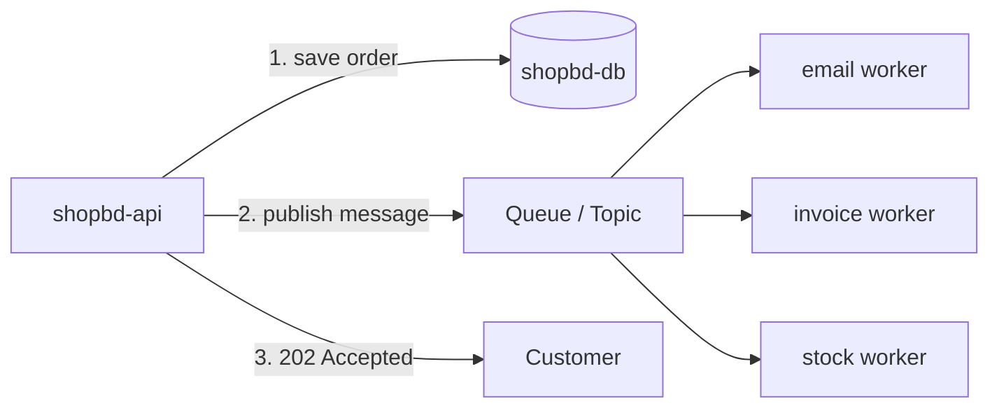
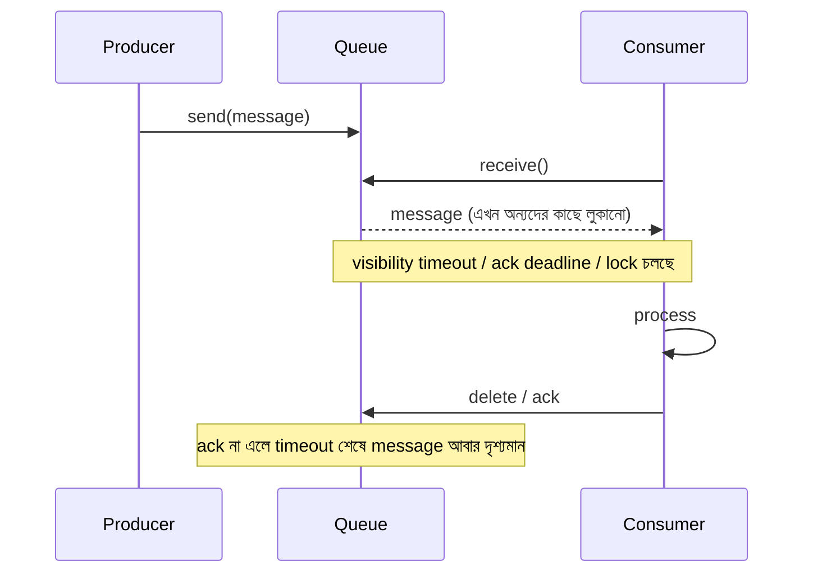
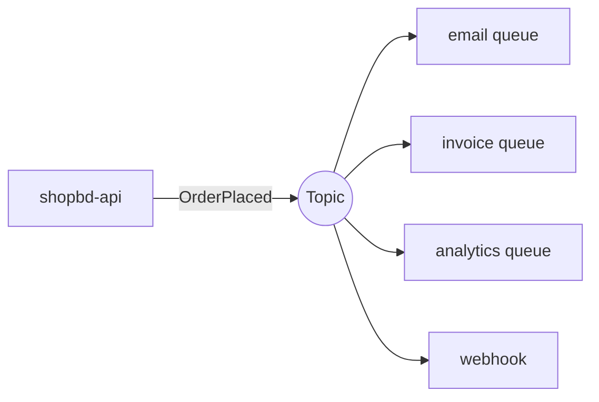
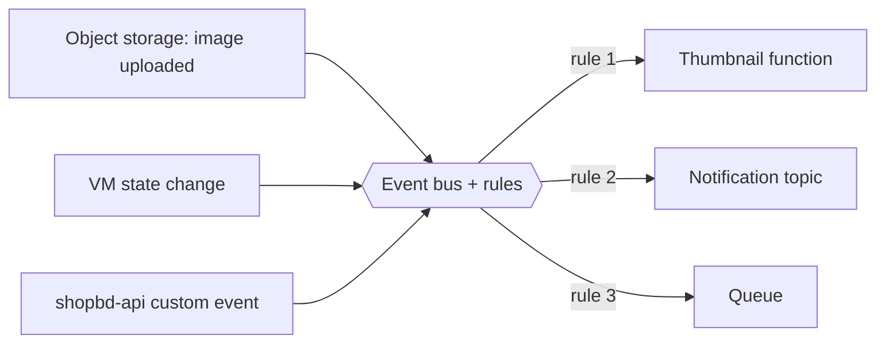
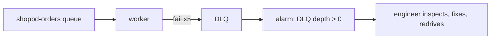
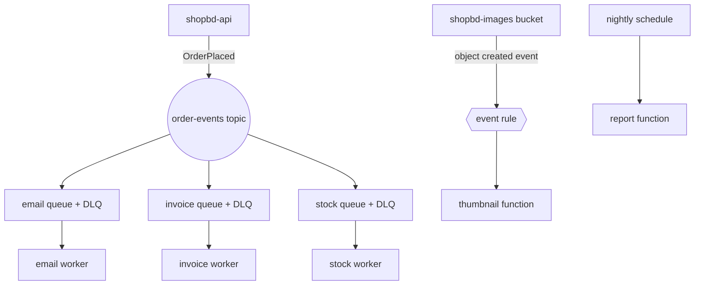

# 11 · Messaging ও Event

> **এই অধ্যায়ে কী শিখবেন**
>
> - কেন synchronous call-এর বদলে **asynchronous messaging** দরকার, আর queue / topic / event bus / stream — এই চারটার পার্থক্য কী
> - AWS, GCP, Azure ও OCI-এ queue, pub/sub, event routing ও streaming service-গুলোর নাম, মিল ও অমিল
> - **Visibility timeout, ack, retry, Dead-Letter Queue (DLQ)** — message হারানো ছাড়া কীভাবে process করবেন
> - Workflow orchestration: Step Functions, Workflows, Logic Apps / Durable Functions
> - **Fan-out, DLQ, idempotency** pattern — এবং `shopbd`-র order flow-তে এগুলোর বাস্তব ব্যবহার
> - CLI ও Terraform দিয়ে প্রতিটি cloud-এ queue + DLQ + topic বানানো

!!! abstract "এক নজরে — কোন cloud-এ কী নাম"

    | Concept | AWS | GCP | Azure | OCI |
    |---|---|---|---|---|
    | Queue (একজন consumer message নেয়) | Amazon SQS (Standard / FIFO) | Pub/Sub (pull subscription), Cloud Tasks | Service Bus queue, Storage Queue | OCI Queue |
    | Pub/Sub (fan-out) | Amazon SNS | Pub/Sub topic + একাধিক subscription | Service Bus topic + subscription, Event Grid | OCI Notifications |
    | Event bus / event routing | Amazon EventBridge | Eventarc | Azure Event Grid | OCI Events |
    | Streaming (ordered log, replay) | Kinesis Data Streams, Amazon MSK | Pub/Sub, Managed Service for Apache Kafka | Event Hubs | OCI Streaming |
    | Workflow orchestration | AWS Step Functions | Workflows | Logic Apps, Durable Functions | সরাসরি সমতুল্য নেই (Functions + Queue, বা Oracle Integration) |
    | Scheduler (সময় ধরে trigger) | EventBridge Scheduler | Cloud Scheduler | Logic Apps / Functions timer trigger | OCI Functions + Events / Resource Scheduler |
    | Dead-letter | SQS DLQ (redrive policy) | Dead letter topic | Dead-letter sub-queue (built-in) | OCI Queue DLQ |

## ১. কেন Messaging? — Synchronous বনাম Asynchronous

`shopbd`-তে একজন customer "Place order" চাপলে কী কী হওয়া দরকার? Order DB-তে সেভ, stock কমানো, confirmation
e-mail, invoice PDF, ওয়ারহাউজকে জানানো, nightly report-এর জন্য data। সবকিছু API-র ভেতরে এক request-এ করলে:

- Customer-কে সব কাজ শেষ হওয়া পর্যন্ত অপেক্ষা করতে হয় (e-mail server ধীর হলে checkout-ও ধীর)।
- একটা ধাপ ফেল করলে পুরো request ফেল।
- Traffic হঠাৎ বাড়লে (ঈদের আগে sale) সব service একসাথে চাপে পড়ে।

সমাধান: API শুধু **order সেভ করে একটা message পাঠিয়ে দেয়**, তারপর সাথে সাথে customer-কে "অর্ডার পেয়েছি" বলে দেয়।
বাকি কাজ আলাদা worker ধীরেসুস্থে করে।

!!! example "Analogy — রেস্টুরেন্টের অর্ডার স্লিপ"
    ওয়েটার (API) আপনার অর্ডার নিয়ে রান্নাঘরে (worker) দাঁড়িয়ে থাকে না। সে **অর্ডার স্লিপ** একটা র‍্যাকে (queue) গুঁজে
    দিয়ে চলে যায়। রান্নাঘর নিজের গতিতে স্লিপ তুলে রান্না করে। Rush hour-এ স্লিপ জমে — কিন্তু হারায় না। আর
    যদি একই স্লিপ দেখে বাবুর্চি তিনবার ব্যর্থ হয়, স্লিপটা আলাদা "সমস্যার ট্রে"-তে (DLQ) রাখা হয়।



### চারটি মৌলিক ধরন

| ধরন | মূল ধারণা | একটি message কয়জন পায়? | কখন |
|---|---|---|---|
| **Queue** | কাজের তালিকা; consumer নিয়ে process করে delete করে | **একজন** (competing consumers) | কাজ ভাগ করা — e-mail পাঠানো, ছবি resize |
| **Pub/Sub topic** | publisher একবার পাঠায়, প্রতি subscription নিজের কপি পায় | **প্রতিটি subscriber** (fan-out) | একটি ঘটনা অনেকে জানবে |
| **Event bus** | ঘটনা (event) ও rule/filter দিয়ে routing; source ও target ঢিলেঢালা | যে rule মেলে সে | AWS/SaaS/নিজের app-এর ঘটনা routing |
| **Stream** | ordered, append-only log; consumer নিজের offset ধরে পড়ে, আবার replay করা যায় | প্রতিটি consumer group | click-stream, log, IoT, বিপুল ডেটা |

!!! note "Message বনাম Event"
    **Message** মানে "এই কাজটা করো" (command) — প্রেরক চায় কেউ নিক। **Event** মানে "এটা ঘটে গেছে" (`OrderPlaced`) —
    প্রেরক জানে না কে শুনছে। Queue সাধারণত command-এর জন্য, event bus/pub-sub event-এর জন্য — তবে বাস্তবে দুটো মিশে যায়।

### Delivery guarantee — না বুঝলে পরে কষ্ট

- **At-most-once** — একবার চেষ্টা, হারাতে পারে। (প্রায় ব্যবহার হয় না।)
- **At-least-once** — হারায় না, কিন্তু **একই message দুবার আসতে পারে**। প্রায় সব managed service-এর default।
- **Exactly-once (processing)** — কিছু service নির্দিষ্ট শর্তে দেয় (SQS FIFO, Pub/Sub exactly-once delivery, Service Bus duplicate
  detection)। তবুও আপনার নিজের code-কে idempotent রাখাই নিরাপদ — নিচে ৭ নম্বর সেকশন দেখুন।

## ২. Queue — কাজের লাইন

Queue-র জীবনচক্র সব cloud-এ প্রায় একই:



মূল শব্দগুলো (নাম আলাদা, কাজ এক):

| ধারণা | মানে | AWS SQS | GCP Pub/Sub | Azure Service Bus | OCI Queue |
|---|---|---|---|---|---|
| Hide-while-processing | Consumer নেওয়ার পর কিছুক্ষণ অন্যরা দেখে না | visibility timeout | ack deadline | lock duration (peek-lock) | visibility timeout |
| সম্পন্ন বলা | Message মুছে ফেলা | `DeleteMessage` | `ack` | `complete` | `DeleteMessage` |
| ব্যর্থ হলে | আবার দিতে দেওয়া | timeout শেষ / visibility 0 | `nack` / deadline শেষ | `abandon` | timeout শেষ / update |
| বারবার ব্যর্থ | Poison message আলাদা করা | redrive policy → DLQ | dead letter topic | max delivery count → DLQ | dead letter queue |

### Visibility timeout — সবচেয়ে বেশি ভুল হওয়া সেটিং

Consumer message নিলে সেটা `visibility timeout` সময়ের জন্য লুকিয়ে যায়। এই সময়ের মধ্যে `delete` না করলে message আবার
অন্যজনের কাছে যায়। **নিয়ম:** timeout = আপনার সবচেয়ে ধীর processing-এর সময়ের চেয়ে বেশি (সাধারণত ৬ গুণ নিরাপদ)।
কম রাখলে একই order-এর e-mail দুবার যাবে; অনেক বেশি রাখলে ব্যর্থ message আবার চেষ্টা হতে দেরি হবে।

### Long polling — খালি লাইনে CPU পোড়াবেন না

Queue খালি থাকলে বারবার `receive` দিলে খরচ ও CPU দুটোই নষ্ট। Long polling-এ request কিছুক্ষণ (সাধারণত ২০ সেকেন্ড পর্যন্ত)
ঝুলে থাকে যতক্ষণ message না আসে। SQS-এ `WaitTimeSeconds`, OCI Queue-তে `timeoutInSeconds`; Pub/Sub-এর streaming pull ও Service
Bus-এর client library নিজেই এটা সামলায়।

=== "AWS"

    Service: **Amazon SQS** — দুই ধরন: **Standard** (প্রায় সীমাহীন throughput, at-least-once, order নিশ্চিত নয়) ও **FIFO**
    (order ঠিক থাকে `MessageGroupId`-র ভেতরে, deduplication আছে, queue নাম `.fifo` দিয়ে শেষ হতে হয়, throughput কম)।
    Message retention default ৪ দিন, সর্বোচ্চ ১৪ দিন। Message-এর size সীমা আছে (সম্প্রতি বেড়েছে) — বড় payload S3-তে রেখে
    শুধু key পাঠানোই রীতি।

    Console: **SQS → Queues → Create queue**।

    ```bash
    # 1) DLQ আগে বানান
    aws sqs create-queue --queue-name shopbd-orders-dlq --region ap-south-1

    # 2) Main queue: visibility 60s, long polling 20s, 5 বার ব্যর্থ হলে DLQ
    cat > attrs.json <<'EOF'
    {
      "VisibilityTimeout": "60",
      "ReceiveMessageWaitTimeSeconds": "20",
      "MessageRetentionPeriod": "345600",
      "RedrivePolicy": "{\"deadLetterTargetArn\":\"arn:aws:sqs:ap-south-1:123456789012:shopbd-orders-dlq\",\"maxReceiveCount\":\"5\"}"
    }
    EOF
    aws sqs create-queue --queue-name shopbd-orders --attributes file://attrs.json --region ap-south-1

    # 3) পাঠানো, নেওয়া, মোছা
    QURL=$(aws sqs get-queue-url --queue-name shopbd-orders --query QueueUrl --output text)
    aws sqs send-message --queue-url "$QURL" --message-body '{"order_id":"ORD-1001","type":"OrderPlaced"}'
    aws sqs receive-message --queue-url "$QURL" --wait-time-seconds 10 --max-number-of-messages 5
    aws sqs delete-message --queue-url "$QURL" --receipt-handle "<receipt-handle>"
    ```

    DLQ-র message ঠিক করার পর ফেরত পাঠাতে: Console-এ DLQ → **Start DLQ redrive**।

=== "GCP"

    Service: **Pub/Sub** — GCP-তে আলাদা "queue" product নেই; **pull subscription** দিয়ে queue-এর কাজ হয়। একটি subscription
    = একটি আলাদা "লাইন"। একাধিক worker একই subscription থেকে pull করলে তারা কাজ ভাগ করে নেয়। Message acknowledge করতে হয়
    **ack deadline**-এর (১০–৬০০ সেকেন্ড) ভেতরে। Subscription-এ retention সীমা আছে (default ৭ দিন)। (পুরনো **Pub/Sub Lite** deprecated — নতুন কাজে নয়।)

    **Cloud Tasks** আলাদা: এটি *নির্দিষ্ট HTTP endpoint*-এ rate-limited ও scheduled task পাঠানোর জন্য (যেমন "এই URL-কে সেকেন্ডে
    ৫টির বেশি call করো না")। Publisher জানে কোন target-এ যাবে — Pub/Sub-এর মতো ঢিলেঢালা নয়।

    Console: **Pub/Sub → Topics → Create topic**।

    ```bash
    # Pub/Sub topic global — region flag লাগে না
    gcloud pubsub topics create shopbd-orders
    gcloud pubsub topics create shopbd-orders-dlq
    gcloud pubsub subscriptions create shopbd-orders-dlq-sub --topic=shopbd-orders-dlq

    # Pull subscription + dead letter (5 attempt)
    gcloud pubsub subscriptions create shopbd-orders-email \
      --topic=shopbd-orders \
      --ack-deadline=60 \
      --dead-letter-topic=shopbd-orders-dlq \
      --max-delivery-attempts=5

    gcloud pubsub topics publish shopbd-orders --message='{"order_id":"ORD-1001","type":"OrderPlaced"}'
    gcloud pubsub subscriptions pull shopbd-orders-email --limit=5 --auto-ack
    ```

    !!! warning "Dead letter-এর permission"
        Pub/Sub service agent-কে DLQ topic-এ **publisher** আর main subscription-এ **subscriber** role দিতে হয়, নইলে
        message DLQ-তে যায় না। Console দিয়ে বানালে এটা প্রায়ই নিজে নিজে হয়ে যায়; CLI/Terraform-এ নিজে দিন।

=== "Azure"

    Service: **Azure Service Bus** (enterprise messaging, সবচেয়ে ফিচার-সমৃদ্ধ) ও **Azure Queue Storage** (Storage account-এর
    ভেতরের সহজ, সস্তা, বিশাল-scale queue; ফিচার কম — DLQ বা ordering built-in নেই)।

    Service Bus-এ **peek-lock** মোড: message নিলে *lock* পড়ে (default ১ মিনিট), শেষে `complete`। `Max delivery count` পার হলে
    message নিজে থেকে queue-র **dead-letter sub-queue**-তে যায় — আলাদা DLQ বানাতে হয় না। আরও আছে **sessions** (একই
    session-id-র message ক্রমানুসারে, একজন consumer-এর কাছে), **duplicate detection**, scheduled message, transaction।
    Tier: Basic (topic নেই), Standard, Premium (isolated, বড় message, VNet/private endpoint)।

    Portal: **Service Bus → Queues → + Queue**।

    ```bash
    az group create --name shopbd-rg --location centralindia

    az servicebus namespace create \
      --resource-group shopbd-rg --name shopbd-sb-ns \
      --location centralindia --sku Standard

    az servicebus queue create \
      --resource-group shopbd-rg --namespace-name shopbd-sb-ns \
      --name orders --max-delivery-count 5 --lock-duration PT1M

    # সহজ বিকল্প: Queue Storage
    az storage queue create --name shopbd-emails --account-name shopbdstorage --auth-mode login
    az storage message put --queue-name shopbd-emails --account-name shopbdstorage \
      --content "ORD-1001" --auth-mode login
    ```

=== "OCI"

    Service: **OCI Queue** — fully managed, at-least-once, visibility timeout, long polling, **dead letter queue** ও
    *channels* (একটি queue-র ভেতরে আলাদা লাইন, যেমন per-tenant) আছে। প্রতিটি queue-র নিজস্ব **messages endpoint** থাকে —
    message পাঠানো/নেওয়ার সময় সেটা দিতে হয়।

    Console: **Developer Services → Application Integration → Queue → Create queue**।

    ```bash
    oci queue queue-admin queue create \
      --compartment-id ocid1.compartment.oc1..example \
      --display-name shopbd-orders \
      --dead-letter-queue-delivery-count 5 \
      --visibility-in-seconds 60

    # Data plane (messages endpoint queue details থেকে পাবেন)
    oci queue messages put-messages \
      --queue-id ocid1.queue.oc1.ap-mumbai-1.example \
      --endpoint https://cell-1.queue.messaging.ap-mumbai-1.oci.oraclecloud.com \
      --messages '[{"content":"{\"order_id\":\"ORD-1001\"}"}]'
    ```

### Terraform — queue + DLQ

=== "AWS"

    ```hcl
    resource "aws_sqs_queue" "orders_dlq" {
      name                      = "shopbd-orders-dlq"
      message_retention_seconds = 1209600 # 14 days
    }

    resource "aws_sqs_queue" "orders" {
      name                       = "shopbd-orders"
      visibility_timeout_seconds = 60
      receive_wait_time_seconds  = 20
      redrive_policy = jsonencode({
        deadLetterTargetArn = aws_sqs_queue.orders_dlq.arn
        maxReceiveCount     = 5
      })
    }
    ```

=== "GCP"

    ```hcl
    resource "google_pubsub_topic" "orders" {
      name = "shopbd-orders"
    }

    resource "google_pubsub_topic" "orders_dlq" {
      name = "shopbd-orders-dlq"
    }

    resource "google_pubsub_subscription" "orders_email" {
      name                 = "shopbd-orders-email"
      topic                = google_pubsub_topic.orders.id
      ack_deadline_seconds = 60

      dead_letter_policy {
        dead_letter_topic     = google_pubsub_topic.orders_dlq.id
        max_delivery_attempts = 5
      }

      retry_policy {
        minimum_backoff = "10s"
        maximum_backoff = "300s"
      }
    }
    ```

=== "Azure"

    ```hcl
    resource "azurerm_servicebus_namespace" "main" {
      name                = "shopbd-sb-ns"
      location            = azurerm_resource_group.main.location
      resource_group_name = azurerm_resource_group.main.name
      sku                 = "Standard"
    }

    resource "azurerm_servicebus_queue" "orders" {
      name                = "orders"
      namespace_id        = azurerm_servicebus_namespace.main.id
      max_delivery_count  = 5
      lock_duration       = "PT1M"
      dead_lettering_on_message_expiration = true
    }
    ```

=== "OCI"

    ```hcl
    resource "oci_queue_queue" "orders" {
      compartment_id                   = var.compartment_id
      display_name                     = "shopbd-orders"
      visibility_in_seconds            = 60
      dead_letter_queue_delivery_count = 5
      retention_in_seconds             = 345600
    }
    ```

## ৩. Pub/Sub ও Fan-out — একটি ঘটনা, অনেক শ্রোতা

Queue-তে একটি message একজনই পায়। কিন্তু `OrderPlaced` ঘটনা তো email, invoice, stock, analytics — সবার জানা দরকার। এখানে
**topic** আসে: publisher শুধু topic-কে বলে; প্রতিটি subscriber নিজের কপি পায়।



!!! tip "সেরা pattern: Topic → প্রতি consumer-এর নিজস্ব Queue"
    Topic সরাসরি worker-কে call করলে worker ডাউন থাকলে message হারাতে পারে। তাই **প্রতিটি subscriber-এর জন্য আলাদা
    durable queue** রাখুন (SNS → SQS, Pub/Sub topic → আলাদা subscription, Service Bus topic → আলাদা subscription)। এতে
    প্রতিটি consumer নিজের গতিতে চলে, নিজের DLQ পায়, আর একজনের সমস্যা অন্যকে আটকায় না।

=== "AWS"

    Service: **Amazon SNS** — topic (Standard / FIFO), subscriber হতে পারে SQS, Lambda, HTTP(S), e-mail, SMS, mobile push,
    Firehose। **Message filtering** — subscription-এ filter policy দিলে শুধু মেলানো message যায়। Fan-out-এর জন্য SQS queue-র
    *access policy*-তে SNS topic-কে `sqs:SendMessage` অনুমতি দিতে হয়।

    ```bash
    TOPIC_ARN=$(aws sns create-topic --name shopbd-order-events --query TopicArn --output text)

    aws sns subscribe \
      --topic-arn "$TOPIC_ARN" \
      --protocol sqs \
      --notification-endpoint arn:aws:sqs:ap-south-1:123456789012:shopbd-orders \
      --attributes '{"FilterPolicy":"{\"type\":[\"OrderPlaced\"]}","RawMessageDelivery":"true"}'

    aws sns subscribe --topic-arn "$TOPIC_ARN" --protocol email --notification-endpoint ops@example.com

    aws sns publish --topic-arn "$TOPIC_ARN" \
      --message '{"order_id":"ORD-1001"}' \
      --message-attributes '{"type":{"DataType":"String","StringValue":"OrderPlaced"}}'
    ```

=== "GCP"

    Service: **Pub/Sub** নিজেই topic + subscription মডেল। একটি topic-এ অনেক subscription; প্রতিটি আলাদা কপি পায়। Subscription-এর ধরন:
    **pull**, **push** (HTTPS endpoint-এ POST), **BigQuery subscription** (সরাসরি table-এ), **Cloud Storage subscription**
    (ফাইলে)। Filter: subscription তৈরির সময় attribute-ভিত্তিক filter। Ordering: publish-এ **ordering key** + subscription-এ
    `--enable-message-ordering`। Exactly-once delivery: pull subscription-এ `--enable-exactly-once-delivery`।

    ```bash
    gcloud pubsub topics create shopbd-order-events

    gcloud pubsub subscriptions create shopbd-invoice-sub \
      --topic=shopbd-order-events \
      --message-filter='attributes.type = "OrderPlaced"'

    gcloud pubsub subscriptions create shopbd-analytics-sub \
      --topic=shopbd-order-events \
      --push-endpoint=https://shopbd-analytics-example.a.run.app/pubsub

    gcloud pubsub topics publish shopbd-order-events \
      --message='{"order_id":"ORD-1001"}' --attribute=type=OrderPlaced
    ```

=== "Azure"

    দুটি আলাদা মডেল — গুলিয়ে ফেলবেন না:

    - **Service Bus topic + subscription**: *message* (command/ business data) পাঠানোর জন্য; প্রতি subscription-এ নিজস্ব queue,
      DLQ, filter **rule** (SQL filter বা correlation filter)। Basic tier-এ topic নেই।
    - **Event Grid**: *event* (ঘটে-যাওয়া ঘটনা) routing — হালকা, push-ভিত্তিক, Azure resource-এর system event (Blob created
      ইত্যাদি) থেকে Function/Logic App/webhook/queue-তে। বিস্তারিত ৪ নম্বরে।

    ```bash
    az servicebus topic create --resource-group shopbd-rg --namespace-name shopbd-sb-ns --name order-events

    az servicebus topic subscription create \
      --resource-group shopbd-rg --namespace-name shopbd-sb-ns \
      --topic-name order-events --name invoice --max-delivery-count 5
    ```

=== "OCI"

    Service: **OCI Notifications** (CLI-তে `ons`) — topic + subscription। Subscription
    protocol: Email, HTTPS (custom URL), Slack, PagerDuty, SMS, **OCI Functions**। Notifications "queue" নয় — message জমিয়ে রাখে
    না; delivery fail করলে retry করে কিছু সময় পর্যন্ত। তাই durable fan-out দরকার হলে Notifications → Functions → Queue, কিংবা
    Events → Queue-র মতো সাজান।

    OCI-র alarm, budget ও অনেক service-এর event আসলে Notifications topic-এ গিয়েই e-mail/Slack হয় — এই service-টি OCI-তে
    সর্বব্যাপী।

    ```bash
    oci ons topic create \
      --compartment-id ocid1.compartment.oc1..example \
      --name shopbd-order-events

    oci ons subscription create \
      --compartment-id ocid1.compartment.oc1..example \
      --topic-id ocid1.onstopic.oc1.ap-mumbai-1.example \
      --protocol EMAIL \
      --subscription-endpoint ops@example.com

    oci ons message publish \
      --topic-id ocid1.onstopic.oc1.ap-mumbai-1.example \
      --body '{"order_id":"ORD-1001"}'
    ```

### Terraform — topic + subscription

Topic ও subscription-এর resource নাম: AWS `aws_sns_topic` + `aws_sns_topic_subscription` (protocol `sqs`/`email`, `raw_message_delivery = true`);
GCP `google_pubsub_topic` + `google_pubsub_subscription` (`filter = "attributes.type = \"OrderPlaced\""`); Azure `azurerm_servicebus_topic` +
`azurerm_servicebus_subscription` (`max_delivery_count` বাধ্যতামূলক); OCI `oci_ons_notification_topic` + `oci_ons_subscription`
(`protocol = "EMAIL"`, `endpoint = "ops@example.com"`)। গঠন ২ নম্বরের queue উদাহরণের মতোই।

## ৪. Event Bus — ঘটনা routing

Pub/Sub topic-এ আপনি নিজে message বানিয়ে পাঠান। **Event bus** অন্যরকম: cloud-এর নিজের service আর আপনার app **event** বের করে,
আর আপনি **rule** লেখেন — "যদি event-টা এমন হয় তাহলে এই target-কে call করো"। যেমন: "`shopbd-images` bucket-এ নতুন ছবি এলে
thumbnail function চালাও", "কোনো EC2/VM বন্ধ হলে ops-কে জানাও"।



=== "AWS"

    Service: **Amazon EventBridge** — **event bus** (default bus-এ AWS service-এর event আসে; custom bus আপনার app-এর জন্য),
    **rule** + **event pattern** (JSON filter), target (Lambda, SQS, SNS, Step Functions, API destination ইত্যাদি), **archive &
    replay**, **schema registry**। সংশ্লিষ্ট: **EventBridge Scheduler** (cron/one-time schedule — পুরনো "CloudWatch Events
    scheduled rule"-এর আধুনিক রূপ) ও **EventBridge Pipes** (source → filter → enrich → target পাইপলাইন)।

    S3-এর event EventBridge-এ পেতে bucket-এ EventBridge notification চালু করতে হয়।

    ```bash
    aws events put-rule \
      --name shopbd-image-uploaded \
      --event-pattern '{"source":["aws.s3"],"detail-type":["Object Created"],"detail":{"bucket":{"name":["shopbd-images"]}}}'

    aws events put-targets --rule shopbd-image-uploaded \
      --targets 'Id=1,Arn=arn:aws:lambda:ap-south-1:123456789012:function:shopbd-thumbnailer'

    # নিজের app থেকে custom event
    aws events put-events --entries \
      '[{"Source":"shopbd.api","DetailType":"OrderPlaced","Detail":"{\"order_id\":\"ORD-1001\"}"}]'

    # Nightly report: Scheduler
    aws scheduler create-schedule --name shopbd-nightly-report \
      --schedule-expression "cron(0 18 * * ? *)" \
      --flexible-time-window Mode=OFF \
      --target '{"Arn":"arn:aws:lambda:ap-south-1:123456789012:function:shopbd-report","RoleArn":"arn:aws:iam::123456789012:role/shopbd-scheduler-role"}'
    ```

=== "GCP"

    Service: **Eventarc** — Google Cloud service-এর event (Cloud Storage object finalized, Audit Log-ভিত্তিক event, Pub/Sub message,
    custom) থেকে **Cloud Run**, Cloud Run functions, GKE, Workflows-এ পাঠায়। Event **CloudEvents** ফরম্যাটে আসে। Eventarc
    ভেতরে Pub/Sub ব্যবহার করে। Schedule-এর জন্য আলাদা: **Cloud Scheduler** (cron → Pub/Sub / HTTP / Workflows)।

    ```bash
    gcloud eventarc triggers create shopbd-image-trigger \
      --location=asia-south1 \
      --destination-run-service=shopbd-thumbnailer \
      --destination-run-region=asia-south1 \
      --event-filters="type=google.cloud.storage.object.v1.finalized" \
      --event-filters="bucket=shopbd-images" \
      --service-account=shopbd-eventarc@my-project-id.iam.gserviceaccount.com

    gcloud scheduler jobs create pubsub shopbd-nightly-report \
      --location=asia-south1 --schedule="0 18 * * *" --time-zone="UTC" \
      --topic=shopbd-report-trigger --message-body='run'
    ```

    !!! note "Cloud Storage trigger-এর শর্ত"
        Cloud Storage trigger-এর জন্য bucket ও trigger একই location-এ থাকা দরকার, আর Cloud Storage service agent-কে Pub/Sub
        publisher role দিতে হয়।

=== "Azure"

    Service: **Azure Event Grid** — *system topic* (Azure resource-এর event, যেমন Blob Storage, Resource Group), *custom topic*
    (নিজের app-এর event), *partner events* (Auth0 ইত্যাদি)। Handler: Functions, Logic Apps, webhook, Service Bus, Storage Queue,
    Event Hubs। Delivery retry + dead-lettering (blob container-এ) আছে। নতুন **Event Grid namespaces** pull delivery ও MQTT
    broker দেয় — IoT/ডিভাইস কাজে উপযোগী।

    Schedule: আলাদা service নেই — Function-এর **timer trigger** বা Logic Apps-এর recurrence।

    ```bash
    SA_ID=$(az storage account show --name shopbdstorage --resource-group shopbd-rg --query id -o tsv)

    az eventgrid event-subscription create \
      --name shopbd-image-uploaded \
      --source-resource-id "$SA_ID" \
      --endpoint-type storagequeue \
      --endpoint "$SA_ID/queueservices/default/queues/shopbd-emails" \
      --included-event-types Microsoft.Storage.BlobCreated
    ```

=== "OCI"

    Service: **OCI Events** — OCI service-এর resource event (যেমন `com.oraclecloud.objectstorage.createobject`) এর উপর **rule**;
    action হিসেবে **Notifications**, **Functions** বা **Streaming**। Custom app event নেই — Events মূলত OCI resource-এর
    জন্য। Event **CloudEvents** ফরম্যাটে। Object Storage bucket-এ event emit চালু করতে হয় (bucket-এর `Emit Object Events`)।

    ```bash
    cat > condition.json <<'EOF'
    {"eventType":["com.oraclecloud.objectstorage.createobject"],
     "data":{"additionalDetails":{"bucketName":["shopbd-images"]}}}
    EOF

    cat > actions.json <<'EOF'
    {"actions":[{"actionType":"FAAS","isEnabled":true,
      "functionId":"ocid1.fnfunc.oc1.ap-mumbai-1.example"}]}
    EOF

    oci events rule create \
      --compartment-id ocid1.compartment.oc1..example \
      --display-name shopbd-image-uploaded \
      --is-enabled true \
      --condition file://condition.json \
      --actions file://actions.json
    ```

### Terraform — "ছবি upload হলে কাজ চালাও"

=== "AWS"

    ```hcl
    resource "aws_cloudwatch_event_rule" "image_uploaded" {
      name = "shopbd-image-uploaded"
      event_pattern = jsonencode({
        source        = ["aws.s3"]
        "detail-type" = ["Object Created"]
        detail        = { bucket = { name = ["shopbd-images"] } }
      })
    }

    resource "aws_cloudwatch_event_target" "thumbnailer" {
      rule = aws_cloudwatch_event_rule.image_uploaded.name
      arn  = aws_lambda_function.thumbnailer.arn
    }
    ```

    (Terraform-এ EventBridge resource-এর নাম এখনো `aws_cloudwatch_event_*`।)

=== "GCP"

    ```hcl
    resource "google_eventarc_trigger" "image_uploaded" {
      name            = "shopbd-image-trigger"
      location        = "asia-south1"
      service_account = google_service_account.eventarc.email

      matching_criteria {
        attribute = "type"
        value     = "google.cloud.storage.object.v1.finalized"
      }
      matching_criteria {
        attribute = "bucket"
        value     = "shopbd-images"
      }

      destination {
        cloud_run_service {
          service = google_cloud_run_v2_service.thumbnailer.name
          region  = "asia-south1"
        }
      }
    }
    ```

=== "Azure"

    ```hcl
    resource "azurerm_eventgrid_system_topic" "storage" {
      name                   = "shopbd-storage-events"
      resource_group_name    = azurerm_resource_group.main.name
      location               = azurerm_resource_group.main.location
      source_arm_resource_id = azurerm_storage_account.main.id
      topic_type             = "Microsoft.Storage.StorageAccounts"
    }

    resource "azurerm_eventgrid_system_topic_event_subscription" "image_uploaded" {
      name                = "shopbd-image-uploaded"
      system_topic        = azurerm_eventgrid_system_topic.storage.name
      resource_group_name = azurerm_resource_group.main.name
      included_event_types = ["Microsoft.Storage.BlobCreated"]

      storage_queue_endpoint {
        storage_account_id = azurerm_storage_account.main.id
        queue_name         = "shopbd-emails"
      }
    }
    ```

=== "OCI"

    ```hcl
    resource "oci_events_rule" "image_uploaded" {
      compartment_id = var.compartment_id
      display_name   = "shopbd-image-uploaded"
      is_enabled     = true
      condition = jsonencode({
        eventType = ["com.oraclecloud.objectstorage.createobject"]
        data      = { additionalDetails = { bucketName = ["shopbd-images"] } }
      })

      actions {
        actions {
          action_type = "FAAS"
          is_enabled  = true
          function_id = oci_functions_function.thumbnailer.id
        }
      }
    }
    ```

## ৫. Streaming — ordered log ও replay

Queue-তে message process হয়ে গেলে **মুছে যায়**। Stream-এ message একটা **log**-এ থাকে নির্দিষ্ট retention পর্যন্ত; consumer
নিজের **offset** (কোথা পর্যন্ত পড়েছে) মনে রাখে। ফলে:

- একই ডেটা **একাধিক consumer group** আলাদাভাবে পড়তে পারে
- বাগ ঠিক করে **অতীত থেকে replay** করা যায়
- **Partition/shard** key-এর ভিত্তিতে ordering থাকে (একই key সবসময় একই partition-এ)
- Throughput বাড়াতে partition বাড়াতে হয়

!!! tip "Queue না Stream?"
    - "এই কাজ একবার করো, তারপর ভুলে যাও" → **Queue**
    - "এই ঘটনার ধারা অনেকে পড়বে, আবার পড়তে হতে পারে, order জরুরি, ভলিউম বিশাল" → **Stream**
    `shopbd`-র মতো ছোট শপের order flow-তে Queue যথেষ্ট; click-stream বা দিনে লক্ষ লক্ষ event হলে Stream।

=== "AWS"

    Service: **Kinesis Data Streams** (AWS-native; **shard** = ১ MB/s write, ২ MB/s read-এর একক; **on-demand** mode-এ capacity
    নিজে বাড়ে; retention default ২৪ ঘণ্টা, বাড়ানো যায়) এবং **Amazon MSK** (managed Apache Kafka; MSK Serverless-ও আছে —
    Kafka ecosystem/tool দরকার হলে)। Delivery টার্গেটে ঢালতে **Amazon Data Firehose** (S3, Redshift ইত্যাদি)।

    ```bash
    aws kinesis create-stream --stream-name shopbd-clicks \
      --stream-mode-details StreamMode=ON_DEMAND --region ap-south-1

    aws kinesis put-record --stream-name shopbd-clicks \
      --partition-key user-42 \
      --cli-binary-format raw-in-base64-out \
      --data '{"page":"/product/17"}'
    ```

=== "GCP"

    Service: **Pub/Sub** নিজেই high-throughput ingestion-এর জন্য ব্যবহৃত হয় (global, autoscaling, partition নিয়ে ভাবতে হয়
    না) — আলাদা stream service সাধারণত লাগে না। Retention-এ বাড়তি সময় ও **seek/replay** (subscription অতীত snapshot/timestamp-এ
    ফেরানো) পাওয়া যায়। Kafka ফরম্যাট/ecosystem দরকার হলে **Google Cloud Managed Service for Apache Kafka**। Stream processing:
    **Dataflow** (Apache Beam)।

    ```bash
    # এক ঘণ্টা আগের থেকে আবার পড়তে চাইলে (topic-এ retention/ acked retain থাকা দরকার)
    gcloud pubsub subscriptions seek shopbd-clicks-sub --time=2026-11-24T10:00:00Z
    ```

=== "Azure"

    Service: **Azure Event Hubs** — partition + **consumer group**; **Capture** দিয়ে স্বয়ংক্রিয়ভাবে Blob/Data Lake-এ জমা; **Kafka
    protocol endpoint** (Standard tier বা উপরে) — Kafka client কোড বদলে শুধু connection string দিলেই চলে। Retention tier ভেদে
    আলাদা। Processing: Stream Analytics, Functions, Databricks।

    ```bash
    az eventhubs namespace create \
      --resource-group shopbd-rg --name shopbd-eh-ns \
      --location centralindia --sku Standard

    az eventhubs eventhub create \
      --resource-group shopbd-rg --namespace-name shopbd-eh-ns \
      --name shopbd-clicks --partition-count 2
    ```

=== "OCI"

    Service: **OCI Streaming** — partition-ভিত্তিক, **Apache Kafka compatible API**, stream pool দিয়ে group ও private
    endpoint। Retention সীমিত (ঘণ্টা থেকে কয়েক দিন — docs-এ সীমা দেখুন)। Processing: Functions, Data Flow (Spark),
    Service Connector Hub (stream → Object Storage ইত্যাদি)।

    ```bash
    oci streaming admin stream create \
      --compartment-id ocid1.compartment.oc1..example \
      --name shopbd-clicks --partitions 1
    ```

## ৬. Workflow Orchestration — ধাপে ধাপে লম্বা কাজ

কিছু কাজ একাধিক ধাপের: "payment নিশ্চিত → stock কমাও → যদি stock না থাকে refund → নইলে courier book → e-mail"। প্রতিটি
ধাপে retry, timeout, শর্ত (if/else), সমান্তরাল কাজ, ব্যর্থ হলে **compensation** (আগের ধাপ ফেরত নেওয়া) দরকার। এগুলো queue দিয়ে
নিজে হাতে বানালে জটিল হয়ে যায়। তাই **workflow / state machine** service।

=== "AWS"

    Service: **AWS Step Functions** — **Amazon States Language (ASL)** JSON-এ state machine। Task, Choice, Parallel, Map, Wait,
    Retry/Catch। দুই ধরন: **Standard** (দীর্ঘ-চলমান, exactly-once workflow execution, history থাকে) ও **Express** (স্বল্প,
    বেশি volume, at-least-once)। AWS service-কে সরাসরি call (SDK integration) করা যায় — Lambda ছাড়াই।

    ```json
    {
      "StartAt": "ChargePayment",
      "States": {
        "ChargePayment": {
          "Type": "Task",
          "Resource": "arn:aws:states:::lambda:invoke",
          "Parameters": { "FunctionName": "shopbd-charge", "Payload.$": "$" },
          "Retry": [{ "ErrorEquals": ["States.TaskFailed"], "MaxAttempts": 3, "BackoffRate": 2.0 }],
          "Catch": [{ "ErrorEquals": ["States.ALL"], "Next": "Refund" }],
          "Next": "Done"
        },
        "Refund": { "Type": "Task", "Resource": "arn:aws:states:::lambda:invoke",
                    "Parameters": { "FunctionName": "shopbd-refund", "Payload.$": "$" }, "End": true },
        "Done": { "Type": "Succeed" }
      }
    }
    ```

    ```bash
    aws stepfunctions create-state-machine --name shopbd-order-flow \
      --definition file://order-flow.json \
      --role-arn arn:aws:iam::123456789012:role/shopbd-stepfunctions-role

    aws stepfunctions start-execution \
      --state-machine-arn arn:aws:states:ap-south-1:123456789012:stateMachine:shopbd-order-flow \
      --input '{"order_id":"ORD-1001"}'
    ```

=== "GCP"

    Service: **Workflows** — YAML (বা JSON) এ ধাপ; HTTP call, Google API connector, `try/except/retry`, `switch`, parallel,
    subworkflow। Serverless — ব্যবহার অনুযায়ী খরচ। Eventarc / Cloud Scheduler দিয়ে trigger।

    ```yaml
    main:
      params: [args]
      steps:
        - charge:
            call: http.post
            args:
              url: https://shopbd-api.example.com/internal/charge
              body:
                order_id: ${args.order_id}
            result: charge_result
        - check_stock:
            switch:
              - condition: ${charge_result.body.in_stock}
                next: done
            next: refund
        - refund:
            call: http.post
            args:
              url: https://shopbd-api.example.com/internal/refund
              body:
                order_id: ${args.order_id}
        - done:
            return: ${args.order_id}
    ```

    ```bash
    gcloud workflows deploy shopbd-order-flow --location=asia-south1 --source=order-flow.yaml
    gcloud workflows run shopbd-order-flow --location=asia-south1 --data='{"order_id":"ORD-1001"}'
    ```

=== "Azure"

    দুটি পথ:

    - **Logic Apps** — low-code/visual designer; ১০০০+ connector (Office 365, SAP, Salesforce…)। Business integration ও
      non-developer-দের জন্য ভালো। Consumption (per-run) ও Standard (workflow engine, নিজস্ব hosting) plan।
    - **Durable Functions** — **code-first** (C#, Python, JS…); Azure Functions-এর extension। *Orchestrator function* সাধারণ
      code-এ লেখা, ভেতরে `call_activity`। Pattern: function chaining, **fan-out/fan-in**, async HTTP API, human interaction
      (অনুমোদনের অপেক্ষা), monitor।

    ```python
    import azure.durable_functions as df

    my_app = df.DFApp()

    @my_app.orchestration_trigger(context_name="context")
    def order_flow(context: df.DurableOrchestrationContext):
        order = context.get_input()
        charged = yield context.call_activity("charge_payment", order)
        if charged["in_stock"]:
            yield context.call_activity("book_courier", order)
        else:
            yield context.call_activity("refund_payment", order)
        return order["order_id"]
    ```

=== "OCI"

    OCI-তে Step Functions/Workflows-এর মতো **সাধারণ-উদ্দেশ্যের state-machine service core catalog-এ নেই** (Nov 2026-এও
    docs দেখে নিশ্চিত হয়ে নিন)। বিকল্প:

    - **OCI Functions + Queue + Events** দিয়ে নিজে saga/orchestrator code (state DB-তে রেখে)
    - **Oracle Integration** (আলাদা product) — visual process automation ও connector
    - ডেটা pipeline-এর জন্য **Data Integration** ও Data Flow-র নিজস্ব scheduling

    শেখার জন্য সবচেয়ে সহজ: Events → Functions → Queue চেইন, আর state `shopbd-db`-র `orders.status` কলামে রাখা।

!!! warning "Orchestration বনাম Choreography"
    **Orchestration**: একজন "কন্ডাক্টর" (workflow) সব ধাপ ঠিক করে — flow দেখা ও debug সহজ। **Choreography**: প্রতিটি service event
    শুনে নিজের কাজ করে পরবর্তী event ছাড়ে — ঢিলেঢালা, কিন্তু "পুরো flow কোথায় আটকেছে" বোঝা কঠিন। ছোট flow-তে choreography,
    ধাপ বেশি/compensation লাগলে orchestration।

## ৭. অপরিহার্য Pattern — Fan-out, DLQ, Idempotency

### ক) Fan-out

একটি event → অনেক consumer। উপরের ৩ নম্বরে দেখেছেন (topic → প্রতি consumer-এর নিজস্ব queue)। **Fan-out/fan-in** (workflow-এ)
মানে একটি বড় কাজ ভেঙে সমান্তরালে চালিয়ে শেষে ফলাফল জোড়া — যেমন ১০০০ product-এর ছবি ভেঙে ১০০০ thumbnail job, শেষে "সব শেষ" রিপোর্ট
(Step Functions `Map`, Durable Functions fan-out/fan-in)।

### খ) Dead-Letter Queue (DLQ)

কিছু message **কখনোই সফল হবে না** (ভুল JSON, ডিলিট হয়ে যাওয়া user)। এটা বারবার চেষ্টা হলে queue আটকে যায় ও খরচ বাড়ে।
**Poison message** আলাদা DLQ-তে সরানোই সমাধান।



| ধাপ | করণীয় |
|---|---|
| ১ | প্রতিটি queue/subscription-এর জন্য DLQ বানান; max attempts ৩–৫ |
| ২ | **DLQ-তে message জমলেই alarm** (ops@example.com-এ) — নীরব DLQ মানে নীরবে হারানো কাজ |
| ৩ | DLQ-র retention main queue-র চেয়ে **বেশি** রাখুন (SQS-এ আসল enqueue সময় ধরে retention গোনা হয়) |
| ৪ | বাগ ঠিক করার পর **redrive** (SQS redrive, Pub/Sub: DLQ subscription থেকে নিয়ে republish, Service Bus: DLQ sub-queue থেকে resubmit) |

### গ) Idempotency — একই message দুবার এলেও ক্ষতি নেই

At-least-once মানে duplicate **হবেই**। Consumer এমনভাবে লিখুন যাতে একই message একবার বা দশবার process করলে ফল এক।

**উপায়:** প্রতিটি message-এ একটা অনন্য **idempotency key** (যেমন `order_id + event_type`); process করার আগে "আগে দেখেছি?" চেক
— একটা DB table-এর **unique constraint** সবচেয়ে নির্ভরযোগ্য।

```python
import psycopg  # PostgreSQL driver

def handle_message(conn, msg):
    key = f"{msg['order_id']}:{msg['type']}"
    with conn.transaction():
        # first writer wins; a duplicate delivery inserts 0 rows
        cur = conn.execute(
            "INSERT INTO processed_messages (idempotency_key) VALUES (%s) "
            "ON CONFLICT (idempotency_key) DO NOTHING",
            (key,),
        )
        if cur.rowcount == 0:
            return  # already handled, safe to ack
        send_confirmation_email(msg["order_id"])
```

!!! danger "Side-effect যা DB transaction-এ রোলব্যাক হয় না"
    E-mail পাঠানো বা payment gateway call DB transaction-এর বাইরে। তাই ছোট flow-তে প্রথমে "processing" চিহ্ন বসান, তারপর
    কাজ, তারপর "done"; আর বাইরের API-কে (payment) তাদের **নিজস্ব idempotency key** দিন (অনেক gateway এটা সমর্থন করে)।

### ঘ) আরও কিছু জরুরি pattern

- **Retry with exponential backoff + jitter** — ব্যর্থ হলে ১s, ২s, ৪s… (সাথে সামান্য random) অপেক্ষা; সবাই একসাথে retry করে downstream
  ভেঙে ফেলা ("thundering herd") এড়াতে।
- **Backpressure / autoscaling by queue depth** — queue-র দৈর্ঘ্য (SQS `ApproximateNumberOfMessagesVisible`) ধরে worker autoscale করুন।
- **Claim-check** — বড় ফাইল message-এ না ঢুকিয়ে object storage-এ রেখে শুধু `s3://…`/`gs://…` পথ পাঠান।
- **Transactional outbox** — DB-তে order সেভ ও message পাঠানো দুটো আলাদা সিস্টেম; একটা সফল, অন্যটা ফেল হলে অসঙ্গতি। সমাধান: একই DB
  transaction-এ `outbox` table-এ message লিখুন, আলাদা একটি relay সেটা queue-তে পাঠায়।
- **Ordering** — শুধু যেখানে দরকার (SQS FIFO `MessageGroupId`, Pub/Sub ordering key, Service Bus session, Kafka partition key)। Order
  চাইলে সমান্তরালতা কমে।

## মিল ও অমিল

| বিষয় | AWS | GCP | Azure | OCI |
|---|---|---|---|---|
| "Queue" আলাদা product? | হ্যাঁ (SQS) | না — Pub/Sub pull subscription (+ Cloud Tasks) | হ্যাঁ (Service Bus / Storage Queue) | হ্যাঁ (Queue) |
| Fan-out ইউনিট | SNS topic → SQS | topic → subscription | Service Bus topic → subscription | Notifications topic (non-durable) |
| DLQ | আলাদা queue + redrive policy | আলাদা topic + subscription | **built-in sub-queue** | আলাদা (queue-র ভেতরে ব্যবস্থা) |
| Exactly-once | FIFO (৫ মিনিট dedupe window) | exactly-once delivery (pull) | duplicate detection | নেই — idempotent লিখুন |
| Ordering | FIFO group id | ordering key | sessions | partition (Streaming) |
| Event routing | EventBridge | Eventarc | Event Grid | Events (OCI resource-ভিত্তিক) |
| Schedule | EventBridge Scheduler | Cloud Scheduler | Functions timer / Logic Apps | Functions + Events / Resource Scheduler |
| Kafka-compatible | MSK | Managed Kafka | Event Hubs (Kafka endpoint) | Streaming (Kafka API) |
| Workflow | Step Functions | Workflows | Logic Apps / Durable Functions | সরাসরি নেই |

**যে gotcha-গুলোতে মানুষ আটকায়:**

- **GCP-তে "SQS" খুঁজবেন না।** Pub/Sub একই সাথে queue ও topic; আলাদা subscription মানেই আলাদা "queue"। একই subscription-এ অনেক
  worker = কাজ ভাগ; ভিন্ন subscription = প্রত্যেকে সব message।
- **Azure-এ তিনটি "event/message" service:** Service Bus (business message), Event Grid (reactive event), Event Hubs (stream)।
  ভুল পছন্দের সবচেয়ে সাধারণ উদাহরণ — Event Hubs দিয়ে ordinary queue বানানো।
- **SNS ≠ queue.** SNS-এ message জমা থাকে না; subscriber ডাউন থাকলে retry/DLQ ছাড়া হারাতে পারে — তাই SQS বসান।
- **OCI Notifications-ও durable queue নয়।** Durability দরকার হলে OCI Queue বা Streaming।
- **Pub/Sub topic global**, কিন্তু message storage policy দিয়ে region সীমাবদ্ধ করা যায় (compliance-এ লাগে)। SQS/Service Bus/OCI Queue
  region-bound।
- **Ack deadline/visibility/lock** — তিন cloud-এ তিন নাম, ভুল সেট করলে duplicate processing।

## Real-world: shopbd

**Requirement:** order এলে (১) confirmation e-mail, (২) invoice PDF, (৩) stock আপডেট; ছবি upload হলে thumbnail; প্রতি রাতে
sales report।



| কাজ | AWS | GCP | Azure | OCI |
|---|---|---|---|---|
| order-events topic | SNS `shopbd-order-events` | Pub/Sub topic `shopbd-order-events` | Service Bus topic `order-events` | Notifications topic (+ Queue consumer) |
| প্রতি consumer queue + DLQ | SQS ×৩ + DLQ | ৩টি subscription + dead letter topic | ৩টি topic subscription (DLQ built-in) | OCI Queue ×৩ (DLQ সহ) |
| ছবি → thumbnail | S3 → EventBridge → Lambda | Cloud Storage → Eventarc → Cloud Run | Blob → Event Grid → Function | Object Storage → Events → Functions |
| nightly report | EventBridge Scheduler → Lambda | Cloud Scheduler → Pub/Sub → Cloud Run job | Function timer trigger | Functions + scheduled trigger |
| ops alert (DLQ > 0) | CloudWatch alarm → SNS → ops@example.com | Monitoring alert → ops@example.com | Azure Monitor alert → Action group | Monitoring alarm → Notifications → ops@example.com |

**Design সিদ্ধান্ত:**

- API শুধু DB-তে order সেভ + একটি `OrderPlaced` event; বাকি সব async। Checkout দ্রুত থাকে।
- প্রতি consumer-এর নিজস্ব queue ও DLQ; "email worker ডাউন" হলে invoice থেমে যায় না।
- Worker-এ idempotency key = `order_id:OrderPlaced`; unique constraint সহ `processed_messages` table (`shopbd-db`)।
- DLQ-তে ১টি message হলেই `ops@example.com`-এ alert।
- Click-stream-এ আপাতত Stream দরকার নেই — যখন দৈনিক লক্ষ event হবে তখন Kinesis / Pub/Sub / Event Hubs / OCI Streaming।
- Payment→stock→courier flow ধাপ বেড়ে গেলে Step Functions / Workflows / Durable Functions-এ সরানো।

## Best practices

- **প্রতিটি queue-র সাথে DLQ** — এবং DLQ-র জন্য alarm।
- **Consumer idempotent** — duplicate delivery ধরে নিন।
- **Visibility timeout / ack deadline = processing time-এর চেয়ে বেশি**; দীর্ঘ কাজে লম্বা-কাজের মাঝখানে timeout বাড়ান (extend)।
- **Message ছোট রাখুন** — বড় data object storage-এ, message-এ reference।
- **Message-এ schema version** রাখুন (`"v":1`), যাতে পুরনো ও নতুন consumer একসাথে চলে।
- **Least-privilege** — producer শুধু send, consumer শুধু receive/delete ([IAM](03-identity-and-access.md))।
- **Encryption** — SQS SSE, Pub/Sub CMEK, Service Bus (Premium CMEK), OCI Queue Vault key; বিস্তারিত [Security](13-security.md)-তে।
- **Monitoring**: queue depth, oldest message age, DLQ depth, consumer error rate ([Observability](12-observability.md))।
- **Retry-তে exponential backoff + jitter**, আর downstream-এর সক্ষমতার চেয়ে বেশি concurrency দেবেন না।
- **IaC দিয়ে বানান** — queue/topic/DLQ/permissions একসাথে ([Terraform](14-infrastructure-as-code.md)); private connectivity: [Networking](05-networking.md)।

## Common mistakes

| ভুল | সমস্যা | সমাধান |
|---|---|---|
| Visibility timeout খুব কম | একই order-এর e-mail দুবার | সবচেয়ে ধীর processing × ৬ রাখুন; দরকারে extend |
| DLQ নেই | Poison message চিরকাল retry, খরচ ও latency | DLQ + max attempts ৩–৫ |
| DLQ আছে কিন্তু alarm নেই | মাসের পর মাস ব্যর্থ order কেউ জানে না | DLQ depth > 0 হলে alert |
| Idempotency নেই | Duplicate invoice, double stock কমানো | unique key + `ON CONFLICT DO NOTHING` |
| SNS-কে সরাসরি Lambda/HTTP-তে, queue ছাড়া | Consumer ডাউন থাকলে message হারায় | SNS → SQS → worker |
| Pub/Sub dead letter-এ permission না দেওয়া | Message DLQ-তে যায় না | Pub/Sub service agent-কে role দিন |
| বড় payload message-এ | Size সীমা, ধীর, ব্যয়বহুল | Claim-check: object storage-এ রেখে reference |

## ইন্টারভিউ / সার্টিফিকেশন টিপস

??? question "Queue আর Topic (pub/sub)-এর মূল পার্থক্য কী?"
    Queue-তে প্রতিটি message **একজন** consumer পায় (কাজ ভাগ হয়)। Topic-এ প্রতিটি subscriber **নিজের কপি** পায় (fan-out)।
    বাস্তবে দুটো মিলিয়ে ব্যবহার হয়: topic → প্রতি consumer-এর queue।

??? question "At-least-once delivery হলে কীভাবে duplicate সামলাবেন?"
    Consumer-কে **idempotent** বানাবো: প্রতি message-এ idempotency key, প্রক্রিয়ার আগে DB unique constraint দিয়ে "আগে হয়েছে কি না"
    চেক। বাইরের API (payment)-কে তাদের নিজস্ব idempotency key দেব।

??? question "Visibility timeout কী? কম রাখলে কী হয়?"
    Consumer message নেওয়ার পর কিছুক্ষণ সেটা অন্য consumer-দের কাছে লুকানো থাকে। এর মধ্যে delete না হলে আবার দৃশ্যমান হয়। কম হলে
    processing শেষ হওয়ার আগেই অন্য worker একই message নেবে → duplicate।

??? question "DLQ কেন দরকার? ব্যবহার কীভাবে করবেন?"
    "Poison message" যা কখনো সফল হবে না, তা আলাদা queue-তে সরাতে। Max receive/delivery count দিন, DLQ-তে message জমলে alarm,
    কারণ খুঁজে ঠিক করে redrive।

??? question "Azure-এ Service Bus, Event Grid ও Event Hubs কখন কোনটা?"
    Service Bus: business message (order, payment) — queue/topic, DLQ, session। Event Grid: reactive event routing (blob তৈরি হলো)।
    Event Hubs: বিশাল ভলিউম stream/telemetry, Kafka-compatible।

## সারসংক্ষেপ

- Messaging দিয়ে API ও worker আলাদা করুন — দ্রুত response, ব্যর্থতায় retry, traffic spike সহনীয়।
- **Queue** = একজন নেয়; **Topic** = সবাই পায়; **Event bus** = rule দিয়ে routing; **Stream** = ordered log + replay।
- নাম: SQS/SNS/EventBridge/Kinesis ↔ Pub/Sub/Eventarc ↔ Service Bus/Storage Queue/Event Grid/Event Hubs ↔ OCI Queue/Notifications/Events/Streaming।
- Workflow: Step Functions, Workflows, Logic Apps/Durable Functions; OCI-তে সরাসরি সমতুল্য নেই।
- তিন অপরিহার্য pattern: **fan-out (topic → queue), DLQ + alarm, idempotency key**।
- Visibility timeout / ack deadline / lock সঠিক রাখুন; ছোট message, schema version, least-privilege, encryption।
- পরবর্তী: [12 · Monitoring, Logging ও Tracing](12-observability.md) — queue depth ও DLQ-র alarm কীভাবে বানাবেন।
