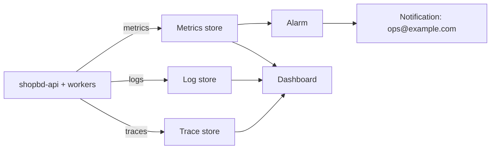
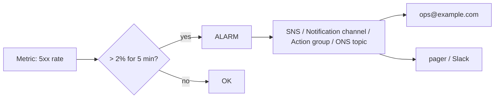
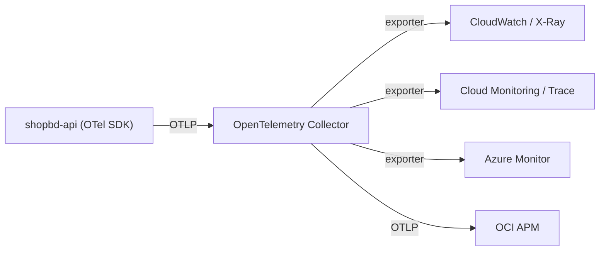
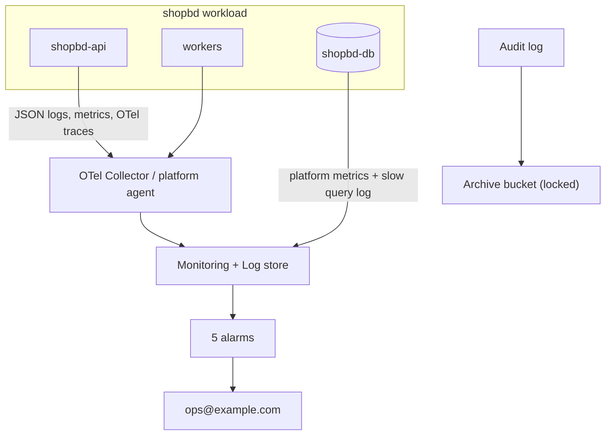

# 12 · Monitoring, Logging ও Tracing

> **এই অধ্যায়ে কী শিখবেন**
>
> - Observability-র তিন স্তম্ভ — **metrics, logs, traces** — আর alert কীভাবে বানালে ঘুম নষ্ট না করে আসল সমস্যা ধরা যায়
> - AWS CloudWatch, GCP Cloud Monitoring + Logging, Azure Monitor + Log Analytics + Application Insights, OCI Monitoring + Logging + APM-এর মিল ও অমিল
> - একই প্রশ্ন চার query ভাষায়: **Logs Insights, Logging query language, KQL, OCI Logging search**
> - Distributed tracing: X-Ray, Cloud Trace, Application Insights, OCI APM — এবং vendor-neutral **OpenTelemetry**
> - **Audit log** — "কে, কখন, কী করল": CloudTrail, Cloud Audit Logs, Activity Log, OCI Audit
> - CLI ও Terraform-এ alarm, log retention ও audit সেটআপ; `shopbd`-র বাস্তব monitoring plan

!!! abstract "এক নজরে — কোন cloud-এ কী নাম"

    | Concept | AWS | GCP | Azure | OCI |
    |---|---|---|---|---|
    | Metrics | CloudWatch Metrics | Cloud Monitoring | Azure Monitor Metrics | OCI Monitoring |
    | Alarm / Alert | CloudWatch Alarms | Alerting policies | Alert rules + Action groups | Alarms + Notifications |
    | Logs | CloudWatch Logs | Cloud Logging | Log Analytics workspace (Azure Monitor Logs) | OCI Logging (+ Logging Analytics) |
    | Log query | Logs Insights, Live Tail | Logging query language, Log Analytics (SQL) | KQL (Kusto) | Logging search, Logging Analytics query |
    | Agent | CloudWatch agent | Ops Agent | Azure Monitor Agent (AMA) | Unified Monitoring Agent |
    | Tracing / APM | AWS X-Ray, CloudWatch Application Signals | Cloud Trace (+ Cloud Profiler) | Application Insights | OCI Application Performance Monitoring (APM) |
    | Dashboard | CloudWatch Dashboards | Monitoring Dashboards | Azure Dashboards, Workbooks | Console Dashboards, Monitoring metric explorer |
    | Synthetic / uptime | CloudWatch Synthetics | Uptime checks | Availability tests (App Insights) | APM Synthetic Monitoring, Health Checks |
    | Audit log | CloudTrail | Cloud Audit Logs | Activity Log (+ Entra audit/sign-in logs) | OCI Audit |
    | Prometheus-managed | Amazon Managed Service for Prometheus | Managed Service for Prometheus | Azure Monitor managed Prometheus | OKE metrics → Monitoring (Prometheus scrape/ Grafana) |

## ১. Observability — তিন স্তম্ভ

**Monitoring** জিজ্ঞেস করে "system কি ঠিক আছে?" — আগে থেকে জানা প্রশ্ন (CPU কত? error rate কত?)।
**Observability** জিজ্ঞেস করে "কেন ঠিক নেই?" — আগে ভাবিনি এমন প্রশ্নের উত্তরও system-এর output থেকে বের করা যায় কিনা।

!!! example "Analogy — হাসপাতালের রোগী"
    **Metrics** = বেডসাইড মনিটরের সংখ্যা (হৃদস্পন্দন, চাপ) — একনজরে বলে কিছু একটা গোলমাল। **Logs** = নার্সের খাতা
    ("১০:০৩-এ জ্বর, ওষুধ দেওয়া হলো") — কী ঘটেছিল তার বিস্তারিত। **Traces** = রোগী ভর্তি থেকে অপারেশন থিয়েটার পর্যন্ত যাত্রাপথ,
    কোন বিভাগে কত সময় লাগল।

| স্তম্ভ | কী | শক্তি | দুর্বলতা |
|---|---|---|---|
| **Metrics** | সময়ভিত্তিক সংখ্যা (CPU, request/s, latency p95) | হালকা, সস্তা, alert-এর জন্য সেরা | "কেন" বলে না |
| **Logs** | ঘটনার text/JSON রেকর্ড | বিস্তারিত, কারণ খোঁজার জন্য | ভারী, সস্তা নয়, ঘাঁটা ধীর |
| **Traces** | একটি request-এর service-to-service যাত্রা (span-এর গাছ) | কোন service ধীর তা ধরায় | sampling লাগে; instrumentation লাগে |



### কী মাপবেন — Golden Signals ও SLO

Google SRE-র **চারটি golden signal** প্রায় যেকোনো service-এর জন্য যথেষ্ট শুরু:

1. **Latency** — response-এ কত সময় (সফল ও ব্যর্থ আলাদা করে; average নয়, **p95/p99**)
2. **Traffic** — কত request/s
3. **Errors** — কত % ব্যর্থ (HTTP 5xx, exception)
4. **Saturation** — resource কতটা ভরা (CPU, memory, disk, queue depth, DB connection)

**SLI** = মাপা সংখ্যা (যেমন সফল request-এর %); **SLO** = লক্ষ্য ("৩০ দিনে ৯৯.৯% request সফল"); **error budget** = ০.১% যতটুকু ভুল
করার সুযোগ। SLO-র সাথে মিলিয়ে alert দিন — "CPU ৮০%" নয়, "customer-এর checkout ব্যর্থ হচ্ছে" ধরনের alert।

## ২. Metrics

প্রতিটি metric = **নাম + dimension/label + timestamp + মান**। যেমন `CPUUtilization` + `InstanceId=i-…` + ১০:০৫ + ৭২%।

- **Platform metric** — cloud নিজে থেকে দেয় (VM-এর CPU, LB-র request count, DB-র connection)। সাধারণত ফ্রি।
- **Guest/OS metric** — VM-এর ভেতরের memory, disk space — **agent** লাগে (hypervisor থেকে দেখা যায় না)।
- **Custom/application metric** — আপনার code থেকে (`orders_placed`, `payment_failures`)।

!!! warning "Cardinality = খরচ"
    Dimension-এ `user_id` বা `order_id` দিলে প্রতিটি মান আলাদা time-series হয়ে যায় — metric সংখ্যা ও খরচ বিস্ফোরণ। Dimension হবে
    সীমিত মানের (`env`, `route`, `status_class`)। ব্যক্তি/order-ভিত্তিক তথ্য থাকবে log-এ।

=== "AWS"

    Service: **Amazon CloudWatch Metrics**। কাঠামো: **Namespace** (`AWS/EC2`, আপনার `ShopBD/Api`) → **Metric name** → **Dimensions**।
    Default ৫ মিনিট (EC2 basic), ১ মিনিট (detailed monitoring); custom metric **high-resolution** (১ সেকেন্ড) হতে পারে।
    Memory/disk-এর জন্য **CloudWatch agent**। Application metric পাঠাতে `PutMetricData` বা **Embedded Metric Format (EMF)** — JSON
    log লাইন লিখলেই CloudWatch metric বানিয়ে নেয়।

    Console: **CloudWatch → Metrics → All metrics**।

    ```bash
    aws cloudwatch put-metric-data --region ap-south-1 \
      --namespace ShopBD/Api --metric-name OrdersPlaced \
      --value 1 --unit Count --dimensions Env=prod

    aws cloudwatch get-metric-statistics --region ap-south-1 \
      --namespace AWS/EC2 --metric-name CPUUtilization \
      --dimensions Name=InstanceId,Value=i-0123456789abcdef0 \
      --start-time 2026-11-24T00:00:00Z --end-time 2026-11-24T01:00:00Z \
      --period 300 --statistics Average Maximum
    ```

=== "GCP"

    Service: **Cloud Monitoring** (আগের নাম Stackdriver)। Metric type যেমন `compute.googleapis.com/instance/cpu/utilization`;
    **monitored resource** (VM, Cloud Run revision) + **labels**। Custom metric: `custom.googleapis.com/…` অথবা OpenTelemetry/
    **Google Cloud Managed Service for Prometheus** (Prometheus metric সরাসরি — GKE-তে জনপ্রিয়)। **Metrics scope** দিয়ে একাধিক project-এর
    metric এক জায়গায় দেখা যায়। VM-এর memory/disk-এর জন্য **Ops Agent**।

    Console: **Monitoring → Metrics Explorer**।

    ```bash
    gcloud monitoring dashboards list
    ```

    (Custom metric পাঠানো সাধারণত client library / OpenTelemetry দিয়ে — নিচের OpenTelemetry সেকশন।)

=== "Azure"

    Service: **Azure Monitor Metrics** — প্রায় সব resource platform metric দেয় (১ মিনিট granularity), ৯৩ দিন রাখা হয়। **Custom metrics**
    (Application Insights বা API দিয়ে), **Azure Monitor managed service for Prometheus** (AKS ও অন্যান্য)। Guest metric ও log:
    **Azure Monitor Agent (AMA)** + **Data Collection Rule (DCR)** — কোন ডেটা কোথায় যাবে তার নিয়ম। পুরনো Log Analytics/
    Diagnostics agent (MMA/OMS, WAD) retire — AMA-তে যান।

    Portal: **Monitor → Metrics**।

    ```bash
    VM_ID=$(az vm show --resource-group shopbd-rg --name shopbd-api-vm --query id -o tsv)

    az monitor metrics list --resource "$VM_ID" \
      --metric "Percentage CPU" --interval PT5M --aggregation Average
    ```

=== "OCI"

    Service: **OCI Monitoring** — **namespace** (`oci_computeagent`, `oci_lbaas`, `oci_autonomous_database`…), **metric**,
    **dimensions**, আর **MQL (Monitoring Query Language)** — যেমন `CpuUtilization[1m].mean()`। VM-এর metric পেতে instance-এ
    **Oracle Cloud Agent**-এর Compute Instance Monitoring plugin চালু থাকতে হয়। Custom metric `PostMetricData` API-তে (নিজের
    namespace; `oci_` দিয়ে শুরু করা যায় না)।

    Console: **Observability & Management → Monitoring → Metrics Explorer**।

    ```bash
    oci monitoring metric-data summarize-metrics-data \
      --compartment-id ocid1.compartment.oc1..example \
      --namespace oci_computeagent \
      --query-text 'CpuUtilization[5m].mean()'
    ```

## ৩. Alarm / Alert

Alarm = "metric যদি X সময় ধরে threshold পার করে, তাহলে কাউকে জানাও/কিছু চালাও"। প্রতিটি cloud-এর গঠন একই:
**condition** → **state change** → **notification channel/target**।



### ভালো alert-এর নিয়ম

- **Symptom-এ alert, cause-এ নয়**: "checkout error rate > 2%" (user-এর কষ্ট) — "CPU > 80%" (হয়তো সমস্যাই নয়) নয়। CPU-র মতো cause-metric dashboard-এ।
- **Actionable**: alert এলে কী করতে হবে তা জানা থাকতে হবে (runbook লিংক)। না থাকলে alert মুছুন।
- **Duration/evaluation period** দিন — এক মিনিটের spike-এ ঘুম ভাঙানো যাবে না।
- **Missing data কীভাবে ধরবেন** ঠিক করুন — service মরে গেলে metric আসা বন্ধ হয়; "ডেটা নেই" কি ভালো না খারাপ? (CloudWatch `treat-missing-data`)
- **Severity ভাগ করুন**: critical → pager/phone; warning → e-mail/chat।
- **Composite/multi-condition** দিয়ে noise কমান (AWS composite alarm, GCP multi-condition policy)।

=== "AWS"

    Service: **CloudWatch Alarms** — state `OK` / `ALARM` / `INSUFFICIENT_DATA`; action: SNS, Auto Scaling, EC2 action,
    Systems Manager। **Anomaly detection alarm** (ML-ভিত্তিক band), **composite alarm** (একাধিক alarm-এর AND/OR), metric math।
    Notification SNS topic দিয়ে — ([Messaging](11-messaging-and-events.md))।

    ```bash
    aws sns create-topic --name shopbd-ops-alerts --region ap-south-1
    aws sns subscribe --region ap-south-1 \
      --topic-arn arn:aws:sns:ap-south-1:123456789012:shopbd-ops-alerts \
      --protocol email --notification-endpoint ops@example.com

    aws cloudwatch put-metric-alarm --region ap-south-1 \
      --alarm-name shopbd-api-5xx-high \
      --namespace AWS/ApplicationELB --metric-name HTTPCode_Target_5XX_Count \
      --dimensions Name=LoadBalancer,Value=app/shopbd-alb/0123456789abcdef \
      --statistic Sum --period 60 --evaluation-periods 5 --datapoints-to-alarm 3 \
      --threshold 20 --comparison-operator GreaterThanThreshold \
      --treat-missing-data notBreaching \
      --alarm-actions arn:aws:sns:ap-south-1:123456789012:shopbd-ops-alerts
    ```

=== "GCP"

    Service: **Cloud Monitoring alerting policy** — **condition** (metric threshold, metric absence, log-match, **PromQL**), **notification
    channel** (email, Slack, PagerDuty, Pub/Sub, webhook), documentation field (runbook), **incident** তৈরি হয় ও auto-close।
    Log-based alert-ও আছে (নির্দিষ্ট log লাইন এলেই)।

    ```bash
    # notification channel (e-mail)
    gcloud beta monitoring channels create \
      --display-name="shopbd ops" --type=email \
      --channel-labels=email_address=ops@example.com

    # policy defined in a JSON/YAML file
    gcloud alpha monitoring policies create --policy-from-file=shopbd-api-5xx-policy.json
    ```

=== "Azure"

    Service: **Azure Monitor Alerts** — রুল ধরন: **metric alert** (near real-time), **log search alert** (KQL query-ভিত্তিক),
    **activity log alert** (control-plane event), **smart detection** (App Insights)। রুল → **Action group** (email, SMS, push, voice,
    Webhook, Function, Logic App, ITSM)। Action group আলাদা resource — অনেক alert একই group ব্যবহার করে।

    ```bash
    az monitor action-group create \
      --resource-group shopbd-rg --name shopbd-ops --short-name shopbdops \
      --action email ops ops@example.com

    AG_ID=$(az monitor action-group show -g shopbd-rg -n shopbd-ops --query id -o tsv)
    VM_ID=$(az vm show -g shopbd-rg -n shopbd-api-vm --query id -o tsv)

    az monitor metrics alert create \
      --name shopbd-api-cpu-high --resource-group shopbd-rg \
      --scopes "$VM_ID" --condition "avg Percentage CPU > 80" \
      --window-size 5m --evaluation-frequency 1m \
      --action "$AG_ID" --severity 2
    ```

=== "OCI"

    Service: **Monitoring Alarms** — **query** (MQL, threshold ও duration সহ), **severity**, **destination = Notifications topic**
    (এবং Notifications সেখান থেকে email/Slack/PagerDuty/Functions), repeat interval, **alarm group by dimension**। Alarm state
    `OK`/`FIRING`। ভালো অভ্যাস: প্রথমে Notifications topic ও email subscription বানান — ([Messaging](11-messaging-and-events.md))।

    ```bash
    oci monitoring alarm create \
      --compartment-id ocid1.compartment.oc1..example \
      --display-name shopbd-api-cpu-high \
      --metric-compartment-id ocid1.compartment.oc1..example \
      --namespace oci_computeagent \
      --query-text 'CpuUtilization[5m].mean() > 80' \
      --severity CRITICAL \
      --destinations '["ocid1.onstopic.oc1.ap-mumbai-1.example"]' \
      --is-enabled true
    ```

### Terraform — notification + alarm

=== "AWS"

    ```hcl
    resource "aws_sns_topic" "ops_alerts" {
      name = "shopbd-ops-alerts"
    }

    resource "aws_sns_topic_subscription" "ops_email" {
      topic_arn = aws_sns_topic.ops_alerts.arn
      protocol  = "email"
      endpoint  = "ops@example.com"
    }

    resource "aws_cloudwatch_metric_alarm" "api_5xx" {
      alarm_name          = "shopbd-api-5xx-high"
      namespace           = "AWS/ApplicationELB"
      metric_name         = "HTTPCode_Target_5XX_Count"
      dimensions          = { LoadBalancer = aws_lb.api.arn_suffix }
      statistic           = "Sum"
      period              = 60
      evaluation_periods  = 5
      datapoints_to_alarm = 3
      threshold           = 20
      comparison_operator = "GreaterThanThreshold"
      treat_missing_data  = "notBreaching"
      alarm_actions       = [aws_sns_topic.ops_alerts.arn]
    }
    ```

=== "GCP"

    ```hcl
    resource "google_monitoring_notification_channel" "ops_email" {
      display_name = "shopbd ops"
      type         = "email"
      labels       = { email_address = "ops@example.com" }
    }

    resource "google_monitoring_alert_policy" "api_5xx" {
      display_name = "shopbd-api-5xx-high"
      combiner     = "OR"

      conditions {
        display_name = "Cloud Run 5xx rate"
        condition_threshold {
          filter = <<-EOT
            resource.type = "cloud_run_revision"
            AND metric.type = "run.googleapis.com/request_count"
            AND metric.labels.response_code_class = "5xx"
          EOT
          comparison      = "COMPARISON_GT"
          threshold_value = 5
          duration        = "300s"
          aggregations {
            alignment_period   = "60s"
            per_series_aligner = "ALIGN_RATE"
          }
        }
      }

      notification_channels = [google_monitoring_notification_channel.ops_email.id]
    }
    ```

=== "Azure"

    ```hcl
    resource "azurerm_monitor_action_group" "ops" {
      name                = "shopbd-ops"
      resource_group_name = azurerm_resource_group.main.name
      short_name          = "shopbdops"

      email_receiver {
        name          = "ops"
        email_address = "ops@example.com"
      }
    }

    resource "azurerm_monitor_metric_alert" "api_cpu" {
      name                = "shopbd-api-cpu-high"
      resource_group_name = azurerm_resource_group.main.name
      scopes              = [azurerm_linux_virtual_machine.api.id]
      frequency           = "PT1M"
      window_size         = "PT5M"
      severity            = 2

      criteria {
        metric_namespace = "Microsoft.Compute/virtualMachines"
        metric_name      = "Percentage CPU"
        aggregation      = "Average"
        operator         = "GreaterThan"
        threshold        = 80
      }

      action {
        action_group_id = azurerm_monitor_action_group.ops.id
      }
    }
    ```

=== "OCI"

    ```hcl
    resource "oci_ons_notification_topic" "ops" {
      compartment_id = var.compartment_id
      name           = "shopbd-ops-alerts"
    }

    resource "oci_ons_subscription" "ops_email" {
      compartment_id = var.compartment_id
      topic_id       = oci_ons_notification_topic.ops.id
      protocol       = "EMAIL"
      endpoint       = "ops@example.com"
    }

    resource "oci_monitoring_alarm" "api_cpu" {
      compartment_id        = var.compartment_id
      metric_compartment_id = var.compartment_id
      display_name          = "shopbd-api-cpu-high"
      namespace             = "oci_computeagent"
      query                 = "CpuUtilization[5m].mean() > 80"
      severity              = "CRITICAL"
      destinations          = [oci_ons_notification_topic.ops.id]
      is_enabled            = true
    }
    ```

## ৪. Logging

Log = event-এর লেখা রেকর্ড। তিন ধরনের source:

- **Platform/service logs** — cloud service-এর নিজস্ব log (LB access log, VPC flow log, DB slow query)। সাধারণত চালু করে দিতে হয়।
- **Application logs** — আপনার app (`stdout`/ফাইল)। Container/serverless-এ `stdout` লিখলেই cloud নিয়ে নেয়।
- **OS/system logs** — syslog, journald — **agent** দরকার।

!!! tip "Structured (JSON) logging করুন"
    `"Order 1001 failed for user 42"` plain text খুঁজতে regex লাগে। `{"level":"error","order_id":"ORD-1001","msg":"payment failed",
    "trace_id":"…"}` JSON হলে প্রতিটি cloud ফিল্ড ধরে query/filter করতে পারে — আর `trace_id` থাকলে log ও trace জোড়া লাগে।

```python
import json, logging, sys

class JsonFormatter(logging.Formatter):
    def format(self, record):
        return json.dumps({
            "level": record.levelname.lower(),
            "msg": record.getMessage(),
            "logger": record.name,
        })

handler = logging.StreamHandler(sys.stdout)   # stdout: collected by the platform
handler.setFormatter(JsonFormatter())
logging.getLogger().addHandler(handler)
logging.getLogger().setLevel(logging.INFO)
logging.getLogger("shopbd.api").info("order placed")
```

### সংগঠন ও retention

| ধারণা | AWS | GCP | Azure | OCI |
|---|---|---|---|---|
| গুচ্ছ | Log group → Log stream | Log bucket (`_Default`, `_Required`, user-defined) | Log Analytics workspace → table | Log group → Log |
| Retention সেটিং | log group-এ (১ দিন…∞) | bucket-এ (default ৩০ দিন, বাড়ানো যায়) | workspace/table-এ (default ৩০ দিন+) | log-এ (৩০ দিন default, সর্বোচ্চ ১৮০ দিন — docs দেখুন) |
| বাইরে পাঠানো | subscription filter, export to S3 | **sink** → BigQuery/Storage/Pub/Sub | Diagnostic settings → Storage/Event Hubs | **Service Connector Hub** → Object Storage/Streaming/Functions |
| Log থেকে metric | Metric filter | Log-based metric | Log search alert / DCR transform | Service Connector / Logging Analytics |

!!! warning "খরচের বড় উৎস: ingestion ও retention"
    প্রায় সব cloud-এ log-এর খরচ **কতটা ডেটা ঢুকল (ingestion)** + **কতদিন রাখলেন** + **কতটা query করলেন** দিয়ে। `DEBUG` log
    production-এ চালিয়ে রাখা, অপ্রয়োজনীয় health-check log, VPC flow log "ALL" ফিল্টার — বিল ফুলিয়ে দেয়। Pricing: aws.amazon.com/cloudwatch/pricing,
    cloud.google.com/stackdriver/pricing, azure.microsoft.com/pricing (Azure Monitor), oracle.com/cloud/price-list।

=== "AWS"

    Service: **CloudWatch Logs**। Lambda, ECS (`awslogs` driver), API Gateway ইত্যাদি স্বয়ংক্রিয়ভাবে লেখে; EC2-তে **CloudWatch agent**।
    Log class: Standard / Infrequent Access (সস্তা ingestion, কম ফিচার)। **Live Tail** — লাইভ log দেখা। লম্বা সময়ের archive: S3-তে export / Firehose।

    ```bash
    aws logs create-log-group --log-group-name /shopbd/prod/api --region ap-south-1
    aws logs put-retention-policy --log-group-name /shopbd/prod/api \
      --retention-in-days 30 --region ap-south-1

    # live tail (AWS CLI v2)
    aws logs tail /shopbd/prod/api --follow --since 10m --region ap-south-1

    # error লাইন ফিল্টার
    aws logs filter-log-events --log-group-name /shopbd/prod/api \
      --filter-pattern '{ $.level = "error" }' --region ap-south-1
    ```

=== "GCP"

    Service: **Cloud Logging**। Cloud Run, GKE, Cloud Run functions, GCE (Ops Agent) থেকে স্বয়ংক্রিয়। **Log Router**: প্রতিটি log
    সব sink-এর inclusion/exclusion filter-এ মেলানো হয় — `_Default` bucket (৩০ দিন), `_Required` bucket (audit — ৪০০ দিন, বদলানো যায়
    না)। নিজের **log bucket** বানিয়ে retention ঠিক করা যায়; **Log Analytics** চালু করলে bucket-এ SQL চালানো যায়।
    Log-এ `severity`, `resource.type`, `jsonPayload` — query-র ভিত্তি।

    ```bash
    gcloud logging buckets update _Default --location=global --retention-days=30

    gcloud logging read 'resource.type="cloud_run_revision" AND severity>=ERROR' \
      --limit=20 --freshness=1h

    # BigQuery sink (long-term analysis)
    gcloud logging sinks create shopbd-errors-to-bq \
      bigquery.googleapis.com/projects/my-project-id/datasets/shopbd_logs \
      --log-filter='severity>=ERROR'
    ```

=== "Azure"

    Service: **Azure Monitor Logs = Log Analytics workspace**। Resource-এর log (PaaS) **Diagnostic settings** দিয়ে workspace-এ
    পাঠাতে হয় — **নিজে থেকে যায় না** (এটা প্রায়ই ভুলে যাওয়া হয়)। VM-এর log: AMA + DCR। Table plan: **Analytics** (পূর্ণ ফিচার, দামি),
    **Basic/Auxiliary** (সস্তা, সীমিত query)। App-এর log/trace-এর জন্য workspace-based **Application Insights**।

    ```bash
    az monitor log-analytics workspace create \
      --resource-group shopbd-rg --workspace-name shopbd-logs \
      --location centralindia --retention-time 30

    WS_ID=$(az monitor log-analytics workspace show -g shopbd-rg -n shopbd-logs --query id -o tsv)
    DB_ID=$(az postgres flexible-server show -g shopbd-rg -n shopbd-db --query id -o tsv)

    az monitor diagnostic-settings create \
      --name to-law --resource "$DB_ID" --workspace "$WS_ID" \
      --logs '[{"categoryGroup":"allLogs","enabled":true}]'
    ```

=== "OCI"

    Service: **OCI Logging**। Log তিন ধরন: **Service log** (Object Storage, LB, VCN flow logs ইত্যাদি — log group-এ enable করতে হয়),
    **Custom log** (agent দিয়ে VM-এর ফাইল), **Audit** (আলাদা — নিচে)। Custom log-এর জন্য VM-এ **Unified Monitoring Agent** ও
    **agent configuration**। বড় বিশ্লেষণ/ML-এর জন্য আলাদা **Logging Analytics** service (parsers, বিস্তৃত query ভাষা)।

    ```bash
    oci logging log-group create \
      --compartment-id ocid1.compartment.oc1..example \
      --display-name shopbd-prod-logs

    oci logging log create \
      --log-group-id ocid1.loggroup.oc1.ap-mumbai-1.example \
      --display-name shopbd-api-app --log-type CUSTOM
    ```

### Terraform — log group / workspace + retention

=== "AWS"

    ```hcl
    resource "aws_cloudwatch_log_group" "api" {
      name              = "/shopbd/prod/api"
      retention_in_days = 30
    }
    ```

=== "GCP"

    ```hcl
    resource "google_logging_project_bucket_config" "shopbd" {
      project        = "my-project-id"
      location       = "global"
      bucket_id      = "shopbd-app-logs"
      retention_days = 30
    }
    ```

=== "Azure"

    ```hcl
    resource "azurerm_log_analytics_workspace" "main" {
      name                = "shopbd-logs"
      location            = azurerm_resource_group.main.location
      resource_group_name = azurerm_resource_group.main.name
      sku                 = "PerGB2018"
      retention_in_days   = 30
    }
    ```

=== "OCI"

    ```hcl
    resource "oci_logging_log_group" "prod" {
      compartment_id = var.compartment_id
      display_name   = "shopbd-prod-logs"
    }

    resource "oci_logging_log" "api" {
      log_group_id       = oci_logging_log_group.prod.id
      display_name       = "shopbd-api-app"
      log_type           = "CUSTOM"
      is_enabled         = true
      retention_duration = 30
    }
    ```

## ৫. Log Query — একই প্রশ্ন, চার ভাষা

প্রশ্ন: **"গত এক ঘণ্টায় কোন API path-এ সবচেয়ে বেশি 5xx error এসেছে?"** (JSON log-এ `status` ও `path` ফিল্ড আছে ধরে নিই)

=== "AWS"

    **CloudWatch Logs Insights** — pipe-ভিত্তিক ভাষা: `fields`, `filter`, `stats`, `sort`, `parse`, `limit`। একবারে একাধিক log group-এ চালানো যায়।
    JSON ফিল্ড সরাসরি পাওয়া যায়।

    ```text
    fields @timestamp, path, status
    | filter status >= 500
    | stats count(*) as errors by path
    | sort errors desc
    | limit 10
    ```

    ```bash
    QID=$(aws logs start-query --region ap-south-1 \
      --log-group-name /shopbd/prod/api \
      --start-time $(date -d '1 hour ago' +%s) --end-time $(date +%s) \
      --query-string 'fields path, status | filter status >= 500 | stats count(*) as errors by path | sort errors desc | limit 10' \
      --query 'queryId' --output text)

    aws logs get-query-results --region ap-south-1 --query-id "$QID"
    ```

=== "GCP"

    **Logging query language** — filter ভাষা (SQL-এর মতো নয়): ফিল্ড ও তুলনা, `AND`/`OR`/`NOT`, `:` (contains), `=~` (regex)।
    Group-by/aggregation দরকার হলে **Log Analytics** চালু করে SQL ব্যবহার করুন।

    ```text
    resource.type="cloud_run_revision"
    resource.labels.service_name="shopbd-api"
    jsonPayload.status>=500
    ```

    ```bash
    gcloud logging read \
      'resource.type="cloud_run_revision" AND resource.labels.service_name="shopbd-api" AND jsonPayload.status>=500' \
      --freshness=1h --limit=50 --format='value(jsonPayload.path)'
    ```

    Log Analytics (BigQuery-style SQL) উদাহরণ:

    ```sql
    SELECT JSON_VALUE(json_payload.path) AS path, COUNT(*) AS errors
    FROM `my-project-id.global._Default._AllLogs`
    WHERE SAFE_CAST(JSON_VALUE(json_payload.status) AS INT64) >= 500
      AND timestamp > TIMESTAMP_SUB(CURRENT_TIMESTAMP(), INTERVAL 1 HOUR)
    GROUP BY path ORDER BY errors DESC LIMIT 10
    ```

=== "Azure"

    **KQL (Kusto Query Language)** — table থেকে শুরু করে pipe (`|`): `where`, `summarize`, `project`, `extend`, `top`, `render`। Azure Monitor,
    Microsoft Sentinel, Defender, Data Explorer — সবখানে একই ভাষা, তাই শিখে রাখা লাভজনক। Workspace-based App Insights-এ table `AppRequests`, `AppTraces`, `AppExceptions`।

    ```text
    AppRequests
    | where TimeGenerated > ago(1h)
    | where toint(ResultCode) >= 500
    | summarize errors = count() by Name
    | top 10 by errors desc
    ```

    ```bash
    az monitor log-analytics query \
      --workspace 00000000-0000-0000-0000-000000000000 \
      --analytics-query 'AppRequests | where TimeGenerated > ago(1h) | where toint(ResultCode) >= 500 | summarize errors=count() by Name | top 10 by errors desc'
    ```

=== "OCI"

    **Logging search** (Console: Logging → Search) — `search "<compartment>/<log-group>/<log>" | where … | sort by datetime desc`
    ধাঁচের ভাষা; ফিল্ড `data.*` (log content), `logContent`, `datetime`। বিশ্লেষণ (group by, chart) দরকার হলে **Logging Analytics**-এর
    নিজস্ব query ভাষা (`… | stats count by 'Path'` ধাঁচ — parser/field নাম আপনার source অনুযায়ী)।

    ```text
    search "ocid1.compartment.oc1..example/ocid1.loggroup.oc1.ap-mumbai-1.example/ocid1.log.oc1.ap-mumbai-1.example"
    | where data.status >= 500
    | sort by datetime desc
    ```

    ```bash
    oci logging-search search-logs \
      --search-query 'search "ocid1.compartment.oc1..example" | where data.status >= 500 | sort by datetime desc' \
      --time-start 2026-11-24T00:00:00Z --time-end 2026-11-24T01:00:00Z
    ```

| কাজ | Logs Insights | GCP filter | KQL | OCI search |
|---|---|---|---|---|
| ফিল্টার | `filter status >= 500` | `jsonPayload.status>=500` | `where toint(ResultCode) >= 500` | `where data.status >= 500` |
| গোনা/গ্রুপ | `stats count(*) by path` | Log Analytics SQL `GROUP BY` | `summarize count() by Name` | Logging Analytics `stats` |
| সময় | query-র time range | `--freshness` / `timestamp>=` | `where TimeGenerated > ago(1h)` | time-start / time-end |
| সাজানো | `sort errors desc` | `ORDER BY` | `top 10 by errors` | `sort by datetime` |

### Log থেকে Metric ও Alert

যে সংখ্যা metric হিসেবে আসে না (যেমন "payment failed" লাইনের সংখ্যা), তা log থেকে metric বানান:

- **AWS**: *Metric filter* — log group-এ pattern দিলে CloudWatch metric বানায়, তার উপর alarm।
- **GCP**: *Log-based metric* (counter/distribution) + alerting policy; অথবা সরাসরি *log-based alert*।
- **Azure**: *Log search alert rule* — KQL query নির্দিষ্ট ব্যবধানে চলে, ফল threshold পার করলে alert।
- **OCI**: Service Connector Hub দিয়ে log → Monitoring/Functions, বা Logging Analytics-এ saved search ও alert।

## ৬. Distributed Tracing

`shopbd`-র একটা checkout request যায়: LB → `shopbd-api` → `shopbd-db` + payment gateway + queue। কোনটা ধীর? Log-এ আলাদা আলাদা টুকরো, কিন্তু
**trace** পুরো যাত্রা একসাথে দেখায়। যেমন ৮০০ ms-এর checkout-এ trace দেখাবে: DB `SELECT` ৪০ ms, `INSERT` ৬০ ms, payment gateway ৫৫০ ms (আসল দোষী), queue publish ৩০ ms।

- **Trace** = একটি request-এর সম্পূর্ণ যাত্রা; **span** = তার এক ধাপ (নাম, শুরু, সময়, attribute)। Span গাছের মতো parent-child।
- **Context propagation**: এক service অন্যকে call করলে HTTP header-এ trace id পাঠাতে হয় (W3C `traceparent` header — এখন সবার standard)।
- **Sampling**: সব request trace করলে খরচ/overhead; তাই ১–১০% বা "ধীর ও error সব, বাকি কিছু" (tail sampling)।


=== "AWS"

    Service: **AWS X-Ray** — trace, **service map**, segment/subsegment, sampling rules, X-Ray group। X-Ray SDK-র বদলে এখন
    **OpenTelemetry (AWS Distro for OpenTelemetry, ADOT)** ব্যবহারের পরামর্শ — SDK ধাপে ধাপে maintenance-এ। নতুন **CloudWatch Application
    Signals** service/SLO-কেন্দ্রিক APM view দেয়। Lambda/API Gateway/ECS-এ tracing সহজেই চালু করা যায় ("Active tracing")।

    ```bash
    # Lambda function-এ active tracing চালু
    aws lambda update-function-configuration \
      --function-name shopbd-thumbnailer --tracing-config Mode=Active --region ap-south-1

    aws xray get-trace-summaries --region ap-south-1 \
      --start-time 2026-11-24T00:00:00Z --end-time 2026-11-24T01:00:00Z
    ```

=== "GCP"

    Service: **Cloud Trace** — latency view, trace list, analysis report। Cloud Run/App Engine/Cloud Run functions-এ কিছু trace
    স্বয়ংক্রিয়; বাকিটা **OpenTelemetry** দিয়ে। **Cloud Profiler** (CPU/memory flame graph, production-এ কম overhead) ও **Error Reporting**
    (exception গুচ্ছ) পাশাপাশি আছে। Log-এ trace field দিলে Logs Explorer থেকে trace-এ লাফ দেওয়া যায়।

    Console: **Trace → Trace explorer**।

=== "Azure"

    Service: **Application Insights** (Azure Monitor-এর APM অংশ, workspace-based) — distributed tracing, **application map**, live metrics,
    failures/performance blade, availability test, smart detection। Instrumentation: **Azure Monitor OpenTelemetry Distro** (Python:
    `azure-monitor-opentelemetry`) — Classic Application Insights SDK-র বদলে এটাই এখন প্রস্তাবিত পথ। App Service/Functions-এ
    "auto-instrumentation" (code না বদলে চালু) অনেক runtime-এ আছে।

    Portal: **Application Insights → Investigate → Application map / Transaction search**।

=== "OCI"

    Service: **OCI Application Performance Monitoring (APM)** — **APM domain** (ডেটা সংরক্ষণের একক) তৈরি করে **data key** নিয়ে agent/
    OpenTelemetry exporter ঠিক করতে হয়। Trace Explorer, **Synthetic Monitoring** (browser/REST/ping check), Real User Monitoring,
    Server monitoring। OTLP-র মাধ্যমে ডেটা নেওয়া যায় — ফলে OpenTelemetry দিয়ে instrument করলে vendor lock-in কম। Free tier
    domain-এর সীমা আছে।

    Console: **Observability & Management → Application Performance Monitoring → APM Domains**।

## ৭. OpenTelemetry — একবার instrument, যেকোনো cloud-এ

**OpenTelemetry (OTel)** CNCF-এর vendor-neutral standard: metrics, logs, traces-এর API/SDK + **OTLP** wire protocol + **Collector**।
আপনার app একবার OTel দিয়ে instrument করলে ডেটা AWS/GCP/Azure/OCI বা Grafana/Datadog যেকোনো backend-এ পাঠানো যায় — শুধু exporter/collector config বদলে।



```python
# pip install opentelemetry-sdk opentelemetry-exporter-otlp
from opentelemetry import trace
from opentelemetry.sdk.resources import Resource
from opentelemetry.sdk.trace import TracerProvider
from opentelemetry.sdk.trace.export import BatchSpanProcessor
from opentelemetry.exporter.otlp.proto.http.trace_exporter import OTLPSpanExporter

provider = TracerProvider(resource=Resource.create({"service.name": "shopbd-api"}))
# endpoint of your Collector (or a backend that accepts OTLP)
provider.add_span_processor(BatchSpanProcessor(OTLPSpanExporter(endpoint="http://localhost:4318/v1/traces")))
trace.set_tracer_provider(provider)

tracer = trace.get_tracer("shopbd.api")
with tracer.start_as_current_span("place_order") as span:
    span.set_attribute("order.id", "ORD-1001")
    # ... DB insert, publish message ...
```

| Cloud | OTel-এর সাথে সম্পর্ক |
|---|---|
| AWS | **ADOT** (AWS Distro for OpenTelemetry) Collector → X-Ray, CloudWatch, Managed Prometheus |
| GCP | Google-built Collector/exporter ও Cloud Observability-র OTLP endpoint → Cloud Trace, Monitoring, Logging |
| Azure | **Azure Monitor OpenTelemetry Distro** → Application Insights |
| OCI | **APM** সরাসরি OTLP নিতে পারে; Collector-ও চলে |

!!! tip "সুপারিশ"
    নতুন প্রজেক্টে সরাসরি OpenTelemetry দিয়ে শুরু করুন। পরে cloud বদলালে বা multi-cloud হলে code বদলাতে হবে না — শুধু Collector config।
    Service-নামের (`service.name`) ও `deployment.environment` attribute সবসময় দিন।

## ৮. Audit Log — "কে, কখন, কী করল?"

Audit log = **control-plane** কাজের রেকর্ড: কে bucket delete করল, কে security group খুলল, কোন role কাকে দেওয়া হলো। Security investigation ও
compliance-এর ভিত্তি। এটা application log নয় — cloud API call-এর log।

| বিষয় | AWS CloudTrail | GCP Cloud Audit Logs | Azure Activity Log | OCI Audit |
|---|---|---|---|---|
| Default | **Event history**: ৯০ দিন management event, চালু | **Admin Activity** সবসময় চালু, বন্ধ করা যায় না | সব subscription-এ চালু, ৯০ দিন | সবসময় চালু, default ৯০ দিন (বাড়িয়ে ৩৬৫ পর্যন্ত) |
| Data-plane (object read/write) | **Data events** — আলাদা চালু ও খরচ | **Data Access** logs — BigQuery বাদে default বন্ধ | resource log (Diagnostic settings) | কিছু service log (Object Storage ইত্যাদি) আলাদা |
| দীর্ঘ সময়ের জন্য | **Trail** → S3 (+ CloudWatch Logs), CloudTrail Lake (SQL) | **sink** → bucket/BigQuery/Storage | Diagnostic settings → Log Analytics/Storage | Service Connector Hub → Object Storage |
| Identity লগ | CloudTrail-এ IAM/STS event | Cloud Audit + Identity Platform | **Microsoft Entra** sign-in ও audit logs (আলাদা) | Identity Domains audit |

!!! danger "Audit log সবার আগে সুরক্ষা করুন"
    Account compromise হলে আক্রমণকারী প্রথমে log মুছতে/বন্ধ করতে চায়। তাই audit log আলাদা (log-archive) account/project-এ, write-once
    (S3 Object Lock / bucket retention lock), ও integrity validation চালু ([Accounts](02-accounts-and-hierarchy.md))।

=== "AWS"

    Service: **AWS CloudTrail** — *management events* (control plane, default), *data events* (S3 object, Lambda invoke — বিপুল volume,
    আলাদা খরচ), *Insights events* (অস্বাভাবিক API ব্যবহার)। **Organization trail** দিয়ে সব account এক জায়গায়। Multi-region trail করুন;
    **log file validation** চালু রাখুন।

    ```bash
    # শেষ ৯০ দিনে কে bucket delete করল
    aws cloudtrail lookup-events --region ap-south-1 \
      --lookup-attributes AttributeKey=EventName,AttributeValue=DeleteBucket

    aws cloudtrail create-trail --name shopbd-org-trail \
      --s3-bucket-name shopbd-audit-logs-123456789012 \
      --is-multi-region-trail --enable-log-file-validation
    aws cloudtrail start-logging --name shopbd-org-trail
    ```

=== "GCP"

    Service: **Cloud Audit Logs** — চার ধরন: **Admin Activity** (resource বদল; সবসময় চালু), **Data Access** (data পড়া/লেখা; BigQuery ছাড়া
    default বন্ধ, চালু করলে volume ও খরচ), **System Event** (Google-এর নিজস্ব কাজ), **Policy Denied**। Log-এর নাম:
    `cloudaudit.googleapis.com%2Factivity`। Organization-level **aggregated sink** দিয়ে সব project-এর audit log কেন্দ্রীয় bucket-এ।

    ```bash
    gcloud logging read 'logName:"cloudaudit.googleapis.com%2Factivity" AND protoPayload.methodName:"storage.buckets.delete"' \
      --limit=10 --freshness=30d

    gcloud logging sinks create shopbd-audit-archive \
      storage.googleapis.com/shopbd-audit-archive-bucket \
      --log-filter='logName:"cloudaudit.googleapis.com"'
    ```

=== "Azure"

    Service: **Azure Activity Log** — subscription-level control-plane event (resource তৈরি/মোছা, role assignment, policy)। ৯০ দিন
    portal-এ; দীর্ঘ সময়ের জন্য **Diagnostic settings** দিয়ে Log Analytics/Storage/Event Hubs-এ পাঠান। আলাদা: **Microsoft Entra** sign-in
    log ও audit log (identity) — তাদের নিজস্ব diagnostic setting। Resource-এর data-plane log (Key Vault, Storage) ও resource diagnostic settings-এ।

    ```bash
    az monitor activity-log list --offset 7d \
      --query "[?operationName.value=='Microsoft.Storage/storageAccounts/delete']"
    ```

=== "OCI"

    Service: **OCI Audit** — প্রতিটি OCI API call (কে, কোন IP, কখন, কোন resource) নিজে থেকে রেকর্ড হয়; অতিরিক্ত enable করতে হয়
    না। Retention default ৯০ দিন, tenancy-level Audit configuration-এ ৩৬৫ দিন পর্যন্ত বাড়ানো যায়। দীর্ঘ সময়ের জন্য **Service Connector Hub** দিয়ে Object Storage-এ।
    Audit ঘটনা **Events** service-এও আসে — "কেউ policy বদলালে আমাকে জানাও" সম্ভব।

    ```bash
    oci audit event list \
      --compartment-id ocid1.compartment.oc1..example \
      --start-time 2026-11-23T00:00:00Z --end-time 2026-11-24T00:00:00Z
    ```

### Terraform — audit সেটআপ

=== "AWS"

    ```hcl
    resource "aws_cloudtrail" "main" {
      name                          = "shopbd-org-trail"
      s3_bucket_name                = aws_s3_bucket.audit.id
      is_multi_region_trail         = true
      include_global_service_events = true
      enable_log_file_validation    = true
    }
    ```

=== "GCP"

    ```hcl
    # enable Data Access audit logs for Cloud Storage
    resource "google_project_iam_audit_config" "storage" {
      project = "my-project-id"
      service = "storage.googleapis.com"

      audit_log_config { log_type = "ADMIN_READ" }
      audit_log_config { log_type = "DATA_READ" }
      audit_log_config { log_type = "DATA_WRITE" }
    }
    ```

=== "Azure"

    ```hcl
    # send the subscription Activity Log to Log Analytics
    resource "azurerm_monitor_diagnostic_setting" "activity" {
      name                       = "activity-to-law"
      target_resource_id         = "/subscriptions/00000000-0000-0000-0000-000000000000"
      log_analytics_workspace_id = azurerm_log_analytics_workspace.main.id

      enabled_log { category = "Administrative" }
      enabled_log { category = "Security" }
      enabled_log { category = "Policy" }
    }
    ```

=== "OCI"

    ```hcl
    # Audit is always on; only retention is configurable (tenancy level)
    resource "oci_audit_configuration" "main" {
      compartment_id        = var.tenancy_ocid
      retention_period_days = 365
    }
    ```

## ৯. Dashboard, Uptime ও Synthetic Check

- **Dashboard**: এক পাতায় golden signals + business metric (orders/min); Terraform/JSON-এ code হিসেবে রাখুন।
- **Uptime / synthetic check**: বাইরে থেকে নিয়মিত `https://shopbd.example.com/health` ডাকা — DNS, certificate expiry, CDN সমস্যা ধরা যায়
  (CloudWatch Synthetics, GCP Uptime checks, App Insights availability test, OCI APM Synthetics/Health Checks)।
- **Health endpoint**: *liveness* (process বেঁচে আছে) ও *readiness* (DB ইত্যাদি ঠিক আছে) — [Load Balancing](10-load-balancing-scaling-dns-cdn.md)।

## মিল ও অমিল

| বিষয় | AWS | GCP | Azure | OCI |
|---|---|---|---|---|
| Metrics ও Logs | আলাদা (CloudWatch Metrics / Logs) | আলাদা কিন্তু একই "Cloud Observability" console | আলাদা: Metrics store বনাম Log Analytics | আলাদা: Monitoring / Logging |
| Query ভাষা | Logs Insights (pipe) | filter ভাষা + SQL (Log Analytics) | KQL (শক্তিশালী, সর্বত্র) | search + Logging Analytics |
| Agent ছাড়া OS metric | না (memory/disk-এ agent) | না (Ops Agent) | না (AMA) | না (Cloud Agent plugin) |
| Log default কোথায় যায় | Lambda/ECS: auto | Cloud Run/GKE: auto | PaaS: **না — diagnostic settings লাগে** | Service log: **না — enable করতে হয়** |
| Alert → target | SNS | notification channel | action group | Notifications topic |
| Free retention | log group: ∞ (নিজে সীমা দিন), metric ১৫ মাস | `_Default` ৩০ দিন | workspace ৩০ দিন, metric ৯৩ দিন | log ৩০ দিন+, metric ৯০ দিন |
| Audit default | ৯০ দিন event history | Admin Activity চালু | Activity Log ৯০ দিন | Audit ৯০ দিন (সর্বোচ্চ ৩৬৫) |

**যে gotcha-গুলোতে আটকায়:**

- **Azure PaaS resource log নিজে যায় না** — diagnostic setting না দিলে "log নেই কেন?" হবে। OCI Service log-ও enable করতে হয়।
- **CloudWatch log group retention default "Never expire"** — ভুলে গেলে বছরের পর বছর খরচ। Terraform-এ সবসময় `retention_in_days` দিন।
- **GCP Data Access audit log default বন্ধ** — তাই "কে এই bucket-এর ফাইল পড়েছিল?" পরে জানার উপায় নেই। সংবেদনশীল resource-এ আগে থেকে চালু করুন (খরচ বুঝে)।
- **CloudTrail event history শুধু management event, ৯০ দিন** — data event ও দীর্ঘ সময় চাইলে trail বানাতেই হবে।
- **Metric resolution ও retention আলাদা** — CloudWatch ১ সেকেন্ডের ডেটা ৩ ঘণ্টা, ১ মিনিটের ১৫ দিন, ইত্যাদি rollup হয়; পুরনো ডেটায় ছোট spike হারিয়ে যায়।

## Real-world: shopbd

`shopbd` একটি ছোট দল (২ জন), তাই লক্ষ্য: **কম alert, কিন্তু যেগুলো আসে সেগুলো আসল**।



**পাঁচটি alarm (শুরুর জন্য যথেষ্ট):**

| # | Alarm | ধরন |
|---|---|---|
| ১ | `shopbd-api` 5xx rate > ২% (৫ মিনিট) | symptom, critical |
| ২ | API p95 latency > ১.৫ s (১০ মিনিট) | symptom, warning |
| ৩ | DB CPU > ৮৫% বা free storage < ১০% | saturation, warning |
| ৪ | DLQ-তে ≥ ১ message ([Messaging](11-messaging-and-events.md)) | critical |
| ৫ | `https://shopbd.example.com/health` uptime check ব্যর্থ | critical |

| উপাদান | AWS | GCP | Azure | OCI |
|---|---|---|---|---|
| App log | CloudWatch Logs `/shopbd/prod/api` (৩০ দিন) | Cloud Logging bucket `shopbd-app-logs` | Log Analytics `shopbd-logs` | Log group `shopbd-prod-logs` |
| Metrics | CloudWatch (ALB, RDS, custom `ShopBD/Api`) | Cloud Monitoring (Cloud Run, Cloud SQL) | Azure Monitor (App Service, PG Flexible Server) | OCI Monitoring (LB, MySQL/PostgreSQL) |
| Tracing | X-Ray / ADOT | Cloud Trace | Application Insights | APM domain `shopbd-apm` |
| Alert → | SNS `shopbd-ops-alerts` | notification channel `shopbd ops` | action group `shopbd-ops` | ONS topic `shopbd-ops-alerts` |
| Audit | CloudTrail org trail → locked S3 | Audit sink → locked bucket | Activity Log → Log Analytics + Storage | Audit + Connector Hub → Object Storage |
| Uptime | CloudWatch Synthetics | Uptime check | Availability test | APM Synthetic / Health Checks |

**নিয়ম:** ঘটনার সময় যে কেউ একটি `trace_id` ধরে log ↔ trace যেতে পারবে; log ৩০ দিন hot, audit ১ বছর archive; dashboard ও alarm Terraform-এ
([IaC](14-infrastructure-as-code.md))।

## Best practices

- **Structured JSON log + trace_id** — প্রতিটি request-এর log ও trace জোড়া লাগান।
- **Golden signals + business metric** দিয়ে শুরু করুন; alert symptom-ভিত্তিক ও actionable।
- **প্রতিটি log group/bucket/workspace-এ retention সেট করুন** — কেন্দ্রীয় default (Terraform module)।
- **Sensitive ডেটা log করবেন না** — পাসওয়ার্ড, token, card, পূর্ণ NID/ফোন; log-এ masking করুন ([Security](13-security.md))।
- **Audit log কেন্দ্রীয়, locked, দীর্ঘ retention** — আলাদা account/project-এ।
- **OpenTelemetry** দিয়ে instrument — vendor-নিরপেক্ষ।
- **Monitoring সিস্টেমও monitor করুন** — notification target (email সাবস্ক্রিপশন confirm হয়েছে কি? Action group-এ typo?) পরীক্ষা করে নিন।

## Common mistakes

| ভুল | ফল | সমাধান |
|---|---|---|
| Alert নেই, শুধু dashboard | কেউ দেখার আগেই outage | symptom-ভিত্তিক alarm + notification |
| SNS email confirm না করা (AWS) | alarm বাজে, মেইল যায় না | subscription **Confirmed** কিনা দেখুন; test alarm চালান |
| Log retention না দেওয়া | বছর শেষে বিশাল বিল | সব log group-এ `retention_in_days` |
| Azure/OCI-তে diagnostic/service log চালু না করা | ঘটনার দিন log নেই | IaC-তে diagnostic setting/service log বাধ্যতামূলক |
| Data Access / data event audit চালু না করা | "কে ফাইল নিয়েছিল" জানার উপায় নেই | সংবেদনশীল bucket-এ চালু, খরচ হিসাব করে |
| Audit log একই account-এ ও মুছে ফেলা যায় | আক্রমণে প্রমাণ নষ্ট | আলাদা locked archive |

## ইন্টারভিউ / সার্টিফিকেশন টিপস

??? question "Monitoring আর Observability-র পার্থক্য কী? তিন স্তম্ভ কী কী?"
    Monitoring জানা প্রশ্নের (CPU কত?) উত্তর; Observability অজানা প্রশ্নের ("কেন ধীর?")। তিন স্তম্ভ: metrics (সংখ্যা), logs (ঘটনার রেকর্ড),
    traces (request-এর যাত্রা)। Alert metric-এ, কারণ খোঁজা log/trace-এ।

??? question "CloudWatch, Cloud Monitoring, Azure Monitor ও OCI Monitoring-এর মধ্যে মূল পার্থক্য?"
    ধারণা একই। AWS-এ metrics ও logs আলাদা service (CloudWatch Metrics/Logs); GCP-তে Cloud Monitoring + Cloud Logging; Azure-এ Azure Monitor
    metrics + Log Analytics (KQL); OCI-তে Monitoring (MQL) + Logging। Azure-এ PaaS log diagnostic setting দিয়ে পাঠাতে হয়।

??? question "CloudTrail event history আর trail-এর পার্থক্য?"
    Event history শুধু ৯০ দিনের management event, দেখার জন্য। Trail S3-তে স্থায়ী log পাঠায়, data event/Insights সহ, multi-region/organization সম্ভব।

??? question "GCP-র কোন audit log default বন্ধ?"
    **Data Access** audit logs (BigQuery ছাড়া)। Admin Activity ও System Event সবসময় চালু।

??? question "OpenTelemetry কেন গুরুত্বপূর্ণ?"
    Vendor-neutral standard: একবার instrument করলে OTLP দিয়ে যেকোনো backend-এ ডেটা পাঠানো যায়; cloud বদলালে code বদলে না, Collector config বদলায়।

??? question "Alert fatigue কীভাবে কমাবেন?"
    Symptom-ভিত্তিক ও actionable alert; duration/datapoints দিয়ে spike উপেক্ষা; severity ভাগ; composite/multi-condition; নিয়মিত review ও মুছে ফেলা।

## সারসংক্ষেপ

- Observability = **metrics + logs + traces**; metric দিয়ে alert, log/trace দিয়ে কারণ খোঁজা। Golden signals ও SLO ধরে শুরু।
- নাম: CloudWatch + X-Ray + CloudTrail ↔ Cloud Monitoring/Logging/Trace + Cloud Audit Logs ↔ Azure Monitor + Log Analytics + App Insights + Activity Log ↔ OCI Monitoring/Logging/APM + Audit।
- Alert-এর গঠন: condition → notification channel (SNS / channel / action group / ONS topic); symptom-ভিত্তিক, actionable।
- Query ভাষা: Logs Insights, Logging query language (+ SQL), **KQL**, OCI search। Structured JSON log রাখুন।
- Tracing: trace/span, context propagation, sampling; **OpenTelemetry** দিয়ে vendor-neutral।
- Audit log কেন্দ্রীয়, locked, দীর্ঘ retention; Azure/OCI-তে resource log নিজে যায় না; GCP Data Access বন্ধ থাকে।
- খরচ: ingestion + retention + cardinality + sampling — retention সবসময় সেট করুন।
- পরবর্তী: [13 · Security](13-security.md) — encryption, secret, WAF, threat detection।
