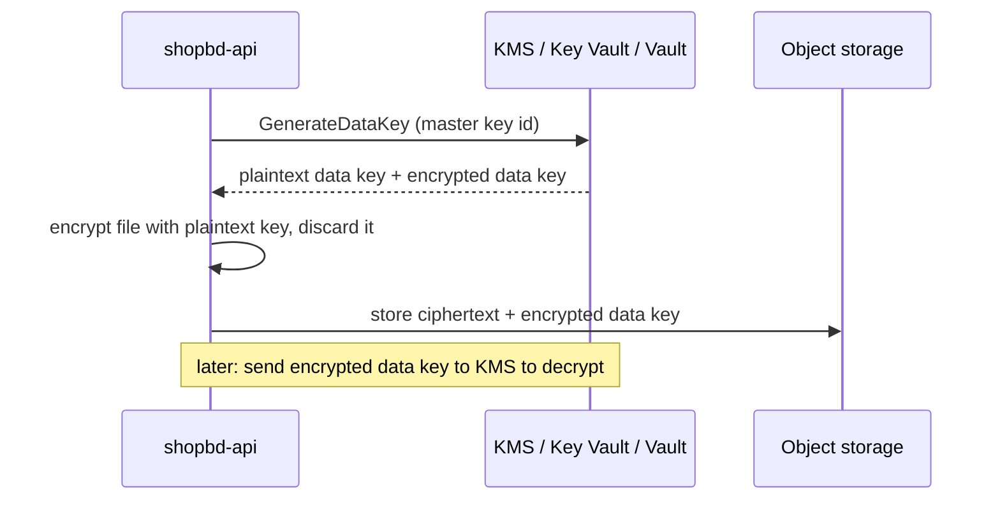
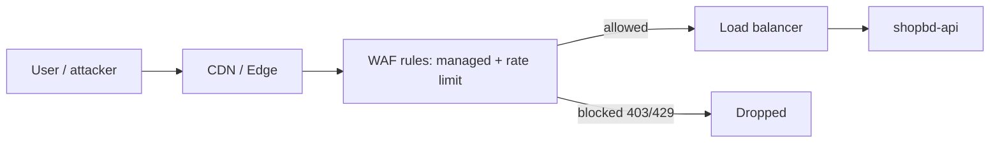
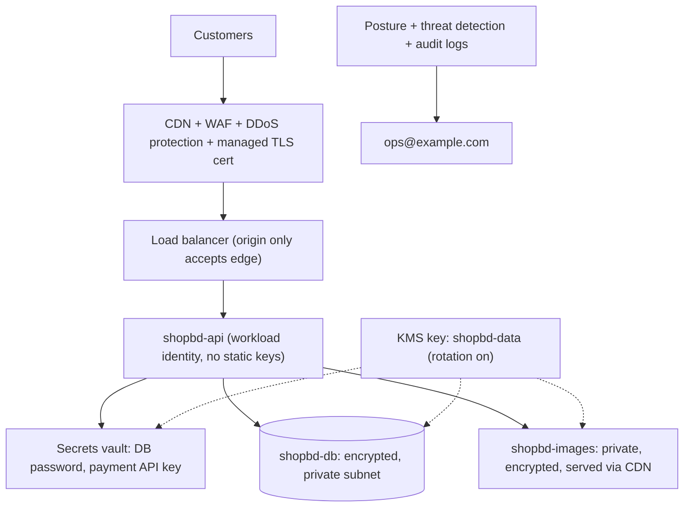

# 13 · Security

> **এই অধ্যায়ে কী শিখবেন**
>
> - Defense in depth: কোন স্তরে কোন সুরক্ষা — আর cloud-এ আপনার দায়িত্ব কতটুকু
> - **Key management** (KMS / Cloud KMS / Key Vault / OCI Vault), envelope encryption, rotation
> - **Secrets** ও **certificates** কীভাবে code ও repository-র বাইরে রাখবেন
> - **WAF** ও **DDoS protection**: AWS WAF + Shield, Cloud Armor, Azure WAF + DDoS Protection, OCI WAF
> - **Posture ও threat detection**: Security Hub + GuardDuty, Security Command Center, Defender for Cloud, Cloud Guard
> - Encryption at rest / in transit এবং compliance-এর বাস্তব হিসাব
> - CLI ও Terraform উদাহরণ এবং `shopbd`-র security baseline

!!! abstract "এক নজরে — কোন cloud-এ কী নাম"

    | Concept | AWS | GCP | Azure | OCI |
    |---|---|---|---|---|
    | Key management | AWS KMS (+ CloudHSM) | Cloud KMS (+ Cloud HSM, EKM) | Azure Key Vault (+ Managed HSM) | OCI Vault (KMS) |
    | Secrets | Secrets Manager, SSM Parameter Store | Secret Manager | Key Vault secrets | Vault secrets |
    | Certificates | AWS Certificate Manager (ACM), Private CA | Certificate Manager, CA Service | Key Vault certificates, App Service/Front Door managed certs | OCI Certificates service |
    | WAF | AWS WAF | Cloud Armor | Azure WAF (Application Gateway / Front Door) | OCI WAF |
    | DDoS | Shield Standard / Advanced | Cloud Armor (+ global LB) | Azure DDoS Protection | OCI built-in L3/L4 DDoS + WAF |
    | Posture (CSPM) | Security Hub, Config, Access Analyzer | Security Command Center | Microsoft Defender for Cloud | Cloud Guard, Security Zones |
    | Threat detection | GuardDuty (+ Detective) | SCC Event Threat Detection | Defender plans, Microsoft Sentinel (SIEM) | Cloud Guard detectors, Threat Intelligence |
    | Vulnerability scan | Inspector | SCC / Artifact Analysis | Defender for Cloud (servers, containers) | Vulnerability Scanning Service |
    | Sensitive data discovery | Macie | Sensitive Data Protection | Microsoft Purview | Data Safe |
    | Compliance reports | AWS Artifact | Compliance Reports Manager | Service Trust Portal | OCI compliance documents |

## ১. Security-র মূল ধারণা

### Defense in depth — স্তরে স্তরে নিরাপত্তা

একটাই তালা ভাঙলেই সব শেষ হলে সেটা নিরাপত্তা নয়। তাই স্তর বানাতে হয়।

!!! example "Analogy — দুর্গ"
    শহরের প্রাচীর (edge: WAF/DDoS), নদীর খাল (network: firewall/private subnet), ফটকের প্রহরী (identity: IAM/MFA), দুর্গের ভেতরের
    তালাবন্ধ সিন্দুক (data: encryption), আর সবকিছুর সিসিটিভি (detection: log, alert)। একটি ভাঙলেও পরের স্তর আটকায়।

### Shared responsibility আবার মনে করুন

Cloud provider **cloud-এর নিরাপত্তা** (ডেটা সেন্টার, hypervisor, managed service-এর ভেতরের patching) সামলায়; আপনি সামলান **cloud-এর ভেতরের
নিরাপত্তা** — IAM, network নিয়ম, ডেটা encryption সেটিং, app-এর code, patching (VM-এ)। সবচেয়ে বেশি breach হয় **ভুল configuration** ও
**leaked credential** থেকে, cloud-এর hack থেকে নয়। ([Cloud-এর ভিত্তি](01-cloud-fundamentals.md), [IAM](03-identity-and-access.md))

### shopbd-র hazard (threat model সংক্ষেপে)

| ঝুঁকি | উদাহরণ | কোন নিয়ন্ত্রণ |
|---|---|---|
| Credential leak | DB পাসওয়ার্ড GitHub-এ | Secrets vault + secret scanning |
| Public bucket | `shopbd-images`-এর সাথে customer invoice ফাঁস | Block public access, শুধু CDN থেকে read |
| Web attack | SQL injection, bot scraping, brute-force login | WAF + rate limit |
| DDoS | ঈদ sale-এর সময় ইচ্ছাকৃত traffic flood | DDoS protection + CDN |
| Insider/ভুল permission | Developer prod DB মুছে দিল | Least privilege, MFA, audit log |
| Data theft | DB snapshot চুরি | Encryption at rest + KMS key policy |

## ২. Key Management — encryption key-র নিরাপদ ঘর

Encryption মানে ডেটাকে চাবি দিয়ে এলোমেলো করা। আসল প্রশ্ন: **চাবি কোথায় থাকে, কে ব্যবহার করতে পারে?** চাবি সাদা text-এ app-এর পাশে থাকলে
encryption অর্থহীন। **Key management service (KMS)** চাবি HSM-সুরক্ষিত জায়গায় রাখে, ব্যবহারের হিসাব (audit) রাখে, আর চাবি *বের করে* না — আপনি
"এটা encrypt করো" বলে অনুরোধ পাঠান।

### Envelope encryption

বড় ডেটা সরাসরি KMS-এ পাঠানো হয় না (সীমা ও ধীর)। বদলে:

1. KMS-কে বলুন একটি **data key** বানাতে — আপনি পান plaintext + KMS-এ encrypt করা কপি।
2. Plaintext data key দিয়ে ডেটা encrypt করুন (দ্রুত, লোকাল), তারপর plaintext key মেমরি থেকে ফেলুন।
3. Encrypted data key ডেটার পাশে রাখুন। ডিক্রিপ্ট করতে KMS-কে বলুন data key খুলে দিতে।



প্রায় সব cloud-এর storage/DB এই envelope পদ্ধতিতে নিজেই কাজ করে — আপনি শুধু বলেন "এই key ব্যবহার করো"।

### কী-র ধরন (মালিকানা)

| ধরন | কে নিয়ন্ত্রণ করে | কখন |
|---|---|---|
| **Provider-owned / platform-managed** | Cloud নিজে, আপনি দেখেন না | Default; কোনো ঝামেলা নেই |
| **Customer-managed key (CMK / CMEK)** | আপনি KMS-এ — rotate, disable, access-নিয়ম | Compliance, "key বন্ধ করলে ডেটা অচল" নিয়ন্ত্রণ |
| **External / BYOK-HYOK** | আপনার নিজস্ব HSM বা তৃতীয় পক্ষ (EKM, External KMS) | কড়া regulatory দাবি |

### Rotation ও deletion

- **Rotation**: নতুন key version বানানো; পুরনো version দিয়ে encrypt করা ডেটা তখনও খোলা যায় (cloud মনে রাখে কোন version)। Automatic rotation
  চালু রাখুন। Data পুনরায় encrypt করার দরকার নেই (envelope-এর কারণে)।
- **Deletion অপূরণীয়**: key মুছলে সেই key-র সব ডেটা চিরতরে অপাঠ্য। তাই সব cloud-এ **অপেক্ষার সময়** আছে (AWS ৭–৩০ দিন, Key Vault
  soft-delete + purge protection, GCP key version destroy-এর scheduled সময়, OCI scheduled deletion)। Production key-তে purge protection/
  prevent-destroy রাখুন।
- **Access**: key ব্যবহারের অনুমতি (`Encrypt/Decrypt`) আর key পরিচালনার অনুমতি (`Create/Delete/Rotate`) আলাদা ভূমিকায় দিন।

=== "AWS"

    Service: **AWS KMS** — *KMS key* (পুরনো নাম CMK) তিন ধরন: **AWS owned** (দৃশ্যমান নয়), **AWS managed** (`aws/s3` — ফ্রি, আপনি policy বদলাতে
    পারেন না), **customer managed** (আপনার নিয়ন্ত্রণ, **key policy** + IAM)। *Alias* (`alias/shopbd-data`) দিয়ে key-কে মনে রাখা সহজ। Automatic rotation
    (default বছরে একবার, ব্যবধান কনফিগারযোগ্য)। **Multi-Region keys** DR-এর জন্য। আলাদা **CloudHSM** (single-tenant HSM) কড়া FIPS দাবিতে।
    Key policy-ই মূল — IAM policy একা যথেষ্ট নয় (key policy IAM-কে অনুমতি দিলে তবেই)।

    Console: **KMS → Customer managed keys → Create key**।

    ```bash
    KEY_ID=$(aws kms create-key --description "shopbd data key" \
      --query KeyMetadata.KeyId --output text --region ap-south-1)

    aws kms create-alias --alias-name alias/shopbd-data --target-key-id "$KEY_ID" --region ap-south-1
    aws kms enable-key-rotation --key-id "$KEY_ID" --region ap-south-1

    # ছোট ডেটা সরাসরি encrypt (≤ 4 KB)
    aws kms encrypt --key-id alias/shopbd-data \
      --plaintext fileb://secret.txt --query CiphertextBlob --output text --region ap-south-1

    # Envelope: data key চাওয়া
    aws kms generate-data-key --key-id alias/shopbd-data --key-spec AES_256 --region ap-south-1
    ```

=== "GCP"

    Service: **Cloud KMS** — কাঠামো: **Key ring** (location-ভিত্তিক গুচ্ছ, মোছা যায় না) → **Key** → **Key version**। Protection level:
    **SOFTWARE**, **HSM** (Cloud HSM), **EXTERNAL** (Cloud EKM)। Rotation schedule key-তে সেট করা যায় (নতুন primary version)। CMEK
    সাপোর্টকারী service-এর list বিশাল। **Cloud KMS Autokey** key ring/key নিজে বানিয়ে দেয় (বড় org-এ কাজের)। Key ring মোছা যায় না — নাম ভেবে
    দিন।

    ```bash
    gcloud kms keyrings create shopbd-ring --location=asia-south1

    gcloud kms keys create shopbd-data \
      --keyring=shopbd-ring --location=asia-south1 --purpose=encryption \
      --rotation-period=90d --next-rotation-time=2027-02-01T00:00:00Z

    echo -n "secret" | gcloud kms encrypt \
      --keyring=shopbd-ring --key=shopbd-data --location=asia-south1 \
      --plaintext-file=- --ciphertext-file=secret.enc
    ```

    CMEK ব্যবহারের আগে সংশ্লিষ্ট service-এর **service agent**-কে key-তে `roles/cloudkms.cryptoKeyEncrypterDecrypter` দিতে হয়।

=== "Azure"

    Service: **Azure Key Vault** — একই vault-এ **keys, secrets, certificates**। Tier: Standard (software-protected key) ও Premium (HSM-backed key);
    আলাদা **Managed HSM** (single-tenant, FIPS 140-3 Level 3) কড়া দাবিতে। Access model: **Azure RBAC** (প্রস্তাবিত) বা পুরনো access policy।
    **Soft delete** (সবসময় চালু) + **purge protection** (প্রোডাকশনে চালু করুন) — একবার purge protection দিলে বন্ধ করা যায় না।
    Key rotation policy দিয়ে auto-rotation। Storage/SQL/Disk-এর **customer-managed key** Key Vault-এর key দিয়ে + managed identity-তে `Key Vault Crypto
    Service Encryption User` role।

    ```bash
    az keyvault create \
      --name shopbd-kv-001 --resource-group shopbd-rg --location centralindia \
      --enable-rbac-authorization true --enable-purge-protection true

    az keyvault key create --vault-name shopbd-kv-001 \
      --name shopbd-data-key --kty RSA --size 2048
    ```

=== "OCI"

    Service: **OCI Vault** — **vault** (DEFAULT = shared HSM partition, **VIRTUAL PRIVATE** = dedicated partition), তার ভেতরে **master encryption keys**
    (AES, RSA, ECDSA; protection mode **HSM** বা software) ও **secrets**। প্রতিটি vault-এর আলাদা **management endpoint** ও **crypto endpoint** —
    CLI/SDK-তে সেটা দিতে হয়। Key rotate করলে নতুন version। Object Storage, Block Volume, DB ইত্যাদিতে "Encrypt using customer-managed keys" বেছে
    vault-এর key দেওয়া যায় (সাথে IAM policy — service-কে key ব্যবহারের অনুমতি)। Key মুছতে scheduled deletion (৭–৩০ দিন)।

    ```bash
    oci kms management vault create \
      --compartment-id ocid1.compartment.oc1..example \
      --display-name shopbd-vault --vault-type DEFAULT

    oci kms management key create \
      --compartment-id ocid1.compartment.oc1..example \
      --display-name shopbd-data-key \
      --key-shape '{"algorithm":"AES","length":32}' \
      --endpoint https://example-management.kms.ap-mumbai-1.oraclecloud.com
    ```

### Terraform — key

=== "AWS"

    ```hcl
    resource "aws_kms_key" "data" {
      description             = "shopbd data key"
      enable_key_rotation     = true
      deletion_window_in_days = 30
    }

    resource "aws_kms_alias" "data" {
      name          = "alias/shopbd-data"
      target_key_id = aws_kms_key.data.key_id
    }
    ```

=== "GCP"

    ```hcl
    resource "google_kms_key_ring" "shopbd" {
      name     = "shopbd-ring"
      location = "asia-south1"
    }

    resource "google_kms_crypto_key" "data" {
      name            = "shopbd-data"
      key_ring        = google_kms_key_ring.shopbd.id
      rotation_period = "7776000s" # 90 days

      lifecycle {
        prevent_destroy = true
      }
    }
    ```

=== "Azure"

    ```hcl
    data "azurerm_client_config" "current" {}

    resource "azurerm_key_vault" "main" {
      name                       = "shopbd-kv-001"
      location                   = azurerm_resource_group.main.location
      resource_group_name        = azurerm_resource_group.main.name
      tenant_id                  = data.azurerm_client_config.current.tenant_id
      sku_name                   = "standard"
      enable_rbac_authorization  = true
      purge_protection_enabled   = true
      soft_delete_retention_days = 30
    }

    resource "azurerm_key_vault_key" "data" {
      name         = "shopbd-data-key"
      key_vault_id = azurerm_key_vault.main.id
      key_type     = "RSA"
      key_size     = 2048
      key_opts     = ["encrypt", "decrypt", "wrapKey", "unwrapKey"]
    }
    ```

=== "OCI"

    ```hcl
    resource "oci_kms_vault" "main" {
      compartment_id = var.compartment_id
      display_name   = "shopbd-vault"
      vault_type     = "DEFAULT"
    }

    resource "oci_kms_key" "data" {
      compartment_id      = var.compartment_id
      display_name        = "shopbd-data-key"
      management_endpoint = oci_kms_vault.main.management_endpoint
      protection_mode     = "HSM"

      key_shape {
        algorithm = "AES"
        length    = 32
      }
    }
    ```

## ৩. Secrets Management

**Secret** = পাসওয়ার্ড, API key, DB connection string, token। নিয়ম নম্বর ১: **secret কখনো source code, Docker image, `.env` ফাইল git-এ, বা
chat-এ থাকবে না।** নিয়ম ২: app runtime-এ **নিজের identity দিয়ে** secret vault থেকে পড়বে — vault-এর জন্য আবার আলাদা পাসওয়ার্ড রাখবেন না
(IAM role / managed identity / service account / instance principal — [IAM অধ্যায়](03-identity-and-access.md))।

| ক্ষমতা | AWS | GCP | Azure | OCI |
|---|---|---|---|---|
| Service | Secrets Manager (সহজ ও অন্তর্নির্মিত rotation); SSM Parameter Store (সস্তা/সাধারণ config + SecureString) | Secret Manager | Key Vault secrets | Vault secrets |
| Versioning | হ্যাঁ (staging label `AWSCURRENT`) | হ্যাঁ (`latest` বা নম্বর) | হ্যাঁ | হ্যাঁ (version number, rotation state) |
| Auto-rotation | Lambda দিয়ে (RDS ইত্যাদির জন্য ready template) | Rotation schedule → Pub/Sub notification → আপনার function নতুন version লেখে | Event Grid event → Function | নিজস্ব রোটেশন বা integrated service |
| Encryption | KMS key | Google-managed বা CMEK | Key Vault-ই | vault-এর master key |
| Replication | multi-region replica secret | automatic / user-managed regions | vault regional | cross-region replication |
| Access control | IAM + resource policy | IAM (`secretAccessor`) | Azure RBAC (`Key Vault Secrets User`) | IAM policy |

=== "AWS"

    ```bash
    aws secretsmanager create-secret --name shopbd/prod/db-password \
      --secret-string '{"username":"shopbd_app","password":"CHANGE_ME"}' \
      --region ap-south-1

    aws secretsmanager get-secret-value --secret-id shopbd/prod/db-password \
      --query SecretString --output text --region ap-south-1

    # SSM Parameter Store (SecureString)
    aws ssm put-parameter --name /shopbd/prod/api-key --type SecureString \
      --value 'CHANGE_ME' --region ap-south-1
    ```

    App কোড (IAM role থেকে credential নিজে আসে):

    ```python
    import json
    import boto3

    client = boto3.client("secretsmanager", region_name="ap-south-1")
    secret = json.loads(client.get_secret_value(SecretId="shopbd/prod/db-password")["SecretString"])
    ```

=== "GCP"

    ```bash
    printf 'CHANGE_ME' | gcloud secrets create shopbd-db-password \
      --replication-policy=automatic --data-file=-

    # নতুন version যোগ
    printf 'NEW_VALUE' | gcloud secrets versions add shopbd-db-password --data-file=-

    gcloud secrets versions access latest --secret=shopbd-db-password
    ```

    Cloud Run/GKE-তে secret সরাসরি env var বা mounted ফাইল হিসেবে দেওয়া যায় — সার্ভিস অ্যাকাউন্টে `roles/secretmanager.secretAccessor` লাগে।

=== "Azure"

    ```bash
    az keyvault secret set --vault-name shopbd-kv-001 \
      --name db-password --value 'CHANGE_ME'

    az keyvault secret show --vault-name shopbd-kv-001 --name db-password --query value -o tsv
    ```

    App Service / Container Apps / Functions-এ **Key Vault reference** দিয়ে app setting-এ secret লিংক করা যায় (managed identity দিয়ে) —
    code-এ vault client না লিখেই।

=== "OCI"

    ```bash
    # secret content অবশ্যই base64 (CHANGE_ME = Q0hBTkdFX01F)
    oci vault secret create-base64 \
      --compartment-id ocid1.compartment.oc1..example \
      --secret-name shopbd-db-password \
      --vault-id ocid1.vault.oc1.ap-mumbai-1.example \
      --key-id ocid1.key.oc1.ap-mumbai-1.example \
      --secret-content-content Q0hBTkdFX01F

    # runtime-এ পড়া (secrets = data plane)
    oci secrets secret-bundle get --secret-id ocid1.vaultsecret.oc1.ap-mumbai-1.example
    ```

### Terraform — secret

=== "AWS"

    ```hcl
    resource "aws_secretsmanager_secret" "db" {
      name       = "shopbd/prod/db-password"
      kms_key_id = aws_kms_key.data.arn
    }

    resource "aws_secretsmanager_secret_version" "db" {
      secret_id     = aws_secretsmanager_secret.db.id
      secret_string = var.db_password # sensitive variable
    }
    ```

=== "GCP"

    ```hcl
    resource "google_secret_manager_secret" "db" {
      secret_id = "shopbd-db-password"
      replication {
        auto {}
      }
    }

    resource "google_secret_manager_secret_version" "db" {
      secret      = google_secret_manager_secret.db.id
      secret_data = var.db_password
    }
    ```

=== "Azure"

    ```hcl
    resource "azurerm_key_vault_secret" "db" {
      name         = "db-password"
      value        = var.db_password
      key_vault_id = azurerm_key_vault.main.id
    }
    ```

=== "OCI"

    ```hcl
    resource "oci_vault_secret" "db" {
      compartment_id = var.compartment_id
      vault_id       = oci_kms_vault.main.id
      key_id         = oci_kms_key.data.id
      secret_name    = "shopbd-db-password"

      secret_content {
        content_type = "BASE64"
        content      = base64encode(var.db_password)
      }
    }
    ```

!!! danger "Terraform state-এ secret সাদা text-এ থাকে"
    উপরের `secret_data`/`secret_string` Terraform state ফাইলে সাদা text হিসেবে যায়। তাই state ফাইল **encrypted remote backend**-এ রাখুন, access সীমিত
    করুন ([IaC](14-infrastructure-as-code.md))। আরও ভালো: Terraform-এ শুধু secret-এর *কাঠামো* বানান, মান আলাদাভাবে (CLI/pipeline/rotation) বসান।

### Secrets-এর best practice

- **Rotation**: নিয়মিত বা লিক সন্দেহ হলে সঙ্গে সঙ্গে। দুই-version (পুরনো+নতুন কিছুক্ষণ) pattern ব্যবহার করুন যাতে downtime না হয়।
- **Short-lived credential** সর্বোচ্চ পছন্দ — long-lived key নয় (OIDC/workload identity — [CI/CD](15-cicd-devops.md))।
- **Secret scanning**: GitHub secret scanning/push protection, pre-commit hook (gitleaks)।
- **কখনো log-এ ছাপাবেন না**; error message-এ connection string রাখবেন না।
- **এক secret = এক উদ্দেশ্য**; environment (dev/prod) আলাদা।

## ৪. Certificates ও TLS

**Certificate** (X.509) প্রমাণ করে `shopbd.example.com` সত্যিই আপনার, আর HTTPS চালু করে। সমস্যা: certificate-এর মেয়াদ আছে (public cert সাধারণত
ছোট জীবনের) — মেয়াদ শেষে site "Not secure" হয়ে যায়। তাই **managed certificate** (cloud নিজে renew করে) ব্যবহার করুন।

| ধরন | মানে | উদাহরণ |
|---|---|---|
| **Public cert** | ব্রাউজার বিশ্বাস করে; domain-validation (DNS/HTTP) | ACM, GCP Certificate Manager, Azure managed certs |
| **Private cert / private CA** | শুধু আপনার সংস্থার ভেতরে (internal service, mTLS) | AWS Private CA, GCP CA Service, OCI Certificates (internal CA) |
| **Imported cert** | বাইরের CA (DigiCert, Let's Encrypt) থেকে কেনা/নেওয়া, নিজে renew | সব cloud |

=== "AWS"

    Service: **AWS Certificate Manager (ACM)** — public certificate ফ্রি (ACM-integrated service-এ — ELB, CloudFront, API Gateway), DNS validation + auto
    renewal। ACM-এর public cert **export করা যায় না** (EC2-তে সরাসরি বসানো যায় না — ALB/CloudFront-এ বসান)। **CloudFront-এর জন্য certificate
    অবশ্যই `us-east-1` region-এ**। Internal PKI: **AWS Private CA** (আলাদা খরচ)।

    ```bash
    aws acm request-certificate --domain-name shopbd.example.com \
      --subject-alternative-names "*.shopbd.example.com" \
      --validation-method DNS --region ap-south-1

    aws acm describe-certificate --certificate-arn arn:aws:acm:ap-south-1:123456789012:certificate/00000000-0000-0000-0000-000000000000 \
      --region ap-south-1
    ```

=== "GCP"

    Service: **Certificate Manager** — Google-managed certificate (DNS authorization বা load balancer authorization), wildcard সাপোর্ট, **certificate map** দিয়ে LB-এ
    একাধিক cert। পুরনো "classic" load balancer-এর managed SSL certificate-ও দেখতে পারেন। Internal PKI: **Certificate Authority Service**।

    ```bash
    gcloud certificate-manager dns-authorizations create shopbd-dns-auth --domain=shopbd.example.com

    gcloud certificate-manager certificates create shopbd-cert \
      --domains=shopbd.example.com --dns-authorizations=shopbd-dns-auth
    ```

=== "Azure"

    Service: **Key Vault certificates** (import বা integrated CA — DigiCert/GlobalSign — দিয়ে issue/renew), আর PaaS-এর **managed certificate**: App Service
    Managed Certificate, **Azure Front Door**-এর managed cert (custom domain)। Application Gateway-তে Key Vault থেকে cert নেওয়া যায়। Azure-তে নিজস্ব
    হোস্ট করা public/private CA product নেই — private PKI সাধারণত নিজে (AD CS) বা তৃতীয় পক্ষ।

    ```bash
    az keyvault certificate create --vault-name shopbd-kv-001 --name shopbd-web \
      --policy "$(az keyvault certificate get-default-policy)"
    ```

=== "OCI"

    Service: **OCI Certificates** — certificate authority (internal/private CA) তৈরি, certificate issue ও auto-renew, import; **Load Balancer ও API Gateway**
    এই service-এর cert ব্যবহার করতে পারে। Public CA-র certificate (Let's Encrypt/বাণিজ্যিক) সাধারণত বাইরে থেকে নিয়ে import করে LB-তে বসানো হয় — সর্বশেষ
    সক্ষমতা docs-এ দেখে নিন।

    ```bash
    oci certs-mgmt certificate list --compartment-id ocid1.compartment.oc1..example
    ```

!!! tip "HTTPS ও HSTS"
    সব endpoint-এ HTTPS বাধ্যতামূলক, HTTP → HTTPS redirect, TLS ≥ 1.2 (সম্ভব হলে 1.3), `Strict-Transport-Security` header। DNS/CDN সংক্রান্ত বিস্তারিত
    [Load Balancing, DNS ও CDN](10-load-balancing-scaling-dns-cdn.md)-এ।

## ৫. Encryption at Rest ও in Transit

### At rest — ডেটা ডিস্কে/storage-এ

আধুনিক cloud-এ প্রায় সব managed storage **default-এ encrypted** — প্রশ্নটা হলো *কার key দিয়ে*।

| Service | AWS | GCP | Azure | OCI |
|---|---|---|---|---|
| Object storage | S3: SSE-S3 default (২০২৩ থেকে সব নতুন object); SSE-KMS option | GCS: সবসময় encrypted (Google-managed); CMEK option | Blob: platform-managed key default; customer-managed key option | Object Storage: সবসময় encrypted (Oracle-managed); customer-managed key option |
| Block/Disk | EBS encryption (account-এ default চালু করা যায়) | PD সবসময় encrypted; CMEK | Managed Disk SSE; disk encryption set + CMK | Block Volume সবসময় encrypted; customer key option |
| Database | RDS/Aurora: create-এর সময় চালু (পরে বদলানো কঠিন) | Cloud SQL: সবসময়; CMEK option | Azure SQL TDE default; CMK option | Autonomous/DB systems: default + customer key |

!!! warning "RDS-এর encryption পরে চালু করা যায় না"
    AWS RDS instance বানানোর সময় encryption না দিলে সরাসরি পরে চালু করা যায় না — snapshot → encrypted copy → restore লাগে। তাই শুরুতেই চালু।
    ([Database](07-databases.md))

CLI-তে bucket-এ customer-managed key বসানো:

=== "AWS"

    ```bash
    aws s3api put-bucket-encryption --bucket shopbd-images \
      --server-side-encryption-configuration '{"Rules":[{"ApplyServerSideEncryptionByDefault":{"SSEAlgorithm":"aws:kms","KMSMasterKeyID":"alias/shopbd-data"},"BucketKeyEnabled":true}]}'
    ```

=== "GCP"

    ```bash
    gcloud storage buckets update gs://shopbd-images \
      --default-encryption-key=projects/my-project-id/locations/asia-south1/keyRings/shopbd-ring/cryptoKeys/shopbd-data
    ```

=== "Azure"

    Storage account-এ customer-managed key: account-এ managed identity → Key Vault-এ `Key Vault Crypto Service Encryption User` role → Portal/CLI-তে
    "Encryption → Customer-managed keys" (`az storage account update` এর `--encryption-key-source Microsoft.Keyvault` সহ key vault ও key flags)।

    ```bash
    az storage account update --name shopbdstorage --resource-group shopbd-rg \
      --min-tls-version TLS1_2 --https-only true
    ```

=== "OCI"

    ```bash
    oci os bucket update --bucket-name shopbd-images \
      --kms-key-id ocid1.key.oc1.ap-mumbai-1.example
    ```

### In transit — তারে চলার সময়

- **TLS 1.2+ সর্বত্র** — client↔LB, LB↔backend (re-encryption/end-to-end), service↔database (DB-তে `sslmode=require`/`verify-full`)।
- **Storage-এ HTTPS বাধ্যতামূলক**: S3 bucket policy `aws:SecureTransport`; Azure Storage "Secure transfer required"; GCS ও OCI-এ HTTPS default
  endpoint।
- **Private connectivity**: VPC endpoint / Private Service Connect / Private Link / Service Gateway দিয়ে ট্রাফিক public internet-এ না নিয়ে ([Networking](05-networking.md))।
- **mTLS** service-to-service (service mesh বা private CA)।
- **VPN/ExpressRoute-ধরনের** link-এ MACsec/IPsec যেখানে প্রয়োজন।

```json
{
  "Version": "2012-10-17",
  "Statement": [{
    "Sid": "DenyNonTLS",
    "Effect": "Deny",
    "Principal": "*",
    "Action": "s3:*",
    "Resource": ["arn:aws:s3:::shopbd-images", "arn:aws:s3:::shopbd-images/*"],
    "Condition": { "Bool": { "aws:SecureTransport": "false" } }
  }]
}
```

## ৬. WAF — Web Application Firewall

**WAF** HTTP/S ট্রাফিক (Layer 7) পরীক্ষা করে — SQL injection, XSS, bad bot, অতিরিক্ত অনুরোধ আটকায়। এটা network firewall (Layer 3/4) থেকে আলাদা:
সে পোর্ট/IP দেখে, WAF request-এর **ভেতরের** বিষয় দেখে। **Rule-ধরন**: managed rule set (OWASP Top 10, known bad IP), custom rule, **rate limiting**,
geo-block, bot control। কাজ: allow / block / count (log-only) / CAPTCHA।

!!! tip "নতুন rule আগে *count/detection* mode-এ"
    সরাসরি block করলে বৈধ customer আটকে যেতে পারে। কয়েকদিন শুধু log করে false positive দেখে তারপর block/prevention।



=== "AWS"

    Service: **AWS WAF** (WAFv2) — **Web ACL** → rules (managed rule group: `AWSManagedRulesCommonRuleSet`, SQLi, known bad inputs, IP reputation; rate-based rule;
    custom)। Attach: **CloudFront**, **ALB**, API Gateway, AppSync, Cognito। Scope: `REGIONAL` (ALB ইত্যাদি) বা `CLOUDFRONT` (সবসময় `us-east-1`)। Bot Control, CAPTCHA
    add-on। **Firewall Manager** সব account-এ একসাথে।

    ```bash
    cat > rules.json <<'EOF'
    [
      {
        "Name": "AWSCommon",
        "Priority": 1,
        "OverrideAction": { "None": {} },
        "Statement": { "ManagedRuleGroupStatement": { "VendorName": "AWS", "Name": "AWSManagedRulesCommonRuleSet" } },
        "VisibilityConfig": { "SampledRequestsEnabled": true, "CloudWatchMetricsEnabled": true, "MetricName": "AWSCommon" }
      },
      {
        "Name": "RateLimitPerIP",
        "Priority": 2,
        "Action": { "Block": {} },
        "Statement": { "RateBasedStatement": { "Limit": 1000, "AggregateKeyType": "IP" } },
        "VisibilityConfig": { "SampledRequestsEnabled": true, "CloudWatchMetricsEnabled": true, "MetricName": "RateLimitPerIP" }
      }
    ]
    EOF

    aws wafv2 create-web-acl --name shopbd-web-acl --scope REGIONAL --region ap-south-1 \
      --default-action Allow={} \
      --visibility-config SampledRequestsEnabled=true,CloudWatchMetricsEnabled=true,MetricName=shopbd-web-acl \
      --rules file://rules.json

    aws wafv2 associate-web-acl --region ap-south-1 \
      --web-acl-arn arn:aws:wafv2:ap-south-1:123456789012:regional/webacl/shopbd-web-acl/00000000-0000-0000-0000-000000000000 \
      --resource-arn arn:aws:elasticloadbalancing:ap-south-1:123456789012:loadbalancer/app/shopbd-alb/0123456789abcdef
    ```

=== "GCP"

    Service: **Cloud Armor** — **security policy** external Application Load Balancer-এর backend service-এ (বা Cloud CDN-এ) লাগে। **Preconfigured WAF rules** (OWASP
    ModSecurity CRS-ভিত্তিক: `sqli-v33-stable`, `xss-v33-stable`…), custom rules (CEL expression), **rate limiting/throttle**, geo/IP allow-deny, **Adaptive Protection**
    (ML-ভিত্তিক L7 DDoS)। Tier: Standard ও Enterprise।

    ```bash
    gcloud compute security-policies create shopbd-armor --description "shopbd WAF"

    gcloud compute security-policies rules create 1000 --security-policy=shopbd-armor \
      --expression="evaluatePreconfiguredWaf('sqli-v33-stable')" --action=deny-403

    gcloud compute security-policies rules create 2000 --security-policy=shopbd-armor \
      --src-ip-ranges="*" --action=throttle \
      --rate-limit-threshold-count=100 --rate-limit-threshold-interval-sec=60 \
      --conform-action=allow --exceed-action=deny-429 --enforce-on-key=ip

    gcloud compute backend-services update shopbd-backend --global --security-policy=shopbd-armor
    ```

=== "Azure"

    Service: **Azure Web Application Firewall** — আলাদা product নয়, **Application Gateway** (regional) বা **Azure Front Door** (global)-এর ফিচার। **WAF policy** =
    managed rule set (OWASP CRS / Microsoft Default Rule Set + bot protection), custom rules, rate limit (Front Door), mode: **Detection** বা **Prevention**।
    Policy আলাদা resource — একটি policy একাধিক gateway/listener/route-এ।

    ```bash
    az network application-gateway waf-policy create \
      --name shopbd-waf --resource-group shopbd-rg --type OWASP --version 3.2

    az network application-gateway waf-policy policy-setting update \
      --policy-name shopbd-waf --resource-group shopbd-rg --state Enabled --mode Prevention
    ```

=== "OCI"

    Service: **OCI WAF** — **WAF policy** (access control, rate limiting, protection rules — OWASP-ভিত্তিক, bot management) **Load Balancer**-এ বা edge-এ
    (**WAF firewall** resource দিয়ে attach)। Console-এ policy বানিয়ে LB-তে enforcement point দিলে চালু। Policy JSON/Terraform-এ জটিল — শুরুতে Console।
    Detect (log) ও Block action আলাদা।

    ```bash
    oci waf web-app-firewall-policy list --compartment-id ocid1.compartment.oc1..example
    ```

### Terraform — WAF

=== "AWS"

    ```hcl
    resource "aws_wafv2_web_acl" "api" {
      name  = "shopbd-web-acl"
      scope = "REGIONAL"

      default_action {
        allow {}
      }

      rule {
        name     = "AWSCommon"
        priority = 1
        override_action {
          none {}
        }
        statement {
          managed_rule_group_statement {
            vendor_name = "AWS"
            name        = "AWSManagedRulesCommonRuleSet"
          }
        }
        visibility_config {
          cloudwatch_metrics_enabled = true
          metric_name                = "AWSCommon"
          sampled_requests_enabled   = true
        }
      }

      visibility_config {
        cloudwatch_metrics_enabled = true
        metric_name                = "shopbd-web-acl"
        sampled_requests_enabled   = true
      }
    }
    ```

=== "GCP"

    ```hcl
    resource "google_compute_security_policy" "armor" {
      name = "shopbd-armor"

      rule {
        action   = "deny(403)"
        priority = 1000
        match {
          expr {
            expression = "evaluatePreconfiguredWaf('sqli-v33-stable')"
          }
        }
      }
    }
    ```

=== "Azure"

    ```hcl
    resource "azurerm_web_application_firewall_policy" "main" {
      name                = "shopbd-waf"
      resource_group_name = azurerm_resource_group.main.name
      location            = azurerm_resource_group.main.location

      policy_settings {
        enabled = true
        mode    = "Prevention"
      }

      managed_rules {
        managed_rule_set {
          type    = "OWASP"
          version = "3.2"
        }
      }
    }
    ```

=== "OCI"

    ```hcl
    # OCI WAF: oci_waf_web_app_firewall_policy (rules) + oci_waf_web_app_firewall
    # (attaches the policy to a load balancer). Rule blocks are long; start from the
    # Console, then export to Terraform.
    resource "oci_waf_web_app_firewall_policy" "main" {
      compartment_id = var.compartment_id
      display_name   = "shopbd-waf-policy"
    }
    ```

## ৭. DDoS Protection

**DDoS** = বিপুল ট্রাফিকে সার্ভিস অচল করে দেওয়া। Layer 3/4 (volumetric — bandwidth/packet flood) আর Layer 7 (HTTP flood — আসল request-এর মতো দেখতে)।
Cloud-এর বিশাল network নিজেই অনেকটা শোষণ করে; বাড়তি সুরক্ষা আছে।

| স্তর | AWS | GCP | Azure | OCI |
|---|---|---|---|---|
| Always-on (বিনা খরচে) | **Shield Standard** — সব AWS customer, L3/L4 | Google front-end infra — global LB L3/L4 absorb | **Infrastructure DDoS protection** (default) | L3/L4 DDoS protection সব public endpoint-এ |
| Enhanced | **Shield Advanced** — L7 tuning, DDoS Response Team, DDoS-জনিত খরচ-ছাড়ের সুবিধা; সাধারণত মেয়াদী চুক্তি | **Cloud Armor** (Standard / Enterprise, Adaptive Protection) | **DDoS Network Protection** / **IP Protection** (tuned policy, rapid response) | WAF rate limiting + Edge (CDN-ধরনের) policy |
| L7 | WAF rate-based rules + CloudFront | Cloud Armor rate limit | WAF + Front Door | OCI WAF |

!!! tip "ছোট শপের জন্য বাস্তব পথ"
    প্রথমে সবকিছু **CDN/global LB-র পিছনে** রাখুন (origin IP লুকিয়ে), origin-এ শুধু CDN থেকে আসা ট্রাফিক অনুমতি দিন, WAF-এ rate limit। Enhanced DDoS পরিষেবা
    (Shield Advanced / Azure DDoS Network Protection) ব্যয়বহুল ও বড় প্রতিষ্ঠানের জন্য — ঝুঁকি ও বাজেট বুঝে। খরচের হিসাব official pricing page-এ।

## ৮. Posture ও Threat Detection

দুটি ভিন্ন কাজ:

- **Posture management (CSPM)** — "আমার configuration কি নিরাপদ?" (public bucket, MFA ছাড়া root, খোলা SSH)। *আক্রমণের আগে* ভুল ধরে।
- **Threat detection** — "এখন কেউ কি আক্রমণ করছে?" (অস্বাভাবিক API call, crypto-mining, credential-চুরির লক্ষণ)। *আক্রমণ চলাকালীন* ধরে — মূলত audit log, flow log, DNS log
  বিশ্লেষণ করে ([Observability](12-observability.md))।

=== "AWS"

    Service-গুলো আলাদা আলাদা, একসাথে কাজ করে:

    - **AWS Security Hub** — finding একত্র করে (CSPM অংশ, standard: AWS Foundational Security Best Practices, CIS Benchmark, PCI DSS); docs-এ পোস্টচার-অংশ
      **Security Hub CSPM** নামেও পাবেন।
    - **Amazon GuardDuty** — threat detection (CloudTrail, VPC Flow, DNS log, S3/EKS/Lambda/malware protection)।
    - **Amazon Inspector** — EC2/ECR image/Lambda-র vulnerability scan।
    - **Amazon Macie** — S3-তে sensitive data (PII) খোঁজে।
    - **IAM Access Analyzer** — বাইরে থেকে access পাওয়া resource (public bucket/cross-account role) ও unused access।
    - **AWS Config** — configuration পরিবর্তনের ইতিহাস ও compliance rule।
    - **Amazon Detective** — finding-এর মূল কারণ অনুসন্ধান।

    Organization-এ **delegated administrator** account দিয়ে সব account/region-এ একসাথে চালু করা হয়।

    ```bash
    aws guardduty create-detector --enable --region ap-south-1
    aws securityhub enable-security-hub --region ap-south-1
    aws inspector2 enable --resource-types EC2 ECR LAMBDA --region ap-south-1
    ```

=== "GCP"

    Service: **Security Command Center (SCC)** — tier: **Standard** (মৌলিক posture), **Premium**, **Enterprise** (SIEM/SOAR-সহ)। **Security Health Analytics**
    (misconfiguration), **Event Threat Detection** (log-ভিত্তিক), **Container Threat Detection**, **Virtual Machine Threat Detection**, **Web Security Scanner**; **attack
    path simulation**। সংশ্লিষ্ট: **Sensitive Data Protection** (পূর্ব-নাম Cloud DLP), **Artifact Analysis** (image vulnerability), **Policy Intelligence/Recommender**
    (অতিরিক্ত permission)। SCC সাধারণত **Organization** স্তরে চালু হয়।

    ```bash
    gcloud services enable securitycenter.googleapis.com --project=my-project-id
    ```

    (Org-level activation ও tier Console থেকে: **Security → Security Command Center**।)

=== "Azure"

    Service: **Microsoft Defender for Cloud** — **Foundational CSPM** (বিনামূল্যে: secure score, recommendation), **Defender CSPM** (উন্নত), এবং resource-ভিত্তিক **Defender
    plans**: Servers, Containers, Storage, Databases, Key Vault, App Service, APIs… (এগুলো paid, প্রতিটি আলাদা enable)। **Azure Policy** দিয়ে নিয়ম কার্যকর করা (পূর্ব-
    অনুমোদিত নয় এমন region/SKU আটকানো)। **Microsoft Sentinel** — cloud-native SIEM/SOAR (log বিশ্লেষণ, hunting, playbook)। পুরনো নাম
    "Azure Security Center/Azure Defender" দেখলে এটাই।

    ```bash
    az security pricing create --name VirtualMachines --tier Standard
    az security pricing list -o table
    ```

=== "OCI"

    Service: **Cloud Guard** — *target* (compartment) → *detector recipes* (configuration ও activity দুই ধরনের ঝুঁকি) + *responder recipes* (স্বয়ংক্রিয় ব্যবস্থা, যেমন
    public bucket private করা) → *problems*। **Security Zones** — compartment-এ নীতি বসিয়ে ভুল কাজ আটকে দেয় (যেমন "এই compartment-এ public bucket বানানো যাবে না,
    unencrypted volume চলবে না") — *prevent*, শুধু alert নয়। আরও: **Vulnerability Scanning Service** (host/container), **Data Safe** (database security ও masking),
    **Threat Intelligence**, **Bastion** service। Cloud Guard অতিরিক্ত খরচ ছাড়া পাওয়া যায় — চালু করে রাখাই ভালো অভ্যাস।

    ```bash
    oci cloud-guard configuration update \
      --reporting-region ap-mumbai-1 --status ENABLED
    ```

### Terraform — detection চালু

=== "AWS"

    ```hcl
    resource "aws_guardduty_detector" "main" {
      enable = true
    }

    resource "aws_securityhub_account" "main" {}
    ```

=== "GCP"

    ```hcl
    # Activate the API; SCC tier and org-level settings are managed at organization level.
    resource "google_project_service" "scc" {
      project = "my-project-id"
      service = "securitycenter.googleapis.com"
    }
    ```

=== "Azure"

    ```hcl
    resource "azurerm_security_center_subscription_pricing" "vms" {
      tier          = "Standard"
      resource_type = "VirtualMachines"
    }
    ```

=== "OCI"

    ```hcl
    resource "oci_cloud_guard_cloud_guard_configuration" "main" {
      compartment_id   = var.tenancy_ocid
      reporting_region = "ap-mumbai-1"
      status           = "ENABLED"
    }
    ```

**Finding পেলে:** severity অনুযায়ী triage (public + sensitive data আগে); সরল ক্ষেত্রে auto-remediation (Cloud Guard responder, AWS Config remediation, Azure Policy `DeployIfNotExists`); alert ops-এ ([Messaging](11-messaging-and-events.md)-এর topic/event bus দিয়ে)।

## ৯. Compliance

**Compliance** = নিয়ম/আইন/standard মানার প্রমাণ। সাধারণ framework:

| Framework | কী | কার জন্য |
|---|---|---|
| **ISO/IEC 27001** | তথ্য-নিরাপত্তা ব্যবস্থাপনার standard | প্রায় সবাই |
| **SOC 2** | সেবা-সংস্থার নিয়ন্ত্রণের অডিট (security, availability, confidentiality…) | SaaS ক্লায়েন্ট দাবি করে |
| **PCI DSS** | কার্ড ডেটা | যারা card ধরে — **ছোট shop-এর সেরা উপায়: কার্ড ডেটা নিজে না ধরা, payment gateway-কে দেওয়া** |
| **GDPR / স্থানীয় data-protection আইন** | ব্যক্তিগত ডেটার সুরক্ষা ও অধিকার | EU নাগরিকের ডেটা, বা দেশের আইন |
| **HIPAA** | স্বাস্থ্য তথ্য (US) | হেলথকেয়ার |
| **CIS Benchmarks** | কনফিগারেশন হার্ডেনিং চেকলিস্ট | সবাই (posture tools-এ বিল্ট-ইন) |

!!! warning "Cloud compliant ≠ আপনার app compliant"
    Provider-র data center ISO/SOC সার্টিফাইড হলেও আপনার app আপনা-আপনি compliant হয় না (shared responsibility)। প্রতিটি cloud প্রমাণপত্র দেয় — সেগুলো আপনার audit-এর
    "ভিত্তি" হিসেবে ব্যবহার করুন, আপনার অংশ আপনাকেই প্রমাণ করতে হবে। বাংলাদেশে ডেটা সংরক্ষণ/সীমান্ত-পারাপারের নিয়ম ও খাতভিত্তিক নির্দেশনা (যেমন আর্থিক খাত) বদলায় — আইনজীবী/
    compliance পরামর্শকের সাথে মিলিয়ে নিন।

**কাজের ধারা:** (১) কোন standard মানতে হবে ঠিক করুন, (২) data-র শ্রেণিবিন্যাস (public/internal/confidential/PII), (৩) নিয়ন্ত্রণ বসান (encryption, access, log, retention),
(৪) স্বয়ংক্রিয় চেক ও প্রমাণ জমান, (৫) নিয়মিত পর্যালোচনা।

## মিল ও অমিল

| বিষয় | AWS | GCP | Azure | OCI |
|---|---|---|---|---|
| Key-র কাঠামো | Key + alias | Key ring → key → version | Vault → key | Vault → key (endpoint সহ) |
| Key access | **Key policy** + IAM | IAM | Azure RBAC / access policy | IAM policy |
| Secrets-এর ঘর | আলাদা service (Secrets Manager/SSM) | আলাদা (Secret Manager) | **Key Vault-এই** | Vault-এ |
| Certificate | ACM (ফ্রি, export নয়) | Certificate Manager | Key Vault + managed certs | Certificates service |
| WAF attach | CloudFront/ALB/API GW | **Backend service**-এ (global LB) | Application Gateway / Front Door | Load Balancer / edge |
| DDoS L3/4 free | Shield Standard | Google front-end | Infra protection | built-in |
| Posture | Security Hub + অনেক আলাদা service | **SCC এক ছাতার নিচে** | Defender for Cloud (plan-ভিত্তিক) | Cloud Guard (+ Security Zones prevent) |
| Preventive নিয়ম | SCP, Config rules | Organization Policy | Azure Policy | **Security Zones** |
| Audit log | CloudTrail | Cloud Audit Logs | Activity Log | Audit |

**যে gotcha-গুলোতে আটকায়:**

- **AWS key policy** ছাড়া IAM যথেষ্ট নয়; **cross-account** ব্যবহারে key policy-তেও অনুমতি লাগে। Key-র region = ডেটার region (cross-region copy-তে আলাদা key)।
- **GCP key ring মোছা যায় না** (key version-এর material destroy হয়, ring থাকে) — নাম ও location ভেবে দিন; Cloud KMS location ডেটার location-এর সাথে মেলাতে হয়।
- **Azure Key Vault-এ purge protection একবার চালু করলে বন্ধ হয় না**; vault নাম global-unique; network firewall চালু থাকলে "trusted Microsoft services" ও private endpoint ভুল
  হলে app vault-এ ঢুকতে পারে না।
- **OCI KMS endpoint** (management vs crypto) আলাদা — CLI-তে ভুল endpoint দিলে error; আর IAM policy-তে key ব্যবহারের অনুমতি service principal-কেও দিতে হয়।
- **CloudFront-এর ACM cert `us-east-1`**; WAF `CLOUDFRONT` scope-ও তাই।

## Real-world: shopbd

`shopbd`-র security baseline (আগে নিয়ম, পরে টুল):



| নিয়ন্ত্রণ | AWS | GCP | Azure | OCI |
|---|---|---|---|---|
| Edge/WAF | CloudFront + WAF (managed + rate rule) | Cloud CDN + Cloud Armor | Front Door + WAF policy | OCI WAF on LB |
| TLS cert | ACM (`shopbd.example.com`) | Certificate Manager | Front Door managed cert | LB + Certificates service |
| Key | KMS `alias/shopbd-data` (rotation) | Cloud KMS `shopbd-ring/shopbd-data` | Key Vault `shopbd-kv-001` | Vault `shopbd-vault` |
| Secrets | Secrets Manager `shopbd/prod/*` | Secret Manager | Key Vault secrets + reference | Vault secrets |
| DB encryption | RDS encrypted with CMK | Cloud SQL CMEK | Flexible Server + CMK | DB system + vault key |
| Posture | Security Hub + Config | SCC | Defender for Cloud (free CSPM) | Cloud Guard |
| Threat | GuardDuty | Event Threat Detection (Premium) | Defender plans (servers, storage) | Cloud Guard detectors |

**শুরুর ক্রম** (সময় কম হলে এটাই করুন):

1. Root/admin-এ **MFA**, প্রতিদিনের কাজে আলাদা user/role ([IAM](03-identity-and-access.md))।
2. সব storage ও DB-তে **encryption + public access বন্ধ**।
3. **Secrets vault** — git থেকে সব পাসওয়ার্ড সরান, যেগুলো কখনো commit হয়েছিল সেগুলো **রোটেট** করুন।
4. **CDN + WAF + managed TLS**; origin শুধু edge-এর জন্য খোলা।
5. **Audit log চালু ও কেন্দ্রীয়** ([Observability](12-observability.md))।
6. **Posture + threat detection** চালু (GuardDuty/SCC/Defender/Cloud Guard) + alert `ops@example.com`-এ।
7. Backup ও DR পরীক্ষা ([Architecture ও DR](19-architecture-ha-dr.md))।

## Best practices

- Least privilege + MFA; long-lived key এড়িয়ে role/managed identity/workload identity; key admin ও key user আলাদা।
- সব ডেটা at rest/in transit encrypted; সংবেদনশীল ডেটায় CMK, rotation চালু, production key-তে deletion protection।
- Secrets vault-এ, নিয়মিত rotate; কখনো code/log/state-এ নয়; PII চিহ্নিত করুন (Macie / Sensitive Data Protection / Purview / Data Safe)।
- Private subnet-এ DB; CDN + WAF + DDoS সুরক্ষা; WAF rule আগে count, পরে block।
- Audit log কেন্দ্রীয় ও লক-করা; threat detection ও posture সব account/project/subscription-এ; finding-এর মালিক ও SLA ঠিক করুন।
- IaC দিয়ে security কনফিগারেশন; incident response plan (কে কাকে ডাকবে, কীভাবে revoke/rotate) লিখে রাখুন; image/dependency scan CI-তে ([CI/CD](15-cicd-devops.md))।

## Common mistakes

| ভুল | ফল | সমাধান |
|---|---|---|
| `.env`/secret git-এ commit | প্রকাশ্য repo-তে বা clone-এ চিরকাল থাকে | rotate করুন (git history মুছে লাভ নেই), secret scanning + push protection |
| Bucket public | customer ডেটা ফাঁস | Block Public Access/public access prevention, শুধু CDN |
| Encryption বন্ধ রাখা বা ভুলে যাওয়া (RDS) | পরে পরিবর্তন কঠিন/অসম্ভব | শুরুতেই; IaC default/policy দিয়ে আটকান |
| KMS key মুছে ফেলা | সব ডেটা চিরতরে অপাঠ্য | waiting period, purge protection, deletion alarm |
| Origin IP খোলা (CDN বাইপাস) | WAF/DDoS এড়িয়ে সরাসরি আক্রমণ | origin শুধু edge IP/identity-র জন্য |
| Certificate মেয়াদ শেষ | site "Not secure", API client ব্যর্থ | managed cert + expiry alarm |
| Terraform state-এ secret, state unencrypted | state leak = secret leak | encrypted remote backend, সীমিত access |

## ইন্টারভিউ / সার্টিফিকেশন টিপস

??? question "Envelope encryption কী? কেন দরকার?"
    KMS-এ থাকা master key দিয়ে একটি **data key** encrypt/decrypt করা হয়; সেই data key দিয়ে বাস্তব ডেটা (লোকালি, দ্রুত)। কারণ KMS-এ বড় ডেটা পাঠানো ধীর ও সীমিত;
    master key কখনো KMS ছাড়ে না; rotation-এ ডেটা পুনরায় encrypt করতে হয় না।

??? question "AWS KMS-এ AWS managed key আর customer managed key-র পার্থক্য?"
    AWS managed (`aws/s3`): ফ্রি, AWS পরিচালনা করে, policy বদলানো যায় না, rotation স্বয়ংক্রিয়। Customer managed: আপনার key policy, alias, rotation সেটিং, cross-account শেয়ার,
    disable/delete-এর ক্ষমতা — compliance ও নিয়ন্ত্রণের জন্য।

??? question "WAF ও network firewall-এর পার্থক্য?"
    Network firewall (SG/NSG/firewall rules) Layer 3/4 — IP/port/protocol। WAF Layer 7 — HTTP request-এর ভেতরের (SQLi, XSS, rate, bot)। দুটোই লাগে।

??? question "Posture management আর threat detection-এর পার্থক্য?"
    Posture: configuration-এর ভুল আগে ধরা (public bucket, MFA নেই)। Threat detection: log বিশ্লেষণ করে চলমান আক্রমণ ধরা (GuardDuty/SCC ETD/Defender/Cloud Guard)।

??? question "Leaked secret পেলে প্রথম কাজ কী?"
    ১) সঙ্গে সঙ্গে **revoke/rotate** (git history মুছে লাভ নেই, ধরে নিন লিক হয়েছে), ২) audit log দেখে কেউ ব্যবহার করেছে কিনা, ৩) কারণ ঠিক করা (secret scanning, vault), ৪) post-incident review।

## সারসংক্ষেপ

- Security = স্তরে স্তরে (edge → network → identity → data → detection)। Cloud-এর ভেতরের দায়িত্ব আপনার (shared responsibility)।
- **Key management**: KMS / Cloud KMS / Key Vault / OCI Vault; envelope encryption; rotation চালু; deletion প্রতিরোধ (waiting period, purge protection)।
- **Secrets** vault-এ, runtime-এ নিজের identity দিয়ে পড়া; code, log, state, git-এ নয়; Terraform state-এর secret সুরক্ষিত রাখুন।
- **Certificates**: managed cert (ACM / Certificate Manager / Key Vault & managed certs / OCI Certificates); HTTPS ও TLS ≥ 1.2 সর্বত্র; CloudFront-এর ACM `us-east-1`।
- **Encryption at rest** প্রায় সর্বত্র default — প্রশ্ন *কার key*; **in transit** TLS, private connectivity, mTLS।
- **WAF** (AWS WAF / Cloud Armor / Azure WAF / OCI WAF): আগে count mode, rate limit; **DDoS**: edge-এর পিছনে লুকানো origin + WAF; উন্নত সুরক্ষা প্রয়োজন অনুযায়ী।
- **Posture ও threat detection**: Security Hub + GuardDuty / SCC / Defender for Cloud / Cloud Guard + Security Zones — চালু করুন, alert-এর মালিক ঠিক করুন।
- **Compliance**: provider-র সার্টিফিকেট আপনার অংশ প্রমাণ করে না; ডেটা শ্রেণিবিন্যাস, নিয়ন্ত্রণ, প্রমাণ, পর্যালোচনা।
- পরবর্তী: [14 · Infrastructure as Code (Terraform)](14-infrastructure-as-code.md) — এই সব security কনফিগারেশন code-এ রাখা।
