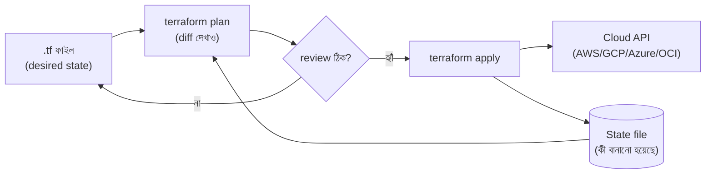
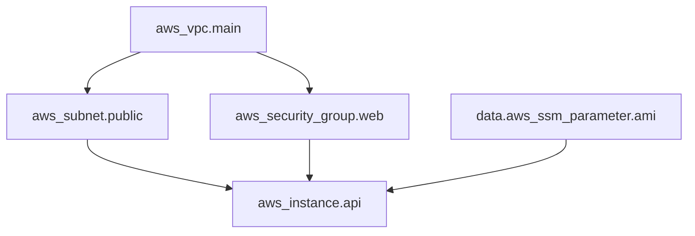
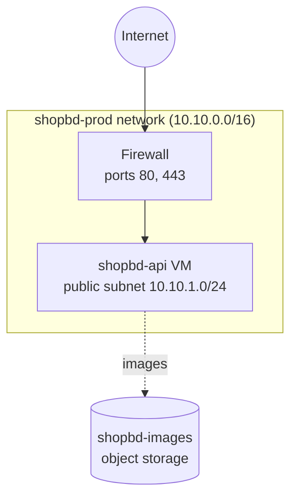

# 14 · Infrastructure as Code (Terraform)

> **এই অধ্যায়ে কী শিখবেন**
>
> - Infrastructure as Code (IaC) কী, কেন Console-এ ক্লিক করে production চালানো বিপজ্জনক
> - **Terraform শূন্য থেকে** — install, HCL, provider, variable/output, state, remote backend (S3 / GCS / Azure Storage / OCI Object Storage), locking
> - Module, workspace বনাম আলাদা state, `plan` / `apply` / `destroy`, `import`, drift, `lifecycle`, state-এ secret-এর ঝুঁকি
> - OpenTofu কী এবং Terraform থেকে কীভাবে আলাদা
> - প্রতিটি cloud-এর নিজস্ব IaC — CloudFormation ও CDK, GCP Infrastructure Manager, ARM ও Bicep, OCI Resource Manager
> - **একই `shopbd` network + VM + bucket** চার cloud-এ Terraform দিয়ে পাশাপাশি

!!! abstract "এক নজরে — কোন cloud-এ কী নাম"

    | Concept | AWS | GCP | Azure | OCI |
    |---|---|---|---|---|
    | Terraform provider | `hashicorp/aws` | `hashicorp/google` | `hashicorp/azurerm` | `oracle/oci` |
    | নিজস্ব declarative IaC | CloudFormation | Infrastructure Manager (Terraform-based) | ARM template / Bicep | Resource Manager (Terraform-based) |
    | Code দিয়ে IaC | AWS CDK | — (Terraform-ই মূল) | Bicep (DSL), Pulumi | — (Terraform-ই মূল) |
    | Remote state backend | S3 | Cloud Storage (GCS) | Blob Storage (`azurerm` backend) | Object Storage (`oci` backend) |
    | State locking | S3 lockfile (`use_lockfile`) | GCS native lock | Blob lease | Object Storage backend / Resource Manager |
    | "Plan" preview | Change set / `cdk diff` | Terraform plan (preview) | `what-if` | Plan job |
    | Drift detection | CloudFormation drift detection | Terraform `plan -refresh-only` | Terraform / what-if | Resource Manager drift detection |
    | Deprecated পুরনো নাম | — | Deployment Manager (deprecated) | — | — |

---

## ১. Infrastructure as Code কী ও কেন

ধরুন `shopbd`-র ডেভেলপার রাহিম Console-এ ক্লিক করে একটা VPC, দুটো subnet, একটা VM আর একটা bucket বানাল। দুই মাস পর রাহিম ছুটিতে, আর staging environment দরকার। কেউ জানে না রাহিম ঠিক কোন কোন বাটনে ক্লিক করেছিল। এটাই **ক্লিক-অপস**-এর সমস্যা — অবকাঠামো আছে, কিন্তু তার *বিবরণ* নেই।

**Infrastructure as Code** মানে অবকাঠামোর বিবরণ **ফাইলে লিখে রাখা**, তারপর একটা টুল সেই ফাইল পড়ে cloud-এ resource বানায়। ফলাফল:

- **Repeatable** — একই ফাইল দিয়ে dev, staging, prod একই রকম বানানো যায়।
- **Reviewable** — infra-র পরিবর্তন Pull Request হয়ে আসে, কেউ review করে।
- **Versioned** — Git history দেখলে বোঝা যায় কে কবে কেন security group খুলল।
- **Disaster recovery** — region নষ্ট হলে অন্য region-এ একই কোড চালালেই হয়।
- **Documentation** — কোডই আসল ডকুমেন্ট; পুরনো হয়ে যায় না।

!!! note "দৈনন্দিন উপমা"
    রান্নার রেসিপি। রেসিপি থাকলে যে কেউ একই স্বাদের তরকারি রাঁধতে পারে। রেসিপি ছাড়া শুধু "মায়ের হাতের আন্দাজ" — একজনের মাথায় থাকে, হারিয়ে গেলে শেষ।

### Declarative বনাম Imperative

| | Declarative ("কী চাই") | Imperative ("কীভাবে করবে") |
|---|---|---|
| উদাহরণ | Terraform, CloudFormation, Bicep | Bash script + `aws`/`gcloud` CLI, SDK |
| আপনি লেখেন | চূড়ান্ত অবস্থা: "একটা VPC থাকবে, CIDR `10.10.0.0/16`" | ধাপ: "VPC বানাও, তারপর subnet বানাও…" |
| দ্বিতীয়বার চালালে | টুল দেখে কিছু বদলানোর নেই — কিছু করে না (**idempotent**) | আবার বানাতে গিয়ে error বা duplicate |
| পরিবর্তন | ফাইল বদলান, টুল diff বের করে | নিজেকে update-script লিখতে হয় |

Terraform, CloudFormation, Bicep — সবই declarative। CDK আর Pulumi ভেতরে declarative engine চালায়, কিন্তু আপনি লেখেন Python/TypeScript-এ।

### ছবিতে IaC workflow



---

## ২. Terraform পরিচিতি ও install

**Terraform** (HashiCorp) হলো সবচেয়ে বহুল-ব্যবহৃত multi-cloud IaC টুল। এক ভাষা (HCL), এক workflow — শুধু **provider** বদলালে AWS, GCP, Azure, OCI সব চলে। তাই এই সাইটে Terraform হলো মূল সুতো; প্রতিটি অধ্যায়ের Terraform snippet এই ধারণার ওপর দাঁড়িয়ে।

### কীভাবে কাজ করে

1. আপনি `.tf` ফাইলে resource বর্ণনা করেন।
2. `terraform init` — প্রয়োজনীয় **provider** plugin ডাউনলোড করে।
3. `terraform plan` — আপনার কোড, **state**, আর cloud-এর বর্তমান অবস্থা মিলিয়ে বলে কী কী create/change/destroy হবে।
4. `terraform apply` — cloud API call করে resource বানায়, আর **state file** আপডেট করে।

Terraform নিজে cloud চেনে না — চেনে **provider**। Provider হলো একটা plugin যা HCL-কে সেই cloud-এর API call-এ রূপান্তর করে।

### Install

=== "AWS"

    Terraform install-এর পদ্ধতি cloud-ভেদে আলাদা নয় — Terraform আপনার মেশিনে চলে। Ubuntu/Debian-এ HashiCorp-এর apt repository থেকে:

    ```bash
    wget -O- https://apt.releases.hashicorp.com/gpg | sudo gpg --dearmor -o /usr/share/keyrings/hashicorp-archive-keyring.gpg
    echo "deb [signed-by=/usr/share/keyrings/hashicorp-archive-keyring.gpg] https://apt.releases.hashicorp.com $(lsb_release -cs) main" | sudo tee /etc/apt/sources.list.d/hashicorp.list
    sudo apt update && sudo apt install terraform
    terraform version
    ```

    এরপর AWS credential: `aws configure sso` (বা `aws configure`) — Terraform এই profile/environment variable নিজেই পড়ে।

=== "GCP"

    Terraform install উপরের মতোই (apt, Homebrew `brew install terraform`, বা binary download)। GCP-র জন্য credential:

    ```bash
    gcloud auth application-default login
    gcloud config set project my-project-id
    ```

    `application-default login` একটা **ADC (Application Default Credentials)** ফাইল বানায়, যেটা Terraform-এর `google` provider পড়ে।

=== "Azure"

    Terraform install একই। Azure-এর জন্য:

    ```bash
    az login
    az account set --subscription 00000000-0000-0000-0000-000000000000
    ```

    `azurerm` provider Azure CLI-র login ব্যবহার করতে পারে। CI-তে সাধারণত service principal বা OIDC (অধ্যায় [15](15-cicd-devops.md))।

=== "OCI"

    Terraform install একই। OCI-র জন্য `oci setup config` দিয়ে `~/.oci/config` তৈরি করুন (user OCID, tenancy OCID, fingerprint, private key path, region)। `oci` provider এই ফাইলই পড়ে।

    ```bash
    oci setup config
    ```

!!! tip "Version manager"
    একাধিক প্রজেক্টে ভিন্ন Terraform version লাগলে `tfenv` বা `mise`/`asdf` ব্যবহার করুন। প্রতিটি প্রজেক্টে `required_version` ঠিক করে দিন (নিচে দেখুন)।

---

## ৩. HCL basics — প্রথম প্রজেক্ট

Terraform-এর ভাষা **HCL (HashiCorp Configuration Language)**। ফাইলের extension `.tf`। একটা ফোল্ডারের সব `.tf` ফাইল মিলে একটা **configuration** (root module)।

### সাধারণ ফাইল-বিন্যাস

```text
shopbd-infra/
├── versions.tf      # terraform {} block, provider version
├── providers.tf     # provider "aws" { ... }
├── variables.tf     # input variable
├── main.tf          # resource
├── outputs.tf       # output
├── terraform.tfvars # variable-এর মান (secret রাখবেন না)
└── .terraform.lock.hcl  # provider version lock — Git-এ commit করুন
```

ফাইলের নাম বাধ্যতামূলক নয় — Terraform সব `.tf` একসাথে পড়ে। এটা শুধু convention।

### HCL-এর মূল block

```hcl
# ১. resource — একটা আসল জিনিস বানান
resource "aws_s3_bucket" "images" {          # type = "aws_s3_bucket", local name = "images"
  bucket = "shopbd-images-example"           # argument
  tags = {
    Project = "shopbd"
  }
}

# ২. অন্য resource-এর attribute ব্যবহার (reference) — এতেই dependency তৈরি হয়
resource "aws_s3_bucket_versioning" "images" {
  bucket = aws_s3_bucket.images.id           # <type>.<name>.<attribute>
  versioning_configuration {
    status = "Enabled"
  }
}

# ৩. data source — আগে থেকে থাকা জিনিস পড়ুন (বানায় না)
data "aws_caller_identity" "current" {}

# ৪. output — apply-এর পর দেখাবে
output "account_id" {
  value = data.aws_caller_identity.current.account_id
}
```

মনে রাখার সূত্র: `resource "TYPE" "NAME" { ... }`। `TYPE`-এর prefix সবসময় provider (`aws_`, `google_`, `azurerm_`, `oci_`)। `NAME` শুধু আপনার কোডের ভেতরের লেবেল; cloud-এ নাম আলাদা (`bucket = "..."`)।

### Dependency graph

Terraform নিজে বুঝে নেয় কোনটা আগে। `aws_s3_bucket_versioning` bucket-এর `id` ব্যবহার করছে, তাই bucket আগে তৈরি হবে। আলাদা ফাইলে লিখলেও কোনো পার্থক্য নেই — order নির্ভর করে **reference**-এর ওপর, ফাইলের line-এর ওপর নয়।



---

## ৪. Provider ও Terraform block

`versions.tf`-এ Terraform ও provider-এর version বেঁধে দেওয়া **অত্যন্ত জরুরি** — না হলে আগামীকাল নতুন provider major version এলে আপনার `plan` ভেঙে যেতে পারে।

=== "AWS"

    ```hcl
    terraform {
      required_version = ">= 1.10"

      required_providers {
        aws = {
          source  = "hashicorp/aws"
          version = "~> 6.0"
        }
      }
    }

    provider "aws" {
      region = "ap-south-1"

      default_tags {
        tags = {
          Project     = "shopbd"
          Environment = "prod"
          ManagedBy   = "terraform"
        }
      }
    }
    ```

    `default_tags` প্রতিটি taggable resource-এ নিজে থেকে tag বসায় — cost allocation (অধ্যায় [18](18-cost-management.md)) এর জন্য চমৎকার।

=== "GCP"

    ```hcl
    terraform {
      required_version = ">= 1.10"

      required_providers {
        google = {
          source  = "hashicorp/google"
          version = "~> 7.0"
        }
      }
    }

    provider "google" {
      project = "my-project-id"
      region  = "asia-south1"
      zone    = "asia-south1-a"

      default_labels = {
        project     = "shopbd"
        environment = "prod"
        managed_by  = "terraform"
      }
    }
    ```

=== "Azure"

    ```hcl
    terraform {
      required_version = ">= 1.10"

      required_providers {
        azurerm = {
          source  = "hashicorp/azurerm"
          version = "~> 4.0"
        }
      }
    }

    provider "azurerm" {
      features {}                                          # বাধ্যতামূলক (খালি হলেও)
      subscription_id = "00000000-0000-0000-0000-000000000000"  # azurerm 4.x-এ প্রয়োজন
    }
    ```

=== "OCI"

    ```hcl
    terraform {
      required_version = ">= 1.10"

      required_providers {
        oci = {
          source  = "oracle/oci"
          version = "~> 7.0"
        }
      }
    }

    provider "oci" {
      region = "ap-mumbai-1"
      # বাকি auth ~/.oci/config থেকে আসে। CI-তে auth = "InstancePrincipal" বা environment variable
    }
    ```

!!! note "Version সংখ্যা"
    উপরের version constraint (`~> 6.0` ইত্যাদি) উদাহরণ। নতুন প্রজেক্ট শুরুর সময় [Terraform Registry](https://registry.terraform.io) থেকে বর্তমান major version দেখে নিন। `~> 6.0` মানে `>= 6.0, < 7.0`।

### `.terraform.lock.hcl`

`terraform init` প্রতিটি provider-এর **ঠিক কোন version ও hash** নেওয়া হয়েছে তা এই ফাইলে লেখে। এটা Git-এ commit করুন — তাহলে আপনার সহকর্মী আর CI ঠিক একই provider পাবে।

---

## ৫. Variable, local, output, data source, loop

### Input variable

```hcl
variable "environment" {
  type        = string
  description = "dev, staging or prod"
  default     = "dev"

  validation {
    condition     = contains(["dev", "staging", "prod"], var.environment)
    error_message = "environment must be dev, staging or prod."
  }
}

variable "vpc_cidr" {
  type    = string
  default = "10.10.0.0/16"
}

variable "allowed_ports" {
  type    = list(number)
  default = [80, 443]
}

variable "db_password" {
  type      = string
  sensitive = true          # plan/apply-এর output-এ লুকানো থাকবে (state-এ কিন্তু থাকে!)
}
```

মান দেওয়ার উপায় (অগ্রাধিকার কম থেকে বেশি):

1. `default`
2. `terraform.tfvars` / `*.auto.tfvars`
3. `-var-file=prod.tfvars`
4. environment variable `TF_VAR_environment=prod`
5. `-var="environment=prod"` (সবচেয়ে বেশি অগ্রাধিকার)

```bash
terraform apply -var-file=prod.tfvars
TF_VAR_db_password='...' terraform apply
```

### Local value

```hcl
locals {
  name_prefix = "shopbd-${var.environment}"
  common_tags = {
    Project     = "shopbd"
    Environment = var.environment
  }
}

# ব্যবহার: local.name_prefix
```

### Output

```hcl
output "vpc_id" {
  description = "ID of the shopbd VPC"
  value       = aws_vpc.main.id
}

output "db_endpoint" {
  value     = aws_db_instance.main.address
  sensitive = true
}
```

```bash
terraform output
terraform output -raw vpc_id
terraform output -json
```

Output একটা প্রজেক্টের ফলাফল অন্য প্রজেক্টে বা module-এ পাঠানোর মাধ্যম।

### `count`, `for_each`, `dynamic`

```hcl
# count — N-টা একই resource
resource "aws_subnet" "private" {
  count             = 2
  vpc_id            = aws_vpc.main.id
  cidr_block        = cidrsubnet(var.vpc_cidr, 8, count.index + 10)
  availability_zone = data.aws_availability_zones.available.names[count.index]
}

# for_each — নামযুক্ত map/set; item যোগ-বিয়োগে বাকিগুলো নড়ে না (count-এর চেয়ে নিরাপদ)
resource "aws_s3_bucket" "buckets" {
  for_each = toset(["images", "reports", "backups"])
  bucket   = "shopbd-${each.key}-example"
}

# dynamic block — repeated nested block
resource "aws_security_group" "web" {
  name   = "shopbd-web"
  vpc_id = aws_vpc.main.id

  dynamic "ingress" {
    for_each = var.allowed_ports
    content {
      from_port   = ingress.value
      to_port     = ingress.value
      protocol    = "tcp"
      cidr_blocks = ["0.0.0.0/0"]
    }
  }
}
```

!!! warning "`count` বনাম `for_each`"
    `count` index দিয়ে resource চেনে (`[0]`, `[1]`)। তালিকার মাঝখান থেকে একটা বাদ দিলে পরের সবগুলোর index সরে যায় — Terraform ভাববে বাকিগুলো destroy করে নতুন বানাতে হবে। যেখানে item-এর পরিচয় আছে সেখানে `for_each` ব্যবহার করুন।

### দরকারি built-in function

```hcl
cidrsubnet("10.10.0.0/16", 8, 1)       # "10.10.1.0/24"
format("shopbd-%s-vpc", var.environment)
merge(local.common_tags, { Name = "api" })
lookup(var.sizes, var.environment, "small")
file("${path.module}/user-data.sh")
```

পরীক্ষা করতে `terraform console` চালিয়ে expression লিখে দেখতে পারেন।

---

## ৬. State — Terraform-এর স্মৃতি

**State** হলো `terraform.tfstate` নামের JSON ফাইল। এতে লেখা থাকে: আপনার কোডের `aws_vpc.main` আসলে cloud-এর কোন ID (`vpc-0abc…`)। এই mapping ছাড়া Terraform জানে না কোনটা তার নিজের বানানো।

!!! note "উপমা"
    State হলো লাইব্রেরির রেজিস্টার খাতা। বই (resource) তাকে আছে, কিন্তু কোন বই কার নামে ইস্যু, তা লেখা আছে খাতায়। খাতা হারালে তাকের বইগুলো কার, কেউ জানে না।

### State কেন এত গুরুত্বপূর্ণ

- **Mapping** — কোড ↔ আসল resource ID
- **Metadata** — dependency order
- **Performance** — বড় infra-তে প্রতিবার সব API call না করে cache থেকে কাজ
- **Plan-এর ভিত্তি** — plan = কোড − state (+ refresh)

### Local state-এর সমস্যা

ডিফল্টে state `terraform.tfstate` নামে আপনার ল্যাপটপে থাকে। সমস্যা:

| সমস্যা | ফল |
|---|---|
| ল্যাপটপ নষ্ট/হারালে | state গেল — resource এখন "অনাথ", Terraform আর চেনে না |
| দুজন একসাথে কাজ করলে | state আলাদা, একজন অন্যেরটা মুছে দিতে পারে |
| একসাথে দুজন `apply` | state corrupt হতে পারে |
| CI/CD-তে চালানো | pipeline-এর কাছে আপনার ল্যাপটপের ফাইল নেই |
| Git-এ commit করলে | secret ফাঁস (নিচে দেখুন) |

সমাধান: **remote backend** — state থাকে cloud-এর object storage-এ, locking সহ।

### State কমান্ড

```bash
terraform state list                           # কী কী resource track হচ্ছে
terraform state show aws_vpc.main              # একটার বিস্তারিত
terraform state mv aws_instance.api aws_instance.web   # নাম বদলালে (resource রেখে)
terraform state rm aws_s3_bucket.old           # Terraform ভুলে যাক (cloud-এ resource থেকে যায়)
terraform show                                 # পুরো state পড়ার মতো করে
```

!!! danger "State ফাইল হাতে এডিট করবেন না"
    `state mv`/`rm` ছাড়া JSON হাতে বদলানো ভয়ংকর। আর কোনো state কমান্ড চালানোর আগে backup নিন। Remote backend-এ **versioning** চালু রাখলে ভুলের পর আগের version ফেরানো যায়।

---

## ৭. Remote backend — চার cloud-এ

Backend ঠিক করে state কোথায় থাকবে। প্রতিটি cloud-এর object storage-ই backend হিসেবে কাজ করে, আর locking-এর ব্যবস্থা আছে — যাতে একসাথে দুটো `apply` না চলে।

!!! warning "Chicken-and-egg সমস্যা"
    State রাখার bucket-টা নিজেই তো একটা resource! সেটা Terraform দিয়ে বানালে সেই bucket-এর state কোথায় থাকবে? সমাধান: state bucket **একবার হাতে (CLI দিয়ে)** বা আলাদা ছোট "bootstrap" configuration দিয়ে বানান (সেটার state local থাকুক বা Git-এ গোপনে রাখুন), তারপর মূল প্রজেক্ট সেই bucket ব্যবহার করুক।

=== "AWS"

    **S3 backend।** আগে bucket বানান (versioning ও encryption সহ):

    ```bash
    aws s3api create-bucket --bucket shopbd-tfstate-123456789012 \
      --region ap-south-1 \
      --create-bucket-configuration LocationConstraint=ap-south-1
    aws s3api put-bucket-versioning --bucket shopbd-tfstate-123456789012 \
      --versioning-configuration Status=Enabled
    aws s3api put-public-access-block --bucket shopbd-tfstate-123456789012 \
      --public-access-block-configuration BlockPublicAcls=true,IgnorePublicAcls=true,BlockPublicPolicy=true,RestrictPublicBuckets=true
    ```

    ```hcl
    terraform {
      backend "s3" {
        bucket       = "shopbd-tfstate-123456789012"
        key          = "prod/network/terraform.tfstate"
        region       = "ap-south-1"
        encrypt      = true
        use_lockfile = true      # S3-তেই lock ফাইল — আলাদা DynamoDB লাগে না
      }
    }
    ```

    **Locking:** নতুন Terraform (1.10+)-এ `use_lockfile = true` S3-তে `.tflock` ফাইল বানিয়ে lock করে। পুরনো পদ্ধতি ছিল একটা **DynamoDB table** (`dynamodb_table = "..."`) — এখন সেটা deprecated; পুরনো প্রজেক্টে দেখতে পাবেন।

=== "GCP"

    **GCS backend।**

    ```bash
    gcloud storage buckets create gs://shopbd-tfstate-my-project-id \
      --location=asia-south1 --uniform-bucket-level-access
    gcloud storage buckets update gs://shopbd-tfstate-my-project-id --versioning
    ```

    ```hcl
    terraform {
      backend "gcs" {
        bucket = "shopbd-tfstate-my-project-id"
        prefix = "prod/network"
      }
    }
    ```

    **Locking:** GCS backend নিজে থেকেই lock করে — আলাদা কিছু লাগে না। Credential আসে ADC থেকে। অন্য project-এর service account ব্যবহার করতে চাইলে `impersonate_service_account` অপশন আছে।

=== "Azure"

    **`azurerm` backend (Blob Storage)।** Storage account আর container লাগবে:

    ```bash
    az group create --name shopbd-tfstate-rg --location centralindia
    az storage account create --name shopbdtfstate12345 \
      --resource-group shopbd-tfstate-rg --location centralindia \
      --sku Standard_LRS --allow-blob-public-access false
    az storage container create --name tfstate \
      --account-name shopbdtfstate12345 --auth-mode login
    ```

    ```hcl
    terraform {
      backend "azurerm" {
        resource_group_name  = "shopbd-tfstate-rg"
        storage_account_name = "shopbdtfstate12345"
        container_name       = "tfstate"
        key                  = "prod/network.tfstate"
        use_azuread_auth     = true     # access key ছাড়া Entra ID দিয়ে
      }
    }
    ```

    **Locking:** blob **lease** দিয়ে স্বয়ংক্রিয়। Storage account-এর নাম globally unique, শুধু ছোট হাতের অক্ষর ও সংখ্যা (৩–২৪)।

=== "OCI"

    **OCI Object Storage।** Bucket বানান:

    ```bash
    oci os bucket create --compartment-id ocid1.compartment.oc1..example \
      --name shopbd-tfstate --versioning Enabled
    oci os ns get      # namespace জানতে
    ```

    নতুন Terraform-এ সরাসরি `oci` backend আছে:

    ```hcl
    terraform {
      backend "oci" {
        bucket    = "shopbd-tfstate"
        namespace = "my-namespace"
        key       = "prod/network/terraform.tfstate"
        region    = "ap-mumbai-1"
      }
    }
    ```

    পুরনো version-এ বা বিকল্প হিসেবে Object Storage-এর **S3-compatible API** দিয়ে `s3` backend ব্যবহার করা যায় (custom `endpoints`, path-style, কিছু `skip_*` অপশন সহ) — কিন্তু সেখানে locking নির্ভরযোগ্য নাও হতে পারে। সবচেয়ে নিরাপদ: `oci` backend, অথবা **OCI Resource Manager** (নিচে ১৬ নম্বর সেকশন) যেটা নিজেই state রাখে ও lock করে।

!!! tip "Backend-এ credential হার্ডকোড করবেন না"
    `backend` block-এ variable ব্যবহার **করা যায় না**। ভিন্ন environment-এ ভিন্ন bucket লাগলে partial configuration ব্যবহার করুন:

    ```bash
    terraform init -backend-config="bucket=shopbd-tfstate-prod" -backend-config="key=prod/terraform.tfstate"
    ```

### Local থেকে remote-এ state সরানো

`backend` block যোগ করে আবার চালান:

```bash
terraform init -migrate-state
```

Terraform জিজ্ঞেস করবে local state remote-এ কপি করবে কিনা — `yes`।

### State bucket-এর নিরাপত্তা

State-এ থাকতে পারে password, private key, connection string (দেখুন সেকশন ১৩)। তাই:

- Bucket **private**, public access বন্ধ
- **Versioning** চালু (ভুল apply-এর পর rollback)
- **Encryption at rest** (S3 `encrypt`, GCS ডিফল্ট, Azure ডিফল্ট, OCI ডিফল্ট; দরকারে নিজস্ব KMS key)
- Access শুধু CI role ও অল্প কয়েকজন admin-এর

---

## ৮. Workflow — `init`, `plan`, `apply`, `destroy`

```bash
terraform init            # provider/module ডাউনলোড, backend সেটআপ
terraform fmt -recursive  # code ফরম্যাট
terraform validate        # syntax ও internal consistency চেক
terraform plan            # কী বদলাবে দেখুন (কিছুই বদলায় না)
terraform apply           # plan দেখিয়ে yes/no জিজ্ঞেস করে চালায়
terraform destroy         # যা বানিয়েছে সব মুছে
```

### Plan-এর output পড়া

```text
  + create     নতুন resource
  ~ update     জায়গায় পরিবর্তন
  - destroy    মুছে যাবে
-/+ replace    মুছে আবার বানাবে (সতর্ক!)
```

!!! warning "`-/+` দেখলেই থামুন"
    "must be replaced" মানে resource মুছে নতুন বানানো হবে। Database বা VM হলে data/IP হারাতে পারে। কোন attribute বদলানোয় replace লাগছে, plan-এর `# forces replacement` চিহ্ন দেখে বুঝুন।

### Saved plan — CI-র জন্য

```bash
terraform plan -out=tfplan        # plan ফাইলে সেভ
terraform show tfplan             # পড়ুন
terraform apply tfplan            # ঠিক এই plan-ই apply — মাঝখানে অন্য কিছু বদলালে নয়
```

Review-করা plan আর apply-করা plan **একই** হওয়া নিশ্চিত করার সেরা উপায় এটা।

### দরকারি flag

```bash
terraform plan -target=aws_s3_bucket.images   # শুধু একটা (শেষ উপায়; স্বাভাবিক workflow-এ নয়)
terraform apply -auto-approve                 # প্রশ্ন ছাড়া (শুধু CI-তে, plan review-এর পর)
terraform plan -destroy                       # destroy হলে কী হতো
terraform apply -replace=aws_instance.api     # একটা resource জোর করে নতুন করে বানান
terraform plan -refresh-only                  # শুধু cloud-এর অবস্থা state-এ তুলুন, কোড নয়
```

!!! danger "`terraform destroy` আর `-auto-approve` একসাথে নয়"
    prod-এ কখনো না। `prevent_destroy` lifecycle (সেকশন ১২) এবং CI-তে manual approval রাখুন।

---

## ৯. Module — পুনর্ব্যবহারযোগ্য অংশ

**Module** হলো একটা ফোল্ডার যার ভেতরে `.tf` ফাইল আছে, আর আপনি সেটাকে function-এর মতো ডাকেন। `shopbd` ঠিক একই network dev, staging, prod-এ চায় — একবার module লিখে তিনবার ডাকুন।

```text
shopbd-infra/
├── modules/
│   └── network/
│       ├── main.tf        # resource
│       ├── variables.tf   # module-এর input
│       └── outputs.tf     # module-এর output
└── envs/
    ├── dev/main.tf
    └── prod/main.tf
```

`modules/network/variables.tf`:

```hcl
variable "name"     { type = string }
variable "vpc_cidr" { type = string }
```

`modules/network/outputs.tf`:

```hcl
output "vpc_id"           { value = aws_vpc.this.id }
output "public_subnet_id" { value = aws_subnet.public.id }
```

`envs/prod/main.tf`:

```hcl
module "network" {
  source   = "../../modules/network"
  name     = "shopbd-prod"
  vpc_cidr = "10.10.0.0/16"
}

resource "aws_instance" "api" {
  subnet_id = module.network.public_subnet_id   # module output ব্যবহার
  # ...
}
```

### Module-এর source

| Source | উদাহরণ |
|---|---|
| Local path | `source = "./modules/network"` |
| Terraform Registry | `source = "terraform-aws-modules/vpc/aws"`, `version = "~> 6.0"` |
| Git | `source = "git::https://github.com/org/repo.git//modules/network?ref=v1.2.0"` |

!!! tip "Registry module ব্যবহারের নিয়ম"
    Community module (যেমন `terraform-aws-modules`, `terraform-google-modules`, Azure Verified Modules, `oracle-terraform-modules`) সময় বাঁচায়। তবে **version pin করুন**, আর ব্যবহারের আগে কোড একবার পড়ে নিন। ছোট প্রজেক্টে নিজের ছোট module প্রায়ই বেশি বোধগম্য।

### Module লেখার নিয়ম

- **একটা কাজ** — "network", "vm", "bucket"; একটা "everything" module নয়
- Input কম রাখুন, sensible default দিন
- Provider module-এর ভেতরে `provider` block বসাবেন না — root থেকে আসুক
- প্রতিটি output-এ `description`

---

## ১০. Workspace বনাম আলাদা state

একই code দিয়ে একাধিক environment (dev/staging/prod) কীভাবে চালাবেন? দুই পথ।

### পথ ১ — Terraform workspace

```bash
terraform workspace list
terraform workspace new staging
terraform workspace select prod
terraform workspace show
```

একই backend-এ একই configuration, কিন্তু **আলাদা state** (S3-তে `env:/staging/...` path)। কোডে `terraform.workspace` দিয়ে নাম পাওয়া যায়:

```hcl
locals {
  env = terraform.workspace
}
```

### পথ ২ — আলাদা ফোল্ডার/ফাইল, আলাদা backend key

```text
envs/
├── dev/      # backend key = "dev/terraform.tfstate"
├── staging/
└── prod/     # আলাদা bucket, আলাদা credential
```

### কোনটা কখন

| | Workspace | আলাদা ফোল্ডার/state |
|---|---|---|
| বোঝা | সহজ, কিন্তু "এখন কোন workspace-এ আছি" ভুলে যাওয়া সহজ | স্পষ্ট — ফোল্ডারেই বোঝা যায় |
| Credential/account আলাদা (prod আলাদা account) | কঠিন — একই backend, একই credential | সহজ — প্রতি env-এ আলাদা backend |
| Environment-এর মধ্যে পার্থক্য | ছোট (শুধু size/count) | বড় (আলাদা resource) |
| ঝুঁকি | ভুল workspace-এ `destroy` | কম |
| ঠিক কখন | একই account-এ ছোট, প্রায় একই রকম copy (feature-branch preview) | **prod ও non-prod আলাদা** — সাধারণ production পছন্দ |

**সুপারিশ:** prod আলাদা account/project/subscription/compartment-এ থাকলে **আলাদা state**-ই নিন; workspace রাখুন সাময়িক/preview environment-এর জন্য। (Terraform workspace ও HCP Terraform workspace এক জিনিস নয় — নামে মিল, ধারণায় আলাদা।)

!!! note "Terragrunt"
    ফোল্ডার-ভিত্তিক বড় setup-এ প্রতিবার backend/provider block কপি করা ক্লান্তিকর। **Terragrunt** নামে একটা wrapper tool তা DRY রাখতে সাহায্য করে। এখনই লাগবে না — পরে জানলেই চলবে।

---

## ১১. `import`, `moved` ও drift

### Import — আগে থেকে থাকা resource Terraform-এ আনা

আপনার কোম্পানি Console-এ বানানো একটা bucket আছে, এখন Terraform-এর আওতায় আনতে চান। Terraform 1.5+ এ **`import` block**:

```hcl
import {
  to = aws_s3_bucket.images
  id = "shopbd-images-example"        # cloud-এর আসল ID/নাম
}

resource "aws_s3_bucket" "images" {
  bucket = "shopbd-images-example"
}
```

```bash
terraform plan                                   # import হবে কিনা দেখুন
terraform plan -generate-config-out=generated.tf # কোডের খসড়া Terraform লিখে দেয়
terraform apply
```

পুরনো পদ্ধতি: `terraform import aws_s3_bucket.images shopbd-images-example` (command)। প্রতি provider-এর ডকুমেন্টেশনের **Import** অংশে বলা আছে resource-এর ID কী ধরনের (AWS-এ নাম/ID, Azure-এ পুরো resource ID, OCI-তে OCID, GCP-তে `projects/.../...` path)।

!!! tip "Import-এর পর plan খালি আসা পর্যন্ত কোড মেলান"
    Import শুধু state ভরে — কোড আপনাকেই লিখে মেলাতে হয়। `plan`-এ "No changes" না আসা পর্যন্ত argument ঠিক করুন।

### Rename/refactor — `moved` block

Resource-এর কোড-নাম বদলালে Terraform ভাববে পুরনোটা destroy, নতুনটা create। সেটা এড়াতে:

```hcl
moved {
  from = aws_instance.api
  to   = aws_instance.web
}
```

### Drift

**Drift** = কোড/state যা বলে, আসল cloud-এ তা নয়। কারণ: কেউ Console-এ হাতে security group খুলেছে, auto-scaling কিছু বদলেছে, অন্য টুল বদলেছে।

```bash
terraform plan -refresh-only      # কী কী drift হয়েছে দেখুন (কিছু বদলায় না)
terraform apply -refresh-only     # state-কে বাস্তবের সাথে মেলান
terraform plan                    # সাধারণ plan-ও drift দেখায় ও কোড অনুযায়ী ফেরাতে চায়
```

**Drift এর চিকিৎসা দুই রকম:** (ক) কোড অনুযায়ী ফিরিয়ে দিন (`apply`), অথবা (খ) পরিবর্তনটা ঠিক হলে কোডে তুলে নিন। কোনোটাই না করে চালিয়ে গেলে infra-র "সত্য" দুই জায়গায় থাকে। Production-এ নিয়মিত `plan` (যেমন রাতে scheduled CI job) চালিয়ে drift ধরুন।

---

## ১২. `lifecycle`, `depends_on` ও তুলনামূলক উন্নত বিষয়

### `lifecycle`

```hcl
resource "aws_db_instance" "main" {
  # ...
  lifecycle {
    prevent_destroy       = true               # destroy করতে গেলে error
    create_before_destroy = true               # replace-এর সময় আগে নতুন, পরে পুরনো
    ignore_changes        = [tags["LastScan"]] # বাইরের টুল বদলালে Terraform আপত্তি করবে না
    replace_triggered_by  = [aws_launch_template.api]
  }
}
```

| Setting | কখন |
|---|---|
| `prevent_destroy` | database, state bucket, production data store |
| `create_before_destroy` | downtime ছাড়া replace (LB-র পেছনের VM, certificate) |
| `ignore_changes` | autoscaler/অন্য টুল যে field বদলায় (desired capacity, বাইরের tag) |
| `replace_triggered_by` | অন্য resource বদলালে এটাও নতুন করে বানাতে |

### `depends_on`

সাধারণত reference-ই dependency বানায়। যেখানে reference নেই কিন্তু ক্রম জরুরি (IAM policy attach হওয়ার পরে instance চালু):

```hcl
resource "aws_instance" "api" {
  # ...
  depends_on = [aws_iam_role_policy_attachment.api_s3]
}
```

### `precondition` / `postcondition` ও `check`

Plan/apply-এর সময় নিজস্ব শর্ত যাচাই — যেমন "subnet-এর CIDR variable-এর ভেতরে পড়ে কিনা"। বড় প্রজেক্টে guard হিসেবে কাজে লাগে।

---

## ১৩. State-এ secret — লুকোনো ঝুঁকি

!!! danger "State ফাইলে secret **plain text**-এ থাকে"
    `sensitive = true` শুধু terminal output লুকায়। Database password, private key, access token — যা resource-এর attribute, সবই `terraform.tfstate`-এ পরিষ্কার লেখা থাকে। State পড়তে পারলে secret পড়তে পারেন।

### সামলানোর উপায়

1. **State-কে secret হিসেবে ভাবুন** — private bucket, encryption, সীমিত IAM, access log।
2. **State Git-এ কখনো না** — `.gitignore`-এ `*.tfstate*`, `.terraform/`।
3. **Secret সরাসরি কোডে না** — `terraform.tfvars`-এ password লিখে commit করবেন না।
4. **Secret manager থেকে পড়ুন বা নিজেই বানাতে দিন:**
   - ডেটাবেস password: manage করুন cloud-এর secrets service দিয়ে (AWS Secrets Manager/RDS managed master password, GCP Secret Manager, Azure Key Vault, OCI Vault — দেখুন [Security](13-security.md))। অনেক database resource-এ "cloud নিজে password ঘোরায়" অপশন আছে, সেটা নিন।
5. **Ephemeral values ও write-only argument** — নতুন Terraform (1.10/1.11+)-এ কিছু মান state-এ না লিখে শুধু run-এর সময় ব্যবহারের সুবিধা আছে। কিছু provider resource-এ `*_wo` ধরনের write-only argument আছে। আপনার provider-এর documentation-এ দেখুন কোন resource সমর্থন করে।
6. **OpenTofu** state encryption দেয় (সেকশন ১৫)।

!!! tip "Sensitive ডেটা বের করুন"
    আদর্শ: secret-এর *মান* Terraform-এ আনবেনই না; resource শুধু secret-এর **reference/ID** জানুক (যেমন ARN, Key Vault secret URI)।

---

## ১৪. Test, lint, policy ও CI-তে Terraform

| কাজ | টুল/কমান্ড |
|---|---|
| Format | `terraform fmt -check -recursive` |
| Syntax | `terraform validate` |
| Lint (provider-specific ভুল) | `tflint` |
| Security scan | `trivy config .` বা `checkov -d .` |
| Unit-ধরনের test | `terraform test` (Terraform 1.6+, `.tftest.hcl` ফাইল) |
| Policy-as-code | OPA/Conftest, Sentinel (HCP Terraform) |
| Cost estimate | Infracost (প্ল্যান থেকে আনুমানিক খরচ) |
| Documentation | `terraform-docs` |

একটা স্বাভাবিক Pull-Request pipeline (বিস্তারিত অধ্যায় [15](15-cicd-devops.md)-এ):

1. PR খুললে: `fmt -check`, `validate`, `tflint`, security scan, `terraform plan` — plan-এর output PR-এ comment।
2. Review ও merge।
3. `main`-এ merge হলে: **manual approval** → `terraform apply` (saved plan)।

Pipeline-কে ক্লাউডে ঢুকতে দিন **OIDC / workload identity** দিয়ে — দীর্ঘস্থায়ী access key নয়।

---

## ১৫. OpenTofu — Terraform-এর open-source fork

২০২৩-এ HashiCorp Terraform-এর license বদলে **BSL (Business Source License)** করে — আগের মতো পুরোপুরি open-source (MPL) থাকে না। তখন community **OpenTofu** নামে একটা fork বানায়, যেটা এখন Linux Foundation-এর অধীনে open-source (MPL 2.0)।

| | Terraform | OpenTofu |
|---|---|---|
| Command | `terraform` | `tofu` |
| ভাষা | HCL | HCL (প্রায় একই) |
| License | BSL (HashiCorp/IBM) | MPL 2.0, Linux Foundation |
| Registry | registry.terraform.io | registry.opentofu.org (provider সাধারণত একই) |
| Provider (aws, google, azurerm, oci) | আছে | আছে |
| State format | `.tfstate` | সামঞ্জস্যপূর্ণ (migration সহজ) |
| বিশেষ ফিচার | HCP Terraform-এর সাথে একীভূত, ephemeral/write-only | **State encryption**, early variable evaluation ইত্যাদি |

```bash
tofu init
tofu plan
tofu apply
```

!!! note "কোনটা বাছবেন?"
    শিখতে ও বেশিরভাগ কাজে এই অধ্যায়ের সব কিছুই OpenTofu-তে (`terraform` → `tofu`) চলে। চাকরির বাজারে এখনো "Terraform" নামই বেশি; আপনার কোম্পানি কোনটা ব্যবহার করে সেটাই আসল সিদ্ধান্ত। দুটোর মধ্যে মাইগ্রেশন সাধারণত সহজ, তবে নতুন ফিচার ক্রমে ভিন্ন হচ্ছে — সরাসরি ডকুমেন্টেশন মিলিয়ে নিন: [opentofu.org](https://opentofu.org)।

!!! note "CDK for Terraform"
    Python/TypeScript দিয়ে Terraform চালানোর **CDKTF** প্রজেক্টটি HashiCorp আর এগিয়ে নিচ্ছে না (sunset/archived)। নতুন প্রজেক্টে সাধারণ HCL, অথবা Pulumi ব্যবহার করুন।

---

## ১৬. প্রতিটি cloud-এর নিজস্ব IaC

Terraform multi-cloud, কিন্তু প্রতিটি cloud-এর নিজের টুলও আছে। কখন কাজে লাগে: শুধু এক cloud, cloud-এর সাথে গভীর একীকরণ (rollback, console-এ stack দেখা), বা compliance-এ "vendor-native" দরকার।

=== "AWS"

    ### CloudFormation

    **AWS CloudFormation** — JSON/YAML **template** → **stack**। AWS নিজে state রাখে (আপনার bucket লাগে না), failure হলে স্বয়ংক্রিয় **rollback**।

    ```yaml
    AWSTemplateFormatVersion: "2010-09-09"
    Description: shopbd network and image bucket

    Parameters:
      Environment:
        Type: String
        Default: prod
        AllowedValues: [dev, staging, prod]

    Resources:
      Vpc:
        Type: AWS::EC2::VPC
        Properties:
          CidrBlock: 10.10.0.0/16
          EnableDnsHostnames: true
          Tags:
            - Key: Name
              Value: !Sub "shopbd-${Environment}-vpc"

      PublicSubnet:
        Type: AWS::EC2::Subnet
        Properties:
          VpcId: !Ref Vpc
          CidrBlock: 10.10.1.0/24
          AvailabilityZone: !Select [0, !GetAZs ""]
          MapPublicIpOnLaunch: true

      ImagesBucket:
        Type: AWS::S3::Bucket
        DeletionPolicy: Retain
        Properties:
          VersioningConfiguration:
            Status: Enabled
          PublicAccessBlockConfiguration:
            BlockPublicAcls: true
            BlockPublicPolicy: true
            IgnorePublicAcls: true
            RestrictPublicBuckets: true

    Outputs:
      VpcId:
        Value: !Ref Vpc
        Export:
          Name: !Sub "shopbd-${Environment}-vpc-id"
    ```

    ```bash
    aws cloudformation validate-template --template-body file://shopbd.yaml

    aws cloudformation deploy \
      --template-file shopbd.yaml \
      --stack-name shopbd-prod-network \
      --parameter-overrides Environment=prod \
      --region ap-south-1

    aws cloudformation describe-stacks --stack-name shopbd-prod-network
    aws cloudformation detect-stack-drift --stack-name shopbd-prod-network
    aws cloudformation delete-stack --stack-name shopbd-prod-network
    ```

    মূল ধারণা: **Template, Stack, Change set** (update-এর আগে preview), **Drift detection**, **StackSets** (একাধিক account/region-এ একসাথে), **DeletionPolicy** (stack মুছলেও resource রাখা), intrinsic function (`!Ref`, `!Sub`, `!GetAtt`)।

    ### AWS CDK

    **AWS CDK** — Python/TypeScript/Java ইত্যাদিতে infra লিখুন; CDK সেটাকে CloudFormation template বানিয়ে deploy করে। Loop, function, class ব্যবহার করা যায়।

    ```python
    from aws_cdk import App, Stack, aws_ec2 as ec2, aws_s3 as s3, RemovalPolicy
    from constructs import Construct

    class ShopbdStack(Stack):
        def __init__(self, scope: Construct, id: str, **kwargs):
            super().__init__(scope, id, **kwargs)

            vpc = ec2.Vpc(self, "ShopbdVpc", max_azs=2, nat_gateways=0)

            s3.Bucket(
                self, "Images",
                versioned=True,
                block_public_access=s3.BlockPublicAccess.BLOCK_ALL,
                removal_policy=RemovalPolicy.RETAIN,
            )

    app = App()
    ShopbdStack(app, "shopbd-prod")
    app.synth()
    ```

    ```bash
    cdk bootstrap aws://123456789012/ap-south-1   # একবার, প্রতি account/region
    cdk synth     # CloudFormation template দেখুন
    cdk diff      # পরিবর্তনের preview
    cdk deploy
    cdk destroy
    ```

=== "GCP"

    ### Infrastructure Manager

    **Infrastructure Manager (Infra Manager)** হলো Google Cloud-এর managed সেবা যেটা **Terraform কোড** চালায় — আপনি Terraform লেখেন, Google সেটা সার্ভারে `apply` করে, state ও revision রাখে। (পুরনো **Deployment Manager** deprecated — পুরনো প্রজেক্টে দেখলে Infra Manager বা Terraform-এ সরান।)

    ধারণা: **Deployment** = একটা Terraform configuration-এর একটা চলমান instance; আপনার দেওয়া **service account** দিয়ে resource বানায়।

    ```bash
    gcloud services enable config.googleapis.com

    gcloud infra-manager deployments apply \
      projects/my-project-id/locations/asia-south1/deployments/shopbd-network \
      --service-account=projects/my-project-id/serviceAccounts/infra-manager@my-project-id.iam.gserviceaccount.com \
      --local-source=./terraform \
      --input-values=project_id=my-project-id

    gcloud infra-manager deployments describe \
      projects/my-project-id/locations/asia-south1/deployments/shopbd-network
    gcloud infra-manager deployments list --location=asia-south1
    ```

    Git repository থেকেও source নেওয়া যায় (`--git-source-repo` ইত্যাদি)। Flag-এর পূর্ণ তালিকা: `gcloud infra-manager deployments apply --help` ও [cloud.google.com/infrastructure-manager/docs](https://cloud.google.com/infrastructure-manager/docs)।

    !!! note "GCP-তে CDK-এর মতো কিছু?"
        GCP-র নিজস্ব "code দিয়ে IaC" নেই — Terraform-ই community-র মূল পথ। Google নিজের Terraform module ও "Cloud Foundation Toolkit" blueprint দেয়।

=== "Azure"

    ### ARM template ও Bicep

    Azure-এর native IaC হলো **ARM template** (JSON)। JSON লেখা কষ্টকর বলে Microsoft বানিয়েছে **Bicep** — পরিষ্কার DSL, যা কম্পাইল হয়ে ARM JSON হয়। নতুন কাজে Bicep-ই বাছুন; ARM JSON পুরনো কাজে দেখবেন।

    ```bicep
    param location string = 'centralindia'
    param environment string = 'prod'

    resource vnet 'Microsoft.Network/virtualNetworks@2024-05-01' = {
      name: 'shopbd-${environment}-vnet'
      location: location
      properties: {
        addressSpace: {
          addressPrefixes: ['10.10.0.0/16']
        }
        subnets: [
          {
            name: 'public'
            properties: {
              addressPrefix: '10.10.1.0/24'
            }
          }
        ]
      }
    }

    resource images 'Microsoft.Storage/storageAccounts@2023-05-01' = {
      name: 'shopbdimages${uniqueString(resourceGroup().id)}'
      location: location
      sku: {
        name: 'Standard_LRS'
      }
      kind: 'StorageV2'
      properties: {
        allowBlobPublicAccess: false
        minimumTlsVersion: 'TLS1_2'
      }
    }

    output vnetId string = vnet.id
    ```

    ```bash
    az group create --name shopbd-prod-rg --location centralindia

    # আগে preview (what-if) — Terraform plan-এর মতো
    az deployment group what-if \
      --resource-group shopbd-prod-rg \
      --template-file main.bicep \
      --parameters environment=prod

    az deployment group create \
      --resource-group shopbd-prod-rg \
      --template-file main.bicep \
      --parameters environment=prod

    az bicep build --file main.bicep     # ARM JSON বানিয়ে দেখুন
    ```

    মূল ধারণা: scope (resource group / subscription / management group / tenant), **what-if**, **deployment mode** (Incremental ডিফল্ট; Complete মোডে template-এ নেই এমন resource মুছে যায় — সাবধান), **Template Specs**, **Deployment Stacks**। Bicep-এর API version (`@2024-05-01`) resource-এর ডকুমেন্টেশন দেখে নিন — উদাহরণের version বদলাতে পারে।

=== "OCI"

    ### Resource Manager

    **OCI Resource Manager** হলো OCI-র managed Terraform সেবা। আপনার Terraform কোড **zip** করে একটা **Stack** বানান; Resource Manager state রাখে ও lock করে, আর **plan / apply / destroy job** চালায। **Drift detection** আছে।

    ```bash
    # Stack তৈরি (zip ফাইল থেকে)
    oci resource-manager stack create \
      --compartment-id ocid1.compartment.oc1..example \
      --config-source ./shopbd-network.zip \
      --display-name shopbd-network

    # plan job
    oci resource-manager job create-plan-job --stack-id ocid1.ormstack.oc1..example

    # apply job
    oci resource-manager job create-apply-job \
      --stack-id ocid1.ormstack.oc1..example \
      --execution-plan-strategy AUTO_APPROVED
    ```

    Resource Manager কোন Terraform version সমর্থন করে তা ডকুমেন্টেশনে দেখুন — সবসময় সর্বশেষ Terraform-এর সমান নাও হতে পারে।

    Console-এ: **Developer Services → Resource Manager → Stacks → Create stack**। এছাড়া ডকুমেন্টেশনের **Stack from existing compartment** ("Create stack from compartment") দিয়ে আগে থেকে থাকা resource থেকে Terraform কোড বের করা যায় — import-এর বিকল্প।

    **OCI Landing Zones** (Oracle-এর Terraform blueprint) Resource Manager-এ এক ক্লিকে deploy করা যায়।

### কোন টুল কখন

| পরিস্থিতি | সুপারিশ |
|---|---|
| একাধিক cloud, বা ভবিষ্যতে হতে পারে | **Terraform / OpenTofu** |
| শুধু AWS, ডেভেলপাররা Python/TS-এ স্বচ্ছন্দ | CDK বা Terraform |
| শুধু AWS, template + rollback + StackSets চাই | CloudFormation |
| শুধু Azure, Microsoft-native | Bicep |
| GCP-তে managed Terraform run (state আপনার bucket-এ লাগবে না) | Infrastructure Manager |
| OCI-তে managed Terraform run | Resource Manager |

---

## ১৭. একই `shopbd` stack চার cloud-এ

লক্ষ্য: **একটা network (VPC/VNet/VCN), একটা public VM, আর একটা image bucket**। নামকরণ একই; resource-এর ধরন cloud-ভেদে আলাদা — ঠিক সেটাই দেখুন।



!!! warning "চালানোর আগে"
    - নিচের উদাহরণ শেখার জন্য — আগে `terraform validate` ও `plan` চালান। `apply` করলে **খরচ হবে** — শেষে `terraform destroy` মনে রাখবেন।
    - **Bucket/storage account নাম globally unique** — `shopbd-images-example` আগেই কেউ নিয়ে থাকতে পারে; নিজস্ব suffix দিন।
    - `0.0.0.0/0` দিয়ে ৮০/৪৪৩ খোলা web server-এর জন্য ঠিক, কিন্তু SSH (২২) কখনো সবার জন্য খুলবেন না — ছোট admin IP range দিন।
    - Network/Firewall ধারণা: [05 · Networking](05-networking.md); VM: [04 · Compute](04-compute-vms.md); bucket: [06 · Storage](06-storage.md)।

=== "AWS"

    VPC, public subnet, Internet Gateway, route table, security group, EC2, S3 bucket।

    ```hcl
    variable "bucket_suffix" {
      type    = string
      default = "example"
    }

    data "aws_availability_zones" "available" {
      state = "available"
    }

    # Latest Amazon Linux 2023 AMI (public SSM parameter)
    data "aws_ssm_parameter" "al2023" {
      name = "/aws/service/ami-amazon-linux-latest/al2023-ami-kernel-default-x86_64"
    }

    resource "aws_vpc" "main" {
      cidr_block           = "10.10.0.0/16"
      enable_dns_hostnames = true
      tags                 = { Name = "shopbd-prod-vpc" }
    }

    resource "aws_internet_gateway" "main" {
      vpc_id = aws_vpc.main.id
      tags   = { Name = "shopbd-prod-igw" }
    }

    resource "aws_subnet" "public" {
      vpc_id                  = aws_vpc.main.id
      cidr_block              = "10.10.1.0/24"
      availability_zone       = data.aws_availability_zones.available.names[0]
      map_public_ip_on_launch = true
      tags                    = { Name = "shopbd-prod-public-a" }
    }

    resource "aws_route_table" "public" {
      vpc_id = aws_vpc.main.id

      route {
        cidr_block = "0.0.0.0/0"
        gateway_id = aws_internet_gateway.main.id
      }
      tags = { Name = "shopbd-prod-public-rt" }
    }

    resource "aws_route_table_association" "public" {
      subnet_id      = aws_subnet.public.id
      route_table_id = aws_route_table.public.id
    }

    resource "aws_security_group" "web" {
      name   = "shopbd-web"
      vpc_id = aws_vpc.main.id

      ingress {
        from_port   = 443
        to_port     = 443
        protocol    = "tcp"
        cidr_blocks = ["0.0.0.0/0"]
      }
      ingress {
        from_port   = 80
        to_port     = 80
        protocol    = "tcp"
        cidr_blocks = ["0.0.0.0/0"]
      }
      egress {
        from_port   = 0
        to_port     = 0
        protocol    = "-1"
        cidr_blocks = ["0.0.0.0/0"]
      }
    }

    resource "aws_instance" "api" {
      ami                    = data.aws_ssm_parameter.al2023.value
      instance_type          = "t3.micro"
      subnet_id              = aws_subnet.public.id
      vpc_security_group_ids = [aws_security_group.web.id]

      metadata_options {
        http_tokens = "required"   # IMDSv2 only
      }
      tags = { Name = "shopbd-api" }
    }

    resource "aws_s3_bucket" "images" {
      bucket = "shopbd-images-${var.bucket_suffix}"
    }

    resource "aws_s3_bucket_public_access_block" "images" {
      bucket                  = aws_s3_bucket.images.id
      block_public_acls       = true
      block_public_policy     = true
      ignore_public_acls      = true
      restrict_public_buckets = true
    }

    output "api_public_ip" {
      value = aws_instance.api.public_ip
    }
    ```

=== "GCP"

    VPC (custom mode, global), regional subnet, firewall rule, Compute Engine VM, Cloud Storage bucket। GCP VPC **global**; subnet regional — তাই "AZ"-ভিত্তিক subnet ভাবনা এখানে নেই।

    ```hcl
    variable "project_id" {
      type    = string
      default = "my-project-id"
    }

    variable "bucket_suffix" {
      type    = string
      default = "example"
    }

    resource "google_compute_network" "main" {
      name                    = "shopbd-prod-vpc"
      auto_create_subnetworks = false      # custom mode
    }

    resource "google_compute_subnetwork" "public" {
      name          = "shopbd-prod-public"
      region        = "asia-south1"
      network       = google_compute_network.main.id
      ip_cidr_range = "10.10.1.0/24"
    }

    resource "google_compute_firewall" "web" {
      name    = "shopbd-allow-web"
      network = google_compute_network.main.name

      allow {
        protocol = "tcp"
        ports    = ["80", "443"]
      }
      source_ranges = ["0.0.0.0/0"]
      target_tags   = ["shopbd-web"]
    }

    resource "google_compute_instance" "api" {
      name         = "shopbd-api"
      machine_type = "e2-small"
      zone         = "asia-south1-a"
      tags         = ["shopbd-web"]

      boot_disk {
        initialize_params {
          image = "debian-cloud/debian-12"
        }
      }

      network_interface {
        subnetwork = google_compute_subnetwork.public.id
        access_config {}                    # ephemeral external IP
      }

      shielded_instance_config {
        enable_secure_boot = true
      }
    }

    resource "google_storage_bucket" "images" {
      name                        = "shopbd-images-${var.bucket_suffix}"
      location                    = "ASIA-SOUTH1"
      uniform_bucket_level_access = true
      public_access_prevention    = "enforced"
    }

    output "api_public_ip" {
      value = google_compute_instance.api.network_interface[0].access_config[0].nat_ip
    }
    ```

    লক্ষ্য করুন: Internet Gateway বা route table লাগেনি — GCP-তে default internet route আছে; "খোলা" নিয়ন্ত্রণ হয় firewall + external IP দিয়ে। Firewall rule **network-level** এবং **tag/service account** দিয়ে VM-এ প্রযোজ্য।

=== "Azure"

    Resource group (Azure-এ বাধ্যতামূলক container), VNet, subnet, NSG, public IP, NIC, Linux VM, storage account + container।

    ```hcl
    variable "storage_suffix" {
      type    = string
      default = "example"      # শুধু ছোট হাতের অক্ষর/সংখ্যা, মোট ≤ 24
    }

    variable "admin_ssh_public_key" {
      type = string            # যেমন file("~/.ssh/id_ed25519.pub")
    }

    resource "azurerm_resource_group" "main" {
      name     = "shopbd-prod-rg"
      location = "centralindia"
    }

    resource "azurerm_virtual_network" "main" {
      name                = "shopbd-prod-vnet"
      address_space       = ["10.10.0.0/16"]
      location            = azurerm_resource_group.main.location
      resource_group_name = azurerm_resource_group.main.name
    }

    resource "azurerm_subnet" "public" {
      name                 = "public"
      resource_group_name  = azurerm_resource_group.main.name
      virtual_network_name = azurerm_virtual_network.main.name
      address_prefixes     = ["10.10.1.0/24"]
    }

    resource "azurerm_network_security_group" "web" {
      name                = "shopbd-web-nsg"
      location            = azurerm_resource_group.main.location
      resource_group_name = azurerm_resource_group.main.name

      security_rule {
        name                       = "allow-web"
        priority                   = 100
        direction                  = "Inbound"
        access                     = "Allow"
        protocol                   = "Tcp"
        source_port_range          = "*"
        destination_port_ranges    = ["80", "443"]
        source_address_prefix      = "*"
        destination_address_prefix = "*"
      }
    }

    resource "azurerm_subnet_network_security_group_association" "public" {
      subnet_id                 = azurerm_subnet.public.id
      network_security_group_id = azurerm_network_security_group.web.id
    }

    resource "azurerm_public_ip" "api" {
      name                = "shopbd-api-pip"
      location            = azurerm_resource_group.main.location
      resource_group_name = azurerm_resource_group.main.name
      allocation_method   = "Static"
      sku                 = "Standard"
    }

    resource "azurerm_network_interface" "api" {
      name                = "shopbd-api-nic"
      location            = azurerm_resource_group.main.location
      resource_group_name = azurerm_resource_group.main.name

      ip_configuration {
        name                          = "internal"
        subnet_id                     = azurerm_subnet.public.id
        private_ip_address_allocation = "Dynamic"
        public_ip_address_id          = azurerm_public_ip.api.id
      }
    }

    resource "azurerm_linux_virtual_machine" "api" {
      name                  = "shopbd-api"
      resource_group_name   = azurerm_resource_group.main.name
      location              = azurerm_resource_group.main.location
      size                  = "Standard_B1s"
      admin_username        = "azureuser"
      network_interface_ids = [azurerm_network_interface.api.id]

      admin_ssh_key {
        username   = "azureuser"
        public_key = var.admin_ssh_public_key
      }

      os_disk {
        caching              = "ReadWrite"
        storage_account_type = "Standard_LRS"
      }

      source_image_reference {
        publisher = "Canonical"
        offer     = "ubuntu-24_04-lts"
        sku       = "server"
        version   = "latest"
      }
    }

    resource "azurerm_storage_account" "images" {
      name                            = "shopbdimages${var.storage_suffix}"
      resource_group_name             = azurerm_resource_group.main.name
      location                        = azurerm_resource_group.main.location
      account_tier                    = "Standard"
      account_replication_type        = "LRS"
      allow_nested_items_to_be_public = false
      min_tls_version                 = "TLS1_2"
    }

    resource "azurerm_storage_container" "images" {
      name                  = "images"
      storage_account_id    = azurerm_storage_account.images.id
      container_access_type = "private"
    }

    output "api_public_ip" {
      value = azurerm_public_ip.api.ip_address
    }
    ```

    লক্ষ্য করুন: Azure-এ **resource group** সব কিছুর মা; NSG এখানে **subnet-এ** attach করা হয়েছে (NIC-তেও করা যায়); VM-এর জন্য আলাদা NIC আর public IP resource লাগে। Storage account-এর container resource-এ আর্গুমেন্ট `storage_account_id` (পুরনো provider version-এ `storage_account_name` ছিল) — আপনার provider version-এর ডকুমেন্টেশন দেখে নিন।

=== "OCI"

    Compartment-ভিত্তিক। VCN, Internet Gateway, route table, security list, subnet, Compute instance, Object Storage bucket। OCI-তে **প্রায় প্রতিটি resource-এ `compartment_id` লাগে**।

    ```hcl
    variable "compartment_ocid" {
      type    = string
      default = "ocid1.compartment.oc1..example"
    }

    data "oci_identity_availability_domains" "ads" {
      compartment_id = var.compartment_ocid
    }

    data "oci_objectstorage_namespace" "ns" {
      compartment_id = var.compartment_ocid
    }

    data "oci_core_images" "ol" {
      compartment_id           = var.compartment_ocid
      operating_system         = "Oracle Linux"
      operating_system_version = "9"
      shape                    = "VM.Standard.E4.Flex"
      sort_by                  = "TIMECREATED"
      sort_order               = "DESC"
    }

    resource "oci_core_vcn" "main" {
      compartment_id = var.compartment_ocid
      cidr_blocks    = ["10.10.0.0/16"]
      display_name   = "shopbd-prod-vcn"
      dns_label      = "shopbdprod"
    }

    resource "oci_core_internet_gateway" "main" {
      compartment_id = var.compartment_ocid
      vcn_id         = oci_core_vcn.main.id
      display_name   = "shopbd-prod-igw"
    }

    resource "oci_core_route_table" "public" {
      compartment_id = var.compartment_ocid
      vcn_id         = oci_core_vcn.main.id
      display_name   = "shopbd-prod-public-rt"

      route_rules {
        destination       = "0.0.0.0/0"
        destination_type  = "CIDR_BLOCK"
        network_entity_id = oci_core_internet_gateway.main.id
      }
    }

    resource "oci_core_security_list" "web" {
      compartment_id = var.compartment_ocid
      vcn_id         = oci_core_vcn.main.id
      display_name   = "shopbd-web-sl"

      egress_security_rules {
        destination = "0.0.0.0/0"
        protocol    = "all"
      }

      ingress_security_rules {
        protocol = "6"                       # TCP
        source   = "0.0.0.0/0"
        tcp_options {
          min = 443
          max = 443
        }
      }
      ingress_security_rules {
        protocol = "6"
        source   = "0.0.0.0/0"
        tcp_options {
          min = 80
          max = 80
        }
      }
    }

    resource "oci_core_subnet" "public" {
      compartment_id    = var.compartment_ocid
      vcn_id            = oci_core_vcn.main.id
      cidr_block        = "10.10.1.0/24"
      display_name      = "shopbd-prod-public"
      route_table_id    = oci_core_route_table.public.id
      security_list_ids = [oci_core_security_list.web.id]
      dns_label         = "public"
    }

    resource "oci_core_instance" "api" {
      compartment_id      = var.compartment_ocid
      availability_domain = data.oci_identity_availability_domains.ads.availability_domains[0].name
      display_name        = "shopbd-api"
      shape               = "VM.Standard.E4.Flex"

      shape_config {
        ocpus         = 1
        memory_in_gbs = 8
      }

      create_vnic_details {
        subnet_id        = oci_core_subnet.public.id
        assign_public_ip = true
      }

      source_details {
        source_type = "image"
        source_id   = data.oci_core_images.ol.images[0].id
      }

      metadata = {
        ssh_authorized_keys = file("~/.ssh/id_ed25519.pub")
      }
    }

    resource "oci_objectstorage_bucket" "images" {
      compartment_id = var.compartment_ocid
      namespace      = data.oci_objectstorage_namespace.ns.namespace
      name           = "shopbd-images"
      access_type    = "NoPublicAccess"
      versioning     = "Enabled"
    }

    output "api_public_ip" {
      value = oci_core_instance.api.public_ip
    }
    ```

    লক্ষ্য করুন: OCI Object Storage bucket-এর নাম **namespace**-এর ভেতরে unique (globally নয়), তাই `shopbd-images` ব্যবহার করা যায়। Subnet-এ security list attach; NSG (Network Security Group) বিকল্প — [05 · Networking](05-networking.md)।

### চালানোর ক্রম (চার cloud-এই এক)

```bash
terraform init
terraform fmt -recursive
terraform validate
terraform plan -out=tfplan
terraform apply tfplan
terraform output
terraform destroy          # পরীক্ষা শেষে খরচ বাঁচাতে
```

### Environment-ভিত্তিক ফাইল (পুরো stack-এর variable)

`prod.tfvars`:

```hcl
bucket_suffix = "abc123"
```

```bash
terraform plan -var-file=prod.tfvars
```

---

## মিল ও অমিল

| বিষয় | AWS | GCP | Azure | OCI |
|---|---|---|---|---|
| Terraform provider auth (লোকাল) | `aws configure sso`/profile, env var | `gcloud auth application-default login` | `az login` | `~/.oci/config` |
| Provider-এ বাধ্যতামূলক "scope" | region | project (+ region) | `features {}` + subscription | region + প্রতি resource-এ `compartment_id` |
| Resource-এর "মা" | Account | Project | Resource group (প্রতি resource-এ বাধ্যতামূলক) | Compartment |
| Network কত বড় | Regional VPC | **Global** VPC, regional subnet | Regional VNet | Regional VCN |
| Internet-এ বের হওয়া | IGW + route table | Default route + external IP + firewall | Public IP + NSG (default outbound) | IGW + route table + security list |
| Remote state | S3 | GCS | Blob Storage | Object Storage (`oci` backend) |
| State lock | `use_lockfile` | নেটিভ | blob lease | backend / Resource Manager |
| Native IaC | CloudFormation / CDK | Infra Manager (Terraform) | ARM / Bicep | Resource Manager (Terraform) |
| Bucket নামের scope | Global | Global | Storage account — global | Namespace-এর ভেতরে |

**যেসব জায়গায় সবাই আটকায়:**

- **Provider version bump** — `~> 6.0` থেকে `7.0`-এ গেলে argument rename/remove হতে পারে; changelog পড়ে upgrade করুন।
- **Azure `features {}` ও `subscription_id`** — ভুলে গেলে `init`/`plan` error।
- **OCI-তে compartment ভুলে যাওয়া** — resource root compartment-এ গিয়ে পড়ে।
- **GCP API enable না করা** — `google_compute_instance` বানাতে `compute.googleapis.com` enabled থাকতে হবে।
- **Azure resource group মুছলে ভেতরের সব যায়** — এমনকি Terraform-এর বাইরে বানানো resource-ও।
- **Eventual consistency** — IAM policy তৈরির সাথে সাথে ব্যবহার করলে কখনো প্রথমবার fail, আবার `apply` করলে ঠিক।

---

## Real-world: shopbd

shopbd-র টিম ৩ জন। তাদের repository এভাবে সাজানো:

```text
shopbd-infra/
├── modules/
│   ├── network/
│   ├── vm/
│   └── bucket/
├── envs/
│   ├── dev/
│   ├── staging/
│   └── prod/
└── .github/workflows/terraform.yml
```

**প্রতিদিনের workflow:**

1. রাকিব "নতুন security group rule" যোগ করে feature branch-এ PR খোলে।
2. CI `fmt`, `validate`, `tflint`, security scan, `plan` চালায়; plan PR-এ comment হিসেবে আসে।
3. সাদিয়া review করে — plan-এ শুধু একটা `+ create` আছে, কোনো `-/+` নেই।
4. Merge হলে CI **manual approval** চায়; approve করলে saved plan `apply` হয়।
5. প্রতি রাতে scheduled `plan -refresh-only` চলে — কেউ Console-এ কিছু বদলালে Slack-এ alert।

**Cloud অনুযায়ী shopbd-র state:**

=== "AWS"

    State: S3 bucket `shopbd-tfstate-123456789012` (versioning + encryption + `use_lockfile`)। Prod আলাদা AWS account-এ, তাই prod-এর backend আলাদা। একাধিক account-এ একই baseline (logging, guardrail) ছড়াতে CloudFormation StackSets কাজে লাগে।

=== "GCP"

    State: GCS bucket, প্রতি environment-এর আলাদা `prefix`। Prod আলাদা project-এ। CI চালায় **Infrastructure Manager** বা সরাসরি Terraform (workload identity federation দিয়ে)।

=== "Azure"

    State: `shopbd-tfstate-rg` resource group-এর storage account, `use_azuread_auth = true`। Azure-ভিত্তিক হলে ছোট ছোট workload-এ Bicep + `what-if` ভালো; তবে shopbd তার multi-cloud ভবিষ্যতের জন্য Terraform-এ থাকে।

=== "OCI"

    State: Object Storage bucket (versioning চালু) বা Resource Manager stack। Prod আলাদা compartment-এ; compartment OCID variable হিসেবে পাঠানো হয় — কোডে হার্ডকোড নয়।

---

## Best practices

- **Remote state + locking** — প্রথম দিন থেকেই; local state শুধু শেখার জন্য।
- **Version pin** — `required_version`, প্রতি provider, প্রতি registry module; `.terraform.lock.hcl` commit।
- **ছোট state, ছোট blast radius** — network, database, app আলাদা state-এ। এক ফাইলে পুরো কোম্পানি নয়।
- **PR-এ `plan`, merge-এর পর manual approval-এ `apply`**; saved plan ব্যবহার।
- **Prod আলাদা credential/account** আর state। Dev-এর credential দিয়ে prod-এ হাত দেওয়া যাবে না।
- **State bucket লকডাউন** — private, versioned, encrypted, অল্প মানুষ।
- **Secret state-এ আনবেন না** — secret manager reference, `sensitive`-এর ওপর ভরসা না।
- **`prevent_destroy`** database ও state bucket-এ।
- **Tag/label সব resource-এ** (`default_tags`/`default_labels`) — cost ও ownership।
- **Console-এ হাতে পরিবর্তন নিষিদ্ধ** (read-only access বাদে); জরুরি fix হলে পরে কোডে ফেরান।
- **Module ছোট ও একক-উদ্দেশ্য**, registry module pin করা।
- **নিয়মিত drift check** এবং provider upgrade-এর জন্য আলাদা PR।
- **CI-তে OIDC** — দীর্ঘস্থায়ী access key নয়।

---

## Common mistakes

| ভুল | কেন সমস্যা | সমাধান |
|---|---|---|
| `terraform.tfstate` Git-এ commit | secret ফাঁস; দুজনের state দ্বন্দ্ব | `.gitignore`, remote backend |
| Local state-এ team কাজ | state হারায়/দ্বন্দ্ব | S3/GCS/azurerm/OCI backend |
| Lock নেই, দুজন একসাথে `apply` | state corrupt | locking সহ backend |
| Provider version pin না করা | হঠাৎ `plan` ভেঙে যায় | `~>` constraint + lock ফাইল commit |
| `plan` না দেখে `-auto-approve` | অবাঞ্ছিত destroy | PR-এ plan review, manual approval |
| `-/+` replace লক্ষ্য না করা | database/VM মুছে নতুন হয় | plan পড়ুন, `prevent_destroy` |
| `count`-এ তালিকার মাঝ থেকে বাদ | বাকিগুলো recreate | `for_each` ব্যবহার |
| Console-এ হাতে বদল (drift) | কোড আর বাস্তব আলাদা | নিয়ম + scheduled drift check |
| Password `.tfvars`-এ commit | secret ফাঁস | secret manager, env var, `.gitignore` |
| State bucket-এ versioning নেই | ভুল apply/state ফেরানো যায় না | versioning চালু |
| `terraform state rm`-এর পর ভুলে যাওয়া | resource অনাথ, খরচ চলছে | cloud-এও মুছে দেখুন |
| একটা বিশাল state | `plan` ধীর, ঝুঁকি বড় | layer ভাগ করুন |
| Backend bucket নিজেই Terraform দিয়ে মুছে ফেলা | state চলে যায় | `prevent_destroy`, আলাদা bootstrap |
| Bucket/storage নাম global conflict | `apply` error | suffix যোগ |

---

## ইন্টারভিউ / সার্টিফিকেশন টিপস

??? question "Terraform state কী এবং কেন গুরুত্বপূর্ণ?"
    State হলো Terraform-এর রেকর্ড — কোডের resource ↔ cloud-এর আসল resource ID। এটা দিয়েই Terraform বোঝে কী বানানো, কী বদলাবে। হারালে Terraform resource চেনে না; secret থাকতে পারে বলে নিরাপত্তাও গুরুত্বপূর্ণ।

??? question "Remote backend কেন দরকার? Locking কীভাবে কাজ করে?"
    Team-এর সবার একই state, backup/versioning, CI-তে ব্যবহার — এই কারণে। Locking একসাথে দুটো `apply` আটকায়: S3 (`use_lockfile`; পুরনো সময়ে DynamoDB), GCS (নেটিভ), Azure Blob (lease)।

??? question "`terraform plan` আর `terraform apply`-এর পার্থক্য? Saved plan কী?"
    `plan` শুধু পরিবর্তনের পূর্বরূপ দেখায়; `apply` কার্যকর করে। `plan -out=tfplan` একটা পরিকল্পনা ফাইলে রাখে, `apply tfplan` ঠিক সেটাই চালায় — review আর apply-এর মধ্যে অন্য কিছু বদলাতে পারে না।

??? question "`count` ও `for_each`-এর পার্থক্য কখন গুরুত্বপূর্ণ?"
    `count` index-ভিত্তিক; তালিকার মাঝ থেকে item বাদ দিলে পরের resource-গুলো recreate হতে পারে। `for_each` key-ভিত্তিক, তাই অন্যগুলো স্থির থাকে।

??? question "Workspace না আলাদা ফোল্ডার — prod-এর জন্য কোনটা?"
    Prod আলাদা account/credential-এ থাকলে আলাদা ফোল্ডার ও backend (স্পষ্ট, নিরাপদ)। Workspace ছোট, প্রায় একই রকম copy-র জন্য।

??? question "Console-এ কেউ resource বদলে দিলে (drift) কী করবেন?"
    `terraform plan -refresh-only` দিয়ে ধরুন। পরিবর্তন ভুল হলে `apply` করে কোড অনুযায়ী ফেরান; ঠিক হলে কোডে তুলুন। প্রতিরোধ: Console write access সীমিত, scheduled drift check।

??? question "আগে থেকে থাকা resource কীভাবে Terraform-এ আনবেন?"
    `import` block (Terraform 1.5+) বা `terraform import`। এরপর কোড মিলিয়ে `plan` "No changes" আনুন। `-generate-config-out` কোডের খসড়া বানিয়ে দেয়।

??? question "State-এ কি secret থাকে? কী করবেন?"
    হ্যাঁ, plain text-এ। State bucket private + encrypted + versioned রাখুন, Git-এ দেবেন না, secret মান Terraform-এ না আনা, ephemeral/write-only অপশন ও secret manager ব্যবহার।

??? question "Terraform বনাম CloudFormation/Bicep?"
    Terraform multi-cloud ও আলাদা state (আপনার দায়িত্ব); CloudFormation/Bicep নিজ cloud-এর সাথে গভীরভাবে যুক্ত, state cloud নিজে সামলায় ও rollback সুবিধা দেয়, কিন্তু অন্য cloud-এ কাজে লাগে না।

??? question "OpenTofu কী?"
    Terraform-এর license বদলের পর Linux Foundation-এর অধীনে গড়া open-source fork; `tofu` command, HCL প্রায় একই, state encryption-এর মতো বাড়তি ফিচার আছে।

??? question "`lifecycle`-এর `prevent_destroy` ও `ignore_changes` কখন?"
    `prevent_destroy` — database/state bucket-এর মতো যা মুছলে ক্ষতি। `ignore_changes` — বাইরের টুল (autoscaler, scanner) যে field বদলায় তা নিয়ে Terraform যেন লড়াই না করে।

??? question "AWS CDK কীভাবে কাজ করে?"
    Programming language-এ লেখা কোড `cdk synth`-এ CloudFormation template হয়, তারপর CloudFormation সেটা deploy করে।

!!! tip "পরীক্ষা"
    HashiCorp **Terraform Associate** সার্টিফিকেশন এই অধ্যায়ের বিষয়গুলোই (state, module, workflow, backend) ধরে। Cloud-পরীক্ষায় (AWS Solutions Architect/DevOps, Azure AZ-104/AZ-400, GCP Associate/Professional, OCI Architect) IaC-র প্রশ্নে native টুলের নাম ও কাজ জানা লাগে।

---

## সারসংক্ষেপ

- IaC মানে infra ফাইলে লেখা — repeatable, reviewable, versioned। Terraform declarative; `plan` দেখে `apply`।
- Terraform-এর মূল সুতো: **provider → resource → variable/output → state → backend → module**।
- **State** হলো কোড ও আসল resource-এর সেতু; টিমের জন্য **remote backend + locking** (S3 / GCS / azurerm / OCI) বাধ্যতামূলক।
- Environment আলাদা করতে prod-এর জন্য **আলাদা state/credential**; workspace শুধু ছোট copy-র জন্য।
- **import, moved, drift check** পুরনো infra আনে ও নিরাপদ রাখে; **lifecycle** দুর্ঘটনা আটকায়।
- State-এ secret plain text — state-কে secret ভাবুন।
- OpenTofu = open-source fork; Native টুল: **CloudFormation/CDK, Infrastructure Manager, ARM/Bicep, Resource Manager**।
- `shopbd`-র network + VM + bucket চার cloud-এ একই ধাঁচে — শুধু resource-এর নাম আর scope আলাদা।

পরের অধ্যায়: [15 · CI/CD ও DevOps](15-cicd-devops.md) — এই Terraform কোড pipeline-এ কীভাবে চলবে। খরচের হিসাব: [18 · Cost Management](18-cost-management.md)।
