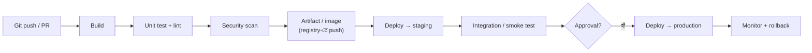
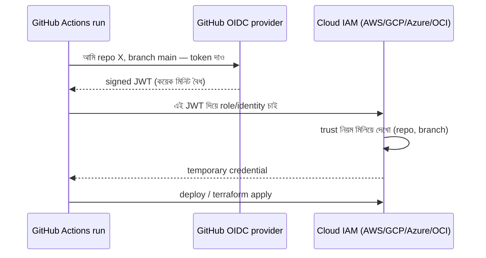
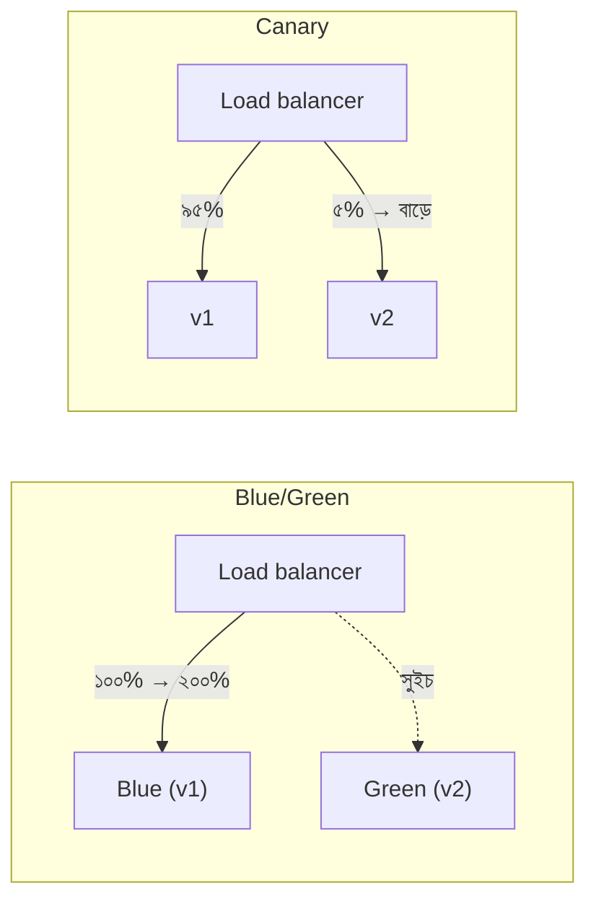
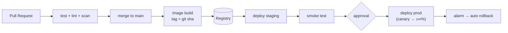

# 15 · CI/CD ও DevOps

> **এই অধ্যায়ে কী শিখবেন**
>
> - CI/CD ও DevOps-এর মূল ধারণা — pipeline-এর ধাপ, Continuous Delivery বনাম Deployment
> - প্রতিটি cloud-এর native pipeline: **CodePipeline/CodeBuild/CodeDeploy**, **Cloud Build/Cloud Deploy**, **Azure DevOps Pipelines**, **OCI DevOps**
> - Artifact/container registry: **ECR, Artifact Registry, ACR, OCIR**
> - **GitHub Actions + OIDC** — চার cloud-এ কোনো দীর্ঘস্থায়ী access key ছাড়া deploy
> - Deployment strategy: rolling, blue/green, canary, rollback
> - Terraform pipeline, approval, environment, pipeline security ও DORA metrics

!!! abstract "এক নজরে — কোন cloud-এ কী নাম"

    | Concept | AWS | GCP | Azure | OCI |
    |---|---|---|---|---|
    | Native CI (build/test) | CodeBuild | Cloud Build | Azure Pipelines (Azure DevOps) | OCI DevOps — Build pipelines |
    | Native CD (deploy) | CodeDeploy, CodePipeline | Cloud Deploy | Azure Pipelines — deployment jobs, Environments | OCI DevOps — Deployment pipelines |
    | Pipeline orchestration | CodePipeline | Cloud Build triggers + Cloud Deploy | Azure Pipelines (YAML) | OCI DevOps — Build + Deployment pipeline |
    | Source hosting (নিজস্ব) | CodeCommit (নিচের নোট দেখুন) | Cloud Source Repositories (নতুন ব্যবহারকারীর জন্য বন্ধ) | Azure Repos | OCI DevOps Code Repository |
    | Container registry | ECR | Artifact Registry | ACR (Azure Container Registry) | OCIR (Container Registry) |
    | Package registry | CodeArtifact | Artifact Registry | Azure Artifacts | OCI Artifact Registry |
    | OIDC (GitHub → cloud) | IAM OIDC provider + role | Workload Identity Federation | Federated credential (Entra ID app) | Identity Domain token exchange / API key |
    | Build config ফাইল | `buildspec.yml` | `cloudbuild.yaml` | `azure-pipelines.yml` | `build_spec.yaml` |
    | Approval gate | CodePipeline manual approval | Cloud Deploy `requireApproval` | Environment approval/checks | Deployment pipeline approval stage |

---

## ১. CI/CD কী এবং কেন

**CI (Continuous Integration)** — ডেভেলপাররা ঘনঘন (দিনে বহুবার) কোড মূল branch-এ merge করে, আর প্রতিটি merge-এ স্বয়ংক্রিয়ভাবে **build ও test** চলে। ভুল থাকলে মিনিটের মধ্যে জানা যায়।

**CD** দুই রকম:

| | Continuous **Delivery** | Continuous **Deployment** |
|---|---|---|
| test পাস করলে | production-এ পাঠানোর জন্য *তৈরি*; একজন মানুষ approve করে | সরাসরি production-এ চলে যায় |
| উপযুক্ত | বেশিরভাগ ব্যবসা, নিয়ন্ত্রিত পরিবেশ | শক্ত test + monitoring + rollback সহ পরিপক্ক team |

!!! note "দৈনন্দিন উপমা"
    একটা বিরিয়ানির দোকানের কিচেন: প্রতি ব্যাচে স্বাদ-পরীক্ষা (test), মান ঠিক হলে প্যাকেট (artifact), তারপর ডেলিভারি (deploy)। প্রতিবার একই ধাপ, একই মান — "আজ ভুলে লবণ দিইনি" ধরনের দুর্ঘটনা কমে।

### একটা সাধারণ pipeline-এর ধাপ



**মূল নীতি:** একবার build করুন, **একই artifact** staging থেকে production-এ নিয়ে যান। Environment-ভেদে নতুন করে build করলে "staging-এ চলছিল, prod-এ চলে না" সমস্যা ফিরে আসে।

### DevOps কী

DevOps কোনো টুল নয় — **সংস্কৃতি ও অনুশীলন**: Dev আর Ops আলাদা দেয়ালের দুপাশে না থেকে একসাথে কাজ করে। কাজে দেখা যায়:

- সব কিছু Git-এ (code, infra — অধ্যায় [14](14-infrastructure-as-code.md) — config, pipeline)
- ছোট ছোট ঘনঘন release
- স্বয়ংক্রিয় test ও deploy
- monitoring ও দ্রুত feedback (অধ্যায় [12](12-observability.md))
- ঘটনার পর দোষ নয়, শিক্ষা (blameless post-mortem)

### DORA metrics — সফলতা মাপা

| Metric | অর্থ |
|---|---|
| Deployment frequency | কত ঘনঘন production-এ deploy |
| Lead time for changes | commit থেকে production পর্যন্ত কত সময় |
| Change failure rate | কত শতাংশ deploy-এর ফলে সমস্যা |
| Time to restore service | সমস্যা হলে কত দ্রুত ঠিক |

---

## ২. Source control ও branching

Pipeline শুরু হয় Git থেকে। দুটো প্রচলিত কৌশল:

| | Trunk-based | GitFlow |
|---|---|---|
| Branch | ছোট-আয়ু feature branch → দ্রুত `main`-এ | `develop`, `release`, `hotfix` বহু branch |
| Release | `main` থেকে যেকোনো সময় | release branch থেকে |
| উপযুক্ত | CI/CD-র জন্য আদর্শ, ছোট-মাঝারি team | ধীর, versioned release (mobile app, packaged software) |

`shopbd`-র মতো ছোট team-এর জন্য **trunk-based** + Pull Request + branch protection (review বাধ্যতামূলক, status check পাস না করলে merge বন্ধ) সবচেয়ে সহজ।

!!! note "Source hosting নিয়ে বাস্তব কথা"
    বেশিরভাগ team এখন **GitHub বা GitLab**-এ কোড রাখে, আর cloud-এর native টুল সেখানে connect করে। Cloud-এর নিজস্ব repo (AWS CodeCommit, Azure Repos, OCI DevOps Code Repository) আছে — কিন্তু সেগুলোর অবস্থা বদলায়: **AWS CodeCommit** নিয়ে AWS-এর ঘোষণা সময়ের সাথে বদলেছে, **Google Cloud Source Repositories** নতুন গ্রাহকের জন্য বন্ধ। নতুন প্রজেক্টে GitHub/GitLab ধরাই নিরাপদ; নিজস্ব repo ব্যবহারের আগে বর্তমান অবস্থা ডকুমেন্টেশনে দেখুন।

---

## ৩. Native pipeline — প্রতিটি cloud-এ

প্রতিটি cloud-এর টুল দুই কাজ ভাগ করে: **Build (CI)** আর **Deploy (CD)**।

=== "AWS"

    **AWS-এর "Code" সেবাগুলো:**

    | সেবা | কাজ |
    |---|---|
    | **CodeBuild** | managed build server — কোড compile, test, image বানানো |
    | **CodeDeploy** | EC2/on-prem/Lambda/ECS-এ deploy (in-place, blue/green) |
    | **CodePipeline** | Source → Build → Test → Deploy ধাপগুলো জুড়ে দেয় |
    | **CodeArtifact** | npm/pip/Maven package repository |

    GitHub/GitLab/Bitbucket থেকে source নিতে CodePipeline **CodeConnections** (পুরনো নাম CodeStar Connections) ব্যবহার করে।

    **`buildspec.yml`** (CodeBuild — shopbd API image build ও ECR-এ push):

    ```yaml
    version: 0.2

    env:
      variables:
        AWS_REGION: ap-south-1
        ECR_REPO: 123456789012.dkr.ecr.ap-south-1.amazonaws.com/shopbd-api

    phases:
      pre_build:
        commands:
          - aws ecr get-login-password --region $AWS_REGION | docker login --username AWS --password-stdin 123456789012.dkr.ecr.ap-south-1.amazonaws.com
          - IMAGE_TAG=$(echo $CODEBUILD_RESOLVED_SOURCE_VERSION | cut -c1-8)
      build:
        commands:
          - pip install -r requirements.txt
          - pytest -q
          - docker build -t $ECR_REPO:$IMAGE_TAG .
      post_build:
        commands:
          - docker push $ECR_REPO:$IMAGE_TAG
          - printf '[{"name":"shopbd-api","imageUri":"%s"}]' $ECR_REPO:$IMAGE_TAG > imagedefinitions.json

    artifacts:
      files:
        - imagedefinitions.json
    ```

    **CLI:**

    ```bash
    # build project চালানো ও অবস্থা দেখা
    aws codebuild start-build --project-name shopbd-api-build
    aws codebuild batch-get-builds --ids <build-id>

    # pipeline চালানো ও অবস্থা
    aws codepipeline start-pipeline-execution --name shopbd-api-pipeline
    aws codepipeline get-pipeline-state --name shopbd-api-pipeline

    # Manual approval-এর পর
    aws codepipeline put-approval-result --pipeline-name shopbd-api-pipeline \
      --stage-name Approve --action-name ManualApproval \
      --result summary="OK",status=Approved --token <token>
    ```

    **CodePipeline-এর সাধারণ stage:** `Source` → `Build` (CodeBuild) → `DeployStaging` → `Approve` (manual approval) → `DeployProd`। Deploy action-এ ECS, CodeDeploy, CloudFormation ইত্যাদি বেছে নেওয়া যায়।

    **Console:** CodePipeline → Create pipeline → source (GitHub via connection) → build provider CodeBuild → deploy provider।

=== "GCP"

    **GCP-র সেবা:**

    | সেবা | কাজ |
    |---|---|
    | **Cloud Build** | serverless CI — প্রতি step একটা container |
    | **Cloud Deploy** | managed CD — delivery pipeline, release, promotion, approval (GKE, Cloud Run ইত্যাদিতে) |
    | **Artifact Registry** | image ও package রাখার জায়গা |

    **`cloudbuild.yaml`:**

    ```yaml
    steps:
      - name: 'python:3.12'
        entrypoint: bash
        args: ['-c', 'pip install -r requirements.txt && pytest -q']

      - name: 'gcr.io/cloud-builders/docker'
        args:
          - build
          - -t
          - asia-south1-docker.pkg.dev/$PROJECT_ID/shopbd/api:$SHORT_SHA
          - .

    images:
      - asia-south1-docker.pkg.dev/$PROJECT_ID/shopbd/api:$SHORT_SHA
    ```

    (`$SHORT_SHA` কাজ করে যখন build **trigger** থেকে চলে। `gcr.io/cloud-builders/...` হলো Google-এর builder image — এটা পুরনো Container Registry-র সাথে গুলিয়ে ফেলবেন না; image *সংরক্ষণ* হচ্ছে Artifact Registry-তে।)

    ```bash
    # একবার হাতে build
    gcloud builds submit --config=cloudbuild.yaml .

    # GitHub trigger (repository আগে Cloud Build-এ connect করা থাকতে হবে)
    gcloud builds triggers list
    ```

    **Cloud Deploy:** `clouddeploy.yaml`-এ delivery pipeline ও target:

    ```yaml
    apiVersion: deploy.cloud.google.com/v1
    kind: DeliveryPipeline
    metadata:
      name: shopbd-api
    serialPipeline:
      stages:
        - targetId: staging
        - targetId: prod
    ---
    apiVersion: deploy.cloud.google.com/v1
    kind: Target
    metadata:
      name: staging
    run:
      location: projects/my-project-id/locations/asia-south1
    ---
    apiVersion: deploy.cloud.google.com/v1
    kind: Target
    metadata:
      name: prod
    requireApproval: true
    run:
      location: projects/my-project-id/locations/asia-south1
    ```

    ```bash
    gcloud deploy apply --file=clouddeploy.yaml --region=asia-south1

    gcloud deploy releases create rel-001 \
      --delivery-pipeline=shopbd-api \
      --region=asia-south1 \
      --images=api=asia-south1-docker.pkg.dev/my-project-id/shopbd/api:abc1234
    ```

    Release প্রথমে `staging`-এ যায়; `prod`-এ **promote** করতে approval লাগে (`requireApproval: true`)। Rollback ও canary সমর্থিত। Cloud Run target-এর জন্য Cloud Deploy `skaffold`-ভিত্তিক render করে — সম্পূর্ণ উদাহরণ ডকুমেন্টেশনে।

=== "Azure"

    **Azure DevOps** একটা সম্পূর্ণ platform: **Boards** (কাজের তালিকা), **Repos**, **Pipelines**, **Test Plans**, **Artifacts**। CI/CD অংশ হলো **Azure Pipelines** — YAML-এ লেখা।

    **`azure-pipelines.yml`:**

    ```yaml
    trigger:
      branches:
        include: [main]

    pool:
      vmImage: ubuntu-latest

    stages:
      - stage: Build
        jobs:
          - job: build
            steps:
              - script: |
                  pip install -r requirements.txt
                  pytest -q
                displayName: Test

              - task: Docker@2
                displayName: Build and push
                inputs:
                  command: buildAndPush
                  containerRegistry: shopbd-acr-connection   # Azure DevOps service connection
                  repository: shopbd/api
                  tags: $(Build.BuildId)

      - stage: Prod
        dependsOn: Build
        jobs:
          - deployment: deploy_prod
            environment: shopbd-prod          # approval এই Environment-এ সেট করা থাকে
            strategy:
              runOnce:
                deploy:
                  steps:
                    - script: echo "deploy image tag $(Build.BuildId)"
    ```

    **Environment** (Pipelines → Environments) তৈরি করে সেখানে **approval ও check** বসান — YAML-এ approval লেখা হয় না, Environment-এ থাকে। **Service connection** দিয়ে pipeline Azure-এ ঢোকে (এখন **workload identity federation** ভিত্তিক connection-ই সুপারিশ — secret ছাড়া)।

    ```bash
    az pipelines run --name shopbd-api --project shopbd
    az pipelines runs list --project shopbd
    ```

    (এর জন্য `az extension add --name azure-devops`।) Hosted agent-এর free parallel job-এর সীমা ও নিয়ম বদলায়, ডকুমেন্টেশন দেখে নিন। অনেক team Azure Repos/Pipelines-এর বদলে **GitHub Actions** ব্যবহার করে Azure-এ deploy করে — পরের সেকশনে।

=== "OCI"

    **OCI DevOps** — একটা integrated service, যার অংশ:

    | অংশ | কাজ |
    |---|---|
    | **Project** | সবকিছুর container (একটা compartment-এ) |
    | **Code repository** | নিজস্ব Git, বা GitHub/GitLab/Bitbucket mirror/connect |
    | **Build pipeline** | `build_spec.yaml` অনুযায়ী build ও test; output artifact |
    | **Artifact** | image (OCIR) বা অন্য ফাইলের সংজ্ঞা |
    | **Environment** | deploy-র গন্তব্য — OKE cluster, Compute instance group, OCI Functions |
    | **Deployment pipeline** | stage সাজিয়ে deploy: rolling, blue/green, canary, manual approval |
    | **Trigger** | কোড push হলে স্বয়ংক্রিয় build চালু |

    **`build_spec.yaml`:**

    ```yaml
    version: 0.1
    component: build
    timeoutInSeconds: 600
    shell: bash

    env:
      variables:
        IMAGE_NAME: "bom.ocir.io/my-namespace/shopbd-api"

    steps:
      - type: Command
        name: "Run tests"
        command: |
          pip install -r requirements.txt
          pytest -q

      - type: Command
        name: "Build image"
        command: |
          docker build -t shopbd-api:latest .

    outputArtifacts:
      - name: shopbd_api_image
        type: DOCKER_IMAGE
        location: shopbd-api:latest
    ```

    Build pipeline-এর "Deliver artifacts" stage image-টাকে OCIR-এ পাঠায়; তারপর **Deployment pipeline** সেটা OKE বা Compute-এ deploy করে। Console: **Developer Services → DevOps → Projects**।

    Build runner OCI resource ব্যবহারের জন্য **dynamic group + policy** (resource principal) লাগে — [03 · IAM](03-identity-and-access.md) দেখুন। CLI: `oci devops build-run create --build-pipeline-id ocid1.devopsbuildpipeline.oc1..example`।

### Terraform-এ registry ও repo (সংক্ষেপে)

Pipeline-এর গন্তব্য registry-ও কোডে বানান — হাতে নয়।

=== "AWS"

    ```hcl
    resource "aws_ecr_repository" "api" {
      name                 = "shopbd-api"
      image_tag_mutability = "IMMUTABLE"

      image_scanning_configuration {
        scan_on_push = true
      }
    }
    ```

=== "GCP"

    ```hcl
    resource "google_artifact_registry_repository" "shopbd" {
      location      = "asia-south1"
      repository_id = "shopbd"
      format        = "DOCKER"
      description   = "shopbd container images"
    }
    ```

=== "Azure"

    ```hcl
    resource "azurerm_container_registry" "shopbd" {
      name                = "shopbdacr12345"        # globally unique, শুধু অক্ষর-সংখ্যা
      resource_group_name = azurerm_resource_group.main.name
      location            = azurerm_resource_group.main.location
      sku                 = "Basic"
      admin_enabled       = false                   # admin user বন্ধ, Entra ID দিয়ে
    }
    ```

=== "OCI"

    ```hcl
    resource "oci_artifacts_container_repository" "api" {
      compartment_id = var.compartment_ocid
      display_name   = "shopbd-api"
      is_public      = false
    }
    ```

---

## ৪. Artifact ও container registry

Pipeline-এর build-এর ফলাফল (container image, package, zip) যেখানে সংরক্ষিত — সেটাই **registry**। Deploy ধাপ এখান থেকেই image টানে।

**ভালো registry-র ফিচার:** private repository, vulnerability scanning, immutable tag, lifecycle/retention policy (পুরনো image মুছে খরচ কমায়), geo-replication, IAM দিয়ে নিয়ন্ত্রণ।

=== "AWS"

    **Amazon ECR** — image URL: `123456789012.dkr.ecr.ap-south-1.amazonaws.com/shopbd-api:tag`

    ```bash
    aws ecr create-repository --repository-name shopbd-api --region ap-south-1

    aws ecr get-login-password --region ap-south-1 | \
      docker login --username AWS --password-stdin 123456789012.dkr.ecr.ap-south-1.amazonaws.com

    docker tag shopbd-api:latest 123456789012.dkr.ecr.ap-south-1.amazonaws.com/shopbd-api:v1
    docker push 123456789012.dkr.ecr.ap-south-1.amazonaws.com/shopbd-api:v1
    ```

    Lifecycle policy দিয়ে "শেষ ৩০টি ছাড়া বাকি মুছো" ধরনের নিয়ম বসানো যায়। Package-এর জন্য **CodeArtifact**।

=== "GCP"

    **Artifact Registry** (পুরনো **Container Registry / gcr.io** বন্ধ হয়ে গেছে বা হচ্ছে — Artifact Registry-তে সরান)। URL: `asia-south1-docker.pkg.dev/my-project-id/shopbd/api:tag`

    ```bash
    gcloud artifacts repositories create shopbd \
      --repository-format=docker --location=asia-south1

    gcloud auth configure-docker asia-south1-docker.pkg.dev

    docker tag shopbd-api:latest asia-south1-docker.pkg.dev/my-project-id/shopbd/api:v1
    docker push asia-south1-docker.pkg.dev/my-project-id/shopbd/api:v1
    ```

    একই সেবায় npm, Python (pip), Maven, apt ইত্যাদি repository-ও আছে।

=== "Azure"

    **Azure Container Registry (ACR)** — URL: `shopbdacr12345.azurecr.io/shopbd/api:tag`

    ```bash
    az acr create --name shopbdacr12345 --resource-group shopbd-prod-rg --sku Basic
    az acr login --name shopbdacr12345

    docker tag shopbd-api:latest shopbdacr12345.azurecr.io/shopbd/api:v1
    docker push shopbdacr12345.azurecr.io/shopbd/api:v1

    # ল্যাপটপে Docker ছাড়াই cloud-এ build
    az acr build --registry shopbdacr12345 --image shopbd/api:v1 .
    ```

    **ACR Tasks** build স্বয়ংক্রিয় করে। Package-এর জন্য **Azure Artifacts**।

=== "OCI"

    **OCIR (Oracle Cloud Infrastructure Registry)** — URL: `<region-key>.ocir.io/<tenancy-namespace>/<repo>:tag`; Mumbai-র region key `bom`। Login-এর username হয় `<tenancy-namespace>/<user>` আর password হলো **Auth Token** (Console → Profile → Auth tokens)।

    ```bash
    docker login bom.ocir.io -u 'my-namespace/ops@example.com'     # password = auth token

    docker tag shopbd-api:latest bom.ocir.io/my-namespace/shopbd-api:v1
    docker push bom.ocir.io/my-namespace/shopbd-api:v1
    ```

    Package-এর জন্য আলাদা সেবা **OCI Artifact Registry**।

!!! tip "Tag নিয়ে নিয়ম"
    `latest` tag production-এ ব্যবহার করবেন না — কোন কোড চলছে বোঝা যায় না, rollback কঠিন। `git-sha` বা semantic version (`v1.4.2`) দিন, আর registry-তে **immutable tags** চালু রাখুন।

---

## ৫. GitHub Actions + OIDC — চাবি ছাড়া deploy

GitHub Actions সবচেয়ে প্রচলিত CI/CD। চার cloud-এই সমস্যাটা একই: pipeline-কে cloud-এ ঢুকতে হবে — কীভাবে?

**পুরনো (খারাপ) উপায়:** cloud-এর access key/secret GitHub Secrets-এ রাখা। সমস্যা: দীর্ঘস্থায়ী, ফাঁস হলে ঘোরানো কঠিন, অনেক সময় অতিরিক্ত ক্ষমতাসম্পন্ন।

**নতুন (ভালো) উপায়: OIDC।** প্রতিটি workflow run-এর সময় GitHub একটা **স্বল্পায়ু signed token** দেয় (যাতে লেখা `repo:my-org/shopbd:ref:refs/heads/main` — কোন repo, কোন branch)। Cloud সেই token যাচাই করে (trust আগে থেকে সেট করা) এবং **কয়েক মিনিটের temporary credential** দেয়। কোনো secret সংরক্ষণ নেই।



প্রতিটি workflow-তে এই permission লাগে:

```yaml
permissions:
  id-token: write      # OIDC token চাইতে
  contents: read
```

=== "AWS"

    **ধাপ ১ — IAM OIDC provider ও role (Terraform):**

    ```hcl
    resource "aws_iam_openid_connect_provider" "github" {
      url            = "https://token.actions.githubusercontent.com"
      client_id_list = ["sts.amazonaws.com"]
    }

    data "aws_iam_policy_document" "github_trust" {
      statement {
        actions = ["sts:AssumeRoleWithWebIdentity"]

        principals {
          type        = "Federated"
          identifiers = [aws_iam_openid_connect_provider.github.arn]
        }

        condition {
          test     = "StringEquals"
          variable = "token.actions.githubusercontent.com:aud"
          values   = ["sts.amazonaws.com"]
        }

        condition {
          test     = "StringLike"
          variable = "token.actions.githubusercontent.com:sub"
          values   = ["repo:my-org/shopbd:ref:refs/heads/main"]
        }
      }
    }

    resource "aws_iam_role" "github_deploy" {
      name               = "shopbd-github-deploy"
      assume_role_policy = data.aws_iam_policy_document.github_trust.json
    }
    ```

    Role-এ শুধু প্রয়োজনীয় permission (ECR push, ECS update) attach করুন — `AdministratorAccess` নয়।

    **ধাপ ২ — workflow:**

    ```yaml
    jobs:
      deploy:
        runs-on: ubuntu-latest
        permissions:
          id-token: write
          contents: read
        steps:
          - uses: actions/checkout@v4

          - uses: aws-actions/configure-aws-credentials@v4
            with:
              role-to-assume: arn:aws:iam::123456789012:role/shopbd-github-deploy
              aws-region: ap-south-1

          - run: aws sts get-caller-identity
          - run: aws ecs update-service --cluster shopbd-prod --service shopbd-api --force-new-deployment
    ```

=== "GCP"

    **ধাপ ১ — Workload Identity Pool ও provider:**

    ```bash
    gcloud iam workload-identity-pools create github \
      --project=my-project-id --location=global --display-name="GitHub"

    gcloud iam workload-identity-pools providers create-oidc github-provider \
      --project=my-project-id --location=global \
      --workload-identity-pool=github \
      --issuer-uri="https://token.actions.githubusercontent.com" \
      --attribute-mapping="google.subject=assertion.sub,attribute.repository=assertion.repository" \
      --attribute-condition="assertion.repository=='my-org/shopbd'"

    # service account-কে এই repo-র identity impersonate করতে দিন
    gcloud iam service-accounts add-iam-policy-binding \
      deployer@my-project-id.iam.gserviceaccount.com \
      --role=roles/iam.workloadIdentityUser \
      --member="principalSet://iam.googleapis.com/projects/123456789012/locations/global/workloadIdentityPools/github/attribute.repository/my-org/shopbd"
    ```

    **ধাপ ২ — workflow:**

    ```yaml
    jobs:
      deploy:
        runs-on: ubuntu-latest
        permissions:
          id-token: write
          contents: read
        steps:
          - uses: actions/checkout@v4

          - uses: google-github-actions/auth@v2
            with:
              workload_identity_provider: projects/123456789012/locations/global/workloadIdentityPools/github/providers/github-provider
              service_account: deployer@my-project-id.iam.gserviceaccount.com

          - uses: google-github-actions/setup-gcloud@v2

          - run: >
              gcloud run deploy shopbd-api
              --image asia-south1-docker.pkg.dev/my-project-id/shopbd/api:${{ github.sha }}
              --region asia-south1
    ```

=== "Azure"

    **ধাপ ১ — Entra ID app + federated credential:**

    ```bash
    az ad app create --display-name shopbd-github
    az ad sp create --id <app-id>

    az ad app federated-credential create --id <app-id> --parameters '{
      "name": "shopbd-main",
      "issuer": "https://token.actions.githubusercontent.com",
      "subject": "repo:my-org/shopbd:ref:refs/heads/main",
      "audiences": ["api://AzureADTokenExchange"]
    }'

    # শুধু প্রয়োজনীয় scope-এ role দিন
    az role assignment create --assignee <app-id> --role Contributor \
      --scope /subscriptions/00000000-0000-0000-0000-000000000000/resourceGroups/shopbd-prod-rg
    ```

    **ধাপ ২ — workflow:**

    ```yaml
    jobs:
      deploy:
        runs-on: ubuntu-latest
        permissions:
          id-token: write
          contents: read
        steps:
          - uses: actions/checkout@v4

          - uses: azure/login@v2
            with:
              client-id: ${{ vars.AZURE_CLIENT_ID }}
              tenant-id: ${{ vars.AZURE_TENANT_ID }}
              subscription-id: ${{ vars.AZURE_SUBSCRIPTION_ID }}

          - run: >
              az containerapp update --name shopbd-api
              --resource-group shopbd-prod-rg
              --image shopbdacr12345.azurecr.io/shopbd/api:${{ github.sha }}
    ```

    এই তিনটি ID গোপন *চাবি* নয় (secret নয়), তাই repository **variables**-এও রাখা যায়। Branch ছাড়া **GitHub Environment**-ভিত্তিক subject (`repo:my-org/shopbd:environment:production`)-ও ব্যবহার করা যায়।

=== "OCI"

    OCI-তে GitHub থেকে চাবি ছাড়া ঢোকার পথ আছে — **Identity Domain-এ OIDC token exchange (workload identity federation)**: GitHub-এর token দিয়ে একটা স্বল্পায়ু OCI session token (UPST) নেওয়া হয়। সেটআপ AWS/GCP/Azure-র চেয়ে বেশি ধাপের এবং Identity Domain-এর **Integrated application ও trust** কনফিগারেশন লাগে — সর্বশেষ ধাপগুলো দেখুন [docs.oracle.com](https://docs.oracle.com/en-us/iaas/Content/home.htm)-এর IAM Identity Domains ও GitHub Actions integration পাতায়।

    অনেক team এখনো সবচেয়ে সরল পথ নেয় — **ছোট ক্ষমতার আলাদা CI user + API signing key**, GitHub Secrets-এ:

    ```yaml
    jobs:
      deploy:
        runs-on: ubuntu-latest
        steps:
          - uses: actions/checkout@v4

          - uses: oracle-actions/run-oci-cli-command@v1.3.0
            env:
              OCI_CLI_USER: ${{ secrets.OCI_CLI_USER }}
              OCI_CLI_TENANCY: ${{ secrets.OCI_CLI_TENANCY }}
              OCI_CLI_FINGERPRINT: ${{ secrets.OCI_CLI_FINGERPRINT }}
              OCI_CLI_KEY_CONTENT: ${{ secrets.OCI_CLI_KEY_CONTENT }}
              OCI_CLI_REGION: ap-mumbai-1
            with:
              command: os ns get
    ```

    এই পথে **key নিয়মিত ঘোরান**, user-কে শুধু দরকারি compartment-এর policy দিন, আর সম্ভব হলে OCI DevOps-এর নিজের build/deploy pipeline (যেটা **resource principal** ব্যবহার করে, কোনো key লাগে না) বা OIDC token exchange-এ যান।

### OIDC trust শক্ত করার নিয়ম

- Trust-এর শর্তে **repo ও branch/environment** দুটোই সীমাবদ্ধ করুন। শুধু `repo:my-org/*` লিখলে org-এর যেকোনো repo ঢুকতে পারবে।
- **Pull request থেকে চালানো workflow**-কে prod role দেবেন না — prod role শুধু `main` বা `production` environment-এ।
- Role-এর ক্ষমতা **least privilege** (অধ্যায় [03](03-identity-and-access.md)); আলাদা role: staging বনাম prod, plan বনাম apply।
- Third-party Action-এর version **commit SHA**-তে pin করুন — tag বদলে malicious কোড ঢোকানো যায়।

---

## ৬. Deployment strategy

নতুন version কীভাবে ব্যবহারকারীর কাছে পৌঁছাবে — এটাই strategy। সঠিক পছন্দ ঝুঁকি আর খরচের ভারসাম্য।

| Strategy | কীভাবে কাজ করে | সুবিধা | অসুবিধা |
|---|---|---|---|
| **Recreate** | পুরনো সব বন্ধ, নতুন চালু | সবচেয়ে সরল | downtime আছে |
| **Rolling** | একটা একটা (বা ব্যাচে) instance বদলায় | downtime নেই, বাড়তি খরচ কম | পুরনো-নতুন একসাথে চলে; rollback ধীর |
| **Blue/Green** | পুরো নতুন environment (green) বানিয়ে traffic এক ঝটকায় সরানো | দ্রুত rollback (traffic ফেরান) | সাময়িক দ্বিগুণ resource |
| **Canary** | প্রথমে ৫% user নতুন version পায়, ঠিক থাকলে বাড়ে | বাস্তব traffic-এ ঝুঁকি কম | জটিল, ভালো monitoring দরকার |
| **Feature flag** | কোড deploy হয় কিন্তু ফিচার "বন্ধ"; পরে চালু | deploy আর release আলাদা | flag-এর জঞ্জাল জমে |



!!! note "উপমা"
    Blue/green হলো দুটো রাস্তা — পুরনোটা চালু রেখে নতুনটা বানিয়ে শেষে সব গাড়ি নতুন রাস্তায় পাঠানো। Canary হলো আগে একটা-দুটো গাড়ি নতুন রাস্তায় পাঠিয়ে দেখা ঠিক আছে কিনা।

কোন cloud-এ এটা কোন টুল দিয়ে হয়:

=== "AWS"

    - **CodeDeploy** — EC2/on-prem: in-place (rolling) বা blue/green; **ECS**: blue/green ও canary/linear (traffic shifting); **Lambda**: alias-এর মাধ্যমে canary/linear।
    - **ECS rolling update** — service-এ `minimumHealthyPercent`/`maximumPercent`।
    - **Auto Scaling group** — instance refresh।
    - Rollback: CodeDeploy alarm-এর সাথে জুড়ে দিলে খারাপ metric-এ নিজে rollback।

    ```bash
    aws deploy list-deployments --application-name shopbd-api --deployment-group-name prod
    aws deploy get-deployment --deployment-id d-EXAMPLE123
    aws deploy stop-deployment --deployment-id d-EXAMPLE123 --auto-rollback-enabled
    ```

    Deployment configuration-এর নাম যেমন `CodeDeployDefault.ECSCanary10Percent5Minutes` (১০% traffic ৫ মিনিট, তারপর বাকিটা) — deployment group-এ সেট করা হয়।

=== "GCP"

    - **Cloud Deploy** — canary ও progressive delivery (GKE ও Cloud Run), approval, rollback।
    - **Cloud Run revisions** — প্রতিটি deploy একটা revision; traffic ভাগ করে canary/rollback সহজ।
    - **GKE** — rolling update (Deployment), Argo Rollouts/Flagger দিয়ে canary।

    ```bash
    # নতুন revision-এ ১০% traffic
    gcloud run services update-traffic shopbd-api --region=asia-south1 \
      --to-revisions=shopbd-api-00005-abc=10,shopbd-api-00004-xyz=90

    # পুরোপুরি নতুনটায়
    gcloud run services update-traffic shopbd-api --region=asia-south1 --to-latest
    ```

=== "Azure"

    - **App Service deployment slots** — staging slot-এ deploy, তারপর **swap**; slot swap-ই blue/green।
    - **Container Apps revisions** — একাধিক revision একসাথে, traffic splitting দিয়ে canary।
    - **AKS** — rolling, বা Argo Rollouts/Flagger।
    - **Azure Pipelines** deployment job-এ `runOnce`, `rolling`, `canary` strategy আছে।

    ```bash
    az webapp deployment slot swap --name shopbd-api --resource-group shopbd-prod-rg \
      --slot staging --target-slot production
    ```

=== "OCI"

    - **OCI DevOps Deployment pipeline** — OKE ও Compute instance group-এ **rolling**, **blue/green**, **canary** stage, সাথে manual approval stage।
    - **OCI Load Balancer** backend set বদলে নিজে blue/green করা যায়।
    - **OCI Functions** — নতুন image/version রিলিজ।

    Deployment pipeline-এর stage Console বা Terraform (`oci_devops_deploy_pipeline`, `oci_devops_deploy_stage`) দিয়ে বানানো যায়; stage-এর ধরন (`OKE_BLUE_GREEN_DEPLOYMENT`, `OKE_CANARY_DEPLOYMENT` ইত্যাদি) ডকুমেন্টেশনে দেখুন।

### Rollback পরিকল্পনা

- **কীভাবে rollback করবেন, deploy-র আগেই ঠিক করুন।** সবচেয়ে সহজ: আগের artifact-টা আবার deploy করা (সে-কারণেই immutable tag)।
- Health check ও alarm জুড়ে দিন — খারাপ হলে স্বয়ংক্রিয় rollback।
- **Database migration** সবচেয়ে বিপজ্জনক অংশ: কোড rollback সহজ, schema rollback কঠিন। নিয়ম: **expand → migrate → contract** — প্রথমে নতুন column যোগ করুন (পুরনো কোডও চলে), কোড deploy হোক, অনেক পরে পুরনো column সরান। কখনো একই deploy-তে column মুছে কোড বদলাবেন না।

---

## ৭. Terraform pipeline — Infra-কে CI/CD-তে আনা

অধ্যায় [14](14-infrastructure-as-code.md)-এর Terraform কোড হাতে `apply` না করে pipeline-এ চালান। নিয়ম:

1. **Pull Request:** `fmt`, `validate`, `plan` — plan-এর ফল PR-এ comment।
2. **Merge → `main`:** `plan` আবার চালিয়ে saved plan artifact রাখা।
3. **Approval:** protected **Environment** (reviewer আছে)।
4. **Apply:** saved plan দিয়ে।

`.github/workflows/terraform.yml` (AWS উদাহরণ; GCP/Azure-তে শুধু login ধাপ বদলায় — উপরের OIDC দেখুন):

```yaml
name: terraform

on:
  pull_request:
    paths: ["envs/prod/**", "modules/**"]
  push:
    branches: [main]
    paths: ["envs/prod/**", "modules/**"]

permissions:
  id-token: write
  contents: read
  pull-requests: write

env:
  TF_DIR: envs/prod

jobs:
  plan:
    runs-on: ubuntu-latest
    steps:
      - uses: actions/checkout@v4

      - uses: aws-actions/configure-aws-credentials@v4
        with:
          role-to-assume: arn:aws:iam::123456789012:role/shopbd-terraform-plan
          aws-region: ap-south-1

      - uses: hashicorp/setup-terraform@v3

      - run: terraform -chdir=$TF_DIR init -input=false
      - run: terraform -chdir=$TF_DIR fmt -check -recursive
      - run: terraform -chdir=$TF_DIR validate
      - run: terraform -chdir=$TF_DIR plan -input=false -out=tfplan

      - uses: actions/upload-artifact@v4
        with:
          name: tfplan
          path: envs/prod/tfplan

  apply:
    needs: plan
    if: github.ref == 'refs/heads/main' && github.event_name == 'push'
    runs-on: ubuntu-latest
    environment: production           # এখানে required reviewers সেট করা — manual approval
    steps:
      - uses: actions/checkout@v4

      - uses: aws-actions/configure-aws-credentials@v4
        with:
          role-to-assume: arn:aws:iam::123456789012:role/shopbd-terraform-apply
          aws-region: ap-south-1

      - uses: hashicorp/setup-terraform@v3
      - uses: actions/download-artifact@v4
        with:
          name: tfplan
          path: envs/prod

      - run: terraform -chdir=envs/prod init -input=false
      - run: terraform -chdir=envs/prod apply -input=false tfplan
```

লক্ষ্য করুন **plan role** আর **apply role** আলাদা: PR থেকে চলা plan job শুধু read-ক্ষমতা পায়; লেখার ক্ষমতা শুধু approved `main` job-এর কাছে।

নেটিভ বিকল্প: GCP **Infrastructure Manager** বা OCI **Resource Manager**-এর plan/apply job-কে pipeline থেকে ডাকা (`gcloud infra-manager ...`, `oci resource-manager job create-apply-job ...`); Azure-এ `az deployment group what-if` + `create` ধাপ।

!!! tip "অন্য টুল"
    **Atlantis**, **Spacelift**, **env0**, **HCP Terraform** — Terraform-এর জন্য বিশেষায়িত automation, PR-এ `atlantis plan` ধরনের comment দিয়ে চালায়। ছোট team-এর জন্য উপরের GitHub Actions-ই যথেষ্ট।

---

## ৮. Environment, secret ও approval

### Environment ভাগ

| Environment | উদ্দেশ্য | deploy |
|---|---|---|
| dev | ডেভেলপারের পরীক্ষা | প্রতি merge-এ স্বয়ংক্রিয় |
| staging | production-এর মতো, QA/smoke test | প্রতি merge-এ স্বয়ংক্রিয় |
| production | আসল ব্যবহারকারী | approval সহ বা নিয়ন্ত্রিত |

আদর্শ: প্রতিটি environment **আলাদা account/project/subscription/compartment** — [02 · Account ও Hierarchy](02-accounts-and-hierarchy.md)। Production-এর credential dev pipeline দেখতেই পাবে না।

### Pipeline-এ secret

- সম্ভব হলে **secret-ই রাখবেন না** — OIDC/managed identity।
- যা না রাখলেই নয় (third-party API key): GitHub **Environment secrets**; আরও ভালো — runtime-এ cloud secret manager থেকে (Secrets Manager / Secret Manager / Key Vault / OCI Vault — [13 · Security](13-security.md))।
- Log-এ secret print করবেন না; GitHub `***` দিয়ে মাস্ক করে, কিন্তু base64 বা ভাঙা অংশ মাস্ক হয় না।
- **Fork থেকে আসা PR**-এ secret দেওয়া হয় না — এই নিয়ম বদলাবেন না।

### Approval ও branch protection

- `main` protected: PR বাধ্যতামূলক, ≥১ review, CI check সবুজ, force-push বন্ধ।
- Production deploy-এ **manual approval** (GitHub Environment required reviewers; CodePipeline approval; Cloud Deploy `requireApproval`; Azure Environment check; OCI approval stage)।
- Approver ও change-এর লেখক আলাদা মানুষ হবেন।

---

## ৯. Pipeline security (DevSecOps)

Pipeline নিজেই আক্রমণের লক্ষ্য — কারণ তার কাছে production-এ ঢোকার চাবি থাকে।

| ধাপ | কী করবেন | উদাহরণ টুল |
|---|---|---|
| Secret scan | commit-এ password/key ধরা | gitleaks, GitHub secret scanning |
| SAST | কোডে নিরাপত্তা ত্রুটি | CodeQL, Semgrep, Bandit |
| Dependency scan | পুরনো/দুর্বল library | Dependabot, `pip-audit`, `npm audit`, Trivy |
| Image scan | container-এর CVE | ECR scan, Artifact Analysis, Defender for Containers, OCI Vulnerability Scanning, Trivy |
| IaC scan | Terraform-এ misconfig (খোলা bucket) | Trivy, Checkov, tflint |
| SBOM ও signing | কী কী উপাদান আছে, কে বানিয়েছে | Syft, cosign |
| Least-privilege | pipeline role সীমিত | সেকশন ৫ |

**আরও:**

- Third-party Action ও base image **pin** করুন (SHA/digest)।
- Self-hosted runner সাবধানে — public repo-তে নয়; ephemeral রাখুন।
- Build log, pipeline-এর audit trail সংরক্ষণ করুন।
- Pipeline-এর মূল ফাইল (`.github/workflows/`) বদলাতে CODEOWNERS review লাগান।

---

## ১০. GitOps ও Kubernetes (সংক্ষেপে)

**GitOps**: Git-ই সত্যের উৎস। pipeline cluster-এ সরাসরি `kubectl apply` না করে Git-এ manifest/image tag বদলায়; cluster-এর ভেতরের **Argo CD** বা **Flux** Git দেখে নিজে সিঙ্ক করে। সুবিধা: কে কী বদলাল Git history-তেই, drift নিজে ঠিক হয়, pipeline-এর হাতে cluster-এর admin চাবি লাগে না।

প্রতিটি managed Kubernetes (EKS, GKE, AKS, OKE — [08 · Container ও Kubernetes](08-containers-kubernetes.md)) Argo CD/Flux সমর্থন করে; Azure ও GKE-তে managed Flux/Config Sync extension আছে। ছোট `shopbd`-র জন্য শুরুতে সরল pipeline-ই যথেষ্ট।

---

## মিল ও অমিল

| বিষয় | AWS | GCP | Azure | OCI |
|---|---|---|---|---|
| CI | CodeBuild | Cloud Build | Azure Pipelines | DevOps Build pipeline |
| CD | CodeDeploy/CodePipeline | Cloud Deploy | Pipelines deployment job + Environments | DevOps Deployment pipeline |
| Config ভাষা | `buildspec.yml` | `cloudbuild.yaml` | `azure-pipelines.yml` | `build_spec.yaml` |
| প্রতি step | shell command | **container** (প্রতি step একটা image) | task/script | command |
| Registry | ECR | Artifact Registry | ACR | OCIR |
| Registry URL | `<acct>.dkr.ecr.<region>.amazonaws.com` | `<region>-docker.pkg.dev/<project>/<repo>` | `<name>.azurecr.io` | `<region-key>.ocir.io/<namespace>` |
| Registry login | `ecr get-login-password` | `gcloud auth configure-docker` | `az acr login` | Auth token |
| GitHub OIDC | IAM OIDC provider + role | Workload Identity Federation | Federated credential | Token exchange / API key |
| Approval | CodePipeline approval action | `requireApproval` | Environment check | Approval stage |

**যেসব জায়গায় মানুষ আটকায়:**

- **Azure DevOps vs GitHub Actions** — দুটো আলাদা সেবা; Azure-এ deploy করতে Azure DevOps লাগে না।
- **GCP Cloud Build-এর সার্ভিস অ্যাকাউন্ট** — build যে service account দিয়ে চলে তার ক্ষমতা সামলান; ডিফল্ট account-এ বেশি অধিকার থাকে।
- **OCIR login** — password আসলে Auth Token (Console password নয়), username-এ namespace প্রিফিক্স।
- **AWS CodeBuild-এ Docker build** — privileged mode চালু করতে হয়।
- **ACR admin user** ডিফল্টে বন্ধ — চালু করে password শেয়ার না করে managed identity ব্যবহার করুন।
- **OIDC subject ও repo/branch নাম** হুবহু মিলতে হবে (case-sensitive); না মিললে "not authorized" error।

---

## Real-world: shopbd

shopbd-র কোড GitHub-এ। টিম চার cloud-এর যেকোনোটায় একই ধাঁচের pipeline রাখে:



=== "AWS"

    GitHub Actions → OIDC role `shopbd-github-deploy` → image ECR `shopbd-api`-তে → `aws ecs update-service` (ECS Fargate) → CodeDeploy canary ১০%। Terraform pipeline-এ আলাদা plan/apply role; state S3-তে।

=== "GCP"

    GitHub Actions → Workload Identity Federation → Artifact Registry `shopbd`-এ push → **Cloud Run** revision, `update-traffic` দিয়ে ১০% canary → ঠিক থাকলে ১০০%। বা Cloud Build trigger + **Cloud Deploy** (`requireApproval: true` prod target-এ)।

=== "Azure"

    GitHub Actions → `azure/login` (federated credential) → ACR → **Container Apps** নতুন revision, traffic splitting। বিকল্প: Azure Pipelines + Environment approval।

=== "OCI"

    OCI DevOps: কোড GitHub থেকে connect → Build pipeline `build_spec.yaml` → OCIR `shopbd-api` → Deployment pipeline (OKE, canary stage + manual approval stage)। Build runner **resource principal** ব্যবহার করে, কোনো key নেই।

**ফলাফল:** `shopbd` দিনে ৫–১০ বার safe deploy করতে পারে; কোনো ডেভেলপারের কাছে production-এর চাবি নেই; rollback মানে আগের image-টাই আবার deploy।

---

## Best practices

- **Everything as code** — application, infra ([14](14-infrastructure-as-code.md)), pipeline সব Git-এ।
- **Build once, deploy everywhere** — একই image/artifact staging → prod।
- **ছোট ও ঘন deploy** — বড় release মানে বড় ঝুঁকি।
- **OIDC / managed identity** — দীর্ঘস্থায়ী cloud key নয়।
- **Pipeline-এর role least privilege**, plan ও apply আলাদা, prod শুধু `main`-এ।
- **Immutable, versioned tag** (`git-sha`); `latest` নয়।
- **Fast feedback** — CI ১০ মিনিটের নিচে রাখতে চেষ্টা করুন (cache, parallel job)।
- **Test pyramid** — অনেক unit, কিছু integration, অল্প end-to-end/smoke।
- **Health check + auto rollback** — deploy-এর পর alarm দেখুন।
- **Security scan pipeline-এ** — secret, dependency, image, IaC।
- **Manual approval prod-এ**, branch protection `main`-এ।
- **Pipeline-এর খরচ নজরে রাখুন** — idle runner, বড় runner, অপ্রয়োজনীয় ঘনঘন build ([18](18-cost-management.md))।
- **Build artifact ও log retention** ঠিক করুন; registry-তে পুরনো image মোছার lifecycle।

---

## Common mistakes

| ভুল | সমস্যা | সমাধান |
|---|---|---|
| GitHub Secrets-এ দীর্ঘস্থায়ী cloud access key | ফাঁস হলে বড় ক্ষতি | OIDC / workload identity |
| OIDC trust-এ `repo:my-org/*` | org-এর যেকোনো repo ঢুকতে পারে | নির্দিষ্ট repo + branch/environment |
| Pipeline role-এ `AdministratorAccess`/Owner | ক্ষতির সীমা নেই | least privilege, আলাদা plan/apply |
| `latest` tag deploy | কোন version চলছে অস্পষ্ট, rollback কঠিন | git-sha/semver + immutable tag |
| Staging আর prod-এর জন্য আলাদা build | "staging-এ চলছিল" | একই artifact promote |
| Prod-এ test ছাড়া সরাসরি deploy | বাগ সরাসরি ব্যবহারকারীর কাছে | staging + smoke test + approval |
| Schema ও কোড একসাথে breaking পরিবর্তন | rollback অসম্ভব | expand → migrate → contract |
| Pipeline-এর কোড (`.github/workflows`) কেউ review করে না | pipeline হাইজ্যাক | CODEOWNERS, branch protection |
| Third-party Action `@main`/ভাসমান tag | supply-chain ঝুঁকি | SHA pin |
| Fork PR-এ secret পাঠানো | চুরি | secret দেবেন না; `pull_request_target` সাবধানে |
| Terraform `apply` লোকাল ল্যাপটপ থেকে | CI-র সাথে state/ক্ষমতা মেলে না | শুধু pipeline থেকে |
| Registry-তে পুরনো image জমতে থাকা | storage খরচ | lifecycle/retention policy |
| Rollback কখনো পরীক্ষা না করা | দরকারের সময় কাজ করে না | নিয়মিত rollback drill |

---

## ইন্টারভিউ / সার্টিফিকেশন টিপস

??? question "Continuous Delivery আর Continuous Deployment-এর পার্থক্য?"
    Delivery: test পাস করলে production-এর জন্য প্রস্তুত, শেষ ধাপে মানুষ approve করে। Deployment: approval ছাড়াই স্বয়ংক্রিয়ভাবে production-এ যায়।

??? question "OIDC দিয়ে GitHub Actions থেকে cloud-এ ঢোকা কীভাবে কাজ করে? কেন ভালো?"
    Workflow run-এর সময় GitHub একটা signed স্বল্পায়ু JWT দেয় (repo/branch সহ)। Cloud-এ আগে থেকে trust সেট করা থাকে (AWS IAM OIDC provider+role, GCP workload identity pool, Azure federated credential)। Cloud token যাচাই করে temporary credential দেয়। কোনো দীর্ঘস্থায়ী secret সংরক্ষণ হয় না, ফাঁসের ঝুঁকি কম।

??? question "Blue/green আর canary-র পার্থক্য? কখন কোনটা?"
    Blue/green: পুরো নতুন environment বানিয়ে traffic এক ঝটকায় সরানো; দ্রুত rollback, কিন্তু সাময়িক দ্বিগুণ খরচ। Canary: অল্প শতাংশ user দিয়ে ধাপে ধাপে; বাস্তব traffic-এ ঝুঁকি কম, কিন্তু ভালো monitoring দরকার।

??? question "CodeBuild-এর `buildspec.yml`-এর মূল phase কী কী?"
    `install`, `pre_build`, `build`, `post_build`, আর `artifacts`/`cache`/`reports`। `env` দিয়ে variable ও secret আনা হয়।

??? question "Cloud Build আর Cloud Deploy-র পার্থক্য?"
    Cloud Build = CI (build/test/image)। Cloud Deploy = CD (delivery pipeline, release, environment-এ promotion, approval, rollback)।

??? question "Azure Pipelines-এ approval কোথায় সেট হয়?"
    YAML-এ নয় — **Environment**-এ (approvals & checks)। `deployment` job সেই `environment` নাম উল্লেখ করলে approval ট্রিগার হয়।

??? question "OCI DevOps-এ build আর deploy-র ভাগ কীভাবে?"
    Build pipeline (`build_spec.yaml`) artifact বানায়; Artifact registry/OCIR-এ রাখে; Deployment pipeline সেটা Environment (OKE, instance group, Functions)-এ rolling/blue-green/canary stage দিয়ে deploy করে।

??? question "Database schema বদল কীভাবে নিরাপদে deploy করবেন?"
    Expand-contract: backward-compatible পরিবর্তন আগে (নতুন nullable column), কোড deploy, ডেটা migrate, অনেক পরে পুরনোটা সরানো। একই release-এ breaking পরিবর্তন নয়।

??? question "Pipeline নিজে কীভাবে নিরাপদ রাখবেন?"
    OIDC, least-privilege role, action/image pin, secret scan, branch protection ও CODEOWNERS, fork PR-এ secret না দেওয়া, prod শুধু approved `main` থেকে।

??? question "DORA metrics কী কী?"
    Deployment frequency, lead time for changes, change failure rate, time to restore service।

!!! tip "পরীক্ষার জন্য"
    AWS DevOps Engineer Professional, Azure **AZ-400 (DevOps Engineer Expert)**, Google **Professional Cloud DevOps Engineer**, OCI DevOps Professional — সবখানেই CI/CD pipeline, deployment strategy, artifact management, security-in-pipeline আসে। আপনার লক্ষ্য cloud-এর native টুলের নাম ও কাজ মুখস্থ রাখুন।

---

## সারসংক্ষেপ

- **CI** = ঘনঘন merge + স্বয়ংক্রিয় build/test; **CD** = প্রস্তুত (Delivery) বা স্বয়ংক্রিয় (Deployment) release।
- Native: **AWS** CodePipeline/CodeBuild/CodeDeploy; **GCP** Cloud Build + Cloud Deploy; **Azure** Azure Pipelines (+ Environments); **OCI** DevOps (build + deployment pipeline)।
- Registry: **ECR / Artifact Registry / ACR / OCIR** — immutable, versioned tag; scan; lifecycle।
- **GitHub Actions + OIDC** চার cloud-এ চাবি ছাড়া deploy — trust শক্ত (repo + branch) আর role least privilege।
- Strategy: recreate, rolling, blue/green, canary, feature flag — rollback আগে থেকে ভাবুন; DB migration expand-contract।
- Terraform pipeline: PR-এ plan, approval, saved plan দিয়ে apply; plan ও apply role আলাদা।
- Pipeline-ও attack surface — scan, pin, protect, review।

পরের অধ্যায়: [18 · Cost Management](18-cost-management.md) (pipeline ও infra-র খরচ সামলানো)। Infra কোড: [14 · IaC](14-infrastructure-as-code.md)।
