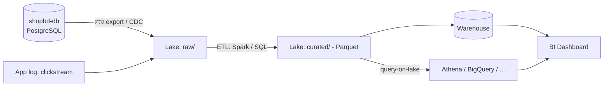
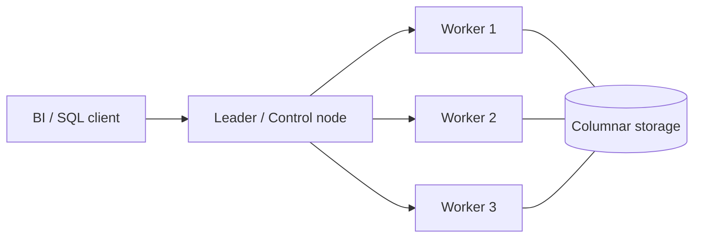

# 16 · Data ও Analytics

> **এই অধ্যায়ে কী শিখবেন**
>
> - OLTP বনাম OLAP, data warehouse, data lake ও lakehouse — কোনটা কী
> - Data lake: object storage + Parquet + partition + catalog
> - Query-on-lake: Athena, BigQuery external table, Synapse serverless, Autonomous Database external table
> - Warehouse: Redshift, BigQuery, Synapse / Microsoft Fabric, Autonomous Data Warehouse
> - ETL / ELT ও orchestration: Glue, Dataflow / Dataproc, Data Factory, OCI Data Integration
> - BI tool ও খরচ কমানোর কৌশল

!!! abstract "এক নজরে — কোন cloud-এ কী নাম"

    | Concept | AWS | GCP | Azure | OCI |
    |---|---|---|---|---|
    | Data lake storage | S3 | Cloud Storage | ADLS Gen2 (Blob + hierarchical namespace), OneLake (Fabric) | Object Storage |
    | Catalog / governance | Glue Data Catalog, Lake Formation | Dataplex Universal Catalog | Microsoft Purview | OCI Data Catalog |
    | Query on lake (serverless) | Athena | BigQuery external / BigLake tables | Synapse serverless SQL, Fabric SQL endpoint | Autonomous DB external tables |
    | Data warehouse | Redshift (Provisioned / Serverless) | BigQuery | Synapse dedicated SQL pool → Microsoft Fabric Warehouse | Autonomous Data Warehouse |
    | ETL / ELT (serverless) | AWS Glue | Dataflow, BigQuery SQL/Dataform | Azure Data Factory / Fabric Data Factory | OCI Data Integration |
    | Managed Spark / Hadoop | EMR, Glue Spark | Dataproc (Serverless for Apache Spark) | Synapse Spark, Azure Databricks, HDInsight | OCI Data Flow, Big Data Service |
    | CDC / replication | DMS, zero-ETL | Datastream | Data Factory CDC, Fabric Mirroring | OCI GoldenGate |
    | Orchestration | Step Functions, MWAA (Airflow) | Cloud Composer (Airflow), Workflows | Data Factory pipelines | Data Integration pipelines |
    | BI | Amazon QuickSight (Quick Suite) | Looker, Looker Studio | Power BI | Oracle Analytics Cloud |

## ১. Data-র দুই জগৎ: OLTP ও OLAP

আগের অধ্যায়ে ([Database](07-databases.md)) আমরা যে PostgreSQL দেখেছি তা **OLTP** (Online Transaction Processing): অসংখ্য ছোট কাজ — একটা order বসানো, একটা stock কমানো। দ্রুত, row-ভিত্তিক।

কিন্তু মালিক যখন জিজ্ঞেস করেন "গত ৩ মাসে কোন জেলায় কোন category সবচেয়ে বেশি বিক্রি হলো?" — সেটা **OLAP** (Online Analytical Processing): কয়েক কোটি row ঘেঁটে কয়েকটা কলামের যোগফল। এটা production DB-তে চালালে ধীর হয় ও customer-দের order আটকে যায়।

| | OLTP | OLAP |
|---|---|---|
| কাজ | লেনদেন (insert/update) | বিশ্লেষণ (aggregate) |
| Query | ছোট, একটা-দুটো row | বড়, কোটি row, কয়েকটা কলাম |
| Storage | Row-oriented | **Column-oriented** |
| Schema | Normalized | Denormalized (star schema) |
| উদাহরণ | RDS, Cloud SQL | Redshift, BigQuery |

!!! note "Analogy"
    OLTP = দোকানের ক্যাশ কাউন্টার (প্রতিটি বিক্রি টুক টুক করে লেখা)। OLAP = মাস শেষে হিসাবরক্ষক পুরো খাতা নিয়ে বসে বিক্রির রিপোর্ট বানান। দুজনকে একই টেবিলে বসালে কাউন্টারের লাইন ধীর হয়।

### Warehouse, Lake ও Lakehouse

| | Data warehouse | Data lake | Lakehouse |
|---|---|---|---|
| কী রাখে | Structured, পরিষ্কার data | যেকোনো কিছু (CSV, JSON, ছবি, log) | Lake-এর data-র ওপর warehouse-এর মতো table/transaction |
| Schema | Write-এর সময় (schema-on-write) | Read-এর সময় (schema-on-read) | Table format (Iceberg/Delta) দিয়ে |
| খরচ | বেশি per TB | সস্তা (object storage) | সস্তা storage + কম্পিউট আলাদা |
| উদাহরণ | BigQuery, Redshift | S3 + Parquet | Iceberg on S3 / BigLake, Fabric OneLake (Delta) |

### ETL বনাম ELT

- **ETL**: Extract → Transform → Load। আগে বাইরে পরিষ্কার করে তারপর warehouse-এ ঢোকানো।
- **ELT**: Extract → Load → Transform। কাঁচা data আগে lake/warehouse-এ, তারপর SQL দিয়ে ভেতরেই রূপান্তর। আধুনিক cloud warehouse-এ কম্পিউট সস্তা ও scalable বলে ELT এখন বেশি প্রচলিত।

### shopbd-র pipeline



## ২. Data lake

Data lake মানে **object storage-এ ফাইল রাখা + তাদের ওপর query চালানোর ক্ষমতা**। কারণ object storage সস্তা ও অসীম — [Storage](06-storage.md) অধ্যায়ের সেই `shopbd-datalake` bucket।

### Layer (medallion) নকশা

| Layer | কী থাকে | shopbd-তে |
|---|---|---|
| **Raw / Bronze** | যেমন এসেছে, অপরিবর্তিত | `raw/orders/2026-11-23.csv` |
| **Cleaned / Silver** | ডুপ্লিকেট বাদ, type ঠিক, Parquet | `curated/orders/dt=2026-11-23/part-0.parquet` |
| **Business / Gold** | রিপোর্টের জন্য aggregate | `marts/daily_sales/` |

### File format: CSV কেন নয়, Parquet কেন

| Format | ধরন | কেমন | কখন |
|---|---|---|---|
| CSV / JSON | Row, text | বড়, ধীর scan, type নেই | ইনপুট/বিনিময়ের জন্য |
| **Parquet** | Column, compressed | ছোট, দ্রুত, query-র জন্য শুধু দরকারি কলাম পড়ে | **lake-এর default** |
| ORC | Column | Parquet-এর মতো (Hive জগতে) | Hadoop ecosystem |
| Avro | Row, schema সহ | Streaming/ইভেন্টে ভালো | Kafka/event data |

### Partitioning

Partition মানে folder দিয়ে ভাগ করা — যেমন `dt=2026-11-23/`। "২৩ নভেম্বরের order" query করলে engine শুধু ওই folder পড়ে। এতে **কম data scan = কম খরচ ও দ্রুত query**।

```text
s3://shopbd-datalake/curated/orders/dt=2026-11-22/part-0.parquet
s3://shopbd-datalake/curated/orders/dt=2026-11-23/part-0.parquet
```

!!! warning "বেশি partition-ও খারাপ"
    প্রতিটা `customer_id` দিয়ে partition করলে কোটি ছোট folder হয় — metadata-র বোঝা বাড়ে। সাধারণত তারিখ (বা মাস) দিয়ে ভাগ করুন; partition প্রতি অন্তত কয়েকশ MB data ভালো।

### Catalog ও Governance

Lake-এর ফাইলগুলো কোথায়, schema কী — এই তথ্য রাখে **catalog**। Query engine ও BI tool এখান থেকে "table" দেখে।

| | AWS | GCP | Azure | OCI |
|---|---|---|---|---|
| Catalog | **Glue Data Catalog** | **Dataplex Universal Catalog** (পুরোনো *Data Catalog* এর উত্তরসূরি) | **Microsoft Purview** (Unity/Fabric catalog-ও) | **OCI Data Catalog** |
| Access control | **Lake Formation** (table/column-level permission) | Dataplex + IAM, BigQuery column policy | Purview + Azure RBAC, Fabric workspace role | IAM policy + Autonomous DB-র নিজস্ব নিয়ম |

### Lakehouse table format

**Apache Iceberg**, **Delta Lake**, **Apache Hudi** — Parquet ফাইলের ওপর metadata layer, যা দেয় ACID transaction, update/delete, টেবিলের পুরোনো অবস্থায় ফেরার (snapshot) সুবিধা। AWS-এ **S3 Tables** (Iceberg), GCP-তে **BigLake** (Iceberg), Fabric-এ **OneLake** (Delta), OCI-তে Autonomous Database ও Data Flow Iceberg/Delta পড়তে পারে। শুরুতে সাধারণ Parquet + partition যথেষ্ট; update/delete বেশি দরকার হলে table format ভাবুন।

### Lake bucket তৈরি

Lake-এর storage হলো [Storage](06-storage.md)-এর মতোই object storage। Azure-তে আলাদা একটা switch আছে: **hierarchical namespace (HNS)** চালু করলে Blob account হয় **ADLS Gen2** — আসল folder, দ্রুত rename, ও ACL।

=== "AWS"

    ```bash
    aws s3 mb s3://shopbd-datalake --region ap-south-1
    aws s3 cp orders-2026-11-23.parquet \
      s3://shopbd-datalake/curated/orders/dt=2026-11-23/part-0.parquet
    ```

=== "GCP"

    ```bash
    gcloud storage buckets create gs://shopbd-datalake --location=asia-south1
    gcloud storage cp orders-2026-11-23.parquet \
      gs://shopbd-datalake/curated/orders/dt=2026-11-23/part-0.parquet
    ```

=== "Azure"

    ```bash
    az storage account create \
      --name shopbddatalake \
      --resource-group shopbd-prod-rg \
      --location centralindia \
      --sku Standard_LRS \
      --kind StorageV2 \
      --enable-hierarchical-namespace true

    az storage fs create --name curated --account-name shopbddatalake --auth-mode login
    ```

=== "OCI"

    ```bash
    oci os bucket create \
      --compartment-id ocid1.compartment.oc1..example \
      --namespace-name my-namespace \
      --name shopbd-datalake

    oci os object put --namespace-name my-namespace --bucket-name shopbd-datalake \
      --name curated/orders/dt=2026-11-23/part-0.parquet --file orders-2026-11-23.parquet
    ```

## ৩. Query-on-lake: lake-এর ফাইলে সরাসরি SQL

Warehouse-এ data কপি না করেই lake-এর Parquet ফাইলের ওপর SQL চালানো যায়। Serverless — কোনো cluster চালু রাখতে হয় না; সাধারণত **কত data scan হলো** তার ওপর খরচ।

| | AWS Athena | BigQuery external / BigLake | Synapse serverless / Fabric SQL endpoint | OCI Autonomous DB external table |
|---|---|---|---|---|
| Engine | Trino/Presto-ভিত্তিক | BigQuery | T-SQL (`OPENROWSET`) | Oracle SQL (`DBMS_CLOUD`) |
| Cluster লাগে? | না | না | না | Autonomous DB instance লাগে |
| খরচের একক | Scanned data (TB) | Scanned data বা slot | Processed data (TB) | Database compute (ECPU) |
| Table-এর সংজ্ঞা | Glue Catalog-এ | BigQuery dataset-এ | External table / view | External table |

=== "AWS"

    Service: **Amazon Athena**। Console: Athena → Query editor। Result রাখার জন্য একটা S3 location দরকার।

    ```sql
    CREATE EXTERNAL TABLE shopbd_lake.orders (
      order_id    string,
      customer_id string,
      district    string,
      total_bdt   double,
      status      string,
      created_at  timestamp
    )
    PARTITIONED BY (dt string)
    STORED AS PARQUET
    LOCATION 's3://shopbd-datalake/curated/orders/';

    MSCK REPAIR TABLE shopbd_lake.orders;   -- নতুন partition folder চিনিয়ে দেয়

    SELECT district, SUM(total_bdt) AS sales
    FROM shopbd_lake.orders
    WHERE dt = '2026-11-23'
    GROUP BY district
    ORDER BY sales DESC;
    ```

    ```bash
    aws athena start-query-execution \
      --query-string "SELECT count(*) FROM shopbd_lake.orders WHERE dt='2026-11-23'" \
      --work-group shopbd-analytics \
      --result-configuration OutputLocation=s3://shopbd-athena-results/
    ```

=== "GCP"

    Service: **BigQuery** (external table) / **BigLake**। Console: BigQuery → Explorer।

    ```sql
    CREATE EXTERNAL TABLE shopbd_analytics.orders_ext
    OPTIONS (
      format = 'PARQUET',
      uris = ['gs://shopbd-datalake/curated/orders/*']
    );

    SELECT district, SUM(total_bdt) AS sales
    FROM shopbd_analytics.orders_ext
    GROUP BY district
    ORDER BY sales DESC;
    ```

    Hive-style partition (`dt=...`) চেনাতে `hive_partition_uri_prefix` সহ external table definition লাগে। **BigLake table** নিলে column-level security ও caching পাওয়া যায়।

=== "Azure"

    Service: **Synapse serverless SQL pool** (বা Fabric lakehouse-এর SQL analytics endpoint)।

    ```sql
    SELECT TOP 10 district, SUM(total_bdt) AS sales
    FROM OPENROWSET(
        BULK 'https://shopbddatalake.dfs.core.windows.net/curated/orders/*/*.parquet',
        FORMAT = 'PARQUET'
    ) AS orders
    GROUP BY district
    ORDER BY sales DESC;
    ```

    Workspace-এর managed identity-কে storage account-এ **Storage Blob Data Reader** role দিতে হয়।

=== "OCI"

    Service: **Autonomous Database**-এ `DBMS_CLOUD` package দিয়ে external table।

    ```sql
    BEGIN
      DBMS_CLOUD.CREATE_EXTERNAL_TABLE(
        table_name    => 'ORDERS_EXT',
        credential_name => 'OBJ_STORE_CRED',
        file_uri_list => 'https://objectstorage.ap-mumbai-1.oraclecloud.com/n/my-namespace/b/shopbd-datalake/o/curated/orders/*.parquet',
        format        => '{"type":"parquet","schema":"first"}'
      );
    END;
    /

    SELECT district, SUM(total_bdt) AS sales FROM ORDERS_EXT GROUP BY district;
    ```

    Credential হিসেবে resource principal বা auth token ব্যবহার করা যায়। বড় Spark কাজে **OCI Data Flow** আলাদা ভালো।

!!! tip "Cost-এর প্রধান নিয়ম: কম scan করুন"
    - Parquet ব্যবহার করুন, শুধু দরকারি কলাম `SELECT` করুন (`SELECT *` নয়)।
    - Partition filter (`WHERE dt = ...`) সবসময় দিন।
    - **Athena workgroup**-এ per-query data limit, **BigQuery**-তে `--dry_run` ও maximum bytes billed দিয়ে ভুলে বিশাল query ঠেকান।

## ৪. Data warehouse

Warehouse = OLAP-এর জন্য বানানো, column-ভিত্তিক, parallel (MPP) query engine।



| | AWS Redshift | GCP BigQuery | Azure Synapse / Fabric Warehouse | OCI Autonomous Data Warehouse |
|---|---|---|---|---|
| মডেল | Provisioned (RA3 node) বা **Serverless** | সম্পূর্ণ serverless | Synapse dedicated pool (DWU) / Fabric capacity (CU) | Autonomous (ECPU, auto-tuning) |
| Compute ও storage | RA3-তে আলাদা | আলাদা | আলাদা | আলাদা |
| খরচের ধরন | Node-hour বা RPU-hour | On-demand (per TB scanned) অথবা capacity (slots) | DWU-hour / Capacity Unit | ECPU-hour + storage |
| বিশেষত্ব | Redshift Spectrum (S3 query), zero-ETL | Partition + clustering, BI Engine, ML in SQL | Power BI-এর সাথে গভীর মিল | Oracle SQL, auto-index, ML |
| Dataset/schema-র নাম | Database → schema | Project → **dataset** → table | Database → schema | Schema (user) |

!!! warning "Azure: Synapse ও Fabric"
    Microsoft-এর কৌশলগত দিক এখন **Microsoft Fabric** (OneLake + Warehouse + Lakehouse + Data Factory + Power BI একসাথে)। **Azure Synapse Analytics** এখনও চলছে ও সমর্থিত, কিন্তু নতুন প্রজেক্ট সাধারণত Fabric দিয়ে শুরু হয়। বর্তমান পরামর্শ শুরুর আগে [Microsoft Learn](https://learn.microsoft.com/fabric/) দেখে নিন।

!!! note "OCI-র নাম বদল"
    Oracle ২০২৫-এ Autonomous Database-কে "Autonomous AI Database" নামেও ডাকতে শুরু করেছে। Workload type (Data Warehouse, Transaction Processing…) আগের মতোই; docs-এ দুই নামই দেখতে পাবেন।

### Warehouse তৈরি ও data load

=== "AWS"

    ```bash
    aws redshift-serverless create-namespace --namespace-name shopbd-analytics
    aws redshift-serverless create-workgroup \
      --workgroup-name shopbd-wg \
      --namespace-name shopbd-analytics \
      --base-capacity 8
    ```

    ```sql
    CREATE TABLE orders (
      order_id    varchar(40),
      customer_id varchar(40),
      district    varchar(40),
      total_bdt   double precision,
      status      varchar(20),
      created_at  timestamp
    );

    COPY orders
    FROM 's3://shopbd-datalake/curated/orders/dt=2026-11-23/'
    IAM_ROLE 'arn:aws:iam::123456789012:role/shopbd-redshift-copy'
    FORMAT AS PARQUET;
    ```

=== "GCP"

    ```bash
    bq mk --dataset --location=asia-south1 my-project-id:shopbd_analytics

    bq load --source_format=PARQUET \
      shopbd_analytics.orders \
      "gs://shopbd-datalake/curated/orders/dt=2026-11-23/*.parquet"

    bq query --use_legacy_sql=false \
      'SELECT district, SUM(total_bdt) AS sales FROM shopbd_analytics.orders GROUP BY district ORDER BY sales DESC'
    ```

    BigQuery-তে server নেই, cluster নেই — dataset বানিয়ে load করলেই হলো। বড় table-এ **partition** (তারিখ) ও **clustering** (যেমন `district`) যোগ করুন।

=== "Azure"

    ```bash
    az extension add --name synapse

    az synapse sql pool create \
      --workspace-name shopbd-synapse \
      --resource-group shopbd-prod-rg \
      --name shopbd_dw \
      --performance-level DW100c
    ```

    ```sql
    COPY INTO dbo.orders
    FROM 'https://shopbddatalake.dfs.core.windows.net/curated/orders/dt=2026-11-23/*.parquet'
    WITH (FILE_TYPE = 'PARQUET');
    ```

    Fabric Warehouse Portal/REST দিয়ে তৈরি হয় এবং একই T-SQL (`COPY INTO`) বোঝে।

=== "OCI"

    ```bash
    oci db autonomous-database create \
      --compartment-id ocid1.compartment.oc1..example \
      --db-name shopbdadw \
      --display-name shopbd-adw \
      --db-workload DW \
      --compute-model ECPU \
      --compute-count 2 \
      --data-storage-size-in-tbs 1 \
      --admin-password '<strong-password>'
    ```

    ```sql
    BEGIN
      DBMS_CLOUD.COPY_DATA(
        table_name      => 'ORDERS',
        credential_name => 'OBJ_STORE_CRED',
        file_uri_list   => 'https://objectstorage.ap-mumbai-1.oraclecloud.com/n/my-namespace/b/shopbd-datalake/o/curated/orders/dt=2026-11-23/*.parquet',
        format          => '{"type":"parquet","schema":"first"}'
      );
    END;
    /
    ```

### Terraform

=== "AWS"

    ```hcl
    resource "aws_redshiftserverless_namespace" "shopbd" {
      namespace_name = "shopbd-analytics"
      db_name        = "shopbd"
    }

    resource "aws_redshiftserverless_workgroup" "shopbd" {
      namespace_name = aws_redshiftserverless_namespace.shopbd.namespace_name
      workgroup_name = "shopbd-wg"
      base_capacity  = 8
    }

    resource "aws_glue_catalog_database" "lake" {
      name = "shopbd_lake"
    }

    resource "aws_athena_workgroup" "analytics" {
      name = "shopbd-analytics"

      configuration {
        bytes_scanned_cutoff_per_query = 10737418240  # ১০ GB-র বেশি scan করলে query বন্ধ
        result_configuration {
          output_location = "s3://shopbd-athena-results/"
        }
      }
    }
    ```

=== "GCP"

    ```hcl
    resource "google_bigquery_dataset" "analytics" {
      dataset_id = "shopbd_analytics"
      location   = "asia-south1"
    }

    resource "google_bigquery_table" "orders" {
      dataset_id          = google_bigquery_dataset.analytics.dataset_id
      table_id            = "orders"
      deletion_protection = true

      time_partitioning {
        type  = "DAY"
        field = "created_at"
      }

      clustering = ["district"]
    }
    ```

=== "Azure"

    ```hcl
    resource "azurerm_storage_account" "lake" {
      name                     = "shopbddatalake"
      resource_group_name      = "shopbd-prod-rg"
      location                 = "centralindia"
      account_tier             = "Standard"
      account_replication_type = "ZRS"
      is_hns_enabled           = true
    }

    resource "azurerm_storage_data_lake_gen2_filesystem" "curated" {
      name               = "curated"
      storage_account_id = azurerm_storage_account.lake.id
    }

    resource "azurerm_data_factory" "etl" {
      name                = "shopbd-adf"
      location            = "centralindia"
      resource_group_name = "shopbd-prod-rg"

      identity {
        type = "SystemAssigned"
      }
    }
    ```

    Warehouse-এর জন্য `azurerm_synapse_workspace` + `azurerm_synapse_sql_pool` অথবা Fabric capacity (`azurerm_fabric_capacity`) — দুটোতেই বেশ কয়েকটা required argument আছে, তাই provider docs দেখে নিন।

=== "OCI"

    ```hcl
    resource "oci_database_autonomous_database" "adw" {
      compartment_id           = var.compartment_id
      db_name                  = "shopbdadw"
      display_name             = "shopbd-adw"
      db_workload              = "DW"
      compute_model            = "ECPU"
      compute_count            = 2
      data_storage_size_in_tbs = 1
      admin_password           = var.adw_admin_password
    }
    ```

## ৫. ETL / ELT ও Orchestration

Data কপি-করা, পরিষ্কার-করা ও সাজানো — এই pipeline-এর সরঞ্জাম:

| কাজ | AWS | GCP | Azure | OCI |
|---|---|---|---|---|
| Serverless ETL | **AWS Glue** (Spark job, crawler, DataBrew) | **Dataflow** (Apache Beam; batch+stream) | **Azure Data Factory** / Fabric Data Factory (pipeline + mapping data flow) | **OCI Data Integration** (visual, data flow) |
| Managed Spark/Hadoop | **EMR** | **Dataproc** (বা Serverless for Apache Spark) | **Synapse Spark**, **Azure Databricks**, HDInsight | **OCI Data Flow**, Big Data Service |
| Schema খুঁজে বের করা | Glue Crawler | Dataplex discovery | Purview scan | Data Catalog harvest |
| CDC (change data capture) | DMS, Aurora→Redshift **zero-ETL** | **Datastream** | Data Factory CDC, Fabric Mirroring | **OCI GoldenGate** |
| Orchestration (workflow/schedule) | Step Functions, **MWAA** (Managed Airflow) | **Cloud Composer** (Airflow), Workflows | Data Factory pipeline trigger | Data Integration schedule / pipeline |
| Streaming → lake | Amazon Data Firehose → S3 | Dataflow / Pub/Sub → BigQuery subscription | Event Hubs Capture / Stream Analytics | OCI Streaming + GoldenGate |

Streaming-এর মূল ধারণা: [Messaging ও Event](11-messaging-and-events.md)।

### একটা Spark ETL — চার জায়গায় একই কোড

PySpark কোড প্রায় অপরিবর্তিত চলে Glue, Dataproc, Synapse/Databricks ও OCI Data Flow-এ — শুধু path-এর scheme আলাদা (`s3://`, `gs://`, `abfss://`, `oci://`)।

```python
from pyspark.sql import SparkSession, functions as F

spark = SparkSession.builder.appName("shopbd-orders-etl").getOrCreate()

raw = spark.read.option("header", True).csv("s3://shopbd-datalake/raw/orders/2026-11-23.csv")

clean = (
    raw.dropDuplicates(["order_id"])
       .withColumn("total_bdt", F.col("total_bdt").cast("double"))
       .withColumn("created_at", F.to_timestamp("created_at"))
       .withColumn("dt", F.date_format("created_at", "yyyy-MM-dd"))
       .filter(F.col("status").isNotNull())
)

clean.write.mode("overwrite").partitionBy("dt").parquet(
    "s3://shopbd-datalake/curated/orders/"
)
```

### প্ল্যাটফর্ম ধরে pipeline

=== "AWS"

    **AWS Glue**: ETL job (Spark), crawler দিয়ে schema আবিষ্কার, Glue Data Catalog।

    ```bash
    aws glue create-database --database-input Name=shopbd_lake

    aws glue start-job-run --job-name shopbd-nightly-orders

    aws glue get-job-runs --job-name shopbd-nightly-orders --max-items 5
    ```

    Orchestration: **EventBridge Scheduler** (রাত ২টা) → **Step Functions** → Glue job → Athena/Redshift। Production database থেকে Redshift-এ **zero-ETL integration** (Aurora/RDS) থাকলে আলাদা ETL pipeline কমানো যায়।

=== "GCP"

    **Dataflow** (Apache Beam, batch ও streaming), **Dataproc** (Spark/Hadoop), **BigQuery Data Transfer Service** (SaaS/GCS থেকে schedule করে load), **Datastream** (CDC)।

    ```bash
    gcloud dataflow jobs list --region=asia-south1

    gcloud dataproc clusters create shopbd-spark \
      --region=asia-south1 \
      --num-workers=2
    ```

    ELT-র ক্ষেত্রে অনেক সময় BigQuery-র ভেতরেই SQL (scheduled query / Dataform) যথেষ্ট — আলাদা ETL tool লাগে না। Orchestration: **Cloud Composer** (Airflow) বা সরল ক্ষেত্রে **Cloud Scheduler + Workflows**।

=== "Azure"

    **Azure Data Factory** — drag-and-drop pipeline, ১০০+ connector (copy activity), mapping data flow (Spark চালায় নিজে)। Fabric-এ **Data Factory** একই ধারণা।

    ```bash
    az extension add --name datafactory

    az datafactory create \
      --resource-group shopbd-prod-rg \
      --factory-name shopbd-adf \
      --location centralindia
    ```

    Pipeline-এর ফর্ম সাধারণত JSON/Portal-এ ডিজাইন হয় ও Git-এ থাকে। Spark-ভিত্তিক বড় কাজে **Azure Databricks** বা Synapse/Fabric notebook।

=== "OCI"

    **OCI Data Integration** (visual ETL ও pipeline), **OCI Data Flow** (managed Apache Spark — আপনি শুধু application দেন), **GoldenGate** (real-time replication)।

    ```bash
    oci data-integration workspace create \
      --compartment-id ocid1.compartment.oc1..example \
      --display-name shopbd-di
    ```

    Oracle Autonomous Database-এ `DBMS_CLOUD` ও scheduler দিয়ে ছোট ELT সরাসরি DB-র ভেতরেই করা যায়।

!!! tip "ছোট দলের জন্য সহজ শুরু"
    প্রথমেই Spark/Airflow-র জটিলতায় যাবেন না। shopbd-র মতো ছোট অনলাইন শপে: **রাতে একটা script** → PostgreSQL থেকে Parquet export → lake → warehouse/Athena-তে SQL। ডেটা বাড়লে তখন managed ETL।

### Orchestration-এ যা থাকা চাই

- **Schedule**: রাত ২টায় চালু (cron বা scheduler)।
- **Dependency**: export শেষ হলে তবেই transform।
- **Retry ও alert**: ব্যর্থ হলে `ops@example.com`-এ email — [Monitoring](12-observability.md)।
- **Idempotent**: একই দিনের job দুবার চালালে duplicate হবে না (`overwrite` partition বা `MERGE`)।

## ৬. Business Intelligence (BI)

BI tool warehouse বা lake-এর table থেকে chart/dashboard বানায়।

| | AWS | GCP | Azure | OCI |
|---|---|---|---|---|
| Tool | **Amazon QuickSight** (এখন Amazon Quick Suite-এর অংশ) | **Looker** (enterprise, semantic layer), **Looker Studio** (বিনামূল্যের সহজ) | **Power BI** (Fabric-এর সাথে) | **Oracle Analytics Cloud** |
| Data source | Athena, Redshift, RDS, S3 | BigQuery, Cloud SQL | Fabric/Synapse, Azure SQL, Excel | Autonomous DB, OCI sources |
| বিশেষত্ব | Pay-per-session, SPICE in-memory engine, embedded analytics | LookML দিয়ে metric সংজ্ঞা এক জায়গায় | Excel-এর মতো পরিচিত, Microsoft 365-এর সাথে মিল | Oracle ecosystem-এর গভীর integration |

প্রতিটি BI tool-এ যা দেখতে হবে: **row-level security** (কে কোন ডেটা দেখবে), **semantic layer** ("revenue" মানে কী তা একবার সংজ্ঞায়িত), refresh schedule, ও কয়জন user-এর license — খরচের প্রধান factor। শুরুতে Looker Studio বা Power BI Desktop-এর মতো সহজ বিকল্পও চলে। Metabase/Superset-এর মতো open source tool-ও যেকোনো cloud-এর warehouse-এ জোড়া যায়।

## ৭. Governance, security ও খরচ

### নিরাপত্তা ও privacy

- **PII (ব্যক্তিগত তথ্য)**: customer-এর ফোন নম্বর, ঠিকানা warehouse-এ আনার আগে **masking/hashing** করুন — analytics-এ আসল নম্বর লাগে না।
- Column-level permission (Lake Formation / BigQuery policy tags / Purview / Oracle Data Redaction)।
- Lake bucket private, encryption চালু ([Security](13-security.md))।
- Access log চালু (CloudTrail data events / Cloud Audit Logs / Storage logs)।
- ডেটা retention নীতি: raw data কতদিন রাখবেন (lifecycle — [Storage](06-storage.md))।

### খরচ কী কী বাড়ায়

| কারণ | কীভাবে নিয়ন্ত্রণ করবেন |
|---|---|
| Scan করা data (Athena, BigQuery on-demand, Synapse serverless) | Parquet, partition, শুধু দরকারি কলাম, query limit |
| Warehouse compute চালু থাকা (Redshift provisioned, Synapse dedicated, ADW) | Serverless/pause/auto-scale; ব্যবহারহীন সময়ে বন্ধ |
| ETL job-এর সময় | ছোট ছোট ফাইল জুড়ে বড় ফাইল (কয়েকশ MB); incremental load |
| Storage | Lifecycle, পুরোনো raw → cold/archive |
| Cross-region/egress transfer | Lake ও warehouse একই region-এ |
| BI user license | Viewer vs Author আলাদা করা |

দাম বাদ দিয়ে শুধু এই কারণগুলো মাথায় রাখুন; হিসাব করতে অফিসিয়াল calculator: [AWS](https://calculator.aws/), [GCP](https://cloud.google.com/products/calculator), [Azure](https://azure.microsoft.com/pricing/calculator/), [OCI](https://www.oracle.com/cloud/costestimator.html)। বিস্তারিত: [Cost Management](18-cost-management.md)।

## মিল ও অমিল

| বিষয় | AWS | GCP | Azure | OCI |
|---|---|---|---|---|
| Warehouse "serverless"? | Redshift Serverless (RPU) | BigQuery (মূলত serverless) | Fabric / Synapse serverless (query-only) | Autonomous (auto-scale, কিন্তু instance আছে) |
| Query-on-lake-এর একক | Athena (আলাদা service) | BigQuery-র ভেতরেই external table | Synapse serverless / Fabric endpoint | Autonomous DB external table |
| Catalog | Glue (de-facto) | Dataplex | Purview | OCI Data Catalog |
| Orchestration | Step Functions / MWAA | Composer (Airflow) | Data Factory | Data Integration |
| "Dataset" শব্দ | Database/schema | **Dataset** (project-এর নিচে) | Database/schema | Schema |
| মূল ভাষা | Presto-SQL (Athena), Redshift SQL | GoogleSQL (BigQuery) | T-SQL | Oracle SQL / PL-SQL |
| Platform strategy | আলাদা আলাদা service-এর সমষ্টি | বেশিরভাগ BigQuery-কেন্দ্রিক | Fabric-এ একত্রীকরণ | Autonomous DB-কেন্দ্রিক |

**Gotcha**

- **SQL dialect আলাদা:** Athena (Trino), BigQuery (GoogleSQL), Synapse (T-SQL), Oracle — date function ও `LIMIT`/`TOP` ভিন্ন। এক cloud-এর query অন্যটায় সরাসরি চলে না।
- **Region মেলানো:** BigQuery dataset `asia-south1`-এ হলে GCS bucket-ও একই region/location-এ হওয়া ভালো — cross-location load/query-তে সমস্যা বা খরচ হয়।
- **Athena-তে নতুন partition ধরা পড়ে না** `MSCK REPAIR TABLE` / partition projection ছাড়া।
- **Synapse dedicated pool চালু থাকলেই বিল** — ব্যবহার না করলে pause করুন।
- **BigQuery on-demand-এ `SELECT *`** পুরো table-এর scan-এর বিল আনে — `LIMIT` খরচ কমায় না!
- **OCI Autonomous Database-এ external table-এর credential** আগে `DBMS_CLOUD.CREATE_CREDENTIAL` দিয়ে বানাতে হয়।
- **Azure Data Factory-র pipeline থেকে storage access** managed identity ও role assignment ছাড়া ব্যর্থ হয়।

## Real-world: shopbd

shopbd-র মালিকের প্রশ্ন: "প্রতিদিন কোন জেলায় কত বিক্রি? কোন product সবচেয়ে বেশি ফেরত আসছে?" — একটা ছোট কিন্তু সঠিক data pipeline:

1. **Source**: `shopbd-db` (PostgreSQL) — read replica থেকে ([Database](07-databases.md)), production-এর ওপর চাপ ছাড়াই।
2. **রাত ২টা** একটা scheduled job: গতকালের order ও order_items Parquet-এ export করে `raw/` ও `curated/orders/dt=YYYY-MM-DD/`-এ লেখে (ফোন নম্বর hash করে)।
3. **Query**: প্রথমে lake-এর ওপর সরাসরি Athena / BigQuery external / Synapse serverless / ADB external table-এ SQL।
4. **Warehouse** (ঐচ্ছিক, ডেটা বাড়লে): orders, products, customers-এর star schema।
5. **Dashboard**: BI tool-এ "আজকের বিক্রি", "জেলাভিত্তিক বিক্রি", "ফেরতের হার" — সকাল ৯টায় refresh।
6. **Alert**: job ব্যর্থ হলে `ops@example.com`-এ email।

সবচেয়ে সাধারণ রিপোর্ট query (ধারণা একই, dialect ভিন্ন):

```sql
SELECT
  district,
  COUNT(*)        AS orders,
  SUM(total_bdt)  AS sales_bdt
FROM orders
WHERE dt BETWEEN '2026-11-01' AND '2026-11-30'
  AND status = 'delivered'
GROUP BY district
ORDER BY sales_bdt DESC
LIMIT 10;
```

| ধাপ | AWS | GCP | Azure | OCI |
|---|---|---|---|---|
| Lake | S3 `shopbd-datalake` | GCS `shopbd-datalake` | ADLS Gen2 `shopbddatalake` | Object Storage `shopbd-datalake` |
| ETL | Glue job (Spark) / cron script | Dataflow বা BigQuery scheduled query | Data Factory | Data Integration / Data Flow |
| Query | Athena (+ Redshift Serverless) | BigQuery | Synapse serverless (+ Fabric) | Autonomous DW |
| Dashboard | QuickSight | Looker Studio | Power BI | Oracle Analytics Cloud |
| Schedule | EventBridge Scheduler | Cloud Scheduler | ADF trigger | OCI Scheduler / Data Integration schedule |

ছোট শুরুর পরামর্শ: প্রথমে **শুধু lake + serverless query + একটা বিনামূল্যের BI tool** — warehouse তখনই, যখন query ধীর হচ্ছে বা অনেক মানুষ একসাথে dashboard দেখছে।

## Best practices

- **OLTP-তে analytics নয়**: read replica বা আলাদা warehouse/lake ব্যবহার করুন।
- **Parquet + partition by date** lake-এর default; ছোট ফাইলের বদলে কয়েকশ MB-র ফাইল।
- **Layer রাখুন**: raw অপরিবর্তিত রাখুন — transform ভুল হলে আবার চালানো যায়।
- **ELT প্রাধান্য**: কাঁচা data আগে আনুন, SQL দিয়ে ভেতরে transform; version-controlled SQL (Dataform/dbt)।
- **Idempotent pipeline**: একই job দুবার চালালে ফল একই।
- **Catalog ও schema ডকুমেন্ট করুন**; data owner ঠিক করুন।
- **PII mask/hash**, column-level permission, least privilege ([Identity ও Access](03-identity-and-access.md))।
- **Cost guardrail**: query bytes limit, budget alert, auto-pause।
- **Data quality check**: row count, null check, duplicate check — pipeline-এর ধাপে।
- **Monitoring**: job ব্যর্থতা, data freshness (আজকের partition এসেছে কি না)।
- **একই region-এ** lake, warehouse ও compute।

## Common mistakes

| ভুল | ফল | সমাধান |
|---|---|---|
| Production DB-তে ভারী report query | App ধীর, timeout | Read replica / warehouse |
| CSV-তে lake রাখা | বড়, ধীর, দামি scan | Parquet-এ রূপান্তর |
| Partition ছাড়া বা অত্যধিক partition | সব scan বা metadata-র বোঝা | তারিখ-ভিত্তিক সঠিক granularity |
| `SELECT *` | অপ্রয়োজনীয় scan খরচ | শুধু দরকারি কলাম |
| Warehouse চালু রেখে ভুলে যাওয়া | অকারণে বিল | Serverless / auto-pause / schedule |
| Raw data না রেখে শুধু transform-করা data রাখা | ভুল হলে আর ঠিক করা যায় না | Bronze/raw স্থায়ী রাখুন |
| Non-idempotent job | Retry-তে duplicate row | Partition overwrite / MERGE |
| PII (ফোন, ঠিকানা) সরাসরি analytics-এ | Privacy ঝুঁকি | Hash/mask, access control |
| Lake ও warehouse ভিন্ন region-এ | বাড়তি egress ও ধীর load | একই region |
| একটাই বিশাল "everything" Spark cluster | খরচ ও জটিলতা | Serverless job বা ছোট ছোট কাজ |
| BI-তে সবাইকে সব data দেখানো | তথ্য ফাঁস | Row/column-level security |

## ইন্টারভিউ / সার্টিফিকেশন টিপস

??? question "Data warehouse আর data lake-এর পার্থক্য কী?"
    Warehouse: structured, পরিষ্কার, schema-on-write, দ্রুত SQL (BigQuery, Redshift)। Lake: যেকোনো ধরনের কাঁচা data, সস্তা object storage, schema-on-read। Lakehouse দুটোর সুবিধা একত্র করে (Iceberg/Delta)।

??? question "ETL আর ELT-এর পার্থক্য?"
    ETL-এ transform load-এর আগে (বাইরের engine-এ); ELT-এ কাঁচা data আগে load, তারপর warehouse-এর কম্পিউট দিয়ে transform। আধুনিক cloud-এ ELT বেশি প্রচলিত।

??? question "Athena বা BigQuery-তে খরচ কমানোর উপায়?"
    Columnar format (Parquet), partition + partition filter, শুধু প্রয়োজনীয় কলাম, query-র সীমা (workgroup limit / max bytes billed), result caching।

??? question "Redshift Serverless বনাম Provisioned কখন?"
    Workload অনিয়মিত/অজানা হলে Serverless (ব্যবহারের ভিত্তিতে)। স্থির, ভারী workload ও নিয়ন্ত্রণ/reserved-দামের সুবিধা চাইলে Provisioned RA3।

??? question "BigQuery slot কী? On-demand ও capacity pricing-এর পার্থক্য?"
    Slot = BigQuery-র কম্পিউট একক। On-demand: scan করা data অনুযায়ী খরচ। Capacity: নির্দিষ্ট slot reserve করে স্থির খরচ — প্রচুর ও পূর্বানুমেয় query থাকলে সুবিধা।

??? question "Parquet কেন দ্রুত?"
    Column-ভিত্তিক সংরক্ষণ — query শুধু দরকারি কলাম পড়ে; compression ভালো; metadata (min/max) দিয়ে row group বাদ দেওয়া যায় (predicate pushdown)।

??? question "Synapse আর Fabric-এর সম্পর্ক?"
    Fabric হলো Microsoft-এর নতুন unified analytics platform (OneLake, Warehouse, Lakehouse, Data Factory, Power BI)। Synapse এখনও সমর্থিত, তবে নতুন কাজ সাধারণত Fabric-এ যায়।

??? question "CDC কী এবং কেন দরকার?"
    Change Data Capture — source database-এর পরিবর্তন (insert/update/delete) প্রায় real-time ধরে অন্য জায়গায় পাঠানো। Batch export-এর চেয়ে নতুন, production-এ কম চাপ। Tool: DMS/zero-ETL, Datastream, Fabric Mirroring/Data Factory, GoldenGate।

## সারসংক্ষেপ

- **OLTP ও OLAP আলাদা** রাখুন; analytics production DB-তে নয়।
- **Data lake** = object storage + **Parquet** + **partition** + **catalog**; লেয়ার: raw → curated → marts।
- **Query-on-lake** (Athena / BigQuery external / Synapse serverless / ADB external) — warehouse ছাড়াই শুরু করার সহজ পথ; খরচ scan-এর ওপর।
- **Warehouse**: Redshift, BigQuery, Synapse → Fabric, Autonomous Data Warehouse — column-ভিত্তিক MPP।
- **ETL/ELT**: Glue, Dataflow/Dataproc, Data Factory, OCI Data Integration/Data Flow; PySpark কোড প্রায় সব জায়গায় চলে।
- **Orchestration ও idempotency**, **PII masking** ও **cost guardrail** ছাড়া pipeline production-ready নয়।
- **BI**: QuickSight, Looker/Looker Studio, Power BI, Oracle Analytics Cloud।
- shopbd: replica → রাতে Parquet → lake → serverless query → dashboard; warehouse পরে।

পরের অধ্যায়: [17 · AI ও Machine Learning](17-ai-ml.md)।
