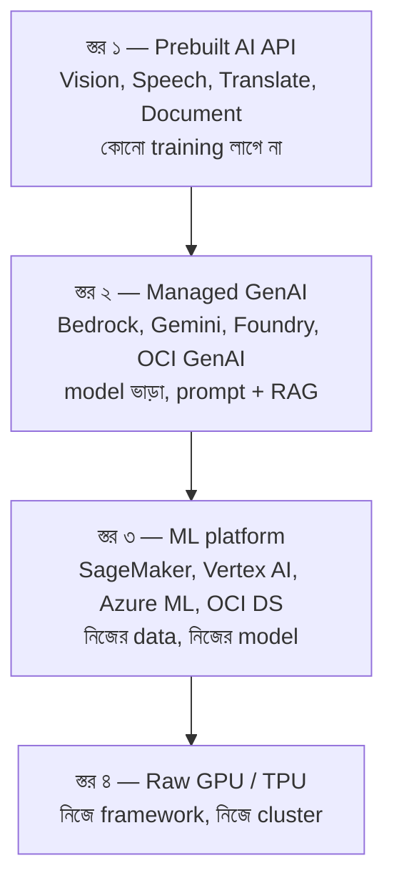
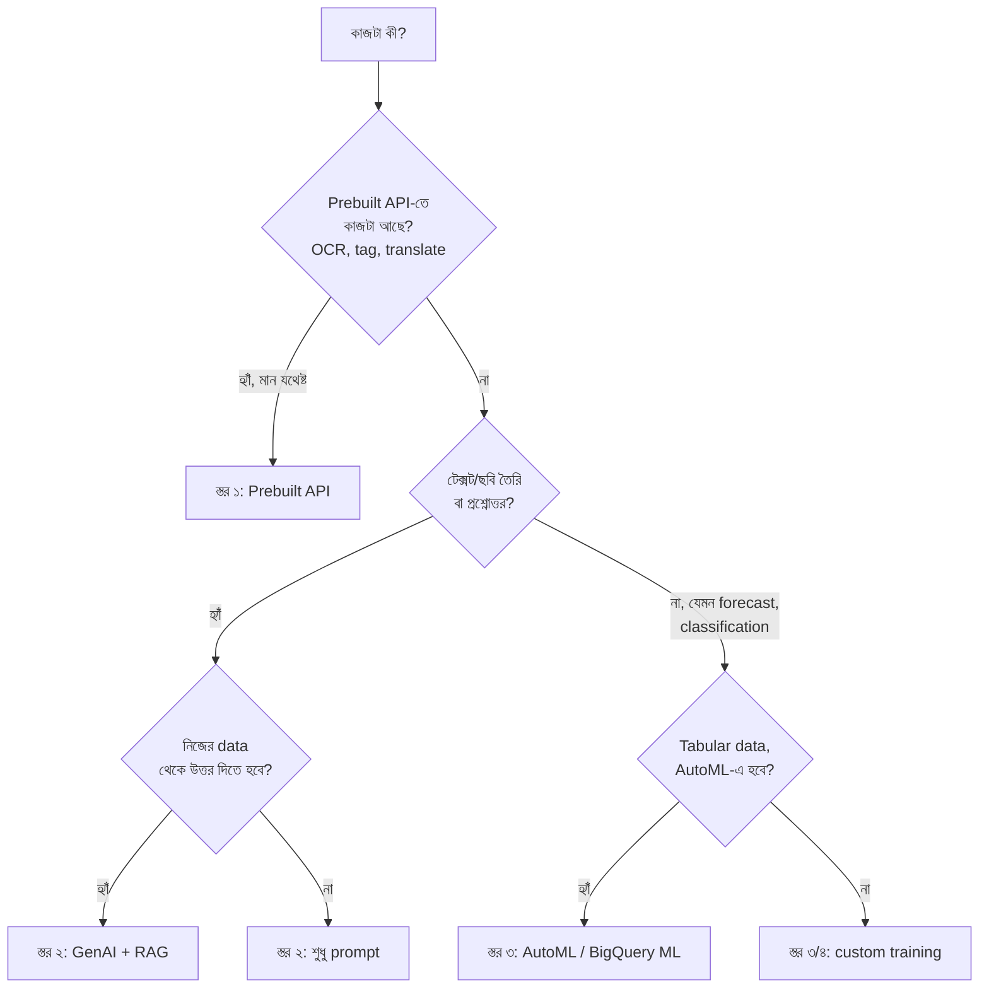
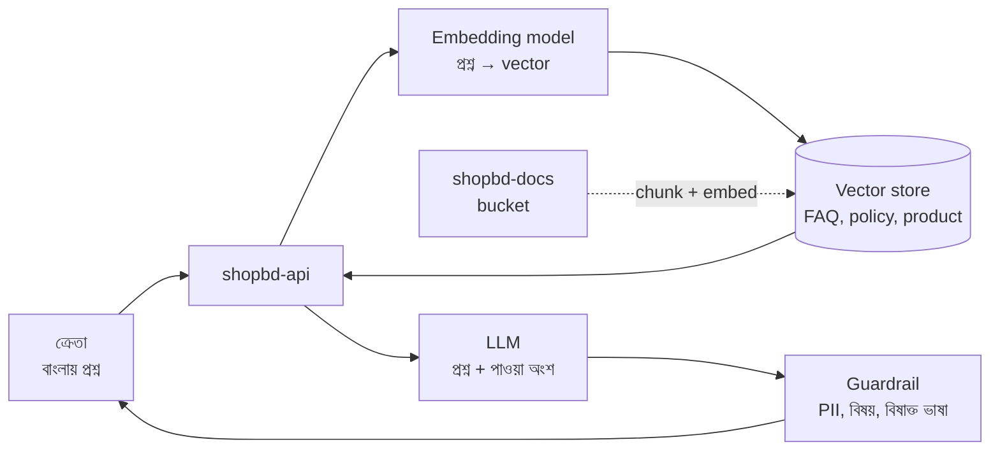
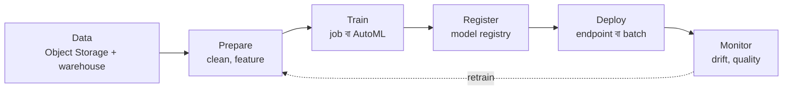
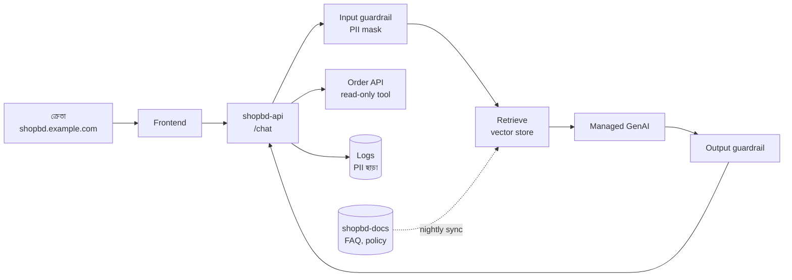

# 17 · AI ও Machine Learning

> এই অধ্যায়ে কী শিখবেন
>
> - AI-এর চারটি স্তর: prebuilt AI API, managed Generative AI, ML platform ও নিজের GPU — কখন কোনটা বেছে নেবেন
> - চার cloud-এর ML platform (SageMaker AI, Vertex AI, Azure Machine Learning, OCI Data Science) ও training/inference-এর ধরন
> - Managed GenAI (Bedrock, Gemini on Vertex AI, Microsoft Foundry / Azure OpenAI, OCI Generative AI) দিয়ে RAG, agent ও guardrail
> - Vision, speech, translate ও document-এর prebuilt API দিয়ে বিনা training-এ কাজ চালানো
> - GPU/accelerator, quota ও capacity — আর কেন GPU endpoint ভুলে চালু রাখা সবচেয়ে ব্যয়বহুল ভুল
> - Responsible AI: privacy, hallucination, bias, guardrail ও cost control

`shopbd` এখন আর শুধু একটা দোকান না — ক্রেতারা বাংলায় প্রশ্ন করে, ম্যানেজার জানতে চান আগামী মাসে কত বিক্রি হবে, আর হাজার হাজার product-এর description লেখার লোক নেই।
এই চারটা সমস্যাই AI দিয়ে সমাধান করা যায় — কিন্তু প্রতিটার জন্য আলাদা স্তরের tool লাগে। এই অধ্যায়ে আমরা সেটাই শিখব।

!!! abstract "এক নজরে — কোন cloud-এ কী নাম"

    | Concept | AWS | GCP | Azure | OCI |
    |---|---|---|---|---|
    | ML platform (build, train, deploy) | Amazon SageMaker AI | Vertex AI | Azure Machine Learning | OCI Data Science |
    | Managed GenAI (model API) | Amazon Bedrock | Gemini on Vertex AI + Model Garden | Microsoft Foundry (Azure OpenAI, Foundry Models) | OCI Generative AI |
    | Agent / RAG builder | Bedrock Knowledge Bases, Agents, AgentCore | Vertex AI Agent Builder, RAG Engine | Foundry Agent Service, Azure AI Search | OCI Generative AI Agents |
    | Guardrail / safety | Bedrock Guardrails | Safety filters, Model Armor | Azure AI Content Safety | OCI Generative AI guardrails |
    | Vision (image tagging, OCR) | Rekognition, Textract | Cloud Vision API, Document AI | Azure AI Vision, Document Intelligence | OCI Vision, Document Understanding |
    | Speech | Transcribe, Polly | Speech-to-Text, Text-to-Speech | Azure AI Speech | OCI Speech |
    | Translate | Amazon Translate | Cloud Translation | Azure AI Translator | OCI Language (translation) |
    | Text analytics (NLP) | Comprehend | Natural Language API | Azure AI Language | OCI Language |
    | Forecasting | SageMaker (Chronos/DeepAR); Amazon Forecast নতুন customer নেয় না | BigQuery ML (ARIMA_PLUS, TimesFM) | Azure ML AutoML forecasting | OCI Forecasting, Data Science AutoML |
    | Vector search | OpenSearch, Aurora pgvector, Bedrock KB | Vertex AI Vector Search, AlloyDB/Cloud SQL pgvector | Azure AI Search, PostgreSQL pgvector | OCI Search with OpenSearch, Oracle AI Vector Search, pgvector |
    | GPU VM | P5/P4d (training), G5/G6 (inference) | A3/A4 (training), G2 (inference) | ND-series (training), NC-series (inference) | BM.GPU.* bare metal, VM.GPU.* |
    | নিজস্ব AI chip | Trainium, Inferentia | TPU | Maia (শুধু Microsoft-এর নিজের workload) | — (NVIDIA ও AMD GPU) |

## ১. AI-এর চারটি স্তর — কোথায় শুরু করবেন?

"AI করব" বললে অনেকেই সোজা GPU কেনার কথা ভাবেন। আসলে cloud-এ AI চারটা স্তরে পাওয়া যায়, আর **ওপরের স্তরে যত থাকবেন, কাজ তত কম**।
একটা দোকানের উদাহরণ ভাবুন: ওপরের স্তর হলো তৈরি খাবার কিনে আনা, নিচের স্তর হলো নিজে ধান চাষ করা। বেশিরভাগ সময় আপনার ধান চাষের দরকার নেই।



| স্তর | কী করেন | দক্ষতা | খরচের ধরন | shopbd উদাহরণ |
|---|---|---|---|---|
| ১. Prebuilt API | ছবি/অডিও/টেক্সট পাঠান, উত্তর পান | শুধু API call | প্রতি request/ছবি/মিনিট | product ছবির tag, অনুবাদ |
| ২. Managed GenAI | prompt লেখেন, RAG বানান | prompt engineering | প্রতি token (অথবা reserved capacity) | description generator, chatbot |
| ৩. ML platform | নিজের data দিয়ে model train/deploy | ML engineer | training job-ঘণ্টা + endpoint-ঘণ্টা | sales forecast, recommendation |
| ৪. Raw GPU | সব নিজে | ML infra engineer | GPU instance-ঘণ্টা | নিজের Bangla LLM fine-tune |

### কোনটা বেছে নেবেন



!!! tip "নিয়মটা মনে রাখুন"
    আগে ওপরের স্তরে চেষ্টা করুন। মান কম হলে তবেই নিচে নামুন। Prebuilt API বা prompt দিয়ে ৮০% কাজ হলে বাকি ২০%-এর জন্য নিজের model বানানো প্রায় কখনোই লাভজনক না।

## ২. Prebuilt AI API — training ছাড়াই AI

এগুলো হলো "AI as a REST API"। আপনি ছবি পাঠান, JSON ফেরত আসে। Model কীভাবে চলে, GPU কোথায় — সব cloud দেখে। বিল হয় প্রতি call বা প্রতি ইউনিট-এ।

| কাজ | AWS | GCP | Azure | OCI |
|---|---|---|---|---|
| ছবির label/object | Rekognition | Cloud Vision API | Azure AI Vision (Image Analysis) | OCI Vision |
| ছবি/PDF থেকে লেখা (OCR) | Textract, Rekognition text | Vision OCR, Document AI | Document Intelligence, AI Vision Read | Document Understanding |
| Speech → text | Transcribe | Speech-to-Text | Azure AI Speech | OCI Speech |
| Text → speech | Polly | Text-to-Speech | Azure AI Speech | — (আলাদা TTS service সীমিত; docs দেখুন) |
| অনুবাদ | Translate | Cloud Translation | Azure AI Translator | OCI Language |
| Sentiment, entity | Comprehend | Natural Language API | Azure AI Language | OCI Language |
| Content moderation | Rekognition moderation | Vision SafeSearch | Azure AI Content Safety | OCI Vision / Language classifiers |
| Anomaly detection | Lookout (সীমিত), SageMaker | Vertex AI | Azure AI (Anomaly Detector retired) | OCI Anomaly Detection |

!!! warning "বাংলা ভাষার সাপোর্ট আলাদা আলাদা"
    Translate সব cloud-এ বাংলা (`bn`) সাপোর্ট করে। কিন্তু speech-to-text, sentiment বা entity extraction-এ বাংলার মান ও locale (`bn-BD` বনাম `bn-IN`) cloud ও সময়ভেদে বদলায়।
    **Production-এ নেওয়ার আগে নিজের প্রকৃত বাংলা নমুনা দিয়ে চার cloud-এই পরীক্ষা করুন** — language list-এর তালিকা দেখেই সিদ্ধান্ত নেবেন না।

### ২.১ উদাহরণ: shopbd-র product ছবিতে auto-tag

`shopbd-images` bucket-এ বিক্রেতারা ছবি তোলেন। আমরা চাই প্রতিটা ছবি থেকে "saree", "cotton", "red" — এ ধরনের tag বের হোক, যাতে search ভালো হয়।

=== "AWS"

    Service: **Amazon Rekognition** — `DetectLabels`। ছবি S3-তে থাকলে সরাসরি reference দেওয়া যায়, ডাউনলোড লাগে না।

    ```bash
    aws rekognition detect-labels \
      --region ap-south-1 \
      --image '{"S3Object":{"Bucket":"shopbd-images","Name":"products/1001.jpg"}}' \
      --max-labels 10 \
      --min-confidence 80
    ```

    Console: Rekognition → Label detection → ছবি upload করে demo দেখা যায়।

=== "GCP"

    Service: **Cloud Vision API** — label detection। আগে API enable করতে হয়।

    ```bash
    gcloud services enable vision.googleapis.com

    gcloud ml vision detect-labels gs://shopbd-images/products/1001.jpg
    ```

    Console: APIs & Services → Cloud Vision API; অথবা Vision-এর "Try it" পাতা।

=== "Azure"

    Service: **Azure AI Vision** — Image Analysis (`tags` feature)। Resource বানিয়ে key বা Entra ID দিয়ে call করতে হয়।

    ```bash
    az cognitiveservices account create \
      --name shopbd-vision --resource-group shopbd-ai-rg \
      --kind ComputerVision --sku S1 --location centralindia

    curl -X POST \
      "https://shopbd-vision.cognitiveservices.azure.com/computervision/imageanalysis:analyze?api-version=2024-02-01&features=tags" \
      -H "Ocp-Apim-Subscription-Key: $VISION_KEY" \
      -H "Content-Type: application/json" \
      -d '{"url":"https://shopbd.example.com/img/1001.jpg"}'
    ```

=== "OCI"

    Service: **OCI Vision** — image classification/object detection। Object Storage-এর ছবি সরাসরি reference করা যায়। Python SDK সবচেয়ে সহজ পথ।

    ```python
    import oci

    config = oci.config.from_file()
    client = oci.ai_vision.AIServiceVisionClient(config)

    details = oci.ai_vision.models.AnalyzeImageDetails(
        compartment_id="ocid1.compartment.oc1..example",
        features=[oci.ai_vision.models.ImageClassificationFeature(max_results=10)],
        image=oci.ai_vision.models.ObjectStorageImageDetails(
            namespace_name="my-namespace",
            bucket_name="shopbd-images",
            object_name="products/1001.jpg",
        ),
    )
    print(client.analyze_image(details).data)
    ```

### ২.২ অনুবাদ ও speech — shopbd-তে কোথায় লাগে

- **Translate:** ইংরেজি product title থেকে বাংলা title বানানো, বা ক্রেতার বাংলা review ইংরেজিতে অনুবাদ করে analytics-এ পাঠানো।
- **Speech-to-text:** কাস্টমার কেয়ারের ফোন কলের recording থেকে transcript বানিয়ে "অভিযোগ কোন বিষয়ে" বের করা। বাংলা উচ্চারণ ও আঞ্চলিকতায় মান কমতে পারে — sample দিয়ে WER (word error rate) মেপে নিন।
- **Document AI:** supplier-এর চালান/invoice-এর ছবি থেকে নম্বর, তারিখ, টাকার অঙ্ক বের করা।

=== "AWS"

    ```bash
    aws translate translate-text \
      --region ap-south-1 \
      --text "Handloom cotton saree, free delivery in Dhaka" \
      --source-language-code en --target-language-code bn
    ```

=== "GCP"

    ```bash
    curl -X POST "https://translation.googleapis.com/language/translate/v2" \
      -H "Authorization: Bearer $(gcloud auth print-access-token)" \
      -H "x-goog-user-project: my-project-id" \
      -H "Content-Type: application/json" \
      -d '{"q":"Handloom cotton saree, free delivery in Dhaka","source":"en","target":"bn","format":"text"}'
    ```

=== "Azure"

    ```bash
    curl -X POST "https://api.cognitive.microsofttranslator.com/translate?api-version=3.0&from=en&to=bn" \
      -H "Ocp-Apim-Subscription-Key: $TRANSLATOR_KEY" \
      -H "Ocp-Apim-Subscription-Region: centralindia" \
      -H "Content-Type: application/json" \
      -d '[{"Text":"Handloom cotton saree, free delivery in Dhaka"}]'
    ```

=== "OCI"

    OCI-তে অনুবাদ **OCI Language** service-এর অংশ। Console: Analytics & AI → Language → Text translation। Programmatic ব্যবহারে `oci.ai_language.AIServiceLanguageClient`-এর batch translation API আছে; সমর্থিত ভাষার তালিকা (বাংলা সহ) আপনার region-এর docs-এ মিলিয়ে নিন।

## ৩. Managed Generative AI — model ভাড়া নিন, বানাবেন না

**Generative AI (GenAI)** মানে এমন model যা টেক্সট, ছবি, কোড তৈরি করে (LLM — Large Language Model)। এই model train করতে কোটি কোটি টাকার GPU লাগে, তাই cloud আপনাকে **API হিসেবে ভাড়া** দেয়। আপনি prompt পাঠান, প্রতি **token** (শব্দের টুকরো; বাংলায় একটা শব্দে প্রায়ই একাধিক token যায়) হিসাবে বিল দেওয়া হয়।

| বৈশিষ্ট্য | AWS Bedrock | GCP Vertex AI | Azure Foundry | OCI Generative AI |
|---|---|---|---|---|
| নিজস্ব model | Amazon Nova, Titan embeddings | Gemini, Imagen, Veo, Gemma (open) | — (OpenAI model হোস্ট করে; Microsoft-এর নিজস্ব model-ও আছে) | — (Cohere, Meta Llama, xAI ইত্যাদি হোস্ট করে) |
| তৃতীয় পক্ষের model | Anthropic, Meta, Mistral, Cohere ইত্যাদি | Model Garden: Anthropic Claude, Llama, Mistral ইত্যাদি | OpenAI, Meta, Mistral, DeepSeek ইত্যাদি (Foundry Models) | Cohere, Meta Llama ইত্যাদি |
| Unified API | Converse API | Gemini API / Gen AI SDK | OpenAI-compatible API | Generative AI Inference API (chat) |
| On-demand (pay per token) | হ্যাঁ | হ্যাঁ | Standard / Global Standard | On-demand |
| Reserved capacity | Provisioned Throughput | Provisioned Throughput | Provisioned (PTU) | Dedicated AI Cluster |
| Batch (সস্তা, ধীর) | Batch inference | Batch prediction | Batch deployment | — (docs দেখুন) |
| Fine-tuning | Custom models / fine-tuning | Supervised tuning | Foundry fine-tuning | Dedicated AI Cluster-এ fine-tune |

!!! note "নাম বদলের হিসাব"
    - Azure-এর পুরোনো নাম: **Azure AI Studio → Azure AI Foundry → Microsoft Foundry**। পুরোনো ব্লগে যেকোনো একটা দেখতে পারেন। "Azure OpenAI Service" নামটা এখনও চলে, তবে এখন এটা Foundry Models-এর ভেতরের একটা ধরন।
    - AWS-এর **SageMaker** এখন **Amazon SageMaker AI** নামে পরিচিত; "SageMaker" নামটা বৃহত্তর data+AI প্ল্যাটফর্ম (Unified Studio) বোঝাতেও ব্যবহার হয়।
    - Model-এর নাম ও ভার্সন খুব দ্রুত বদলায় ও পুরোনো model retire হয়। Code-এ model ID hardcode না করে config-এ রাখুন।

### ৩.১ Model access ও region

- প্রতিটা model সব region-এ নেই। Bangladesh থেকে latency-র জন্য Mumbai (`ap-south-1`, `asia-south1`, `centralindia`, `ap-mumbai-1`) ভালো, কিন্তু **model availability আগে console-এ দেখুন**।
- AWS-এ **cross-region inference profile** দিয়ে request অন্য region-এ route হতে পারে। GCP-তে `global` endpoint আছে। Azure-এ **Global Standard** deployment ডেটা প্রসেসিংয়ে region বদলাতে পারে। অর্থাৎ **data residency কড়া হলে এই অপশনগুলো বন্ধ রাখুন** বা docs পড়ে নিশ্চিত হোন।
- কিছু model প্রথমবার ব্যবহারে use-case form বা Marketplace subscription/EULA গ্রহণ করতে হয়।

### ৩.২ Hello GenAI — shopbd product description

কাজ: product-এর কিছু attribute থেকে বাংলায় ৩ লাইনের description তৈরি।

=== "AWS"

    Service: **Amazon Bedrock** — `Converse` API (সব model-এর জন্য একই আকার)।

    ```bash
    aws bedrock list-foundation-models --region ap-south-1 \
      --query "modelSummaries[].modelId" --output text

    # MODEL_ID: a model or inference profile ID available in your region
    aws bedrock-runtime converse \
      --region ap-south-1 \
      --model-id "$MODEL_ID" \
      --messages '[{"role":"user","content":[{"text":"Write a 3-line Bangla product description: handloom cotton saree, red, 6.3m."}]}]' \
      --inference-config '{"maxTokens":300,"temperature":0.4}'
    ```

    ```python
    import boto3

    client = boto3.client("bedrock-runtime", region_name="ap-south-1")
    resp = client.converse(
        modelId="MODEL_ID",
        messages=[{"role": "user", "content": [{"text": "Describe: handloom cotton saree, red"}]}],
        inferenceConfig={"maxTokens": 300, "temperature": 0.4},
    )
    print(resp["output"]["message"]["content"][0]["text"])
    ```

=== "GCP"

    Service: **Gemini on Vertex AI**। প্রথমে API enable করুন, তারপর Google Gen AI SDK দিয়ে Vertex মোডে call করুন।

    ```bash
    gcloud services enable aiplatform.googleapis.com
    gcloud auth application-default login
    pip install google-genai
    ```

    ```python
    from google import genai

    client = genai.Client(vertexai=True, project="my-project-id", location="asia-south1")
    resp = client.models.generate_content(
        model="gemini-2.5-flash",  # replace with a currently available model
        contents="Write a 3-line Bangla product description: handloom cotton saree, red, 6.3m.",
    )
    print(resp.text)
    ```

=== "Azure"

    Service: **Microsoft Foundry / Azure OpenAI**। আগে resource, তারপর model **deployment** বানাতে হয় — call করার সময় model-এর নাম নয়, **deployment-এর নাম** দিতে হয়।

    ```bash
    az cognitiveservices account create \
      --name shopbd-openai --resource-group shopbd-ai-rg \
      --kind OpenAI --sku S0 --location swedencentral \
      --custom-domain shopbd-openai

    az cognitiveservices account deployment create \
      --name shopbd-openai --resource-group shopbd-ai-rg \
      --deployment-name shopbd-desc \
      --model-name gpt-4o-mini --model-version "2024-07-18" \
      --model-format OpenAI --sku-name Standard --sku-capacity 10
    ```

    ```python
    from azure.identity import DefaultAzureCredential, get_bearer_token_provider
    from openai import AzureOpenAI

    token_provider = get_bearer_token_provider(
        DefaultAzureCredential(), "https://cognitiveservices.azure.com/.default"
    )
    client = AzureOpenAI(
        azure_endpoint="https://shopbd-openai.openai.azure.com",
        azure_ad_token_provider=token_provider,
        api_version="2024-10-21",
    )
    resp = client.chat.completions.create(
        model="shopbd-desc",  # deployment name
        messages=[{"role": "user", "content": "Write a 3-line Bangla description: handloom cotton saree"}],
    )
    print(resp.choices[0].message.content)
    ```

=== "OCI"

    Service: **OCI Generative AI** — on-demand model, ঠিক কোন model কোন region-এ আছে তা docs/console-এ দেখুন (সব region-এ নেই)।

    ```bash
    oci generative-ai model-collection list-models \
      --compartment-id ocid1.compartment.oc1..example
    ```

    ```python
    import oci
    from oci.generative_ai_inference import GenerativeAiInferenceClient, models

    config = oci.config.from_file()
    client = GenerativeAiInferenceClient(config, service_endpoint=
        "https://inference.generativeai.us-chicago-1.oci.oraclecloud.com")

    chat = models.ChatDetails(
        compartment_id="ocid1.compartment.oc1..example",
        serving_mode=models.OnDemandServingMode(model_id="MODEL_ID"),
        chat_request=models.GenericChatRequest(
            messages=[models.UserMessage(content=[models.TextContent(
                text="Write a 3-line Bangla description: handloom cotton saree")])],
            max_tokens=300, temperature=0.4,
        ),
    )
    print(client.chat(chat).data)
    ```

### ৩.৩ Prompt লেখার নিয়ম (সব cloud-এ একই)

1. **Role ও লক্ষ্য** — "তুমি shopbd-র copywriter; ৩ লাইনে বাংলায় লেখো।"
2. **Context দাও** — attribute list, brand tone, নিষিদ্ধ শব্দ।
3. **Format বলে দাও** — "JSON ফেরত দাও: `{title, description, tags}`"।
4. **Temperature** — তথ্যভিত্তিক কাজে কম (০–০.৪), সৃজনশীল কাজে বেশি।
5. **Few-shot** — দুটো ভালো উদাহরণ দেখান।
6. **System prompt-এ secret রাখবেন না** — user প্রায়ই তা বের করে ফেলে।

### ৩.৪ Terraform: AI-তে least-privilege access

GenAI-র সবচেয়ে সাধারণ security ভুল হলো "সবাইকে admin" দেওয়া। নিচে shopbd API-এর জন্য শুধু model call করার অধিকার দেওয়া হলো।

=== "AWS"

    ```hcl
    data "aws_iam_policy_document" "shopbd_bedrock_invoke" {
      statement {
        actions = [
          "bedrock:InvokeModel",
          "bedrock:InvokeModelWithResponseStream",
        ]
        resources = [
          "arn:aws:bedrock:ap-south-1::foundation-model/*",
          "arn:aws:bedrock:ap-south-1:123456789012:inference-profile/*",
        ]
      }
    }

    resource "aws_iam_policy" "shopbd_bedrock_invoke" {
      name   = "shopbd-bedrock-invoke"
      policy = data.aws_iam_policy_document.shopbd_bedrock_invoke.json
    }
    # attach to the shopbd-api task/instance role
    ```

=== "GCP"

    ```hcl
    resource "google_project_service" "aiplatform" {
      project = "my-project-id"
      service = "aiplatform.googleapis.com"
    }

    resource "google_service_account" "shopbd_ai" {
      project    = "my-project-id"
      account_id = "shopbd-ai"
    }

    resource "google_project_iam_member" "shopbd_ai_user" {
      project = "my-project-id"
      role    = "roles/aiplatform.user"
      member  = "serviceAccount:${google_service_account.shopbd_ai.email}"
    }
    ```

=== "Azure"

    ```hcl
    resource "azurerm_cognitive_account" "shopbd_openai" {
      name                  = "shopbd-openai"
      location              = "swedencentral"
      resource_group_name   = azurerm_resource_group.ai.name
      kind                  = "OpenAI"
      sku_name              = "S0"
      custom_subdomain_name = "shopbd-openai"
    }

    resource "azurerm_cognitive_deployment" "desc" {
      name                 = "shopbd-desc"
      cognitive_account_id = azurerm_cognitive_account.shopbd_openai.id
      model {
        format  = "OpenAI"
        name    = "gpt-4o-mini"
        version = "2024-07-18"
      }
      sku {
        name     = "Standard"
        capacity = 10
      }
    }

    resource "azurerm_role_assignment" "api_openai_user" {
      scope                = azurerm_cognitive_account.shopbd_openai.id
      role_definition_name = "Cognitive Services OpenAI User"
      principal_id         = azurerm_user_assigned_identity.shopbd_api.principal_id
    }
    ```

=== "OCI"

    ```hcl
    resource "oci_identity_policy" "shopbd_genai" {
      compartment_id = var.tenancy_ocid
      name           = "shopbd-genai-access"
      description    = "shopbd API may call Generative AI"
      statements = [
        "allow dynamic-group shopbd-api-dg to use generative-ai-family in compartment shopbd-prod",
      ]
    }
    ```

    `shopbd-api-dg` হলো একটা dynamic group (instance principal)। Policy statement parent compartment বা tenancy-তে রাখতে হয়।

## ৪. RAG, Agent ও Guardrail

### ৪.১ RAG কেন?

LLM আপনার shopbd-র return policy, স্টক বা ডেলিভারি চার্জ জানে না। না জানলে সে **অনুমান করে বানিয়ে বলে** (hallucination)। সমাধান: **RAG (Retrieval-Augmented Generation)** — উত্তর দেওয়ার আগে নিজের নথি থেকে প্রাসঙ্গিক অংশ খুঁজে prompt-এ জুড়ে দেওয়া।

উপমা: পরীক্ষায় **open-book exam**। ছাত্র (LLM) সব মুখস্থ জানে না, কিন্তু বই (আপনার নথি) খুলে দেখে লিখতে পারে।



**ধাপগুলো:** (১) নথি ছোট **chunk**-এ ভাঙুন (২) প্রতিটা chunk-কে **embedding** (সংখ্যার vector) বানান (৩) vector database-এ রাখুন (৪) প্রশ্ন এলে প্রশ্নকেও embed করে সবচেয়ে কাছের chunk খুঁজুন (৫) সেই chunk-সহ LLM-কে দিন।

| উপাদান | AWS | GCP | Azure | OCI |
|---|---|---|---|---|
| Managed RAG | Bedrock Knowledge Bases | Vertex AI RAG Engine, Agent Builder Search | Azure AI Search + Foundry "On your data" | OCI Generative AI Agents (RAG) |
| Embedding model | Titan/Cohere embeddings | Gemini embedding / text-embedding | OpenAI text-embedding | Cohere embed |
| Vector store | OpenSearch Serverless, Aurora/RDS pgvector, S3 Vectors | Vector Search, AlloyDB/Cloud SQL pgvector | AI Search, PostgreSQL pgvector, Cosmos DB | OpenSearch, Oracle AI Vector Search, pgvector |
| নথির উৎস | S3 | Cloud Storage | Blob Storage | Object Storage |

!!! tip "ছোট shopbd-র জন্য সহজ পথ"
    ইতিমধ্যে PostgreSQL আছে (`shopbd-db`)? **pgvector extension** চালু করে একই database-এ vector রাখুন — আলাদা vector DB-র খরচ ও ঝামেলা নেই। হাজার-দশ হাজার chunk পর্যন্ত এটা যথেষ্ট ভালো।

### ৪.২ Agent ও tool use

**Agent** হলো এমন LLM যা শুধু কথা বলে না, **tool/function call** করে কাজও করে — যেমন "অর্ডার #1001-এর স্ট্যাটাস কী?" শুনে `get_order_status(1001)` API ডাকে, ফলাফল পড়ে উত্তর দেয়।

- LLM-কে tool-এর নাম, কাজ ও parameter schema বলে দেওয়া হয়; সে JSON আকারে বলে কোন tool কোন argument-এ ডাকতে হবে; **আপনার code** সেটা চালায় এবং ফল ফেরত দেয়।
- ঝুঁকি: agent ভুল tool ডাকতে বা prompt injection-এ প্রতারিত হতে পারে। তাই tool-এর IAM অধিকার **ন্যূনতম** রাখুন, টাকা-পয়সা/মুছে ফেলার কাজে **human approval** রাখুন।
- Managed agent: AWS Bedrock Agents ও AgentCore, GCP Vertex AI Agent Builder (Agent Development Kit), Azure Foundry Agent Service, OCI Generative AI Agents।
- **MCP (Model Context Protocol)** এখন tool সংযোগের জনপ্রিয় মান; চারটি cloud-ই কোনো না কোনো আকারে সাপোর্ট করে — আপনার বেছে নেওয়া service-এর docs দেখুন।

### ৪.৩ Guardrail — AI-র সীমারেখা

| কী আটকাবেন | উদাহরণ (shopbd chatbot) |
|---|---|
| বিষয়ের বাইরে প্রশ্ন | চ্যাটবট রাজনীতি বা চিকিৎসা-পরামর্শ দেবে না |
| বিষাক্ত/অশালীন ভাষা | ক্রেতার গালি বা hate speech ফিল্টার |
| PII (ব্যক্তিগত তথ্য) | ফোন নম্বর, NID, কার্ড নম্বর উত্তর বা log থেকে মাস্ক |
| Prompt injection | "আগের নির্দেশ ভুলে যাও" ধরনের আক্রমণ |
| Hallucination | context-এর বাইরে উত্তর হলে "জানি না" বলা (grounding check) |

=== "AWS"

    **Bedrock Guardrails** — denied topics, content filters, PII redaction, contextual grounding check। একটা guardrail বানিয়ে `Converse` call-এ `guardrailConfig` দিয়ে জুড়ে দেওয়া যায়। এটা শুধু Bedrock model না, `ApplyGuardrail` API দিয়ে অন্য model-এর আউটপুটেও চালানো যায়।

=== "GCP"

    **Gemini safety settings** (harm category threshold) এবং **Model Armor** (prompt injection, sensitive data, malicious URL screening)। Sensitive data আটকাতে **Sensitive Data Protection (DLP)** ব্যবহার করা যায়।

=== "Azure"

    **Azure AI Content Safety** — content filter প্রতিটা Azure OpenAI deployment-এ ডিফল্টে চালু; **Prompt Shields** jailbreak/injection ধরে; **Groundedness detection** hallucination ধরে। Filter-এর threshold deployment-এ কাস্টমাইজ করা যায়।

=== "OCI"

    **OCI Generative AI**-তে content moderation, prompt injection ও PII-এর guardrail আছে। কোন model ও region-এ কোনটা পাওয়া যায় তা docs-এ মিলিয়ে নিন; না থাকলে নিজের code-এ আগে/পরে একটা যাচাই ধাপ বসান।

## ৫. ML Platform — নিজের data, নিজের model

যখন prebuilt API বা prompt যথেষ্ট না — যেমন shopbd-র নিজস্ব বিক্রির data থেকে **আগামী মাসের বিক্রি অনুমান** — তখন ML platform লাগে। এটা হলো ML-এর পুরো জীবনচক্রের জন্য একটা workbench।



### ৫.১ প্ল্যাটফর্ম ও তাদের উপাদান

| কাজ | AWS SageMaker AI | GCP Vertex AI | Azure Machine Learning | OCI Data Science |
|---|---|---|---|---|
| Notebook | Studio, Notebook Instances | Workbench, Colab Enterprise | Compute Instance, Notebooks | Notebook Session |
| Training job | Training Job | Custom Training Job | Job (command/sweep) | Jobs |
| AutoML | Autopilot / Canvas | Vertex AutoML | Automated ML | AutoML (Accelerated Data Science) |
| Pipeline | SageMaker Pipelines | Vertex AI Pipelines | Azure ML Pipelines | ML Pipelines |
| Model registry | Model Registry | Model Registry | Model Registry | Model Catalog |
| Online endpoint | Real-time Endpoint | Endpoint | Managed Online Endpoint | Model Deployment |
| Batch inference | Batch Transform | Batch Prediction | Batch Endpoint | Batch via Jobs |
| Feature store | Feature Store | Vertex AI Feature Store / BigQuery | Managed Feature Store | — (docs দেখুন) |
| Monitoring | Model Monitor, Clarify | Model Monitoring | Model monitoring, Responsible AI dashboard | Model Monitoring (সীমিত) |
| Experiment tracking | SageMaker with MLflow | Vertex AI Experiments | MLflow built-in | MLflow integration |

!!! note "MLflow আছে সবখানে"
    **MLflow** একটা open-source experiment tracking tool। চার cloud-ই কোনো না কোনোভাবে সাপোর্ট করে — তাই MLflow-তে অভ্যস্ত হলে platform বদলালে কম কষ্ট হবে। একইভাবে **ONNX**, **PyTorch**, **scikit-learn** portable।

### ৫.২ শুরুর কমান্ড ও console

=== "AWS"

    Console: SageMaker AI → Studio (প্রথমে একটা **Domain** বানাতে হয়, তারপর user profile)।
    Domain বানানো IAM role, VPC ও subnet চায় — নতুনদের জন্য console-এর "quick setup" সহজ।

    ```bash
    aws sagemaker list-endpoints --region ap-south-1
    aws sagemaker list-training-jobs --region ap-south-1 --max-results 5
    aws sagemaker list-models --region ap-south-1
    ```

=== "GCP"

    Console: Vertex AI → Dashboard। শুরুতে API enable, তারপর Workbench instance বা সরাসরি custom job।

    ```bash
    gcloud services enable aiplatform.googleapis.com

    gcloud ai endpoints list --region=asia-south1
    gcloud ai models list --region=asia-south1

    gcloud ai custom-jobs create \
      --region=asia-south1 \
      --display-name=shopbd-forecast-train \
      --worker-pool-spec=machine-type=n1-standard-8,replica-count=1,container-image-uri=asia-south1-docker.pkg.dev/my-project-id/shopbd/train:latest
    ```

=== "Azure"

    Console: Azure Machine Learning studio (ml.azure.com)। Workspace বানাতে Storage Account, Key Vault ও Application Insights লাগে (CLI সেগুলো automatic বানিয়ে নেয়)।

    ```bash
    az extension add --name ml

    az ml workspace create --name shopbd-ml --resource-group shopbd-ai-rg --location centralindia
    az ml compute list --workspace-name shopbd-ml --resource-group shopbd-ai-rg
    az ml online-endpoint list --workspace-name shopbd-ml --resource-group shopbd-ai-rg
    ```

=== "OCI"

    Console: Analytics & AI → Data Science → Project → Notebook Session / Job / Model Deployment। কাজ শুরুর আগে dynamic group ও policy লাগে (`data-science-family`)।

    ```bash
    oci data-science project create \
      --compartment-id ocid1.compartment.oc1..example \
      --display-name shopbd-ml

    oci data-science model-deployment list \
      --compartment-id ocid1.compartment.oc1..example
    ```

### ৫.৩ Terraform: ML workspace-এর ভিত্তি

=== "AWS"

    ```hcl
    # SageMaker needs an execution role the service can assume.
    resource "aws_iam_role" "sagemaker_exec" {
      name = "shopbd-sagemaker-exec"
      assume_role_policy = jsonencode({
        Version = "2012-10-17"
        Statement = [{
          Effect    = "Allow"
          Principal = { Service = "sagemaker.amazonaws.com" }
          Action    = "sts:AssumeRole"
        }]
      })
    }

    resource "aws_iam_role_policy_attachment" "sagemaker_full" {
      role       = aws_iam_role.sagemaker_exec.name
      policy_arn = "arn:aws:iam::aws:policy/AmazonSageMakerFullAccess"
    }
    ```

=== "GCP"

    ```hcl
    resource "google_vertex_ai_dataset" "sales" {
      display_name        = "shopbd-sales"
      metadata_schema_uri = "gs://google-cloud-aiplatform/schema/dataset/metadata/tabular_1.0.0.yaml"
      region              = "asia-south1"
    }
    ```

=== "Azure"

    ```hcl
    resource "azurerm_machine_learning_workspace" "shopbd" {
      name                    = "shopbd-ml"
      location                = azurerm_resource_group.ai.location
      resource_group_name     = azurerm_resource_group.ai.name
      application_insights_id = azurerm_application_insights.ml.id
      key_vault_id            = azurerm_key_vault.ml.id
      storage_account_id      = azurerm_storage_account.ml.id

      identity {
        type = "SystemAssigned"
      }
    }
    ```

=== "OCI"

    ```hcl
    resource "oci_datascience_project" "shopbd" {
      compartment_id = var.compartment_id
      display_name   = "shopbd-ml"
      description    = "shopbd forecasting and recommendations"
    }

    resource "oci_datascience_notebook_session" "shopbd" {
      compartment_id = var.compartment_id
      project_id     = oci_datascience_project.shopbd.id
      display_name   = "shopbd-notebook"
      notebook_session_configuration_details {
        shape     = "VM.Standard.E4.Flex"
        subnet_id = var.subnet_id
        notebook_session_shape_config_details {
          ocpus         = 2
          memory_in_gbs = 16
        }
      }
    }
    ```

## ৬. Inference — model চালু করার চার উপায়

Model train হলো, এখন সেটা দিয়ে **prediction** (inference) দিতে হবে। কত দ্রুত, কত ঘন ঘন, কত টাকায় — এই তিন প্রশ্নে চারটা পথ আছে।

| ধরন | কখন | উদাহরণ | খরচের স্বভাব |
|---|---|---|---|
| **Real-time endpoint** | মিলিসেকেন্ডে উত্তর | cart-এ "এটাও কিনেছেন অনেকে" | endpoint চললেই বিল — ব্যবহার না হলেও |
| **Serverless inference** | অনিয়মিত, ছোট traffic | মাঝে মাঝে ছবির classification | ব্যবহারে বিল, cold start আছে |
| **Async inference** | বড় payload, কয়েক মিনিট ঠিক আছে | বড় PDF analysis | queue-ভিত্তিক, শূন্য instance-এ নামতে পারে |
| **Batch inference** | সবকিছু একসাথে, রাতে | রাতের forecast, সব product-এর embedding | job চলা পর্যন্ত বিল |

| ধরন | AWS | GCP | Azure | OCI |
|---|---|---|---|---|
| Real-time | SageMaker Endpoint | Vertex Endpoint | Managed Online Endpoint | Model Deployment |
| Serverless | SageMaker Serverless Inference | Cloud Run-এ নিজের container | AML-এ নেই (Container Apps/Functions ব্যবহার) | OCI Functions / Container Instances |
| Async | Async Inference | Batch/Cloud Tasks + Run | — (batch endpoint) | Jobs |
| Batch | Batch Transform | Batch Prediction | Batch Endpoint | Jobs |

!!! danger "সবচেয়ে ব্যয়বহুল ভুল"
    GPU endpoint **ভুলে চালু রেখে** যাওয়া। Notebook instance, dev endpoint, ছোট্ট experiment-এর GPU — সপ্তাহান্তে কেউ খেয়াল না করলে বিল আকাশছোঁয়া হয়।
    Auto-stop/idle shutdown চালু করুন, শূন্য-এ নামানো যায় এমন scaling রাখুন, আর **budget alert** দিন ([Cost Management](18-cost-management.md) অধ্যায়)।

## ৭. shopbd-র sales forecast — সবচেয়ে সোজা পথ কোনটা?

ম্যানেজারের প্রশ্ন: "আগামী ৩০ দিনে প্রতিদিন কত টাকার বিক্রি হবে?" এটা **time-series forecasting**। Data: `daily_sales(order_date, total_sales)`।

- **AWS:** *Amazon Forecast* নতুন customer নেয় না (২০২৪ থেকে বন্ধ); বর্তমান পথ হলো SageMaker AI-তে forecasting model (যেমন Chronos বা DeepAR) বা Canvas-এর time-series forecasting। এই নামটা পুরোনো ব্লগে পাবেন বলে জানিয়ে রাখলাম।
- **GCP:** data যদি BigQuery-তে থাকে, **BigQuery ML** দিয়ে SQL-এই model train ও forecast হয় — কোনো ML platform ছাড়াই।
- **Azure:** Azure ML **Automated ML**-এ forecasting task type নির্বাচন করলেই হয়।
- **OCI:** **OCI Forecasting** service বা Data Science-এর AutoML।

```sql
-- BigQuery ML: train a time-series model, then forecast 30 days
CREATE OR REPLACE MODEL `my-project-id.shopbd.sales_forecast`
OPTIONS (
  model_type = 'ARIMA_PLUS',
  time_series_timestamp_col = 'order_date',
  time_series_data_col = 'total_sales'
) AS
SELECT order_date, total_sales
FROM `my-project-id.shopbd.daily_sales`;

SELECT *
FROM ML.FORECAST(
  MODEL `my-project-id.shopbd.sales_forecast`,
  STRUCT(30 AS horizon, 0.9 AS confidence_level)
);
```

!!! tip "ঈদ ও পহেলা বৈশাখ"
    বাংলাদেশের e-commerce-এ ঈদ, পহেলা বৈশাখ, ১১.১১ sale-এ বিক্রি লাফিয়ে ওঠে। Forecast model-কে **holiday/event column** দিন (ARIMA_PLUS-এ holiday region সেট করা যায়; AutoML-এ covariate হিসেবে দিন)। না দিলে model প্রতিবার "অস্বাভাবিক" ভাববে।

## ৮. GPU ও accelerator

LLM ও deep learning-এর হিসাব মূলত matrix গুণ — এটা CPU-তে ধীর, GPU-তে হাজার গুণ দ্রুত। Training-এর জন্য বড় GPU/accelerator, inference-এর জন্য ছোট (সস্তা) GPU বা বিশেষ chip।

| ব্যবহার | AWS | GCP | Azure | OCI |
|---|---|---|---|---|
| বড় training | P5 / P4d (NVIDIA H100/A100), Trn1/Trn2 (Trainium) | A3 / A4 (NVIDIA H100/H200/B200), TPU | ND-series (H100 ইত্যাদি) | BM.GPU.H100.8, BM.GPU.A100, BM.GPU.H200.8, AMD MI300X |
| Inference / fine-tune | G5 / G6 (A10G/L4), Inf2 (Inferentia) | G2 (L4), TPU | NC-series | VM.GPU.A10.1, VM.GPU.* |
| Managed cluster | SageMaker HyperPod | GKE + TPU/GPU, Dynamic Workload Scheduler | AKS/CycleCloud/AML compute cluster | OKE + GPU, Supercluster |
| Capacity বুক করা | EC2 Capacity Blocks for ML, On-Demand Capacity Reservation | Reservations, Dynamic Workload Scheduler | Capacity Reservation | Capacity Reservations |

!!! warning "GPU quota ডিফল্টে শূন্য থাকতে পারে"
    নতুন account-এ GPU quota প্রায়ই **০** বা খুব কম থাকে। Quota বাড়ানোর request করতে কয়েক ঘণ্টা থেকে কয়েক দিন লাগে, আর চাহিদা বেশি হলে approved quota-তেও capacity না-ও পাওয়া যেতে পারে। প্রজেক্ট শুরুর **আগেই** quota দেখুন।

=== "AWS"

    ```bash
    aws service-quotas list-service-quotas --service-code ec2 --region ap-south-1 \
      --query "Quotas[?contains(QuotaName, 'G and VT') || contains(QuotaName, 'P instances')].[QuotaName,Value]" \
      --output table
    ```

    Quota বাড়াতে: Service Quotas console → EC2 → ঐ quota → Request increase।

=== "GCP"

    ```bash
    gcloud compute accelerator-types list --filter="zone:asia-south1-a"
    gcloud compute regions describe asia-south1 --format="yaml(quotas)"
    ```

    Quota বাড়াতে: IAM & Admin → Quotas & System Limits → GPU filter করে edit।

=== "Azure"

    ```bash
    az vm list-usage --location centralindia --output table
    az vm list-skus --location centralindia --size Standard_NC --output table
    ```

    Quota বাড়াতে: Portal → Quotas → Compute → Request increase (VM family অনুযায়ী আলাদা)।

=== "OCI"

    ```bash
    oci limits value list \
      --compartment-id ocid1.tenancy.oc1..example \
      --service-name compute --all
    ```

    আউটপুটে `gpu` যুক্ত limit খুঁজুন। বাড়াতে: Governance → Limits, Quotas and Usage → Request a service limit increase।

### ৮.১ GPU-র খরচ কমানোর উপায়

- **Right-size:** inference-এর জন্য H100 লাগে না; ছোট model L4/A10G-তে চলে।
- **Spot/preemptible** GPU training-এ (checkpoint রেখে) বড় সাশ্রয়; endpoint-এ ঝুঁকিপূর্ণ।
- **Quantization** (model ছোট করা), **batching**, **caching** (একই prompt বারবার না ডাকা)।
- ছোট কাজের জন্য **managed GenAI (token-based)** প্রায়ই নিজের GPU-র চেয়ে সস্তা — যতক্ষণ না আপনার volume অনেক বড়।
- কাজ শেষে `stop`/`delete`; notebook-এ idle timeout।

## ৯. Responsible AI — দায়িত্বশীল ব্যবহার

AI ভুল করে, পক্ষপাত করে, আর আপনার ক্রেতার তথ্য নিয়ে কাজ করে। তাই কয়েকটা নিয়ম শুরু থেকেই মানুন।

| ঝুঁকি | কী হতে পারে | প্রতিকার |
|---|---|---|
| **Hallucination** | chatbot ভুল return policy বলল | RAG + grounding check + "নিশ্চিত না হলে জানি না বলো" |
| **Privacy** | ক্রেতার ফোন/ঠিকানা prompt বা log-এ গেল | PII mask করে পাঠান, log সংরক্ষণ নিয়ন্ত্রণ, data residency |
| **Bias** | recommendation বা credit-সদৃশ সিদ্ধান্তে একটা গোষ্ঠী বঞ্চিত | data audit, fairness মাপা (Clarify / Responsible AI dashboard), human review |
| **Prompt injection** | ক্রেতার লেখায় লুকানো নির্দেশে bot ভুল কাজ করল | input/output guardrail, tool-এ least privilege |
| **Copyright/ভুয়া ছবি** | GenAI ছবি আসল বলে চালানো | AI-generated চিহ্নিত করুন |
| **Over-reliance** | কেউ AI-র উত্তর যাচাই না করে ব্যবহার করল | গুরুত্বপূর্ণ সিদ্ধান্তে human-in-the-loop |

**Privacy-র গুরুত্বপূর্ণ প্রশ্ন:** "আমার prompt কি model-কে train করতে ব্যবহার হয়?" চারটা প্ল্যাটফর্মেরই enterprise GenAI service-এর নীতি হলো ডিফল্টে আপনার data দিয়ে base model train হয় না — কিন্তু **নিজের service ও region-এর সর্বশেষ data-privacy docs পড়ে নিশ্চিত হোন**, বিশেষ করে abuse monitoring, logging ও cross-region inference নিয়ে। Bangladesh-এর ব্যক্তিগত তথ্য সুরক্ষা সংক্রান্ত আইন/নীতিমালার দিকেও নজর রাখুন।

!!! example "shopbd chatbot-এর ন্যূনতম নিয়ম"
    1. শুধু FAQ ও policy নথি থেকে উত্তর; না পেলে মানুষ agent-এর কাছে পাঠাও।
    2. অর্ডার/টাকা সংক্রান্ত কাজ tool দিয়ে, read-only; refund-এর অনুমোদন মানুষ দেয়।
    3. ফোন/NID prompt-এর আগে মাস্ক।
    4. প্রতিটা উত্তরে "এটি AI সহকারী" লেখা।
    5. মাসিক নমুনা-যাচাই: ১০০টা কথোপকথন পড়ে ভুলের হার মাপা।

## ১০. MLOps ও খরচ-নিয়ন্ত্রণের ছোট চেকলিস্ট

- **Version everything:** data, code, model, prompt — চারটাই। Prompt বদলালেও আচরণ বদলায়।
- **Evaluation:** GenAI-তেও test set রাখুন (২০–৫০টা প্রশ্ন + আদর্শ উত্তর), model বা prompt বদলালে আবার চালান।
- **Monitoring:** latency, error rate, token ব্যবহার, ব্যবহারকারীর 👍/👎, data drift।
- **Cost allocation:** tag/label দিন (`app=shopbd`, `env=prod`, `feature=chatbot`) — কোন feature কত token খেল বোঝা যাবে।
- **Rate limit ও retry:** quota-র কারণে `429` আসবে; exponential backoff রাখুন।
- **Cache:** একই FAQ প্রশ্নের উত্তর cache করুন (Redis)।
- **ছোট model আগে:** সহজ কাজে (classification, রূপান্তর) ছোট/সস্তা model; কঠিন কাজে বড়।

## মিল ও অমিল

| বিষয় | AWS | GCP | Azure | OCI |
|---|---|---|---|---|
| GenAI-র দর্শন | অনেক provider-এর model, এক API (Bedrock) | নিজস্ব Gemini কেন্দ্রে, Model Garden-এ বাকিরা | OpenAI-ঘনিষ্ঠ, Microsoft ecosystem-এর সাথে গভীর | Cohere/Llama, Oracle DB-র সাথে বাঁধা |
| ML platform-এর ভিত্তি | IAM role + S3 | project + GCS + BigQuery | workspace + Storage + Key Vault | project + compartment + Object Storage |
| Data analytics-এর সাথে মিল | Athena/Redshift → SageMaker | **BigQuery ML** সবচেয়ে সহজ | Fabric/Synapse → AML | Autonomous DB-র ভেতরে ML |
| নিজস্ব chip | Trainium/Inferentia | TPU | — | — |
| Model-এ কী access লাগে | model enable/use-case form (model ভেদে) | API enable + IAM | resource + deployment + quota | policy + region-এ model আছে কি না |
| Quota-র ধরন | RPM/TPM per model per region | per model per region | **TPM per deployment/subscription** | service limit/dedicated cluster |

**যেসব বিষয়ে মানুষ হোঁচট খায়:**

- **Azure:** call করতে হয় *deployment-এর নাম* দিয়ে, model-এর নাম দিয়ে নয়। Model আছে কিন্তু quota ০ — তখন `429` বা deployment ব্যর্থ হয়।
- **AWS:** SageMaker Domain/Studio-র ধাপ নতুনদের কাছে ভারী; Bedrock-এ region ও inference profile মেলাতে হয়।
- **GCP:** API enable না করলেই "403 / API not enabled"; model-এর region মিলতে হয়, অনেক সময় `global` endpoint লাগে।
- **OCI:** সবকিছু compartment OCID-এর সাথে বাঁধা; GenAI সব region-এ নেই, তাই inference endpoint-এর region আলাদা হতে পারে।
- সব cloud: **GPU quota ও capacity**; model retire হওয়ার ঘোষণা (পুরোনো model ID হঠাৎ বন্ধ)।

## Real-world: shopbd

shopbd-র চারটি AI কাজ ও কোন স্তরে কী:

| কাজ | স্তর | AWS | GCP | Azure | OCI |
|---|---|---|---|---|---|
| Product description লেখা | ২ — GenAI | Bedrock Converse | Gemini on Vertex AI | Foundry deployment | OCI Generative AI |
| ছবি auto-tag (`shopbd-images`) | ১ — Prebuilt | Rekognition | Cloud Vision | Azure AI Vision | OCI Vision |
| বিক্রির forecast | ৩ — ML/AutoML | SageMaker (Chronos/DeepAR) | BigQuery ML | Azure ML AutoML | OCI Forecasting / Data Science |
| বাংলা সাপোর্ট chatbot | ২ — GenAI + RAG | Bedrock KB + Guardrails | Vertex RAG Engine + Model Armor | Foundry + AI Search + Content Safety | GenAI Agents |

### Architecture — বাংলা support chatbot



### Event-driven image tagging

নতুন ছবি আপলোড হলে স্বয়ংক্রিয়ভাবে tag বসানো: object storage event → function → vision API → tag `shopbd-db`-তে।

=== "AWS"

    S3 (`shopbd-images`) event → **Lambda** → Rekognition `DetectLabels` → tags PostgreSQL-এ। ছবি বড় হলে SQS বসিয়ে retry/DLQ।

=== "GCP"

    Cloud Storage event → **Eventarc** → Cloud Run function → Vision API → Cloud SQL।

=== "Azure"

    Blob Storage event → **Event Grid** → Azure Function → Azure AI Vision → PostgreSQL Flexible Server।

=== "OCI"

    Object Storage event → **OCI Events** → OCI Function → OCI Vision → database।
    Function-এর IAM-এর জন্য resource principal ব্যবহার করুন।

এই pattern-এর বিস্তারিত: [Messaging ও Event](11-messaging-and-events.md) ও [Serverless](09-serverless.md)।

### শুরুর পরামর্শ (খরচ কম রেখে)

1. প্রথমে শুধু **Prebuilt API + managed GenAI** — নিজের GPU কিনবেন না।
2. Chatbot-এর জন্য pgvector + একটা ছোট/সস্তা model; মান মাপুন।
3. Forecast-এর জন্য AutoML/BigQuery ML — প্রথমে সবচেয়ে সহজ baseline (গত বছরের একই সপ্তাহ) বানিয়ে দেখুন AI আদৌ তার চেয়ে ভালো কি না।
4. Budget alert ও প্রতি-feature tag প্রথম দিন থেকেই।

## Best practices

- **ওপরের স্তর আগে:** Prebuilt → GenAI → AutoML → custom।
- **Identity-based access:** API key নয়; IAM role / service account / managed identity / instance principal ([IAM](03-identity-and-access.md))।
- **Private connectivity:** সম্ভব হলে private endpoint (PrivateLink, Private Service Connect, Private Endpoint, OCI private endpoint) দিয়ে model call।
- **Config-এ model ID:** code-এ hardcode নয়; model retire হলে শুধু config বদলাবে।
- **Evaluation set** রাখুন এবং model/prompt বদলের আগে-পরে চালান।
- **Guardrail + grounding + human-in-the-loop** — ঝুঁকিপূর্ণ কাজে।
- **Region ও data residency** আগে ঠিক করুন; cross-region inference বুঝে চালু করুন।
- **Tag/label** দিয়ে feature-ভিত্তিক খরচ মাপুন; token ও GPU-ঘণ্টায় budget alert।
- **IaC:** endpoint, deployment, policy সব Terraform-এ ([IaC](14-infrastructure-as-code.md))।
- **Idle শূন্য:** notebook ও dev endpoint auto-shutdown।

## Common mistakes

| ভুল | কেন সমস্যা | সমাধান |
|---|---|---|
| শুরুতেই নিজের model train করা | সময় ও GPU খরচ, মান প্রায়ই prebuilt-এর চেয়ে কম | আগে API/prompt/RAG |
| GPU endpoint/notebook চালু রেখে যাওয়া | নীরবে বিশাল বিল | auto-stop, budget alert, নিয়মিত cleanup |
| LLM-কে "সত্যের উৎস" ভাবা | hallucination | RAG + উৎস-উদ্ধৃতি + guardrail |
| PII সরাসরি prompt-এ পাঠানো | privacy ও আইনি ঝুঁকি | mask/redact, ন্যূনতম তথ্য |
| API key code বা Git-এ রাখা | key leak | managed identity/IAM role, secret manager |
| শুধু একটা region-এ model quota-র ওপর নির্ভর | `429`, capacity শেষ | retry+backoff, fallback model/region, quota আগে বাড়ানো |
| Model ID hardcode | model retire হলে production ভাঙে | config + deprecation ঘোষণায় নজর |
| Test ছাড়া prompt বদল | আচরণ অজান্তে বদলায় | evaluation set + prompt version control |
| Azure-এ model নামে call | `DeploymentNotFound` | deployment-এর নাম ব্যবহার করুন |
| Forecast-এ ঈদ/ছুটি উপেক্ষা | বড় sale-এ ভুল পূর্বাভাস | event/holiday feature |
| Agent-কে বেশি অধিকার | prompt injection-এ ক্ষতি | read-only tool, approval ধাপ |

## ইন্টারভিউ / সার্টিফিকেশন টিপস

??? question "Prebuilt AI API, managed GenAI ও ML platform — কখন কোনটা?"
    কাজটা prebuilt API-তে থাকলে (OCR, অনুবাদ, label) সেটাই — সবচেয়ে সস্তা ও দ্রুত। টেক্সট/ছবি তৈরি বা প্রশ্নোত্তরে managed GenAI (সাথে নিজের data লাগলে RAG)। নিজের tabular/time-series data থেকে নির্দিষ্ট পূর্বাভাসে ML platform (AutoML আগে)। Raw GPU শুধু বড় ও বিশেষ training-এ।

??? question "RAG কী এবং fine-tuning-এর সাথে পার্থক্য কী?"
    RAG: উত্তরের সময় প্রাসঙ্গিক নথি খুঁজে prompt-এ জোড়া — data সহজে হালনাগাদ হয়, উৎস দেখানো যায়। Fine-tuning: model-এর আচরণ/স্টাইল বদলায়, নতুন তথ্য শেখানোর ভালো উপায় না। তথ্য-ভিত্তিক প্রশ্নে সাধারণত আগে RAG।

??? question "Hallucination কমাতে কী করবেন?"
    RAG দিয়ে context দেওয়া, "context-এ না থাকলে জানি না বলো" নির্দেশ, কম temperature, grounding check (Bedrock Guardrails / Azure Groundedness), উৎস উদ্ধৃতি, আর গুরুত্বপূর্ণ ক্ষেত্রে human review।

??? question "Azure OpenAI-তে `429` আসছে অথচ মাত্র কয়েকটা request — কেন?"
    Quota হলো deployment-ভিত্তিক TPM/RPM; ছোট capacity দিয়ে deployment বানালে সামান্য burst-এই সীমা ছোঁয়। Capacity বাড়ান, retry+backoff রাখুন, প্রয়োজনে Provisioned (PTU) বা আরেক deployment/region-এ fallback।

??? question "On-demand (per-token) বনাম Provisioned Throughput কখন?"
    অনিয়মিত বা কম traffic-এ on-demand সস্তা ও সহজ। স্থির, বেশি ও latency-সংবেদনশীল traffic-এ reserved capacity (Provisioned Throughput / PTU / Dedicated AI Cluster) predictable latency ও প্রতি-token খরচ কম দিতে পারে — তবে ব্যবহার না হলেও টাকা যায়।

??? question "SageMaker AI, Vertex AI, Azure ML — তিনটির কেন্দ্রীয় ধারণা মিলিয়ে বলুন।"
    তিনটিতেই: managed notebook, training job (container), AutoML, pipeline, model registry, endpoint (real-time/batch), monitoring। পার্থক্য মূলত ecosystem-এ — SageMaker AWS IAM/S3-এর সাথে, Vertex AI BigQuery/GCS-এর সাথে, Azure ML Entra/Storage/Key Vault ও Fabric-এর সাথে। OCI Data Science একই ধারণার ছোট সংস্করণ।

??? question "GPU quota কেন সমস্যা?"
    নতুন account-এ ডিফল্ট quota কম/শূন্য, অনুমোদনে সময় লাগে, আর অনুমোদনের পরও চাহিদায় capacity না থাকতে পারে। সমাধান: আগে quota চাওয়া, reservation/Capacity Block, একাধিক region/instance-family-র পরিকল্পনা, আর সম্ভব হলে managed GenAI।

??? question "Amazon Forecast-এর কী হলো, বিকল্প কী?"
    Amazon Forecast নতুন customer নেওয়া বন্ধ করেছে। বিকল্প: SageMaker AI-তে Chronos/DeepAR বা Canvas forecasting; অন্য cloud-এ BigQuery ML, Azure ML AutoML বা OCI Forecasting।

??? question "Prompt injection কী ও কীভাবে ঠেকাবেন?"
    ব্যবহারকারীর (বা retrieved নথির) টেক্সটে লুকানো নির্দেশ যা model-কে ভুল কাজে প্ররোচিত করে। ঠেকাতে: input/output guardrail (Prompt Shields, Model Armor, Bedrock Guardrails), user-data ও system নির্দেশ আলাদা রাখা, tool-এ least privilege, ঝুঁকিপূর্ণ action-এ human approval।

## সারসংক্ষেপ

- AI-র **চার স্তর**: Prebuilt API → Managed GenAI → ML platform → Raw GPU। সবসময় ওপর থেকে শুরু করুন।
- **ML platform:** SageMaker AI, Vertex AI, Azure ML, OCI Data Science — একই জীবনচক্র (data → train → register → deploy → monitor), আলাদা ecosystem।
- **Managed GenAI:** Bedrock, Gemini on Vertex AI, Microsoft Foundry/Azure OpenAI, OCI Generative AI — প্রতি token বিল, ঐচ্ছিক reserved capacity। Model/region availability ও নাম প্রায়ই বদলায়।
- **RAG** নিজের data দিয়ে hallucination কমায়; **agent** tool ডাকে; **guardrail** সীমা টানে।
- **GPU:** quota ও capacity আগে দেখুন; ভুলে-চালু-রাখা endpoint/notebook সবচেয়ে বড় খরচের উৎস।
- **Responsible AI:** privacy, bias, hallucination, injection — প্রতিটার জন্য আগে থেকে পরিকল্পনা ও human-in-the-loop।
- shopbd-র জন্য পথ: ছবি tag → Prebuilt, description ও chatbot → GenAI (+RAG), forecast → AutoML/BigQuery ML।

পরবর্তী: [18 · Cost Management](18-cost-management.md) — AI-র খরচ নিয়ন্ত্রণে রাখার কৌশল, আর [19 · Architecture, HA/DR](19-architecture-ha-dr.md) — সব মিলিয়ে সম্পূর্ণ architecture।

আরও পড়ুন (official docs):

- AWS: <https://docs.aws.amazon.com/bedrock/> · <https://docs.aws.amazon.com/sagemaker/>
- GCP: <https://cloud.google.com/vertex-ai/docs>
- Azure: <https://learn.microsoft.com/azure/ai-foundry/> · <https://learn.microsoft.com/azure/machine-learning/>
- OCI: <https://docs.oracle.com/iaas/Content/generative-ai/home.htm> · <https://docs.oracle.com/iaas/data-science/home.htm>
