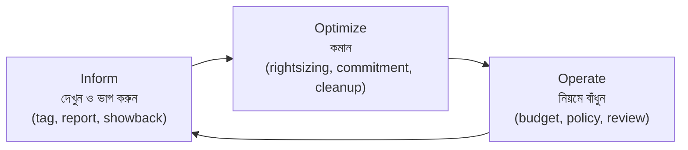
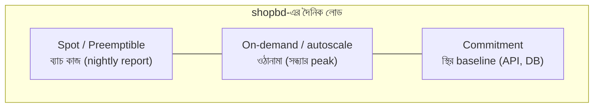

# 18 · Cost management (FinOps)

> **এই অধ্যায়ে কী শিখবেন**
>
> - Cloud-এর খরচ কোথা থেকে আসে এবং **FinOps** কী
> - প্রতিটি cloud-এর **billing console** ও খরচ দেখার উপায়, **budget ও alert**
> - **Tag/label** দিয়ে cost allocation — কার কত খরচ
> - **Commitment**: Savings Plans, CUD, Azure Reservations ও Savings Plan, OCI Universal Credits — এবং Spot/Preemptible
> - **Rightsizing** টুল, idle resource, **egress (data transfer) খরচ**, **free tier**
> - একটা পূর্ণ **cost checklist** ও `shopbd`-র মাসিক খরচ-পর্যালোচনা

!!! abstract "এক নজরে — কোন cloud-এ কী নাম"

    | Concept | AWS | GCP | Azure | OCI |
    |---|---|---|---|---|
    | Billing কেন্দ্র | Billing and Cost Management | Cloud Billing | Microsoft Cost Management + Billing | Billing & Cost Management |
    | খরচ বিশ্লেষণ | Cost Explorer | Billing Reports | Cost analysis | Cost Analysis |
    | Budget ও alert | AWS Budgets | Budgets & alerts | Budgets (Cost Management) | Budgets + alert rules |
    | বিস্তারিত ডেটা export | Cost and Usage Report / Data Exports | Billing export → BigQuery | Cost Management exports | Cost and usage reports (Object Storage) / Usage API |
    | খরচ ভাগ করার ট্যাগ | Cost allocation tags | Labels | Tags (+ inheritance policy) | Cost-tracking tags (defined tags), compartments |
    | অস্বাভাবিক খরচ ধরা | Cost Anomaly Detection | Anomaly detection (Billing) | Cost anomaly alerts | Budgets + Usage API |
    | Commitment | Savings Plans, Reserved Instances | Committed Use Discounts (CUD) | Reservations, Savings Plan for compute | Universal Credits (commitment) |
    | কম দামের spare capacity | Spot Instances | Spot VMs | Spot VMs | Preemptible instances |
    | Rightsizing | Compute Optimizer, Trusted Advisor | Recommender / Active Assist | Azure Advisor | Cloud Advisor |
    | Free tier | Free Tier / Free plan | Free Trial + Always Free | Free account + Always free | Free Trial + Always Free |

---

## ১. Cloud-এর খরচ কোথা থেকে আসে

Cloud-এ "বিদ্যুৎ বিলের মতো" — যত ব্যবহার, তত বিল। কিন্তু বিলটা এক জায়গা থেকে আসে না। মূল কয়েকটা উৎস:

| উৎস | কী কারণে খরচ | `shopbd`-এ উদাহরণ |
|---|---|---|
| **Compute** | VM/container কত বড়, কত ঘণ্টা চলছে | `shopbd-api` VM ২৪ ঘণ্টা চালু |
| **Storage** | কত GB, কোন class, কত request, snapshot | `shopbd-images` bucket, পুরনো snapshot |
| **Database** | instance size, storage, backup, HA/replica | `shopbd-db` PostgreSQL (Multi-AZ/HA) |
| **Network** | বাইরে যাওয়া ট্রাফিক (egress), NAT, load balancer ঘণ্টা | ছবি ডাউনলোড, NAT gateway |
| **Logging/Monitoring** | কত log ingest ও কত দিন রাখা | debug log সব রেখে দেওয়া |
| **Idle জিনিস** | চলছে কিন্তু কেউ ব্যবহার করছে না | আনঅ্যাটাচড disk, ব্যবহারহীন public IP |
| **Support ও marketplace** | support plan, তৃতীয় পক্ষের license | |

!!! note "দৈনন্দিন উপমা"
    বাসার বিদ্যুৎ বিল: ফ্যান-লাইট অফ না করে বের হলে মিটার ঘোরে। Cloud-ও তাই — **বন্ধ না করা resource-ই সবচেয়ে বড় অপচয়।** কিন্তু cloud-এ মিটারটা আরও জটিল — ঘণ্টা, GB, request, সব আলাদা মিটার।

### মূল সূত্র

> **খরচ = পরিমাণ × সময় × দর** — আপনি তিনটার একটাই কমাতে পারেন: কম বা ছোট resource (পরিমাণ), দরকার না হলে বন্ধ (সময়), বা সস্তা pricing model (দর)।

### FinOps কী

**FinOps** = Finance + DevOps। খরচকে শুধু "মাসের শেষে আসা বিল" না ভেবে engineering-এর অংশ করা। তিন ধাপের চক্র:



- **Inform** — কার কত খরচ? কোন service, কোন environment?
- **Optimize** — অপচয় কমান, সস্তা pricing বেছে নিন।
- **Operate** — budget, alert, প্রতি মাসে review — যাতে আবার জমে না যায়।

**Unit economics:** মোট বিলের চেয়ে বেশি অর্থবহ হলো **একক প্রতি খরচ**: "প্রতি অর্ডারে cloud খরচ কত?" ব্যবসা বাড়লে বিল বাড়বেই — সমস্যা তখনই, যখন অর্ডারপ্রতি খরচ বাড়ে।

!!! warning "এই অধ্যায়ে দাম নেই"
    Cloud-এর দাম বদলায় (region, সময়, ডিসকাউন্ট)। এখানে কোনো নির্দিষ্ট দাম দেওয়া হয়নি — **খরচ কীসে হয়** তা বোঝানো হয়েছে। হিসাবের জন্য দেখুন: [AWS Pricing Calculator](https://calculator.aws), [Google Cloud Pricing Calculator](https://cloud.google.com/products/calculator), [Azure Pricing Calculator](https://azure.microsoft.com/pricing/calculator/), [OCI Cost Estimator](https://www.oracle.com/cloud/costestimator.html)।

---

## ২. Billing console ও খরচ দেখা

প্রথম কাজ — **দেখতে পাওয়া**। যা দেখা যায় না তা কমানো যায় না।

=== "AWS"

    **Billing and Cost Management** console থেকে শুরু। মূল অংশ:

    - **Cost Explorer** — সময়, service, region, tag অনুযায়ী খরচের চার্ট (প্রথমবার চালু করতে হয়)
    - **Bills** — চলতি মাসের বিল, service-ভিত্তিক
    - **Budgets**, **Cost Anomaly Detection**, **Cost allocation tags**
    - **Cost and Usage Report (CUR)** / **Data Exports** — সবচেয়ে বিস্তারিত ডেটা, S3-তে; Athena দিয়ে query
    - **Free Tier** পাতা — ব্যবহার সীমা কতটা পেরোচ্ছে

    Organization-এ থাকলে **management account** পুরো প্রতিষ্ঠানের consolidated বিল দেখে — [02 · Account ও Hierarchy](02-accounts-and-hierarchy.md)।

    ```bash
    # সার্ভিস-ভিত্তিক মাসিক খরচ
    aws ce get-cost-and-usage \
      --time-period Start=2026-11-01,End=2026-11-24 \
      --granularity MONTHLY \
      --metrics UnblendedCost \
      --group-by Type=DIMENSION,Key=SERVICE

    # tag অনুযায়ী
    aws ce get-cost-and-usage \
      --time-period Start=2026-11-01,End=2026-11-24 \
      --granularity MONTHLY \
      --metrics UnblendedCost \
      --group-by Type=TAG,Key=project
    ```

=== "GCP"

    **Cloud Billing** — billing account আলাদা সত্তা; এক বা একাধিক project সেই account-এর সাথে জোড়া থাকে।

    - **Reports** — সময়, project, service, SKU, label অনুযায়ী ফিল্টার
    - **Cost table**, **Budgets & alerts**, **Commitments**
    - **Billing export → BigQuery** — সবচেয়ে শক্তিশালী উপায়; আপনি SQL দিয়ে যা খুশি জিজ্ঞেস করতে পারেন (export **চালু করার পর** থেকে ডেটা জমে, পেছনের ডেটা আসে না — তাই প্রথম দিনেই চালু করুন)
    - **FinOps hub** ও **Recommender**-এর সুপারিশ

    ```bash
    gcloud billing accounts list
    gcloud billing projects describe my-project-id     # কোন billing account-এ জোড়া
    ```

    BigQuery export চালু থাকলে, label অনুযায়ী খরচ:

    ```sql
    SELECT
      service.description AS service,
      SUM(cost) AS total_cost
    FROM `my-project-id.billing_export.gcp_billing_export_v1_XXXXXX`
    WHERE usage_start_time >= TIMESTAMP('2026-11-01')
      AND EXISTS (SELECT 1 FROM UNNEST(labels) l WHERE l.key = 'project' AND l.value = 'shopbd')
    GROUP BY service
    ORDER BY total_cost DESC;
    ```

=== "Azure"

    **Microsoft Cost Management + Billing** (Portal-এ "Cost Management")।

    - **Cost analysis** — scope বেছে নিন (management group / subscription / resource group), তারপর tag, service, location দিয়ে ভাগ
    - **Budgets**, **Alerts**, **Advisor** (cost recommendations)
    - **Exports** — নিয়মিত CSV storage account-এ
    - **Reservations / Savings plans** blade

    Billing-এর ধরন: **MCA (Microsoft Customer Agreement)** বা **EA (Enterprise Agreement)** — account-এর ধরনে billing scope-এর নাম আলাদা হয়।

    ```bash
    az account show
    az consumption usage list --top 10 --query "[].{name:instanceName, cost:pretaxCost}" -o table
    az advisor recommendation list --category Cost -o table
    ```

    (`az consumption` ও `az costmanagement` extension সাবস্ক্রিপশন/অ্যাকাউন্টের ধরনে আলাদা আচরণ করতে পারে; না পেলে Portal-এর Cost analysis-ই ভরসা।)

=== "OCI"

    **Billing & Cost Management → Cost Analysis** — compartment, service, tag অনুযায়ী খরচ।

    - **Cost Analysis** (চার্ট), **Budgets**, **Cost and usage reports** (CSV, আপনার tenancy-র জন্য Oracle-এর নিজস্ব Object Storage bucket থেকে ডাউনলোড)
    - **Usage API** — প্রোগ্রাম্যাটিক query
    - **Cloud Advisor** — recommendation
    - **Compartment** নিজেই খরচ ভাগের একক — [02 · Account ও Hierarchy](02-accounts-and-hierarchy.md)

    ```bash
    oci usage-api usage-summary request-summarized-usages \
      --tenant-id ocid1.tenancy.oc1..example \
      --time-usage-started 2026-11-01T00:00:00Z \
      --time-usage-ended 2026-11-24T00:00:00Z \
      --granularity DAILY \
      --query-type COST \
      --group-by '["service"]'
    ```

!!! tip "প্রথম সপ্তাহের কাজ"
    নতুন account খুললে প্রথম দিনেই: (১) billing alert/budget সেট, (২) খরচ-ডেটা export চালু (CUR / BigQuery export / Azure exports), (৩) কে billing দেখতে পারবে ঠিক করুন, (৪) free tier সীমা মনে রাখুন। দেরি করলে পেছনের ডেটা পাওয়া যায় না।

---

## ৩. Tag / Label — কার কত খরচ

একটা বিলে "EC2: ১২০০ ডলার" লেখা থাকলে কিছুই বোঝা যায় না — কোন প্রজেক্ট? কোন টিম? কোন environment? **Tag (AWS/Azure/OCI) বা Label (GCP)** হলো resource-এ লাগানো key=value লেবেল, যা দিয়ে খরচ ভাগ করা যায় (**cost allocation**)।

### প্রস্তাবিত ট্যাগ-সেট (shopbd)

| Key | উদাহরণ | কেন |
|---|---|---|
| `project` | `shopbd` | কোন প্রজেক্ট |
| `environment` | `prod` / `staging` / `dev` | prod vs dev খরচ আলাদা |
| `owner` | `ops@example.com` | কে দায়ী |
| `cost-center` | `engineering` | হিসাব কোন বিভাগের |
| `managed-by` | `terraform` | কোডে আছে কিনা |

!!! warning "ট্যাগ নিজে নিজে খরচে যুক্ত হয় না"
    - **AWS:** tag লাগানোর পর **Billing → Cost allocation tags**-এ সেই key **activate** করতে হয়; activate-এর **পর** থেকে খরচে দেখা যায়।
    - **Azure:** tag resource group থেকে ভেতরের resource-এ **নিজে inherit হয় না** — Azure Policy (inherit tag) বা Cost Management-এর tag inheritance সেটিং লাগে।
    - **GCP:** label billing export-এ আসে; কিছু service-এ label সমর্থন নেই বা আংশিক।
    - **OCI:** খরচ ভাগের জন্য **cost-tracking** চিহ্নিত defined tag লাগে (tag namespace-এ)। Free-form tag দিয়ে নয়।

=== "AWS"

    ```bash
    # tag লাগানো (EC2)
    aws ec2 create-tags --resources i-0123456789abcdef0 \
      --tags Key=project,Value=shopbd Key=environment,Value=prod

    # cost allocation-এর জন্য key চালু
    aws ce update-cost-allocation-tags-status \
      --cost-allocation-tags-status TagKey=project,Status=Active TagKey=environment,Status=Active
    ```

    Terraform — provider স্তরে সব resource-এ:

    ```hcl
    provider "aws" {
      region = "ap-south-1"

      default_tags {
        tags = {
          project     = "shopbd"
          environment = "prod"
          owner       = "ops@example.com"
          managed-by  = "terraform"
        }
      }
    }
    ```

    **AWS Organizations tag policy** দিয়ে আবশ্যিক key ও মানের তালিকা ঠিক করা যায়।

=== "GCP"

    ```bash
    # label লাগানো (VM)
    gcloud compute instances add-labels shopbd-api \
      --zone=asia-south1-a --labels=project=shopbd,environment=prod
    ```

    Terraform:

    ```hcl
    provider "google" {
      project = "my-project-id"
      region  = "asia-south1"

      default_labels = {
        project     = "shopbd"
        environment = "prod"
        owner       = "ops"
        managed_by  = "terraform"
      }
    }
    ```

    Label-এ বড় হাতের অক্ষর/ইমেইল-চিহ্ন (`@`) চলে না — নিয়ম ছোট হাতের অক্ষর, সংখ্যা, `_` ও `-`। সবচেয়ে সরল cost-allocation কৌশল: **প্রতি environment-এর জন্য আলাদা project** — তাহলে project-ই খরচের একক।

=== "Azure"

    ```bash
    # resource group-এ tag
    az group update --name shopbd-prod-rg --tags project=shopbd environment=prod

    # একটা resource-এ
    az resource tag --tags project=shopbd environment=prod \
      --ids /subscriptions/00000000-0000-0000-0000-000000000000/resourceGroups/shopbd-prod-rg/providers/Microsoft.Compute/virtualMachines/shopbd-api
    ```

    Terraform:

    ```hcl
    locals {
      tags = {
        project     = "shopbd"
        environment = "prod"
        owner       = "ops@example.com"
        managed-by  = "terraform"
      }
    }

    resource "azurerm_resource_group" "main" {
      name     = "shopbd-prod-rg"
      location = "centralindia"
      tags     = local.tags
    }
    ```

    Azure-এ tag প্রতিটি resource-এ আলাদা বসাতে হয় (inherit করতে Policy)। **Resource group + subscription** ভাগ নিজেই খরচের স্বাভাবিক একক।

=== "OCI"

    OCI-তে সবচেয়ে প্রাকৃতিক ভাগ — **compartment** (যেমন `shopbd-prod`, `shopbd-dev`)। এর ওপর **tag namespace ও defined tag**:

    ```bash
    oci iam tag-namespace create \
      --compartment-id ocid1.compartment.oc1..example \
      --name shopbd --description "shopbd cost tags"

    oci iam tag create \
      --tag-namespace-id ocid1.tagnamespace.oc1..example \
      --name environment --description "environment" \
      --is-cost-tracking true
    ```

    Terraform:

    ```hcl
    resource "oci_identity_tag_namespace" "shopbd" {
      compartment_id = var.compartment_ocid
      name           = "shopbd"
      description    = "shopbd tags"
    }

    resource "oci_identity_tag" "environment" {
      tag_namespace_id = oci_identity_tag_namespace.shopbd.id
      name             = "environment"
      description      = "environment name"
      is_cost_tracking = true
    }
    ```

    **Tag default** (compartment-এর ভেতরে নতুন resource-এ নিজে tag বসানো) দিয়ে ভুলে যাওয়া ঠেকানো যায়।

### ট্যাগ নিয়ম জোর করা

শুধু অনুরোধ করলে হয় না — **enforce** করুন: AWS tag policy / SCP, GCP Organization Policy ও label চেক, Azure Policy (`Require a tag` ও `Inherit a tag from the resource group`), OCI tag default। Terraform-এ `default_tags` বসালে নতুন resource বাদ পড়ে না; পুরনো resource-এর জন্য ক্লিনআপ করুন।

---

## ৪. Budget ও alert

**Budget** = আপনি একটা সীমা ঠিক করেন (যেমন মাসে এই পরিমাণ), আর খরচ কোনো শতাংশ পেরোলে (৫০%, ৮০%, ১০০%) বা **পূর্বাভাস** (forecast) পেরোতে যাচ্ছে বুঝলে email/SMS/chat-এ alert আসে।

!!! danger "Budget খরচ থামায় না — শুধু জানায়"
    ডিফল্টে budget কেবল **alert** দেয়। সীমা পেরোলে কিছু নিজে বন্ধ হয় না। (AWS Budgets Actions, Azure action group বা GCP-তে Pub/Sub + automation দিয়ে সীমিত স্বয়ংক্রিয় ব্যবস্থা নেওয়া যায়, কিন্তু production বন্ধ করে দেওয়ার ঝুঁকি আছে — সাবধানে।) তাই alert আসলে **একজন মানুষকে** তা দেখতে হবে — alert-এর ঠিকানা এমন কোনো ইনবক্স নয় যা কেউ দেখে না।

### প্রস্তাবিত alert সিঁড়ি

| Threshold | ধরন | কাকে |
|---|---|---|
| ৫০% | actual | team lead |
| ৮০% | actual | team + ops |
| ১০০% | actual | সবাই + ব্যবস্থাপক |
| ১০০% | **forecast** | team — মাস শেষের আগেই সতর্কতা |

=== "AWS"

    ```bash
    # budget.json
    cat > budget.json <<'EOF'
    {
      "BudgetName": "shopbd-monthly",
      "BudgetLimit": { "Amount": "100", "Unit": "USD" },
      "TimeUnit": "MONTHLY",
      "BudgetType": "COST"
    }
    EOF

    # notifications.json
    cat > notifications.json <<'EOF'
    [
      {
        "Notification": {
          "NotificationType": "ACTUAL",
          "ComparisonOperator": "GREATER_THAN",
          "Threshold": 80,
          "ThresholdType": "PERCENTAGE"
        },
        "Subscribers": [ { "SubscriptionType": "EMAIL", "Address": "ops@example.com" } ]
      }
    ]
    EOF

    aws budgets create-budget --account-id 123456789012 \
      --budget file://budget.json \
      --notifications-with-subscribers file://notifications.json
    ```

    Terraform:

    ```hcl
    resource "aws_budgets_budget" "monthly" {
      name         = "shopbd-monthly"
      budget_type  = "COST"
      limit_amount = "100"
      limit_unit   = "USD"
      time_unit    = "MONTHLY"

      notification {
        comparison_operator        = "GREATER_THAN"
        threshold                  = 80
        threshold_type             = "PERCENTAGE"
        notification_type          = "ACTUAL"
        subscriber_email_addresses = ["ops@example.com"]
      }

      notification {
        comparison_operator        = "GREATER_THAN"
        threshold                  = 100
        threshold_type             = "PERCENTAGE"
        notification_type          = "FORECASTED"
        subscriber_email_addresses = ["ops@example.com"]
      }
    }
    ```

    `limit_amount` আপনার নিজের সিদ্ধান্ত — এটা দাম নয়, সীমা।

=== "GCP"

    ```bash
    gcloud billing budgets create \
      --billing-account=000000-AAAAAA-BBBBBB \
      --display-name="shopbd-monthly" \
      --budget-amount=100USD \
      --threshold-rule=percent=0.5 \
      --threshold-rule=percent=0.8 \
      --threshold-rule=percent=1.0
    ```

    Terraform:

    ```hcl
    resource "google_billing_budget" "monthly" {
      billing_account = "000000-AAAAAA-BBBBBB"
      display_name    = "shopbd-monthly"

      budget_filter {
        projects = ["projects/123456789012"]      # project number
      }

      amount {
        specified_amount {
          currency_code = "USD"
          units         = "100"
        }
      }

      threshold_rules { threshold_percent = 0.5 }
      threshold_rules { threshold_percent = 0.8 }
      threshold_rules {
        threshold_percent = 1.0
        spend_basis       = "FORECASTED_SPEND"
      }
    }
    ```

    ডিফল্টে billing account-এর admin/user-রা email পান; আলাদা ঠিকানা বা Pub/Sub-এ পাঠাতে Cloud Monitoring notification channel সংযুক্ত করুন। Budget API সক্রিয় থাকা লাগে (`billingbudgets.googleapis.com`)।

=== "Azure"

    Portal: **Cost Management → Budgets → Add** — scope (subscription/resource group), মাসিক পরিমাণ, alert condition, email/action group।

    ```bash
    az consumption budget list -o table
    ```

    Terraform (resource group-ভিত্তিক):

    ```hcl
    resource "azurerm_consumption_budget_resource_group" "monthly" {
      name              = "shopbd-monthly"
      resource_group_id = azurerm_resource_group.main.id

      amount     = 100
      time_grain = "Monthly"

      time_period {
        start_date = "2026-12-01T00:00:00Z"
      }

      notification {
        enabled        = true
        threshold      = 80
        operator       = "GreaterThan"
        threshold_type = "Actual"
        contact_emails = ["ops@example.com"]
      }

      notification {
        enabled        = true
        threshold      = 100
        operator       = "GreaterThan"
        threshold_type = "Forecasted"
        contact_emails = ["ops@example.com"]
      }
    }
    ```

    **Action group** জুড়ে দিলে email ছাড়াও webhook/Logic App/Automation চালানো যায়।

=== "OCI"

    ```bash
    # budget (target = compartment)
    oci budgets budget create \
      --compartment-id ocid1.tenancy.oc1..example \
      --amount 100 \
      --reset-period MONTHLY \
      --target-type COMPARTMENT \
      --targets '["ocid1.compartment.oc1..example"]' \
      --display-name shopbd-monthly
    ```

    (`--compartment-id` এখানে **tenancy OCID** — budget tenancy-তেই থাকে।)

    Terraform:

    ```hcl
    resource "oci_budget_budget" "monthly" {
      compartment_id = var.tenancy_ocid
      amount         = 100
      reset_period   = "MONTHLY"
      display_name   = "shopbd-monthly"
      target_type    = "COMPARTMENT"
      targets        = [var.compartment_ocid]
    }

    resource "oci_budget_alert_rule" "eighty" {
      budget_id      = oci_budget_budget.monthly.id
      type           = "ACTUAL"
      threshold      = 80
      threshold_type = "PERCENTAGE"
      recipients     = "ops@example.com"
      message        = "shopbd has used 80% of its monthly budget"
    }
    ```

    Budget **tag-ভিত্তিক** (cost-tracking tag) target-ও হতে পারে।

---

## ৫. Anomaly detection ও forecast

Budget মাসিক সীমা দেখে; **anomaly detection** দেখে "আজকের খরচ হঠাৎ অস্বাভাবিক"। কেউ ভুলে বড় GPU VM চালু রেখে গেলে বা একটা loop-এ S3 request লক্ষ লক্ষ হলে — মাস শেষের আগেই ধরা পড়ে।

| Cloud | টুল |
|---|---|
| AWS | **Cost Anomaly Detection** — monitor বানান (service/tag/account ভিত্তিক), subscription-এ email/SNS |
| GCP | Billing-এর anomaly/cost insights (FinOps hub), budget-এর forecast alert |
| Azure | Cost Management-এর **anomaly alert** (cost analysis ও Alerts) |
| OCI | Budget alert + Usage API-র daily ডেটা নিজের check; (সুবিধা Cost Analysis-এ বদলায়) |

নিজস্ব সহজ পদ্ধতি (সব cloud-এ): প্রতিদিনের খরচ export থেকে একটা ছোট script বা query — "গতকালের খরচ গত ৭ দিনের গড়ের দেড়গুণের বেশি হলে Slack-এ জানাও।"

---

## ৬. Pricing model ও commitment

একই VM তিন ভাবে কেনা যায়:

| Model | কী | ছাড়ের ধারণা | ঝুঁকি |
|---|---|---|---|
| **On-demand** | ঘণ্টা/সেকেন্ডে, কোনো প্রতিশ্রুতি নেই | কোনো ছাড় নেই | সবচেয়ে বেশি দর |
| **Commitment** (Reserved/Savings Plan/CUD) | ১ বা ৩ বছরের জন্য ব্যবহারের প্রতিশ্রুতি | বড় ছাড় | ব্যবহার কমে গেলেও টাকা দিতে হয় |
| **Spot / Preemptible** | cloud-এর অব্যবহৃত capacity, যেকোনো সময় কেড়ে নিতে পারে | সবচেয়ে বড় ছাড় | হঠাৎ বন্ধ হতে পারে |

!!! note "উপমা"
    On-demand = রিকশা ভাড়া (যখন দরকার)। Commitment = মাসিক পাস কেনা (নিয়মিত যাতায়াতে সস্তা, কিন্তু না গেলেও টাকা গেল)। Spot = ফাঁকা সিট — সস্তা, কিন্তু কর্তৃপক্ষ বলতে পারে "নেমে যান"।

**সোনালি নিয়ম:** commitment শুধু **স্থির ভিত্তি-ব্যবহার (baseline)**-এর জন্য — যেমন যে VM ২৪×৭ চলবেই। ওঠানামা-করা অংশ on-demand বা autoscaling-এ, ব্যাচ/ফল্ট-সহনশীল কাজ spot-এ।



### প্রতিটি cloud-এর commitment

=== "AWS"

    | বিকল্প | বৈশিষ্ট্য |
    |---|---|
    | **Compute Savings Plans** | প্রতি ঘণ্টায় একটা খরচের প্রতিশ্রুতি; EC2 (যেকোনো family/region/OS), Fargate, Lambda — সবচেয়ে নমনীয় |
    | **EC2 Instance Savings Plans** | নির্দিষ্ট family + region; ছাড় বেশি, নমনীয়তা কম |
    | **Reserved Instances (RI)** | নির্দিষ্ট instance type; Standard বা Convertible; RDS/ElastiCache/OpenSearch-এও আছে |
    | **Spot Instances** | spare capacity; ২ মিনিটের আগাম নোটিস; Auto Scaling/ECS/EKS/Batch-এ মিশানো যায় |

    - মেয়াদ ১ বা ৩ বছর; payment: No upfront / Partial / All upfront।
    - Console: **Billing and Cost Management → Savings Plans** — *Recommendations* ও *Purchase*।
    - Database-এর জন্য RDS **Reserved Instances** (Savings Plan DB-তে সীমিত)।

    ```bash
    aws savingsplans describe-savings-plans
    aws ce get-savings-plans-purchase-recommendation \
      --savings-plans-type COMPUTE_SP --term-in-years ONE_YEAR --payment-option NO_UPFRONT \
      --lookback-period-in-days THIRTY_DAYS
    ```

=== "GCP"

    | বিকল্প | বৈশিষ্ট্য |
    |---|---|
    | **Committed Use Discounts (CUD) — resource-based** | নির্দিষ্ট region-এ vCPU/memory/GPU পরিমাণের প্রতিশ্রুতি |
    | **CUD — spend-based (flexible)** | নির্দিষ্ট খরচের প্রতিশ্রুতি; একাধিক service/machine type-এ প্রযোজ্য (Compute, Cloud SQL ইত্যাদির কিছু) |
    | **Sustained Use Discounts** | মাসে অনেকক্ষণ চালালে নিজে নিজে ছাড় — **শুধু কিছু পুরনো machine family-তে**; নতুন family-তে নেই |
    | **Spot VMs** | সস্তা, যেকোনো সময় preempt; অল্প সময়ের নোটিস |

    - মেয়াদ ১ বা ৩ বছর। Billing account → **Commitments**।
    - CUD **billing account/project**-এ কেনা হয়, নির্দিষ্ট region-এ (resource-based হলে)।

    ```bash
    gcloud compute commitments list
    gcloud compute instances create shopbd-batch --zone=asia-south1-a \
      --provisioning-model=SPOT --instance-termination-action=STOP
    ```

=== "Azure"

    | বিকল্প | বৈশিষ্ট্য |
    |---|---|
    | **Reservations (Reserved VM Instances ইত্যাদি)** | নির্দিষ্ট VM size/region, ১ বা ৩ বছর; SQL, Cosmos DB, Storage ইত্যাদিতেও |
    | **Savings plan for compute** | প্রতি ঘণ্টায় খরচের প্রতিশ্রুতি; VM, App Service, Functions Premium, Container Instances ইত্যাদিতে নমনীয় |
    | **Azure Hybrid Benefit** | আপনার নিজস্ব Windows Server/SQL Server license থাকলে ছাড় |
    | **Spot VMs** | সস্তা, eviction হতে পারে (দাম বা capacity-র কারণে) |

    - Portal: **Reservations** ও **Savings plans** blade; কেনার আগে Advisor-এর সুপারিশ দেখুন।
    - Reservation-এ **exchange/refund** সীমিত শর্তে আছে — নিয়ম পরিবর্তনশীল, ডকুমেন্টেশন পড়ুন।

    ```bash
    az reservations reservation-order list -o table
    az vm create --name shopbd-batch --resource-group shopbd-prod-rg --image Ubuntu2404 \
      --priority Spot --eviction-policy Deallocate --max-price -1
    ```

=== "OCI"

    | বিকল্প | বৈশিষ্ট্য |
    |---|---|
    | **Pay As You Go** | ব্যবহার অনুযায়ী, প্রতিশ্রুতি নেই |
    | **Universal Credits (Annual/Monthly Flex)** | নির্দিষ্ট পরিমাণ credit-এর প্রতিশ্রুতি — সব OCI service-এ খরচ করা যায় (নির্দিষ্ট service-এর জন্য নয়) |
    | **Preemptible instances** | সস্তা, যেকোনো সময় বন্ধ হতে পারে; ব্যাচ/স্টেটলেস কাজের জন্য |
    | **Flex shapes** | OCPU ও memory আলাদা করে ঠিক করুন → বাড়তি অব্যবহৃত resource কম |

    OCI-র নমনীয় commitment মডেল ("Universal Credits") মানে আলাদা Reserved Instance পরিচালনা লাগে না। Oracle-এর license (BYOL) থাকলে সেটাও ছাড়ের উৎস। বিস্তারিত দর ও শর্ত Oracle সেলস/ডকুমেন্টেশনের কাছে।

    ```bash
    oci compute instance launch --availability-domain "<AD-name>" \
      --compartment-id ocid1.compartment.oc1..example \
      --shape VM.Standard.E4.Flex \
      --shape-config '{"ocpus":1,"memoryInGBs":8}' \
      --subnet-id ocid1.subnet.oc1..example \
      --image-id ocid1.image.oc1..example \
      --preemptible-instance-config '{"preemptionAction":{"type":"TERMINATE","preserveBootVolume":false}}'
    ```

### Commitment কেনার নিয়ম

1. **আগে rightsizing** — অপচয়ের ওপর commitment কিনলে অপচয় ১–৩ বছরের জন্য আটকে যায়।
2. **৩০–৯০ দিনের ব্যবহার** দেখুন (cloud-এর recommendation tool)।
3. **ছোট শুরু** — baseline-এর ~৫০–৭০% দিয়ে; পরে বাড়ান।
4. **১ বছর দিয়ে শুরু**, ব্যবহার স্থির হলে ৩ বছর।
5. নমনীয় টাইপ (Compute SP / flexible CUD / Azure savings plan) বাছুন যদি instance type বদলাবার সম্ভাবনা থাকে।
6. Commitment-এর **কভারেজ ও utilization** মাসে একবার মেপে দেখুন।

!!! warning "Spot/Preemptible কখন নয়"
    Database, একমাত্র API server, state-ধারী কাজ — যা হঠাৎ বন্ধ হলে ক্ষতি। Spot দিন stateless, পুনরায় চালানো যায় এমন কাজে: batch, CI runner, image processing, dev/test, Kubernetes worker-এর একাংশ।

---

## ৭. Rightsizing ও idle resource

**Rightsizing** = প্রকৃত ব্যবহার দেখে resource-এর আকার ঠিক করা। অনেক VM-এর CPU ১০%-এর নিচে ঘোরে অথচ বড় instance কেনা — এটা সবচেয়ে সাধারণ অপচয়।

=== "AWS"

    - **AWS Compute Optimizer** — EC2, EBS, Lambda, ECS-on-Fargate-এর জন্য ML-ভিত্তিক সুপারিশ (কমান/বাড়ান)
    - **Trusted Advisor** — idle load balancer, অব্যবহৃত EBS, idle RDS ইত্যাদি (পূর্ণ check Business/Enterprise support-এ)
    - **Cost Explorer → Rightsizing recommendations**

    ```bash
    aws compute-optimizer get-ec2-instance-recommendations
    aws ec2 describe-volumes --filters Name=status,Values=available   # কোনো VM-এ লাগানো নেই
    aws ec2 describe-addresses --query 'Addresses[?AssociationId==`null`]'   # অব্যবহৃত Elastic IP
    ```

=== "GCP"

    - **Recommender / Active Assist** — idle VM, VM rightsizing, idle disk/IP, idle Cloud SQL ইত্যাদির সুপারিশ
    - **FinOps hub** — সুপারিশ + সম্ভাব্য সাশ্রয় একসাথে

    ```bash
    gcloud recommender recommendations list \
      --project=my-project-id --location=asia-south1-a \
      --recommender=google.compute.instance.MachineTypeRecommender

    gcloud compute disks list --filter="-users:*"          # কোনো VM-এ লাগানো নেই
    gcloud compute addresses list --filter="status=RESERVED"  # অব্যবহৃত static IP
    ```

=== "Azure"

    - **Azure Advisor** → **Cost** — VM shutdown/resize, অব্যবহৃত public IP/disk, reservation সুপারিশ
    - Cost Management-এর "**Idle**" ও "**Underutilized**" সংকেত
    - **Azure Workbooks** — নিজস্ব report

    ```bash
    az advisor recommendation list --category Cost -o table
    az disk list --query "[?managedBy==null].{name:name,rg:resourceGroup,size:diskSizeGb}" -o table
    az network public-ip list --query "[?ipConfiguration==null].name" -o tsv
    ```

=== "OCI"

    - **Cloud Advisor** — compute/block volume/load balancer/ডেটাবেসের কম-ব্যবহারের সুপারিশ
    - **Flex shape** — OCPU/memory সরাসরি ঠিক করে "ঠিক-যতটুকু" নিন
    - **OCI Monitoring** metric দেখে নিজের query

    ```bash
    oci bv volume list --compartment-id ocid1.compartment.oc1..example --lifecycle-state AVAILABLE
    ```

    Cloud Advisor-এর সুপারিশ Console-এ **Governance & Administration → Cloud Advisor**-এ দেখুন। Block volume `AVAILABLE` মানে কোনো instance-এ লাগানো নেই কিনা তা volume attachment দেখে যাচাই করুন।

### সবচেয়ে সাধারণ অপচয় — ক্লিনআপ তালিকা

| অপচয় | কীভাবে ধরবেন |
|---|---|
| বন্ধ VM-এর সাথে লাগানো disk, আনঅ্যাটাচড disk | "available/unattached" ফিল্টার |
| পুরনো snapshot/image/backup | বয়স অনুযায়ী তালিকা, retention policy |
| ব্যবহারহীন public/static IP | "unassociated" ফিল্টার |
| Idle load balancer (কোনো target নেই) | request-count শূন্য |
| NAT gateway যা ব্যবহার হয় না | bytes processed শূন্য |
| Dev/staging ২৪×৭ চলছে | schedule করে রাত-ছুটিতে বন্ধ |
| বড় size VM/DB কম CPU-তে | rightsizing recommendation |
| Log অনির্দিষ্টকাল জমা | retention সীমা |
| পুরনো test project/resource group | ownership tag + মেয়াদ |
| Over-provisioned IOPS/premium disk | metric মিলিয়ে disk tier কমান |

!!! tip "Dev/Staging বন্ধ রাখার সময়সূচি"
    Dev environment রাত ১০টা–সকাল ৮টা এবং শুক্র-শনিবার বন্ধ রাখলে compute-এর অর্ধেকেরও বেশি সময় বাঁচে। Azure VM-এ **Auto-shutdown**, GCP **instance schedule**, AWS **Instance Scheduler** বা EventBridge Scheduler + Lambda, OCI-তে scheduled function/script। মনে রাখুন: VM বন্ধ করলেও **disk, IP, license-এর খরচ চলতে থাকে** — কী কী বিল হয় তা cloud ও shape ভেদে আলাদা, pricing পাতায় দেখুন।

---

## ৮. Storage-এর খরচ

Storage সস্তা মনে হয়, কিন্তু জমে জমে বড় হয়। খরচ আসে: **GB × মাস**, **storage class**, **request/operation সংখ্যা**, **retrieval ফি** (ঠান্ডা class থেকে ফেরত আনলে), **replication**, **snapshot**।

- **Storage class/tier** ঠিক করুন — ঘন ঘন ব্যবহৃত ডেটা Standard/Hot, কম ব্যবহৃত Infrequent/Cool, আর্কাইভ Archive। বিস্তারিত: [06 · Storage](06-storage.md)।
- **Lifecycle policy** দিয়ে স্বয়ংক্রিয়: ৩০ দিন পর ঠান্ডা class-এ, ৩৬৫ দিন পর archive/মোছা।
- **Versioning** চালু থাকলে পুরনো version-ও বিল হয় — noncurrent version মোছার নিয়ম দিন।
- **অসম্পূর্ণ multipart upload** (AWS) জমে থাকে — lifecycle-এ পরিষ্কার করুন।
- **Snapshot/backup** — সংখ্যা ও বয়স সীমা, ডুপ্লিকেট নয়।
- **ছোট ফাইল** অনেক হলে request-খরচ বাড়ে; ঠান্ডা class-এ ন্যূনতম আকার/ন্যূনতম সংরক্ষণ-কাল (minimum storage duration) আছে — আগে মুছলেও পুরো মেয়াদের টাকা।

=== "AWS"

    ```json
    {
      "Rules": [
        {
          "ID": "shopbd-images-tiering",
          "Status": "Enabled",
          "Filter": { "Prefix": "uploads/" },
          "Transitions": [ { "Days": 30, "StorageClass": "STANDARD_IA" } ],
          "NoncurrentVersionExpiration": { "NoncurrentDays": 90 },
          "AbortIncompleteMultipartUpload": { "DaysAfterInitiation": 7 }
        }
      ]
    }
    ```

    ```bash
    aws s3api put-bucket-lifecycle-configuration --bucket shopbd-images \
      --lifecycle-configuration file://lifecycle.json
    ```

    **S3 Intelligent-Tiering** — প্রবেশাধিকার-ধরন অনির্দিষ্ট হলে নিজে tier বদলায়।

=== "GCP"

    ```bash
    # lifecycle.json: 30 দিন পর Nearline, 365 দিন পর মুছে ফেলা
    gcloud storage buckets update gs://shopbd-images --lifecycle-file=lifecycle.json
    ```

    **Autoclass** চালু করলে GCS নিজে ব্যবহার দেখে class বদলায়।

=== "Azure"

    Storage account-এর **Lifecycle management** নিয়ম — Hot → Cool → Cold → Archive, এবং মোছা। Portal: Storage account → **Lifecycle management**। Archive tier-এ blob "rehydrate" করতে সময় ও খরচ লাগে।

=== "OCI"

    Object Storage **Lifecycle policy** — Standard → Infrequent Access → Archive, ও মোছা। **Auto-tiering** bucket-এ চালু করা যায়। Archive থেকে "restore" করতে সময় লাগে এবং আগে-মোছার ন্যূনতম মেয়াদ আছে।

---

## ৯. Network ও egress (data transfer) খরচ

Cloud-এর "লুকোনো" খরচ — ডেটা **ঢোকা প্রায় ফ্রি**, কিন্তু **বেরোনো (egress)** টাকার।

| ট্রাফিক | সাধারণ নিয়ম (সব cloud-এ মোটামুটি) |
|---|---|
| Internet → cloud (ingress) | সাধারণত ফ্রি |
| Cloud → Internet (egress) | প্রতি GB চার্জ (মাসে কিছু ফ্রি অংশ থাকে) |
| একই zone/AZ-এর ভেতর (private IP) | সাধারণত ফ্রি |
| এক AZ/zone থেকে আরেক zone (একই region) | কিছু cloud চার্জ করে — pricing দেখুন |
| এক region থেকে আরেক region | চার্জ |
| Cloud-এর নিজস্ব সেবার সাথে (যেমন S3 থেকে একই region-এ EC2) | প্রায়ই ফ্রি |
| NAT gateway/Load balancer পেরোলে | **processing চার্জ** আলাদা |

**shopbd-র বাস্তব উদাহরণ:** ছবি-ভরা ওয়েবসাইট — ব্যবহারকারী প্রতিবার product image ডাউনলোড করলে সেটা egress। হাজার হাজার ভিজিটর = বড় egress বিল।

### egress কমানোর উপায়

1. **CDN ব্যবহার** — ছবি edge থেকে যায়; CDN-এর egress দর সাধারণত সস্তা এবং origin-এ আঘাত কমে ([10 · Load Balancing, DNS ও CDN](10-load-balancing-scaling-dns-cdn.md))।
2. **Compression ও আকার** — WebP/AVIF ছবি, gzip/brotli।
3. **Compute ও ডেটা একই region-এ** — cross-region traffic এড়ান।
4. **Private/Gateway endpoint** — S3/GCS/Storage-এ যাওয়া NAT-এর ভেতর দিয়ে নয় ([05 · Networking](05-networking.md))।
5. **NAT gateway-র ব্যবহার কমান** — প্রতি-GB processing চার্জ; AWS-এ S3-এর জন্য Gateway endpoint ফ্রি।
6. **Caching** — browser/CDN cache header।
7. **ডেটা-ভারী কাজ ডেটার কাছে চালান** — বড় ডেটা বের করে এনে প্রসেস নয়।

=== "AWS"

    - Egress internet-এ প্রতি-GB; মাসে অল্প একটা ফ্রি অংশ আছে। CloudFront থেকে ডেলিভারি সাধারণত origin-থেকে-সরাসরির চেয়ে সস্তা, এবং **origin → CloudFront ট্রান্সফার ফ্রি**।
    - **Cross-AZ** ট্রাফিক চার্জযোগ্য — multi-AZ architecture-এ বিবেচনা করুন।
    - **NAT Gateway**: ঘণ্টা + প্রতি-GB — বড় অপ্রত্যাশিত বিলের পরিচিত কারণ।
    - S3 **Gateway VPC endpoint** ফ্রি; Interface endpoint-এ ঘণ্টা ও প্রতি-GB।

=== "GCP"

    - **Network Service Tiers**: Premium (Google-এর backbone, দ্রুত, দামি) বনাম Standard (সস্তা)।
    - Internet egress প্রতি-GB; একই region-এ zone-এর মধ্যে ট্রাফিক চার্জ হতে পারে; Cloud CDN/Media CDN edge-egress কমায়।
    - **Cloud NAT**: ঘণ্টা ও প্রতি-GB processing।

=== "Azure"

    - Egress internet-এ প্রতি-GB; মাসে প্রথম কিছু GB ফ্রি (সর্বশেষ নিয়ম pricing পাতায়)।
    - **Azure Front Door/CDN** edge delivery।
    - **NAT Gateway**/**Azure Firewall**-এ ঘণ্টা ও প্রতি-GB; Private Endpoint-এও ডেটা-প্রসেসিং চার্জ আছে।

=== "OCI"

    - OCI-এর egress নীতি তুলনামূলক উদার — প্রতি মাসে একটা বড় পরিমাণ outbound ডেটা ফ্রি (সঠিক পরিমাণ ও শর্ত [oracle.com/cloud/networking/pricing](https://www.oracle.com/cloud/networking/pricing/)-এ দেখুন), তারপর প্রতি-GB।
    - Region-এর মধ্যে/internal ট্রাফিকের নিয়ম আলাদা; **FastConnect** ও **Service Gateway** (Object Storage-এ নিরাপদ, NAT ছাড়া রুট) ব্যবহার করুন।

!!! note "Cloud ছাড়ার সময় egress"
    ইউরোপের Data Act ও প্রতিযোগিতার চাপে কয়েকটি বড় cloud provider cloud ছেড়ে যাওয়া গ্রাহকদের জন্য নির্দিষ্ট শর্তে ডেটা-ট্রান্সফার ফি মওকুফের কর্মসূচি চালু করেছে — শর্ত ও প্রযোজ্যতা সংশ্লিষ্ট provider-এর ডকুমেন্টেশনে দেখুন।

---

## ১০. Free tier ও trial

প্রতিটি cloud নতুন ব্যবহারকারীকে কিছু ফ্রি সুযোগ দেয় — শেখা ও ছোট প্রজেক্টের জন্য দারুণ। কিন্তু **শর্ত বদলায়**; সবসময় অফিশিয়াল পাতা দেখুন।

| ধরন | অর্থ |
|---|---|
| **Free trial credit** | নির্দিষ্ট মেয়াদে (যেমন ৩০/৯০ দিন বা কয়েক মাস) credit; শেষ হলে বন্ধ বা paid-এ যেতে হবে |
| **Always free** | শর্তসাপেক্ষে সীমার ভেতরে চিরকাল ফ্রি (ছোট VM, কিছু GB storage, কিছু function call) |
| **12-month free** | প্রথম ১২ মাস নির্দিষ্ট সীমা পর্যন্ত ফ্রি (কিছু cloud) |

=== "AWS"

    **AWS Free Tier**: নতুন account-এ credit-ভিত্তিক free plan ও কিছু service-এর "always free" সীমা (যেমন Lambda, DynamoDB-র অংশ) এবং কয়েকটি short-term trial। Free plan-এর নিয়ম, মেয়াদ ও কোন service অন্তর্ভুক্ত — সময়ের সাথে বদলেছে; [aws.amazon.com/free](https://aws.amazon.com/free/) দেখুন। Billing console-এর **Free Tier** পাতায় বর্তমান ব্যবহার দেখা যায়, আর budget alert সেট করুন।

=== "GCP"

    **Free Trial** (নতুন গ্রাহকের credit, নির্দিষ্ট মেয়াদ) + **Always Free** (নির্দিষ্ট region ও সীমায় — যেমন ছোট VM, কিছু storage, Cloud Run/Functions-এর request, BigQuery-র মাসিক query সীমা)। Trial-এ billing account যুক্ত হলেও পরীক্ষামূলক account সীমিত — paid-এ upgrade না করলে খরচ হয় না। [cloud.google.com/free](https://cloud.google.com/free)।

=== "Azure"

    **Azure free account**: নতুন গ্রাহকের জন্য একটা credit (নির্দিষ্ট দিনের জন্য), কিছু service ১২ মাস ফ্রি, আর অনেক service **always free** সীমায়। Credit শেষ বা সময় শেষ হলে paid-এ upgrade না করলে resource বন্ধ হয়ে যায়। [azure.microsoft.com/free](https://azure.microsoft.com/free/)।

=== "OCI"

    **Free Trial** (credit, নির্দিষ্ট মেয়াদ) + **Always Free** — Ampere A1 (Arm) compute-এর সীমিত OCPU/memory, ছোট AMD VM, Autonomous Database, block ও object storage-এর কিছু অংশ, ও load balancer/ডেটা ট্রান্সফারের নির্দিষ্ট ভাতা। Always Free resource সাধারণত **home region**-এ। [oracle.com/cloud/free](https://www.oracle.com/cloud/free/)।

!!! warning "Free tier-এর ফাঁদ"
    - Free সীমা পেরোলে নিঃশব্দে বিল শুরু — **প্রথম দিনেই budget alert**।
    - Free tier-এর resource ভুলে গেলে (বিশেষ করে trial শেষে paid-এ রূপান্তর) বিল আসে।
    - এক ধরনের ফ্রি সীমা অন্য সেবায় প্রযোজ্য নয়; মেয়াদ ও শর্ত আলাদা।
    - শিখতে গিয়ে বানানো resource কাজ শেষে **মুছে দিন** (`terraform destroy`)।

---

## ১১. স্থাপত্যগত খরচ-সিদ্ধান্ত

- **Autoscaling** — রাতে/কম লোডে ছোট, peak-এ বড় ([10 · Load Balancing ও Scaling](10-load-balancing-scaling-dns-cdn.md))। ২৪×৭ peak-এর আকারে চালানো অপচয়।
- **Serverless** — কম/অনিয়মিত ট্রাফিকে সস্তা (ব্যবহারে-টাকা); স্থির, ভারী, ২৪×৭ কাজে VM/container কখনো সস্তা। দুই দিকেই হিসাব করুন ([09 · Serverless](09-serverless.md))।
- **Managed বনাম self-managed** — Managed database বাড়তি খরচ, কিন্তু আপনার সময় ও ঝুঁকি বাঁচায়। শুধু "সস্তা" দেখে নিজে চালানো প্রায়ই ভুল।
- **Multi-AZ/HA সবখানে নয়** — prod-এ HA দরকার, dev-এ নয়।
- **Arm-ভিত্তিক instance** (AWS Graviton, GCP Axion/Tau T2A, Azure Cobalt/Ampere, OCI Ampere A1) — সাধারণত একই কাজে কম খরচ; আপনার সফটওয়্যার Arm-এ চলে কিনা যাচাই করুন।
- **Log ও metric** — সব log চিরকাল নয়; sampling, retention, কোন log কোথায় ([12 · Monitoring](12-observability.md))।
- **Region নির্বাচন** — একই service-এর দাম region-ভেদে আলাদা; কিন্তু latency ও data-residency আগে।

---

## ১২. Cost checklist

প্রতি মাসে/ত্রৈমাসিকে এই তালিকা ধরে এগোন:

**Visibility**

- [ ] Billing export চালু (CUR / BigQuery / Azure export / OCI cost report)
- [ ] সব resource-এ আবশ্যিক tag/label (project, environment, owner, cost-center) এবং enforce
- [ ] AWS-এ cost allocation tag activated; Azure-এ tag inheritance; OCI-তে cost-tracking tag
- [ ] Dashboard: service অনুযায়ী ও environment অনুযায়ী খরচ

**Control**

- [ ] Budget ও alert (৫০/৮০/১০০% + forecast) — alert-এর ঠিকানা কেউ দেখে
- [ ] Anomaly detection চালু
- [ ] Quota/limit ও permission দিয়ে "কে বড় resource বানাতে পারে" সীমিত
- [ ] Dev/test-এর মেয়াদ ও auto-shutdown

**Optimize**

- [ ] Rightsizing recommendation পর্যালোচনা
- [ ] Idle resource ক্লিনআপ (disk, IP, snapshot, LB, NAT)
- [ ] Storage lifecycle ও retention
- [ ] Commitment কভারেজ ও utilization (৩০–৯০ দিন ডেটা)
- [ ] Spot/Preemptible কাজে লাগানো যায় এমন workload
- [ ] CDN ও caching, egress কমানো
- [ ] Log retention ও ingestion

**Operate**

- [ ] মাসিক cost review মিটিং (১৫ মিনিট), সিদ্ধান্ত লিখে রাখা
- [ ] Unit economics (প্রতি অর্ডার/ব্যবহারকারী খরচ) ট্র্যাক
- [ ] Free tier সীমা ও trial-এর মেয়াদ ক্যালেন্ডারে
- [ ] নতুন service-এর আগে আনুমানিক খরচ (pricing calculator / Infracost)

---

## মিল ও অমিল

| বিষয় | AWS | GCP | Azure | OCI |
|---|---|---|---|---|
| খরচের প্রাকৃতিক একক | Account | **Project** | Subscription / Resource group | **Compartment** |
| Tag-এ খরচ দেখতে | Cost allocation tag **activate** করতে হয় | Label billing export-এ আসে | Tag নিজে inherit হয় না | Cost-tracking defined tag |
| Billing export (বিস্তারিত) | CUR → S3 | → BigQuery | → Storage (CSV) | Cost reports (Oracle-এর bucket) / Usage API |
| Commitment ধরন | Savings Plans / RI | CUD (resource ও spend) | Reservations / Savings plan | Universal Credits |
| Automatic ছাড় | (নেই) | Sustained Use (পুরনো family) | (নেই) | (নেই) |
| সস্তা spare capacity | Spot | Spot VM | Spot VM | Preemptible |
| Budget কোথায় থাকে | Account (বা org-এ) | Billing account | Subscription/RG scope | **Tenancy** (compartment/tag target) |
| Egress | প্রতি-GB, cross-AZ চার্জ | Network tier (Premium/Standard) | প্রতি-GB | উদার মাসিক ফ্রি অংশ |
| Rightsizing | Compute Optimizer | Recommender | Advisor | Cloud Advisor |

**যেখানে সবাই আটকায়:**

- **AWS tag activate না করা** — tag দিলাম, Cost Explorer-এ কিছু নেই।
- **Azure tag inherit** — resource group-এ tag আছে, ভেতরের resource-এ নেই; Cost analysis-এ "untagged" বিশাল।
- **GCP billing export দেরিতে চালু** — পেছনের মাসের ডেটা আর পাওয়া যায় না।
- **OCI budget-এর `compartment-id` = tenancy** — compartment ভেবে ভুল OCID দিলে error।
- **Commitment পরিবর্তন কঠিন** — ভুল family/region কিনলে ফেরত বা বদল সীমিত।
- **শুধু compute দেখা** — আসল বিল প্রায়ই NAT, egress, logging, snapshot থেকে।

---

## Real-world: shopbd

`shopbd`-র মাসিক cloud খরচ-পর্যালোচনা (প্রতি মাসের ৫ তারিখ, ১৫ মিনিট):

**১. দেখা (Inform):** service অনুযায়ী top ৫ খরচ — সাধারণত compute (`shopbd-api`), database (`shopbd-db`), network (egress + NAT), storage (`shopbd-images`), logging। Environment অনুযায়ী ভাগ: prod বনাম staging বনাম dev।

**২. প্রশ্ন (Optimize):**

- Staging/dev রাতে বন্ধ আছে?
- API VM-এর CPU গড়ে কত? ছোট করা যায়?
- ছবির egress CDN দিয়ে যাচ্ছে?
- পুরনো snapshot ও log কেটে ফেলা হয়েছে?
- Baseline compute-এর ওপর commitment কেনার সময় হয়েছে?

**৩. সিদ্ধান্ত (Operate):** কী বদলানো হবে, কে করবে, কবে — লিখে রাখা। প্রতি অর্ডারে cloud খরচ আগের মাসের সাথে তুলনা।

=== "AWS"

    Budget `shopbd-monthly` ৫০/৮০/১০০% + forecast → `ops@example.com`। `project/environment` tag activated। ছবি CloudFront-এর পেছনে, S3 Gateway endpoint (NAT এড়াতে)। EC2-র স্থির অংশে Compute Savings Plan (১ বছর, no upfront, baseline-এর ~৬০%)। nightly report Spot-এ। Dev instance EventBridge Scheduler দিয়ে রাতে বন্ধ। CloudWatch Logs retention ৩০ দিন।

=== "GCP"

    Prod আর dev আলাদা **project** — project ধরেই খরচ। BigQuery billing export প্রথম দিন থেকে চালু; Looker Studio-তে ড্যাশবোর্ড। Cloud CDN দিয়ে ছবি, Cloud Storage Autoclass। Cloud Run-এ ছোট `min-instances`। স্থির অংশে flexible CUD। Dev VM instance schedule দিয়ে রাতে বন্ধ। Recommender-এর idle VM সুপারিশ প্রতি মাসে দেখা।

=== "Azure"

    Subscription আলাদা (prod/non-prod), Policy দিয়ে tag inherit ও আবশ্যিক। Cost Management budget + action group। ছবি Azure Front Door/CDN-এর পেছনে, Storage lifecycle (Hot → Cool)। স্থির অংশে Savings plan for compute বা Reservation; নিজস্ব license থাকলে Hybrid Benefit। Dev VM-এ Auto-shutdown। Advisor Cost সুপারিশ মাসিক।

=== "OCI"

    Compartment `shopbd-prod` / `shopbd-dev` — খরচ compartment ধরেই। Tenancy-তে budget + alert rule। Cost-tracking tag `shopbd.environment`। Flex shape-এ ঠিক-আকার OCPU/memory, nightly কাজ preemptible-এ। Object Storage lifecycle। উদার egress ভাতা, তবু CDN। Cloud Advisor সুপারিশ দেখা।

---

## Best practices

- **প্রথম দিনেই budget ও alert** — আর alert দেখার মানুষ ঠিক করুন।
- **প্রথম দিনেই billing export** (CUR/BigQuery/exports) — পেছনের ডেটা পাওয়া যায় না।
- **Tag/label কোডে বাধ্যতামূলক** (`default_tags`) এবং policy দিয়ে enforce।
- **Environment আলাদা account/project/subscription/compartment** — খরচ ও ঝুঁকি দুটোই পরিষ্কার।
- **আগে rightsizing, তারপর commitment**; commitment শুধু baseline-এ, ছোট থেকে বাড়িয়ে।
- **Spot/Preemptible শুধু stateless/ফল্ট-সহনশীল কাজে।**
- **Dev/staging schedule করে বন্ধ**।
- **Storage lifecycle ও retention** — storage, snapshot, log।
- **Egress নিয়ে ভাবুন architecture-এর সময়** — CDN, একই region, private endpoint।
- **Unit economics** মাপুন — প্রতি অর্ডার/user খরচ।
- **নিয়মিত review** — মাসে একবার ছোট, ত্রৈমাসিকে commitment পর্যালোচনা।
- **খরচ engineering-এর দায়িত্ব** — প্রতিটি টিম নিজের খরচ দেখে (showback)।
- **নতুন resource বানানোর আগে কত খরচ ভাবুন** — pricing calculator, Infracost PR-এ।
- **Learning/PoC resource মুছুন** (`terraform destroy`)।

---

## Common mistakes

| ভুল | সমস্যা | সমাধান |
|---|---|---|
| Budget/alert নেই | মাসের শেষে চমক | প্রথম দিনেই budget + forecast alert |
| Alert যায় এমন ইনবক্সে যা কেউ দেখে না | alert অকার্যকর | টিমের ইনবক্স/chat, নির্দিষ্ট মালিক |
| Tag নেই | "কে এত খরচ করল" জানা যায় না | `default_tags` + policy |
| AWS-এ tag লাগিয়ে activate না করা | Cost Explorer-এ দেখা যায় না | cost allocation tag activate |
| Billing export দেরিতে চালু | পুরনো ডেটা হারানো | অ্যাকাউন্ট খোলার দিনই |
| rightsizing ছাড়াই commitment | অপচয় আটকে যায় | আগে অপ্টিমাইজ, তারপর commit |
| Commitment বেশি কেনা (১০০%+) | ব্যবহার কমলে ক্ষতি | baseline-এর ৫০–৭০% থেকে শুরু |
| Spot-এ database/একমাত্র server | হঠাৎ বন্ধ হয়ে outage | Spot শুধু stateless কাজে |
| Dev/test ২৪×৭ চালু | সহজ সাশ্রয় হাতছাড়া | auto-shutdown schedule |
| আনঅ্যাটাচড disk, পুরনো snapshot, ব্যবহারহীন IP | নীরবে বিল বাড়ে | নিয়মিত ক্লিনআপ ও recommendation |
| NAT gateway দিয়ে S3/Storage ট্রাফিক | অপ্রত্যাশিত processing খরচ | Gateway/Service endpoint |
| CDN ছাড়া ছবি সরাসরি origin থেকে | বড় egress বিল | CDN + caching |
| Log অনির্দিষ্টকাল জমা | logging খরচ বিশাল | retention সীমা, কম verbose |
| Free tier সীমার কথা ভুলে যাওয়া | trial শেষে বিল | calendar + budget |
| শেখা শেষে resource না মোছা | চলতেই থাকে | `terraform destroy`, ownership tag |
| শুধু compute-এ নজর | আসল খরচ NAT/egress/DB/logs-এ | পুরো service-breakdown দেখুন |

---

## ইন্টারভিউ / সার্টিফিকেশন টিপস

??? question "FinOps কী? তিন ধাপ কী কী?"
    Cloud খরচ ইঞ্জিনিয়ারিং, ফাইন্যান্স ও ব্যবসার যৌথ দায়িত্বে আনার অনুশীলন। ধাপ: **Inform** (দৃশ্যমানতা, tag, report), **Optimize** (rightsizing, commitment, ক্লিনআপ), **Operate** (budget, policy, নিয়মিত review)।

??? question "On-demand, Reserved/Savings Plan ও Spot-এর পার্থক্য? কোনটা কখন?"
    On-demand: নমনীয়, ছাড় নেই। Commitment: ১/৩ বছরের প্রতিশ্রুতিতে বড় ছাড়, স্থির baseline-এর জন্য। Spot/Preemptible: সবচেয়ে সস্তা কিন্তু যেকোনো সময় কেড়ে নেওয়া যায় — stateless ও ফল্ট-সহনশীল কাজে।

??? question "AWS Savings Plans বনাম Reserved Instances?"
    Savings Plan: ঘণ্টাপ্রতি খরচের প্রতিশ্রুতি, Compute SP খুব নমনীয় (EC2/Fargate/Lambda, যেকোনো family/region)। RI: নির্দিষ্ট instance type-এর প্রতিশ্রুতি; Convertible RI কিছুটা নমনীয়। (RDS ইত্যাদিতে RI এখনো প্রচলিত।)

??? question "GCP-র CUD আর Sustained Use Discount-এর পার্থক্য?"
    CUD: ১/৩ বছরের প্রতিশ্রুতি, আপনি কেনেন। SUD: মাসে বেশি সময় চালালে নিজে নিজে ছাড় (শুধু কিছু পুরনো machine family-তে)।

??? question "Budget কি খরচ থামায়?"
    না — ডিফল্টে শুধু alert। সীমিত স্বয়ংক্রিয় ব্যবস্থা (AWS Budgets Actions, Azure action group, GCP Pub/Sub + automation) বানানো যায়, কিন্তু production বন্ধ করার ঝুঁকি আছে।

??? question "AWS-এ tag দিলাম কিন্তু Cost Explorer-এ দেখা যাচ্ছে না — কেন?"
    Cost allocation tag **activate** করতে হয় Billing console-এ (বা `ce update-cost-allocation-tags-status`)। Activate-এর পর থেকে ডেটা আসে, পেছনের নয়।

??? question "Egress খরচ কেন বেশি আসে, কীভাবে কমাবেন?"
    ডেটা বাইরে (internet/অন্য region) গেলে প্রতি-GB চার্জ। CDN, compression, একই region-এ compute+data, private endpoint, caching দিয়ে কমে।

??? question "NAT gateway-র বিল হঠাৎ বেড়েছে — কারণ কী হতে পারে?"
    প্রতি-GB processing চার্জ — প্রাইভেট subnet-এর VM যদি S3/Storage/Container registry থেকে বিপুল ডেটা NAT-এর মধ্য দিয়ে নামায়। সমাধান: Gateway/Interface/Service endpoint।

??? question "Azure-এ tag resource group থেকে ভেতরের resource-এ যায় কি?"
    না, নিজে যায় না। Azure Policy-র "Inherit a tag from the resource group" বা Cost Management-এর tag inheritance সেটিং দিয়ে করতে হয়।

??? question "OCI-তে খরচ ভাগ করার সেরা উপায়?"
    Compartment ও cost-tracking defined tag; budget tenancy-তে বসে compartment/tag টার্গেট করে।

??? question "Commitment কেনার আগে কী করবেন?"
    Rightsizing, ৩০–৯০ দিনের ব্যবহার বিশ্লেষণ, baseline-এর অংশ (৫০–৭০%) দিয়ে ছোট শুরু, ১ বছর, নমনীয় ধরন।

!!! tip "পরীক্ষা"
    **FinOps Certified Practitioner (FinOps Foundation)** সবচেয়ে সরাসরি। AWS Cloud Practitioner/Solutions Architect, Azure AZ-900/AZ-104, GCP Cloud Digital Leader/Associate, OCI Foundations-এ pricing model, support plan, TCO, budget, tagging আসে।

---

## সারসংক্ষেপ

- খরচ = পরিমাণ × সময় × দর; সবচেয়ে বড় অপচয় — চলতে থাকা কিন্তু অব্যবহৃত resource।
- **FinOps** = Inform → Optimize → Operate; মাপুন **unit economics**।
- প্রথম দিনেই: **billing export, budget+alert, tag/label**। চারটি console: Cost Explorer / Billing Reports (+BigQuery) / Cost analysis / Cost Analysis।
- **Tag cost allocation**: AWS-এ activate, Azure-এ inherit policy, GCP-তে label/project, OCI-তে compartment + cost-tracking tag।
- **Budget শুধু জানায়** — alert কেউ দেখুক; anomaly detection অতিরিক্ত নিরাপত্তা।
- **Commitment** (Savings Plans / CUD / Reservations ও Savings plan / Universal Credits) শুধু স্থির baseline-এ, rightsizing-এর পর; **Spot/Preemptible** শুধু stateless কাজে।
- **Rightsizing** টুল: Compute Optimizer / Recommender / Advisor / Cloud Advisor; নিয়মিত ক্লিনআপ।
- **Egress ও NAT** লুকোনো বড় খরচ — CDN, private endpoint, একই region।
- **Free tier**: শর্ত বদলায়, সীমা পেরোলে বিল — budget আগে।
- মাসিক ১৫ মিনিটের cost review আর **cost checklist** — সবচেয়ে কম খরচের সবচেয়ে বড় সাশ্রয়।

আরও দেখুন: [06 · Storage](06-storage.md), [10 · Load Balancing, DNS ও CDN](10-load-balancing-scaling-dns-cdn.md), [14 · IaC](14-infrastructure-as-code.md), [19 · Architecture, HA/DR](19-architecture-ha-dr.md)।
