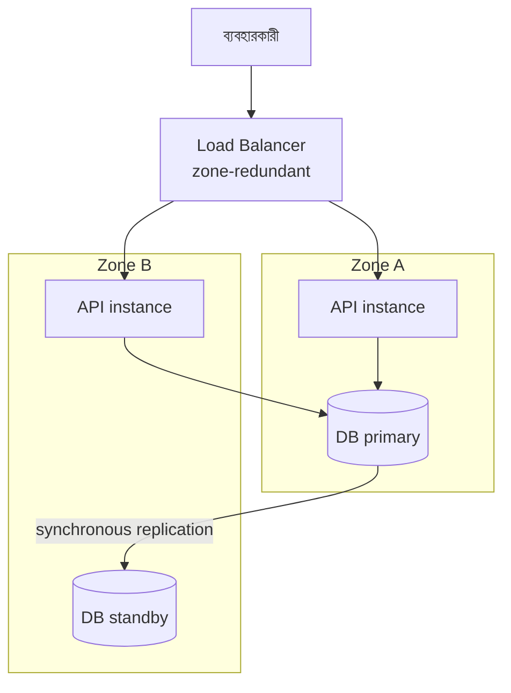
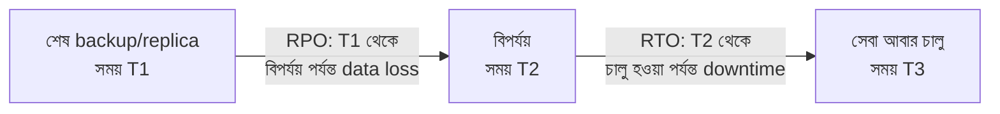
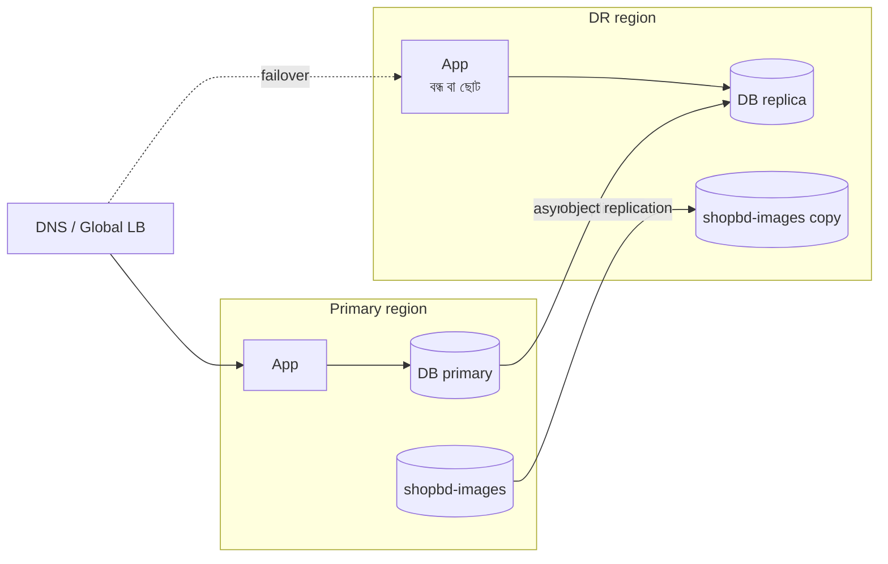
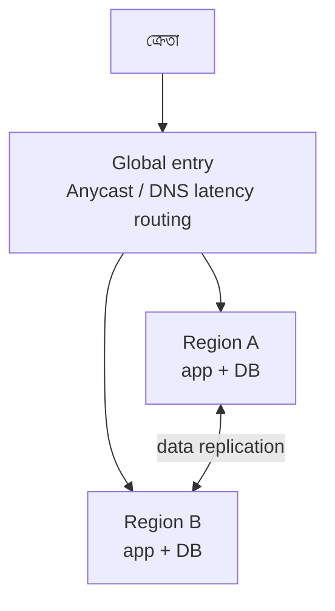
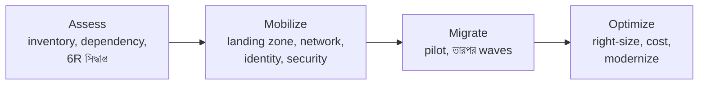

# 19 · Architecture, HA/DR ও Multi-cloud

> এই অধ্যায়ে কী শিখবেন
>
> - চার cloud-এর Well-Architected framework ও তাদের pillar দিয়ে নিজের design যাচাই করার পদ্ধতি
> - High Availability: SLA-র হিসাব, AZ/zone/fault domain, single point of failure খোঁজা
> - RPO/RTO ও চার DR strategy (Backup & Restore, Pilot Light, Warm Standby, Active/Active) — চার cloud-এর টুলসহ
> - Multi-region, multi-cloud ও hybrid (Outposts, Distributed Cloud, Arc, Cloud@Customer) — কখন লাভ, কখন লোকসান
> - Migration-এর 6R ও চার cloud-এর migration টুল
> - `shopbd`-র সম্পূর্ণ reference architecture — চারটি cloud-এ, প্রতিটার mermaid diagram সহ

এতক্ষণ আমরা আলাদা আলাদা ইট শিখেছি — VM, network, database, storage, security। এই অধ্যায়ে সেই ইট দিয়ে **বাড়ি** বানানো হবে।
আর বাড়ি বানানোর আগের প্রশ্ন হলো: "ঝড়, আগুন বা বন্যা এলে বাড়ির কী হবে?" Architecture মানে আসলে এই "যদি" প্রশ্নগুলোর আগাম উত্তর।

!!! abstract "এক নজরে — কোন cloud-এ কী নাম"

    | Concept | AWS | GCP | Azure | OCI |
    |---|---|---|---|---|
    | Design যাচাইয়ের framework | AWS Well-Architected Framework | Google Cloud Well-Architected Framework (আগের নাম Architecture Framework) | Azure Well-Architected Framework | OCI Well-Architected Framework |
    | Review tool | Well-Architected Tool | Architecture Center + Recommender | Azure Advisor, WAF assessment | Cloud Advisor |
    | Region-এর ভেতরে isolation | Availability Zone (AZ) | Zone | Availability Zone | Availability Domain (AD) + Fault Domain (FD) |
    | Bangladesh-এর কাছের region | ap-south-1 (Mumbai), ap-south-2 (Hyderabad) | asia-south1 (Mumbai), asia-south2 (Delhi) | Central India, South India | ap-mumbai-1, ap-hyderabad-1 |
    | Global traffic routing | Route 53, Global Accelerator, CloudFront | Global external Application LB, Cloud DNS | Front Door, Traffic Manager | Traffic Management Steering Policies, DNS |
    | DB-র HA | RDS/Aurora Multi-AZ | Cloud SQL HA (REGIONAL), Spanner | Zone-redundant HA | DB system HA, Data Guard |
    | DR orchestration | Elastic Disaster Recovery, Route 53 ARC, AWS Backup | Backup and DR Service | Azure Site Recovery, Azure Backup | Full Stack Disaster Recovery |
    | Hybrid | Outposts, EKS Anywhere | Google Distributed Cloud | Azure Arc, Azure Local | Cloud@Customer, Dedicated Region |
    | Migration | Migration Hub, MGN, DMS | Migrate to Virtual Machines, Database Migration Service | Azure Migrate | Cloud Migrations, ZDM |
    | IaC | CloudFormation, CDK, Terraform | Infrastructure Manager, Terraform | Bicep/ARM, Terraform | Resource Manager, Terraform |

## ১. Well-Architected Framework — design যাচাইয়ের চেকলিস্ট

প্রতিটি বড় cloud একটা **Well-Architected Framework** প্রকাশ করেছে। এটা কোনো service না — এটা **প্রশ্নের তালিকা** ও **নীতিমালা**, যা দিয়ে আপনি নিজের architecture যাচাই করেন।
উপমা: বাড়ি বানানোর পর structural engineer-এর checklist — ভিত ঠিক আছে? আগুন লাগলে বেরোনোর পথ আছে? বিদ্যুৎ বিল কেমন?

| Pillar (স্তম্ভ) | মূল প্রশ্ন | shopbd-র উদাহরণ |
|---|---|---|
| **Operational Excellence** | কীভাবে চালাই, দেখি ও উন্নত করি? | সব infra Terraform-এ, deploy pipeline-এ, alert-এ `ops@example.com` |
| **Security** | data ও access সুরক্ষিত? | least privilege, encryption, private DB |
| **Reliability** | ভাঙলে নিজে সেরে ওঠে? | Multi-AZ DB, health check, backup, DR |
| **Performance Efficiency** | সঠিক resource, সঠিক পরিমাণে? | CDN-এ ছবি, cache, autoscaling |
| **Cost Optimization** | অপচয় নেই তো? | right-size, commitment, lifecycle, budget |
| **Sustainability / অন্যান্য** | পরিবেশ ও ভবিষ্যৎ | কম idle resource, efficient চিপ |

### ১.১ চার framework — কী মিল, কী অমিল

| | AWS | GCP | Azure | OCI |
|---|---|---|---|---|
| নাম | AWS Well-Architected Framework | Google Cloud Well-Architected Framework | Azure Well-Architected Framework | OCI Well-Architected Framework |
| Pillar সংখ্যা | ৬ (Operational Excellence, Security, Reliability, Performance Efficiency, Cost Optimization, Sustainability) | ৫ (Operational excellence, Security/privacy/compliance, Reliability, Cost optimization, Performance optimization) | ৫ (Reliability, Security, Cost Optimization, Operational Excellence, Performance Efficiency) | কয়েকটি স্তম্ভ (security & compliance, reliability & resilience, performance & cost optimization, operational efficiency, distributed cloud) |
| বাড়তি | Lenses (Serverless, SaaS, ML/GenAI ইত্যাদি) | Perspectives (AI/ML ইত্যাদি) ও Architecture Center-এর reference | Workload ও service guides, trade-off নির্দেশিকা | Reference architectures, best-practices framework |
| Review tool | Well-Architected Tool (console-এ প্রশ্নোত্তর → risk তালিকা) | Recommender ও Active Assist | Azure Advisor ও WAF assessment | Cloud Advisor |

!!! note "Pillar-এর সংখ্যা মুখস্থ নয়, বোঝা জরুরি"
    পরীক্ষায় AWS-এর ৬টি pillar-এর নাম জিজ্ঞেস করা হতে পারে। কিন্তু বাস্তবে আসল কাজ হলো প্রতিটা pillar-এর প্রশ্ন নিজের architecture-এ প্রয়োগ করা। অন্য cloud-গুলোর pillar-এর তালিকা সময়ের সাথে একটু-আধটু বদলায়, তাই আপনার cloud-এর বর্তমান পাতা একবার দেখে নিন।

### ১.২ Trade-off — pillar-গুলো একে অপরের সাথে লড়ে

- বেশি **Reliability** (multi-region) মানে বেশি **Cost** ও complexity।
- কড়া **Security** (সব private, সব approval) মানে ধীর **Operational** গতি।
- সবচেয়ে সস্তা **Cost** মানে কম redundancy — ঝুঁকি বেশি।

ভালো architect সব pillar সর্বোচ্চ করেন না; তিনি **business requirement** দেখে সঠিক ভারসাম্য বেছে নেন। shopbd একটা ছোট দোকান — তাই তার জন্য multi-region active/active অতিরিক্ত, কিন্তু Multi-AZ database অপরিহার্য।

## ২. High Availability (HA)

**High Availability** মানে একটা component ভাঙলেও সিস্টেম চালু থাকা। এর মূল ধারণা একটাই: **কোনো single point of failure (SPOF) রাখবেন না**।
উপমা: দোকানে একটাই বিদ্যুতের লাইন থাকলে লাইন গেলে সব অন্ধকার; জেনারেটর (দ্বিতীয় উৎস) থাকলে দোকান চলে।

### ২.১ Availability-র হিসাব

Availability মাপা হয় শতকরায় — "কত শতাংশ সময় চালু"। ছোট ছোট দশমিক আসলে অনেক বড় পার্থক্য:

| Availability | বছরে সর্বোচ্চ downtime | মাসে প্রায় |
|---|---|---|
| ৯৯% | ৩.৬৫ দিন | ৭.২ ঘণ্টা |
| ৯৯.৯% ("three nines") | ৮.৭৬ ঘণ্টা | ৪৩.৮ মিনিট |
| ৯৯.৯৫% | ৪.৩৮ ঘণ্টা | ২১.৯ মিনিট |
| ৯৯.৯৯% ("four nines") | ৫২.৬ মিনিট | ৪.৩৮ মিনিট |
| ৯৯.৯৯৯% ("five nines") | ৫.২৬ মিনিট | ২৬ সেকেন্ড |

**Composite SLA:** একটা request যদি **একের পর এক** কয়েকটা component পার হয়, তাহলে availability **গুণ** হয় (খারাপ হয়):

```text
Load Balancer 99.99%  x  API 99.95%  x  Database 99.95%
  = 0.9999 x 0.9995 x 0.9995 = ~99.89%
```

আর **সমান্তরাল (redundant)** দুটি independent component থাকলে সম্ভাবনা ভালো হয়:

```text
দুটি AZ, প্রতিটি 99.9% -> দুটোই একসাথে ভাঙার সম্ভাবনা = 0.001 x 0.001
  -> তাত্ত্বিক availability 99.9999%
```

!!! warning "তাত্ত্বিক আর বাস্তব এক না"
    ওপরের সূত্র ধরে নেয় ব্যর্থতাগুলো **independent**। বাস্তবে একটা ভুল deploy, ভুল config বা shared dependency (যেমন একই DNS, একই identity service) দুই AZ-ই একসাথে ফেলে দিতে পারে। আর cloud provider-এর **SLA** হলো টাকা-ফেরতের চুক্তি, availability-র গ্যারান্টি না। SLA-র নির্দিষ্ট সংখ্যা প্রতিটা service-এর official SLA পাতায় দেখুন, এখানে মুখস্থ রাখার দরকার নেই।

### ২.২ Failure domain — কতটা বড় ভাঙন সামলাবেন?

ছোট থেকে বড়: **process → server → rack → data center (AZ) → region → provider**। যত বড় domain ঠেকাতে চান, তত খরচ ও জটিলতা।

| Failure domain | AWS | GCP | Azure | OCI |
|---|---|---|---|---|
| একটা server/rack | Placement groups (spread) | Zone-এর ভেতরে spread policy | Availability Set / VMSS fault domain | **Fault Domain** (AD-র ভেতরে ৩টি) |
| একটা data center | **AZ** | **Zone** | **Availability Zone** | **Availability Domain** |
| পুরো region | Multi-Region | Multi-region | Region pair, multi-region | Multi-region (cross-region) |

!!! warning "OCI-র Mumbai-তে মাত্র একটা AD"
    OCI-র অনেক region (যেমন `ap-mumbai-1`, `ap-hyderabad-1`) **single-AD region**। সেখানে "আলাদা AD-তে রাখুন" সম্ভব না — HA-র জন্য **Fault Domain** (একই AD-র ভেতরে ৩টি আলাদা hardware ও power group) ব্যবহার করতে হয়।
    পুরো data center ডুবে গেলে বাঁচতে **আরেকটি region**-এ (যেমন Hyderabad) cross-region replica রাখুন। Multi-AD region-এ (যেমন Frankfurt, Phoenix) AD আলাদা করা যায়।

### ২.৩ HA-র মূল নকশা



**তিনটি স্তরেই redundancy লাগে:**

1. **Entry:** zone-redundant load balancer (চার cloud-এর managed LB-ই default-এ একাধিক zone ছড়িয়ে থাকে)।
2. **Compute:** কমপক্ষে দুই zone-এ instance বা container; autoscaling group/MIG/VMSS/instance pool-এর **health check** দিয়ে ভাঙা instance বদলানো।
3. **Data:** synchronous replica অন্য zone-এ, failover automatic।

[Compute](04-compute-vms.md), [Load Balancing ও Scaling](10-load-balancing-scaling-dns-cdn.md) ও [Database](07-databases.md) অধ্যায়ে এগুলোর বিস্তারিত আছে।

### ২.৪ HA database — চার cloud-এ

=== "AWS"

    Service: **Amazon RDS for PostgreSQL — Multi-AZ**। Standby অন্য AZ-তে synchronous replica, primary ভাঙলে আপনা-আপনি failover (DNS endpoint একই থাকে)।

    ```bash
    aws rds create-db-instance \
      --db-instance-identifier shopbd-db \
      --engine postgres \
      --db-instance-class db.m6g.large \
      --allocated-storage 100 \
      --master-username shopbd_admin \
      --manage-master-user-password \
      --multi-az \
      --backup-retention-period 14 \
      --region ap-south-1
    ```

    Aurora-তে storage ৩ AZ-তে ৬ কপি থাকে; reader instance অন্য AZ-তে বসালে failover দ্রুত হয়।

=== "GCP"

    Service: **Cloud SQL for PostgreSQL — High availability (REGIONAL)**। Primary ও standby একই region-এর দুই zone-এ।

    ```bash
    gcloud sql instances create shopbd-db \
      --database-version=POSTGRES_16 \
      --region=asia-south1 \
      --tier=db-custom-2-8192 \
      --availability-type=REGIONAL \
      --backup-start-time=20:00 \
      --enable-point-in-time-recovery
    ```

    বিশ্বব্যাপী multi-region লাগলে **Spanner** বা **AlloyDB** (cross-region replica) দেখুন।

=== "Azure"

    Service: **Azure Database for PostgreSQL — Flexible Server, zone-redundant HA**। Standby অন্য zone-এ।

    ```bash
    az postgres flexible-server create \
      --name shopbd-db --resource-group shopbd-prod-rg \
      --location centralindia \
      --tier GeneralPurpose --sku-name Standard_D2ds_v5 \
      --high-availability ZoneRedundant \
      --backup-retention 14 \
      --geo-redundant-backup Enabled
    ```

    Zone-redundant HA ও geo-redundant backup region ও SKU-অনুযায়ী পাওয়া যায় কি না আগে docs-এ দেখুন।

=== "OCI"

    Service: **OCI Database with PostgreSQL** (HA configuration) অথবা **MySQL HeatWave** (`is_highly_available`) অথবা Oracle **Base Database/Autonomous Database** (Data Guard)। Single-AD region-এ HA node-গুলো **fault domain**-এ ছড়ায়।

    ```bash
    # MySQL HeatWave example: highly available DB system
    oci mysql db-system create \
      --compartment-id ocid1.compartment.oc1..example \
      --shape-name MySQL.2 \
      --subnet-id ocid1.subnet.oc1.ap-mumbai-1.example \
      --admin-username shopbd_admin --admin-password "$DB_PASSWORD" \
      --is-highly-available true \
      --display-name shopbd-db
    ```

    PostgreSQL service-এর HA ও replica বিকল্প console বা Terraform-এ বেছে নিন; ঠিক flag-এর জন্য `oci psql db-system create --help`।

**Terraform-এ একই জিনিস:**

=== "AWS"

    ```hcl
    resource "aws_db_instance" "shopbd" {
      identifier              = "shopbd-db"
      engine                  = "postgres"
      instance_class          = "db.m6g.large"
      allocated_storage       = 100
      username                = "shopbd_admin"
      manage_master_user_password = true
      multi_az                = true
      backup_retention_period = 14
      db_subnet_group_name    = aws_db_subnet_group.private.name
      vpc_security_group_ids  = [aws_security_group.db.id]
      storage_encrypted       = true
      deletion_protection     = true
    }
    ```

=== "GCP"

    ```hcl
    resource "google_sql_database_instance" "shopbd" {
      name                = "shopbd-db"
      region              = "asia-south1"
      database_version    = "POSTGRES_16"
      deletion_protection = true

      settings {
        tier              = "db-custom-2-8192"
        availability_type = "REGIONAL"

        backup_configuration {
          enabled                        = true
          point_in_time_recovery_enabled = true
        }
        ip_configuration {
          ipv4_enabled    = false
          private_network = google_compute_network.shopbd.id
        }
      }
    }
    ```

=== "Azure"

    ```hcl
    resource "azurerm_postgresql_flexible_server" "shopbd" {
      name                   = "shopbd-db"
      resource_group_name    = azurerm_resource_group.prod.name
      location               = "centralindia"
      version                = "16"
      sku_name               = "GP_Standard_D2ds_v5"
      storage_mb             = 131072
      administrator_login    = "shopbd_admin"
      administrator_password = var.db_password
      delegated_subnet_id    = azurerm_subnet.db.id
      private_dns_zone_id    = azurerm_private_dns_zone.pg.id
      zone                   = "1"

      high_availability {
        mode                      = "ZoneRedundant"
        standby_availability_zone = "2"
      }
      backup_retention_days        = 14
      geo_redundant_backup_enabled = true
    }
    ```

=== "OCI"

    ```hcl
    resource "oci_mysql_mysql_db_system" "shopbd" {
      compartment_id      = var.compartment_id
      shape_name          = "MySQL.2"
      subnet_id           = oci_core_subnet.db.id
      availability_domain = data.oci_identity_availability_domains.ads.availability_domains[0].name
      admin_username      = "shopbd_admin"
      admin_password      = var.db_password
      display_name        = "shopbd-db"
      is_highly_available = true
    }
    ```

## ৩. Disaster Recovery (DR)

HA ছোটখাটো ব্যর্থতা (একটা server, একটা zone) সামলায়। **DR** হলো বড় বিপর্যয়ের পরিকল্পনা — পুরো region বন্ধ, ভুল করে সব data মুছে ফেলা, ransomware, বা অ্যাকাউন্ট compromise।

!!! danger "Replication ≠ backup"
    Replica ভুল delete-ও সঙ্গে সঙ্গে কপি করে দেয়। কেউ ভুল করে `DROP TABLE orders` চালালে দুই region-এর database-ই খালি। তাই replica আর **আলাদা, immutable, point-in-time backup** — দুটোই লাগে।

### ৩.১ RPO ও RTO

- **RPO (Recovery Point Objective):** কতটুকু data হারানো মেনে নেবেন? (শেষ কত মিনিট/ঘণ্টার অর্ডার)
- **RTO (Recovery Time Objective):** কত সময়ের মধ্যে আবার চালু করতে হবে?

উপমা: দোকানে আগুন লাগল। **RTO** = কত দিনে দোকান আবার খুলব। **RPO** = খাতার কত পাতা পুড়ল (শেষ কবে হিসাবের কপি রেখেছিলাম)।



**শুরু করুন ব্যবসার প্রশ্ন দিয়ে, প্রযুক্তি দিয়ে না:** "shopbd ৪ ঘণ্টা বন্ধ থাকলে কত লোকসান? ১ ঘণ্টার অর্ডার হারালে কত?" সেই সংখ্যা থেকেই RTO/RPO ঠিক হয়, আর সেটা থেকে strategy ও বাজেট।

### ৩.২ চার DR strategy

| Strategy | RTO | RPO | খরচ | কীভাবে কাজ করে |
|---|---|---|---|---|
| **Backup & Restore** | ঘণ্টা (বা বেশি) | ঘণ্টা | সবচেয়ে কম | শুধু backup অন্য region-এ; বিপর্যয়ে IaC দিয়ে নতুন করে বানিয়ে restore |
| **Pilot Light** | দশ মিনিট থেকে ঘণ্টা | মিনিট | কম | শুধু data layer (DB replica) সবসময় চালু; app বন্ধ, দরকারে চালু |
| **Warm Standby** | মিনিট | সেকেন্ড-মিনিট | মাঝারি | ছোট আকারের পুরো সিস্টেম সবসময় চালু; দরকারে scale up |
| **Active/Active (Multi-site)** | প্রায় শূন্য | প্রায় শূন্য | সবচেয়ে বেশি | দুই region-ই live traffic নেয় |



**ক্রম:** Backup & Restore → Pilot Light → Warm Standby → Active/Active; ডানে গেলে RTO/RPO কমে, খরচ ও জটিলতা বাড়ে। ডান দিকে গেলে **application-কেও** multi-region-ready বানাতে হয় (data conflict, session, config)।

### ৩.৩ চার cloud-এর DR টুল

| প্রয়োজন | AWS | GCP | Azure | OCI |
|---|---|---|---|---|
| Backup (কেন্দ্রীয়) | AWS Backup (cross-region, cross-account copy) | Backup and DR Service, Cloud SQL backups | Azure Backup (Recovery Services vault/Backup vault) | OCI Backup policies, Object Storage |
| VM replication | AWS Elastic Disaster Recovery (DRS) | Backup and DR; Persistent Disk async replication | **Azure Site Recovery (ASR)** | Full Stack DR, Block Volume cross-region replication |
| DB cross-region replica | RDS cross-region read replica, Aurora Global Database | Cloud SQL cross-region replica, AlloyDB secondary, Spanner multi-region | PostgreSQL read replica (geo), Cosmos DB multi-region | Data Guard, MySQL cross-region replica |
| Object storage | S3 Cross-Region Replication | dual-/multi-region buckets, Storage Transfer | GRS/GZRS/RA-GZRS, object replication | Object Storage replication policy |
| Traffic failover | Route 53 failover/latency, Application Recovery Controller, Global Accelerator | Global external Application LB, Cloud DNS | Front Door, Traffic Manager | Traffic Management Steering Policies |
| Orchestration | Route 53 ARC, Step Functions | Workflows | ASR Recovery Plans | **Full Stack Disaster Recovery** (DR plan) |
| Chaos/DR test | AWS Fault Injection Service | (open-source/third-party) | Azure Chaos Studio | (open-source/third-party) |

### ৩.৪ Region জোড়া — Bangladesh-এর জন্য

Bangladesh-এ কোনো hyperscaler region নেই; সবচেয়ে কাছের Mumbai/Hyderabad/Delhi/Singapore।

| Cloud | Primary (প্রস্তাবিত) | DR region (প্রস্তাবিত) | মন্তব্য |
|---|---|---|---|
| AWS | ap-south-1 (Mumbai) | ap-south-2 (Hyderabad) বা ap-southeast-1 (Singapore) | Hyderabad একই দেশে, কাছাকাছি latency; service-এর তালিকা কম হতে পারে |
| GCP | asia-south1 (Mumbai) | asia-south2 (Delhi) | |
| Azure | Central India (Pune) | South India (Chennai) — Central India-র paired region | Azure-এ ঘোষিত region pair থাকে; replication-এর ডিফল্ট বিকল্প সাধারণত paired region |
| OCI | ap-mumbai-1 | ap-hyderabad-1 | দুটোই single-AD region |

!!! note "Data residency ও নিয়ম"
    ভারতে data রাখা আপনার আইনি/ক্লায়েন্ট শর্তে অনুমোদিত কি না আগে দেখুন (বিশেষ করে সরকারি বা আর্থিক কাজ)। কোন data কোন দেশে যাবে — এটা architecture-এর আগের সিদ্ধান্ত।

### ৩.৫ কাজে হাত — shopbd-র DR উপাদান

**(ক) Database cross-region replica ও promote**

=== "AWS"

    ```bash
    # cross-region read replica in Hyderabad (encrypted source needs --kms-key-id in the target region)
    aws rds create-db-instance-read-replica \
      --db-instance-identifier shopbd-db-dr \
      --source-db-instance-identifier arn:aws:rds:ap-south-1:123456789012:db:shopbd-db \
      --region ap-south-2

    # during a disaster: promote the replica to a standalone primary
    aws rds promote-read-replica --db-instance-identifier shopbd-db-dr --region ap-south-2
    ```

=== "GCP"

    ```bash
    gcloud sql instances create shopbd-db-dr \
      --master-instance-name=shopbd-db \
      --region=asia-south2

    # during a disaster
    gcloud sql instances promote-replica shopbd-db-dr
    ```

=== "Azure"

    ```bash
    az postgres flexible-server replica create \
      --replica-name shopbd-db-dr \
      --resource-group shopbd-dr-rg \
      --source-server shopbd-db \
      --location southindia

    # during a disaster
    az postgres flexible-server replica promote \
      --name shopbd-db-dr --resource-group shopbd-dr-rg
    ```

=== "OCI"

    Oracle Database-এ **Data Guard** (Console: Base Database → Data Guard associations, অন্য region বেছে নিন)। MySQL HeatWave ও PostgreSQL service-এর cross-region replica/backup-copy বিকল্প আছে কি না এবং সঠিক কমান্ড আপনার ব্যবহৃত service-এর docs-এ দেখুন। Console path: Databases → আপনার DB system → Replicas/Backups।

**(খ) ছবির bucket (`shopbd-images`) cross-region কপি**

=== "AWS"

    ```hcl
    resource "aws_s3_bucket_replication_configuration" "images" {
      bucket = aws_s3_bucket.images.id
      role   = aws_iam_role.s3_replication.arn

      rule {
        id     = "shopbd-images-dr"
        status = "Enabled"
        destination {
          bucket        = aws_s3_bucket.images_dr.arn
          storage_class = "STANDARD_IA"
        }
      }
    }
    # both buckets must have versioning enabled
    ```

=== "GCP"

    Dual-region বা multi-region bucket একটাই bucket, দুই জায়গায় কপি। Mumbai+Delhi জুড়ি আপনার location-এ আছে কি না যাচাই করে নিন; না থাকলে আলাদা bucket + **Storage Transfer Service**-এর নির্ধারিত সময়ের কপি।

    ```bash
    gcloud storage buckets create gs://shopbd-images-dr \
      --location=asia-south2 --uniform-bucket-level-access
    ```

=== "Azure"

    Storage account-এ redundancy **GZRS / RA-GZRS** (primary-তে zone-redundant + paired region-এ কপি)। বিকল্প: **object replication** (blob-level, অন্য account-এ)।

    ```bash
    az storage account create \
      --name shopbdimages --resource-group shopbd-prod-rg \
      --location centralindia --sku Standard_RAGZRS --kind StorageV2
    ```

=== "OCI"

    ```bash
    oci os replication create-replication-policy \
      --bucket-name shopbd-images \
      --name shopbd-images-dr \
      --destination-region ap-hyderabad-1 \
      --destination-bucket shopbd-images-dr
    ```

    Replication চালুর আগে destination bucket বানিয়ে রাখতে হয়।

**(গ) Backup-এর সময়সূচি ও retention (point-in-time recovery সহ)**

=== "AWS"

    ```hcl
    resource "aws_backup_plan" "shopbd" {
      name = "shopbd-daily"

      rule {
        rule_name         = "daily-35d"
        target_vault_name = aws_backup_vault.primary.name
        schedule          = "cron(30 20 * * ? *)"
        lifecycle {
          delete_after = 35
        }
        copy_action {
          destination_vault_arn = aws_backup_vault.dr.arn
          lifecycle {
            delete_after = 35
          }
        }
      }
    }
    ```

=== "GCP"

    ```bash
    gcloud sql instances patch shopbd-db \
      --backup-start-time=20:00 \
      --retained-backups-count=14 \
      --enable-point-in-time-recovery
    ```

=== "Azure"

    ```bash
    az postgres flexible-server update \
      --name shopbd-db --resource-group shopbd-prod-rg \
      --backup-retention 14
    ```

=== "OCI"

    Console: আপনার database service → Backups → automatic backup (retention period) চালু; Object Storage-এ backup নিজে cross-region কপি করা যায়। Vault-এর secret/key-ও backup-এর পরিকল্পনায় রাখুন।

**(ঘ) Traffic failover — DNS বা global LB**

=== "AWS"

    Route 53-এর **failover routing**: primary-র health check ব্যর্থ হলে DR-এর record সক্রিয়।

    ```hcl
    resource "aws_route53_health_check" "primary" {
      fqdn              = "api-primary.shopbd.example.com"
      port              = 443
      type              = "HTTPS"
      resource_path     = "/health"
      request_interval  = 30
      failure_threshold = 3
    }

    resource "aws_route53_record" "api_primary" {
      zone_id         = var.zone_id
      name            = "api.shopbd.example.com"
      type            = "CNAME"
      ttl             = 60
      set_identifier  = "primary"
      records         = ["api-primary.shopbd.example.com"]
      health_check_id = aws_route53_health_check.primary.id

      failover_routing_policy {
        type = "PRIMARY"
      }
    }
    # a second record with failover type SECONDARY points at the DR endpoint
    ```

=== "GCP"

    **Global external Application Load Balancer** একটাই anycast IP দেয়। দুই region-এ backend রাখলে LB নিজেই নিকটতম *সুস্থ* backend-এ traffic পাঠায় — DNS বদলাতে হয় না। Backend-এ health check ব্যর্থ হলে সে region বাদ পড়ে।

    ```bash
    gcloud compute health-checks create https shopbd-api-hc \
      --port=443 --request-path=/health

    gcloud compute backend-services create shopbd-api-bes \
      --global --protocol=HTTPS --health-checks=shopbd-api-hc \
      --load-balancing-scheme=EXTERNAL_MANAGED
    ```

    Cloud Run (serverless NEG) backend-এ LB-র health check ব্যবহার হয় না; সেখানে Cloud Run নিজে availability সামলায় — docs-এ সীমাবদ্ধতা দেখে নিন।

=== "Azure"

    **Azure Front Door** (global L7, WAF সহ) অথবা **Traffic Manager** (DNS-ভিত্তিক)। Priority routing-এ primary ব্যর্থ হলে DR endpoint।

    ```hcl
    resource "azurerm_traffic_manager_profile" "shopbd" {
      name                   = "shopbd-tm"
      resource_group_name    = azurerm_resource_group.global.name
      traffic_routing_method = "Priority"

      dns_config {
        relative_name = "shopbd-tm"
        ttl           = 60
      }
      monitor_config {
        protocol = "HTTPS"
        port     = 443
        path     = "/health"
      }
    }

    resource "azurerm_traffic_manager_external_endpoint" "primary" {
      name       = "primary"
      profile_id = azurerm_traffic_manager_profile.shopbd.id
      target     = "api-primary.shopbd.example.com"
      priority   = 1
    }
    ```

=== "OCI"

    **Traffic Management Steering Policy**-র **Failover** template: primary-র health check ব্যর্থ হলে DNS answer DR endpoint-এ ঘোরে। Console: Networking → DNS Management → Traffic Management Steering Policies; সাথে **Health Checks** বানাতে হয়।

### ৩.৬ DR যদি পরীক্ষা না করেন, সেটা DR না

- **Game day:** নির্দিষ্ট দিনে ইচ্ছাকৃত failover চালিয়ে দেখুন — replica promote হয়? app নতুন DB-র সাথে জুড়ে? DNS বদলায়?
- **Restore test:** backup আছে মানেই restore হবে না। প্রতি মাসে একটা backup থেকে আসলেই restore করে দেখুন।
- **Runbook:** ধাপে ধাপে লেখা নির্দেশ (কে কী করবে, কোন কমান্ড) — বিপদের সময় মাথা ঠান্ডা থাকে না।
- **Failback:** কাজ শেষে আবার primary-তে ফেরার পরিকল্পনা (প্রায়ই failover-এর চেয়ে কঠিন)।
- **৩-২-১ নিয়ম:** ডেটার ৩ কপি, ২ ধরনের স্টোরেজে, ১ কপি অন্য জায়গায় (offsite/আলাদা account বা region)।

## ৪. Multi-region architecture

DR-এ দ্বিতীয় region স্ট্যান্ডবাই; **multi-region active/active**-এ দুটোই কাজ করে। সুবিধা: কম latency (কাছের region-এ), প্রায় শূন্য RTO। কিন্তু **data** হলো আসল সমস্যা।



| প্রশ্ন | কেন কঠিন | সাধারণ সমাধান |
|---|---|---|
| দুই region-এ একই row একসাথে লিখলে? | write conflict | **single-writer** (একটা region-এ লেখা, অন্যটা পড়া) বা conflict resolution সহ global DB |
| Replication lag | অন্য region-এর data সামান্য পুরোনো | eventual consistency মেনে নেওয়া বা সংবেদনশীল পড়া primary থেকে |
| Session/state | ব্যবহারকারী region বদলালে session হারায় | stateless token, shared session store |
| Cost | দ্বিগুণ infra + inter-region data transfer | কেবল যেখানে ব্যবসা দাবি করে |

**Global database বিকল্প:** AWS Aurora Global Database / DynamoDB Global Tables; GCP Spanner multi-region; Azure Cosmos DB multi-region; OCI Autonomous DB/Data Guard-ভিত্তিক সমাধান।
প্রথম প্রশ্ন হওয়া উচিত: "আমার কি আদৌ active/active লাগে?" shopbd-র জন্য উত্তর সাধারণত **না** — Warm Standby যথেষ্ট।

## ৫. Multi-cloud ও Hybrid

### ৫.১ Multi-cloud মানে কী, কেন?

**Multi-cloud** = একাধিক provider ব্যবহার। কারণগুলো:

| ভালো কারণ | খারাপ কারণ |
|---|---|
| ক্লায়েন্ট/আইন নির্দিষ্ট cloud চায় | "vendor lock-in ভয়" — অস্পষ্ট ভয় |
| Best-of-breed (যেমন BigQuery, Oracle DB, Azure-এর Microsoft integration) | "আরও নিরাপদ হবে" — আসলে দ্বিগুণ attack surface |
| Provider-level outage থেকে বাঁচতে (খুব critical সিস্টেমে) | "সবার সাথে দর-কষাকষি" — ছোট কোম্পানির জন্য অকার্যকর |
| কোম্পানি অধিগ্রহণে দুই cloud পেয়েছে | |

**দাম:** দ্বিগুণ দক্ষতা, দ্বিগুণ IAM/network/security মডেল, cross-cloud **egress খরচ**, সবচেয়ে কম-সাধারণ-ভাজক সীমাবদ্ধতা (managed service-এর বিশেষ সুবিধা ছেড়ে দিতে হয়)।

!!! tip "Multi-cloud-কে ঘৃণা করার দরকার নেই, কিন্তু default বানাবেন না"
    ছোট দল (shopbd-র মতো) একটা cloud ভালোভাবে শিখে ও সেটাতে multi-AZ/multi-region করলে বেশি নিরাপদ। Multi-cloud সত্যিই লাগে বড় সংস্থায়, বিশেষ প্রয়োজনে।

### ৫.২ Multi-cloud-এর বাস্তব pattern

1. **Workload-ভেদে cloud:** analytics GCP-তে, ERP Azure-এ, web app AWS-এ। প্রতিটি workload একটা cloud-এই থাকে — সবচেয়ে সহজ ও সাধারণ।
2. **DR অন্য cloud-এ:** primary AWS, backup/DR Azure/OCI-তে। Object-level backup সহজ; পুরো app-কে DR cloud-এ চালানো কঠিন।
3. **Cloud-agnostic stack:** Kubernetes + PostgreSQL + Terraform + OpenTelemetry — যাতে যেকোনো cloud-এ চালানো যায়। দাম: managed service-এর সুবিধা কম।
4. **Database-in-another-cloud:** যেমন Oracle Database service অন্য cloud-এর data center-এর ভেতরে (Oracle Database@AWS/Azure/Google Cloud) — latency কম, কিন্তু অভ্যন্তরীণ ব্যবস্থাপনা Oracle-এর।

**Portability-র হাতিয়ার:** containers/Kubernetes ([08](08-containers-kubernetes.md)), Terraform ([14](14-infrastructure-as-code.md)), PostgreSQL (open-source engine), OpenTelemetry ([12](12-observability.md)), OIDC federation ([03](03-identity-and-access.md)), object storage-এর S3-compatible API (অনেক cloud-ই সমর্থন করে, কিন্তু পুরোপুরি এক নয়)।

**Cross-cloud networking:** site-to-site VPN (সহজ, ইন্টারনেটের ওপর দিয়ে), অথবা colocation/partner (Equinix, Megaport) দিয়ে private interconnect; কিছু জোড়ায় সরাসরি interconnect আছে (যেমন Oracle–Microsoft Azure)। Cross-cloud ট্রাফিকের **egress খরচ** ভুলে যাবেন না।

### ৫.৩ Hybrid — নিজের data center + cloud

**Hybrid** = on-premises (বা edge) + cloud একসাথে। কারণ: আইন, কম latency, আগের বিনিয়োগ, বিশেষ hardware।

| সমাধান | AWS | GCP | Azure | OCI |
|---|---|---|---|---|
| Cloud-এর hardware আপনার ঘরে | **Outposts** | **Google Distributed Cloud** (connected, air-gapped) | **Azure Local** (আগের Azure Stack HCI), Azure Stack Hub | **Cloud@Customer**, **Dedicated Region**, Alloy |
| নিজের server-এ cloud control plane | EKS Anywhere, ECS Anywhere, Systems Manager hybrid | GKE Enterprise (আগের Anthos) | **Azure Arc** (VM, K8s, DB যেকোনো জায়গায় manage) | OKE/Compute Cloud@Customer |
| Edge/বিচ্ছিন্ন পরিবেশ | Snow family, Wavelength, Local Zones | Distributed Cloud Edge | Azure Stack Edge, Edge Zones | Roving Edge Infrastructure |
| Private connectivity | Direct Connect, Site-to-Site VPN | Cloud Interconnect, Cloud VPN | ExpressRoute, VPN Gateway | FastConnect, Site-to-Site VPN |

**Azure Arc** আলাদা করে উল্লেখযোগ্য: এটা অন্য cloud ও on-prem-এর server/Kubernetes-কেও Azure-এ "জুড়ে" এক জায়গা থেকে policy, monitoring, security প্রয়োগ করতে দেয় — তাই multi-cloud management-এও ব্যবহার হয়।

## ৬. Migration — অন্য জায়গা থেকে cloud-এ

### ৬.১ 6R কৌশল

প্রতিটি application-এর জন্য ছয়টির একটি বেছে নিন (কিছু framework সপ্তম "Relocate" যোগ করে):

| R | বাংলায় | কী করেন | shopbd উদাহরণ |
|---|---|---|---|
| **Rehost** (lift & shift) | যেমন আছে তেমন সরানো | VM যেমন, cloud-এ তোলা | পুরোনো VPS-এর API সরাসরি VM-এ |
| **Replatform** (lift, tinker & shift) | সামান্য বদলে সরানো | কোড একই, কিন্তু managed DB/storage ব্যবহার | নিজের PostgreSQL-এর বদলে managed PostgreSQL |
| **Repurchase** | SaaS কিনে ফেলা | নিজের tool ছেড়ে SaaS | নিজের ইমেইল সার্ভারের বদলে managed email/marketing tool |
| **Refactor / Re-architect** | নতুন করে নকশা | cloud-native (container/serverless) | মনোলিথ ভেঙে container বা function |
| **Retire** | বন্ধ করে দেওয়া | আর দরকার নেই | পুরোনো অব্যবহৃত admin tool |
| **Retain** | আপাতত রেখে দেওয়া | এখন সরানো লাভজনক নয় | লাইসেন্স-বাঁধা হিসাবের software |

### ৬.২ ধাপ



- **Landing zone আগে** ([Account ও Hierarchy](02-accounts-and-hierarchy.md)): account/project/subscription কাঠামো, network, IAM, logging ঠিক না করে workload সরাবেন না।
- **Pilot** — ছোট ও কম-ঝুঁকির workload দিয়ে শুরু; শিখুন, তারপর বড় wave।
- **Cutover পরিকল্পনা:** data sync চালু রেখে কম traffic-এর সময় DNS বদল; rollback পথ খোলা।
- **TTL আগেই কমান:** cutover-এর কয়েকদিন আগে DNS TTL কমিয়ে দিন।

### ৬.৩ Migration টুল

| কাজ | AWS | GCP | Azure | OCI |
|---|---|---|---|---|
| Discovery/Assessment | Migration Hub, Application Discovery Service | Migration Center | **Azure Migrate** | OCI Cloud Migrations (discovery, assessment) |
| Server (VM) migration | **Application Migration Service (MGN)** | **Migrate to Virtual Machines** | Azure Migrate (server migration), Site Recovery | OCI Cloud Migrations |
| Database migration | **DMS** (Database Migration Service), Schema Conversion Tool | **Database Migration Service** | **Azure Database Migration Service** | **Database Migration**, **Zero Downtime Migration (ZDM)** |
| Storage/data | DataSync, Transfer Family, Snowball | Storage Transfer Service, Transfer Appliance | AzCopy, Data Box, Storage Mover | Storage Gateway, Data Transfer Appliance |
| VMware workload | VMware Cloud on AWS | Google Cloud VMware Engine | Azure VMware Solution | Oracle Cloud VMware Solution |
| Funding/প্রোগ্রাম | Migration Acceleration Program | — (partner/credit) | Azure Migrate and Modernize | — (partner/credit) |

শিপিং-এ অনেক data (টেরাবাইট) থাকলে ইন্টারনেটে পাঠানো ধীর ও ব্যয়বহুল হতে পারে; **offline appliance** (Snowball, Data Box ইত্যাদি) বিবেচনা করুন।

## ৭. `shopbd` reference architecture — চার cloud-এ

### ৭.১ আবশ্যকতা (requirements)

shopbd একটা ছোট বাংলাদেশি অনলাইন শপ। প্রথমে requirement লিখি — architecture তার উত্তর:

| বিষয় | শর্ত | কেন |
|---|---|---|
| ট্রাফিক | সাধারণ দিনে কম; ঈদ/১১.১১ sale-এ ১০ গুণ | autoscaling দরকার |
| Availability | ৯৯.৯% লক্ষ্য (মাসে ~৪৪ মিনিট downtime) | zone-redundant app ও DB |
| **RTO / RPO** | RTO ≤ ৪ ঘণ্টা, RPO ≤ ১৫ মিনিট | Warm-standby-র নিচের স্তর: DB cross-region replica + IaC |
| Security | HTTPS, DB private, secret manager, WAF, least privilege | [Security](13-security.md) |
| Data | PostgreSQL (`shopbd-db`), ছবি (`shopbd-images`) | |
| Async কাজ | অর্ডার ইমেইল, রাতের sales report | queue ও scheduler |
| Region | primary: Mumbai; DR: Hyderabad/Delhi/South India | |
| বাজেট | ছোট; idle খরচ কম | managed/serverless ঝোঁক |

**Strategy** (প্রতিটি cloud-এ একই কাঠামো: edge → frontend → API → DB → images → async → secrets → monitoring → DR): Primary region-এ পুরো **multi-zone** HA; DR region-এ **Pilot Light++** — DB replica ও ছবির কপি সবসময় চালু, app বন্ধ (IaC দিয়ে মিনিটে চালু হয়)।

### ৭.২ Reference architecture — প্রতি cloud-এ

=== "AWS"

    **Primary:** `ap-south-1` (Mumbai) · **DR:** `ap-south-2` (Hyderabad)

    ```mermaid
    flowchart TB
        U["ক্রেতা"] --> R53["Route 53<br/>shopbd.example.com"]
        R53 --> CF["CloudFront + AWS WAF"]
        CF --> S3W[("S3 shopbd-web<br/>static frontend")]
        CF --> ALB["Application Load Balancer<br/>public subnets"]
        subgraph VPC["shopbd-prod-vpc"]
            subgraph AZA["AZ a — private subnets"]
                ECA["ECS Fargate<br/>shopbd-api"]
            end
            subgraph AZB["AZ b — private subnets"]
                ECB["ECS Fargate<br/>shopbd-api"]
            end
            ALB --> ECA
            ALB --> ECB
            ECA --> RDS[("RDS PostgreSQL<br/>Multi-AZ shopbd-db")]
            ECB --> RDS
            ECA -. "NAT/VPC endpoint" .-> SQS["SQS orders-email"]
        end
        CF --> S3I[("S3 shopbd-images")]
        SQS --> LAM["Lambda worker"] --> SES["Amazon SES<br/>order email"]
        EVB["EventBridge Scheduler<br/>nightly 02:00"] --> RPT["Lambda / ECS task<br/>sales report"] --> S3R[("S3 reports")]
        ECA --> SM["Secrets Manager + KMS"]
        ECA --> CW["CloudWatch<br/>alarms to SNS ops@example.com"]
        RDS -. "cross-region read replica" .-> RDSDR[("RDS replica<br/>ap-south-2")]
        S3I -. "CRR" .-> S3IDR[("S3 images DR")]
    ```

    | স্তর | Service | মন্তব্য |
    |---|---|---|
    | Edge | Route 53, CloudFront, AWS WAF, ACM (certificate, CloudFront-এর জন্য us-east-1) | `shopbd.example.com` |
    | Frontend | S3 + CloudFront (OAC দিয়ে private bucket) | |
    | API | ECS on **Fargate** (বা App Runner) behind **ALB** | private subnet, ≥২ AZ |
    | Database | **RDS PostgreSQL Multi-AZ** | private subnet group, encrypted, PITR |
    | Images | S3 `shopbd-images` + CloudFront | presigned upload URL |
    | Async | SQS → Lambda → **SES**; **EventBridge Scheduler** → report job | |
    | Secrets | Secrets Manager (RDS managed password), KMS | |
    | Observability | CloudWatch, X-Ray/OpenTelemetry, CloudTrail | alarm → SNS → `ops@example.com` |
    | Security | Security groups, VPC endpoints, GuardDuty | [Security](13-security.md) |
    | DR (Hyderabad) | RDS cross-region read replica, S3 CRR, AWS Backup copy, IaC প্রস্তুত | pilot light |

    **ট্রাফিক বাড়লে:** Fargate service-এর target-tracking autoscaling (CPU বা ALB request-per-target)।
    **IaC:** Terraform module — `network`, `data`, `app`, `edge`, `observability` ([Terraform](14-infrastructure-as-code.md))।

=== "GCP"

    **Primary:** `asia-south1` (Mumbai) · **DR:** `asia-south2` (Delhi)

    ```mermaid
    flowchart TB
        U["ক্রেতা"] --> DNS["Cloud DNS<br/>shopbd.example.com"]
        DNS --> LB["Global external Application LB<br/>Cloud CDN + Cloud Armor"]
        LB --> GW[("Cloud Storage shopbd-web<br/>backend bucket")]
        LB --> CR["Cloud Run<br/>shopbd-api — multi-zone"]
        subgraph VPC["shopbd-prod-vpc — global VPC"]
            CR -- "Direct VPC egress<br/>private IP" --> SQL[("Cloud SQL PostgreSQL<br/>HA REGIONAL shopbd-db")]
        end
        LB --> GCSI[("Cloud Storage shopbd-images")]
        CR --> PS["Pub/Sub orders-email"]
        PS --> CRW["Cloud Run worker"] --> MAIL["Email provider<br/>third party API"]
        SCH["Cloud Scheduler<br/>nightly 02:00"] --> JOB["Cloud Run job<br/>sales report"] --> GCSR[("Cloud Storage reports")]
        CR --> SMS["Secret Manager + Cloud KMS"]
        CR --> MON["Cloud Monitoring + Logging<br/>alert to ops@example.com"]
        SQL -. "cross-region replica" .-> SQLDR[("Cloud SQL replica<br/>asia-south2")]
        GCSI -. "dual-region or transfer" .-> GCSDR[("images DR")]
    ```

    | স্তর | Service | মন্তব্য |
    |---|---|---|
    | Edge | Cloud DNS, **global external Application LB**, Cloud CDN, **Cloud Armor** (WAF/DDoS), Google-managed certificate | একটি anycast IP |
    | Frontend | Cloud Storage bucket → LB-র backend bucket | |
    | API | **Cloud Run** (বা GKE Autopilot) | autoscaling (শূন্য পর্যন্ত), multi-zone ডিফল্ট |
    | Database | **Cloud SQL for PostgreSQL, HA (REGIONAL)** (বা AlloyDB) | private IP, PITR |
    | Images | Cloud Storage `shopbd-images` + Cloud CDN | signed URL |
    | Async | **Pub/Sub** → Cloud Run worker; **Cloud Scheduler** → Cloud Run job | |
    | ইমেইল | GCP-তে নিজস্ব bulk email service নেই — তৃতীয় পক্ষের email API (বা SMTP relay) | অমিল! |
    | Secrets | Secret Manager, Cloud KMS | |
    | Observability | Cloud Monitoring, Logging, Trace, Audit Logs | alert policy → `ops@example.com` |
    | DR (Delhi) | Cloud SQL cross-region replica, bucket replication/transfer, Terraform/Infrastructure Manager | pilot light |

    **GCP-র সুবিধা:** VPC **global** — DR region-এর subnet একই VPC-তে; global LB failover সহজ।
    **ট্রাফিক বাড়লে:** Cloud Run max-instances ও concurrency বাড়ান; Cloud SQL-এর connection সীমা মাথায় রাখুন (pooling)।

=== "Azure"

    **Primary:** Central India · **DR:** South India

    ```mermaid
    flowchart TB
        U["ক্রেতা"] --> AFD["Azure Front Door + WAF<br/>shopbd.example.com"]
        AFD --> SA[("Storage static website<br/>shopbd-web")]
        AFD --> CA["Azure Container Apps<br/>shopbd-api — zone-redundant"]
        subgraph VNET["shopbd-prod-vnet"]
            subgraph SNAPP["app subnet"]
                CA
            end
            subgraph SNDB["db subnet delegated"]
                PG[("PostgreSQL Flexible Server<br/>ZoneRedundant HA shopbd-db")]
            end
            CA --> PG
        end
        AFD --> BLOB[("Blob Storage shopbd-images")]
        CA --> SB["Service Bus queue<br/>orders-email"]
        SB --> FN["Azure Functions"] --> ACS["Azure Communication Services<br/>Email"]
        JOBT["Container Apps job<br/>cron 02:00"] --> REP[("Blob reports")]
        CA --> KV["Key Vault + managed identity"]
        CA --> AM["Azure Monitor + Log Analytics<br/>action group ops@example.com"]
        PG -. "geo read replica" .-> PGDR[("PostgreSQL replica<br/>South India")]
        BLOB -. "GZRS / object replication" .-> BLOBDR[("images DR")]
    ```

    | স্তর | Service | মন্তব্য |
    |---|---|---|
    | Edge | Azure DNS, **Azure Front Door** (CDN+WAF+global LB), managed certificate | |
    | Frontend | Storage account static website, বা Static Web Apps | |
    | API | **Azure Container Apps** (বা App Service) | VNet integration, zone redundancy, autoscaling (KEDA) |
    | Database | **Azure Database for PostgreSQL Flexible Server — ZoneRedundant HA** | delegated subnet + private DNS zone |
    | Images | Blob Storage `shopbd-images` (ZRS/GZRS) + Front Door | SAS URL |
    | Async | **Service Bus** → Functions → **Azure Communication Services Email**; Container Apps **job** (cron) | |
    | Secrets | Key Vault, **managed identity** | কোনো password কোডে নয় |
    | Observability | Azure Monitor, Log Analytics, Application Insights, Activity Log | action group → `ops@example.com` |
    | Security | NSG, Private Endpoint, Defender for Cloud, Azure Policy | |
    | DR (South India) | PostgreSQL geo replica, Blob GZRS, Front Door origin failover, Bicep/Terraform | pilot light |

    **Azure-র সুবিধা:** ডিফল্টে region pair, Entra ID-র সাথে integration, Front Door-এ CDN+WAF+failover একসাথে।
    **মনে রাখুন:** Resource Group-এ lifecycle অনুযায়ী resource ভাগ করুন (`shopbd-prod-rg`, `shopbd-dr-rg`, `shopbd-global-rg`)।

=== "OCI"

    **Primary:** `ap-mumbai-1` · **DR:** `ap-hyderabad-1` · (দুটিই single-AD — HA হয় **fault domain** দিয়ে)

    ```mermaid
    flowchart TB
        U["ক্রেতা"] --> DNS["OCI DNS<br/>shopbd.example.com"]
        DNS --> WAF["OCI WAF"]
        WAF --> LB["Flexible Load Balancer<br/>public subnet"]
        subgraph VCN["shopbd-prod-vcn"]
            subgraph PRIV["private subnet — AD-1"]
                FD1["API instance<br/>Fault Domain 1"]
                FD2["API instance<br/>Fault Domain 2"]
                FD3["API instance<br/>Fault Domain 3"]
            end
            LB --> FD1
            LB --> FD2
            LB --> FD3
            FD1 --> DB[("OCI Database with PostgreSQL<br/>HA shopbd-db")]
            FD2 --> DB
            FD3 --> DB
        end
        LB --> OSW[("Object Storage shopbd-web")]
        WAF --> OSI[("Object Storage shopbd-images")]
        FD1 --> Q["OCI Queue<br/>orders-email"]
        Q --> FN["OCI Functions"] --> EM["Email Delivery"]
        CRON["Scheduled job<br/>nightly 02:00"] --> REP[("Object Storage reports")]
        FD1 --> VLT["OCI Vault<br/>secrets + keys"]
        FD1 --> MON["Monitoring + Logging<br/>Notifications to ops@example.com"]
        DB -. "backup copy / replica" .-> DBDR[("DB in Hyderabad")]
        OSI -. "replication policy" .-> OSIDR[("images DR")]
    ```

    | স্তর | Service | মন্তব্য |
    |---|---|---|
    | Edge | OCI DNS, **WAF**, Load Balancer (TLS certificate সহ) | |
    | Frontend | Object Storage + LB/CDN বিকল্প, বা API instance-এ nginx | OCI-র CDN বিকল্প সীমিত; আপনার কেস অনুযায়ী যাচাই করুন |
    | API | **Compute instance pool** (container চালিয়ে) বা OKE / Container Instances | তিন **fault domain**-এ ছড়ানো, instance principal |
    | Database | **OCI Database with PostgreSQL** (HA) বা MySQL HeatWave HA | private subnet, backup/cross-region কপি |
    | Images | Object Storage `shopbd-images` | **PAR** (pre-authenticated request) URL |
    | Async | **OCI Queue** → **Functions** → **Email Delivery**; রাতের job: scheduled instance/cron বা অন্য scheduler | OCI-তে সোজাসুজি "cron থেকে function" বিকল্প সীমিত — আপনার region-এ বর্তমান বিকল্প যাচাই করুন |
    | Secrets | **OCI Vault** (secrets + keys) | |
    | Observability | Monitoring, Logging, APM, Audit; Notifications topic → `ops@example.com` | |
    | Security | NSG, Security Lists, Cloud Guard, Compartment ও policy | `shopbd-prod` compartment |
    | DR (Hyderabad) | Object Storage replication, DB backup/replica cross-region, Full Stack DR plan, Resource Manager/Terraform | pilot light |

    **OCI-র সুবিধা:** কম egress খরচ, শক্তিশালী free/অর্থ-সাশ্রয়ী compute, Oracle DB, ও **Full Stack Disaster Recovery** (compute+DB-র DR plan এক জায়গায়)।
    **মনে রাখুন:** compartment OCID প্রায় সব resource-এ লাগে; policy-তে `dynamic-group` ব্যবহার করুন।

### ৭.৩ SLO ও DR runbook (সব cloud-এ প্রযোজ্য)

**SLO (Service Level Objective) — shopbd-র লক্ষ্য**

| Indicator | লক্ষ্য | কী মাপা হয় |
|---|---|---|
| Availability | ৯৯.৯% (মাসিক) | `/health` সফল % |
| API latency | p95 < ৫০০ ms | load balancer metric |
| Checkout success | ≥ ৯৯% | অর্ডার সফল / চেষ্টা |
| RPO / RTO | ≤ ১৫ মিনিট / ≤ ৪ ঘণ্টা | replica lag; game day-এর সময় |

**DR runbook (সংক্ষেপ)**

1. **ঘোষণা:** `ops@example.com`-এ alert → on-call নিশ্চিত করেন primary region ব্যর্থ (শুধু একটা service নয়)।
2. **ডেটা:** DR region-এর DB replica **promote** করুন (৩.৫ক-র কমান্ড)। Replication lag দেখে সম্ভাব্য data loss রেকর্ড করুন।
3. **App:** Terraform দিয়ে DR region-এ `app` module apply (`terraform apply -var region=dr`) — container image আগেই DR registry-তে কপি করা থাকে।
4. **Secrets/Config:** DR region-এ secret আছে কি না যাচাই (secret replication বা আগে থেকে তৈরি)।
5. **Traffic:** DNS failover/global LB/Front Door/steering policy DR endpoint-এ ঘোরান; TTL কম রাখা ছিল।
6. **যাচাই:** smoke test — হোমপেজ, লগইন, cart, checkout, ইমেইল।
7. **যোগাযোগ:** স্ট্যাটাস পাতা/সোশ্যাল মিডিয়ায় ক্রেতাদের জানান।
8. **Failback:** primary ফিরলে DB উল্টো দিকে sync করে পরিকল্পিত সময়ে ফিরুন; postmortem (blameless) লিখুন।

**Game day checklist:** replica promote সময় মাপা · app-DB connection string বদলের ধাপ · image/registry DR region-এ আছে · DNS TTL সত্যিই কম · alert কাজ করে · runbook-এ ছাড় পড়েনি।

## মিল ও অমিল

| বিষয় | AWS | GCP | Azure | OCI |
|---|---|---|---|---|
| Zone ধারণা | AZ (নামের অক্ষর account-ভেদে আলাদা ম্যাপ হতে পারে — AZ ID দেখুন) | Zone | Availability Zone (logical, subscription-ভেদে ম্যাপ) | AD + **Fault Domain** (Mumbai: ১ AD) |
| Network পরিধি | VPC = region | **VPC = global** | VNet = region | VCN = region |
| DNS-ভিত্তিক বনাম anycast failover | Route 53 (DNS) / Global Accelerator (anycast) | Global LB (anycast) | Traffic Manager (DNS) / Front Door (anycast) | Steering policy (DNS) |
| Region জোড়া | নেই (আপনি বাছেন) | নেই | **আছে** (paired regions) | নেই |
| DR প্রশাসন | Elastic DR, Route 53 ARC | Backup and DR | Site Recovery | Full Stack DR |
| Hybrid-এর দর্শন | hardware ঘরে (Outposts) | software/K8s (Anthos→GKE Enterprise) | **Arc** (control plane সর্বত্র) | Cloud@Customer, Dedicated Region |

**যেসব বিষয়ে মানুষ ভুল করে:**

- **AWS:** AZ-র নাম (`ap-south-1a`) আপনার account-এ আর অন্যের account-এ আলাদা physical AZ হতে পারে — cross-account কাজে **AZ ID** (`aps1-az1`) দেখুন।
- **GCP:** VPC global হলেও subnet regional; আর Cloud Run-এ DB connection সীমা/pooling ভুলবেন না।
- **Azure:** সব region-এ বা সব SKU-তে availability zone নেই; zone-redundant ও zonal সম্পদ এক জিনিস না।
- **OCI:** compartment ও policy ঠিক না থাকলে কিছুই চলে না; Mumbai single-AD বলে "আলাদা AD" পরিকল্পনা কাজ করবে না।
- **সব cloud:** replication ≠ backup; DR region-এ **quota** ও **capacity** আগে থেকে নিশ্চিত না করলে বিপদে instance পাবেন না।

## Real-world: shopbd

shopbd-র যাত্রাপথ (দলের আকার ও ব্যবসা বাড়ার সাথে):

| ধাপ | পরিস্থিতি | architecture |
|---|---|---|
| ১ — শুরু | ১–২ জন ডেভেলপার, কম ট্রাফিক | একটা region, managed DB (single-AZ), ছবি object storage-এ, **backup** চালু; HA পরে |
| ২ — বিক্রি বাড়ছে | ঈদ sale আসছে | Multi-AZ app ও DB, CDN, autoscaling, monitoring ও alert |
| ৩ — ব্যবসা নির্ভর | ডাউনটাইম = বড় লোকসান | DR region-এ replica (Pilot Light), IaC সব, game day বছরে ২ বার |
| ৪ — বড় | একাধিক দেশ/শাখা | Warm Standby বা multi-region; compliance; landing zone |

**ঈদ sale-এর আগের checklist:**

1. Load test করে autoscaling-এর max ঠিক করুন; DB connection ও queue-র সীমা দেখুন।
2. Quota আগে বাড়ান (vCPU, load balancer, API rate)।
3. Cache ও CDN গরম করুন; ছবি প্রি-লোড।
4. Deploy freeze (বড় sale-এর ৩ দিন আগে থেকে)।
5. On-call রোস্টার ও runbook হালনাগাদ; DR replica-র lag ঠিক আছে কি না দেখুন।
6. Budget alert কড়া করুন — ট্রাফিক বাড়লে খরচও বাড়বে।

## Best practices

- **Business দিয়ে শুরু:** RTO/RPO ও বাজেট আগে; তারপর প্রযুক্তি।
- **কমপক্ষে ২ zone**, stateless app, managed HA database।
- **SPOF খুঁজুন** প্রতিটি layer-এ (DNS, LB, secret, identity, একক region-এর service)।
- **Replica + আলাদা backup + restore test** — তিনটাই।
- **সবকিছু IaC-তে** ([Terraform](14-infrastructure-as-code.md)): `network`, `data`, `app`, `edge` module; DR env-এ একই module, ছোট আকার, আলাদা remote state।
- **খরচ:** idle compute, HA-র দ্বিগুণ DB, NAT/egress, log ingest ও DR replica — এই পাঁচটি দেখুন ([Cost](18-cost-management.md))।
- **Failover স্বয়ংক্রিয় রাখুন যেখানে নিরাপদ,** যেখানে data-loss-এর ঝুঁকি (DB promote) সেখানে ইচ্ছাকৃত মানুষের সিদ্ধান্ত।
- **Game day** বছরে অন্তত ২ বার; ফলাফল runbook-এ ফেরত।
- **Landing zone ও আলাদা account** — blast radius কম, backup-এর আলাদা account।
- **Observability আগে:** SLO ঠিক করে alert; সবকিছুতে alert করলে কেউ কিছু দেখে না।
- **Multi-cloud/active-active প্রয়োজন প্রমাণ করে** — ডিফল্ট নয়।
- **Well-Architected review** নিয়মিত (প্রতি বড় পরিবর্তনে ও বছরে একবার)।

## Common mistakes

| ভুল | কেন সমস্যা | সমাধান |
|---|---|---|
| শুধু একটা AZ/zone-এ সব | zone ভাঙলে পুরো সাইট বন্ধ | কমপক্ষে ২ zone; HA DB |
| Replica আছে বলে backup নেই | ভুল delete/ransomware replica-তেও যায় | আলাদা immutable backup + PITR |
| Backup কখনো restore করে দেখেননি | দরকারে দেখা গেল ভাঙা/অসম্পূর্ণ | মাসিক restore test |
| DR region-এ quota ০ বা capacity নেই | বিপদে instance পান না | quota আগে নিন, reservation/pilot light |
| DNS TTL বড় (যেমন ২৪ ঘণ্টা) | failover-এর পর ঘণ্টার পর ঘণ্টা পুরোনো IP | TTL ৬০–৩০০ সেকেন্ড |
| Failover চালু কিন্তু secret/config DR-এ নেই | app উঠলেও DB/key পায় না | secret replication/আগে থেকে তৈরি |
| App stateful (session instance-এ) | instance বদলালে user logout | Redis/DB/token |
| DR প্ল্যান শুধু কাগজে | বিপদে কেউ জানে না কী করতে হবে | game day + runbook |
| শুরুতেই multi-cloud/multi-region | জটিলতা ও খরচ, ছোট দল সামলাতে পারে না | আগে এক region-এ ভালো HA |
| Dependency উপেক্ষা (ইমেইল, payment, DNS) | নিজের system ঠিক, কিন্তু বাইরের জিনিসে আটকে | dependency map ও fallback |
| Migration-এ landing zone বাদ | অগোছালো account, নিরাপত্তা ফাঁক | আগে landing zone |
| 6R না ভেবে সবকিছু lift-and-shift | cloud-এর সুবিধা না পেয়ে বেশি খরচ | workload-ভেদে R বাছুন |
| Production ও DR এক account/subscription-এ | একটা compromise দুটোই শেষ | আলাদা account/project |

## ইন্টারভিউ / সার্টিফিকেশন টিপস

??? question "High Availability আর Disaster Recovery-র পার্থক্য কী?"
    HA ছোট ব্যর্থতা (server, AZ) সামলে সিস্টেম চালু রাখে — প্রায় অদৃশ্যভাবে, একই region-এ। DR পুরো region বা মারাত্মক ঘটনার পর অন্য জায়গায় সিস্টেম ফিরিয়ে আনার পরিকল্পনা, যেখানে কিছুটা downtime ও data loss মেনে নেওয়া হয় (RTO/RPO দ্বারা নির্ধারিত)।

??? question "RTO ও RPO কী? একটা উদাহরণ দিন।"
    RTO: বিপর্যয়ের পর কত সময়ে সেবা চালু; RPO: কতটুকু data হারানো সহনীয়। shopbd-র RPO ১৫ মিনিট মানে সর্বোচ্চ শেষ ১৫ মিনিটের অর্ডার হারানো চলবে; RTO ৪ ঘণ্টা মানে ৪ ঘণ্টার মধ্যে সাইট ফেরাতে হবে। এগুলো ব্যবসা ঠিক করে, তারপর strategy ও বাজেট।

??? question "চার DR strategy ও কখন কোনটা?"
    Backup & Restore (সবচেয়ে সস্তা, RTO ঘণ্টা) — অ-critical; Pilot Light (শুধু data layer সবসময় চালু) — মাঝারি RTO; Warm Standby (ছোট পুরো কপি চালু) — মিনিটের RTO; Active/Active (দুই region live) — প্রায় শূন্য RTO, সর্বোচ্চ খরচ ও data-conflict জটিলতা।

??? question "Multi-AZ আর read replica কি এক জিনিস?"
    না। Multi-AZ (HA) synchronous standby — failover-এর জন্য, সাধারণত পড়ার জন্য ব্যবহার হয় না। Read replica asynchronous — পড়ার load ভাগ করে ও cross-region DR-এ কাজে লাগে, কিন্তু lag থাকতে পারে এবং promote করলে কিছু data হারানো সম্ভব।

??? question "Composite SLA কীভাবে বের করবেন?"
    ক্রমানুসারে (serial) যুক্ত component-গুলোর availability গুণ করে। যেমন 99.99% × 99.95% × 99.95% ≈ 99.89%। সমান্তরাল redundancy availability বাড়ায়, তবে স্বাধীন ব্যর্থতা ধরে নিলেই — বাস্তবে shared dependency ও ভুল deploy সম্ভাবনা বদলে দেয়।

??? question "OCI-র Mumbai region-এ HA কীভাবে করবেন, যেখানে একটাই AD?"
    Fault Domain ব্যবহার করে — AD-র ভেতরে তিনটি আলাদা hardware/power গ্রুপ। Instance pool ও HA database fault domain-এ ছড়ান। পুরো region-এর ঝুঁকির জন্য অন্য region-এ (যেমন Hyderabad) cross-region replica/backup রাখুন।

??? question "6R কী কী?"
    Rehost, Replatform, Repurchase, Refactor/Re-architect, Retire, Retain (সাথে কিছু framework-এ Relocate)। প্রতিটি application-এর জন্য ভিন্ন R হতে পারে; migration শুরুর আগে assessment-এ বেছে নেওয়া হয়।

??? question "Azure Arc ও AWS Outposts-এর পার্থক্য?"
    Outposts: AWS-এর hardware আপনার data center-এ বসে (AWS-পরিচালিত)। Azure Arc: কোনো hardware না, বরং যেকোনো জায়গার (on-prem, অন্য cloud) server/Kubernetes/database-কে Azure-এর control plane-এ জুড়ে একই policy ও monitoring দেওয়ার স্তর। Azure-এ hardware-সহ বিকল্প হলো Azure Local।

## সারসংক্ষেপ

- **Well-Architected Framework** (চার cloud-এরই আছে) = design যাচাইয়ের প্রশ্ন-তালিকা; pillar-গুলোর মধ্যে trade-off মেনে ব্যবসার প্রয়োজনে ভারসাম্য আনুন।
- **HA** = SPOF নেই: ≥২ zone, stateless app, managed HA database। Availability-র সংখ্যা গুণ হয় (serial) — বাস্তবে shared dependency খেয়াল রাখুন।
- **OCI Mumbai/Hyderabad single-AD** — HA-র জন্য fault domain; region-ঝুঁকির জন্য cross-region।
- **DR:** আগে RTO/RPO ঠিক করুন; Backup & Restore → Pilot Light → Warm Standby → Active/Active। Replication ≠ backup; restore ও failover পরীক্ষা করুন (game day)।
- **Multi-region** মানে data-র জটিলতা; **multi-cloud** মানে দ্বিগুণ দক্ষতা ও egress খরচ — প্রয়োজন প্রমাণ করে নিন। **Hybrid:** Outposts, Distributed Cloud, Arc/Azure Local, Cloud@Customer।
- **Migration:** 6R + landing zone আগে + pilot + optimize। টুল: MGN/DMS, Migrate to VMs/DMS, Azure Migrate, OCI Cloud Migrations/ZDM।
- **shopbd reference:** edge (DNS/CDN/WAF) → stateless API (২+ zone) → managed HA PostgreSQL → object storage ছবি → queue ও scheduler → secrets/monitoring → DR region-এ replica ও IaC। চার cloud-এ কাঠামো এক, নাম আলাদা।

পরবর্তী ধাপ: আবার শুরুর অধ্যায়গুলোতে ফিরে এই reference architecture-এর প্রতিটি অংশ নিজের হাতে তৈরি করুন — [Networking](05-networking.md), [Database](07-databases.md), [Security](13-security.md), [Terraform](14-infrastructure-as-code.md), [Cost](18-cost-management.md)। আর AI-র অংশ যোগ করতে: [17 · AI ও ML](17-ai-ml.md)।

আরও পড়ুন (official docs):

- AWS: <https://aws.amazon.com/architecture/well-architected/>
- GCP: <https://cloud.google.com/architecture/framework>
- Azure: <https://learn.microsoft.com/azure/well-architected/>
- OCI: <https://docs.oracle.com/solutions/>
