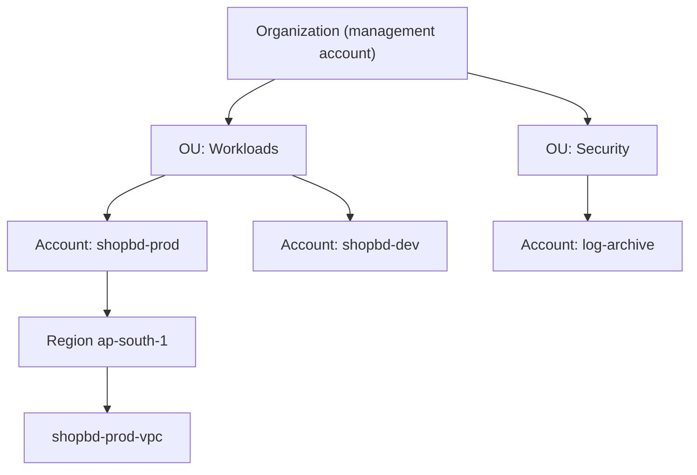

# AWS · Amazon Web Services গাইড

> এই পাতায় শুধু **AWS** নিয়ে কথা। আপনি এখানে শিখবেন:
>
> - AWS-এর মানসিকতা কী — অন্য cloud থেকে কোথায় আলাদা
> - Account খোলা, free tier বোঝা এবং Console ঘুরে দেখা
> - AWS CLI install ও login (`aws configure`, `aws configure sso`)
> - প্রথম account-এর hierarchy ও naming-এর খুঁটিনাটি
> - AWS-এর সব প্রধান service — category অনুযায়ী, প্রতিটার পাশে বিস্তারিত অধ্যায়ের লিংক
> - Certification path, শেখার উৎস ও **প্রথম দিনের checklist**

!!! abstract "এক নজরে — AWS"

    | বিষয় | AWS |
    |---|---|
    | Provider | Amazon (২০০৬ সাল থেকে public cloud) |
    | সবচেয়ে বড় শক্তি | সবচেয়ে বড় service catalog, পরিণত ecosystem, প্রচুর চাকরি ও community |
    | Hierarchy-র মাথা | Organization → OU → **Account** |
    | বাংলাদেশের কাছের region | `ap-south-1` (Mumbai), `ap-south-2` (Hyderabad), `ap-southeast-1` (Singapore) |
    | Web console | [console.aws.amazon.com](https://console.aws.amazon.com) |
    | CLI | `aws` (AWS CLI v2) |
    | নিজস্ব IaC | CloudFormation ও AWS CDK (Terraform-ও খুব জনপ্রিয়) |
    | Free tier পাতা | [aws.amazon.com/free](https://aws.amazon.com/free/) |
    | Pricing পাতা | [aws.amazon.com/pricing](https://aws.amazon.com/pricing/) |

---

## ১. AWS-এর মানসিকতা — কী আলাদা?

### Lego-র বাক্স

AWS কে ভাবুন একটা বিশাল Lego-র দোকান। প্রতিটা ছোট ব্লক (service) একটা নির্দিষ্ট কাজ করে — EC2 দেয় virtual machine,
S3 দেয় object storage, SQS দেয় queue। এই ব্লকগুলো আপনি নিজে জোড়া লাগিয়ে system বানান। ফলাফল: **নমনীয়তা প্রচুর,
কিন্তু শেখার জিনিসও প্রচুর।**

### AWS-এর বৈশিষ্ট্য যেগুলো মনে রাখবেন

- **Account-ই সবচেয়ে শক্ত দেয়াল।** AWS-এ resource আলাদা করার সবচেয়ে মজবুত উপায় হলো আলাদা **account**
  (GCP-র project বা Azure-র subscription-এর মতো ভূমিকা, কিন্তু security boundary হিসেবে আরও কড়া)। বড় প্রতিষ্ঠান `prod`, `dev`,
  `security` — প্রতিটার জন্য আলাদা account নেয়।
- **Region-কেন্দ্রিক।** বেশিরভাগ service একটা region-এ চলে। Console-এর ওপরে ডানদিকে region না দেখে resource খুঁজলে
  "আমার EC2 কই গেল?" — এই সমস্যা সবার একবার হয়।
- **সবকিছু API।** Console-এ যা করেন, CLI/SDK/Terraform-এও তা-ই করা যায়। তাই automation এখানে স্বাভাবিক পথ।
- **অনেক পথ, অনেক service।** একই কাজের একাধিক উপায় থাকে (container চালাতে ECS, EKS, App Runner, Lambda)। নতুনদের জন্য
  এটা বিভ্রান্তিকর, অভিজ্ঞদের জন্য শক্তি।
- **Default-এ বন্ধ (deny by default)।** IAM-এ কিছু allow না করলে কেউ কিছু করতে পারে না। "Access Denied" দেখলে প্রথমে policy দেখুন।
- **Shared responsibility।** Cloud-এর *নিচের* অংশ (data center, hardware) AWS-এর; আপনার data, IAM, OS patch, security group আপনার।
  বিস্তারিত: [Cloud-এর ভিত্তি](../01-cloud-fundamentals.md)।

### বাকি তিন cloud-এর তুলনায়

| বিষয় | AWS-এর অবস্থান |
|---|---|
| Service-এর সংখ্যা | সবচেয়ে বেশি; প্রায় সব workload-এর জন্য একাধিক বিকল্প |
| Isolation unit | Account (শক্ত দেয়াল) |
| Network | VPC **regional**; subnet একটা AZ-তে (GCP-র global VPC-র সঙ্গে আলাদা) |
| Identity | নিজস্ব IAM (JSON policy) + IAM Identity Center; Azure-এর মতো Entra নেই |
| কোথায় সবচেয়ে জোরালো | বৈচিত্র্য, ecosystem, third-party tool support, চাকরির বাজার |
| কোথায় জটিল | অনেক service, IAM policy ও pricing বোঝা, প্রতিটা দামের আলাদা dimension |

!!! note "কখন AWS বেছে নেবেন?"
    Startup বা team যদি বিশাল tool-ecosystem, নানা ধরনের managed service এবং সহজে লোক নিয়োগ চায়, AWS প্রায়ই প্রথম পছন্দ।
    কীভাবে cloud বাছবেন তার আলোচনা আছে [Cloud-এর ভিত্তি](../01-cloud-fundamentals.md) অধ্যায়ে।

---

## ২. Sign-up ও Free Tier

### Account খোলার ধাপ

1. [aws.amazon.com](https://aws.amazon.com) এ **Create an AWS Account** চাপুন।
2. Root user-এর email দিন। **একটা আলাদা, টিমের ঠিকানা** (যেমন `ops@example.com` ধরনের) ব্যবহার করলে ভবিষ্যতে
   মালিকানা বদলানো সহজ হয়; ব্যক্তিগত email-এ account বাঁধবেন না।
3. Account name ও password দিন, contact তথ্য দিন।
4. **Payment method** — credit/debit card লাগে। বাংলাদেশ থেকে সাধারণত international transaction চালু থাকা (dual-currency)
   card লাগে; যাচাইয়ের জন্য ছোট একটা অস্থায়ী hold পড়তে পারে। Card না চললে ব্যাংকের সঙ্গে international online payment চালু আছে কিনা দেখুন।
5. Phone verification (SMS/call) করুন।
6. Support plan বাছুন — শেখার জন্য **Basic (free)** যথেষ্ট।
7. Email-এ ঢুকে sign in করুন।

!!! danger "Root user দিয়ে দৈনন্দিন কাজ নয়"
    প্রথম কাজ: root-এ **MFA** চালু করা। তারপর root-এ access key **কখনো তৈরি করবেন না**। রোজকার কাজ করবেন
    IAM Identity Center বা IAM user/role দিয়ে। বিস্তারিত: [Identity ও Access](../03-identity-and-access.md)।

### Free Tier — কীভাবে ভাববেন

AWS-এর free tier-এর নিয়ম সময়ের সঙ্গে বদলেছে, তাই **এখানে কোনো সংখ্যা লিখছি না** — সবসময় [অফিশিয়াল Free Tier পাতা](https://aws.amazon.com/free/) দেখুন।
সাধারণ গঠনটা এরকম:

| ধরন | মানে | মনে রাখুন |
|---|---|---|
| Free plan / trial credit | নতুন account-এ নির্দিষ্ট সময় বা credit শেষ হওয়া পর্যন্ত চালানো যায় | মেয়াদ বা credit ফুরালে paid plan-এ যেতে হয়; আপনার account-এর শর্ত Billing পাতায় দেখুন |
| 12-month free (পুরোনো account) | কিছু service-এর মাসিক সীমা প্রথম ১২ মাস | আপনার account কবে খোলা তার ওপর নির্ভর করে |
| Always Free | কিছু service-এ মাসিক ছোট একটা সীমা চিরকাল free | সীমা পেরোলে সাধারণ দামে বিল |

!!! warning "Free tier মানে 'কখনো বিল আসবে না' নয়"
    সীমার বাইরের কিছু চালালে বা দামি resource (NAT Gateway, Elastic IP যা কোনো কিছুর সঙ্গে যুক্ত নয়, বড় instance) রেখে দিলে বিল আসে।
    প্রথম দিনেই **Budget** ও billing alert বানিয়ে নিন — বিস্তারিত [Cost Management](../18-cost-management.md)।

---

## ৩. Console ঘুরে দেখা

Console: [console.aws.amazon.com](https://console.aws.amazon.com)। Sign in করলে যা দেখবেন:

| জায়গা | কী আছে |
|---|---|
| ওপরের বাঁদিকে **Services** মেনু / search bar | Service খোঁজার প্রধান উপায়। Search bar-এ service-এর নাম লিখলেই হয় |
| ওপরের ডানদিকে **Region selector** | এখানে `Asia Pacific (Mumbai)` ধরনের নাম দেখাবে। **কাজ শুরুর আগে region দেখে নিন** |
| ওপরের ডানদিকে account নাম | Account ID, Billing and Cost Management, Security credentials, sign out, role switch |
| **CloudShell** আইকন | Browser-এর ভেতরে terminal; AWS CLI আগে থেকে installed ও আপনার login দিয়ে authenticated |
| **Notifications / Health** | AWS-এর দিক থেকে সমস্যা বা পরিকল্পিত কাজের খবর |
| **Console Home** widget | সাম্প্রতিক service, cost summary, security recommendation |
| **Resource Explorer / Tag Editor** | Region জুড়ে resource খোঁজা ও tag করা |

!!! tip "Region নিয়ে ঝামেলা এড়ানোর কৌশল"
    1. কাজের আগে ডানদিকের region নাম দেখে নিন।
    2. কিছু service **global** — IAM, Route 53, CloudFront, Organizations; এগুলোর জন্য region বাছতে হয় না (বা `Global` দেখায়)।
    3. Billing সব region-এর খরচ একসঙ্গে দেখায়; তাই "ভুলে যাওয়া resource" খুঁজতে Billing-এর service-ভিত্তিক breakdown দেখুন।

### Region ও AZ — বাংলাদেশের জন্য

| Region | কোড | মন্তব্য |
|---|---|---|
| Asia Pacific (Mumbai) | `ap-south-1` | বাংলাদেশের সবচেয়ে কাছের জনপ্রিয় বিকল্প; আমাদের উদাহরণে এটাই ধরা হয়েছে |
| Asia Pacific (Hyderabad) | `ap-south-2` | ভারতের দ্বিতীয় region; DR-এর জন্য ভালো |
| Asia Pacific (Singapore) | `ap-southeast-1` | বেশি service ও feature প্রায়ই আগে পাওয়া যায় |

প্রতিটা region-এ একাধিক **Availability Zone (AZ)** — `ap-south-1a`, `ap-south-1b` ইত্যাদি। কোনো নতুন service/feature সব region-এ একসঙ্গে আসে না;
ব্যবহারের আগে [Regional Services list](https://aws.amazon.com/about-aws/global-infrastructure/regional-product-services/) দেখুন।
Region/zone/edge-এর ধারণা: [Cloud-এর ভিত্তি](../01-cloud-fundamentals.md)।

---

## ৪. CLI install ও authentication

### AWS CLI v2 install

=== "Linux"

    ```bash
    curl "https://awscli.amazonaws.com/awscli-exe-linux-x86_64.zip" -o "awscliv2.zip"
    unzip awscliv2.zip
    sudo ./aws/install
    aws --version
    ```

=== "macOS"

    ```bash
    brew install awscli
    aws --version
    ```

=== "Windows"

    ```powershell
    msiexec.exe /i https://awscli.amazonaws.com/AWSCLIV2.msi
    aws --version
    ```

### পদ্ধতি ১ — `aws configure` (IAM user-এর access key)

সবচেয়ে সরল, কিন্তু **long-lived key** থাকে বলে সবচেয়ে ঝুঁকির। শুধু ব্যক্তিগত শেখার account-এ চলে।

```bash
aws configure
# AWS Access Key ID [None]: <your-access-key-id>
# AWS Secret Access Key [None]: <your-secret-access-key>
# Default region name [None]: ap-south-1
# Default output format [None]: json

aws sts get-caller-identity
```

`aws sts get-caller-identity` আপনি কোন account ও কোন identity হিসেবে ঢুকেছেন তা দেখায় — প্রতিদিন কাজ শুরুর আগে এটা চালানো ভালো অভ্যাস।
Key গুলো থাকে `~/.aws/credentials` ও `~/.aws/config` ফাইলে।

!!! danger "Access key কখনো Git-এ নয়"
    Key GitHub-এ push হলে কয়েক মিনিটে bot তুলে নেয়। Key ফাঁস হলে সঙ্গে সঙ্গে IAM-এ সেটা **deactivate** করে নতুন নিন।

### পদ্ধতি ২ — `aws configure sso` (প্রস্তাবিত)

IAM Identity Center (আগের নাম AWS SSO) থাকলে CLI-কে স্থায়ী key দিতে হয় না — browser-এ login করলে **অস্থায়ী credential** আসে।

```bash
aws configure sso
# SSO session name: shopbd
# SSO start URL: https://my-org.awsapps.com/start
# SSO region: ap-south-1
# (browser খুলবে, login করুন; তারপর account ও role বাছুন)
# CLI default client Region: ap-south-1
# Profile name: shopbd-dev

aws sso login --profile shopbd-dev
aws sts get-caller-identity --profile shopbd-dev
```

### Profile ব্যবহার

```bash
# একটা command-এ
aws s3 ls --profile shopbd-dev

# পুরো terminal session-এ
export AWS_PROFILE=shopbd-dev
export AWS_REGION=ap-south-1
aws ec2 describe-instances
```

| Environment variable | কাজ |
|---|---|
| `AWS_PROFILE` | কোন profile ব্যবহার হবে |
| `AWS_REGION` / `AWS_DEFAULT_REGION` | Default region |
| `AWS_ACCESS_KEY_ID`, `AWS_SECRET_ACCESS_KEY`, `AWS_SESSION_TOKEN` | সরাসরি credential (CI বা অস্থায়ী কাজে) |

### অন্যান্য উপায়

- **CloudShell** — Console থেকে এক ক্লিকে terminal; আলাদা install বা key লাগে না। দ্রুত পরীক্ষার জন্য আদর্শ।
- **Instance profile / IAM role** — EC2, Lambda, ECS-এ চলা code নিজে role পায়, key দেওয়ার দরকার হয় না। বিস্তারিত: [Identity ও Access](../03-identity-and-access.md)।
- **GitHub Actions OIDC** — CI থেকে key ছাড়াই AWS-এ ঢোকা: [CI/CD ও DevOps](../15-cicd-devops.md)।
- **SDK** — Python-এর `boto3` ইত্যাদি একই credential chain ব্যবহার করে।

---

## ৫. প্রথম account-এর hierarchy

AWS-এ কাঠামো এরকম:



| স্তর | মানে |
|---|---|
| **Root user** | Account খোলার সময়ের email; সর্বশক্তিমান, প্রায় ব্যবহার করবেন না |
| **Account** | Resource, IAM ও billing-এর মৌলিক সীমানা; ১২ অঙ্কের Account ID (`123456789012`) |
| **Organization** | একাধিক account একসঙ্গে manage; consolidated billing |
| **OU** (Organizational Unit) | Account-এর গ্রুপ; এখানে SCP (guardrail policy) বসে |
| **Region** | Resource আসলে কোথায় থাকে |

শেখার সময় একটা account-ই যথেষ্ট। কিন্তু ছোট প্রতিষ্ঠানও অন্তত `dev` ও `prod` আলাদা account-এ রাখলে ভুল করে prod মুছে ফেলার ভয় অনেক কমে।
গভীর আলোচনা: [Account, Organization ও Resource hierarchy](../02-accounts-and-hierarchy.md)।

### shopbd-র জন্য প্রথম কয়েকটা command

```bash
# আমি কে?
aws sts get-caller-identity

# Organization তৈরি (management account থেকে, একবার)
aws organizations create-organization --feature-set ALL

# প্রথম bucket (নাম globally unique হতে হয় — তাই account ID জুড়ে দেওয়া)
aws s3 mb s3://shopbd-images-123456789012 --region ap-south-1

# কোন কোন region চালু?
aws ec2 describe-regions --query "Regions[].RegionName" --output text
```

---

## ৬. Naming quirks — AWS-এর বিশেষ ব্যাপার-স্যাপার

| বিষয় | কী ঘটে | টিপস |
|---|---|---|
| **ARN** | প্রতিটা resource-এর পূর্ণ নাম: `arn:aws:s3:::shopbd-images-123456789012` | IAM policy-তে ARN লাগে; ভুল ARN মানেই "Access Denied" |
| **S3 bucket name** | সব AWS account জুড়ে **globally unique** | `shopbd-images-<account-id>` ধরনের pattern নিন |
| **Global vs regional** | IAM, Route 53, CloudFront global; বেশিরভাগ service regional | কিছু global service-এর certificate/Config `us-east-1`-এ লাগে (যেমন CloudFront-এর জন্য ACM certificate) |
| **Security Group** | Instance-এর virtual firewall; **stateful**, শুধু allow rule | Azure-এর NSG/GCP-র firewall rule-এর সঙ্গে নামে ও আচরণে আলাদা |
| **Elastic ___** | Elastic IP, Elastic Load Balancing, Elastic Beanstalk — "Elastic" মানে সাধারণত scale/attach করা যায় | নাম দেখে কাজ ধরা কঠিন; service list দেখুন |
| **Amazon vs AWS** | Amazon S3, AWS Lambda — পার্থক্য ঐতিহাসিক | এতে কিছু আসে-যায় না, খোঁজার সময় সংক্ষিপ্ত নাম দিন |
| **Instance type** | `t3.micro`, `m7g.large` — family + generation + size | `g` মানে Graviton (Arm) CPU; সস্তা, তবে software Arm-সমর্থিত হতে হবে |
| **Tag** | Key-value; AWS-এ নাম-ঠিকানার চেয়ে tag-ই খরচ ও ownership ঠিক করে | `Project=shopbd`, `Env=prod`; Cost allocation tag আলাদা চালু করতে হয় |
| **Default VPC** | প্রতি region-এ একটা আগে থেকে তৈরি | শেখার সময় সুবিধাজনক, production-এ নিজের VPC বানান |
| **Service-linked role** | কিছু service নিজে IAM role বানায় | মুছে ফেললে service ভাঙতে পারে |

---

## ৭. AWS-এর service তালিকা (category অনুযায়ী)

নিচের তালিকা AWS-এর সবচেয়ে প্রচলিত service ধরে। "বিস্তারিত" কলামের লিংকে চার cloud-এর তুলনাসহ পূর্ণ আলোচনা পাবেন।
সব service-এর পাশাপাশি তুলনা দেখতে: [Service Map](../reference/service-map.md)।

### Compute

| Service | কাজ | বিস্তারিত |
|---|---|---|
| **Amazon EC2** | Virtual machine; instance type, AMI, key pair | [Virtual Machine](../04-compute-vms.md) |
| **EC2 Auto Scaling** | চাহিদা অনুযায়ী instance বাড়ানো-কমানো | [Load Balancing ও Autoscaling](../10-load-balancing-scaling-dns-cdn.md) |
| **EC2 Spot Instances** | বাড়তি capacity-তে কম দামে; যেকোনো সময় কেড়ে নিতে পারে | [Virtual Machine](../04-compute-vms.md) |
| **EC2 Dedicated Hosts / metal** | নিজস্ব physical server বা bare metal | [Virtual Machine](../04-compute-vms.md) |
| **Amazon Lightsail** | সরল VPS-ধরনের package; নতুনদের ছোট site-এর জন্য | [Virtual Machine](../04-compute-vms.md) |
| **AWS Elastic Beanstalk** | Code দিন, EC2/LB/scaling নিজে বানায় (PaaS-ধরন) | [Serverless](../09-serverless.md) |
| **AWS Batch** | Batch job চালানো (নিচে compute বা Fargate-এ) | [Virtual Machine](../04-compute-vms.md) |
| **AWS Outposts** | AWS hardware আপনার data center-এ | [Architecture, HA/DR ও Multi-cloud](../19-architecture-ha-dr.md) |

### Networking

| Service | কাজ | বিস্তারিত |
|---|---|---|
| **Amazon VPC** | Private network; subnet, route table, Internet/NAT Gateway | [Networking](../05-networking.md) |
| **Security Group / Network ACL** | Instance-স্তরের (stateful) ও subnet-স্তরের (stateless) firewall | [Networking](../05-networking.md) |
| **VPC Peering / Transit Gateway** | একাধিক VPC জোড়া লাগানো | [Networking](../05-networking.md) |
| **AWS PrivateLink / VPC Endpoints** | Internet ছাড়া private পথে service ধরা | [Networking](../05-networking.md) |
| **Site-to-Site VPN / Direct Connect** | অফিস/data center থেকে AWS-এ VPN বা dedicated লাইন | [Networking](../05-networking.md) |
| **Elastic Load Balancing (ALB, NLB, GWLB)** | L7, L4 ও appliance load balancer | [Load Balancing, DNS ও CDN](../10-load-balancing-scaling-dns-cdn.md) |
| **Amazon Route 53** | DNS, routing policy, health check | [Load Balancing, DNS ও CDN](../10-load-balancing-scaling-dns-cdn.md) |
| **Amazon CloudFront** | CDN | [Load Balancing, DNS ও CDN](../10-load-balancing-scaling-dns-cdn.md) |
| **AWS Global Accelerator** | Anycast IP দিয়ে বিশ্বজুড়ে দ্রুত routing | [Load Balancing, DNS ও CDN](../10-load-balancing-scaling-dns-cdn.md) |

### Storage

| Service | কাজ | বিস্তারিত |
|---|---|---|
| **Amazon S3** | Object storage; storage class, lifecycle, presigned URL | [Storage](../06-storage.md) |
| **S3 Glacier classes** | সস্তা archive (পেতে দেরি/খরচ বেশি) | [Storage](../06-storage.md) |
| **Amazon EBS** | VM-এর block disk, snapshot | [Storage](../06-storage.md) |
| **Amazon EFS** | Shared NFS file system | [Storage](../06-storage.md) |
| **Amazon FSx** | Windows, Lustre, NetApp ধরনের managed file system | [Storage](../06-storage.md) |
| **AWS Backup** | কেন্দ্রীয় backup policy | [Storage](../06-storage.md) |
| **DataSync / Transfer Family / Snow family** | Data সরানো — network বা physical device দিয়ে | [Storage](../06-storage.md) |

### Database

| Service | কাজ | বিস্তারিত |
|---|---|---|
| **Amazon RDS** | Managed PostgreSQL, MySQL, MariaDB, SQL Server, Oracle | [Database](../07-databases.md) |
| **Amazon Aurora** | AWS-এর নিজস্ব cloud-native MySQL/PostgreSQL-compatible engine | [Database](../07-databases.md) |
| **Amazon DynamoDB** | Serverless key-value / document NoSQL | [Database](../07-databases.md) |
| **Amazon ElastiCache / MemoryDB** | Redis/Valkey/Memcached cache; durable in-memory | [Database](../07-databases.md) |
| **Amazon DocumentDB / Neptune / Keyspaces** | MongoDB-compatible, graph, Cassandra-compatible | [Database](../07-databases.md) |
| **AWS Database Migration Service (DMS)** | চলমান database অন্য জায়গায় সরানো | [Architecture, HA/DR ও Multi-cloud](../19-architecture-ha-dr.md) |

### Container ও Kubernetes

| Service | কাজ | বিস্তারিত |
|---|---|---|
| **Amazon ECR** | Container image registry | [Container ও Kubernetes](../08-containers-kubernetes.md) |
| **Amazon ECS** | AWS-এর নিজস্ব container orchestrator | [Container ও Kubernetes](../08-containers-kubernetes.md) |
| **Amazon EKS** | Managed Kubernetes | [Container ও Kubernetes](../08-containers-kubernetes.md) |
| **AWS Fargate** | Server manage না করে container চালানো (ECS/EKS-এর mode) | [Container ও Kubernetes](../08-containers-kubernetes.md) |
| **AWS App Runner** | Source/image দিলেই web service; সরল serverless container | [Serverless](../09-serverless.md) |

!!! note "App Runner-এর অবস্থা যাচাই করুন"
    AWS কিছু service নতুন গ্রাহকের জন্য সীমিত করেছে বা maintenance mode-এ নিয়েছে। শুরুর আগে service-এর অফিশিয়াল পাতায় বর্তমান অবস্থা দেখুন।

### Serverless

| Service | কাজ | বিস্তারিত |
|---|---|---|
| **AWS Lambda** | Function চালানো; event-triggered | [Serverless](../09-serverless.md) |
| **Amazon API Gateway** | REST/HTTP/WebSocket API-র সামনের দরজা | [Serverless](../09-serverless.md) |
| **AWS Step Functions** | Serverless workflow/state machine | [Messaging ও Event](../11-messaging-and-events.md) |
| **AWS AppSync** | Managed GraphQL | [Serverless](../09-serverless.md) |
| **ECS Fargate** | Serverless container | [Container ও Kubernetes](../08-containers-kubernetes.md) |

### Messaging ও Event

| Service | কাজ | বিস্তারিত |
|---|---|---|
| **Amazon SQS** | Queue; standard ও FIFO, dead-letter queue | [Messaging ও Event](../11-messaging-and-events.md) |
| **Amazon SNS** | Pub/sub, fan-out, SMS/email notification | [Messaging ও Event](../11-messaging-and-events.md) |
| **Amazon EventBridge** | Event bus ও scheduler | [Messaging ও Event](../11-messaging-and-events.md) |
| **Amazon Kinesis / MSK** | Stream data; MSK মানে managed Kafka | [Messaging ও Event](../11-messaging-and-events.md) |
| **Amazon MQ** | Managed RabbitMQ/ActiveMQ | [Messaging ও Event](../11-messaging-and-events.md) |
| **Amazon SES** | Transactional/bulk email (shopbd-র order email) | [Messaging ও Event](../11-messaging-and-events.md) |

### Observability

| Service | কাজ | বিস্তারিত |
|---|---|---|
| **Amazon CloudWatch** | Metrics, logs, alarms, dashboards, Logs Insights | [Monitoring, Logging ও Tracing](../12-observability.md) |
| **AWS X-Ray** | Distributed tracing | [Monitoring, Logging ও Tracing](../12-observability.md) |
| **AWS CloudTrail** | কে কোথায় কী API call করল — audit log | [Monitoring, Logging ও Tracing](../12-observability.md) |
| **AWS Config** | Resource-এর configuration ইতিহাস ও compliance check | [Security](../13-security.md) |
| **Managed Grafana / Managed Prometheus** | Open-source monitoring stack, managed | [Monitoring, Logging ও Tracing](../12-observability.md) |
| **AWS Distro for OpenTelemetry** | OpenTelemetry collector/SDK distribution | [Monitoring, Logging ও Tracing](../12-observability.md) |

### Security ও Identity

| Service | কাজ | বিস্তারিত |
|---|---|---|
| **AWS IAM** | User, group, role, policy | [Identity ও Access](../03-identity-and-access.md) |
| **IAM Identity Center** | কর্মীদের SSO, multi-account access | [Identity ও Access](../03-identity-and-access.md) |
| **AWS Organizations / Control Tower** | Multi-account কাঠামো, guardrail, landing zone | [Account, Organization ও Hierarchy](../02-accounts-and-hierarchy.md) |
| **AWS KMS** | Encryption key management | [Security](../13-security.md) |
| **AWS Secrets Manager / Parameter Store** | Secret ও config সংরক্ষণ | [Security](../13-security.md) |
| **AWS Certificate Manager (ACM)** | TLS certificate | [Security](../13-security.md) |
| **AWS WAF / Shield** | Web firewall ও DDoS সুরক্ষা | [Security](../13-security.md) |
| **GuardDuty / Security Hub / Inspector** | Threat detection, posture ও vulnerability scan | [Security](../13-security.md) |
| **Amazon Cognito** | App-এর ব্যবহারকারীর sign-up/login | [Identity ও Access](../03-identity-and-access.md) |

### Infrastructure as Code

| Service | কাজ | বিস্তারিত |
|---|---|---|
| **AWS CloudFormation** | JSON/YAML template দিয়ে stack | [Infrastructure as Code](../14-infrastructure-as-code.md) |
| **AWS CDK** | Python/TypeScript দিয়ে লিখে CloudFormation তৈরি | [Infrastructure as Code](../14-infrastructure-as-code.md) |
| **Terraform / OpenTofu (`aws` provider)** | Multi-cloud IaC (AWS-এর নিজস্ব নয়) | [Infrastructure as Code](../14-infrastructure-as-code.md) |
| **AWS Systems Manager** | Fleet পরিচালনা, patch, Session Manager | [Virtual Machine](../04-compute-vms.md) |
| **AWS Service Catalog** | অনুমোদিত template-এর তালিকা | [Infrastructure as Code](../14-infrastructure-as-code.md) |

### CI/CD

| Service | কাজ | বিস্তারিত |
|---|---|---|
| **AWS CodePipeline** | Pipeline orchestration | [CI/CD ও DevOps](../15-cicd-devops.md) |
| **AWS CodeBuild** | Managed build server | [CI/CD ও DevOps](../15-cicd-devops.md) |
| **AWS CodeDeploy** | EC2/ECS/Lambda-য় deploy strategy | [CI/CD ও DevOps](../15-cicd-devops.md) |
| **AWS CodeArtifact** | Package repository (npm, PyPI…) | [CI/CD ও DevOps](../15-cicd-devops.md) |
| **GitHub Actions + OIDC** | Key ছাড়া GitHub থেকে AWS-এ deploy | [CI/CD ও DevOps](../15-cicd-devops.md) |

### Data ও Analytics

| Service | কাজ | বিস্তারিত |
|---|---|---|
| **Amazon Redshift** | Data warehouse | [Data ও Analytics](../16-data-and-analytics.md) |
| **Amazon Athena** | S3-এর data-তে SQL query | [Data ও Analytics](../16-data-and-analytics.md) |
| **AWS Glue** | ETL ও data catalog | [Data ও Analytics](../16-data-and-analytics.md) |
| **Amazon EMR** | Managed Spark/Hadoop | [Data ও Analytics](../16-data-and-analytics.md) |
| **AWS Lake Formation** | Data lake-এর access control | [Data ও Analytics](../16-data-and-analytics.md) |
| **Amazon OpenSearch Service** | Search ও log analytics | [Data ও Analytics](../16-data-and-analytics.md) |
| **Amazon QuickSight** | BI dashboard | [Data ও Analytics](../16-data-and-analytics.md) |
| **Amazon Data Firehose** | Stream থেকে S3/warehouse-এ পৌঁছানো | [Data ও Analytics](../16-data-and-analytics.md) |

### AI ও Machine Learning

| Service | কাজ | বিস্তারিত |
|---|---|---|
| **Amazon SageMaker AI** | Model তৈরি, train, deploy-এর ML platform | [AI ও Machine Learning](../17-ai-ml.md) |
| **Amazon Bedrock** | বিভিন্ন foundation model API দিয়ে ব্যবহার (managed GenAI) | [AI ও Machine Learning](../17-ai-ml.md) |
| **Rekognition / Textract** | ছবি ও document বিশ্লেষণ API | [AI ও Machine Learning](../17-ai-ml.md) |
| **Transcribe / Polly / Translate** | Speech-to-text, text-to-speech, অনুবাদ | [AI ও Machine Learning](../17-ai-ml.md) |
| **Comprehend** | Text বিশ্লেষণ (sentiment, entity) | [AI ও Machine Learning](../17-ai-ml.md) |
| **GPU instance, Trainium / Inferentia** | ML-এর জন্য বিশেষ hardware | [AI ও Machine Learning](../17-ai-ml.md) |

### Cost Management

| Service | কাজ | বিস্তারিত |
|---|---|---|
| **Billing and Cost Management** | Bill, payment, credit দেখা | [Cost Management](../18-cost-management.md) |
| **Cost Explorer** | খরচের গ্রাফ ও বিশ্লেষণ | [Cost Management](../18-cost-management.md) |
| **AWS Budgets** | Budget ও alert | [Cost Management](../18-cost-management.md) |
| **Cost and Usage Report / Data Exports** | বিস্তারিত খরচের raw data | [Cost Management](../18-cost-management.md) |
| **Savings Plans / Reserved Instances** | দীর্ঘমেয়াদি commitment-এ ছাড় | [Cost Management](../18-cost-management.md) |
| **Compute Optimizer / Trusted Advisor** | Rightsizing ও সাশ্রয়ের পরামর্শ | [Cost Management](../18-cost-management.md) |
| **Pricing Calculator** | আগেই আনুমানিক খরচ হিসাব | [Cost Management](../18-cost-management.md) |

---

## ৮. shopbd AWS-এ কেমন দেখায়

`shopbd` — আমাদের ছোট বাংলাদেশি অনলাইন শপ: web frontend, REST API, PostgreSQL, ছবির storage, order email, রাতের sales report।

| shopbd-র অংশ | AWS service | নাম |
|---|---|---|
| Web frontend (static) | S3 + CloudFront | `shopbd-web` |
| REST API | ECS Fargate (ALB-র পেছনে) বা Lambda + API Gateway | `shopbd-api` |
| PostgreSQL | RDS for PostgreSQL | `shopbd-db` |
| Product image | S3 bucket | `shopbd-images` |
| Order email | Amazon SES | sender `ops@example.com` |
| Nightly sales report | EventBridge Scheduler → Lambda | `shopbd-nightly-report` |
| Network | VPC | `shopbd-prod-vpc` |
| Domain | Route 53 | `shopbd.example.com` |
| Monitoring | CloudWatch alarm → SNS → email | `ops@example.com` |

পূর্ণ architecture ও diagram: [Architecture, HA/DR ও Multi-cloud](../19-architecture-ha-dr.md)।

---

## ৯. Certification path

AWS-এর certification-এর নাম ও তালিকা মাঝে মাঝে বদলায় — [aws.amazon.com/certification](https://aws.amazon.com/certification/) দেখে নিন।
সাধারণ ধাপগুলো:

| স্তর | Certification | কার জন্য |
|---|---|---|
| Foundational | **Cloud Practitioner**, **AI Practitioner** | একদম নতুন, non-tech role, প্রথম পরিচয় |
| Associate | **Solutions Architect – Associate** | সবচেয়ে জনপ্রিয় শুরু; architecture বোঝা |
| Associate | **Developer – Associate** | Lambda, API, CI/CD-তে code লেখা মানুষ |
| Associate | **CloudOps Engineer – Associate** (আগে SysOps Administrator) | Operations, monitoring, troubleshooting |
| Associate | **Data Engineer – Associate**, **Machine Learning Engineer – Associate** | Data/ML pipeline |
| Professional | **Solutions Architect – Professional**, **DevOps Engineer – Professional** | অভিজ্ঞ, জটিল system |
| Specialty | **Security**, **Advanced Networking** ইত্যাদি | নির্দিষ্ট ক্ষেত্রে গভীরতা |

!!! tip "শুরুর পরামর্শ"
    হাতে-কলমে ৩–৪টা project (shopbd-র মতো) করে তারপর **Solutions Architect – Associate** দিন। Dump মুখস্থ করার চেয়ে
    "কেন এই service, কেন ওটা নয়" বোঝা চাকরির ইন্টারভিউতে অনেক বেশি কাজে লাগে।

---

## ১০. শেখার উৎস

| উৎস | কী পাবেন |
|---|---|
| [AWS Documentation](https://docs.aws.amazon.com) | প্রতিটা service-এর অফিশিয়াল guide ও API reference |
| [AWS Skill Builder](https://skillbuilder.aws) | অফিশিয়াল কোর্স, lab, exam প্রস্তুতি (কিছু free) |
| [AWS Well-Architected Framework](https://aws.amazon.com/architecture/well-architected/) | ভালো architecture-এর নীতি |
| [AWS Architecture Center](https://aws.amazon.com/architecture/) | Reference architecture ও diagram |
| [AWS Workshops](https://workshops.aws) | ধাপে ধাপে hands-on workshop |
| [AWS CLI Command Reference](https://docs.aws.amazon.com/cli/latest/) | সব command-এর বিবরণ |
| [Terraform AWS provider docs](https://registry.terraform.io/providers/hashicorp/aws/latest/docs) | Terraform resource-এর reference |
| [AWS What's New](https://aws.amazon.com/new/) | নতুন service ও feature-এর খবর |

---

## ১১. প্রথম দিনের checklist

Account খোলার প্রথম দিনেই এগুলো সেরে ফেলুন। প্রতিটা আধ ঘণ্টার বেশি লাগে না, কিন্তু পরে বড় বিপদ থেকে বাঁচায়।

**Account সুরক্ষা**

- [ ] Root user-এ MFA চালু করেছি (authenticator app বা security key)
- [ ] Root user-এর কোনো access key নেই (থাকলে মুছেছি)
- [ ] Root-এর email টিমের ঠিকানা এবং সেই email-এও MFA আছে
- [ ] Alternate contact (billing, security, operations) দিয়েছি

**নিজের জন্য সঠিক login**

- [ ] IAM Identity Center চালু করেছি (বা অন্তত একটা আলাদা admin IAM user বানিয়েছি)
- [ ] নিজের admin user-এ MFA চালু করেছি
- [ ] রোজকার কাজ root নয়, এই user/role দিয়ে করি

**খরচের সুরক্ষা**

- [ ] Billing-এ IAM/Identity Center user-দের access দেখার অনুমতি চালু করেছি
- [ ] একটা **Budget** বানিয়েছি এবং alert `ops@example.com` ধরনের ঠিকানায় যায়
- [ ] [Cost Management](../18-cost-management.md) অধ্যায় একবার পড়েছি
- [ ] Free tier-এর শর্ত ও মেয়াদ নিজের account-এর Billing পাতায় দেখেছি

**Tools**

- [ ] AWS CLI v2 install করেছি (`aws --version`)
- [ ] `aws configure sso` (বা শেখার জন্য `aws configure`) করেছি
- [ ] `aws sts get-caller-identity` চালিয়ে নিজের account ID পেয়েছি
- [ ] CloudShell একবার খুলে দেখেছি

**প্রথম resource**

- [ ] Region `ap-south-1` ঠিক করে নিয়েছি
- [ ] একটা S3 bucket (`shopbd-images-<account-id>`) বানিয়ে একটা ছবি upload করেছি
- [ ] CloudTrail-এ নিজের আজকের API call দেখেছি
- [ ] পরীক্ষার সব resource মুছে ফেলার অভ্যাস করেছি

---

## ১২. সচরাচর ভুল (AWS-এ)

| ভুল | ফল | সমাধান |
|---|---|---|
| Root user দিয়ে সব কাজ | একটা ফাঁস মানে সর্বনাশ | Identity Center/IAM role ব্যবহার করুন |
| Access key code বা Git-এ | Key চুরি, অনাকাঙ্ক্ষিত bill | Role/SSO নিন; key দিলে deactivate ও rotate |
| ভুল region-এ কাজ | "Resource হারিয়ে গেছে" মনে হয় | কাজের আগে region দেখুন, `AWS_REGION` ঠিক রাখুন |
| NAT Gateway ও unattached Elastic IP ফেলে রাখা | নীরবে খরচ বাড়ে | কাজ শেষে মুছুন; Budget alert রাখুন |
| Security Group-এ `0.0.0.0/0` দিয়ে SSH/DB খোলা | হ্যাকিংয়ের ঝুঁকি | নিজের IP বা Session Manager ব্যবহার করুন |
| S3 bucket public রেখে দেওয়া | Data leak | Block Public Access চালু রাখুন; CloudFront ব্যবহার করুন |
| একটাই account-এ dev ও prod | ভুলে prod মুছে ফেলা | অন্তত দুটো আলাদা account |

---

## সারসংক্ষেপ

- AWS মানে **বিশাল Lego-র বাক্স** — নমনীয়, কিন্তু শিখতে সময় লাগে। **Account** হলো সবচেয়ে শক্ত দেয়াল।
- প্রথম দিনেই **root-এ MFA, Budget, SSO** — এই তিনটা করলে ৯০% নতুনদের ভুল এড়ানো যায়।
- CLI-র জন্য `aws configure sso` পছন্দ করুন; কাজের আগে `aws sts get-caller-identity` দিয়ে পরিচয় ও region দেখুন।
- Service খুঁজতে এই পাতার তালিকা ধরে সংশ্লিষ্ট অধ্যায়ে যান; চার cloud-এর পাশাপাশি তুলনা পাবেন।
- পরের ধাপ: [Account ও Hierarchy](../02-accounts-and-hierarchy.md) → [IAM](../03-identity-and-access.md) → [Virtual Machine](../04-compute-vms.md)।

অন্য cloud দেখতে: [GCP](gcp.md) · [Azure](azure.md) · [OCI](oci.md)
