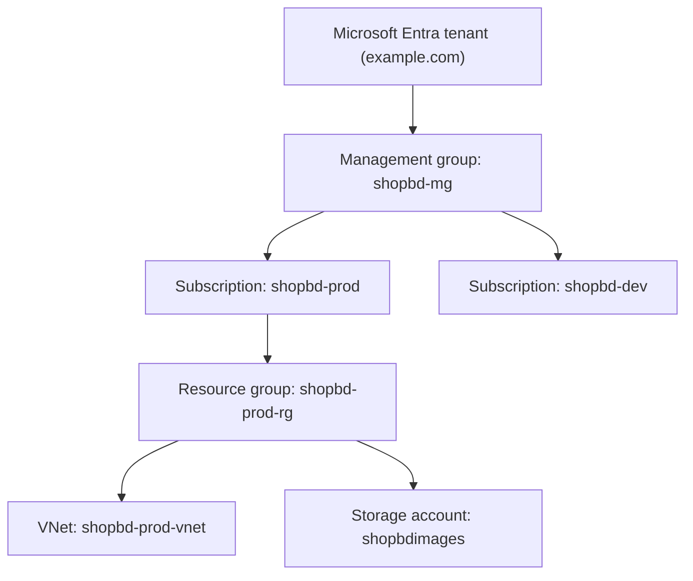

# Azure · Microsoft Azure গাইড

> এই পাতায় শুধু **Microsoft Azure** নিয়ে কথা। আপনি এখানে শিখবেন:
>
> - Azure-এর মানসিকতা — enterprise, Microsoft ecosystem ও **Resource Group**-কেন্দ্রিক ভাবনা
> - Account/subscription খোলা, free account বোঝা, Azure portal ঘুরে দেখা
> - Azure CLI install ও login (`az login`), PowerShell বিকল্প
> - Tenant → Management group → Subscription → Resource group hierarchy
> - Azure-এর সব প্রধান service — category অনুযায়ী, বিস্তারিত অধ্যায়ের লিংকসহ
> - Certification path (AZ-900 থেকে), শেখার উৎস ও **প্রথম দিনের checklist**

!!! abstract "এক নজরে — Azure"

    | বিষয় | Azure |
    |---|---|
    | Provider | Microsoft |
    | সবচেয়ে বড় শক্তি | Microsoft ecosystem (Windows, SQL Server, Microsoft 365), Entra ID, hybrid ও enterprise |
    | Hierarchy-র মাথা | Entra tenant → Management group → **Subscription** → Resource group |
    | বাংলাদেশের কাছের region | `centralindia` (Pune), `southindia` (Chennai), `southeastasia` (Singapore) |
    | Web console | [portal.azure.com](https://portal.azure.com) |
    | CLI | `az` (Azure CLI) এবং Azure PowerShell |
    | নিজস্ব IaC | ARM templates ও **Bicep** (Terraform-ও জনপ্রিয়) |
    | Free পাতা | [azure.microsoft.com/free](https://azure.microsoft.com/free/) |
    | Pricing পাতা | [azure.microsoft.com/pricing](https://azure.microsoft.com/pricing/) |

---

## ১. Azure-এর মানসিকতা — কী আলাদা?

### অফিসের পরিচিত ঘরবাড়ির মতো

কোম্পানির কর্মীরা আগে থেকেই Windows, Active Directory, Outlook, Teams, SQL Server ব্যবহার করে — Azure এই জগতেরই cloud-এ সম্প্রসারণ।
তাই এখানে **identity (Microsoft Entra ID)** সবকিছুর কেন্দ্র, আর অনেক প্রতিষ্ঠান Azure-এ আসে শুধু এই পরিচিত পরিবেশের কারণেই।

### যে বিষয়গুলো Azure-কে আলাদা করে

- **Subscription ও Resource Group।** Subscription হলো billing ও access-এর একক; তার ভেতরে **Resource Group** — কিছু resource-কে একসঙ্গে
  একটা "ফোল্ডার"-এ রাখার জায়গা। একটা app-এর সব resource এক group-এ রাখলে মুছে ফেলাও একসঙ্গে সহজ।
- **Microsoft Entra ID** (আগের নাম Azure Active Directory / Azure AD) — মানুষের identity ও SSO। Azure RBAC role এর ওপর বসে।
- **Hybrid-এ জোর।** অন-প্রেম Windows Server/SQL Server-এর লাইসেন্স Azure-এ আনলে ছাড় (Azure Hybrid Benefit), Azure Arc দিয়ে নিজের server-ও Azure থেকে পরিচালনা।
- **Portal-প্রধান অভিজ্ঞতা।** Portal খুব সমৃদ্ধ; অনেক কাজ ক্লিক-ক্লিক করেই হয়, আবার ARM/Bicep ও CLI আছে।
- **Resource provider।** প্রতিটা service একটা "provider"-এর (যেমন `Microsoft.Network`) অধীন; subscription-এ provider **registered** না থাকলে resource তৈরি হয় না।
- **Quota আছে, region-ভিত্তিক।** প্রতিটা subscription-এ প্রতি region-এ vCPU-র সীমা থাকে; অনেকে প্রথম VM বানাতে গিয়ে quota error পায়।
- **Enterprise-এর সঙ্গে ভালো মেলে।** Microsoft 365, Dynamics, Power Platform, GitHub, Azure DevOps — সবই একই পরিবারে।

### বাকি তিন cloud-এর তুলনায়

| বিষয় | Azure-এর অবস্থান |
|---|---|
| Isolation unit | Subscription (এবং তার ভেতরে Resource Group) |
| Network | VNet **regional** |
| Identity | Microsoft Entra ID (tenant) + Azure RBAC; এটা Azure-এর আলাদা শক্তি |
| কোথায় সবচেয়ে জোরালো | Windows/.NET/SQL Server, hybrid, enterprise ও Microsoft 365 সংযোগ |
| কোথায় খেয়াল রাখবেন | নাম-বদল ও নতুন branding ঘনঘন; "Azure AD", "Azure Security Center" ধরনের পুরোনো নাম বহু ব্লগে |

!!! note "পুরোনো নামের সতর্কতা"
    **Azure Active Directory → Microsoft Entra ID**, **Azure Security Center → Microsoft Defender for Cloud**,
    **Azure Cache for Redis → Azure Managed Redis** (migration দিকে), **Azure AD B2C → Microsoft Entra External ID**।
    AI-র দিকে **Azure AI Foundry** এখন **Microsoft Foundry** নামেও পাবেন। পুরোনো লেখায় এই নামগুলো দেখলে নতুন নামে খুঁজুন।

---

## ২. Sign-up, Subscription ও Free Account

### Account খোলা

1. [azure.microsoft.com/free](https://azure.microsoft.com/free/) এ **Try Azure for free** চাপুন।
2. একটা **Microsoft account** (বা কোম্পানির Entra ID account) দিয়ে sign in করুন।
3. তথ্য ও phone verification, তারপর **card** — বাংলাদেশ থেকে international/dual-currency card লাগে; যাচাইয়ের জন্য অস্থায়ী hold পড়তে পারে।
4. শেষে একটা **Subscription** (যেমন `Azure subscription 1` বা `Free Trial`) ও একটা Entra **tenant** তৈরি হয়।

!!! tip "ছাত্র হলে"
    **Azure for Students** নামে আলাদা একটা offer আছে যেখানে সাধারণত card লাগে না; শিক্ষা-প্রতিষ্ঠানের email দিয়ে যোগ্যতা যাচাই হয়।
    বর্তমান শর্ত অফিশিয়াল পাতায় দেখুন।

### Subscription-এর ধরন

| ধরন | মানে |
|---|---|
| Free Trial / Free account | শেখার জন্য; সীমিত সময়ের credit ও সীমিত service |
| Pay-As-You-Go | যতটুকু ব্যবহার ততটুকু বিল; card-এ |
| Enterprise Agreement / CSP / MCA | বড় প্রতিষ্ঠান বা partner মারফত চুক্তি-ভিত্তিক |
| Visual Studio / Dev-Test benefit | Developer-দের জন্য মাসিক credit (যোগ্য হলে) |

### Free Account — কীভাবে ভাববেন

সংখ্যা ও শর্ত বদলায়, তাই কোনো মান লিখছি না — [অফিশিয়াল Free পাতা](https://azure.microsoft.com/free/) দেখুন। গঠনটা:

| ধরন | মানে | মনে রাখুন |
|---|---|---|
| শুরুর credit | নতুন account-এ নির্দিষ্ট সময়ের জন্য ব্যবহারযোগ্য credit | Credit শেষ বা মেয়াদ গেলে paid-এ যেতে (upgrade) আপনাকে সম্মতি দিতে হয়; না দিলে resource বন্ধ হয়ে যায়, নীরবে বিল আসে না |
| জনপ্রিয় service-এর 12 মাসের free অংশ | কিছু service-এর নির্দিষ্ট মাসিক ঘণ্টা/ক্ষমতা প্রথম বছর free | কোনটা কী, কত — অফিশিয়াল তালিকায় |
| Always Free | কিছু service-এ চিরকাল ছোট সীমা free | সীমার বাইরে হলে সাধারণ দামে |

!!! warning "Credit থাকলেও খরচের হিসাব রাখুন"
    Credit শেষ হওয়ার পর **Pay-As-You-Go**-তে upgrade করলে সব resource পুরো দামে চলে। প্রথম দিনেই **Cost Management → Budgets**
    বানিয়ে নিন — বিস্তারিত [Cost Management](../18-cost-management.md)।

---

## ৩. Azure portal ঘুরে দেখা

Portal: [portal.azure.com](https://portal.azure.com)।

| জায়গা | কী আছে |
|---|---|
| ওপরের **Search bar** | Service, resource, doc খোঁজা — সবচেয়ে দ্রুত navigation |
| ☰ **Portal menu** | Favorites, All services, Resource groups, Subscriptions |
| **Cloud Shell** (`>_`) | Browser-এ Bash বা PowerShell; `az` আগে থেকে ইনস্টল ও login করা |
| **Directory + subscription** filter | কোন tenant ও কোন subscription দেখছেন তা বাছাই |
| **Resource groups** | এখানে app-ভিত্তিক resource দেখা, মুছে ফেলা |
| **Microsoft Entra ID** | ব্যবহারকারী, group, app registration, Conditional Access |
| **Cost Management + Billing** | খরচ বিশ্লেষণ, budget, invoice |
| **Azure Monitor** | Metrics, logs, alert |
| **Microsoft Defender for Cloud** | নিরাপত্তা posture |
| **Azure Advisor** | Cost, security, reliability-র পরামর্শ |
| **Copilot in Azure** (থাকলে) | Portal-এর ভেতরে AI সহায়ক — ফলাফল যাচাই করে নিন |

!!! tip "দুটো filter আগে দেখুন"
    ভুল **subscription** বা ভুল **tenant**-এ কাজ করা Azure-এর সবচেয়ে পরিচিত বিভ্রান্তি। কাজ শুরুর আগে portal-এর filter ও
    CLI-তে `az account show` দেখে নিন।

### Region — বাংলাদেশের জন্য

| Region | কোড | মন্তব্য |
|---|---|---|
| Central India | `centralindia` | বাংলাদেশের কাছের জনপ্রিয় বিকল্প; আমাদের উদাহরণে এটা |
| South India | `southindia` | বিকল্প / DR |
| Southeast Asia | `southeastasia` | Singapore; অনেক service-এ বেশি বিকল্প |

কিছু region-এ **Availability Zone** আছে, সব-তে নেই — VM/service বানানোর আগে region-এ AZ ও service সমর্থিত কিনা দেখুন। Region/zone ধারণা:
[Cloud-এর ভিত্তি](../01-cloud-fundamentals.md)।

---

## ৪. CLI install ও authentication

### Azure CLI install

=== "Windows"

    ```powershell
    winget install --exact --id Microsoft.AzureCLI
    az version
    ```

=== "macOS"

    ```bash
    brew install azure-cli
    az version
    ```

=== "Linux (Debian/Ubuntu)"

    ```bash
    curl -sL https://aka.ms/InstallAzureCLIDeb | sudo bash
    az version
    ```

### Login — `az login`

```bash
# browser খুলে login
az login

# browser নেই (SSH/server) হলে device code
az login --use-device-code

# কোন subscription-এ আছি?
az account show
az account list --output table
```

যদি একাধিক subscription থাকে, কোনটা default হবে তা ঠিক করুন:

```bash
az account set --subscription "00000000-0000-0000-0000-000000000000"
```

### Default location ও group সেট করা

```bash
az configure --defaults location=centralindia group=shopbd-prod-rg
az configure --list-defaults
```

### Service principal ও managed identity (কোড/CI-র জন্য)

- **Managed identity** — Azure VM, App Service, Functions ইত্যাদি নিজে identity পায়, secret লাগে না। সবচেয়ে প্রস্তাবিত।
- **Service principal** — app/CI-র জন্য আলাদা identity; secret/certificate-এর বদলে **federated credential (OIDC)** পছন্দ করুন।
- GitHub Actions থেকে key ছাড়া ঢোকা: [CI/CD ও DevOps](../15-cicd-devops.md); বিস্তারিত IAM: [Identity ও Access](../03-identity-and-access.md)।

### Azure PowerShell (বিকল্প)

Windows-নির্ভর team-এ PowerShell জনপ্রিয়:

```powershell
Install-Module -Name Az -Scope CurrentUser -Repository PSGallery
Connect-AzAccount
Get-AzSubscription
Set-AzContext -Subscription "00000000-0000-0000-0000-000000000000"
```

!!! tip "দ্রুত শুরু: Cloud Shell"
    Portal-এর `>_` চাপলে আলাদা install ছাড়াই `az` ও PowerShell পাবেন, আর আপনি আগে থেকেই login করা। প্রথমবার একটা storage account বানাতে বলতে পারে।

---

## ৫. প্রথম subscription ও hierarchy



| স্তর | মানে |
|---|---|
| **Tenant (Entra ID)** | ব্যবহারকারী ও identity-র ঘর; প্রতিষ্ঠানের "পরিচয়-সীমানা" |
| **Management group** | একাধিক subscription-এর গ্রুপ; এখানে policy ও RBAC বসে |
| **Subscription** | Billing, quota ও access-এর একক |
| **Resource group** | Resource-এর লজিক্যাল গ্রুপ (একই lifecycle-এর); একটা resource ঠিক একটা group-এ থাকে |
| **Resource** | VM, storage, database ইত্যাদি |

!!! note "Resource group-এর location"
    Resource group-এর নিজস্ব একটা location থাকে (metadata কোথায় রাখা হবে), কিন্তু ভেতরের resource অন্য region-এও থাকতে পারে।
    গোলমাল এড়াতে সাধারণত একই region ব্যবহার করুন।

### shopbd-র প্রথম কয়েকটা command

```bash
# resource group (প্রায় সবকিছুর আগে)
az group create --name shopbd-prod-rg --location centralindia

# প্রয়োজনীয় resource provider নিবন্ধন (একবার)
az provider register --namespace Microsoft.Network
az provider register --namespace Microsoft.Storage

# storage account (নাম: ছোট হাতের অক্ষর+সংখ্যা, ৩–২৪ অক্ষর, globally unique)
az storage account create --name shopbdimages001 \
  --resource-group shopbd-prod-rg --location centralindia --sku Standard_LRS

# resource group মুছলে ভেতরের সব মুছে যায় — পরীক্ষার পর পরিষ্কার করার সেরা উপায়
az group delete --name shopbd-prod-rg --yes --no-wait
```

!!! danger "Resource group মুছলে সবই যায়"
    `az group delete` ভেতরের **সব** resource মুছে ফেলে। production group-এ **Resource lock** (`CanNotDelete`) বসানো ভালো অভ্যাস।

Management group, subscription ও tag-এর গভীর আলোচনা: [Account, Organization ও Resource hierarchy](../02-accounts-and-hierarchy.md)।

---

## ৬. Naming quirks — Azure-এর বিশেষ ব্যাপার-স্যাপার

| বিষয় | কী ঘটে | টিপস |
|---|---|---|
| **Storage account name** | ৩–২৪ অক্ষর, শুধু ছোট হাতের অক্ষর ও সংখ্যা (hyphen চলে না), globally unique | `shopbdimages001` |
| **Resource ID** | `/subscriptions/<id>/resourceGroups/<rg>/providers/...` — পাথরের মতো লম্বা | RBAC ও CLI-তে scope এভাবে দেওয়া হয় |
| **Resource group** | সব resource-এর বাধ্যতামূলক "ঘর" | AWS/GCP-তে এই ধারণা সরাসরি নেই |
| **Resource provider registration** | Subscription-এ provider registered না থাকলে error | `az provider register --namespace …` |
| **NSG** (Network Security Group) | Subnet বা NIC-এ attach হয়; stateful; priority-ভিত্তিক rule | AWS Security Group-এর মতো শুধু allow নয়, deny-ও আছে |
| **VM size** | `Standard_B2s`, `Standard_D4s_v5` — family+আকার+version | বিস্তারিত: [Virtual Machine](../04-compute-vms.md) |
| **Azure Database for PostgreSQL – Flexible Server** | আগের "Single Server" retire; এখন Flexible Server | পুরোনো ব্লগে "Single Server" দেখলে ভাববেন এটা পুরোনো |
| **Defender, Entra, Foundry** | নতুন branding — আগের নামও ছড়িয়ে আছে | পুরোনো নামের তালিকা ওপরে |
| **Tag** | Resource, Resource Group ও Subscription-এ key-value | Tag **নিজে থেকে নিচে inherit হয় না**; Azure Policy দিয়ে বাধ্য করুন |
| **Naming convention** | Microsoft-এর Cloud Adoption Framework-এ সংক্ষেপ-উপসর্গ আছে (`rg-`, `vnet-`, `st`) | আমরা এই সাইটে `shopbd-prod-…` ধাঁচ রেখেছি |
| **Quota** | Region ও VM family অনুযায়ী vCPU সীমা | Portal → Quotas থেকে বাড়ানোর অনুরোধ করুন |
| **Classic vs ARM** | পুরোনো "classic" resource আছে | নতুন কাজ সবসময় Azure Resource Manager (ARM) মডেলে |

---

## ৭. Azure-এর service তালিকা (category অনুযায়ী)

"বিস্তারিত" কলামের লিংকে চার cloud-এর তুলনাসহ পূর্ণ আলোচনা। সব service পাশাপাশি: [Service Map](../reference/service-map.md)।

### Compute

| Service | কাজ | বিস্তারিত |
|---|---|---|
| **Azure Virtual Machines** | Virtual machine; size, image, disk | [Virtual Machine](../04-compute-vms.md) |
| **Virtual Machine Scale Sets (VMSS)** | VM-এর দল, autoscaling | [Load Balancing ও Autoscaling](../10-load-balancing-scaling-dns-cdn.md) |
| **Spot VMs** | কম দামে, কেড়ে নেওয়া যেতে পারে | [Virtual Machine](../04-compute-vms.md) |
| **Dedicated Host / bare metal** | নিজস্ব physical host | [Virtual Machine](../04-compute-vms.md) |
| **Azure App Service** | Web app ও API-র জন্য PaaS | [Serverless](../09-serverless.md) |
| **Azure Batch** | Batch/HPC job | [Virtual Machine](../04-compute-vms.md) |
| **Azure Arc / Azure Local** | অন-প্রেম ও অন্য cloud-এর resource Azure থেকে পরিচালনা | [Architecture, HA/DR ও Multi-cloud](../19-architecture-ha-dr.md) |

### Networking

| Service | কাজ | বিস্তারিত |
|---|---|---|
| **Virtual Network (VNet)** | Private network; subnet | [Networking](../05-networking.md) |
| **Network Security Group (NSG)** | Subnet/NIC-স্তরের firewall rule | [Networking](../05-networking.md) |
| **NAT Gateway** | Private subnet থেকে বাইরে যাওয়া | [Networking](../05-networking.md) |
| **VNet Peering / Virtual WAN** | VNet জোড়া; hub-and-spoke ও branch connectivity | [Networking](../05-networking.md) |
| **Private Link / Private Endpoint** | Internet ছাড়া private পথে PaaS ধরা | [Networking](../05-networking.md) |
| **VPN Gateway / ExpressRoute** | VPN ও dedicated লাইন | [Networking](../05-networking.md) |
| **Azure Load Balancer / Application Gateway** | L4 ও L7 load balancer | [Load Balancing, DNS ও CDN](../10-load-balancing-scaling-dns-cdn.md) |
| **Azure Front Door** | Global entry, CDN ও WAF একসঙ্গে | [Load Balancing, DNS ও CDN](../10-load-balancing-scaling-dns-cdn.md) |
| **Azure DNS** | Managed DNS | [Load Balancing, DNS ও CDN](../10-load-balancing-scaling-dns-cdn.md) |
| **Azure Firewall** | Managed network firewall | [Security](../13-security.md) |

### Storage

| Service | কাজ | বিস্তারিত |
|---|---|---|
| **Blob Storage** | Object storage; Hot, Cool, Cold, Archive tier | [Storage](../06-storage.md) |
| **Managed Disks** | VM-এর block disk, snapshot | [Storage](../06-storage.md) |
| **Azure Files** | Managed SMB/NFS file share | [Storage](../06-storage.md) |
| **Azure NetApp Files / Elastic SAN** | উচ্চ-ক্ষমতার file ও block storage | [Storage](../06-storage.md) |
| **Azure Backup** | কেন্দ্রীয় backup | [Storage](../06-storage.md) |
| **Data Box / Azure Storage Mover** | বড় data সরানো | [Storage](../06-storage.md) |

### Database

| Service | কাজ | বিস্তারিত |
|---|---|---|
| **Azure Database for PostgreSQL – Flexible Server** | Managed PostgreSQL | [Database](../07-databases.md) |
| **Azure Database for MySQL – Flexible Server** | Managed MySQL | [Database](../07-databases.md) |
| **Azure SQL Database / Managed Instance** | Microsoft SQL Server-এর managed রূপ | [Database](../07-databases.md) |
| **Azure Cosmos DB** | Globally-distributed multi-model NoSQL | [Database](../07-databases.md) |
| **Azure Managed Redis (আগে Azure Cache for Redis)** | Managed Redis cache | [Database](../07-databases.md) |
| **Azure Database Migration Service** | Database Azure-এ সরানো | [Architecture, HA/DR ও Multi-cloud](../19-architecture-ha-dr.md) |

### Container ও Kubernetes

| Service | কাজ | বিস্তারিত |
|---|---|---|
| **Azure Container Registry (ACR)** | Container image registry | [Container ও Kubernetes](../08-containers-kubernetes.md) |
| **Azure Kubernetes Service (AKS)** | Managed Kubernetes | [Container ও Kubernetes](../08-containers-kubernetes.md) |
| **Azure Container Apps** | Serverless container (Kubernetes না ছুঁয়ে) | [Serverless](../09-serverless.md) |
| **Azure Container Instances (ACI)** | Server ছাড়া একক container | [Serverless](../09-serverless.md) |
| **Azure Red Hat OpenShift** | Managed OpenShift | [Container ও Kubernetes](../08-containers-kubernetes.md) |

### Serverless

| Service | কাজ | বিস্তারিত |
|---|---|---|
| **Azure Functions** | Event/HTTP function | [Serverless](../09-serverless.md) |
| **Azure Container Apps** | Serverless container, scale-to-zero | [Serverless](../09-serverless.md) |
| **Azure App Service** | PaaS web hosting | [Serverless](../09-serverless.md) |
| **API Management (APIM)** | API gateway ও ব্যবস্থাপনা | [Serverless](../09-serverless.md) |
| **Logic Apps / Durable Functions** | Workflow ও long-running orchestration | [Messaging ও Event](../11-messaging-and-events.md) |

### Messaging ও Event

| Service | কাজ | বিস্তারিত |
|---|---|---|
| **Azure Service Bus** | Enterprise queue ও topic (DLQ-সহ) | [Messaging ও Event](../11-messaging-and-events.md) |
| **Azure Storage Queues** | সরল ও সস্তা queue | [Messaging ও Event](../11-messaging-and-events.md) |
| **Azure Event Grid** | Event routing ও pub/sub | [Messaging ও Event](../11-messaging-and-events.md) |
| **Azure Event Hubs** | বড় মাপের event streaming (Kafka-compatible) | [Messaging ও Event](../11-messaging-and-events.md) |
| **Azure Notification Hubs** | Mobile push notification | [Messaging ও Event](../11-messaging-and-events.md) |
| **Azure Communication Services (Email)** | Transactional email/SMS (shopbd-র order email) | [Messaging ও Event](../11-messaging-and-events.md) |

### Observability

| Service | কাজ | বিস্তারিত |
|---|---|---|
| **Azure Monitor** | Metrics, alert, dashboard — মূল ছাতা | [Monitoring, Logging ও Tracing](../12-observability.md) |
| **Log Analytics workspace (KQL)** | Log জমা ও Kusto query | [Monitoring, Logging ও Tracing](../12-observability.md) |
| **Application Insights** | App-এর APM ও distributed tracing | [Monitoring, Logging ও Tracing](../12-observability.md) |
| **Activity Log** | Subscription-স্তরের audit log (কে কী করল) | [Monitoring, Logging ও Tracing](../12-observability.md) |
| **Managed Grafana / Managed Prometheus** | Open-source stack, managed | [Monitoring, Logging ও Tracing](../12-observability.md) |
| **Azure Service Health** | Azure-এর দিকের সমস্যা ও রক্ষণাবেক্ষণের খবর | [Monitoring, Logging ও Tracing](../12-observability.md) |

### Security ও Identity

| Service | কাজ | বিস্তারিত |
|---|---|---|
| **Microsoft Entra ID** | Identity, SSO, MFA, Conditional Access | [Identity ও Access](../03-identity-and-access.md) |
| **Azure RBAC** | Role assignment (scope অনুযায়ী) | [Identity ও Access](../03-identity-and-access.md) |
| **Managed Identities** | Secret ছাড়া Azure resource-এর identity | [Identity ও Access](../03-identity-and-access.md) |
| **Azure Policy / Management groups** | নিয়ম বাধ্য করা, guardrail | [Account, Organization ও Hierarchy](../02-accounts-and-hierarchy.md) |
| **Azure Key Vault** | Key, secret ও certificate | [Security](../13-security.md) |
| **Azure WAF / DDoS Protection** | Web firewall ও DDoS সুরক্ষা | [Security](../13-security.md) |
| **Microsoft Defender for Cloud / Sentinel** | Posture ও threat detection; SIEM | [Security](../13-security.md) |
| **Microsoft Entra External ID** | App-ব্যবহারকারীর sign-up/login (আগের Azure AD B2C) | [Identity ও Access](../03-identity-and-access.md) |

### Infrastructure as Code

| Service | কাজ | বিস্তারিত |
|---|---|---|
| **ARM templates** | JSON দিয়ে declarative deploy | [Infrastructure as Code](../14-infrastructure-as-code.md) |
| **Bicep** | ARM-এর সহজ ভাষা (এটাই এখন প্রস্তাবিত native পথ) | [Infrastructure as Code](../14-infrastructure-as-code.md) |
| **Terraform / OpenTofu (`azurerm` provider)** | Multi-cloud IaC | [Infrastructure as Code](../14-infrastructure-as-code.md) |
| **Azure Blueprints → Template Specs / Deployment Stacks** | Template সংরক্ষণ ও পুনর্ব্যবহার | [Infrastructure as Code](../14-infrastructure-as-code.md) |
| **Azure Automation / Azure Resource Graph** | Automation ও resource query | [Infrastructure as Code](../14-infrastructure-as-code.md) |

### CI/CD

| Service | কাজ | বিস্তারিত |
|---|---|---|
| **Azure DevOps (Pipelines, Repos, Boards)** | CI/CD ও project management | [CI/CD ও DevOps](../15-cicd-devops.md) |
| **GitHub Actions** | Microsoft-এর GitHub-এর CI/CD; Azure-এ OIDC দিয়ে deploy | [CI/CD ও DevOps](../15-cicd-devops.md) |
| **Azure Container Registry** | Image ও artifact registry | [CI/CD ও DevOps](../15-cicd-devops.md) |
| **Azure Artifacts** | Package feed (npm, PyPI, NuGet…) | [CI/CD ও DevOps](../15-cicd-devops.md) |
| **Azure Deployment Environments / Load Testing** | পরীক্ষার environment ও load test | [CI/CD ও DevOps](../15-cicd-devops.md) |

### Data ও Analytics

| Service | কাজ | বিস্তারিত |
|---|---|---|
| **Microsoft Fabric** | একীভূত data platform (lakehouse, warehouse, BI) | [Data ও Analytics](../16-data-and-analytics.md) |
| **Azure Synapse Analytics** | Warehouse ও big-data analytics (Fabric-এর দিকে ঝোঁক) | [Data ও Analytics](../16-data-and-analytics.md) |
| **Azure Data Lake Storage Gen2** | Blob-এর ওপর data lake | [Data ও Analytics](../16-data-and-analytics.md) |
| **Azure Data Factory** | ETL/ELT pipeline | [Data ও Analytics](../16-data-and-analytics.md) |
| **Azure Databricks** | Managed Spark/lakehouse | [Data ও Analytics](../16-data-and-analytics.md) |
| **Power BI** | BI dashboard | [Data ও Analytics](../16-data-and-analytics.md) |
| **Azure Stream Analytics / Data Explorer** | Stream ও log-ধরনের data বিশ্লেষণ | [Data ও Analytics](../16-data-and-analytics.md) |

### AI ও Machine Learning

| Service | কাজ | বিস্তারিত |
|---|---|---|
| **Azure Machine Learning** | ML platform | [AI ও Machine Learning](../17-ai-ml.md) |
| **Azure OpenAI / Microsoft Foundry (আগে Azure AI Foundry)** | Managed GenAI model ও agent platform | [AI ও Machine Learning](../17-ai-ml.md) |
| **Azure AI Services** | Vision, Speech, Language, Translator, Document Intelligence API | [AI ও Machine Learning](../17-ai-ml.md) |
| **Azure AI Search** | Search ও RAG-এর retrieval | [AI ও Machine Learning](../17-ai-ml.md) |
| **GPU VMs (N-series)** | ML-এর জন্য GPU | [AI ও Machine Learning](../17-ai-ml.md) |

### Cost Management

| Service | কাজ | বিস্তারিত |
|---|---|---|
| **Cost Management + Billing** | খরচ বিশ্লেষণ, invoice, payment | [Cost Management](../18-cost-management.md) |
| **Budgets / Cost alerts** | Budget ও threshold alert | [Cost Management](../18-cost-management.md) |
| **Cost allocation / Tags** | Tag দিয়ে খরচ ভাগ | [Cost Management](../18-cost-management.md) |
| **Reservations / Savings Plan for compute** | দীর্ঘমেয়াদি commitment-এ ছাড় | [Cost Management](../18-cost-management.md) |
| **Azure Hybrid Benefit** | অন-প্রেম Windows/SQL লাইসেন্স Azure-এ ব্যবহার করে ছাড় | [Cost Management](../18-cost-management.md) |
| **Azure Advisor / Pricing Calculator** | Rightsizing পরামর্শ ও আগাম খরচ অনুমান | [Cost Management](../18-cost-management.md) |

---

## ৮. shopbd Azure-এ কেমন দেখায়

| shopbd-র অংশ | Azure service | নাম |
|---|---|---|
| Web frontend (static) | Blob Storage static website + Front Door (বা Static Web Apps) | `shopbd-web` |
| REST API | Azure Container Apps বা App Service | `shopbd-api` |
| PostgreSQL | Azure Database for PostgreSQL – Flexible Server | `shopbd-db` |
| Product image | Blob Storage container | `shopbd-images` |
| Order email | Azure Communication Services Email | sender `ops@example.com` |
| Nightly sales report | Container Apps job বা Functions timer trigger | `shopbd-nightly-report` |
| Network | VNet + NSG | `shopbd-prod-vnet` |
| Domain | Azure DNS | `shopbd.example.com` |
| Monitoring | Azure Monitor alert → action group → email | `ops@example.com` |

পূর্ণ architecture: [Architecture, HA/DR ও Multi-cloud](../19-architecture-ha-dr.md)।

---

## ৯. Certification path

Microsoft certification-এর কোড ও তালিকা বদলায় — [learn.microsoft.com/credentials](https://learn.microsoft.com/credentials/) দেখে নিন।

| স্তর | Certification | কার জন্য |
|---|---|---|
| Fundamentals | **AZ-900** Azure Fundamentals | সবার জন্য প্রথম ধাপ; non-tech-ও পারে |
| Fundamentals | **AI-900**, **DP-900**, **SC-900** | AI, data, security-র ভিত্তি |
| Associate | **AZ-104** Azure Administrator | Admin/DevOps; সবচেয়ে চাহিদাপূর্ণ hands-on exam |
| Associate | **AZ-204** Azure Developer | Developer; Functions, App Service, storage |
| Associate | **AZ-500**, **AZ-700**, **DP-203/DP-700**, **AI-102** | Security, network, data, AI-তে বিশেষায়ন (কোডের নাম পরিবর্তন হতে পারে) |
| Expert | **AZ-305** Solutions Architect Expert | Architecture design; AZ-104 পরে |
| Expert | **AZ-400** DevOps Engineer Expert | CI/CD ও DevOps |

!!! tip "শুরুর পরামর্শ"
    **AZ-900 → AZ-104** — এই দুটো দিয়েই বেশিরভাগ job-ready ভিত্তি তৈরি হয়। [Microsoft Learn](https://learn.microsoft.com/training/)-এর free path ও
    sandbox lab দিয়ে হাতে-কলমে করুন।

---

## ১০. শেখার উৎস

| উৎস | কী পাবেন |
|---|---|
| [Microsoft Learn](https://learn.microsoft.com/azure/) | সব service-এর অফিশিয়াল doc, free learning path ও sandbox |
| [Azure Architecture Center](https://learn.microsoft.com/azure/architecture/) | Reference architecture, Azure Well-Architected Framework |
| [Cloud Adoption Framework](https://learn.microsoft.com/azure/cloud-adoption-framework/) | Landing zone, governance, naming convention |
| [Azure CLI reference](https://learn.microsoft.com/cli/azure/) | সব `az` command |
| [Bicep documentation](https://learn.microsoft.com/azure/azure-resource-manager/bicep/) | Bicep শেখা |
| [Terraform AzureRM provider docs](https://registry.terraform.io/providers/hashicorp/azurerm/latest/docs) | Terraform resource reference |
| [Azure Updates](https://azure.microsoft.com/updates/) | নতুন feature ও পরিবর্তন |

---

## ১১. প্রথম দিনের checklist

**Account ও subscription**

- [ ] Microsoft account/Entra account-এ MFA চালু করেছি
- [ ] Portal-এ কোন tenant ও কোন subscription দেখছি তা জানি
- [ ] Free account-এর credit ও মেয়াদ অফিশিয়াল পাতা ও Cost Management-এ দেখেছি
- [ ] **Cost Management → Budgets**-এ একটা budget ও alert (`ops@example.com` ধরনের ঠিকানায়) বানিয়েছি

**Identity**

- [ ] নিজেকে সবসময় Owner না রেখে ছোট role দেওয়ার কথা ভেবেছি — [Identity ও Access](../03-identity-and-access.md)
- [ ] কোড/CI-র জন্য secret না নিয়ে managed identity বা federated credential ভেবেছি

**CLI**

- [ ] Azure CLI install করেছি (`az version`)
- [ ] `az login` করেছি (server হলে `--use-device-code`)
- [ ] `az account show` দিয়ে সঠিক subscription যাচাই করেছি
- [ ] `az configure --defaults location=centralindia` দিয়েছি
- [ ] Cloud Shell একবার খুলে দেখেছি

**প্রথম resource**

- [ ] একটা **Resource Group** (`shopbd-prod-rg`) বানিয়েছি
- [ ] দরকারি **resource provider** registered আছে কিনা দেখেছি
- [ ] একটা Storage account ও Blob container বানিয়ে ছবি upload করেছি
- [ ] Resource-এ tag (`project=shopbd`, `env=prod`) দিয়েছি
- [ ] Activity Log-এ নিজের কাজ দেখেছি
- [ ] পরীক্ষার শেষে Resource Group মুছে পরিষ্কার করেছি

---

## ১২. সচরাচর ভুল (Azure-এ)

| ভুল | ফল | সমাধান |
|---|---|---|
| ভুল subscription/tenant-এ কাজ | Resource "হারিয়ে" যায়, বা ভুল জায়গায় বিল | `az account show`, portal filter দেখুন |
| Resource provider register না করা | `MissingSubscriptionRegistration` error | `az provider register --namespace …` |
| VM বানাতে গিয়ে quota error | Deploy ব্যর্থ | অন্য size/region বা quota increase |
| NSG-তে `Any → 22/3389` খোলা | Brute-force আক্রমণ | নিজের IP, Bastion বা Just-in-time access |
| Client secret expire হওয়া | Production হঠাৎ বন্ধ | Managed identity/federated credential |
| Resource lock ছাড়া production group | ভুলে মুছে ফেলা | `CanNotDelete` lock |
| Storage account public blob access | Data leak | Anonymous access বন্ধ, private endpoint/SAS |
| Credit শেষে upgrade করে ভুলে যাওয়া | বড় bill | Budget ও idle resource মুছে ফেলা |

---

## সারসংক্ষেপ

- Azure মানে **Entra ID + Subscription + Resource Group**-এর ত্রয়ী; Microsoft ecosystem ও hybrid-এ সবচেয়ে শক্ত।
- প্রতিটা resource একটা Resource Group-এ থাকে; পরীক্ষার পরে group মুছলেই সব পরিষ্কার।
- প্রথম দিনে **MFA, Budget, সঠিক subscription যাচাই** — এই তিনটা করুন; `az login` ও `az account show` অভ্যাস করুন।
- নাম-বদল খেয়াল রাখুন: Azure AD → Entra ID, Security Center → Defender for Cloud, Cache for Redis → Managed Redis।
- পরের ধাপ: [Account ও Hierarchy](../02-accounts-and-hierarchy.md) → [IAM](../03-identity-and-access.md) → [Networking](../05-networking.md)।

অন্য cloud দেখতে: [AWS](aws.md) · [GCP](gcp.md) · [OCI](oci.md)
