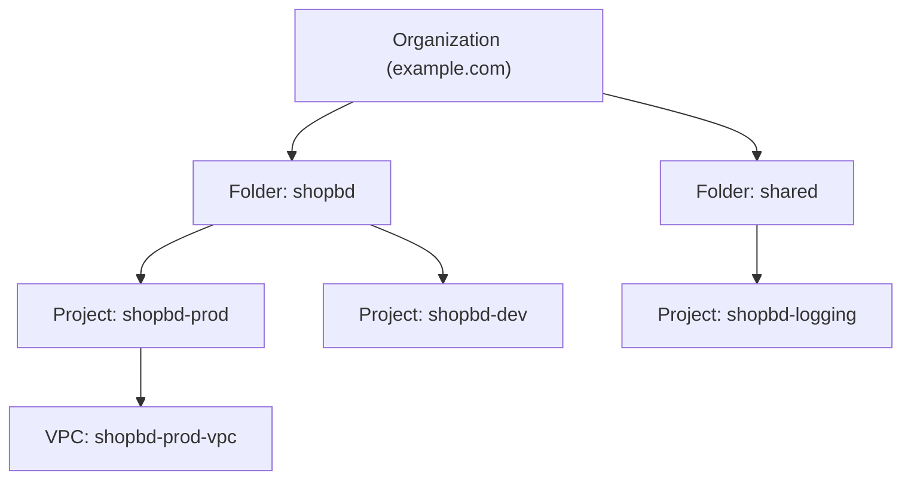

# GCP · Google Cloud গাইড

> এই পাতায় শুধু **Google Cloud (GCP)** নিয়ে কথা। আপনি এখানে শিখবেন:
>
> - GCP-র মানসিকতা — **project-কেন্দ্রিক** ও global-ভাবনার cloud
> - Account/billing খোলা, free trial ও Always Free বোঝা, Console ঘুরে দেখা
> - `gcloud` install ও login (`gcloud init`, `gcloud auth login`, ADC)
> - Organization → Folder → Project hierarchy ও প্রথম project সাজানো
> - GCP-র সব প্রধান service — category অনুযায়ী, বিস্তারিত অধ্যায়ের লিংকসহ
> - Certification path, শেখার উৎস ও **প্রথম দিনের checklist**

!!! abstract "এক নজরে — GCP"

    | বিষয় | GCP |
    |---|---|
    | Provider | Google (Google Cloud Platform → এখন সাধারণত শুধু "Google Cloud") |
    | সবচেয়ে বড় শক্তি | Data/analytics (BigQuery), Kubernetes (GKE), global network, AI |
    | Hierarchy-র মাথা | Organization → Folder → **Project** |
    | বাংলাদেশের কাছের region | `asia-south1` (Mumbai), `asia-south2` (Delhi), `asia-southeast1` (Singapore) |
    | Web console | [console.cloud.google.com](https://console.cloud.google.com) |
    | CLI | `gcloud` (সঙ্গে `gsutil`/`gcloud storage`, `bq`) |
    | নিজস্ব IaC | Infrastructure Manager (Terraform-ভিত্তিক); Terraform নিজেই জনপ্রিয় |
    | Free tier পাতা | [cloud.google.com/free](https://cloud.google.com/free) |
    | Pricing পাতা | [cloud.google.com/pricing](https://cloud.google.com/pricing) |

---

## ১. GCP-র মানসিকতা — কী আলাদা?

### Google-এর নিজের পাইপলাইন

Google নিজের Search, YouTube, Gmail যে infrastructure-এ চালায়, GCP সেই প্রযুক্তিরই বাইরের মানুষের জন্য সংস্করণ। Kubernetes, BigQuery,
TensorFlow — এগুলোর শিকড় Google-এর ভেতরের tool। তাই GCP-র ধরন একটু "engineer-বান্ধব" ও সরল।

### যে বিষয়গুলো GCP-কে আলাদা করে

- **Project-ই কাজের একক।** AWS-এর account বা Azure-এর subscription+resource group মিলিয়ে যে ভূমিকা, GCP-তে তা প্রায় একটা **project**-এ।
  Billing, IAM, API চালু করা, quota — সব project-স্তরে। প্রতিটা app/environment-এর জন্য আলাদা project বানানোই নিয়ম।
- **VPC global।** GCP-র VPC network একটা নির্দিষ্ট region-এর নয় — একটা VPC-র subnet Mumbai ও Singapore দুই জায়গায় থাকতে পারে,
  অথচ সবাই একই private network। (AWS/Azure/OCI-তে network regional।) বিস্তারিত: [Networking](../05-networking.md)।
- **Global load balancer।** একটাই anycast IP দিয়ে বিশ্বের সব region-এর backend-কে traffic দেওয়া যায়।
- **API চালু করতে হয়।** নতুন project-এ বেশিরভাগ service **বন্ধ**; `compute.googleapis.com` ধরনের API আগে `enable` করতে হয়।
  "API has not been used in project … before" error সবার একবার হয়।
- **IAM সরল ধরনের:** "কে (principal) + কোন role + কোন resource-এ" — এই binding। JSON policy-র লম্বা ভাষা কম।
- **Service account** — মানুষ নয়, app/VM-এর identity। Key ফাইল বানানো এড়িয়ে attach বা impersonation ও Workload Identity Federation পছন্দ করুন।
- **Data ও AI-তে শক্ত।** BigQuery serverless warehouse, Vertex AI, GKE Autopilot — এগুলো GCP-র প্রধান আকর্ষণ।

### বাকি তিন cloud-এর তুলনায়

| বিষয় | GCP-র অবস্থান |
|---|---|
| Isolation unit | Project (Folder দিয়ে সাজানো) |
| Network | VPC **global**, subnet regional |
| Identity | Google identity (Google Workspace/Cloud Identity) + IAM role binding |
| কোথায় সবচেয়ে জোরালো | Kubernetes, BigQuery/data analytics, ML, developer experience |
| কোথায় ঝুঁকি | Enterprise/Microsoft-ভিত্তিক প্রতিষ্ঠানে কম প্রচলিত; কিছু service-এর বদলে যাওয়া (rename/deprecate) খেয়াল রাখা |

!!! note "পুরোনো নামের সতর্কতা"
    **Container Registry** এখন **Artifact Registry**-এর জায়গায় বদলে গেছে; **Deployment Manager** deprecated — তার জায়গায় **Infrastructure Manager** বা Terraform;
    আগের **Cloud Functions** এখন **Cloud Run functions** নামে। পুরোনো ব্লগে এই নামগুলো দেখলে নতুন নামটা খুঁজুন।

---

## ২. Sign-up, Billing ও Free Tier

### Account খোলা

1. [cloud.google.com](https://cloud.google.com) এ **Get started for free** চাপুন।
2. একটা **Google account** দিয়ে sign in করুন (Gmail চলে; কোম্পানির জন্য Google Workspace বা Cloud Identity ভালো, কারণ তাতে **Organization** পাওয়া যায়)।
3. দেশ, ব্যবহারের ধরন ঠিক করুন; **payment profile** বানান — card লাগে। বাংলাদেশ থেকে international/dual-currency card দরকার হয়,
   যাচাইয়ের জন্য ছোট অস্থায়ী charge পড়তে পারে।
4. তৈরি হবে একটা **Billing account** ও একটা প্রথম project (প্রায়ই `My First Project` নামে)।

!!! tip "Billing account আর project আলাদা জিনিস"
    **Billing account** হলো "কে বিল দেবে"; **Project** হলো "কোন কাজ"। একটা billing account-এ অনেক project লিংক করা যায়।
    Project-কে billing account-এর সঙ্গে না জুড়লে paid service চালু হয় না।

### Free Tier — কীভাবে ভাববেন

সংখ্যা ও শর্ত বদলায়, তাই এখানে কোনো মান লিখছি না — সবসময় [অফিশিয়াল Free Program পাতা](https://cloud.google.com/free) দেখুন। গঠনটা:

| ধরন | মানে | মনে রাখুন |
|---|---|---|
| **Free Trial** | নতুন গ্রাহকের জন্য নির্দিষ্ট মেয়াদে credit | Trial শেষে নিজে paid account-এ upgrade না করলে সাধারণত auto-charge হয় না; তবে upgrade করলে সাধারণ দাম |
| **Always Free** | কিছু product-এ মাসিক ছোট free সীমা | সীমা, region ও যোগ্যতার শর্ত আছে (কিছু ক্ষেত্রে শুধু নির্দিষ্ট region)। শর্ত না মিলালে বিল আসে |
| কিছু product-এর নিজস্ব free সীমা | যেমন BigQuery-র মাসিক free query/storage অংশ | প্রতিটা product-এর pricing পাতায় দেখুন |

!!! warning "Free মানে বিলহীন নয়"
    Trial চলাকালেও credit-এর বাইরের খরচ বা বড় resource দ্রুত credit খেয়ে ফেলে। প্রথম দিনেই **Budget & alert** বানান —
    বিস্তারিত [Cost Management](../18-cost-management.md)।

---

## ৩. Console ঘুরে দেখা

Console: [console.cloud.google.com](https://console.cloud.google.com)।

| জায়গা | কী আছে |
|---|---|
| ওপরের **Project picker** | এখন কোন project-এ কাজ করছেন; এটাই সবচেয়ে গুরুত্বপূর্ণ জিনিস। Organization/folder ধরে project বাছা যায় |
| **Search bar** | Service, resource, doc এমনকি command খোঁজা — সবচেয়ে দ্রুত navigation |
| বাঁদিকের **Navigation menu** (☰) | Category অনুযায়ী সব product; **Pin** করে প্রিয়গুলো উপরে রাখা যায় |
| **Activate Cloud Shell** (`>_`) | Browser-এ terminal; `gcloud` আগে থেকে ইনস্টল ও login করা; persistent home directory |
| **Cloud Shell Editor** | Browser-এর ভেতরে code editor |
| **IAM & Admin** | IAM, Service accounts, Organization policies, Quotas |
| **APIs & Services** | কোন API চালু, credential, quota |
| **Billing** | Billing account, report, budget, export |
| **Gemini Cloud Assist** (থাকলে) | Console-এর ভেতরে AI সহায়ক; সব সময় ফলাফল যাচাই করে নিন |

!!! tip "Project না দেখে কাজ নয়"
    ঠিক AWS-এর region-এর মতো, GCP-তে প্রতিবার ওপরে project-এর নাম দেখে নিন। ভুল project-এ resource বানালে খুঁজে পাবেন না।
    CLI-তে একই অভ্যাস: `gcloud config list`।

### Region ও Zone — বাংলাদেশের জন্য

| Region | কোড | মন্তব্য |
|---|---|---|
| Mumbai | `asia-south1` | বাংলাদেশের সবচেয়ে কাছের জনপ্রিয় বিকল্প; আমাদের উদাহরণে এটা |
| Delhi | `asia-south2` | DR বা বিকল্প |
| Singapore | `asia-southeast1` | অনেক service বেশি পাওয়া যায় |

প্রতিটা region-এ একাধিক zone — `asia-south1-a`, `-b`, `-c`। কিছু resource **global** (VPC, IAM, global load balancer), কিছু regional, কিছু zonal।
Region/zone ধারণা: [Cloud-এর ভিত্তি](../01-cloud-fundamentals.md)।

---

## ৪. CLI install ও authentication

### `gcloud` install

=== "Linux / macOS"

    ```bash
    # Google-এর installer
    curl https://sdk.cloud.google.com | bash
    exec -l $SHELL
    gcloud --version
    ```

=== "macOS (Homebrew)"

    ```bash
    brew install --cask google-cloud-sdk
    gcloud --version
    ```

=== "Windows"

    ```powershell
    # অফিশিয়াল installer: https://cloud.google.com/sdk/docs/install
    # install শেষে নতুন terminal খুলে:
    gcloud --version
    ```

### প্রথম setup — `gcloud init`

```bash
gcloud init
# ১) browser-এ Google account দিয়ে login
# ২) project বাছুন বা নতুন বানান
# ৩) default Compute region/zone ঠিক করুন (যেমন asia-south1)
```

এটা একটা **configuration**-এ account, project ও region সংরক্ষণ করে।

### Login-এর দুই ধরন (গুরুত্বপূর্ণ!)

| Command | কার জন্য | কী করে |
|---|---|---|
| `gcloud auth login` | **`gcloud` CLI নিজে** | CLI-কে আপনার user হিসেবে চালানোর অনুমতি দেয় |
| `gcloud auth application-default login` | **আপনার code / Terraform / SDK** | "Application Default Credentials (ADC)" তৈরি করে; client library ও Terraform এটা ব্যবহার করে |

```bash
gcloud auth login
gcloud auth application-default login

# এখন কে আর কোন project?
gcloud auth list
gcloud config list
```

!!! warning "দুটোই আলাদা"
    অনেকে `gcloud auth login` করে Terraform চালায় আর "could not find default credentials" error পায় —
    তখন `gcloud auth application-default login` চালাতে হয়।

### Project ও region default ঠিক করা

```bash
gcloud config set project my-project-id
gcloud config set compute/region asia-south1
gcloud config set compute/zone asia-south1-a
```

### একাধিক configuration (dev / prod আলাদা)

```bash
gcloud config configurations create shopbd-dev
gcloud config set project my-project-id
gcloud config configurations list
gcloud config configurations activate shopbd-dev
```

### অন্যান্য উপায়

- **Cloud Shell** — আলাদা install/login ছাড়াই কাজ করা যায়।
- **Service account impersonation** — নিজের user দিয়ে ঢুকে সাময়িকভাবে একটা service account হয়ে কাজ করা (key ফাইল লাগে না)।
- **Attached service account** — Compute Engine VM, Cloud Run নিজে service account পায়।
- **Workload Identity Federation** — GitHub Actions ইত্যাদি থেকে key ছাড়াই GCP-তে ঢোকা: [CI/CD ও DevOps](../15-cicd-devops.md), IAM-এর অংশ: [Identity ও Access](../03-identity-and-access.md)।

---

## ৫. প্রথম project ও hierarchy



| স্তর | মানে |
|---|---|
| **Organization** | কোম্পানির domain-ভিত্তিক শীর্ষ node (Workspace/Cloud Identity থাকলে); এখানে Organization Policy বসে |
| **Folder** | Project-এর গ্রুপ (বিভাগ বা environment অনুযায়ী) |
| **Project** | Billing, IAM, API, quota-র একক |
| **Resource** | VM, bucket, ইত্যাদি; এরা project-এর ভেতরে |

শুধু Gmail দিয়ে খুললে **Organization থাকে না** — project সরাসরি আপনার account-এর নিচে। শেখার জন্য ঠিক আছে; কোম্পানির কাজে Organization দরকার।

### Project-এর তিনটা পরিচয়

| নাম | উদাহরণ | বৈশিষ্ট্য |
|---|---|---|
| **Project name** | `shopbd prod` | যেকোনো নাম; বদলানো যায় |
| **Project ID** | `my-project-id` | globally unique; **একবার বানালে বদলায় না**; CLI/API-তে এটা লাগে |
| **Project number** | `123456789012` | সংখ্যাসূচক, system-নির্ধারিত |

### shopbd-র প্রথম কয়েকটা command

```bash
# project বানানো (ID globally unique হতে হবে)
gcloud projects create my-project-id --name="shopbd prod"

# billing account-এর সঙ্গে জোড়া (billing account ID এখানে placeholder)
gcloud billing projects link my-project-id --billing-account=000000-000000-000000

# API চালু করা
gcloud services enable compute.googleapis.com storage.googleapis.com

# প্রথম bucket
gcloud storage buckets create gs://shopbd-images-my-project-id --location=asia-south1

# Organization থাকলে folder বানানো (organization ID placeholder)
gcloud resource-manager folders create --display-name="shopbd" --organization=123456789012
```

পূর্ণ আলোচনা: [Account, Organization ও Resource hierarchy](../02-accounts-and-hierarchy.md)।

---

## ৬. Naming quirks — GCP-র বিশেষ ব্যাপার-স্যাপার

| বিষয় | কী ঘটে | টিপস |
|---|---|---|
| **Project ID বদলায় না** | ID পরিবর্তন অসম্ভব, মুছলেও সাধারণত নতুন কাজে সেটা আবার নেওয়া যায় না | প্রথমেই ভেবে নাম দিন: `shopbd-prod-<suffix>` |
| **Project মুছলে** | কয়েক দিনের জন্য pending-delete অবস্থায় থাকে, তারপর স্থায়ী | ভুলে মুছলে সময়ের মধ্যে restore করা যায় |
| **API enable** | প্রতি project-এ আলাদা করে | `gcloud services enable …`; IaC-তে এটাও resource হিসেবে রাখুন |
| **Bucket name** | সব GCP জুড়ে globally unique | `shopbd-images-<project-id>` pattern |
| **Label vs Tag** | **Label** = ছোট key-value (খরচ ভাগের জন্য); **Tag** = IAM/policy-র জন্য আলাদা জিনিস | AWS-এর "tag" মানে GCP-তে সাধারণত **label** |
| **Firewall rule** | VPC-স্তরের, tag/service account দিয়ে target করা যায় | AWS Security Group-এর মতো instance-এ attach হয় না |
| **Default service account** | Compute Engine-এর default SA কখনো বড় ক্ষমতা নিয়ে আসে | নিজস্ব ছোট ক্ষমতার service account বানিয়ে VM-এ দিন |
| **Cloud ___** | Cloud Run, Cloud SQL, Cloud Storage, Cloud DNS… | বেশিরভাগ service-এর নামে "Cloud" |
| **Compute Engine vs GCE** | সংক্ষেপে GCE | একই জিনিস |
| **Machine type** | `e2-medium`, `n2-standard-4`, `c3-…` — family+আকার; custom size-ও দেওয়া যায় | বিস্তারিত: [Virtual Machine](../04-compute-vms.md) |
| **Quota** | প্রতিটা project-এ CPU/GPU ইত্যাদির সীমা আছে | নতুন project-এ GPU quota প্রায়ই শূন্য — বাড়ানোর অনুরোধ লাগে |

---

## ৭. GCP-র service তালিকা (category অনুযায়ী)

"বিস্তারিত" কলামের লিংকে চার cloud-এর তুলনাসহ পূর্ণ আলোচনা। সব service পাশাপাশি দেখতে: [Service Map](../reference/service-map.md)।

### Compute

| Service | কাজ | বিস্তারিত |
|---|---|---|
| **Compute Engine** | Virtual machine; machine family, image | [Virtual Machine](../04-compute-vms.md) |
| **Managed Instance Groups (MIG)** | VM-এর দল, autoscaling ও auto-healing | [Load Balancing ও Autoscaling](../10-load-balancing-scaling-dns-cdn.md) |
| **Spot VMs** | কম দামে, যেকোনো সময় বন্ধ হতে পারে (আগের নাম Preemptible VM) | [Virtual Machine](../04-compute-vms.md) |
| **Sole-tenant nodes / Bare Metal** | নিজস্ব physical host বা bare metal | [Virtual Machine](../04-compute-vms.md) |
| **App Engine** | PaaS; code দিলেই app চলে | [Serverless](../09-serverless.md) |
| **Batch** | Batch job চালানো | [Virtual Machine](../04-compute-vms.md) |
| **Google Distributed Cloud** | Google-এর stack নিজের data center/edge-এ | [Architecture, HA/DR ও Multi-cloud](../19-architecture-ha-dr.md) |

### Networking

| Service | কাজ | বিস্তারিত |
|---|---|---|
| **VPC network** | **Global** private network; regional subnet | [Networking](../05-networking.md) |
| **VPC firewall rules / policies** | VPC-স্তরে allow/deny rule | [Networking](../05-networking.md) |
| **Cloud NAT / Cloud Router** | Private VM-এর বাইরে যাওয়া; dynamic routing | [Networking](../05-networking.md) |
| **VPC Network Peering / Network Connectivity Center** | VPC জোড়া লাগানো; hub-and-spoke | [Networking](../05-networking.md) |
| **Private Service Connect / Private Google Access** | Internet ছাড়া private পথে service ধরা | [Networking](../05-networking.md) |
| **Cloud VPN / Cloud Interconnect** | VPN ও dedicated/partner লাইন | [Networking](../05-networking.md) |
| **Cloud Load Balancing** | Global ও regional, L4 ও L7 load balancer | [Load Balancing, DNS ও CDN](../10-load-balancing-scaling-dns-cdn.md) |
| **Cloud DNS** | Managed DNS | [Load Balancing, DNS ও CDN](../10-load-balancing-scaling-dns-cdn.md) |
| **Cloud CDN / Media CDN** | CDN | [Load Balancing, DNS ও CDN](../10-load-balancing-scaling-dns-cdn.md) |

### Storage

| Service | কাজ | বিস্তারিত |
|---|---|---|
| **Cloud Storage (GCS)** | Object storage; Standard, Nearline, Coldline, Archive class | [Storage](../06-storage.md) |
| **Persistent Disk / Hyperdisk** | VM-এর block disk, snapshot | [Storage](../06-storage.md) |
| **Filestore** | Managed NFS file storage | [Storage](../06-storage.md) |
| **Backup and DR Service** | কেন্দ্রীয় backup | [Storage](../06-storage.md) |
| **Storage Transfer Service / Transfer Appliance** | বড় data সরানো | [Storage](../06-storage.md) |

### Database

| Service | কাজ | বিস্তারিত |
|---|---|---|
| **Cloud SQL** | Managed PostgreSQL, MySQL, SQL Server | [Database](../07-databases.md) |
| **AlloyDB for PostgreSQL** | উচ্চ-ক্ষমতার PostgreSQL-compatible | [Database](../07-databases.md) |
| **Cloud Spanner** | Globally-distributed relational database | [Database](../07-databases.md) |
| **Firestore** | Serverless document NoSQL | [Database](../07-databases.md) |
| **Bigtable** | বিশাল wide-column NoSQL | [Database](../07-databases.md) |
| **Memorystore** | Managed Redis/Valkey/Memcached | [Database](../07-databases.md) |
| **Database Migration Service** | Database GCP-তে সরানো | [Architecture, HA/DR ও Multi-cloud](../19-architecture-ha-dr.md) |

### Container ও Kubernetes

| Service | কাজ | বিস্তারিত |
|---|---|---|
| **Artifact Registry** | Container image ও package registry (পুরোনো Container Registry-র উত্তরসূরি) | [Container ও Kubernetes](../08-containers-kubernetes.md) |
| **Google Kubernetes Engine (GKE)** | Managed Kubernetes; Standard ও Autopilot mode | [Container ও Kubernetes](../08-containers-kubernetes.md) |
| **GKE Autopilot** | Node manage না করে pod-ভিত্তিক Kubernetes | [Container ও Kubernetes](../08-containers-kubernetes.md) |
| **Cloud Run** | Serverless container (source বা image) | [Serverless](../09-serverless.md) |

### Serverless

| Service | কাজ | বিস্তারিত |
|---|---|---|
| **Cloud Run** | Container-ভিত্তিক serverless service ও job | [Serverless](../09-serverless.md) |
| **Cloud Run functions** | Event/HTTP function (আগের Cloud Functions) | [Serverless](../09-serverless.md) |
| **API Gateway / Apigee** | API ব্যবস্থাপনা | [Serverless](../09-serverless.md) |
| **App Engine** | PaaS-ধরনের serverless platform | [Serverless](../09-serverless.md) |
| **Workflows** | Serverless orchestration | [Messaging ও Event](../11-messaging-and-events.md) |
| **Cloud Scheduler** | Cron-ধরনের schedule | [Messaging ও Event](../11-messaging-and-events.md) |

### Messaging ও Event

| Service | কাজ | বিস্তারিত |
|---|---|---|
| **Pub/Sub** | Queue ও pub/sub — GCP-র মূল messaging (streaming-ও) | [Messaging ও Event](../11-messaging-and-events.md) |
| **Eventarc** | Event routing (service event → Cloud Run ইত্যাদি) | [Messaging ও Event](../11-messaging-and-events.md) |
| **Cloud Tasks** | Task queue; rate-controlled HTTP কাজ | [Messaging ও Event](../11-messaging-and-events.md) |
| **Managed Service for Apache Kafka** | Managed Kafka | [Messaging ও Event](../11-messaging-and-events.md) |
| **Dataflow** | Stream/batch data processing (Apache Beam) | [Data ও Analytics](../16-data-and-analytics.md) |

!!! note "Email পাঠানো"
    GCP-র নিজস্ব সরাসরি bulk email service নেই; সাধারণত Marketplace-এর পার্টনার বা তৃতীয় পক্ষের email API (SendGrid, Mailgun ইত্যাদি) ব্যবহার হয়।
    shopbd-র order email-এর জন্যও তাই।

### Observability

| Service | কাজ | বিস্তারিত |
|---|---|---|
| **Cloud Monitoring** | Metrics, dashboard, alert policy | [Monitoring, Logging ও Tracing](../12-observability.md) |
| **Cloud Logging** | Log সংগ্রহ, Logs Explorer, query | [Monitoring, Logging ও Tracing](../12-observability.md) |
| **Cloud Trace / Cloud Profiler** | Tracing ও profiling | [Monitoring, Logging ও Tracing](../12-observability.md) |
| **Error Reporting** | Exception গুচ্ছ করে দেখানো | [Monitoring, Logging ও Tracing](../12-observability.md) |
| **Cloud Audit Logs** | কে কী করল — audit log | [Monitoring, Logging ও Tracing](../12-observability.md) |
| **Managed Service for Prometheus** | Prometheus-compatible metrics | [Monitoring, Logging ও Tracing](../12-observability.md) |

### Security ও Identity

| Service | কাজ | বিস্তারিত |
|---|---|---|
| **Cloud IAM** | Role binding, service account | [Identity ও Access](../03-identity-and-access.md) |
| **Cloud Identity / Workspace** | মানুষের account ও SSO | [Identity ও Access](../03-identity-and-access.md) |
| **Organization Policy Service** | পুরো Organization/Folder জুড়ে নিয়ম (guardrail) | [Account, Organization ও Hierarchy](../02-accounts-and-hierarchy.md) |
| **Cloud KMS** | Encryption key management | [Security](../13-security.md) |
| **Secret Manager** | Secret সংরক্ষণ | [Security](../13-security.md) |
| **Certificate Manager** | TLS certificate | [Security](../13-security.md) |
| **Cloud Armor** | WAF ও DDoS সুরক্ষা | [Security](../13-security.md) |
| **Security Command Center** | Posture ও threat detection | [Security](../13-security.md) |
| **Identity Platform / Firebase Auth** | App-ব্যবহারকারীর sign-in | [Identity ও Access](../03-identity-and-access.md) |

### Infrastructure as Code

| Service | কাজ | বিস্তারিত |
|---|---|---|
| **Infrastructure Manager** | Terraform-ভিত্তিক managed deployment | [Infrastructure as Code](../14-infrastructure-as-code.md) |
| **Terraform / OpenTofu (`google` provider)** | Multi-cloud IaC | [Infrastructure as Code](../14-infrastructure-as-code.md) |
| **Deployment Manager** | **Deprecated**; পুরোনো প্রকল্পে দেখা যায় | [Infrastructure as Code](../14-infrastructure-as-code.md) |
| **Config Connector** | Kubernetes YAML দিয়ে GCP resource | [Infrastructure as Code](../14-infrastructure-as-code.md) |

### CI/CD

| Service | কাজ | বিস্তারিত |
|---|---|---|
| **Cloud Build** | Managed build/CI | [CI/CD ও DevOps](../15-cicd-devops.md) |
| **Cloud Deploy** | GKE/Cloud Run-এ delivery pipeline ও promotion | [CI/CD ও DevOps](../15-cicd-devops.md) |
| **Artifact Registry** | Image ও package-এর ঘর | [CI/CD ও DevOps](../15-cicd-devops.md) |
| **GitHub Actions + Workload Identity Federation** | Key ছাড়া GitHub থেকে deploy | [CI/CD ও DevOps](../15-cicd-devops.md) |

### Data ও Analytics

| Service | কাজ | বিস্তারিত |
|---|---|---|
| **BigQuery** | Serverless data warehouse | [Data ও Analytics](../16-data-and-analytics.md) |
| **Dataflow** | Apache Beam দিয়ে batch/stream ETL | [Data ও Analytics](../16-data-and-analytics.md) |
| **Dataproc** | Managed Spark/Hadoop | [Data ও Analytics](../16-data-and-analytics.md) |
| **Dataplex / Data Catalog (Universal Catalog)** | Data governance ও catalog | [Data ও Analytics](../16-data-and-analytics.md) |
| **Looker / Looker Studio** | BI ও dashboard | [Data ও Analytics](../16-data-and-analytics.md) |
| **Cloud Composer** | Managed Apache Airflow | [Data ও Analytics](../16-data-and-analytics.md) |
| **Datastream** | Database-এর change সরাসরি warehouse-এ | [Data ও Analytics](../16-data-and-analytics.md) |

### AI ও Machine Learning

| Service | কাজ | বিস্তারিত |
|---|---|---|
| **Vertex AI** | ML platform ও managed GenAI (Gemini ও অন্যান্য model) | [AI ও Machine Learning](../17-ai-ml.md) |
| **Gemini API / Model Garden** | Foundation model-এর ব্যবহার | [AI ও Machine Learning](../17-ai-ml.md) |
| **Vision / Speech-to-Text / Text-to-Speech / Translation API** | Prebuilt AI API | [AI ও Machine Learning](../17-ai-ml.md) |
| **Document AI** | Document থেকে তথ্য বের করা | [AI ও Machine Learning](../17-ai-ml.md) |
| **GPU / TPU** | ML-এর জন্য বিশেষ hardware | [AI ও Machine Learning](../17-ai-ml.md) |

!!! note "AI product-এর নাম বদলায়"
    GCP-র AI product-এর নাম ও packaging বেশ ঘনঘন বদলায়। এখানে দেওয়া নামের সঙ্গে Console-এ ভিন্নতা দেখলে অফিশিয়াল AI পাতা দেখুন।

### Cost Management

| Service | কাজ | বিস্তারিত |
|---|---|---|
| **Cloud Billing** | Billing account, invoice, payment | [Cost Management](../18-cost-management.md) |
| **Budgets & alerts** | Budget ও threshold-ভিত্তিক alert | [Cost Management](../18-cost-management.md) |
| **Billing export to BigQuery** | খরচের raw data BigQuery-তে, SQL দিয়ে বিশ্লেষণ | [Cost Management](../18-cost-management.md) |
| **Committed Use Discounts (CUD) / Sustained use** | দীর্ঘমেয়াদি commitment-এ ছাড় | [Cost Management](../18-cost-management.md) |
| **Recommender / Active Assist** | Rightsizing ও idle resource পরামর্শ | [Cost Management](../18-cost-management.md) |
| **Pricing Calculator** | আগাম খরচ হিসাব | [Cost Management](../18-cost-management.md) |

---

## ৮. shopbd GCP-তে কেমন দেখায়

| shopbd-র অংশ | GCP service | নাম |
|---|---|---|
| Web frontend (static) | Cloud Storage + Cloud CDN (বা Cloud Run) | `shopbd-web` |
| REST API | Cloud Run | `shopbd-api` |
| PostgreSQL | Cloud SQL for PostgreSQL | `shopbd-db` |
| Product image | Cloud Storage bucket | `shopbd-images` |
| Order email | তৃতীয় পক্ষের email API (Secret Manager-এ key) | sender `ops@example.com` |
| Nightly sales report | Cloud Scheduler → Cloud Run job | `shopbd-nightly-report` |
| Network | VPC (global) + regional subnet | `shopbd-prod-vpc` |
| Domain | Cloud DNS | `shopbd.example.com` |
| Monitoring | Cloud Monitoring alert → email channel | `ops@example.com` |

পূর্ণ architecture: [Architecture, HA/DR ও Multi-cloud](../19-architecture-ha-dr.md)।

---

## ৯. Certification path

Google Cloud certification-এর তালিকা বদলাতে পারে — [cloud.google.com/learn/certification](https://cloud.google.com/learn/certification) দেখুন।

| স্তর | Certification | কার জন্য |
|---|---|---|
| Foundational | **Cloud Digital Leader**, **Generative AI Leader** | নতুন বা non-tech role; ধারণাগত পরিচয় |
| Associate | **Associate Cloud Engineer** | হাতে-কলমে প্রথম ধাপ; `gcloud`, IAM, deploy |
| Professional | **Professional Cloud Architect** | সবচেয়ে সুপরিচিত; architecture design |
| Professional | **Cloud Developer**, **Cloud DevOps Engineer** | App ও delivery |
| Professional | **Cloud Network Engineer**, **Cloud Security Engineer** | Network ও security-তে বিশেষজ্ঞ |
| Professional | **Data Engineer**, **Machine Learning Engineer** | Data/ML pipeline |

!!! tip "শুরুর পরামর্শ"
    প্রথমে **Associate Cloud Engineer**-এর syllabus ধরে এই সাইটের অধ্যায়গুলো hands-on করুন; Qwiklabs-ধরনের lab (Google Cloud Skills Boost) খুব কাজে লাগে।

---

## ১০. শেখার উৎস

| উৎস | কী পাবেন |
|---|---|
| [Google Cloud Documentation](https://cloud.google.com/docs) | প্রতিটা product-এর guide ও reference |
| [Google Cloud Skills Boost](https://www.cloudskillsboost.google) | Lab, কোর্স ও learning path |
| [Architecture Center](https://cloud.google.com/architecture) | Reference architecture, Google Cloud Architecture Framework |
| [Google Cloud Free Program](https://cloud.google.com/free) | Free trial ও Always Free-র সর্বশেষ শর্ত |
| [gcloud CLI reference](https://cloud.google.com/sdk/gcloud/reference) | সব command-এর বিবরণ |
| [Terraform Google provider docs](https://registry.terraform.io/providers/hashicorp/google/latest/docs) | Terraform resource reference |
| [Google Cloud Blog / Release Notes](https://cloud.google.com/release-notes) | নতুন feature ও পরিবর্তন |

---

## ১১. প্রথম দিনের checklist

**Account ও billing**

- [ ] Google account-এ 2-Step Verification চালু করেছি
- [ ] Billing account দেখেছি এবং project তার সঙ্গে জোড়া আছে
- [ ] Billing-এ একটা **Budget & alert** বানিয়েছি; alert `ops@example.com` ধরনের ঠিকানায় যায়
- [ ] Free trial/Always Free-র শর্ত অফিশিয়াল পাতায় পড়েছি

**Project ও hierarchy**

- [ ] `shopbd` ধরনের নামের একটা আলাদা project বানিয়েছি (`My First Project` ব্যবহার না করে)
- [ ] Organization থাকলে Folder-এ সাজিয়েছি; না থাকলে এটা জেনে রেখেছি যে শেখার জন্য ঠিক আছে
- [ ] Project ID যে বদলানো যায় না তা মনে রেখেছি

**CLI**

- [ ] `gcloud` install করেছি (`gcloud --version`)
- [ ] `gcloud init` করেছি এবং default region `asia-south1` দিয়েছি
- [ ] `gcloud auth login` ও `gcloud auth application-default login` দুটোই করেছি (পার্থক্য বুঝে)
- [ ] `gcloud config list` দিয়ে account ও project যাচাই করেছি
- [ ] Cloud Shell একবার খুলে দেখেছি

**প্রথম resource ও নিরাপত্তা**

- [ ] দরকারি API `gcloud services enable …` দিয়ে চালু করেছি
- [ ] একটা Cloud Storage bucket বানিয়ে ছবি upload করেছি
- [ ] নিজের ব্যবহারকারীকে Owner না রেখে ছোট role (principle of least privilege) ভেবেছি — [Identity ও Access](../03-identity-and-access.md)
- [ ] Service account key ফাইল তৈরি না করে impersonation বা attached service account ভেবেছি
- [ ] Cloud Audit Logs-এ নিজের কাজ দেখেছি
- [ ] পরীক্ষার resource মুছে ফেলেছি

---

## ১২. সচরাচর ভুল (GCP-তে)

| ভুল | ফল | সমাধান |
|---|---|---|
| ভুল project-এ কাজ | Resource "হারিয়ে" যায় | Project picker ও `gcloud config list` দেখুন |
| API enable না করা | `API has not been used` error | `gcloud services enable <api>` |
| `auth login` করে Terraform চালানো | Default credentials error | `gcloud auth application-default login` |
| Service account key ফাইল Git-এ | Key ফাঁস | Key না বানিয়ে impersonation/WIF নিন |
| Default service account-এর অতিরিক্ত ক্ষমতা | অজান্তে বড় access | নিজস্ব ছোট ক্ষমতার service account |
| Billing account না জুড়ে paid service চালানোর চেষ্টা | Service চালু হয় না | Project-এ billing link করুন |
| Bucket public রেখে দেওয়া | Data leak | Uniform bucket-level access ও Public access prevention |
| Egress খরচ না ভাবা | অপ্রত্যাশিত বিল | [Cost Management](../18-cost-management.md)-এ egress অংশ পড়ুন |

---

## সারসংক্ষেপ

- GCP মানে **project-কেন্দ্রিক** cloud; VPC **global**, load balancer-ও global।
- নতুন project-এ আগে **API enable**, **billing link** ও **Budget** — এই তিনটা ঠিক করুন।
- `gcloud auth login` (CLI-র জন্য) আর `gcloud auth application-default login` (code/Terraform-এর জন্য) — দুটো আলাদা।
- পুরোনো নাম খেয়াল রাখুন: Container Registry → Artifact Registry, Deployment Manager → Infrastructure Manager, Cloud Functions → Cloud Run functions।
- পরের ধাপ: [Account ও Hierarchy](../02-accounts-and-hierarchy.md) → [IAM](../03-identity-and-access.md) → [Networking](../05-networking.md)।

অন্য cloud দেখতে: [AWS](aws.md) · [Azure](azure.md) · [OCI](oci.md)
