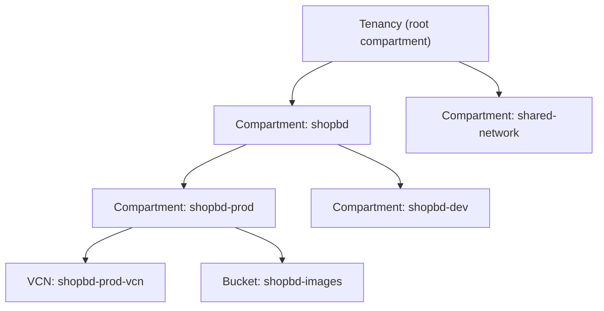

# OCI · Oracle Cloud Infrastructure গাইড

> এই পাতায় শুধু **Oracle Cloud (OCI)** নিয়ে কথা। আপনি এখানে শিখবেন:
>
> - OCI-র মানসিকতা — Oracle Database, bare metal, কম egress খরচ ও **Compartment**-ভিত্তিক সংগঠন
> - Account খোলা, **Home region** বাছার গুরুত্ব, Free Tier ও Always Free বোঝা
> - Console ঘুরে দেখা, OCI CLI install ও login (`oci setup config`)
> - Tenancy → Compartment hierarchy, OCID ও policy statement
> - OCI-র সব প্রধান service — category অনুযায়ী, বিস্তারিত অধ্যায়ের লিংকসহ
> - Certification path, শেখার উৎস ও **প্রথম দিনের checklist**

!!! abstract "এক নজরে — OCI"

    | বিষয় | OCI |
    |---|---|
    | Provider | Oracle |
    | সবচেয়ে বড় শক্তি | Oracle Database (Autonomous DB, Exadata), bare metal, উচ্চ performance network, সহজবোধ্য pricing, শক্তিশালী Always Free |
    | Hierarchy-র মাথা | **Tenancy** → **Compartment** (nested) |
    | বাংলাদেশের কাছের region | `ap-mumbai-1` (Mumbai), `ap-hyderabad-1` (Hyderabad), `ap-singapore-1` (Singapore) |
    | Web console | [cloud.oracle.com](https://cloud.oracle.com) |
    | CLI | `oci` (OCI CLI) |
    | নিজস্ব IaC | Resource Manager (Terraform-ভিত্তিক) |
    | Free পাতা | [oracle.com/cloud/free](https://www.oracle.com/cloud/free/) |
    | Pricing পাতা | [oracle.com/cloud/pricing](https://www.oracle.com/cloud/pricing/) |

---

## ১. OCI-র মানসিকতা — কী আলাদা?

### দেরিতে এসে নতুন করে বানানো

AWS, Azure-র অনেক পরে OCI ("Gen 2 Cloud") এসেছে — সেই সুযোগে শুরু থেকে আধুনিক ডিজাইন: দ্রুত flat network, bare metal সরাসরি দেওয়ার ক্ষমতা,
আর "খরচ যেন আগে থেকে বোঝা যায়" এমন pricing। বিশেষ করে **Oracle Database** চালাতে OCI সবচেয়ে স্বাভাবিক জায়গা।

### যে বিষয়গুলো OCI-কে আলাদা করে

- **Compartment।** OCI-র সবচেয়ে মজার ধারণা: একটা **tenancy**-র ভেতরে nested **compartment** (ফোল্ডারের মতো)। Resource কোনো compartment-এ থাকে,
  এবং **IAM policy** compartment-এর ওপর লেখা হয়। প্রায় প্রতিটা resource বানাতে compartment বলে দিতে হয় — এটাই প্রথমে সবচেয়ে বেশি চোখে পড়ে।
- **OCID সর্বত্র।** প্রতিটা resource-এর একটা বিশ্বজনীন ID — `ocid1.compartment.oc1..example`। CLI/Terraform-এ resource নাম নয়, OCID লাগে।
- **IAM policy = ইংরেজি বাক্য।** JSON নয়, এমন statement: `Allow group shopbd-admins to manage all-resources in compartment shopbd-prod`।
  পড়তে সহজ; তবে কোন compartment-এ বসেছে সেটা গুরুত্বপূর্ণ।
- **Home region স্থায়ী।** Sign-up-এর সময় যে region বাছবেন সেটাই আপনার **home region**; এটা পরে বদলানো যায় না, আর IAM-এর মতো বিষয় সেখানেই থাকে।
- **কম/সহজ egress ও দাম।** বিশ্বের প্রায় সব region-এ দামের কাঠামো একই ধরনের; বাইরে যাওয়া data-র খরচ অনেক সময় অন্য cloud-এর চেয়ে কম — তবুও [pricing পাতা](https://www.oracle.com/cloud/pricing/) দেখে হিসাব করুন।
- **Flexible shape।** VM-এর আকার আপনি নিজে ঠিক করেন — OCPU ও memory আলাদাভাবে দিয়ে (`.Flex` shape)।
- **Multicloud database।** Oracle Database অন্য cloud-এর data center-এর ভেতরেও (Oracle Database@Azure, @AWS, @Google Cloud) পাওয়া যায় — যারা Oracle DB চালায় তাদের জন্য বড় সুবিধা।
- **শক্তিশালী Always Free।** শেখার ও ছোট project-এর জন্য OCI-র Always Free বেশ উদার — তবে সীমা ও শর্ত নিয়মিত অফিশিয়াল পাতায় যাচাই করুন।

### বাকি তিন cloud-এর তুলনায়

| বিষয় | OCI-র অবস্থান |
|---|---|
| Isolation unit | Compartment (tenancy-র ভেতরে) |
| Network | VCN **regional** |
| Identity | OCI IAM (Identity Domains) + English-ধাঁচের policy |
| কোথায় সবচেয়ে জোরালো | Oracle DB, bare metal/HPC, কম egress, নির্দিষ্ট দাম, Always Free |
| কোথায় কম | Service-এর বৈচিত্র্য AWS/Azure-র চেয়ে কম; community ও চাকরির বাজার ছোট |

!!! note "পুরোনো নামের সতর্কতা"
    **IDCS** (Oracle Identity Cloud Service) এখন **IAM Identity Domains**-এর অংশ। **Oracle Cloud Infrastructure Classic** আলাদা পুরোনো পণ্য;
    নতুন কাজ সবসময় **OCI (Gen 2)**-তে। ডাটাবেসে "MySQL HeatWave" এখন **HeatWave**-ভিত্তিক ব্র্যান্ডিংয়ে; Console-এ আজকের নাম দেখে নিন।

---

## ২. Sign-up, Home region ও Free Tier

### Account খোলা

1. [oracle.com/cloud/free](https://www.oracle.com/cloud/free/) এ **Start for free** চাপুন।
2. Email, নাম, দেশ দিন; **Cloud Account Name** (tenancy-র নাম) ঠিক করুন — এটা sign-in-এ লাগে।
3. **Home region** বাছুন — **সবচেয়ে গুরুত্বপূর্ণ ধাপ।** পরে বদলানো যায় না।
4. Phone verification ও **card verification** — card লাগে (Free Tier-এও)। বাংলাদেশ থেকে international/dual-currency card দরকার; কখনো কখনো যাচাই ব্যর্থ হয় —
   তখন অন্য card বা অন্য ব্যাংকের card দিয়ে চেষ্টা করুন, না হলে Oracle সাপোর্টে যোগাযোগ করুন।
5. Account তৈরি হতে কিছু সময় লাগতে পারে; email এলে [cloud.oracle.com](https://cloud.oracle.com)-এ Cloud Account Name দিয়ে sign in করুন।

!!! danger "Home region ভেবেচিন্তে বাছুন"
    - Home region **পরিবর্তনযোগ্য নয়**।
    - **Always Free resource শুধু home region-এ** তৈরি করা যায়।
    - জনপ্রিয় region-এ (বিশেষ করে Free Tier-এর Arm VM-এর জন্য) কখনো কখনো **"Out of host capacity"** দেখায় — তখন সময় বদলে বা আলাদা Availability Domain-এ চেষ্টা করতে হয়।
    বাংলাদেশের জন্য সাধারণত `ap-mumbai-1`, `ap-hyderabad-1` বা `ap-singapore-1`; কোনটায় capacity ভালো তা সম্প্রদায়ের অভিজ্ঞতা ও আপনার পরীক্ষায় দেখুন।

### Free Tier — কীভাবে ভাববেন

সংখ্যা ও শর্ত বদলায়, তাই কোনো মান লিখছি না — সবসময় [অফিশিয়াল Free Tier পাতা](https://www.oracle.com/cloud/free/) দেখুন। গঠনটা:

| ধরন | মানে | মনে রাখুন |
|---|---|---|
| **Free Trial credit** | নতুন account-এ নির্দিষ্ট মেয়াদে credit | Trial-এ প্রায় সব service চালানো যায়; মেয়াদ বা credit ফুরালে resource সীমিত/বন্ধ হয় যদি upgrade না করেন |
| **Always Free** | কিছু service-এ চিরকাল free (যেমন ছোট কিছু VM shape, Arm-ভিত্তিক Ampere shape, একটা-দুটো ছোট Autonomous Database, কিছু block ও object storage, একটা load balancer, monitoring-এর অংশ) | শুধু home region-এ; তালিকা ও সীমা অফিশিয়াল পাতায়। সীমা পেরোলে paid |
| **Pay As You Go (PAYG)** | Upgrade করলে সাধারণ দামে বিল | Upgrade করলেও Always Free resource free থাকে — যদি সীমার ভেতরে থাকেন |

!!! warning "Always Free instance-এর বিশেষ ঝুঁকি"
    - অব্যবহৃত (idle) Always Free instance Oracle **reclaim** (সরিয়ে নিতে) পারে — শর্ত অফিশিয়াল পাতায়।
    - Capacity না পেলে "Out of host capacity" error আসবে; script দিয়ে বারবার চেষ্টা করা (অনেকে করে) কিন্তু Oracle-এর শর্ত মেনে।
    - Production-এ নির্ভরযোগ্যতার জন্য PAYG-তে upgrade ও যথাযথ architecture ভাবুন।

প্রথম দিনেই **Budget** বানান — বিস্তারিত [Cost Management](../18-cost-management.md)।

---

## ৩. Console ঘুরে দেখা

Console: [cloud.oracle.com](https://cloud.oracle.com)।

| জায়গা | কী আছে |
|---|---|
| ওপরের **Region selector** | কোন region-এ কাজ করছেন; home region চিহ্নিত |
| ☰ **Navigation menu** (বাঁদিকে) | Category অনুযায়ী সব service: Compute, Networking, Storage, Database, Developer Services, Observability & Management, Identity & Security, Billing & Cost Management |
| **Search bar** | Service, resource, doc খোঁজা |
| **Compartment selector** | অধিকাংশ list পাতায় বাঁদিকে — **কোন compartment দেখছেন** তা বাছুন; ভুল compartment মানে "resource নেই!" |
| **Cloud Shell** (`>_`) | Browser-এ terminal; `oci` CLI আগে থেকে ইনস্টল ও authenticated |
| **Profile menu** (ওপরে ডানে) | User settings, API key যোগ, Tenancy details, sign out |
| **Identity & Security** | Domains, Compartments, Policies, Vault, Cloud Guard |
| **Governance & Administration** | Tenancy details, Limits/Quotas, Tag namespaces, Cost Analysis |
| **Cost Analysis / Budgets** | খরচ বিশ্লেষণ ও budget |

!!! tip "দুটো জিনিস আগে দেখুন"
    OCI-তে কাজের আগে **region** আর **compartment** — এই দুটো সঠিক কিনা দেখুন। "আমার instance কই?" সমস্যার ৯০% এই দুটোর একটাতে ভুল।

### Region, AD ও FD — বাংলাদেশের জন্য

| Region | কোড | মন্তব্য |
|---|---|---|
| India West (Mumbai) | `ap-mumbai-1` | বাংলাদেশের কাছের জনপ্রিয় বিকল্প; আমাদের উদাহরণে এটা |
| India South (Hyderabad) | `ap-hyderabad-1` | বিকল্প / DR |
| Singapore | `ap-singapore-1` | অনেক service-এ বেশি বিকল্প |

OCI-তে region-এর ভেতরে **Availability Domain (AD)** ও তার ভেতরে **Fault Domain (FD)**। কিছু region-এ একটাই AD, কিছুতে তিনটা। এই ধারণা
অন্য cloud-এর AZ-এর কাছাকাছি, কিন্তু একটু আলাদা — বিস্তারিত: [Cloud-এর ভিত্তি](../01-cloud-fundamentals.md)।

---

## ৪. CLI install ও authentication

### OCI CLI install

=== "Linux / macOS"

    ```bash
    bash -c "$(curl -L https://raw.githubusercontent.com/oracle/oci-cli/master/scripts/install/install.sh)"
    oci --version
    ```

=== "Windows"

    ```powershell
    # অফিশিয়াল installer script (PowerShell, administrator ছাড়াই চলে)
    Set-ExecutionPolicy RemoteSigned
    # ডাউনলোড ও নির্দেশ: https://docs.oracle.com/iaas/Content/API/SDKDocs/cliinstall.htm
    oci --version
    ```

### প্রথম setup — `oci setup config`

```bash
oci setup config
# ১) config ফাইলের জায়গা (default: ~/.oci/config)
# ২) user OCID — Console: Profile → My profile → OCID কপি
# ৩) tenancy OCID — Profile → Tenancy → OCID কপি
# ৪) region (যেমন ap-mumbai-1)
# ৫) নতুন API key pair তৈরি হবে (Y)
```

তারপর **public key** টা Console-এ যোগ করতে হবে:

1. Profile → **My profile** → **API keys** → **Add API key**।
2. `~/.oci/oci_api_key_public.pem`-এর বিষয়বস্তু paste করুন।
3. Console যে configuration file preview দেখায় তার fingerprint মিলিয়ে দেখুন।

```bash
# যাচাই: tenancy-র namespace (Object Storage-এর জন্য) দেখা
oci os ns get

# region তালিকা
oci iam region list --output table
```

`~/.oci/config` ফাইলে সাধারণত এরকম থাকে (সব মান placeholder):

```text
[DEFAULT]
user=ocid1.user.oc1..example
fingerprint=00:00:00:00:00:00:00:00:00:00:00:00:00:00:00:00
tenancy=ocid1.tenancy.oc1..example
region=ap-mumbai-1
key_file=~/.oci/oci_api_key.pem
```

!!! danger "Private key গোপন"
    `oci_api_key.pem` কারো সঙ্গে শেয়ার বা Git-এ রাখবেন না। ফাঁস হলে Console-এ সেই API key মুছে নতুন বানান।

### Session token — স্থায়ী key ছাড়াই

Browser-এ login করে অস্থায়ী token নিয়ে CLI চালানো যায় (যেখানে API key রাখতে চান না):

```bash
oci session authenticate --region ap-mumbai-1
# তারপর প্রতিটা command-এ:
oci iam compartment list --auth security_token
```

### Profile ও environment variable

```bash
# একাধিক profile ([DEFAULT], [SHOPBD_DEV]) থাকলে
oci os ns get --profile SHOPBD_DEV

# পুরো session-এ
export OCI_CLI_PROFILE=SHOPBD_DEV
```

### অন্যান্য উপায়

- **Cloud Shell** — আলাদা key ছাড়াই; Console থেকে এক ক্লিকে।
- **Instance principal / resource principal** — OCI VM বা Function নিজে "identity" পায় (dynamic group + policy দিয়ে), key লাগে না।
  CLI-তে `--auth instance_principal`। বিস্তারিত: [Identity ও Access](../03-identity-and-access.md)।
- **GitHub Actions থেকে** deploy: [CI/CD ও DevOps](../15-cicd-devops.md)।
- **Terraform:** `oci` provider একই config ফাইল ব্যবহার করতে পারে।

---

## ৫. প্রথম compartment ও hierarchy



| স্তর | মানে |
|---|---|
| **Tenancy** | আপনার পুরো OCI account; এটাই **root compartment**-ও |
| **Compartment** | Resource ও policy-র যৌক্তিক গ্রুপ; nested করা যায় (গভীরতার সীমা আছে) |
| **Resource** | VM, VCN, bucket, database ইত্যাদি; ঠিক একটা compartment-এ থাকে |
| **Region** | Resource কোথায় চলবে (বেশিরভাগ regional) |

!!! tip "Root-এ resource নয়"
    Tenancy-র root compartment-এ কাজের resource বানাবেন না; আলাদা compartment বানিয়ে সেখানে রাখুন। policy লেখাও সহজ হয়।

### Policy statement-এর ধাঁচ

```text
Allow group shopbd-admins to manage all-resources in compartment shopbd-prod
Allow group shopbd-devs to read all-resources in compartment shopbd-prod
Allow group shopbd-devs to manage object-family in compartment shopbd-dev
```

গঠন: **Allow `<কে>` to `<verb>` `<কী resource>` in `<কোথায়>`**। Verb-এর স্তর: `inspect` → `read` → `use` → `manage` (ক্রমে বেশি ক্ষমতা)।
Policy compartment-এর ভেতরে বা tenancy-তে বসে; নিচের compartment-গুলোতেও তা প্রযোজ্য হয়।

### shopbd-র প্রথম কয়েকটা command

```bash
# tenancy OCID config থেকে নেওয়া — আপনার নিজের মান ব্যবহার করুন
export TENANCY_OCID="ocid1.tenancy.oc1..example"

# প্রথম compartment
oci iam compartment create \
  --compartment-id "$TENANCY_OCID" \
  --name shopbd-prod \
  --description "shopbd production resources"

# compartment তালিকা
oci iam compartment list --compartment-id "$TENANCY_OCID" --output table

# প্রথম bucket (namespace লাগে)
NS=$(oci os ns get --query data --raw-output)
oci os bucket create --namespace-name "$NS" \
  --compartment-id ocid1.compartment.oc1..example --name shopbd-images
```

গভীর আলোচনা: [Account, Organization ও Resource hierarchy](../02-accounts-and-hierarchy.md)।

---

## ৬. Naming quirks — OCI-র বিশেষ ব্যাপার-স্যাপার

| বিষয় | কী ঘটে | টিপস |
|---|---|---|
| **OCID** | প্রতিটা resource-এর বিশ্বজনীন ID: `ocid1.<type>.oc1.<region>.<unique>` | CLI/Terraform/policy-তে OCID লাগে; নাম নয় |
| **Compartment OCID সবখানে** | প্রায় সব create command-এ `--compartment-id` বাধ্যতামূলক | Shell variable-এ রেখে দিন |
| **Tenancy = root compartment** | Tenancy-র OCID দিয়েই root compartment নির্দেশ | Policy tenancy-তে বসালে পুরো tenancy-জুড়ে প্রযোজ্য |
| **OCPU বনাম vCPU** | x86 shape-এ ১ OCPU = সাধারণত ২ vCPU (hyper-thread); Arm shape-এ ১ OCPU = ১ core | তুলনার সময় খেয়াল রাখুন; DB-তে ECPU নামেও মাপ আছে |
| **Shape** | VM/bare metal-এর ধরন: `VM.Standard.E5.Flex`, `VM.Standard.A1.Flex` (Arm) | `.Flex` মানে OCPU/memory নিজে ঠিক করা; বিস্তারিত: [Virtual Machine](../04-compute-vms.md) |
| **Security List বনাম NSG** | Security List subnet-স্তরে; **Network Security Group (NSG)** VNIC-স্তরে | নতুন কাজে NSG সুবিধাজনক; দুটো একসঙ্গেও চলে |
| **Gateways** | Internet Gateway, NAT Gateway, **Service Gateway** (Oracle service-এ private পথ), DRG | AWS-এ endpoint দিয়ে যা হয়, এখানে Service Gateway |
| **DRG** (Dynamic Routing Gateway) | VPN/FastConnect ও VCN peering/transit-এর কেন্দ্র | [Networking](../05-networking.md) |
| **Object Storage namespace** | প্রতিটা tenancy-র একটা namespace; bucket-এর নাম সেই namespace-এ unique (globally নয়) | `oci os ns get` |
| **Identity Domains** | মানুষের identity-র ঘর (আগে IDCS); **Default domain** থাকে | User/group এই domain-এ |
| **Tag** | **Free-form tag** (সরল) ও **Defined tag** (namespace-সহ, নিয়ন্ত্রিত) | খরচ ভাগের জন্য defined tag ভালো |
| **Home region ও IAM** | IAM resource (user, policy) home region-এ বানাতে হয় | অন্য region-এ গিয়ে policy বানানোর চেষ্টা বিভ্রান্তি আনে |
| **Limits ও Quota** | Service limit আছে; compartment-ভিত্তিক **quota** দিয়ে আরও আটকানো যায় | Governance → Limits, Quotas |

---

## ৭. OCI-র service তালিকা (category অনুযায়ী)

"বিস্তারিত" কলামের লিংকে চার cloud-এর তুলনাসহ পূর্ণ আলোচনা। সব service পাশাপাশি: [Service Map](../reference/service-map.md)।

### Compute

| Service | কাজ | বিস্তারিত |
|---|---|---|
| **OCI Compute (VM)** | Virtual machine; shape, image | [Virtual Machine](../04-compute-vms.md) |
| **Bare Metal instances** | Hypervisor ছাড়া সরাসরি physical server | [Virtual Machine](../04-compute-vms.md) |
| **Instance Pools / Autoscaling** | একই configuration-এর VM-এর দল ও autoscaling | [Load Balancing ও Autoscaling](../10-load-balancing-scaling-dns-cdn.md) |
| **Preemptible instances** | কম দামে, কেড়ে নেওয়া যেতে পারে | [Virtual Machine](../04-compute-vms.md) |
| **Dedicated Virtual Machine Hosts** | নিজস্ব physical host-এ VM | [Virtual Machine](../04-compute-vms.md) |
| **Oracle Cloud VMware Solution** | VMware environment OCI-তে | [Architecture, HA/DR ও Multi-cloud](../19-architecture-ha-dr.md) |
| **Roving Edge / Cloud@Customer / Compute Cloud@Customer** | OCI নিজের data center বা edge-এ | [Architecture, HA/DR ও Multi-cloud](../19-architecture-ha-dr.md) |

### Networking

| Service | কাজ | বিস্তারিত |
|---|---|---|
| **Virtual Cloud Network (VCN)** | Private network; subnet, route table | [Networking](../05-networking.md) |
| **Security Lists / Network Security Groups** | Subnet ও VNIC-স্তরের firewall | [Networking](../05-networking.md) |
| **Internet / NAT / Service Gateway** | বাইরে যাওয়া ও Oracle service-এ private পথ | [Networking](../05-networking.md) |
| **Local & Remote Peering / DRG** | VCN জোড়া ও transit routing | [Networking](../05-networking.md) |
| **Site-to-Site VPN / FastConnect** | VPN ও dedicated লাইন | [Networking](../05-networking.md) |
| **Load Balancer / Network Load Balancer** | L7 ও L4 load balancer | [Load Balancing, DNS ও CDN](../10-load-balancing-scaling-dns-cdn.md) |
| **OCI DNS / Traffic Management** | Managed DNS ও routing steering | [Load Balancing, DNS ও CDN](../10-load-balancing-scaling-dns-cdn.md) |
| **Web Application Firewall / Edge services** | WAF ও edge সুরক্ষা; CDN-ধরনের সমাধান অন্য পার্টনার/Akamai-নির্ভর হতে পারে — বিকল্প দেখে নিন | [Load Balancing, DNS ও CDN](../10-load-balancing-scaling-dns-cdn.md) |
| **Network Firewall** | Managed next-gen firewall | [Security](../13-security.md) |

### Storage

| Service | কাজ | বিস্তারিত |
|---|---|---|
| **Object Storage** | Object storage; Standard, Infrequent Access, Archive tier | [Storage](../06-storage.md) |
| **Block Volume** | VM-এর block disk, backup, performance tier | [Storage](../06-storage.md) |
| **File Storage** | Managed NFS | [Storage](../06-storage.md) |
| **Boot Volume** | VM-এর OS disk (Block Volume-এর অংশ) | [Storage](../06-storage.md) |
| **Volume Backups / Policy-based backup** | Block ও boot volume backup | [Storage](../06-storage.md) |
| **Data Transfer Service** | বড় data পাঠানো | [Storage](../06-storage.md) |

### Database

| Service | কাজ | বিস্তারিত |
|---|---|---|
| **Autonomous Database** | Self-managing Oracle DB (Transaction, Data Warehouse, JSON, APEX) | [Database](../07-databases.md) |
| **Base Database / Exadata Database Service** | Oracle DB-র নিজস্ব নিয়ন্ত্রণ ও উচ্চ ক্ষমতার রূপ | [Database](../07-databases.md) |
| **OCI Database with PostgreSQL** | Managed PostgreSQL | [Database](../07-databases.md) |
| **MySQL HeatWave** | Managed MySQL + in-memory analytics engine | [Database](../07-databases.md) |
| **OCI NoSQL Database** | Serverless NoSQL (table/JSON) | [Database](../07-databases.md) |
| **OCI Cache** | Managed Redis-compatible cache | [Database](../07-databases.md) |
| **Oracle Database@Azure / @AWS / @Google Cloud** | অন্য cloud-এর ভেতরে Oracle DB | [Architecture, HA/DR ও Multi-cloud](../19-architecture-ha-dr.md) |

### Container ও Kubernetes

| Service | কাজ | বিস্তারিত |
|---|---|---|
| **OCI Container Registry (OCIR)** | Container image registry | [Container ও Kubernetes](../08-containers-kubernetes.md) |
| **Container Engine for Kubernetes (OKE)** | Managed Kubernetes | [Container ও Kubernetes](../08-containers-kubernetes.md) |
| **OKE Virtual Nodes** | Node manage না করে serverless-ধরনের Kubernetes | [Container ও Kubernetes](../08-containers-kubernetes.md) |
| **Container Instances** | Server ছাড়া একক container চালানো | [Serverless](../09-serverless.md) |

### Serverless

| Service | কাজ | বিস্তারিত |
|---|---|---|
| **OCI Functions** | Function (Fn Project ভিত্তিক) | [Serverless](../09-serverless.md) |
| **Container Instances** | Serverless container | [Serverless](../09-serverless.md) |
| **API Gateway** | API-র সামনের দরজা | [Serverless](../09-serverless.md) |
| **Events service** | Resource-এর event থেকে Function বা Notification চালানো | [Messaging ও Event](../11-messaging-and-events.md) |
| **Application Integration (Oracle Integration)** | Integration ও workflow-ধরনের কাজ | [Messaging ও Event](../11-messaging-and-events.md) |

### Messaging ও Event

| Service | কাজ | বিস্তারিত |
|---|---|---|
| **OCI Queue** | Managed queue | [Messaging ও Event](../11-messaging-and-events.md) |
| **Notifications** | Pub/sub; email, SMS, Slack ও HTTPS-এ বার্তা | [Messaging ও Event](../11-messaging-and-events.md) |
| **Events** | Event rule | [Messaging ও Event](../11-messaging-and-events.md) |
| **Streaming** | Kafka-compatible event streaming | [Messaging ও Event](../11-messaging-and-events.md) |
| **Service Connector Hub** | এক service থেকে অন্য service-এ data/log সরানোর pipeline | [Messaging ও Event](../11-messaging-and-events.md) |
| **Email Delivery** | Transactional email (shopbd-র order email) | [Messaging ও Event](../11-messaging-and-events.md) |

### Observability

| Service | কাজ | বিস্তারিত |
|---|---|---|
| **Monitoring** | Metrics ও alarm | [Monitoring, Logging ও Tracing](../12-observability.md) |
| **Logging** | Log সংগ্রহ ও search | [Monitoring, Logging ও Tracing](../12-observability.md) |
| **Logging Analytics** | Log-এর গভীর বিশ্লেষণ ও query | [Monitoring, Logging ও Tracing](../12-observability.md) |
| **Application Performance Monitoring (APM)** | Tracing ও APM | [Monitoring, Logging ও Tracing](../12-observability.md) |
| **Audit** | কে কী API call করল — audit log | [Monitoring, Logging ও Tracing](../12-observability.md) |
| **Stack Monitoring / Operations Insights** | Application ও DB-র performance বিশ্লেষণ | [Monitoring, Logging ও Tracing](../12-observability.md) |

### Security ও Identity

| Service | কাজ | বিস্তারিত |
|---|---|---|
| **OCI IAM (Identity Domains)** | User, group, policy, dynamic group, MFA, SSO | [Identity ও Access](../03-identity-and-access.md) |
| **Compartments / Tag-based policy** | Organization-ধরনের কাঠামো | [Account, Organization ও Hierarchy](../02-accounts-and-hierarchy.md) |
| **Vault** | Key management ও secret | [Security](../13-security.md) |
| **Certificates service** | TLS certificate ব্যবস্থাপনা | [Security](../13-security.md) |
| **Web Application Firewall (WAF)** | Web অ্যাপ সুরক্ষা | [Security](../13-security.md) |
| **Cloud Guard / Security Zones** | Posture ও threat detection; নিয়মভঙ্গ আটকানো | [Security](../13-security.md) |
| **Bastion** | Private resource-এ নিরাপদ SSH/RDP | [Security](../13-security.md) |
| **Vulnerability Scanning / Data Safe** | Vulnerability ও database সুরক্ষা | [Security](../13-security.md) |

### Infrastructure as Code

| Service | কাজ | বিস্তারিত |
|---|---|---|
| **Resource Manager** | Managed Terraform: stack, plan, apply, drift detection | [Infrastructure as Code](../14-infrastructure-as-code.md) |
| **Terraform / OpenTofu (`oci` provider)** | Multi-cloud IaC | [Infrastructure as Code](../14-infrastructure-as-code.md) |
| **OCI Landing Zones** | Oracle-এর তৈরি Terraform-ভিত্তিক ভিত্তি | [Infrastructure as Code](../14-infrastructure-as-code.md) |
| **OCI Ansible Collection** | Ansible দিয়ে provisioning | [Infrastructure as Code](../14-infrastructure-as-code.md) |

### CI/CD

| Service | কাজ | বিস্তারিত |
|---|---|---|
| **DevOps service** | Code repository, build ও deployment pipeline | [CI/CD ও DevOps](../15-cicd-devops.md) |
| **OCI Container Registry / Artifacts** | Image ও artifact সংরক্ষণ | [CI/CD ও DevOps](../15-cicd-devops.md) |
| **GitHub Actions + OCI CLI** | বাইরের CI থেকে OCI-তে deploy | [CI/CD ও DevOps](../15-cicd-devops.md) |

### Data ও Analytics

| Service | কাজ | বিস্তারিত |
|---|---|---|
| **Autonomous Data Warehouse** | Warehouse (Autonomous DB-র একটা workload) | [Data ও Analytics](../16-data-and-analytics.md) |
| **Data Integration** | ETL (visual) | [Data ও Analytics](../16-data-and-analytics.md) |
| **Data Flow** | Serverless Apache Spark | [Data ও Analytics](../16-data-and-analytics.md) |
| **Data Catalog** | Metadata ও governance | [Data ও Analytics](../16-data-and-analytics.md) |
| **GoldenGate** | Real-time data replication | [Data ও Analytics](../16-data-and-analytics.md) |
| **Oracle Analytics Cloud** | BI ও dashboard | [Data ও Analytics](../16-data-and-analytics.md) |
| **Big Data Service / Search with OpenSearch** | Hadoop/Spark ও OpenSearch | [Data ও Analytics](../16-data-and-analytics.md) |

### AI ও Machine Learning

| Service | কাজ | বিস্তারিত |
|---|---|---|
| **OCI Data Science** | Notebook, model train ও deploy | [AI ও Machine Learning](../17-ai-ml.md) |
| **OCI Generative AI / Generative AI Agents** | Managed GenAI model ও agent | [AI ও Machine Learning](../17-ai-ml.md) |
| **AI Language / Vision / Speech / Document Understanding** | Prebuilt AI API | [AI ও Machine Learning](../17-ai-ml.md) |
| **GPU shapes / Bare Metal GPU** | ML ও AI-র জন্য GPU | [AI ও Machine Learning](../17-ai-ml.md) |
| **Select AI (Autonomous Database)** | Database-এ প্রাকৃতিক ভাষায় প্রশ্ন | [AI ও Machine Learning](../17-ai-ml.md) |

### Cost Management

| Service | কাজ | বিস্তারিত |
|---|---|---|
| **Cost Analysis** | খরচের গ্রাফ ও বিশ্লেষণ | [Cost Management](../18-cost-management.md) |
| **Budgets** | Budget ও alert | [Cost Management](../18-cost-management.md) |
| **Cost and Usage Reports** | বিস্তারিত raw usage data | [Cost Management](../18-cost-management.md) |
| **Cost-tracking tags** | Tag দিয়ে খরচ ভাগ | [Cost Management](../18-cost-management.md) |
| **Universal Credits / Annual Flex** | দীর্ঘমেয়াদি commitment ও credit | [Cost Management](../18-cost-management.md) |
| **Compartment Quotas / Cost Estimator** | খরচ-সীমা ও আগাম অনুমান | [Cost Management](../18-cost-management.md) |

---

## ৮. shopbd OCI-তে কেমন দেখায়

| shopbd-র অংশ | OCI service | নাম |
|---|---|---|
| Web frontend (static) | Object Storage (public pre-authenticated request বা CDN/LB-র পেছনে) | `shopbd-web` |
| REST API | Container Instances বা OKE; ছোট হলে Compute | `shopbd-api` |
| PostgreSQL | OCI Database with PostgreSQL | `shopbd-db` |
| Product image | Object Storage bucket | `shopbd-images` |
| Order email | Email Delivery | sender `ops@example.com` |
| Nightly sales report | Functions (Events/Scheduler-এর মাধ্যমে ট্রিগার) | `shopbd-nightly-report` |
| Network | VCN + NSG | `shopbd-prod-vcn` |
| Domain | OCI DNS | `shopbd.example.com` |
| Monitoring | Monitoring alarm → Notifications → email | `ops@example.com` |

পূর্ণ architecture: [Architecture, HA/DR ও Multi-cloud](../19-architecture-ha-dr.md)।

---

## ৯. Certification path

Oracle certification-এর নাম ও বছর-সংস্করণ বদলায় — [education.oracle.com](https://education.oracle.com) ও
[mylearn.oracle.com](https://mylearn.oracle.com) দেখে নিন।

| স্তর | Certification | কার জন্য |
|---|---|---|
| Foundations | **OCI Foundations Associate**; **OCI AI Foundations Associate** | সবার জন্য প্রথম ধাপ; অনেক সময় প্রশিক্ষণ বিনামূল্যে |
| Associate | **OCI Architect Associate** | Architecture ও hands-on ভিত্তি |
| Associate | **OCI Developer Professional** | App development |
| Professional | **OCI Architect Professional** | অভিজ্ঞ architect |
| Professional | **OCI Operations Professional**, **OCI Security Professional** | Operation ও security |
| Specialty | **OCI Multicloud Architect** | OCI + অন্য cloud-এ architecture |
| Database | **Autonomous Database / Oracle Database**-ভিত্তিক certification | DBA ও data-ভিত্তিক role |

!!! tip "শুরুর পরামর্শ"
    **OCI Foundations Associate** দিয়ে শুরু করুন; তারপর **Architect Associate**। Oracle প্রায়ই Foundations-এর প্রশিক্ষণ ও exam-এর সুযোগ বিনামূল্যে বা ছাড়ে দেয়
    — চালু আছে কিনা Oracle University-তে দেখুন।

---

## ১০. শেখার উৎস

| উৎস | কী পাবেন |
|---|---|
| [OCI Documentation](https://docs.oracle.com/iaas/) | সব service-এর অফিশিয়াল guide |
| [Oracle University / MyLearn](https://mylearn.oracle.com) | কোর্স ও lab, certification প্রস্তুতি |
| [OCI Architecture Center](https://docs.oracle.com/solutions/) | Reference architecture ও solution playbook |
| [OCI CLI documentation](https://docs.oracle.com/iaas/tools/oci-cli/latest/) | সব `oci` command |
| [Terraform OCI provider docs](https://registry.terraform.io/providers/oracle/oci/latest/docs) | Terraform resource reference |
| [OCI Free Tier](https://www.oracle.com/cloud/free/) | Always Free ও trial-এর সর্বশেষ শর্ত |
| [OCI Release Notes](https://docs.oracle.com/iaas/releasenotes/) | নতুন feature ও পরিবর্তন |
| [Oracle Cloud Pricing / Cost Estimator](https://www.oracle.com/cloud/costestimator.html) | আগাম খরচ অনুমান |

---

## ১১. প্রথম দিনের checklist

**Account ও home region**

- [ ] Home region ভেবেচিন্তে বেছেছি (Mumbai/Hyderabad/Singapore) এবং জানি এটা বদলায় না
- [ ] Cloud Account Name (tenancy name) লিখে রেখেছি
- [ ] নিজের user-এ **MFA** চালু করেছি
- [ ] Free Trial ও Always Free-র শর্ত অফিশিয়াল পাতায় পড়েছি

**Compartment ও policy**

- [ ] Root compartment-এ কিছু না বানিয়ে `shopbd` ধরনের compartment বানিয়েছি
- [ ] একটা group ও তার জন্য সীমিত policy statement লিখেছি — [Identity ও Access](../03-identity-and-access.md)
- [ ] Policy-র verb (`inspect/read/use/manage`) পার্থক্য বুঝেছি

**CLI**

- [ ] OCI CLI install করেছি (`oci --version`)
- [ ] `oci setup config` করেছি এবং public key Console-এ যোগ করেছি
- [ ] `oci os ns get` চালিয়ে যাচাই করেছি
- [ ] Cloud Shell একবার খুলে দেখেছি
- [ ] Private API key কোথাও commit করিনি

**খরচ ও প্রথম resource**

- [ ] **Budget** বানিয়েছি; alert `ops@example.com` ধরনের ঠিকানায় যায়
- [ ] Always Free resource শুধু home region-এ ও সীমার ভেতরে রেখেছি
- [ ] একটা Object Storage bucket বানিয়ে ছবি upload করেছি
- [ ] Audit log-এ নিজের কাজ দেখেছি
- [ ] পরীক্ষার resource মুছে ফেলেছি

---

## ১২. সচরাচর ভুল (OCI-তে)

| ভুল | ফল | সমাধান |
|---|---|---|
| ভুল region বা ভুল compartment দেখা | "Resource নেই" মনে হয় | Region ও compartment selector দেখুন |
| Home region না ভেবে বাছা | পরে বদলানো যায় না; Free resource আটকে যায় | শুরুতেই পরিকল্পনা |
| Root compartment-এ সব resource | Policy ও খরচ-ভাগ জটিল | আলাদা compartment |
| Policy ভুল compartment-এ লেখা | `NotAuthorizedOrNotFound` error | Policy-র কোন compartment-এ বসেছে ও statement-এর "in …" অংশ দেখুন |
| Security List ও NSG গুলিয়ে ফেলা | Traffic আটকে যায় | কোনটা কোথায় attach — দুটোই যাচাই করুন |
| Private API key ফাঁস | Account ঝুঁকিতে | Key মুছে নতুন বানান; instance principal ব্যবহার করুন |
| Always Free instance idle রেখে দেওয়া | Reclaim হতে পারে | নিয়মিত ব্যবহার/শর্ত যাচাই; দরকারে PAYG |
| "Out of host capacity" দেখে হাল ছেড়ে দেওয়া | Instance তৈরি হয় না | সময় বদলে, AD বদলে বা shape বদলে চেষ্টা |

---

## সারসংক্ষেপ

- OCI মানে **Compartment + OCID + English-ধাঁচের policy**; Oracle DB, bare metal ও কম egress-এ সবচেয়ে জোরালো।
- **Home region স্থায়ী** — sign-up-এর সময়ই সিদ্ধান্ত নিন; Always Free শুধু সেখানেই।
- কাজের আগে **region** ও **compartment** দেখুন; Root-এ resource বানাবেন না।
- CLI: `oci setup config` → public key Console-এ যোগ → `oci os ns get` দিয়ে যাচাই; পারলে Cloud Shell বা session token/instance principal ব্যবহার করুন।
- পরের ধাপ: [Account ও Hierarchy](../02-accounts-and-hierarchy.md) → [IAM](../03-identity-and-access.md) → [Networking](../05-networking.md)।

অন্য cloud দেখতে: [AWS](aws.md) · [GCP](gcp.md) · [Azure](azure.md)
